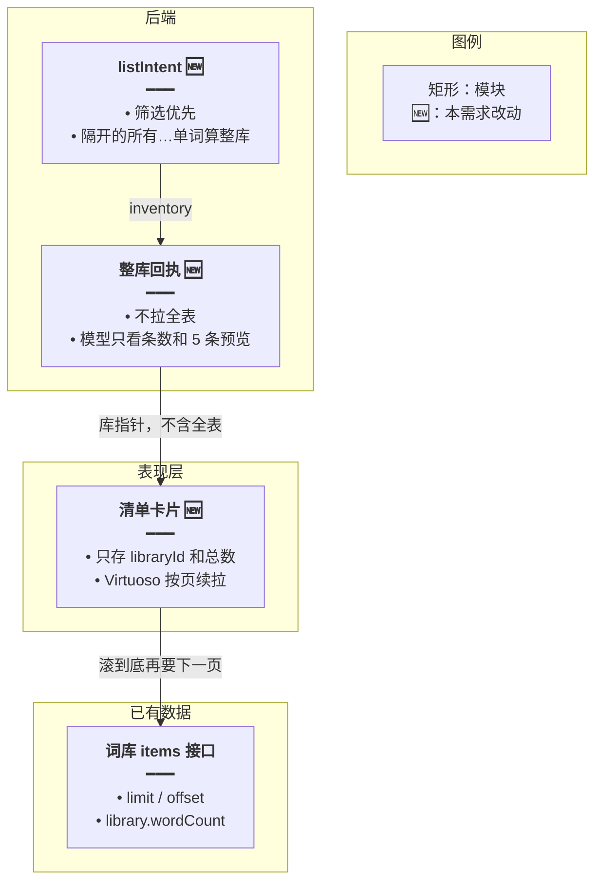
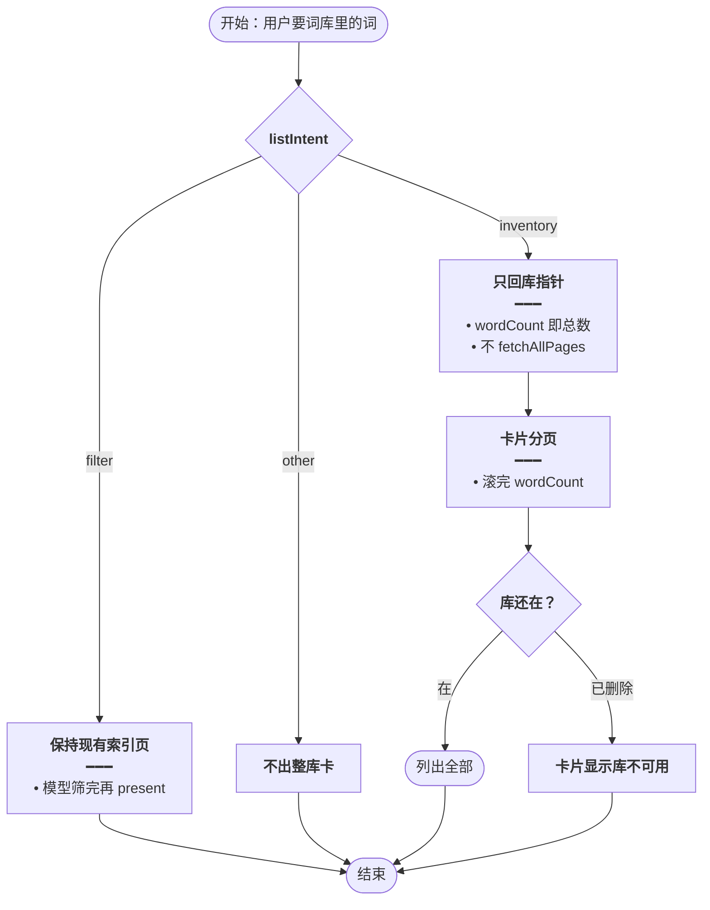
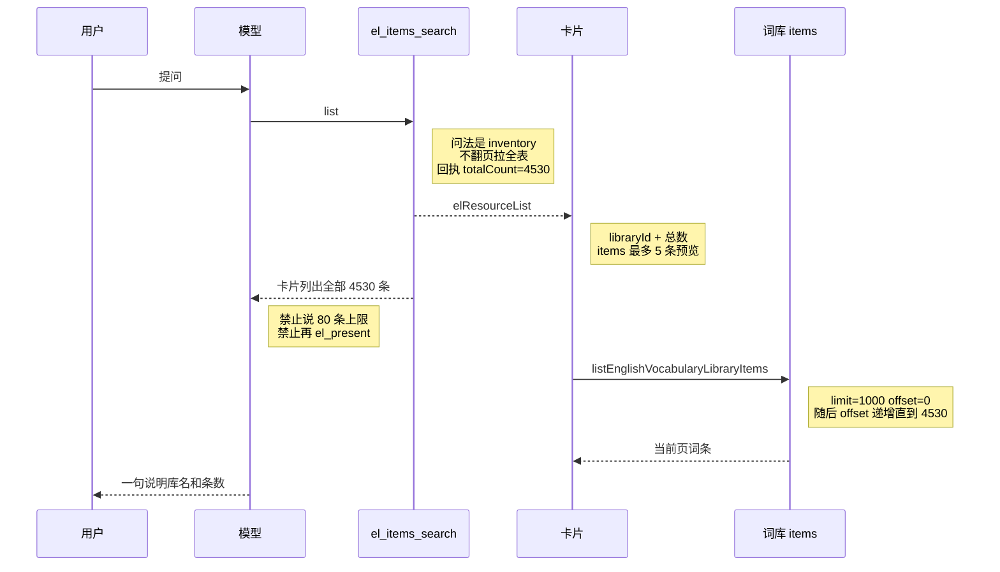
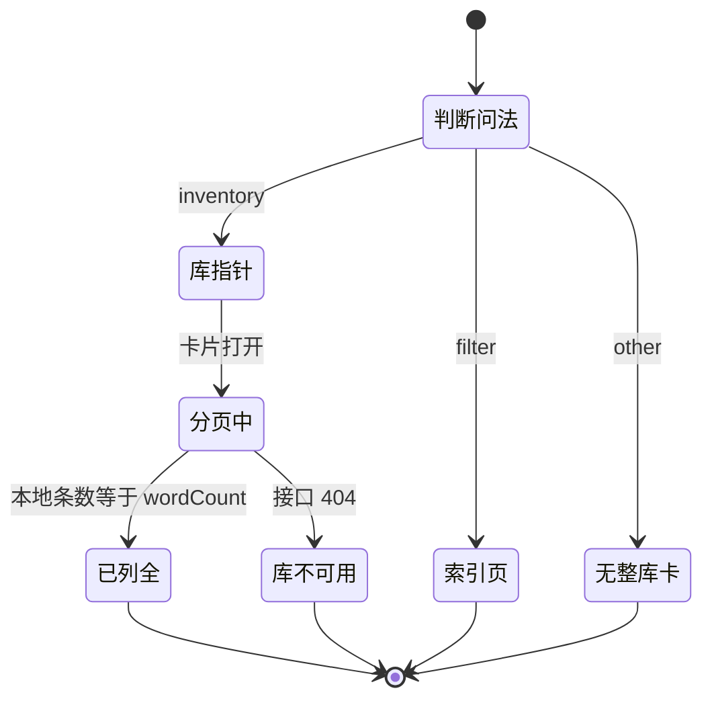

# 整库全量出卡 — 实现思路

> **状态**：规划 | **日期**：2026-10-26 | **需求摘要**：用户要某个词库的全部单词时，卡片按库分页列出全部条数；「所有」和「单词」被库名隔开也要认出来。模型只看到条数，不看到截断后的一页。

## 延伸阅读

- [意图决定出卡.md](./意图决定出卡.md) — 整库问法已经会直接出卡；本篇改的是认句式，以及整库卡不再复制一份全表
- [清单索引可筛选.md](./清单索引可筛选.md) — 筛选题仍只给模型一页索引

---

## 0. 读本文你将得到什么

- 问题：「给出所有英语四级单词库中的单词」没被当成整库。模型只看到 80 条，就把 80 说成一次列不完。
- 市面做法：大结果拆成两路。模型只拿条数和预览；给人看的全表由界面自己分页，不进上下文。
- 一句话方案：服务端用规则认出整库后，卡片拿着 `libraryId` 调现有词库分页接口，滚到第 4530 条为止。
- 阶段：M1 认句式并出卡 → M2 卡片按库分页，不再把全表塞进工具结果。
- 收藏、错题、复习、日推仍用现有硬顶。这次事故是词库。

---

## 1. 需求与边界

### 1.1 用户故事

| 角色 | 场景 | 行为 | 期望结果 |
|------|------|------|----------|
| 学习者 | 「给出所有英语四级单词库中的单词」 | 打开该库 list | 一张卡片，可滚完库内全部词（例如 4530） |
| 学习者 | 「把这个库全部列出来」 | 已能命中「全部」 | 同样按库分页，不截在 2000 |
| 学习者 | 「找出这个库里的人体部位」 | 筛选优先 | 仍只出命中词，不把整库塞进模型 |

### 1.2 范围

| 在范围内 | 不在范围内 |
|----------|------------|
| `el_items_search` 的 `list`（词汇库、语句库）在整库问法下出实时库卡片 | 取消收藏 / 错题 / 复习 / 日推的硬顶 |
| `listIntent` 承认「所有」与「单词」中间隔着库名 | 让模型逐页背完 4530 个词 |
| 卡片复用现有词库分页接口，滚完 `wordCount` | 重做导出；整库导出仍走现有词库 docx |

### 1.3 约束与依赖

- 整库出卡已经存在：`wrap` 里 `listIntent === 'inventory'` 时 `onResourceList`。这句没出卡，是因为没判成 `inventory`。
- `INVENTORY_RE` 只认连着的「所有单词 / 所有词 / 全部 / 列出全部 / 整个库 / 导出」。
- 词库分页已存在：`GET vocabulary-libraries/:libraryId/items`，前端 `listEnglishVocabularyLibraryItems`。语句库对应 `listEnglishClassicQuotesLibraryItems`。单次 `limit` 最大 1000，这是传输页大小，不是产品封顶。
- 单词库页已经用 `LibraryVirtuosoGrid`（`react-virtuoso`）只画可见行。
- 卡片协议已有 `libraryId`、`source: 'library'`、`contentKind`。导出 docx 已经按 `libraryId` 下整库，不依赖卡片里的 `items`。

---

## 2. 市面做法

同一类故障：工具或文件只给了模型一个切片，模型把切片大小讲成「一次最多只能看这么多」。

| 产品 | 怎么处理大列表 | 对本需求的取舍 |
|------|----------------|----------------|
| Claude Code | 工具结果超过 `maxResultSizeChars` 就落盘，模型只收到预览和路径，需要时再读文件。[工具结果落盘](https://anthhub.github.io/open-claude-code/en/03-tool-system.html) | 采用「预览不进全表」。不采用「再让模型把文件读回来」，读回来又会撑满上下文 |
| Anthropic Messages API | 工具结果过大时请求会被拒绝，截断必须由应用自己做，不能指望接口帮你裁。[Bash 工具限制](https://platform.claude.com/docs/en/agents-and-tools/tool-use/bash-tool) | 整库回执在进模型之前就只留条数 |
| MCP Apps（2026-01-26） | `content` 给模型看的短文本；界面用自己的工具或请求拿数据。过大的表不要放进给模型的字段。[规范](https://github.com/modelcontextprotocol/ext-apps/blob/main/specification/2026-01-26/apps.mdx)、[字段怎么分](https://sunpeak.ai/docs/mcp-apps/server/tool-results-model-context) | 采用两路。不新做 iframe 沙箱，现有卡片就是这块界面 |
| FutureSearch 的 MCP 表格 | 模型看到条数、列名和一页预览；组件另走 HTTP 拉全表，再排序和搜索。[大结果组件](https://futuresearch.ai/blog/mcp-results-widget/) | 采用「卡片自己拉全表」。本仓库已有词库分页，不必再做一个下载令牌 |
| ChatGPT 数据分析 | 文件在沙箱里可以是全量，但模型默认 `head()` 后按样本作答。纠正方式是先核对总行数，并禁止把样本说成全集。[大 CSV 被截成前 1000 行](https://aitoolsguidebook.com/en/articles/chatgpt-spreadsheet-too-large-truncated/) | 这就是本次事故：80 条被说成产品上限。回执里写明「卡片列出全部 N 条」，并禁止引用页大小 |

**调研结论**：市面上没有靠生成模型把几千行背进气泡里。全表留在界面，模型只对条数负责。高确定的「列出全部」用规则截住，不交给已经看到截断页的模型去改口。

本仓库对应物已经有了：词库分页接口和 `LibraryVirtuosoGrid`。缺的是整库问法没被认出来，以及整库路径仍把工具结果当成要复制的全表（复制时又被 `EL_FULL_LIST_MAX = 2000` 截断）。

---

## 3. 方案总览

**一句话方案**：规则认出整库后，卡片拿 `libraryId` 分页拉词库，滚完总数；模型回执只有条数。

| # | 设计要点 | 理由 |
|---|----------|------|
| 1 | 筛选正则仍先判断 | 「找出所有人体部位的单词」不能变成整库卡 |
| 2 | 「所有」后 16 字内出现「单词 / 词条 / 的词」即整库 | 覆盖「所有英语四级单词库中的单词」 |
| 3 | 整库工具不再 `fetchAllPages` | 2000 硬顶和上下文都在这条拉取上。词库接口第一页就有 `wordCount` |
| 4 | 卡片按 `offset` 拉到 `wordCount`，Virtuoso 只画可见行 | 和单词库页同一套，没有第二套封顶 |
| 5 | 模型只收到 5 条预览和「卡片列出全部 N 条」 | 避免把 80 条索引说成用户能看到的条数 |

---

## 4. 现状与复用

| 能力 | 仓库中已有 | 本需求中的用法 |
|------|------------|----------------|
| 整库直接出卡 | `english-learning-domain-tools.ts` `wrap`：`inventory` 时 `onResourceList` | 句式补上后仍走这里，卡片载荷改成库指针 |
| 问法 | `el-spill.ts` `listIntent` | 增加隔开匹配 |
| 词库分页 | `listEnglishVocabularyLibraryItems`、`listEnglishClassicQuotesLibraryItems` | 卡片滚动时调用，直到条数等于库总数 |
| 虚拟列表 | `LibraryVirtuosoGrid` | 卡片列表区改用它，不手写窗口 |
| 整库导出 | `ResourceListBlock` 在 `source === 'library'` 时按 `libraryId` 下 docx | 保持。全表不依赖 `items` |

**现状**：「给出所有英语四级单词库中的单词」对不上连写的「所有单词」，`listIntent` 得到 `other`。模型只看到 `slimPage` 的 80 条，回执还写着用 `mode=subset`。它就把 80 当成产品上限。

---

## 5. 架构图



**图内方法说明**：

| 方法 | 功能 |
|------|------|
| `listIntent` | 读用户原话。筛选词先返回 `filter`；「所有」与「单词」隔开也返回 `inventory` |
| `onResourceList` | 整库时推给气泡的块只有 `libraryId`、`totalCount` 和最多 5 条预览 |
| `listEnglishVocabularyLibraryItems` | 卡片按 `offset` 取词。语句库换成 `listEnglishClassicQuotesLibraryItems` |
| `LibraryVirtuosoGrid` | 只挂可见行。`onEndReached` 触发下一页 |

**读图要点**：

- 全表不进模型，也不进 30 分钟的 artifact。刷新对话后卡片仍按 `libraryId` 再拉。
- 筛选问法不进这张图，仍用现有索引页。
- 单次请求最多 1000 条是接口页大小。卡片把 `offset` 加到总数为止，4530 条会分多页拉完。

---

## 6. 主流程图



**图内方法说明**：

| 方法 | 功能 |
|------|------|
| `listIntent` | 把原话分成 `filter` / `inventory` / `other` |
| `onResourceList` | `inventory` 时只带库指针，不复制词条 |
| `listEnglishVocabularyLibraryItems` | 卡片滚动时按页取词，直到本地条数等于 `wordCount` |

**读图要点**：

- 「给出所有…单词库中的单词」走库指针，结束在列出全部。
- 「找出所有人体部位」走索引页。
- 不再有 2000 或 10 万的预拉上限。停下来的条件是页数加总等于库上的条数，或库已经被删。

---

## 7. 核心时序图



**图内方法说明**：

| 方法 | 功能 |
|------|------|
| `list` | 整库问法下只确认库和总数，并通知卡片 |
| `listEnglishVocabularyLibraryItems` | 卡片向已有词库接口要某一页。语句库用 `listEnglishClassicQuotesLibraryItems` |
| `LibraryVirtuosoGrid` | 把已拉到的行画在视口里，触底再要下一页 |

**读图要点**：

- 模型在卡片开始分页之前就只能说「已列出全部 4530 条」。
- 用户滚动时才继续要页，首屏不必等 4530 条到齐。
- 筛选题不会走这条时序。

---

## 8. 状态机



**图内方法说明**：

| 方法 | 功能 |
|------|------|
| `listIntent` | 决定进入库指针、索引页还是不出整库卡 |
| `listEnglishVocabularyLibraryItems` | 分页中每次取一页；条数凑满后进入已列全 |

**读图要点**：4530 条不会停在 2000。凑满 `wordCount` 才是已列全。

---

## 9. 模块职责与接口草图

### 9.1 模块一览

| 模块 | 职责 | 新增/改动 | 预估路径 |
|------|------|-----------|----------|
| `listIntent` | 隔开的「所有…单词」 | 扩展 | `apps/backend/src/services/agent/el-spill.ts` |
| 整库回执 | 不拉全表，只给库指针 | 扩展 | `english-learning-domain-tools.ts` |
| 卡片 | 按库分页 + Virtuoso | 扩展 | `ResourceListBlock.tsx` |

### 9.2 关键接口（伪代码）

```typescript
// 筛选优先，避免「找出所有…单词」被整库吞掉
if (FILTER_RE.test(text)) return 'filter';
// 库名隔在中间时也认整库，这句不再交给模型改口
if (INVENTORY_RE.test(text) || /所有.{0,16}(单词|词条|的词)/.test(text)) return 'inventory';
// 整库块只留库指针。全表由卡片分页，模型看不到 80 条索引
const block = { libraryId, totalCount: library.wordCount, items: page.items.slice(0, 5) };
```

### 9.3 条数规则

| 情况 | 工具结果里有什么 | 卡片 | 模型怎么说 |
|------|------------------|------|------------|
| 整库，`wordCount = 4530` | 库 id、4530、5 条预览 | 分页直到 4530 | 卡片已列出全部 4530 条 |
| 整库，库已删除 | 同左 | 显示库不可用 | 说明库不在了 |
| 筛选 | 仍是最多 2000 条的索引页，模型只看一页 | 只有 `el_present` 的命中行 | 不要说整库已列出 |

卡片内搜索：已拉到本地的行里过滤。没拉完时继续按页拉，过滤结果随页变全。不把搜索词再交给模型。

---

## 10. 分阶段实现步骤

| 阶段 | 目标 | 交付物 | 依赖 |
|------|------|--------|------|
| M1 | 这句问法出整库卡 | `listIntent` | 无 |
| M2 | 卡片条数能滚到库总数，且模型不提 80 条上限 | 库指针 + 分页卡片 | M1 |

- [ ] M1：`FILTER_RE` 之后，若「所有」起 16 字内有「单词」「词条」或「的词」，返回 `inventory`
- [ ] M1：自检「给出所有英语四级单词库中的单词」为 `inventory`，「找出所有人体部位的单词」仍为 `filter`
- [ ] M2：整库 `list` 不再调用 `fetchAllPages`。回执用库上的 `wordCount`，`items` 只留 5 条
- [ ] M2：整库回执写明卡片列出全部 N 条，并禁止把页大小说成用户可见条数
- [ ] M2：`ResourceListBlock` 在 `source === 'library'` 且带 `libraryId` 时，用 `LibraryVirtuosoGrid` 调对应 items 接口，`offset` 加到总数
- [ ] M2：命中子集的 `el_present` 卡仍用块内 `items`，不改成整库分页

---

## 11. 关键决策与备选方案

| 决策 | 选用 | 备选 | 为何不选备选 |
|------|------|------|--------------|
| 谁认出这句 | 原话规则，筛选优先 | 再让模型决定要不要整库 | 模型已经把切片讲成全集。ChatGPT 对 `head()` 也是同一类错误，要在进模型之前截住 |
| 全表放哪 | 卡片按 `libraryId` 分页 | 把 `EL_FULL_LIST_MAX` 提到 4530，一次拉进 artifact | 下一个库会超过新数字；全表进消息和 30 分钟缓存，刷新还会过期。Claude Code 和 MCP Apps 都是指针加界面自取 |
| 列表怎么画 | 复用 `LibraryVirtuosoGrid` | 卡片里手写「只画 80 行」 | 单词库页已经用 Virtuoso 解决过四千行 DOM |
| 筛选大库 | 仍最多 2000 的索引页 | 筛选也把 4530 行塞进模型 | 上下文放不下。主题筛选不在本篇 |

---

## 12. 风险、边界与待确认

| 项 | 等级 | 说明 | 缓解 |
|----|------|------|------|
| 实时库 | 低 | 卡片显示的是当前库，不是提问那一刻的快照。库后来被改，历史对话里的条数会变 | 和单词库页一致。要快照再另做，本篇不做 |
| 库被删 | 低 | 分页接口失败 | 卡片显示库不可用，不回退成 80 条说明 |
| 误判整库 | 低 | 「所有」靠近「单词」但用户其实在讲解 | 筛选词优先 |
| 卡片内搜索 | 低 | 没拉完时过滤结果不完整 | 未拉完继续要页；搜的是本地已有行，不另开一轮模型 |

**待确认**：无。单词库 items 接口返回的 `library.wordCount` 就是总数。语句库用语句库列表项上的条数字段，实现时对一下该类型的字段名。

---

## 13. 验收清单

| # | 用例 | 步骤 | 期望 |
|---|------|------|------|
| AC1 | 隔开的所有 | 「给出所有英语四级单词库中的单词」 | `listIntent` 为 `inventory`，出现整库卡 |
| AC2 | 条数 | 库内 4530 条 | 滚到底是第 4530 条，不是 2000 或 80 |
| AC3 | 模型口径 | 同上 | 不说「单次最多 80 条」或「无法一次列出」 |
| AC4 | 筛选优先 | 「找出所有人体部位的单词」 | 仍是筛选，不出整库分页卡 |
| AC5 | 刷新 | 刷新对话后再打开该卡 | 仍能按 `libraryId` 分页，不因 artifact 过期变空 |
| AC6 | 子集卡 | 成组词表走 `el_present` | 仍只显示点名的那些词 |

---

## 14. 预估改动面（实现阶段参考）

| 类型 | 路径（预估） |
|------|----------------|
| 后端 | `apps/backend/src/services/agent/el-spill.ts`、`english-learning-domain-tools.ts` |
| 前端 | `apps/frontend/src/components/design/Assistant/ResourceListBlock.tsx` |
| 自检 | `el-spill.check.ts`：隔开的「所有…单词」为整库；「找出所有…单词」仍为筛选 |

（本文档为规划态实现思路；落地后以源码为准）
