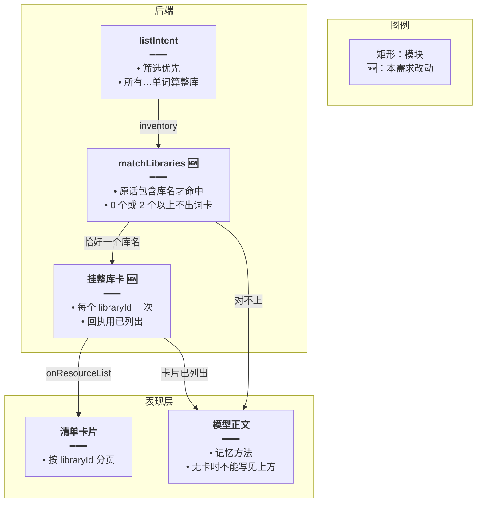
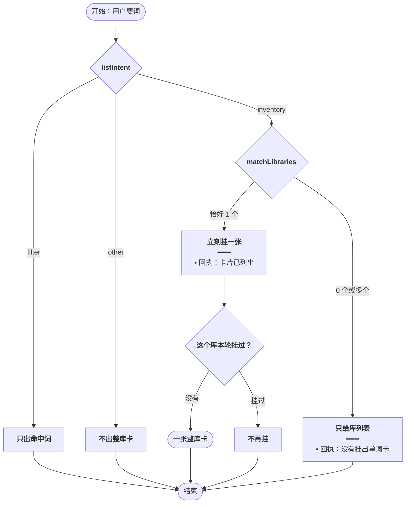
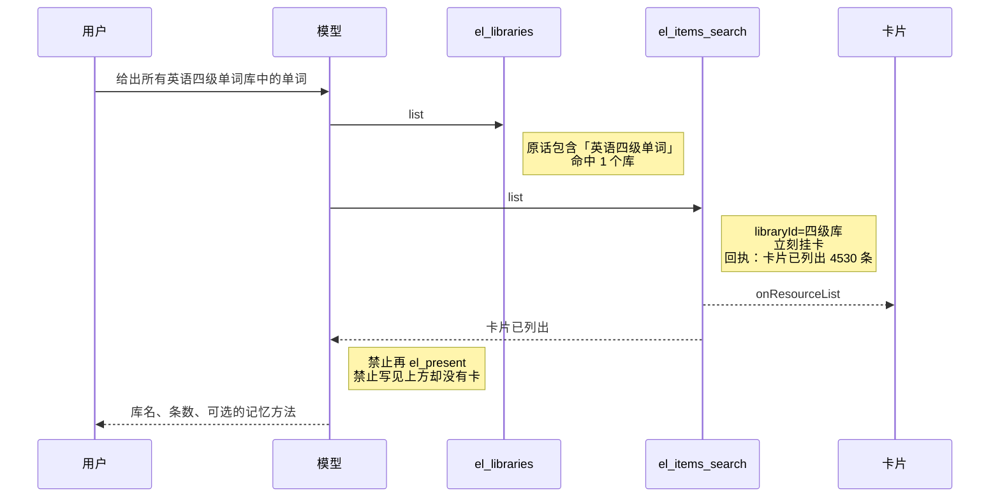
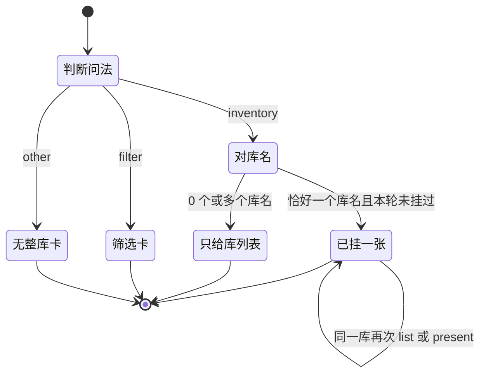

# 整库稳定出卡 — 实现思路

> **状态**：规划 | **日期**：2026-10-26 | **需求摘要**：同一类「把这个库的词全部列出来」每次都出同一张卡；库名对不上时只给库列表，禁止写成卡片已经生成。

## 延伸阅读

- [整库全量出卡.md](./整库全量出卡.md) — 整库卡按 `libraryId` 分页，不再在 2000 条截断
- [意图决定出卡.md](./意图决定出卡.md) — 筛选和讲解仍由 `el_present` 决定出哪几条；本篇只收紧「要整库」

---

## 0. 读本文你将得到什么

- 问题：「我需要所有的英语系级单词，并给出记忆方法」正文写了「两张卡片已经生成（见上方）」，画面上没有卡片。
- 原因：这句已经算整库，但词库卡故意不在 `list` 时挂上，又禁止模型再 `el_present`；收尾兜底只接受恰好一个库。模型仍按回执里的「将列出」写成已经生成。
- 一句话方案：整库卡由服务端在对上库名时立刻挂上，同一句每次同一张；对不上库名就不出卡，回执禁止声称已生成。
- 记忆方法仍由模型写在卡片旁边，不能拿来取消卡片。
- 筛选题不走这条，仍只出命中词。

---

## 1. 需求与边界

### 1.1 用户故事

| 角色 | 场景 | 期望 |
|------|------|------|
| 学习者 | 「给出所有英语四级单词库中的单词」 | 每次都是英语四级单词这一张整库卡 |
| 学习者 | 「商务英语库中的所有单词」 | 每次都是商务英语这一张整库卡 |
| 学习者 | 「所有的英语系级单词，并告诉我怎么记」 | 库名对不上。只展示现有库列表，并写记忆方法。禁止写「卡片已经生成」 |
| 学习者 | 「找出这个库里的人体部位」 | 仍只出命中词，不出整库 |

### 1.2 范围

| 在范围内 | 不在范围内 |
|----------|------------|
| 整库问法下，词库卡何时出现、出现几张 | 重做卡片分页和虚拟列表 |
| 回执用词，避免模型把「将列出」说成「见上方」 | 用另一个模型做意图分类 |
| 原话与库名的字面包含 | 多轮里的「这个库」指代 |

### 1.3 约束

- `listIntent('我需要所有的英语系级单词…')` 已是 `inventory`：「所有」与「单词」隔了「的英语系级」，能对上 `所有.{0,16}(单词|词条|的词)`。缺的不是这句没被认成整库。
- 词库整库现在不调用 `onResourceList`。注释写明要等 `el_present`，收尾再补。
- `el_present` 的系统提示写着：讲解、怎么记、给建议禁止调用。这句后半是记忆方法，模型按提示不去调用。
- 整库回执仍是「卡片将列出全部 N 条。禁止再调用 el_present」。卡片还没挂上，句子却是将来时。
- `inventoryFallback` 在 `libraryId` 不是恰好 1 个时返回空。四级和六级各 list 一次，兜底直接放弃。

---

## 2. 市面做法

同一句话反复问，卡片有时有、有时没有，是因为「出不出卡」交给了生成模型当回合决定。

| 做法 | 来源 | 用在这里 |
|------|------|----------|
| 高确定指令用规则，不交给当回合的生成模型改口 | 对话系统里的意图槽位：列出某集合时由规则触发界面，模型只写说明 | 整库卡在 `list` 成功时由服务端挂上 |
| 工具回执用过去时，且只在界面真的渲染之后 | Claude Code 的大结果是「已落盘」加路径，不是「将会展示」 | 「卡片已列出」只能出现在 `onResourceList` 之后 |
| 对不上唯一对象时先消歧，不假装已经打开 | 助手在多个同名结果时返回候选，不选中其中一个还说已经打开 | 「系级」对不上「英语四级单词」等库名时，只回库列表 |

---

## 3. 方案总览

**一句话方案**：原话里的库名能唯一对上，服务端就挂一张整库卡；对上多个或对不上，就不出词卡，并禁止模型声称已经生成。

| # | 设计要点 | 理由 |
|---|----------|------|
| 1 | 词库整库在 `el_items_search list` 成功时立刻 `onResourceList` | 不再等模型调 `el_present`。同一句不再因模型听话或不听话而有无卡片 |
| 2 | 同一 `libraryId` 本轮只挂一次 | 避免上次「商务英语」两张相同全表 |
| 3 | 库名用原话包含关系判定，不用模型猜 | 「英语四级单词」对得上；「英语系级」对不上四级、六级 |
| 4 | 对不上或对上多个：回执写「没有挂出单词卡」 | 模型不能再写「见上方」 |
| 5 | 「并告诉我怎么记」不改变整库 | 记忆方法是卡片旁边的文字。系统提示里「怎么记禁止 el_present」不能把已经该挂的卡灭掉 |

---

## 4. 现状与复用

| 能力 | 已有位置 | 本需求用法 |
|------|----------|------------|
| 整库问法 | `el-spill.ts` `listIntent` | 继续用。本篇不改筛选优先 |
| 按库分页的卡片 | `ResourceListBlock.tsx` 在 `source==='library'` 且有 `libraryId` 时拉全表 | 挂上的仍是这种卡 |
| 立刻推卡 | `agent.service.ts` `onResourceList` | 词库整库改回走它。同一库只推一次 |
| 兜底只留一个库 | `inventoryFallback` | 改为：还没挂出的每个词库各补一张。现在 `ids.size !== 1` 会把两库问句的卡丢掉 |
| 库列表 | `el_libraries` 的 `list`，条目含 `id`、`title` | 用标题和原话做包含判断 |

**这次画面**：用户要「所有的英语系级单词」并要记忆方法。模型先 `el_libraries`，用 Markdown 表列出四个库，再声称四级和六级两张卡已在上方。词库卡被推迟，记忆方法又禁止 `el_present`，两个库让兜底落空。回执里的「将列出」被写成「已经生成」。

---

## 5. 架构图



**图内方法说明**：

| 方法 | 功能 |
|------|------|
| `listIntent` | 把原话分成整库、筛选或其他。这句「所有…单词」加记忆方法仍是整库 |
| `matchLibraries` | 用库标题是否出现在原话里决定出哪一个库。模型不能另猜一个库名 |
| `onResourceList` | 把整库卡推到气泡。同一 `libraryId` 第二次直接跳过 |

**读图要点**：

- 卡片是否出现，在服务端就定了，不取决于模型这次有没有调用 `el_present`。
- 记忆方法只进正文，不进「出不出卡」的判断。
- 「系级」对不上现有四个库名，所以走到正文，不走到卡片。

---

## 6. 主流程图



**图内方法说明**：

| 方法 | 功能 |
|------|------|
| `listIntent` | 筛选仍优先，避免「找出所有…单词」变成整库 |
| `matchLibraries` | 0 个或多个命中时不挂词卡，避免模型在多个六级库里每次挑不同的两个 |
| `onResourceList` | 唯一命中时挂卡。同一库再 list 或再 `el_present` 都不增加第二张 |

**读图要点**：

- 「英语四级单词」每次都停在「一张整库卡」。
- 「英语系级」每次都停在「只给库列表」。模型可以写记忆方法，但不能写卡片已生成。
- 上次两张相同全表停在「不再挂」。

---

## 7. 核心时序图



**图内方法说明**：

| 方法 | 功能 |
|------|------|
| `list`（`el_libraries`） | 取出库 id 和标题，供原话包含判断 |
| `list`（`el_items_search`） | 唯一命中的库立刻出整库卡，回执改为「已列出」 |
| `onResourceList` | 把这一张卡交给气泡。分页仍由卡片自己完成 |
| `el_present` | 该库本轮已挂过时不再出卡 |

**读图要点**：

- 模型不调用 `el_present` 也会有卡。调用了也不会变成两张。
- 回执是「已列出」，对应画面上真的有卡。
- 「英语系级」不会进入 `el_items_search` 这条成功出卡的时序；库列表回执会写明没有挂出单词卡。

---

## 8. 状态机



**图内方法说明**：

| 方法 | 功能 |
|------|------|
| `listIntent` | 决定是否进入对库名 |
| `matchLibraries` | 决定已挂一张还是只给库列表 |

**读图要点**：同一句原话、同一批库名，每次都进同一个终态。

---

## 9. 模块职责与接口草图

### 9.1 模块一览

| 模块 | 职责 | 改动 | 路径 |
|------|------|------|------|
| `matchLibraries` | 原话是否包含库名 | 新增 | `el-spill.ts` |
| 词库 `list` | 唯一命中时立刻挂卡，回执用「已列出」 | 扩展 | `english-learning-domain-tools.ts` |
| `inventoryFallback` | 漏挂的每个词库各补一张 | 扩展 | `el-spill.ts` |
| 系统提示 | 「怎么记」不取消整库卡；无「已列出」不能写见上方 | 扩展 | `agent.prompt.ts` |

### 9.2 关键接口（伪代码）

```typescript
// 库名整段在原话里才命中，避免「系级」被猜成四级或六级
const hits = libs.filter((lib) => userText.includes(lib.title));
// 恰好一个才挂卡；0 个或多个都只返回库列表
if (hits.length !== 1) return { card: false };
// 同一库本轮已经挂过就跳过，避免两张全表
if (shown.has(hits[0].id)) return { card: false };
// 先挂卡，回执才能写已列出
onResourceList(card);
```

### 9.3 回执

| 情况 | 回执 | 模型可以写 |
|------|------|------------|
| 已挂上唯一库 | 卡片已列出全部 N 条。禁止再 el_present | 库名、条数、记忆方法 |
| 原话对上 0 个或多个库名 | 没有挂出单词卡。禁止写已经生成或见上方 | 库列表，并请用户说出库名 |
| 同一库第二次 list 或 present | 整库卡片已经列出 | 不要再描述一张新卡 |

---

## 10. 分阶段实现步骤

| 阶段 | 目标 | 依赖 |
|------|------|------|
| M1 | 词库整库 list 成功就挂卡，同一库只一张 | 无 |
| M2 | 回执与系统提示改成过去时，对不上库名时明确没挂卡 | M1 |
| M3 | 兜底按「每个未挂的库」补卡，不再要求恰好一个库 | M1 |

- [ ] M1：`el_items_search` 的整库 `list` 恢复 `onResourceList`，并用本轮已挂的 `libraryId` 去重
- [ ] M1：该库再 `el_present` 时直接返回已列出，不再推第二张
- [ ] M2：挂卡之后的回执改为「卡片已列出全部 N 条」
- [ ] M2：`el_libraries` 在整库问法下做包含匹配；不是恰好一个库名时，回执写「没有挂出单词卡」
- [ ] M2：系统提示删掉「怎么记就不出整库卡」。改为：整库卡由工具挂上；没有「已列出」就禁止写见上方
- [ ] M3：`inventoryFallback` 对每个尚未挂出的词库各补一张
- [ ] 自检：「英语四级单词」命中一个库；「英语系级」命中零个；同一 `libraryId` 第二次不挂卡

---

## 11. 关键决策与备选方案

| 决策 | 选用 | 备选 | 为何不选备选 |
|------|------|------|--------------|
| 谁决定有没有卡 | `list` 成功就挂 | 继续等模型 `el_present` | 记忆方法会触发「禁止 present」，两库又让兜底落空，于是有时有卡、有时只有一句「见上方」 |
| 出哪个库 | 原话包含库名，且恰好一个 | 让模型在四个库里挑两个 | 同一句会挑中不同的库，和这次「系级」被说成四级加六级一样 |
| 多个库名都写进原话 | 不出词卡，请用户指定 | 每个都挂整库卡 | 六级相关库有三份，一次挂出上万行，而且用户没点名要哪一份 |
| 回执时态 | 挂上之后才说「已列出」 | 维持「将列出」 | 模型会把将来时说成卡片已经在上方 |

---

## 12. 风险与待确认

| 项 | 等级 | 说明 | 缓解 |
|----|------|------|------|
| 库名是简称 | 低 | 「四级单词」可能不包含完整标题「英语四级单词」 | 第一版只做完整库名包含。简称对不上时走「没有挂出单词卡」，用户改说全名即可 |
| 记忆方法和整库在同一句 | 低 | 模型仍可能把篇幅用在方法上 | 卡由服务端挂，不靠正文 |
| 两张卡的旧路径 | 低 | 立刻挂卡若再允许 present，会回到两张全表 | 已挂的 `libraryId` 直接拒绝第二次 |

**待确认**：无。四个库的标题以 `el_libraries` 返回的 `title` 为准，本次画面里是「英语四级单词」「英语6级词汇」「英语六级单词」「CET6词汇完整版」。

---

## 13. 验收清单

| # | 用例 | 期望 |
|---|------|------|
| AC1 | 连续两次问「给出所有英语四级单词库中的单词」 | 每次都是这一张整库卡，条数 4530 |
| AC2 | 「我需要所有的英语系级单词，并给出记忆方法」 | 有库列表和记忆方法，没有词卡，正文没有「已经生成」或「见上方」 |
| AC3 | 「商务英语库中的所有单词」 | 只有一张商务英语整库卡 |
| AC4 | 「找出所有人体部位的单词」 | 仍是筛选，不出整库 |
| AC5 | 同一库在一轮里 list 两次，或 list 之后再 present | 仍然只有一张卡 |

---

## 14. 预估改动面

| 类型 | 路径 |
|------|------|
| 后端 | `apps/backend/src/services/agent/el-spill.ts`、`english-learning-domain-tools.ts`、`agent.prompt.ts` |
| 自检 | `el-spill.check.ts`：完整库名命中；「系级」不命中；同一库不重复挂卡 |

（本文档为规划态实现思路；落地后以源码为准）
