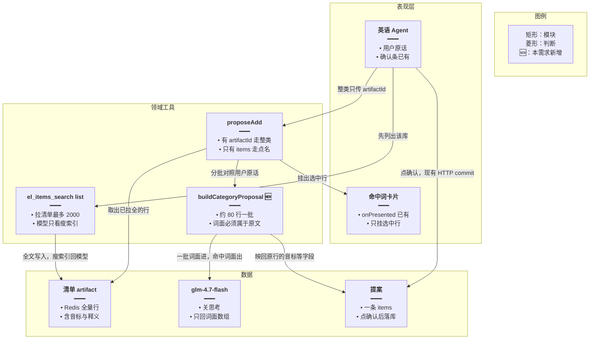
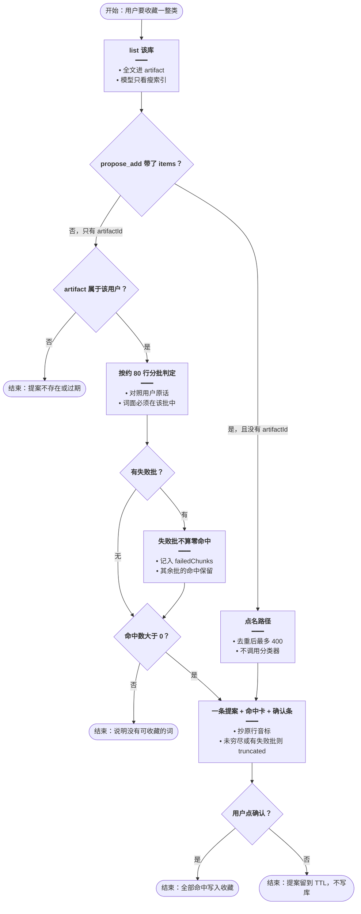
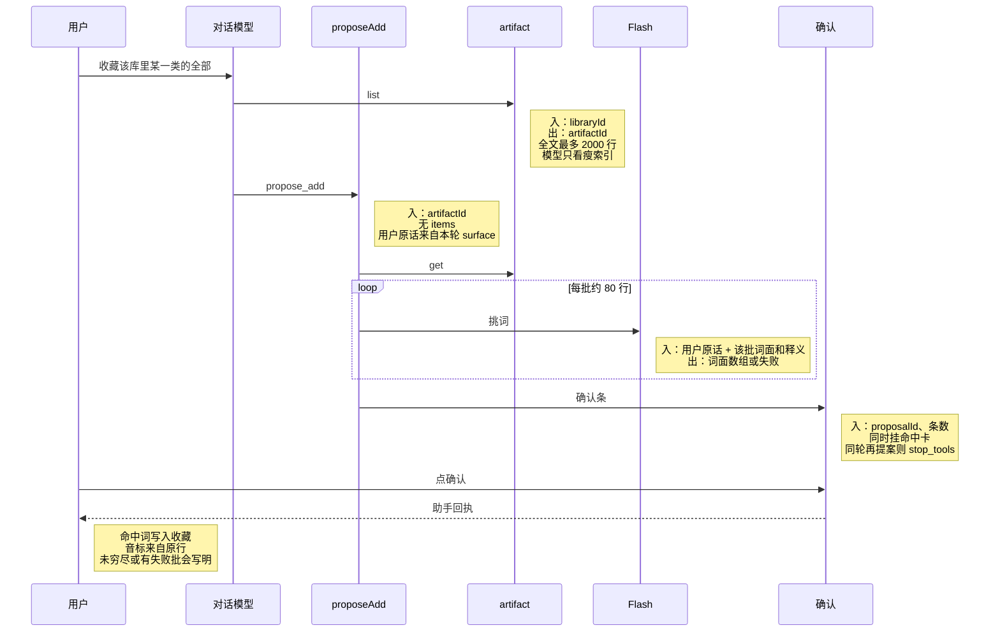
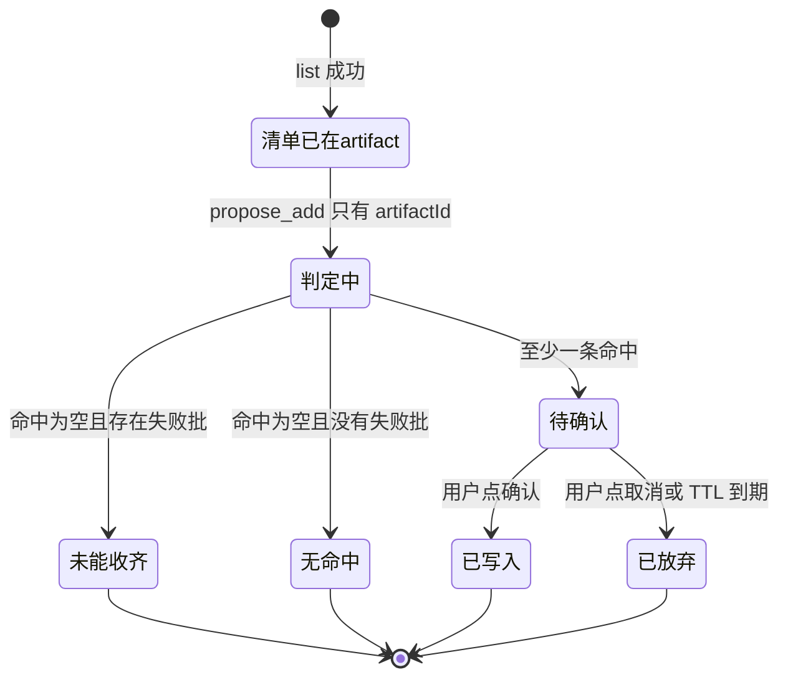

# 整类词一次收藏 — 实现思路

> **状态**：规划（未实现）  
> **日期**：2026-10-28  
> **需求摘要**：用户让英语 Agent 把某本词库里「某一类」词全部收藏，命中数可以超过 40；点一次确认就写入这一类的全部命中，而不是丢掉第 41 个以后的词。  
> **一句话方案（预告）**：整类收藏只传本轮清单的 `artifactId`，服务端用同一套 Flash 模型分批对照用户原话挑词，命中词一次写入提案；点名的少数词仍走 `items`，上限对齐模型一次能看见的瘦索引。

## 延伸阅读

- 提案与直确认：[english/收藏提案直确认.md](./收藏提案直确认.md)（一批 `items`、HTTP `commit`、同轮 `stop_tools`）。该文把「服务端不做动物分类」标成非目标；本篇只在「整类、且要收齐」这条路上放开，点名几个词的路径不动分类器
- 大列表为何不进对话上下文：[english/Agent大结果旁路展示.md](./Agent大结果旁路展示.md)、[english/清单索引可筛选.md](./清单索引可筛选.md)
- 短决策封装的边界：[通用决策封装.md](../通用决策封装.md)（`decide()` 2 秒、最多 400 token，不适合回一串词）
- 清单不再停在 2000：[english/清单按库取全.md](./清单按库取全.md)。下文图和步骤里的「最多 2000」写的是**当时的代码**。清单取全落地后，分类器读到的 artifact 行数等于库内总数
- 点名不再按 400 截断，以及大库判定失败、确认时逐条插入：[english/大批收藏稳落库.md](./大批收藏稳落库.md)。本篇文中的「点名上限 400」是当时的选定方案，后续以那篇为准

---

## 0. 读本文你将得到什么

- 超过 40 个相关词时，现有提案会截掉后面的词，同一轮又不准再提一次，所以收不齐。
- 选定方案：整类收藏对着本轮已经拉好的清单 artifact 做分批判定，一次提案装下全部命中；确认按钮和落库仍走现成的 HTTP `commit`。
- 改动在英语领域工具、一条分类调用、提案回执文案；确认条和前端提交接口不换。
- 分三阶段：M1 整类判定并一次提案，M2 选中词挂卡，M3 点名列表的上限与失败回执。
- 最大风险是分类器把不是这一类的词放进来，或某一批超时后被当成「没有命中」。

---

## 1. 需求与边界

### 1.1 用户故事

| 角色 | 场景 | 行为 | 期望结果 |
|------|------|------|----------|
| 已登录用户 | 英语学习右侧 Agent | 说「把小学三年级词库里关于动物的词全部收藏」 | 一个确认条覆盖这一类的全部命中，不停在 40 |
| 已登录用户 | 词库大于一页瘦索引（例如四级词库几千条） | 同样说「把里面关于动物的都收藏」 | 仍按已取出的清单判完整类，不要求对话模型自己翻完每一页 |
| 已登录用户 | 确认条已出现 | 点确认 | 提案里的词全部写入收藏，带上该库词条已有的音标等字段 |
| 已登录用户 | 只点名几个词 | 说「收藏 duck 和 cat」 | 不跑分类器，仍是一条 `items` 提案 |

### 1.2 范围

| 在范围内 | 不在范围内（非目标） |
|----------|----------------------|
| `el_favorites` / `el_mistakes` 的 `propose_add`：带 `artifactId` 且不带 `items` 时按用户原话整类筛选 | 不抬高 `agentStreamRecursionLimit`（56）和 `ENGLISH_EL_TOOL_RUN_LIMIT`（10） |
| 命中词一次 `proposals.put`，确认仍走 `POST /agent/el-proposal/commit` | 不取消确认、不改成同轮直接 `add` |
| 点名列表与 `propose_remove` 的条数上限从 40 改为模型瘦索引上限 400 | 不把 `decide()` 的 2 秒 / 400 token 默认值改掉 |
| 整类筛选只读本轮 list 已写入的 artifact | 不在本篇改 `fetchAllPages`。条数硬顶的去除见 [清单按库取全](./清单按库取全.md)；那篇落地前，artifact 仍可能停在 2000 |
| 选中词复用 `onPresented` 挂一张子集卡，方便对一下再点确认 | 筛选题不改成挂整库卡 |

### 1.3 约束与依赖

- 须登录；沿用 `JwtGuard` 与现有英语 Agent 会话，不新增会员档。
- 必须复用：`spillListResult` 已经写下的 artifact、`ElProposalStore.put` / HTTP `commit`、`applyElProposal`、`fillFavoriteFields`（已有音标不覆盖）、同轮 `stop_tools`。
- 分类模型与 `decide()` 相同，固定 `glm-4.7-flash`、关闭思考；这一次单独加长超时和输出上限，避免短决策的 400 token 裁掉命中词。
- 体验底线：用户只点一次确认；同一轮对话模型不再为剩余词调用第二次 `propose_add`。

---

## 2. 背景

- **谁、在什么场景、卡在哪**：用户对英语 Agent 说，把某一本词库里某一类词全部收藏。当前 `collectProposeBodies` 去重后只留前 `PROPOSE_ITEM_CAP`（40）条，`truncated` 记进提案；同轮第二次提案返回 `stop_tools`。第 41 个及以后的词既不进提案，也不能在这一轮补提。
- **现状缺口**：40 是为了拦住「一词一次工具调用」把图步数耗尽，不是词库规模。小学三年级上册这本库是 107 条，瘦索引一次放得下，对话模型看得到每个词，真正卡住收齐的是这 40。用户账号里同时有四千到八千条的词库；那些 list 会外溢，对话模型每页只看到 `EL_SLIM_PAGE`（80）条。只把 40 改成 500，模型没看见的词仍然提不出来。
- **不解决会怎样**：用户以为点了确认就是「全部动物」，库里后半部分的相关词仍不在收藏里，回执只补一句「提案已截断至 40 条」。
- **硬约束**：确认必须留在用户点击上；不把整库塞回对话上下文（旁路展示已经为 `maxTokens` 截断做过这件事）；图步数上限保持 56。列表是否在 2000 处停住不由本篇决定，见 [清单按库取全](./清单按库取全.md)。

---

## 3. 现状与复用

| 能力 | 仓库中已有 | 本需求中的用法 |
|------|------------|----------------|
| 一次提案、直确认、同轮刹车 | `apps/backend/src/services/agent/tools/english/domain-tools.ts` 的 `proposeAdd`；`apps/backend/src/services/agent/agent.controller.ts` 的 `POST el-proposal/commit` | 直接复用。整类结果仍是一条提案、一个确认条 |
| 40 条截断 | `propose-bodies.ts` 的 `PROPOSE_ITEM_CAP`、`collectProposeBodies`；`apply-proposal.ts` 的回执；中英 `englishLearning.proposal.capped` | 扩展。整类路径不再走这刀；点名列表和取消收藏把常数改到 400 |
| 词库全量拉到内存再外溢 | `el_items_search` list + `fetchAllPages`。当前硬顶 `EL_FULL_LIST_MAX = 2000`（`envelope.ts`） | 分类器仍只读这次 list 存下的 artifact，不自己向数据库翻页。2000 这道顶的去除见 [清单按库取全](./清单按库取全.md) |
| 模型只看瘦索引 | `spill.ts`：`EL_SLIM_MAX_ITEMS = 400`、`EL_SLIM_MAX_CHARS = 12000` 放得下则整表瘦行，否则 `EL_SLIM_PAGE = 80` 加 `nextOffset` | 直接复用。整类路径不要求模型翻页，也不放宽这组常数 |
| artifact 暂存 | `artifact.store.ts` 的 `put` / `get`，按 `userId` 校验 | 直接复用。`propose_add` 用 `artifactId` 取回全量行 |
| 短决策 | `apps/backend/src/utils/glm-decide.ts` 的 `decide()`，`glm-4.7-flash`，2 秒，`DECIDE_MAX_TOKENS = 400` | 不适用默认入口。整类判定输出是词面数组，400 token 不够；另写一次 Flash 调用，模型名与关思考与它相同 |
| 确认条 | 前端 `englishAgent.ts` 解析 `ui.confirm_proposal`，`commitElProposal` | 直接复用。按钮文案仍是「确认收藏 N 个词」 |
| 选中词展示 | `agent.service.ts` 的 `onPresented` 用 `elCardAnchor` 推卡片 | 直接复用。判定结束后把命中行挂成一张子集卡 |
| 音标补全 | `lookupVocabularyLibrarySnapshots` + `fillFavoriteFields` | 直接复用。提案 body 先抄 artifact 行上的音标，已有音标不会被别的库盖掉 |
| 领域工具次数 | `ENGLISH_EL_TOOL_RUN_LIMIT = 10`，图步 56 | 直接复用。整类判定包在一次 `propose_add` 里面，不增加图步 |

**调研结论**：收不齐有两层。小库（三年级 107 条）模型已经看见全部词，40 是唯一的刀。大库模型每页只看见 80 条，把刀改钝仍然看不见其余的词。清单全文已经在 artifact 里，确认和落库也已经是一条提案。缺的是「用用户原话在这份清单上挑出全部命中，再装进同一条提案」。

---

## 4. 方案比对与最终方案

### 4.1 候选方案

#### 方案 A：维持 40，确认后再发一句补剩下的（复用现状）

- **做法**：不改代码。用户点确认写入前 40 条后，再发「把剩下的相关词也收藏」。新的一轮再 `propose_add`。已收藏的词在 `addVocabularyFavorite` 里算已存在。
- **能工作的原因**：`stop_tools` 只禁同一轮的第二次提案，下一条用户消息会重新开一轮，预算恢复。
- **主要代价**：第 41 个以后的词没有被记住，下一轮模型要重新看清单、重新挑。大库它仍然只看见一页 80 条，补一句也补不齐。用户必须知道还要再问一次。

#### 方案 B：把提案上限抬到 400，仍由对话模型在 `items` 里列出全部词（扩展）

- **做法**：`PROPOSE_ITEM_CAP` 改为 `EL_SLIM_MAX_ITEMS`（400）。提示词改成「看得到的相关词一次放进 `items`」。确认和 `commit` 不动。超过 400 仍截断并写进回执。
- **能工作的原因**：一次工具调用里放几百条不会增加图步。三年级这种放得进瘦索引的库，模型看得到每个词和释义，把命中全放进 `items` 就能一次收齐。
- **主要代价**：四级这类库 list 外溢后模型只有 80 条瘦行。它最多提出这 80 条里的相关词，库里其余页的动物词不会出现在提案里。400 这个数只等于「一页瘦索引」，不等于「这一类的全部」。

#### 方案 C：整类只传 `artifactId`，服务端分批对照用户原话挑词（新增判定，复用提案）

- **做法**：对话模型先走现有 `el_items_search` list（全文进入 artifact，模型自己仍只看瘦索引）。整类收藏时 `propose_add` 只带 `artifactId`，不带 `items`。工具内用 `artifacts.get` 取出最多 2000 行，按约 80 行一批调用 Flash（与 `decide()` 同一模型、关思考），任务是「只从这批词里挑出符合用户原话的词面」。返回词必须是该批原文里出现过的，编造的丢掉。全部命中合成一条提案。点名几个词且不带 `artifactId` 时仍走 `items`。
- **能工作的原因**：挑选发生在一次工具调用内部，图步不变。模型没翻到的页也在 artifact 里，分类器看得到。用户仍点一次确认。
- **主要代价**：确认条出现前要等若干次 Flash。某一批超时不能当成「这批没有相关词」。分类器可能把擦边词放进来，所以要先挂出命中卡再让用户确认。

### 4.2 比对

| 维度 | 方案 A | 方案 B | 方案 C |
|------|--------|--------|--------|
| 正确性（失败路径、边界、数据是否会错） | 小库要靠用户再问；大库再问也只覆盖模型看见的那一页。截掉的词没有存档 | 瘦索引放得下的库可以收齐。外溢库只收齐当前页里的相关词，回执不会说明后面还有页 | 在已取出的清单（最多 2000）里收齐。清单本身被硬顶截断时回执写明未穷尽。超时的批与「零命中」分开。词面不在清单里的丢掉 |
| 复用 / 与现状契合 | 全是现成路径 | 只改 `PROPOSE_ITEM_CAP` 和写死的「40」文案，确认链路不动 | 复用 artifact、`proposeAdd`、HTTP `commit`、`onPresented`、同轮刹车。新增的是工具内部的分批判定 |
| 改动面（要动哪些路径） | 无 | `propose-bodies.ts`、`domain-tools.ts` 两处截断文案、`apply-proposal.ts`、中英 i18n、提示词 | 同上，再加分类调用、`propose_add` 认 `artifactId`、命中卡。前端确认按钮不改 |
| 复杂度（新概念、新状态、新依赖） | 无新概念 | 无新状态，只是常数变大 | 一次工具内的分批调用和「失败批次数」。不新表、不新接口 |
| 体验（延迟、步骤数、失败时用户看到什么） | 至少两次提问、两次确认。用户不知道丢掉了哪些 | 小库一次确认。大库仍然少词，且没有「还差后面的页」 | 一次提问、一次确认。确认前多几秒分类。失败批会写进确认前的说明，不假装已经是全部 |
| 风险（迁移、互斥、并发、回滚） | 无迁移。风险是用户以为已经全部收藏 | 模型一次塞进 400 个不相关的词时，确认条仍要用户点，写库前可以取消 | Flash 误判；超时批被误当成空则漏词。命中卡让用户在写入前看见词面。不改图步上限 |
| 可维护性（以后改一处还是改多处） | 不变 | 截断文案现在散落在工具 message、回执和 i18n，抬上限要一起改 | 整类与点名分成两个入口，40 不再同时表示「防逐词」和「词库规模」。文案改成带实际条数，不再写死 40 |

### 4.3 综合考量

权重最高的是「用户要的全部命中真的进同一条提案」。这是 §1 的成功标准。其次是不把整库塞回对话上下文、不增加图步，这两条已经由 spill 和 `stop_tools` 定死。

方案 A 保留「少一次模型调用」：确认前没有 Flash 等待。这个优点抵不过收不齐，而且下一轮还是一次完整的 Agent 往返。方案 B 保留「改动只有一个常数」：三年级 107 条用它就够。这个优点抵不过外溢库。用户词库里多数本是几千条，list 一过 400 条或一万二千字符就只给模型 80 行。把上限改成 400 或 500，都还是模型看见多少提多少。

选定方案 C。它用已经落在 artifact 里的全文做判定，对话模型只负责指出「是这一份清单」和用户原话。因此放弃方案 B「不加分类调用、确认前零等待」，也放弃方案 A「完全不改行为」。

### 4.4 最终方案

#### 背景

40 条截断和同轮刹车解决的是逐词工具把图步数用尽。用户现在要的是某一类词全部收藏。小库的词模型看得到，大库的词在 artifact 里、不在模型上下文里。确认、落库、刹车都已经能处理一条任意长度的 `items`（写入是按条循环，不是按 40 写死的）。缺的是提案内容要来自整份清单，而不是模型手头那一页。

#### 具体思路

1. 入口仍是 `proposeAdd`。带 `artifactId` 且没有 `items`：整类路径。只有 `items`：点名路径，不调用分类器。两个都有时走整类，忽略模型自带的部分列表，避免它把看见的 80 个当成全部。
2. 数据从本轮 `el_items_search` list 写入的 artifact 来，经分类器得到词面，再映回 artifact 行上的 `word` / `ipa` / `pos` / `segmentation` / `translationZh` / `example`，然后 `proposals.put`。确认 HTTP 仍调用 `applyElProposal`。
3. 提案继续放 Redis（现有 `el_proposal:`，TTL 10 分钟）。不放进对话消息，避免刷新后丢、也避免模型再改一份。分类不做会话记忆。
4. 某一批 Flash 超时或返回无法解析：记入 `failedChunks`，这批不当作零命中。零命中是合法空数组。一个命中都没有且没有失败批：返回 `not_found`，不放确认条。清单 `meta.truncated` 为真：提案 `truncated` 为真，回执说明只在已取出的条数里筛选过。

#### 实现方案

**一句话**：整类收藏只传本轮清单的 `artifactId`，服务端用同一套 Flash 模型分批对照用户原话挑词，命中词一次写入提案；点名的少数词仍走 `items`，上限对齐模型一次能看见的瘦索引。

| 步骤 | 谁 | 做什么 | 输入 → 输出 |
|------|----|--------|-------------|
| 1 | 对话模型 `el_items_search` list | 现有路径拉清单并 `artifacts.put` | `libraryId` → `artifactId` + 瘦索引 |
| 2 | `proposeAdd` | 看到只有 `artifactId`，取出全文 | `artifactId` → 最多 2000 行 |
| 3 | `buildCategoryProposal` | 约 80 行一批调用 Flash，词面必须属于该批 | 用户原话 + 一批词 → 命中词面或失败 |
| 4 | `buildCategoryProposal` | 命中词映回原行，抄音标等字段 | 词面 → `bodies` |
| 5 | `proposeAdd` | `proposals.put` 一条，`onPresented` 挂命中卡，返回确认条 | `bodies` → `proposalId` + `confirm_proposal` |
| 6 | 前端确认按钮 | 现有 `commitElProposal` | `proposalId` → 收藏行 + 助手回执 |

#### 选定原因

1. **正确性**：大库的相关词不在模型上下文里，只抬上限收不齐。牺牲：确认前多几次 Flash，以及误判的可能；用命中卡和「失败批 ≠ 零命中」把漏词变成看得见的说明。
2. **复用**：提案、确认、刹车、artifact 都不换。牺牲：整类和点名变成两个入口，调用方要按「有没有 `items`」分支。
3. **体验**：一次提问、一次确认。牺牲：方案 B 在小库上确认前没有分类等待。
4. **风险**：不改图步和列表硬顶。牺牲：方案 A 的零改动；分类失败要在文案里承认没判完。

#### 优势

- 相对方案 A：不依赖用户发现「被截断了再问一次」，大库也不会只在模型看见的那一页里打转。
- 相对方案 B：外溢之后仍然能用 artifact 里的其余页，而不是把「模型这页看见的相关词」当成全部。

#### 怎么实现

1. 模型对整类请求只调用一次 list、一次 `propose_add({ artifactId })`。提示词写明不要自己列词，也不要翻 `nextOffset` 来凑齐。
2. `buildCategoryProposal` 读 artifact，分批判定，丢掉不在原文里的词，统计失败批。
3. `proposeAdd` 把 `bodies` 写入提案，`truncated` 为「清单未穷尽或有失败批」。确认文案带上实际条数和未判完的批数，不再写死 40。
4. 命中行 `artifacts.put` 后再 `onPresented`，用户先看见将要收藏的词。
5. 点确认后的落库不变。body 上已有音标，`fillFavoriteFields` 不会改成别的库的音标。

### 4.5 其他关键决策

点名列表和取消收藏的条数上限会改变一条提案里的行数，单独立项。

#### 4.5.1 候选

##### 方案 A：点名与取消仍截 40

- **做法**：只有整类路径能超过 40。`collectProposeBodies` 和 `propose_remove` 保持 40。
- **能工作的原因**：用户逐个点名时很少超过 40，现有截断文案可以留着。
- **主要代价**：模型已经在瘦索引里看见 80 个要取消的收藏、或用户明确列出 50 个词时，仍然丢掉 40 个以后的。这和本需求是同一类缺口。

##### 方案 B：点名与取消的上限改为 400

- **做法**：`PROPOSE_ITEM_CAP` 改为 `EL_SLIM_MAX_ITEMS`（400）。这是瘦索引一次最多留给模型的行数，模型列不出它没看见的第 401 个。超过仍截断，回执写实际上限，不写死 40。
- **能工作的原因**：400 已经覆盖模型单次看得到的全部瘦行。图步不增加。
- **主要代价**：模型一旦把无关词塞满 400，确认条会比 40 更大；写入前仍须用户点确认。

#### 4.5.2 比对

| 维度 | 方案 A | 方案 B |
|------|--------|--------|
| 正确性 | 点名或取消超过 40 仍丢词 | 模型这页能看见的词可以一次进提案。第 401 个仍截断并说明 |
| 复用 / 与现状契合 | 常数不动 | 仍用 `collectProposeBodies` 和 `propose_remove` 的同一刀，只改常数和文案 |
| 改动面 | 无 | `PROPOSE_ITEM_CAP`、截断文案、i18n、`checkProposeBodies` 里长度为 41 的断言 |
| 复杂度 | 无 | 无新状态 |
| 体验 | 长点名列表要再问一次 | 一次确认。误塞很多词时确认条变长，仍可取消 |
| 风险 | 与整类路径的体验不一致，用户分不清为什么有的请求收得齐 | 确认前不会自动写入，点取消即丢弃 |
| 可维护性 | 40 和整类的 2000 两套语义容易再混 | 400 有现成常数 `EL_SLIM_MAX_ITEMS` 可指，文案用这个数而不是新造一个 500 |

#### 4.5.3 综合考量

点名路径的权重是「模型已经掌握的那些词不要再被 40 切掉」。整类路径已经不靠模型列词，这条只服务 `items` 和 `propose_remove`。方案 A 少改一个常数，但会把刚解决的截断留在取消收藏和点名收藏上。选定方案 B，放弃「点名路径完全不改」。

#### 4.5.4 最终方案

##### 背景

`propose_remove` 和点名 `items` 与整类共用截断文案。整类改走 artifact 之后，如果这两组仍停在 40，取消「看见的全部动物收藏」会再次只留下前 40 个。

##### 具体思路

1. 点名与取消仍由模型提交 id 或词面，不调用分类器。
2. 上限用 `EL_SLIM_MAX_ITEMS`（400），与瘦索引一次给出的行数相同，不另造 500。
3. 状态仍在同一条 Redis 提案里。
4. 超过 400：截断、`truncated: true`，回执写「提案已截断至 400 条」。

##### 实现方案

**一句话**：点名收藏和取消收藏的单次提案上限改为 400，与瘦索引一次最多给模型的行数相同。

| 步骤 | 谁 | 做什么 | 输入 → 输出 |
|------|----|--------|-------------|
| 1 | `collectProposeBodies` / `propose_remove` | 去重后超过 400 则截断 | 词条或 id → 最多 400 条 + `truncated` |
| 2 | 回执与 i18n | 使用 400 而不是 40 | `truncated` → 一句说明 |

##### 选定原因

1. **正确性**：模型单页能提交的词不再被 40 截掉。牺牲：误提交的上限从 40 变成 400，仍须点确认。
2. **可维护性**：400 来自已有 `EL_SLIM_MAX_ITEMS`。牺牲：文案和自检要跟着改。

##### 优势

- 相对方案 A：取消收藏和点名长列表与「收齐看见的词」一致，不会只在整类路径上收齐。

##### 怎么实现

1. `PROPOSE_ITEM_CAP` 改为 400。
2. 工具 message、`proposalReceipt`、`englishLearning.proposal.capped` 改为 400。
3. `checkProposeBodies` 用 401 条断言截断。

整类路径不读这个常数，它的上限是 artifact 行数（已由 `EL_FULL_LIST_MAX` 封在 2000）。

---

## 5. 架构图



**图内方法说明**：

| 方法 | 功能 |
|------|------|
| `el_items_search` list | 按库分页拉词条，最多 2000 行写入 artifact；对话模型只收到瘦索引或 80 行一页 |
| `proposeAdd` | 区分整类与点名：有 `artifactId` 且没有可用的「仅点名」列表时调用判定，然后 `proposals.put` 一条并返回确认条 |
| `buildCategoryProposal` | 把 artifact 行分批送给 Flash，丢弃不在该批原文中的词面，返回 bodies 与失败批次数 |
| `onPresented` | 已有回调：把命中行的 artifact 推到前端并插入 `[[el:id]]` 锚点 |
| `commitElProposal` | 已有 HTTP：消费提案并 `applyElProposal`，不另开模型轮 |

**读图要点**：

- 对话模型不接触清单全文，全文停在 artifact。
- 新增的只有工具内部的判定；确认条、提案和落库仍是原来的一条链路。
- 命中卡在写入收藏之前出现，用户对照的是将要收藏的词，不是整库。

---

## 6. 主流程图



**图内方法说明**：

| 方法 | 功能 |
|------|------|
| `artifacts.get` | 按用户取回 list 存下的全量行；属主不符则不能用来生成提案 |
| `buildCategoryProposal` | 分批调用 Flash，合并命中，区分超时失败和零命中 |
| `collectProposeBodies` | 点名路径去重并按 400 截断，不参与整类判定 |
| `proposals.put` | 把 bodies 写成一条收藏或错题提案 |
| `applyElProposal` | 用户确认后按 bodies 写入；已有音标保持为该库原行 |

**读图要点**：

- 整类和点名在进入提案之前分开，避免模型顺手带上的半截 `items` 把整类盖掉。
- 失败批会留下说明，不会被记成「这些词不是动物」。
- 不确认就不写库，和现有提案一致。

---

## 7. 核心时序图



**图内方法说明**：

| 方法 | 功能 |
|------|------|
| `list` | 现有词库列表：写入 artifact，按瘦索引规则回复模型 |
| `propose_add` | 整类入口：只收 `artifactId`，内部完成判定和 `proposals.put` |
| `get` | 读取本用户的清单全文 |
| `挑词` | 一批一次 Flash 调用；返回的词必须出现在该批输入里 |
| `commitElProposal` | 用户点确认后消费提案并写收藏，回执由现有 `proposalReceipt` 生成 |

**读图要点**：

- 对话模型只有 list 和一次 `propose_add`，分批判定不占图步。
- 用户原话由服务端从本轮消息带入，不采用模型改写后的筛选条件。
- 确认仍是用户点击，不是模型在同一轮里 `commit`。

---

## 8. 状态机



**图内方法说明**：

| 方法 | 功能 |
|------|------|
| `buildCategoryProposal` | 决定进入待确认、未能收齐或无命中：失败批不算零命中 |
| `commitElProposal` | 待确认 → 已写入 |
| 取消按钮 | 只清前端确认条；Redis 提案留到 TTL，不写库 |

**读图要点**：

- 「未能收齐」和「无命中」分开，避免超时被说成这个库里没有这类词。
- 已写入之后没有自动的下一批；未覆盖的只可能是清单硬顶之外的行，或失败批里的行。

---

## 9. 具体实现（主链路代码）

### 9.1 模块一览

| 模块 | 职责 | 新增/改动 | 预估路径 |
|------|------|-----------|----------|
| 整类判定 | 分批挑词、对照原文、生成 bodies | 新增 | `apps/backend/src/services/agent/tools/english/category-propose.ts` |
| `proposeAdd` | 识别 `artifactId`，挂卡，写提案 | 扩展 | `apps/backend/src/services/agent/tools/english/domain-tools.ts` |
| 点名 / 取消上限 | 40 改为 400，文案带实际上限 | 扩展 | `propose-bodies.ts`、`apply-proposal.ts`、中英 `englishLearning.ts` |
| 提示词 | 整类只传 `artifactId`，不要翻页凑词 | 扩展 | `agent.prompt.ts` 与 `el_favorites` 工具描述 |
| 确认与落库 | 不变 | 直接复用 | `agent.controller.ts`、`englishAgent.ts` |

### 9.2 主链路实现

```typescript
// 对应 §4.4 步骤 3。一批大约 80 行，输出词面才放得进加长后的 Flash 上限
const CATEGORY_CHUNK = 80;

// 对应 §4.4 步骤 3。null 表示这一批超时或无法解析，不能和空数组混成「没有命中」
type ChunkHit = { words: string[] } | null;

// 对应 §4.4 步骤 4。提案行只从清单原行来，分类器编出来的词面进不了收藏
function bodiesFromHits(
	items: Array<Record<string, unknown>>,
	hits: string[],
): Record<string, unknown>[] {
	// 同一词面只留清单里先出现的一行，避免一个词因重复释义变成两条收藏
	const byWord = new Map<string, Record<string, unknown>>();
	// 用清单原文建索引，后面只按这个索引取行
	for (const row of items) {
		// 没有词面的行不能当收藏键
		const word = typeof row.word === 'string' ? row.word.trim() : '';
		// 空词面和重复词面都跳过，保留第一次出现的音标和释义
		if (!word || byWord.has(word.toLowerCase())) continue;
		// 索引用小写词面，展示仍留在原行里
		byWord.set(word.toLowerCase(), row);
	}
	// 命中词也可能重复，收藏表一个词只许一行
	const seen = new Set<string>();
	const bodies: Record<string, unknown>[] = [];
	for (const raw of hits) {
		const key = raw.trim().toLowerCase();
		// 不在清单索引里的词丢掉，防止补进库里没有的词
		const row = key && !seen.has(key) ? byWord.get(key) : undefined;
		if (!row) continue;
		// 同一个命中词只收一次
		seen.add(key);
		bodies.push({
			// 展示词面沿用清单原文，保留大小写
			word: row.word,
			// 音标抄原行；落库时已有音标就不会被别的库改掉
			ipa: typeof row.ipa === 'string' ? row.ipa : '',
			// 词性与音标一样来自用户点名的那本库
			pos: typeof row.pos === 'string' ? row.pos : '',
			// 音节没有则留空，不另查别的库来补
			segmentation: typeof row.segmentation === 'string' ? row.segmentation : '',
			// 释义用这本库的，确认卡和收藏行才是同一句话
			translationZh: typeof row.translationZh === 'string' ? row.translationZh : '',
			// 例句同样只抄原行，这本库没有例句就保持空
			example: typeof row.example === 'string' ? row.example : '',
		});
	}
	// 返回的就是将要放进提案的全部命中
	return bodies;
}
```

```typescript
// 对应 §4.4 步骤 3–4。整段包在一次 propose_add 里，分批不增加图步
async function buildCategoryProposal(
	items: Array<Record<string, unknown>>,
	userText: string,
	classifyChunk: (
		chunk: Array<Record<string, unknown>>,
		userText: string,
	) => Promise<ChunkHit>,
): Promise<{ bodies: Record<string, unknown>[]; failedChunks: number }> {
	// 各批命中先拼在一起，最后再映回原行
	const hits: string[] = [];
	// 超时批单独计数，避免被说成这批没有相关词
	let failedChunks = 0;
	// 按固定批长切开，每批一次 Flash
	for (let i = 0; i < items.length; i += CATEGORY_CHUNK) {
		const chunk = items.slice(i, i + CATEGORY_CHUNK);
		// 传入用户原话，不用模型改写后的条件
		const judged = await classifyChunk(chunk, userText);
		// null 是没判完，整批留在失败计数里
		if (!judged) {
			failedChunks += 1;
			continue;
		}
		// 只承认这一批输入里出现过的词面
		const allowed = new Set(
			chunk
				.map((row) =>
					typeof row.word === 'string' ? row.word.trim().toLowerCase() : '',
				)
				.filter((word) => word.length > 0),
		);
		// 编造词在这里被滤掉，不会进入提案
		hits.push(
			...judged.words.filter((word) => allowed.has(word.trim().toLowerCase())),
		);
	}
	// bodies 是能落库的行，failedChunks 告诉调用方有没有没判完的批
	return { bodies: bodiesFromHits(items, hits), failedChunks };
}
```

```typescript
// 对应 §4.4 步骤 5。整类结果仍是一条提案，确认按钮沿用现成 HTTP commit
async function proposeCategory(
	userId: number,
	artifactId: string,
	userText: string,
): Promise<{ proposalId: string; count: number; failedChunks: number } | null> {
	// 只读本用户的清单，避免拿别人的 artifactId 来生成提案
	const full = await artifacts.get(userId, artifactId);
	// 过期或空清单不能装出确认条
	if (!full?.items?.length) return null;
	const built = await buildCategoryProposal(
		full.items as Array<Record<string, unknown>>,
		userText,
		classifyChunk,
	);
	// 一条命中都没有时不放确认条，失败批由调用方另用文案说明
	if (!built.bodies.length) return null;
	// 一次 put 装下全部命中，同轮第二次提案仍会被 stop_tools 拦住
	const proposalId = await proposals.put(userId, {
		// 整类收藏与点名收藏共用 favorite_add，确认落库不用新分支
		kind: 'favorite_add',
		// 整类先覆盖单词库；语句库没有「动物」这类词面筛选
		contentKind: 'vocab',
		// 兼容只读 body 的旧路径，批量以 items 为准
		body: built.bodies[0],
		// 确认时按数组落库，不只写第一条
		items: built.bodies,
		// 清单被 2000 截断或有未判完的批时，回执不能说已经是词库全文
		truncated: full.truncated === true || built.failedChunks > 0,
	});
	return {
		// 确认按钮只拿这个 id 去 commit
		proposalId,
		// 按钮文案用命中数，不是清单总条数
		count: built.bodies.length,
		// 大于 0 时调用方把 truncated 标上，回执不能说已经判完
		failedChunks: built.failedChunks,
	};
}
```

### 9.3 数据模型

| 字段/实体 | 来源 | 存储 | 说明 |
|-----------|------|------|------|
| `artifactId` | 本轮 list 的 spill | Redis artifact，沿用现有 TTL | 整类提案的输入，不新表 |
| `bodies[]` | artifact 原行 | 提案 `items` | 含音标、词性、音节、释义、例句 |
| `failedChunks` | 分批判定 | 只出现在工具回执 message | 不单独落库；大于 0 时提案 `truncated` 为真 |
| `truncated` | 清单硬顶或失败批 | 提案载荷 | 回执不再写死「40 条」 |
| 点名上限 400 | `EL_SLIM_MAX_ITEMS` | `PROPOSE_ITEM_CAP` | 只约束 `items` 与 `propose_remove` |

---

## 10. 分阶段实现步骤

| 阶段 | 目标 | 交付物 | 依赖 |
|------|------|--------|------|
| M1 | 整类一次提案 | `buildCategoryProposal` + `propose_add` 认 `artifactId` | 现有 artifact 与提案 |
| M2 | 写入前能看见词 | 命中卡 | M1 |
| M3 | 点名和取消不再停在 40，失败批有文案 | 上限 400 与回执 | M1 |

### M1

- [ ] 新增 `category-propose.ts`：80 行一批，空数组与失败分开，词面必须属于该批。
- [ ] `proposeAdd`：有 `artifactId` 且没有走点名时调用它；命中为空且无失败批返回 `not_found`；有失败批且无命中返回说明、不放确认条。
- [ ] 提示词与工具描述：整类只传 `artifactId`，不要翻页凑词，不要在同一轮再 `propose_add`。
- [ ] 自检：编造词面被丢掉；失败批不把该批记成零命中。

### M2

- [ ] 命中行另存 artifact，调用已有 `onPresented`。
- [ ] 确认条文案仍是「确认收藏 N 个词」，N 为命中数。
- [ ] 不挂整库卡。

### M3

- [ ] `PROPOSE_ITEM_CAP` 改为 400；截断文案与 i18n 改为 400。
- [ ] `proposalReceipt` 在整类 `truncated` 时说明「清单未取尽」或「有批未能判断」，不再写「截断至 40 条」。
- [ ] `checkProposeBodies` 用 401 条断言截断仍生效。

---

## 11. 风险、边界与待确认

| 项 | 等级 | 说明 | 缓解 |
|----|------|------|------|
| 分类器把擦边词放进提案 | 中 | Flash 只看词面和释义，可能把「bear 忍受」收成动物 | 写入前挂命中卡；用户点取消则不写库 |
| 超时批被当成没有这类词 | 高 | `decide()` 今天超时返回 null | 本路径 null 记失败批，不并入零命中；回执写明有批未判 |
| 确认前等待 | 中 | 2000 行、80 行一批，约 25 次 Flash | 批与批可有限并发；三年级 107 行大约两批 |
| 清单仍停在 2000 | 中 | 在 [清单按库取全](./清单按库取全.md) 落地前，四千条以上的库后半本不会进入 artifact | 本篇不新开扫描。那篇落地后，这里的 `truncated` 只保留「有批未能判断」 |
| 提案体积 | 低 | 几百条带音标的 JSON 进 Redis | 仍是一条 key，TTL 10 分钟；不把全文写进聊天消息 |
| 逐条 `addVocabularyFavorite` | 低 | 命中上百时确认请求里循环写入 | 不新开任务队列；失败的条计入现有 `failed` 计数 |

**待确认**：

- [ ] Flash 单批输出用 1500 token、超时 8 秒是否足够把 80 行里「全部命中」的词面回完（验证方式：用三年级 107 条和一页 80 条瘦行各跑一次，看返回是否被截断）。
- [ ] 错题的整类加入是否与收藏共用同一判定（实现时 `proposeAdd('mistakes')` 已是同一函数，默认一起走；若只要收藏，调用点加 `which === 'favorites'`）。

---

## 12. 验收清单

| # | 用例 | 步骤 | 期望 |
|---|------|------|------|
| AC1 | 小库整类超过 40 | 对三年级词库说收藏全部动物，点确认 | 一条确认条；收藏数等于命中数，且大于 40 时也不截成 40；词条带该库音标 |
| AC2 | 大库不翻页 | 对超过 400 条的词库说收藏其中某一类 | 模型只 list 一次加一次 `propose_add`；命中包含瘦索引第一页之外、但在 artifact 内的词 |
| AC3 | 失败批 | 让其中一批 Flash 超时 | 不出现「没有这类词」；已判完的批仍可形成提案，回执说明有批未纳入 |
| AC4 | 零命中 | 条件在该库中没有词 | 无确认条，说明没有可收藏的词 |
| AC5 | 点名与取消 | 提交 41 个明确词面或收藏 id | 41 条都在同一条提案里；第 401 个才截断并说明 |
| AC6 | 不确认 | 出现确认条后点取消 | 收藏表不变 |
| AC7 | 同轮刹车 | 整类提案已经返回后再调用一次 `propose_add` | `stop_tools`，不产生第二条提案 |
| AC8 | 编造词 | 分类结果里夹一个清单没有的词 | 该词不进提案 |

---

## 13. 预估改动面（实现阶段参考）

| 类型 | 路径（预估） |
|------|----------------|
| 后端 | `apps/backend/src/services/agent/tools/english/category-propose.ts`（新）、`domain-tools.ts`、`propose-bodies.ts`、`apply-proposal.ts`、`agent.prompt.ts` |
| 前端 | `apps/frontend/src/i18n/locales/zh-CN/englishLearning.ts`、`en-US/englishLearning.ts` 的截断文案。确认按钮不改 |
| 文档（实现后） | `/Users/dnhyxc/Documents/code/micro-apps/remote-docs/wiki/english/` 下的实现归档，不在本篇改写 |

---

（本文档为规划态实现思路；落地后以源码与 remote-docs wiki 专题为准）
