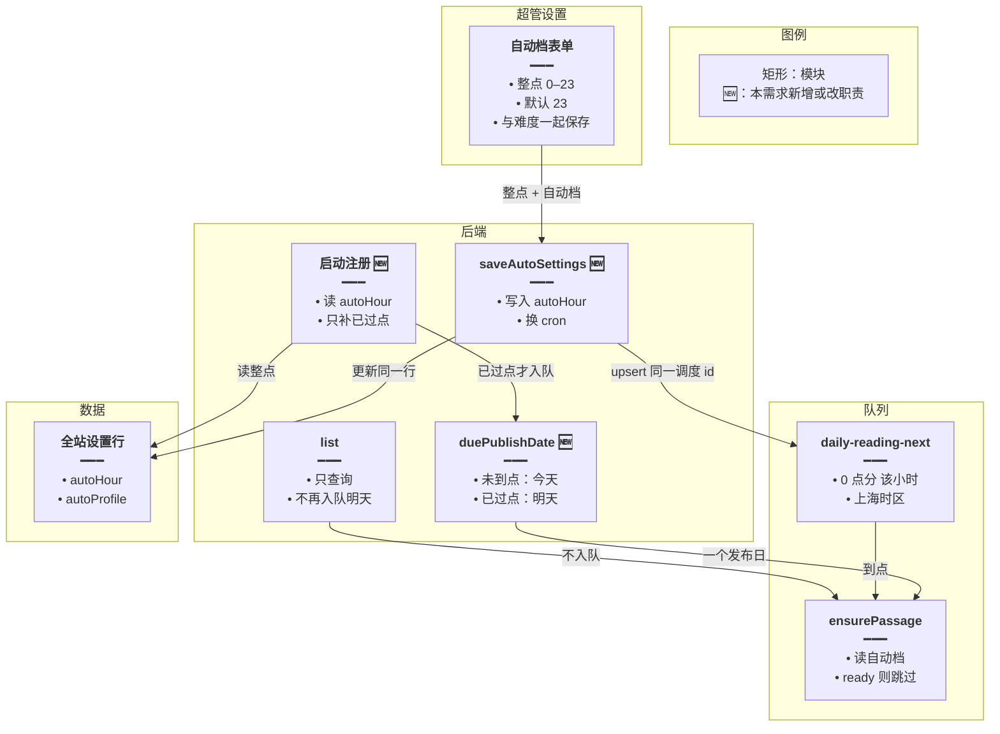
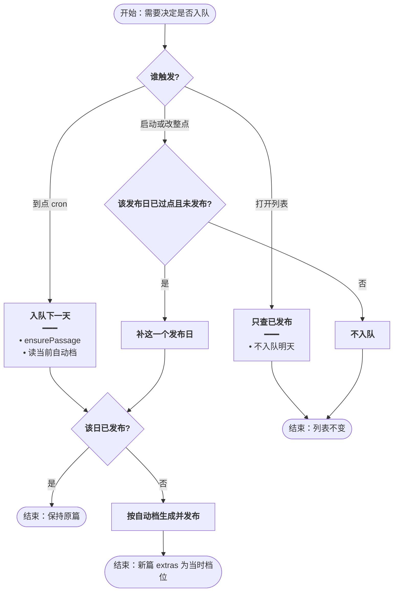
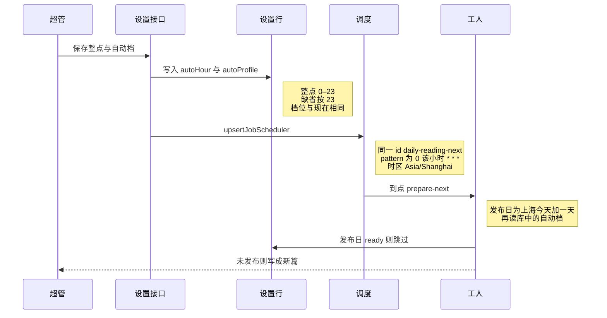
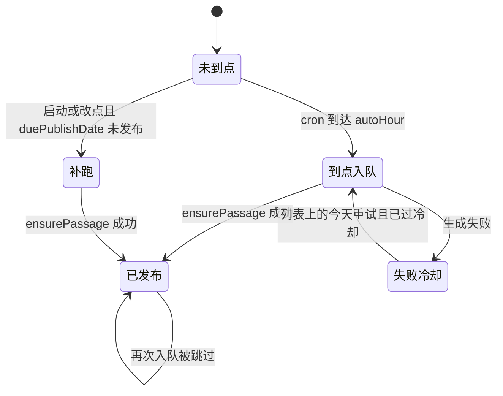

# 日推入队时刻 — 实现思路

> **状态**：已按本文落地  
> **日期**：2026-10-21  
> **需求摘要**：系统日推只在超管设定的整点入队，默认每天 23:00（上海）；打开列表和进程刚启动都不再提前生成明天。

## 延伸阅读

- [每日阅读超管配置.md](./每日阅读超管配置.md)：自动档只给超管写
- [每日阅读.md](./每日阅读.md)：前一天生成、当天展示

---

## 0. 读本文你将得到什么

- 为什么现在改完自动档，第二天仍是 B1、中篇：明天在 23:00 之前就被写好了。
- 一句话方案：整点存进全站自动档，BullMQ 用同一调度 id 换 cron；列表不再入队；只有「这一档的钟点已经过了、篇目还没发布」才补一次。
- 只改后端调度和超管设置页上的一个整点；不改手动生成、不改 SSE。
- 两段落地：M1 关掉提前入队，M2 把整点做成可保存并在保存时换调度。
- 最大风险：进程在整点宕机。用启动时补「已过点且未发布」的那一天，而不是打开列表就生成。

---

## 1. 需求与边界

### 1.1 用户故事

| 角色 | 场景 | 行为 | 期望结果 |
|------|------|------|----------|
| 超管 | 自动生成配置 | 把入队整点从 23 改成别的小时并保存 | 之后只在该小时入队下一天的日推 |
| 超管 | 23:00 前改了难度、篇幅 | 等到设定的整点 | 这一次生成读到刚保存的自动档 |
| 读者 | 白天打开系统日推 | 只看已发布列表 | 不会因此生成明天 |
| 运维 | 整点时进程不在 | 整点之后进程起来 | 补生成那一个已到期、尚未发布的日期 |

### 1.2 范围

| 在范围内 | 不在范围内 |
|----------|------------|
| 超管自动档增加整点，默认 23 | 让普通用户各自设点 |
| 调度 cron 随保存更新 | 精确到分钟 |
| 去掉列表里对明天的入队 | 改手动生成的时机 |
| 启动时只补已过点且未发布的一天 | 已发布的日推按新配置重写 |
| 时区固定上海 | 多时区 |

### 1.3 约束

- 队列仍是 `english-daily-reading`，调度 id 仍是 `daily-reading-next`。BullMQ `^5.70.2` 的 `upsertJobScheduler` 用同一 id 更新 pattern。
- 已发布行（`status === 'ready'`）继续不入队。难度篇幅仍是生成当时写入 `extras` 的快照。
- 手动生成不走这个队列。

---

## 2. 方案总览

**一句话方案**：整点跟自动档存在同一行；到点的 cron 才是明天的生产者；列表只查询；启动和改点时只补「钟点已过、日推未发布」的那一个发布日。

**可行性**：可行。整点是 0–23 的整数，cron 写成 `` `0 ${hour} * * *` ``，时区沿用 `Asia/Shanghai`。保存后对同一个调度 id 再 `upsert` 一次，下一次触发就按新小时。不需要新队列，也不需要在列表请求里入队。

**比「只加整点、列表照旧入队」更合适的原因**：列表入队会在整点之前把明天写成 `ready`。整点任务随后看到已发布就返回，新配置和整点都不会生效。所以整点设置必须和「禁止提前入队」一起做，单独加一个小时字段解决不了当前问题。

| # | 设计要点 | 理由 |
|---|----------|------|
| 1 | 字段 `autoHour` 放在全站设置行，默认 23 | 和 `autoProfile` 一样只给超管，不进用户设置表 |
| 2 | 列表删除 `enqueuePassage(明天)` | 打开页面不是发布时间 |
| 3 | 启动不再无条件入队今天和明天 | 19:25 拉起进程不应写成明天已发布 |
| 4 | 启动和改点时调用一次 `duePublishDate` | 宕机错过整点时补一天，未到点不生成 |
| 5 | 已发布不重写 | 避免改配置就再打一次模型；未发布的下一次到点会读最新自动档 |

---

## 3. 现状与复用

| 能力 | 仓库中已有 | 本需求中的用法 |
|------|------------|----------------|
| 每天 23:00 调度 | `english-daily-reading.service.ts` 的 `upsertJobScheduler`，pattern `0 23 * * *`，`tz: Asia/Shanghai` | 小时改成读 `autoHour` |
| 启动补今天和明天 | 同函数里紧接着两次 `enqueuePassage` | 删掉无条件调用，改成补已到期的一天 |
| 打开列表入队明天 | `list()` 开头无条件 `enqueuePassage(tomorrow)` | 删除 |
| 今天失败或卡住再入队 | `list()` 里对 failed 冷却后、pending 超过 90 秒 | 保留。这是已开始的任务重试，不是提前生成明天 |
| 已发布跳过 | `enqueuePassage` 见 `ready` 即返回 | 不改 |
| 到点读自动档 | `ensurePassage` → `loadAutoSettings` | 不改。到点时读库，所以 23:00 前改的难度会进这一次 |
| 超管自动档表单 | `Settings.tsx` 第二块 `persistAuto` | 增加整点并随自动档一起保存 |
| 重试参数 | `JOB_OPTS`：5 次、间隔 2 分钟 | 不改 |

**调研结论**：生产者有三处，只有 cron 符合「到点生成」。列表入队和启动入队会把发布日提前写成 `ready`。BullMQ 已支持按同一调度 id 更新 cron，不必换队列实现。

---

## 4. 架构图



**图内方法说明**：

| 方法 | 功能 |
|------|------|
| `saveAutoSettings` | 超管保存自动档时写入主题、档位和整点，并按新整点更新调度 |
| `duePublishDate` | 用上海当前时间与整点比较，算出唯一允许补跑的发布日 |
| `ensurePassage` | 工人按发布日生成日推；生成前读自动档；已发布则不再写 |
| `list` | 返回已发布列表和今天的状态；本需求后不再入队明天 |

**读图要点**：

- 到点的 cron 是明天的正常生产者。列表不再是生产者。
- 启动和改点只经过 `duePublishDate`，避免未到点就生成。
- 整点和自动档在同一行，到点生成时读到的是最新档位。

---

## 5. 主流程图



**图内方法说明**：

| 方法 | 功能 |
|------|------|
| `duePublishDate` | 判断启动或改点时该补哪一天；未到点时返回的日期不会提前生成明天 |
| `ensurePassage` | 真正调用模型并写入 `extras.level` / `extras.length` |
| `enqueuePassage` | 已发布、未过期的 pending、冷却中的 failed 都不入队 |

**读图要点**：

- 打开列表这条分支没有入队。
- 已发布是所有入队路径的共同终点，所以提前生成过的篇不会在整点被新配置覆盖。
- 补跑只发生在钟点已经过去之后。

---

## 6. 核心时序图



**图内方法说明**：

| 方法 | 功能 |
|------|------|
| `upsertJobScheduler` | 用固定调度 id 替换 cron，使下一次触发使用新整点 |
| `prepare-next` | 现有工人任务名；执行时用上海今天加一天作为发布日 |
| `ensurePassage` | 读取刚保存的自动档生成；该发布日已发布则返回 |

**读图要点**：

- 保存和到点是两次读库。改档位不必改已经在队列里的任务正文，因为任务只带日期。
- 调度 id 不变，避免 23:00 和自定义小时各跑一遍。

---

## 7. 状态机



**图内方法说明**：

| 方法 | 功能 |
|------|------|
| `duePublishDate` | 未到点时不允许把明天送进补跑 |
| `ensurePassage` | 成功后把该发布日标为 ready，后续入队不再覆盖 |

**读图要点**：已发布是终态。失败冷却只恢复已经尝试过的今天，不负责提前写明天。

---

## 8. 模块职责与接口草图

### 8.1 模块一览

| 模块 | 职责 | 新增/改动 | 预估路径 |
|------|------|-----------|----------|
| 设置行 | 保存 `autoHour` | 扩展列，默认 23 | `entity/english-daily-reading-setting.entity.ts` 与一条迁移 |
| 调度注册 | 按整点 upsert；补已到期的一天 | 改 | `english-daily-reading.service.ts` |
| 列表 | 去掉明天入队；没有行时不再为了入队把今天标成生成中 | 改 | 同文件 `list` |
| 自动档接口 | 读写整点 | 扩展 | `saveAutoSettings` / `readingSettings` |
| 超管表单 | 整点选择，随自动档保存 | 扩展 | `Settings.tsx` 与中英文文案 |

### 8.2 关键接口（草图）

```typescript
// 上海日历上，这一档整点已经过去时，补的是明天；否则只可能补今天
function duePublishDate(hour: number, now: Date): string {
	// 0–23 以外视为 23，避免坏数据写出非法 cron
	const h = hour >= 0 && hour <= 23 ? hour : 23;
	// 用上海时区取当前小时，和 cron 的 tz 一致
	const shanghaiHour = hourInShanghai(now);
	// 已过点：今天这次应产出明天；未到点：上一档产出的是今天
	return shanghaiHour >= h ? addCalendarDays(shanghaiToday(), 1) : shanghaiToday();
}
```

### 8.3 数据模型

| 字段 | 来源 | 存储 | 说明 |
|------|------|------|------|
| `autoHour` | 超管表单，缺省 23 | `english_daily_reading_settings.autoHour` | 只影响系统日推 |
| `autoProfile` | 已有自动档 | 同一行 | 到点时读取，不随入队时刻提前固化 |
| 日推行 `extras` | `ensurePassage` | `english_daily_readings` | 生成当时的难度和篇幅 |

---

## 9. 分阶段实现步骤

| 阶段 | 目标 | 交付物 | 依赖 |
|------|------|--------|------|
| M1 | 不再提前生成明天 | 列表与启动不再无条件入队 | 无 |
| M2 | 整点可配置并生效 | 列、接口、表单、upsert | M1 |

M1

- [x] `list()` 删除对明天的 `enqueuePassage`。
- [x] 没有今天这行时，不再入队，也不把状态标成一直生成中。
- [x] 今天已是 failed 且过了冷却，或 pending 超过 90 秒，仍可入队今天。
- [x] 启动时的两次无条件 `enqueuePassage` 改为只对 `duePublishDate` 入队一次。

M2

- [x] 迁移增加 `autoHour`，已有行填 23。
- [x] 保存自动档时校验 0–23，并 `upsertJobScheduler` 同一 id。
- [x] 若新整点相对现在已经过了，且 `duePublishDate` 未发布，保存后补这一天。
- [x] 超管自动档展示整点；普通用户的设置响应里不带这个字段。

---

## 10. 关键决策与备选方案

| 决策 | 选用 | 备选 | 为何不选备选 |
|------|------|------|--------------|
| 整点存在哪 | 全站自动档一行 | 环境变量 | 超管要在设置页改，改完不用发版 |
| 如何换点 | 同一调度 id 再 upsert | 每个小时一个调度 | 会在旧点和新点各生成一次 |
| 打开列表 | 不入队明天 | 保留列表入队，只把 cron 改成可配置 | 列表会在整点前把明天写成 ready，整点被跳过 |
| 宕机 | 启动时补已过点的一天 | 完全不补，只等下一个整点 | 23:00 进程不在时，那一天会一直缺，直到再过 24 小时 |
| 改配置后的已发布篇 | 不重写 | 保存自动档就删掉明天并重生成 | 多一次模型费用；未到点本来就不该有明天这篇 |
| 精度 | 整点 | 分钟 | 现有产品只需要「晚上几点」 |

**评估**：用户提出的「默认 23 点，超管改了以设置为准」可行，而且比继续用写死的 23:00 更符合设置页。更优的一点是补跑规则：不是打开列表入队，也不是启动就生成明天，而是只补钟点已过且未发布的那一个发布日。少了这条，宕机会丢一天；多了「未到点也入队」，整点设置又会失效。

---

## 11. 风险、边界与待确认

| 项 | 等级 | 说明 | 缓解 |
|----|------|------|------|
| 旧数据里明天已是 ready | 中 | 这次上线前被提前生成的篇仍是旧档位 | 不自动重写；要新档位需等下一个未发布的发布日 |
| 改到更早的小时且今天该点已过 | 中 | 只 upsert cron 的话，下一次要等到明天 | 保存时按新整点跑一次 `duePublishDate` |
| 列表上的「正在准备」 | 低 | 今天没有行时不再转圈入队 | 展示现有的失败或空态，不新增文案也可以 |
| BullMQ 错过触发是否自补 | 低 | 5.70 的调度在进程全程宕机时不一定补历史 tick | 不依赖它，启动时自己补一天 |

**待确认**：无。整点范围、时区、不重写已发布，都按上面写死。

---

## 12. 验收清单

| # | 用例 | 步骤 | 期望 |
|---|------|------|------|
| AC1 | 默认 | 不改整点，看调度 | cron 为每天 23:00，上海时区 |
| AC2 | 改点 | 超管改成 21 并保存 | 同一调度 id 的 pattern 变成 `0 21 * * *` |
| AC3 | 未到点打开列表 | 整点前打开系统日推 | 明天没有新的 day 行 |
| AC4 | 未到点重启 | 整点前重启后端 | 不生成明天 |
| AC5 | 到点 | 等到设定小时 | 生成明天，`extras` 为当时自动档 |
| AC6 | 到点前改档 | 整点前改难度再等到点 | 新篇是新难度，不是 B1、中篇 |
| AC7 | 已发布 | 该日已经 ready 后再到点或改点 | 正文和 extras 不变 |
| AC8 | 宕机补跑 | 整点时进程关闭，整点后启动 | 只补那一个到期发布日 |

---

## 13. 预估改动面

| 类型 | 路径 |
|------|------|
| 后端 | `apps/backend/src/services/english-learning/english-daily-reading.service.ts` |
| 后端 | `apps/backend/src/services/english-learning/entity/english-daily-reading-setting.entity.ts` |
| 迁移 | `apps/backend/src/migrations/` 增加 `autoHour` |
| 前端 | `apps/frontend/src/views/englishLearning/dailyReading/Settings.tsx` |
| 文案 | `apps/frontend/src/i18n/locales/zh-CN/englishLearning.ts`、`en-US/englishLearning.ts` |

（已按本文落地；行为以源码为准）
