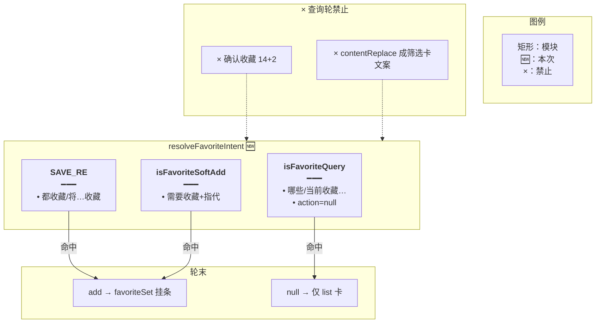
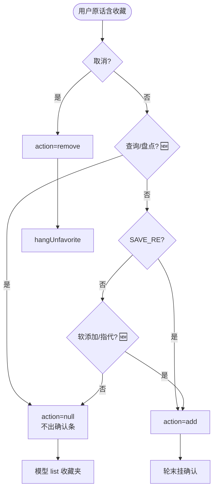
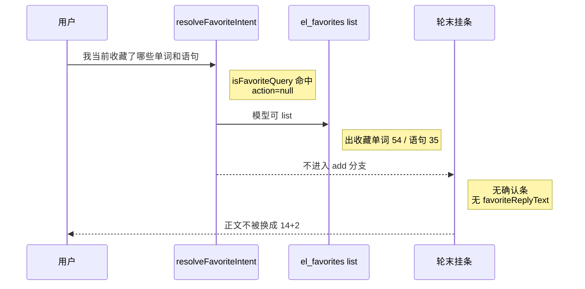
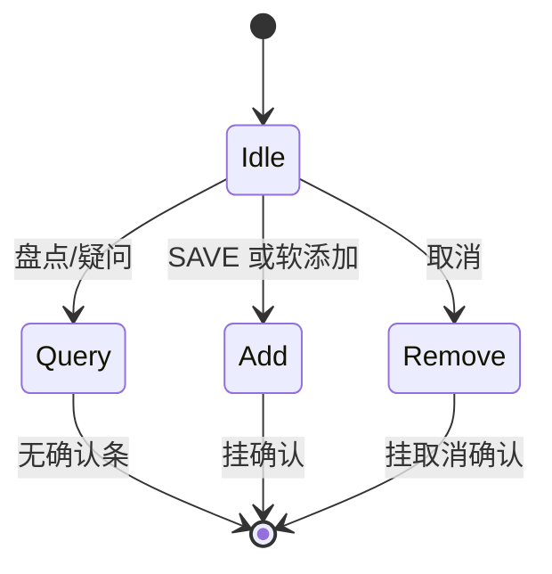

# 查询收藏不挂确认 — 实现思路

> **状态**：规划（M1 工作区已落地）  
> **日期**：2026-10-30  
> **需求摘要**：用户说「我当前收藏了哪些单词和语句」时，只应列出收藏夹（如 54 词 / 35 句），**不得**弹出「确认收藏 14 个词、2 条语句」，也不得用 `contentReplace` 把正文换成历史筛选卡「小学三年级上册…14 / 2」。  
> **一句话方案（预告）**：在 `resolveFavoriteIntent` 里把「询问已有收藏」从添加闸拆开——问句/盘点优先判为 query（action=null）；无保存动词时，仅「需要收藏 + 指代」才进 add；轮末挂条只跟 add/remove，查询轮绝不写 `favoriteReplyText`。

## 延伸阅读

- [收藏意图总控](./收藏意图总控.md)：落地时已写明风险「查看我的收藏被误当成添加」。本文收口该风险的复现
- [收藏确认跟卡片](./收藏确认跟卡片.md)：挂条与 `contentReplace` 机制；查询轮必须整段不进
- [再收藏不断窗](./再收藏不断窗.md)：选卡窗口；本文是意图层，不改 richest
- [取消正文跟确认条](./取消正文跟确认条.md)：取消正文同源；查询同理——无确认则无替换成收藏文案

---

## 0. 读本文你将得到什么

- 为何「当前收藏了哪些」会弹出添加确认条，正文却是历史家庭卡 14+2
- 根因：查询正则过窄 +「单词/语句」对象线索无动词也被当成 add
- 选定方案：查询问句优先；收紧「无 SAVE_RE 也能 add」的条件
- 改动集中在 `favorite-ask.ts` 的 `resolveFavoriteIntent`（+ 单测）；工具 list 与确认条 UI 不改
- 最大风险：过宽查询误挡「我需要收藏哪些…」——用「需要/想/要/帮我 + 收藏」与指代保住添加

---

## 1. 需求与边界

### 1.1 用户故事

| 角色 | 场景 | 行为 | 期望结果 |
|------|------|------|----------|
| 登录用户 | 收藏夹里有几十条，会话里还有旧筛选卡 | 「我当前收藏了哪些单词和语句」 | 出收藏列表卡；**无**确认条；正文不谈「确认收藏 / 三年级 14+2」 |
| 登录用户 | 同上 | 「看看我的收藏列表」 | 仍为 query（回归） |
| 登录用户 | 要重新收藏上次范围 | 「我需要收藏之前的单词和语句」 | 仍为 add both（意图总控不回归） |
| 登录用户 | 明确保存 | 「将上述单词和语句都收藏」 | 仍为 add both |

### 1.2 范围

| 在范围内 | 不在范围内 |
|----------|------------|
| `resolveFavoriteIntent` 查询 vs 添加 | 改收藏 list 分页 UI |
| 查询轮禁止挂 add 确认 / 禁止收藏类 replace | 换模型；向量记忆 |
| 单测覆盖实录句 | 「收藏夹里搜 xxx」复杂筛选（可后加） |

### 1.3 约束与依赖

- 复用现有 `FAVORITE_QUERY_RE` 槽位与轮末 `if (action === 'add')` 挂条
- 名单/确认条仍只服务 add/remove；query 交给模型调 `el_favorites list` + 出 favorites 卡
- Ponytail：不新开 LLM 意图分类器

---

## 2. 背景

### 2.1 实录（如图）

| 层 | 内容 | 对错 |
|----|------|------|
| 用户 | 我当前收藏了哪些单词和语句 | 查询 |
| 列表卡 | 收藏单词 54 / 收藏语句 35 | 查询结果大致对 |
| 正文 | 小学三年级上册英语单词：14 个词。小学三年级上册：2 条语句。 | **错**（历史筛选卡文案） |
| 底栏 | 确认收藏 14 个词、2 条语句 | **错**（添加确认） |

### 2.2 现状缺口（根因链）

不是 list 挂错，而是**意图总闸把查询判成添加**：

1. `FAVORITE_QUERY_RE` 仅：`收藏(列表|夹)|看看收藏|查看收藏|打开收藏|我的收藏|…`  
   **「我当前收藏了哪些…」对不上**（有「收藏了哪些」，无「收藏列表/我的收藏」整段）。
2. 原话含「收藏」+ `FAVORITE_OBJECT_RE` 命中「单词」「语句」→ `object=true`。  
   `SAVE_RE` 未命中（没有「都收藏 / 帮我收藏 / 将…收藏」）。  
   现逻辑：`if (!verb && !object) return null` → **有 object 就继续** → `classic&&vocab` → **`action: 'add', side: 'both'`**。
3. 轮末 `favoriteIntent.action === 'add'` → `favoriteSet` 扫到历史家庭筛选卡 14+2 → 挂「确认收藏 14…2」→ `favoriteReplyText = plan.reply` → **`contentReplace` 盖掉**模型本来可能写的收藏夹说明。
4. 模型仍可能 `el_favorites list` 挂出 54/35 的 favorites 卡 → 用户同时看到**对的列表卡 + 错的确认条 + 错的正文**。

这与 [收藏意图总控](./收藏意图总控.md) §0「最大风险：查看收藏被误当成添加」同一洞；总控为扩「需要收藏之前的…」放宽了 object 路径，**查询闸没同步加宽**。

### 2.3 不解决会怎样

凡「收藏了哪些 / 当前收藏 / 有什么收藏」且点名单词语句的问句，都会误挂添加确认，并用历史库卡数字污染正文。

### 2.4 硬约束

- 查询：**不挂** add/remove 确认条，**不写**收藏类 `favoriteReplyText`。  
- 「我需要收藏之前的单词和语句」等添加句必须继续进 add。  
- 不靠 prompt 求模型别挂确认。

---

## 3. 现状与复用

| 能力 | 仓库中已有 | 本需求用法 |
|------|------------|------------|
| 意图总闸 | `resolveFavoriteIntent` | **扩展**查询优先 + 收紧无动词 add |
| 查询正则 | `FAVORITE_QUERY_RE` | **加宽**问句/盘点 |
| 添加动词 | `SAVE_RE` | 直接复用；有动词仍 add |
| 软添加 | 现靠任意 object | **改为**软动词或指代，且非查询 |
| 挂条 | `agent.service` `action==='add'` | 查询 action=null 后自然不跑 |
| 列表 | `el_favorites` list | 查询轮继续由模型/工具出 favorites 卡 |

**调研结论**：挂条与 replace 逻辑无需改入口条件——把 intent 判对即可。缺口只在 `resolveFavoriteIntent` 的 query / soft-add 边界。

---

## 4. 方案比对与最终方案

### 4.1 候选方案

#### 方案 A：只加宽 `FAVORITE_QUERY_RE`（加「哪些|当前收藏|收藏了」等）

- **做法**：query 命中则 `action=null`；其余逻辑不动（object 仍可无动词进 add）。
- **能工作原因**：实录句可被 query 吃掉。
- **代价**：漏网问句（「收藏夹里都有啥」）仍可能 object→add；与「哪些」相关的添加句若写法刁钻需测。

#### 方案 B：查询优先 + 无 `SAVE_RE` 时仅「软添加」才 add（推荐）

- **做法**：  
  1. 取消 → 仍最先。  
  2. 无「收藏」→ null。  
  3. **查询**（加宽正则，含：哪些/什么/多少/有没有/看看/查看/列出/当前收藏/收藏了哪些…）→ null。  
  4. `SAVE_RE` → add（按侧）。  
  5. 否则仅当 **软添加** `需要收藏|想收藏|要收藏|给我收藏|帮我收藏`（帮我已在 SAVE 亦可）或 **指代保存**（上述|之前|这些|刚才|刚刚）且无查询特征 → add。  
  6. 仅有「单词/语句」物名、无动词无指代无软添加 → **null**（交给模型，不挂确认）。
- **能工作原因**：实录句走 3；「需要收藏之前的…」走 5；「都收藏」走 4。
- **代价**：比 A 多一层软添加规则；要写清与意图总控用例的回归。

#### 方案 C：查询轮前端/后端见到 favorites 卡就拆掉 pendingProposal

- **做法**：有 list 卡则清确认条。
- **能工作原因**：症状上可能去掉条。
- **代价**：治标；正文 replace 仍可能已错；时序竞态。

### 4.2 比对

| 维度 | 方案 A | 方案 B | 方案 C |
|------|--------|--------|--------|
| 正确性 | 实录可过；漏网问句仍 object→add | 查询与软添加边界清晰 | 条可能没，根因仍在 |
| 复用 | 只扩正则 | 扩正则 + 收紧 object 路径 | 动挂条后置 |
| 改动面 | 最小 | 小（单函数） | 中 |
| 复杂度 | 低 | 低～中 | 中 |
| 体验 | 本图可修 | 本图 + 同类问句 | 不可靠 |
| 风险 | 漏判 query | 软添加漏判（单测钉住总控句） | 掩盖 bug |
| 可维护性 | 词表膨胀 | 规则分层好读 | 差 |

### 4.3 综合考量

权重是**正确性**（查询绝不挂添加确认）与**不回归意图总控**（需要收藏之前的…）。  
选定 **B**：查询优先加宽，并收紧「无 SAVE_RE 的 add」。放弃 A 的「改动更少」——因 object 万能仍是地雷。放弃 C 的事后擦除。

### 4.4 最终方案

#### 背景

「我当前收藏了哪些单词和语句」被判成 add both，轮末用历史筛选卡 14+2 挂确认并 replace 正文，同时 list 出了真收藏夹 54/35。根因是 query 闸窄于 object 万能 add，不是记忆丢失。

#### 具体思路

1. **模块**：只改 `resolveFavoriteIntent`（及导出供测的 query/soft 辅助若需要）。  
2. **数据**：仍无新表；intent 仍是 `{ action, side }`。  
3. **状态**：查询 → `action: null`；挂条分支不进。  
4. **边界**：有 SAVE_RE 的保存句不受查询词误伤时，要求查询模式更像「盘点/疑问」而非「把哪些收藏起来」——「帮我收藏哪些家庭词」含帮我收藏（SAVE）仍 add。

#### 实现方案

**一句话**：查询问句优先判 null；无保存动词时仅软添加/指代才 add；轮末挂条自然跳过查询轮。

| 步骤 | 谁 | 做什么 |
|------|----|--------|
| 1 | `isFavoriteQuery` | 加宽盘点/疑问 |
| 2 | `isFavoriteSoftAdd` | 需要/想/要…收藏 或 指代 |
| 3 | `resolveFavoriteIntent` | cancel → query → SAVE → softAdd → else null |
| 4 | 单测 | 实录 query；总控 add；都收藏 add |

#### 选定原因

1. **正确性**：查询与添加在闸上拆开。牺牲：规则比纯加词条稍长。  
2. **复用**：挂条/list 不动。牺牲：不在 C 层擦确认条。  
3. **可维护性**：与总控「风险」闭环。牺牲：放弃 A 的一行正则。

#### 优势

- 相对 A：堵住「任意带单词语句的收藏问句」。  
- 相对 C：从 intent 断源，正文不会被 replace 成 14+2。

#### 怎么实现

见 §9。验收：实录句 `action===null`、无确认条、正文非三年级筛选卡套话。

### 4.5 其他关键决策

#### 4.5.1 「无动词」何时仍可 add

##### 候选

**A**：任意 object（现状，总控）。  
**B**：仅软添加动词簇或指代词（本文）。

##### 比对

| 维度 | A | B |
|------|---|---|
| 正确性 | 查询易误伤 | 查询安全；总控句靠「需要」「之前」 |
| 复用 | 现状 | 显式 soft 规则 |
| 风险 | 高（本 bug） | 「收藏单词」无动词无指代不再自动挂条——通常本就应 list/clarify |

##### 综合考量

选定 B。放弃 A「少改」。「单纯收藏单词」无确认而走工具，可接受。

##### 最终方案（摘要）

- **背景**：object 万能导致查询变 add。  
- **思路**：物名不够，要软动词或指代。  
- **实现**：§9.2。  
- **原因**：正确性。  
- **优势**：相对 A 不再误挂。  
- **怎么实现**：§9。

---

## 5. 架构图



**图内方法说明**：

| 方法 | 功能 |
|------|------|
| `isFavoriteQuery` | 判断盘点/疑问句；命中则不进 add/remove |
| `isFavoriteSoftAdd` | 无 SAVE_RE 时的添加（需要收藏、之前/上述…） |
| `resolveFavoriteIntent` | 总闸；输出 action/side |
| `favoriteSet` / 挂条 | 仅 action=add 时运行（已有） |

**读图要点**：查询在闸上结束；列表卡可以有，确认条不能有。

---

## 6. 主流程图



**图内方法说明**：

| 方法 | 功能 |
|------|------|
| `unfavoriteFromCards` | 取消 |
| `isFavoriteQuery` | 查询分流 |
| `SAVE_RE` / `isFavoriteSoftAdd` | 添加分流 |
| 轮末挂条 | 已有 add/remove 分支 |

**读图要点**：实录句走 Query→Null；「需要收藏之前的」走 Soft→Add。

---

## 7. 核心时序图



**图内方法说明**：

| 方法 | 功能 |
|------|------|
| `resolveFavoriteIntent` | 判 query |
| `el_favorites list` | 出 favorites 卡 |
| 轮末 add 分支 | 本轮跳过 |

**读图要点**：54/35 可以留；14+2 确认条必须消失。

---

## 8. （可选）状态机



**图内方法说明**：同 §5 总闸三出口。

**读图要点**：Query 与 Add 互斥。

---

## 9. 具体实现（主链路代码）

### 9.1 模块一览

| 模块 | 职责 | 类型 | 路径 |
|------|------|------|------|
| `isFavoriteQuery` | 盘点/疑问 | 新增 | `favorite-ask.ts` |
| `isFavoriteSoftAdd` | 无 SAVE 的添加 | 新增 | 同上 |
| `resolveFavoriteIntent` | 重排分支 | 扩展 | 同上 |
| 单测 | 实录 + 总控回归 | 扩展 | `favorite-ask.scope.spec.ts` |

### 9.2 意图

```typescript
// 对应 §4.4 步骤 1。盘点/疑问优先，避免「收藏了哪些单词」被 object 打成 add
const FAVORITE_QUERY_RE =
	/收藏(列表|夹)|看看收藏|查看收藏|打开收藏|我的收藏|语句收藏里|单词收藏里|当前收藏|收藏了哪些|收藏了什么|有哪些收藏|有什么收藏|哪些单词和语句|收藏了哪些单词|收藏了哪些语句/;

// 对应 §4.4 步骤 2。无 SAVE_RE 时仍允许「需要收藏之前的…」进 add，但不允许裸物名
const SOFT_ADD_RE = /需要收藏|想收藏|要收藏|给我收藏/;
const SOFT_REF_RE = /之前|上述|这些|它们|他们|刚才|刚刚/;

export function isFavoriteQuery(userText: string): boolean {
	const text = userText.trim();
	if (!text || !/收藏/.test(text)) return false;
	// 明确盘点句式
	if (FAVORITE_QUERY_RE.test(text)) return true;
	// 「哪些/什么/多少/有没有」+ 收藏 → 问句，不是保存
	if (/哪些|什么|多少|有没有|列出/.test(text) && /收藏/.test(text)) {
		// 「帮我收藏哪些」仍带保存动词，留给 SAVE_RE，这里不抢
		if (SAVE_RE.test(text)) return false;
		return true;
	}
	return false;
}

export function isFavoriteSoftAdd(userText: string): boolean {
	const text = userText.trim();
	// 软动词：需要收藏之前的…
	if (SOFT_ADD_RE.test(text)) return true;
	// 指代 + 收藏：把之前的…（无 SAVE 时）
	if (SOFT_REF_RE.test(text) && /收藏/.test(text)) return true;
	return false;
}

export function resolveFavoriteIntent(userText: string): FavoriteIntent {
	const text = userText.trim();
	if (!text) return { action: null, side: 'card' };
	const cancel = unfavoriteFromCards(text);
	if (cancel) return { action: 'remove', side: cancel };
	if (!/收藏/.test(text)) return { action: null, side: 'card' };
	// 查询优先于 object 万能 add
	if (isFavoriteQuery(text)) return { action: null, side: 'card' };
	const verb = SAVE_RE.test(text);
	const soft = isFavoriteSoftAdd(text);
	// 既无保存动词也无软添加 → 不挂确认（含裸「收藏单词」）
	if (!verb && !soft) return { action: null, side: 'card' };
	const classic = CLASSIC_RE.test(text);
	const vocab = VOCAB_RE.test(text);
	if (classic && vocab) return { action: 'add', side: 'both' };
	if (vocab) return { action: 'add', side: 'vocab' };
	if (classic) return { action: 'add', side: 'classic' };
	return { action: 'add', side: 'card' };
}
```

### 9.3 单测要点

```typescript
expect(resolveFavoriteIntent('我当前收藏了哪些单词和语句')).toEqual({
	action: null,
	side: 'card',
});
expect(resolveFavoriteIntent('我需要收藏之前的单词和语句')).toEqual({
	action: 'add',
	side: 'both',
});
expect(resolveFavoriteIntent('将上述单词和语句都收藏')).toEqual({
	action: 'add',
	side: 'both',
});
expect(resolveFavoriteIntent('看看我的收藏列表')).toEqual({
	action: null,
	side: 'card',
});
```

### 9.4 数据

| 字段 | 说明 |
|------|------|
| `action: null` | 查询；不挂 add 确认 |
| favorites 卡 | 工具 list；source=favorites |

---

## 10. 分阶段实现步骤

| 阶段 | 目标 | 交付 |
|------|------|------|
| M1 | 实录句不挂确认、不 replace 成 14+2 | intent 重排 + 单测 |
| M2（可选） | 查询轮工具回执禁止 propose_add | domain-tools 防御 |

M1

- [x] `我当前收藏了哪些单词和语句` → null
- [x] `我需要收藏之前的单词和语句` → add both
- [x] `将上述单词和语句都收藏` → add both
- [x] 回归：取消 / 看看收藏列表

---

## 11. 风险、边界与待确认

| 项 | 等级 | 说明 | 缓解 |
|----|------|------|------|
| 「帮我收藏哪些家庭词」 | 低 | 含哪些又含帮我收藏 | SAVE_RE 优先于 query 里的「哪些」例外 |
| 裸「收藏单词」不再自动挂条 | 低 | 产品可接受走 list | 文档写明 |
| 总控其它软说法 | 中 | 「打算收藏之前的」 | 可扩 SOFT_ADD_RE |

**待确认**：

- [ ] 「收藏单词」三字是否必须挂确认（验证：现网是否依赖 object 万能）

---

## 12. 验收清单

| # | 用例 | 期望 |
|---|------|------|
| AC1 | 实录句 | 无「确认收藏」条；正文不是三年级 14+2 套话；可有收藏列表卡 |
| AC2 | 需要收藏之前的… | 仍 add，可挂确认 |
| AC3 | 都收藏 | 仍 add both |
| AC4 | 看看我的收藏列表 | 仍 null |

---

## 13. 预估改动面

| 类型 | 路径 |
|------|------|
| 后端 | `apps/backend/src/services/agent/tools/english/favorite-ask.ts` |
| 测试 | `favorite-ask.scope.spec.ts` |
| 文档 | README；与 [收藏意图总控](./收藏意图总控.md) 互链 |
| 前端 | 不改 |

---

（规划态；落地后以源码为准）
