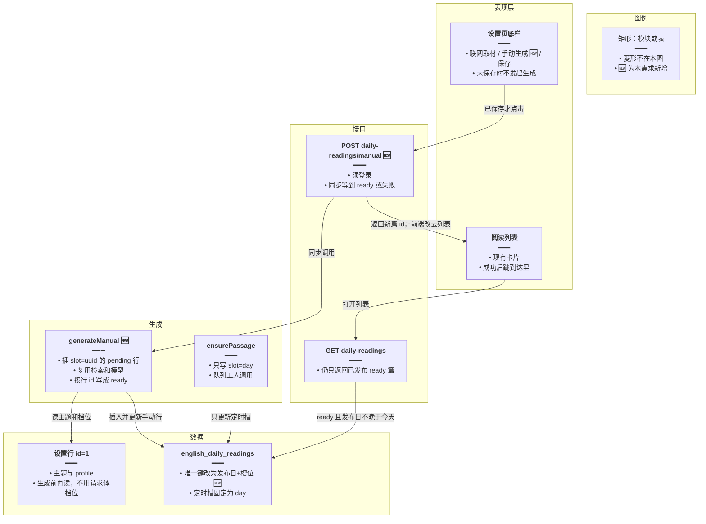
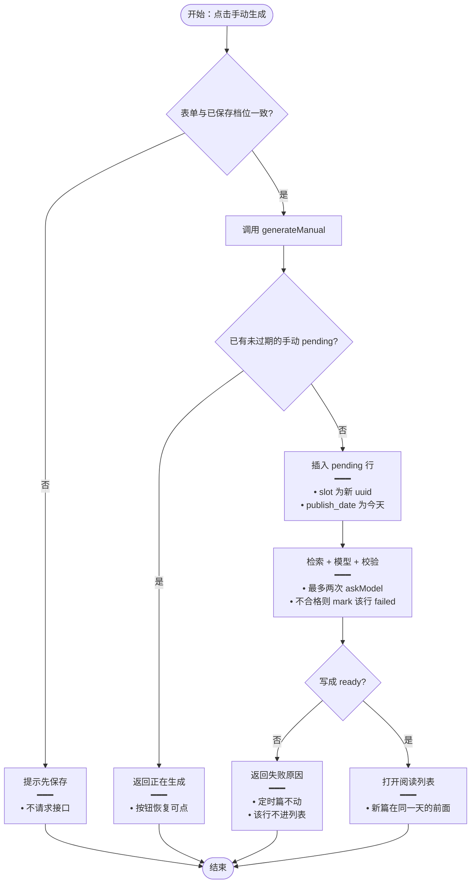
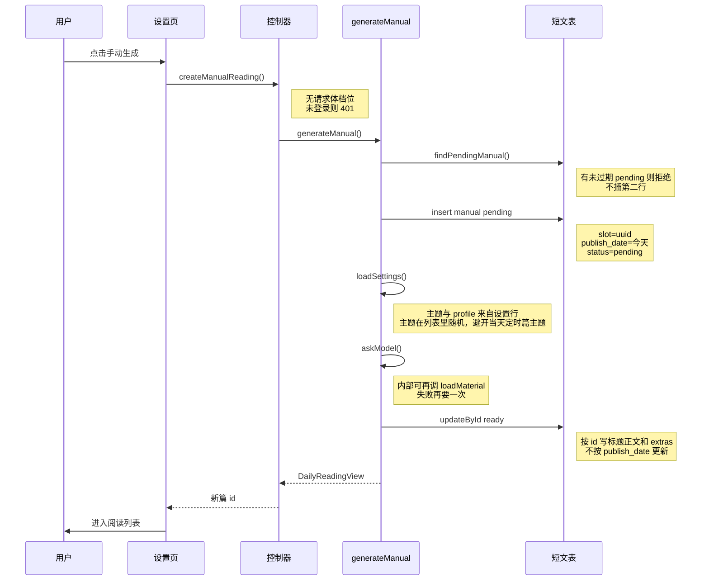
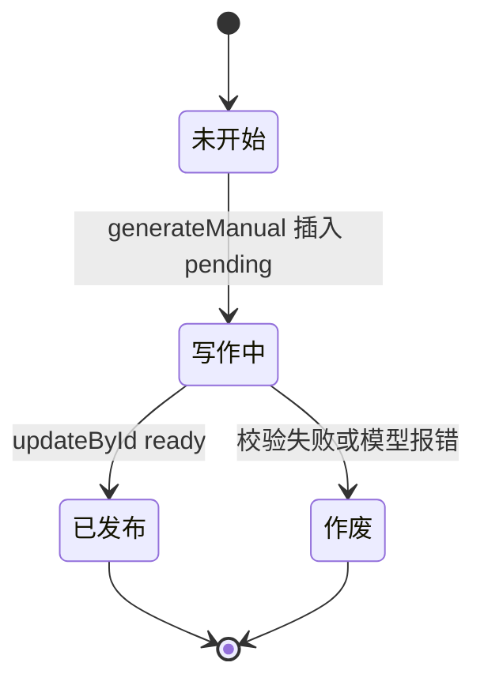

# 每日阅读手动生成 — 实现思路

> **状态**：规划（未实现；定时生成、设置档位、列表/详情已有，可复用）  
> **日期**：2026-10-15  
> **需求摘要**：设置页底部增加「手动生成」。点击后按当前已保存的档位立刻写一篇新短文，写完就出现在每日阅读列表里，不改当天那篇定时短文。

## 延伸阅读

- [每日阅读](./每日阅读.md)（一天一篇的定时链路、`publish_date` 唯一、列表只展示已到发布日的 ready 篇）
- [每日阅读设置](./每日阅读设置.md)（底部「联网取材 / 保存」所在页；档位保存后才被下一篇读取）

---

## 0. 读本文你将得到什么

- 要解决的问题：现在只有每天 21:00（上海）的队列会写短文，改完设置要等到下一篇，不能当场看到结果。
- 总体方案：设置页底部同一行加「手动生成」。请求里同步跑现有的检索、模型和校验，另插一行 `slot` 为新 id 的短文，`publish_date` 记今天，列表原查询就能看见。
- 改动层：设置页底栏、一个 POST、短文表唯一键从「仅发布日」改成「发布日 + 槽位」、列表次排序。
- 分两阶段：M1 写完即进列表；M2 列表卡片标出「手动」。
- 最大风险：全站共用，连点会打两次模型。同一时刻只允许一篇手动稿在写。

---

## 1. 需求与边界

### 1.1 用户故事

| 角色 | 场景 | 行为 | 期望结果 |
|------|------|------|----------|
| 登录用户 | 设置已保存，底栏 | 点「手动生成」 | 按钮转圈；成功后这篇出现在阅读列表，可点进详情 |
| 登录用户 | 设置改了还没保存 | 点「手动生成」 | 不调用模型，提示先保存 |
| 登录用户 | 当天定时篇已经 ready | 再点手动生成 | 定时篇原文不变，列表多一篇 |
| 登录用户 | 已有一篇手动稿正在写 | 再点 | 接口拒绝，按钮保持不可用 |
| 未登录 | 调生成接口 | 请求 | 401，与现有英语学习接口一致 |

### 1.2 范围

| 在范围内 | 不在范围内（非目标） |
|----------|----------------------|
| 底栏与「联网取材」「保存」同一行、三列等宽 | 侧栏卡片上再放一个生成按钮 |
| 用已保存的主题、难度、篇幅、侧重、理解题、联网开关 | 用页面上还没保存的草稿档位 |
| 同步等到这篇写完再返回 | 流式吐正文；把手动稿塞进日期队列（`jobId = 发布日`） |
| 新行进现有列表和详情 | 按用户各存一份；改 `publish_date` 唯一键为「用户 + 日期」 |
| 不覆盖 `slot = day` 的定时篇 | 手动生成顺便重写今天或明天已 ready 的定时篇 |

### 1.3 约束与依赖

- 须登录。全站一份设置、全站一份列表，与 [每日阅读设置](./每日阅读设置.md) 相同。
- 复用 `loadSettings`、`loadMaterial`、`askModel`、`rejectPassage`、`pickExtras`。不复用 `ensurePassage` / `claim`：那两条按发布日占定时槽。
- 列表仍只返回 `status = ready` 且 `publish_date <= 今天`。手动篇把发布日写成今天，才能马上被这条查询看见。
- 体验底线：按钮在请求结束前禁用；失败提示原因，定时篇不受影响。

---

## 2. 方案总览（一句话 + 要点）

**一句话方案**：底栏增加「手动生成」；后端按已保存档位同步写一篇新行（`slot` 用新 id，`publish_date` 为今天），成功后前端打开阅读列表，该篇排在同一天的前面。

| # | 设计要点 | 理由 |
|---|----------|------|
| 1 | 新行，不改定时行 | `publish_date` 今天已经有一篇 ready 时，覆盖会毁掉「已写好的篇目不变」 |
| 2 | 唯一键改为 `(publish_date, slot)` | 定时篇 `slot = day`；手动篇 `slot` 为 uuid。MySQL 没有部分唯一索引，不能只对定时篇保留单列唯一 |
| 3 | 请求内同步生成，不进日期队列 | 队列 `concurrency: 1` 且 `jobId` 是发布日，手动稿会和今天/明天的任务互抢或被去重 |
| 4 | 未保存的表单不能生成 | 生成读的是库里的档位。用屏幕上的草稿会造成「列表里的篇和保存的设置对不上」 |
| 5 | 全站同时只写一篇手动稿 | 设置是全站的，连点等于连打模型 |

---

## 3. 现状与复用

| 能力 | 仓库中已有 | 本需求中的用法 |
|------|------------|----------------|
| 设置页底栏 | `apps/frontend/src/views/englishLearning/dailyReading/Settings.tsx` | 扩展：同一行增加「手动生成」 |
| 已保存档位 | `english-daily-reading.service.ts` 的 `loadSettings` | 直接复用：生成前再读一次库 |
| 检索、模型、校验、学习块 | 同文件 `loadMaterial` / `askModel` / `rejectPassage` / `pickExtras` | 直接复用：抽成按行 id 写入，给定时和手动共用 |
| 定时占坑 | 同文件 `claim`、`ensurePassage`；唯一索引 `uq_english_daily_readings_publish_date` | 不适用：只服务 `slot = day`。查找和失败回写必须带上槽位，避免误伤手动行 |
| 日期队列 | `english-daily-reading.processor.ts`，`DAILY_READING_QUEUE` | 不适用：手动生成不入队 |
| 列表 | `list`：`status = ready` 且 `publish_date <= 今天`，按发布日倒序 | 扩展：次排序改为 `created_at` 倒序，新手动篇排在同一天前面 |
| 列表页 | `apps/frontend/src/views/englishLearning/dailyReading/List.tsx` | 直接复用：生成成功后 `navigate` 到该页，不必另做资源列表 |
| 详情 | `GET daily-readings/:id` | 直接复用：手动篇 id 仍是 uuid |
| 登录校验 | `english-learning.controller.ts` 每日阅读三个接口 | 直接复用：新 POST 同样 `userId == null` 则 401 |

**调研结论**：生成管线已经能按档位写一篇并落 `extras`。缺的是「同一天再插一行」和「这次请求里等到写完」。`claim` 用发布日做唯一插入，手动篇不能走它。列表查询不用改过滤条件，改排序即可。

---

## 4. 架构图



**图内方法说明**：

| 方法 | 功能 |
|------|------|
| `generateManual()` | 读已保存档位，插入一篇 `slot` 为新 uuid、发布日为今天的 pending 行，同步跑检索和模型，按该行 id 写成 ready 或 failed，并返回列表能用的视图 |
| `ensurePassage(publishDate)` | 现有定时入口：只抢 `slot = day` 的那一行。手动生成不调用它 |
| `GET daily-readings` | 现有列表。过滤条件不变，因此手动篇必须把 `publish_date` 写成今天才会出现 |

**读图要点**：

- 底栏只负责发起；写库集中在 `generateManual`。
- 定时链路和手动链路分槽写入同一张表，列表不用新接口。
- 设置表只读。这次点击不保存档位，也不改已有 ready 行。

---

## 5. 主流程图



**图内方法说明**：

| 方法 | 功能 |
|------|------|
| `generateManual()` | 见 §4。流程里「调用 generateManual」这一步包含占坑、写正文和返回视图 |
| `askModel(...)` | 现有方法：按档位向模型要一篇 JSON。校验失败时用拒绝原因再要一次，与定时篇相同 |
| `loadMaterial(theme, useWeb)` | 现有方法：`useWeb` 为真时取检索摘要，否则直接空素材 |
| `pickExtras(...)` | 现有方法：正文合格后摘词汇、语法、理解题；不合格的键丢掉，不让附件废掉整篇 |

**读图要点**：

- 未保存走本地提示，不到后端。
- 失败只标记这一行手动稿。`slot = day` 的定时篇不参与这次更新。
- 成功的终点是现有列表，不新开一种资源页。

---

## 6. 核心时序图



**图内方法说明**：

| 方法 | 功能 |
|------|------|
| `createManualReading()` | 控制器：校验登录后调用服务，把视图包成 `{ success, data }`。不接收主题或档位，避免和未保存表单分叉 |
| `generateManual()` | 服务：占坑、生成、按 id 落库。成功返回与列表卡片相同的视图 |
| `findPendingManual()` | 查 `slot <> day` 且 `status = pending` 且 `started_at` 未超过现有 `PENDING_STALE_MS`（90 秒）。有则拒绝，防止连点 |
| `loadSettings()` | 现有方法：读 id=1 的主题和 profile。手动生成与定时生成使用同一份 |
| `askModel()` | 现有方法：一次模型调用产出短文 JSON。校验失败时由 `generateManual` 再调一次 |
| `insert` / `updateById` | 先插入 pending，再按主键更新。客户端若中途断开，服务端仍可把该行写成 ready，下次打开列表能看见 |

**读图要点**：

- 发起方是设置页，落点是短文表的新行，不是日期队列。
- 参数放在 Note 里：发布日固定为今天，槽位是新 id，更新按主键。
- 同步返回。列表页不靠这次请求轮询；跳转后的 `GET daily-readings` 用现有逻辑即可。

---

## 7. 状态机

只描述**这一篇手动稿**。定时篇的 pending / ready / failed 不变。



**图内方法说明**：

| 方法 | 功能 |
|------|------|
| `generateManual()` | 触发「未开始 → 写作中」。同一时刻另一篇未过期的写作中会让新的点击停在未开始 |
| `updateById` | 写作中写成已发布，或标成作废。作废行 `status = failed`，列表查询看不见 |

**读图要点**：作废不是定时篇那套「冷却后再抢同一发布日」。下一击是新的 `slot`，不复活旧行。

---

## 8. 模块职责与接口草图

### 8.1 模块一览

| 模块 | 职责 | 新增/改动 | 预估路径 |
|------|------|-----------|----------|
| 底栏按钮 | 未保存则提示；请求中禁用；成功去列表 | 扩展 | `apps/frontend/src/views/englishLearning/dailyReading/Settings.tsx` |
| 前端请求 | POST 手动生成 | 新增函数 | `apps/frontend/src/service/index.ts`、`api.ts` |
| 文案 | 「手动生成」「请先保存」「正在生成」 | 新增 key | `apps/frontend/src/i18n/locales/zh-CN/englishLearning.ts` 与 `en-US` |
| 控制器 | 登录后转服务 | 新增路由，写在 `daily-readings/:id` **之前** | `apps/backend/src/services/english-learning/english-learning.controller.ts` |
| 生成 | 插行、复用模型、按 id 更新 | 新增 `generateManual`；`markFailed` / `claim` 限定 `slot = day` | `english-daily-reading.service.ts` |
| 表 | 槽位列与联合唯一 | 新迁移，不改已应用的迁移 | `apps/backend/src/migrations/` |
| 列表排序 | 同一天内新篇在前 | 扩展 `order` | `english-daily-reading.service.ts` 的 `list` |

### 8.2 关键接口（伪代码）

```typescript
// 定时槽常量；和手动 uuid 槽区分，避免 claim 扫到手动行
const DAY_SLOT = 'day';

// 手动生成不收档位：档位以库里已保存的为准，防止未点保存就写篇
function generateManual(): Promise<DailyReadingView> {
	// 有未过期手动 pending 就拒绝，全站同时只打一次模型
	// 插入 slot=uuid、publish_date=今天、status=pending
	// 主题从已保存列表随机，多于一个时避开当天定时篇主题
	// askModel 最多两次；成功则按 id 写成 ready 并返回视图
	return Promise.resolve({} as DailyReadingView);
}
```

路由：`POST /english-learning/daily-readings/manual`。响应 `data` 为现有 `DailyReadingView`（含 `id`）。正在生成用 409，废稿用 400，未登录用 401。

### 8.3 数据模型

| 字段/实体 | 来源 | 存储 | 说明 |
|-----------|------|------|------|
| `slot` | 定时固定 `day`；手动为 uuid | `english_daily_readings.slot` | 新列，非空，默认 `day`。现有行回填 `day` |
| 唯一键 | 原 `publish_date` | `(publish_date, slot)` | 替换 `uq_english_daily_readings_publish_date` |
| `publish_date` | 手动篇写上海今天 | 原列 | 让现有列表条件不必放宽 |
| `extras` | `pickExtras` | 原 JSON | 快照这次的档位，之后改设置不改这篇 |
| 设置 | 已有 id=1 | 不改表 | 生成只读 |

---

## 9. 分阶段实现步骤

| 阶段 | 目标 | 交付物 | 依赖 |
|------|------|--------|------|
| M1 | 点一次，列表多一篇，定时篇不变 | 迁移、POST、底栏按钮、跳转列表 | 现有生成管线 |
| M2 | 列表能看出哪篇是手动写的 | 视图增加 `origin`，卡片日期旁显示「手动」 | M1 |

### M1

- [ ] 迁移：加 `slot`，回填 `day`，唯一键改为 `(publish_date, slot)`。
- [ ] `claim`、`enqueuePassage`、`markFailed`、`ensurePassage` 的按发布日更新全部加上 `slot = day`。
- [ ] 实现 `generateManual`，复用检索、模型和 `pickExtras`，按主键更新。
- [ ] `POST daily-readings/manual` 放在 `:id` 路由之前。
- [ ] 底栏三列等宽；`same === false` 时按钮点击只 Toast「请先保存」。
- [ ] 成功后 `navigate('/english-learning/daily-reading')`。`list` 增加 `created_at DESC`。

### M2

- [ ] `DailyReadingView` 增加 `origin: 'day' | 'manual'`（由 `slot === 'day'` 推导，不另存一列）。
- [ ] 列表卡片在日期旁显示「手动」。详情不改版式。

---

## 10. 关键决策与备选方案

| 决策 | 选用 | 备选 | 为何不选备选 |
|------|------|------|--------------|
| 和定时篇的关系 | 新行，发布日仍是今天 | 覆盖今天的定时篇 | 覆盖违反「已写好的篇目不变」 |
| 唯一键 | `(publish_date, slot)` | 保持仅 `publish_date`，手动篇用明天的日期 | 明天的日期今天不会出现在列表，做不到「加入列表」 |
| 等待方式 | 这次 HTTP 同步等到写完 | 丢进 BullMQ，列表页轮询 | 队列并发为 1，且按发布日去重，手动稿会排队或被吃掉 |
| 档位来源 | 只读已保存设置 | 把当前表单 POST 上去 | 未保存草稿和库不一致，下次定时篇又是另一套 |
| 主题 | 随机，尽量避开今天定时篇 | `themeForDate(今天)` | 该函数按日期取模，同一天每次手动都是同一个主题 |
| 失败行 | 标 failed，下次点击新插一行 | 冷却后重试同一行 | 定时篇的冷却是为了抢同一个发布日；手动篇没有这个坑 |

---

## 11. 风险、边界与待确认

| 项 | 等级 | 说明 | 缓解 |
|----|------|------|------|
| 模型耗时 | 中 | 同步请求可能接近网关超时 | 先插入 pending。超时断开后服务端仍写完，用户再打开列表可见。按钮文案写明需要等待 |
| 连点成本 | 高 | 全站任意登录用户都能点 | `findPendingManual` 拒绝第二篇。待确认是否再加「每天 ready 的手动篇上限」 |
| 迁移写错槽 | 高 | `markFailed(publishDate)` 若仍按发布日更新，会把当天所有手动篇打成 failed | M1 必须先改定时路径的 where，再上手动插入 |
| 未保存生成 | 低 | 用户以为屏幕上的芯片已经生效 | 前端直接拦截，不发请求 |

**待确认**：

- [ ] 每个上海日最多几篇手动 ready。建议先不设上限，只拦并发；若成本过高再加。验证方式：上线后看一天内的 `slot <> day` 行数。

---

## 12. 验收清单

| # | 用例 | 步骤 | 期望 |
|---|------|------|------|
| AC1 | 写完进列表 | 保存设置后点手动生成，等待结束 | 进入列表，新卡片可打开详情，正文和当前档位一致 |
| AC2 | 不覆盖定时篇 | 当天已有 ready 定时篇时再手动生成 | 定时篇标题正文不变，列表有两篇 |
| AC3 | 未保存 | 改一个芯片但不保存，点手动生成 | 无请求，提示先保存 |
| AC4 | 连点 | 第一次尚未返回时再点 | 第二次 409 或按钮已禁用 |
| AC5 | 废稿 | 模型两次都不合格 | 提示失败；列表不出现半成品；定时篇仍在 |
| AC6 | 未登录 | 不带 token 调 POST | 401 |

---

## 13. 预估改动面（实现阶段参考）

| 类型 | 路径（预估） |
|------|----------------|
| 前端 | `apps/frontend/src/views/englishLearning/dailyReading/Settings.tsx`、`List.tsx`（M2）、`src/service/index.ts`、`src/service/api.ts`、中英 `englishLearning.ts` |
| 后端 | `english-daily-reading.service.ts`、`english-learning.controller.ts`、新迁移 `english_daily_reading_slot` |
| 文档（实现后） | 本篇改为已落地说明；不要把规划正文写进主仓 `docs/` |

（本文档为规划态实现思路；落地后以源码为准。）
