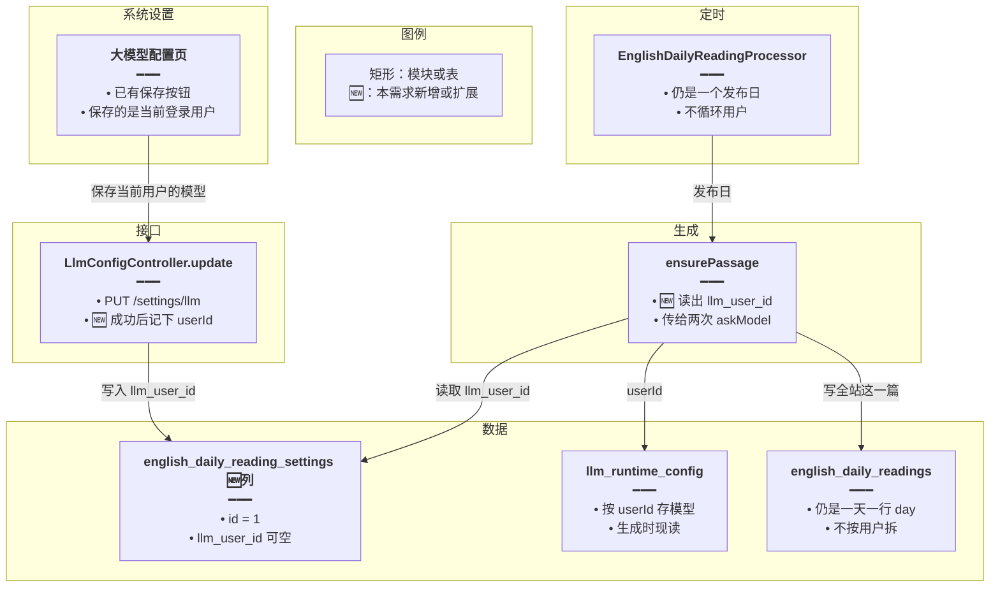
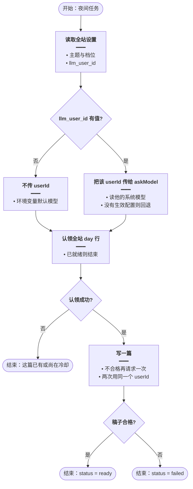
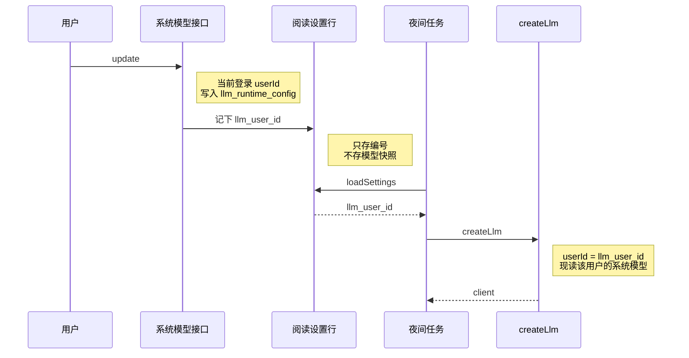
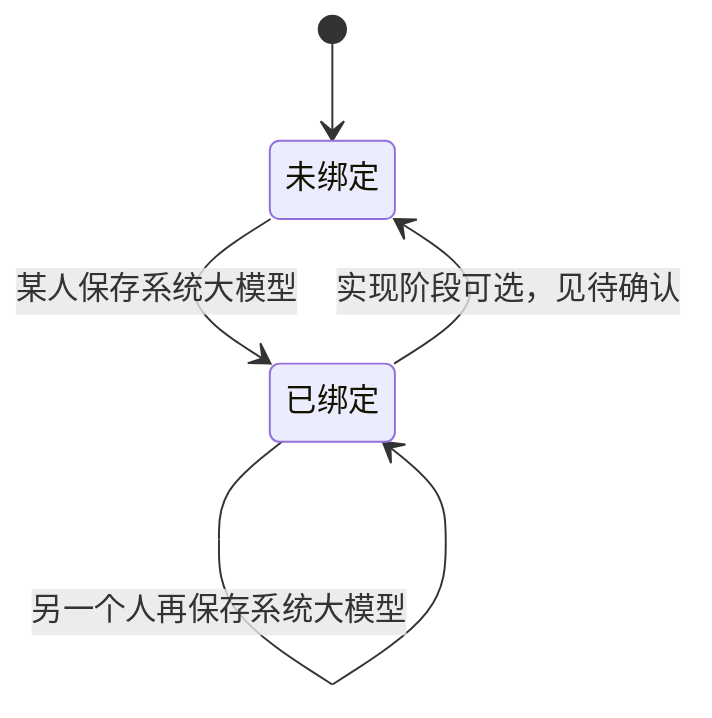

# 每日阅读定时生成使用系统模型 — 实现思路

> **状态**：已放弃（2026-10-16）。不改代码，保持现状：定时生成不传 `userId`，用环境变量默认模型；手动生成用本次登录用户的系统模型；全站仍是一篇。  
> **日期**：2026-10-16  
> **需求摘要**：曾考虑让定时生成带上某个用户的系统模型，或按用户各写一篇。费用记在个人 Key 上却给全站看，按人数生成又会在一个夜里跑不完。两条都不做。下文仅留作否决记录。

## 延伸阅读

- [每日阅读](./每日阅读.md)（前一天生成、当天展示；本文只改定时任务用哪套模型）
- [每日阅读设置](./每日阅读设置.md)（主题与档位仍全站一份，不在这里记用户）
- [每日阅读手动生成](./每日阅读手动生成.md)（手动生成已经传入本次登录用户）

---

## 0. 读本文你将得到什么

- 要解决的问题：夜里的 `ensurePassage` 不传 `userId`，`createLlm` 落到环境变量默认模型。手动生成已经会带登录用户。
- 总体方案：全站仍是一篇、一次模型调用。有人在系统设置里保存大模型时，把该 `userId` 记在全站阅读设置上；定时任务把这个编号传给已有的 `createLlm`。
- 不按用户人数循环，也不为每人另写一篇。用户很多时不会多打模型。
- 分两阶段：M1 记下用户并在定时生成传入；M2 清空配置时的回退与日志。
- 最大边界：全站只有一篇，所以只能绑定一个 `userId`。多人先后保存系统模型时，用最后一次保存系统大模型的那个人，不是最后一次保存阅读主题的人。

---

## 1. 需求与边界

### 1.1 用户故事

| 角色 | 场景 | 行为 | 期望结果 |
|------|------|------|----------|
| 已登录用户 | 在系统设置里保存了自定义大模型 | 等到下一次定时生成 | 这一篇用他系统设置里的模型，而不是环境变量默认模型 |
| 已登录用户 | 之后又在系统设置里改了模型 | 再生成下一发布日 | 新篇用新模型；已经 `ready` 的旧篇不重写 |
| 已登录用户 | 只改每日阅读的主题或难度 | 保存阅读设置 | 不改变定时任务用谁的模型 |
| 已登录用户 | 还没有任何人保存过系统大模型 | 定时任务运行 | 与现在一样，不传 `userId`，用环境变量默认模型 |
| 已登录用户 | 打开列表 | 查看当天短文 | 仍然全站同一篇 |

### 1.2 范围

| 在范围内 | 不在范围内（非目标） |
|----------|----------------------|
| 定时生成的两次 `askModel` 传入已记下的 `userId` | 按用户各写一篇、按人数打模型 |
| 在保存系统大模型（`PUT /settings/llm`）时写下这个 `userId` | 用「最后保存每日阅读设置的人」 |
| 全站设置行增加可空 `llm_user_id` | 扫描谁开了自定义模型，或优先超级管理员 |
| 没记下用户、或该用户已关闭自定义模型时，走 `createLlm` 现有回退 | 在每日阅读页再做 Base URL / API Key 表单 |
| 新迁移；不改已应用的阅读迁移 | 修改已 `ready` 的旧篇 |

### 1.3 约束与依赖

- 定时任务没有登录请求，不能从 JWT 拿用户。编号必须提前落在全站设置行上。
- 复用 `createLlm` → `resolveSiliconFlowCredentials(userId)`：有生效的自定义配置就用它，否则会员档或环境变量。
- 文章唯一键保持 `(publish_date, slot)`。`slot = day` 仍然一天一行。
- 队列仍是一个发布日一个 job，并发 1。
- 手动生成继续用本次请求的 `req.user.userId`，不读 `llm_user_id`。

---

## 2. 方案总览（一句话 + 要点）

**一句话方案**：有人保存系统大模型时记下他的 `userId`；夜间仍只生成一篇，把这个编号传给 `createLlm`。

| # | 设计要点 | 理由 |
|---|----------|------|
| 1 | 仍然全站一篇、一次调用 | 目的只是让自动生成用上系统设置里的模型；按人数生成会随用户数涨费用和耗时 |
| 2 | `userId` 记在阅读设置行，不复制模型名和密钥 | 用户以后改系统设置，下一篇自动读到新配置 |
| 3 | 写入点是 `PUT /settings/llm`，不是保存阅读主题 | 阅读设置的保存者不一定是配模型的人 |
| 4 | 列为空就不传 `userId` | 与现在的默认模型行为一致，任务不失败 |
| 5 | 不扫用户表、不挑超管 | 编号只来自一次真实的保存操作 |

多人都会去保存系统大模型时，全站这一篇只能跟最后一次保存的那个人。若要每个人看到用自己模型写成的不同正文，才需要每人一篇；那会随人数增加调用，不是本需求。

---

## 3. 现状与复用

| 能力 | 仓库中已有 | 本需求中的用法 |
|------|------------|----------------|
| 按用户解析模型 | `createLlm` 的 `userId`，以及 `LlmConfigService.resolveSiliconFlowCredentials` | 定时路径把记下的编号传进去 |
| 手动生成已带登录用户 | `generateManual(..., userId)` | 不改 |
| 夜间一篇 | `EnglishDailyReadingProcessor.process` → `ensurePassage(publishDate)` | 扩展：从设置行取出 `llm_user_id` 再交给 `askModel` |
| 全站设置一行 | `english_daily_reading_settings.id = 1` | 扩展：可空列 `llm_user_id` |
| 保存系统模型 | `LlmConfigController.update` → `LlmConfigService.upsert` | 扩展：保存成功后写下当前 `userId` |
| 文章唯一键 | `uq_english_daily_readings_publish_slot` | 不改 |

**调研结论**：模型解析和「一天一行」都不用重写。缺的只是定时任务手里的那个 `userId`。现在 `ensurePassage` 调用 `askModel` 时不传 `opts`，所以 `createLlm` 没有用户，自定义配置不会生效。

---

## 4. 架构图



**图内方法说明**：

| 方法 / 模块入口 | 功能 |
|-----------------|------|
| `LlmConfigController.update` | 保存当前登录用户的大模型；成功后把该 `userId` 写到全站阅读设置 |
| `LlmConfigService.upsert` | 现有的按用户写入 `llm_runtime_config`；本需求不改它的存储格式 |
| `ensurePassage` | 定时生成全站一篇；从设置行取出 `llm_user_id` 传给 `askModel` |
| `createLlm` | 有 `userId` 就读该用户的系统模型；没有生效配置则会员档或环境变量 |

**读图要点**：

- 阅读列表和文章表都不按用户拆开。
- `userId` 只在「保存系统模型」和「定时生成」之间传递。
- 模型名、地址、密钥仍留在 `llm_runtime_config`，阅读设置只多一个编号。

---

## 5. 主流程图



**图内方法说明**：

| 方法 | 功能 |
|------|------|
| `loadSettings` | 读出全站档位和 `llm_user_id`；列为空表示还没有人保存过系统模型 |
| `askModel(..., { userId })` | 有编号就传入；废稿重试用同一次读到的编号，中途不换人 |
| `createLlm` | 按编号解析模型；该用户后来关掉自定义配置时，走现有回退，生成不失败 |
| `claim` | 仍按发布日认领全站唯一的 `slot = day` 行 |

**读图要点**：

- 无论有没有 `userId`，都只认领并写一行。
- 分支只决定模型凭证，不决定写几篇。
- 认领失败就结束，不会去找另一个用户再写一篇。

---

## 6. 核心时序图



**图内方法说明**：

| 方法 | 功能 |
|------|------|
| `update` | 用户保存系统大模型；这是记下 `userId` 的唯一写入点 |
| `loadSettings` | 定时任务开始时读出编号和阅读档位 |
| `createLlm` | 用该编号生成全站这一篇；编号为空则本次不传 `userId` |

**读图要点**：

- 保存系统模型和夜间生成是两次分开的请求。夜间没有登录态。
- 生成时现读 `llm_runtime_config`，所以中间改过模型也会生效。
- 时序里只有一次 `createLlm`。废稿重试是同一次任务里的第二次，仍用同一个编号。

---

## 7. 状态机

`llm_user_id` 只有两种情况，文章行的 `pending / ready / failed` 不变。



**图内方法说明**：

| 方法 | 功能 |
|------|------|
| `update` | 把 `llm_user_id` 设为当前保存系统模型的用户；后保存的人覆盖先前的人 |
| `clear` | 现有的「恢复默认配置」。是否把绑定清掉见待确认；不清掉时，`createLlm` 发现没有生效自定义配置会自己回退 |

**读图要点**：

- 绑定的是「谁的系统模型」，不是阅读主题的保存者。
- 覆盖只影响还没生成的下一篇。

---

## 8. 模块职责与接口草图

### 8.1 模块一览

| 模块 | 职责 | 新增/改动 | 预估路径 |
|------|------|-----------|----------|
| 阅读设置实体 | 可空 `llm_user_id` | 扩展 | `apps/backend/src/services/english-learning/entity/english-daily-reading-setting.entity.ts` |
| 迁移 | 给设置表加列 | 新增 | `apps/backend/src/migrations/` 新文件 |
| 系统模型保存 | 保存成功后写 `llm_user_id` | 扩展 | `llm-config.service.ts` 的 `upsert`，或由阅读服务提供一个只写编号的方法 |
| 定时生成 | 读编号并传入 `askModel` | 扩展 | `english-daily-reading.service.ts` 的 `ensurePassage` |
| 工人 | 仍调用一次 `ensurePassage(发布日)` | 不改循环 | `english-daily-reading.processor.ts` |
| 文章表 | 一天一行 | 不改 | `english-daily-reading.entity.ts` |
| 前端 | 无新表单 | 不改 | 系统设置页和每日阅读设置页都保持原样 |

### 8.2 关键接口（伪代码）

```typescript
// 系统模型保存成功后调用；只记编号，因为生成时还要现读该用户的配置
function rememberDailyReadingModelUser(userId: number): Promise<void>;

// 定时生成；userId 来自设置行，没有则不传，避免再扫用户表
function ensurePassage(publishDate: string): Promise<void>;
```

### 8.3 数据模型

| 字段/实体 | 来源 | 存储 | 说明 |
|-----------|------|------|------|
| `llm_user_id` | 保存系统大模型时的 `req.user.userId` | `english_daily_reading_settings.llm_user_id`，可空 | 没有保存过则为空 |
| 模型正文 | 该用户的 `llm_runtime_config` | 不复制 | 生成当时由 `createLlm` 读取 |
| 定时篇 | 全站 | `english_daily_readings`，`slot = day` | 唯一键不变 |

---

## 9. 分阶段实现步骤

| 阶段 | 目标 | 交付物 | 依赖 |
|------|------|--------|------|
| M1 | 定时生成能用上系统模型 | 设置列、保存时写入、`ensurePassage` 传入 | 无 |
| M2 | 关掉自定义配置时行为明确 | 回退与日志 | M1 |

- [ ] M1：新迁移为设置表增加可空 `llm_user_id`
- [ ] M1：`upsert` 成功后调用 `rememberDailyReadingModelUser`
- [ ] M1：`ensurePassage` 两次 `askModel` 使用该编号；为空则不传
- [ ] M1：不改文章唯一键，不改工人的「一个发布日一次」
- [ ] M2：日志写下这次用的 `userId` 和解析出的模型名（不要打出密钥）
- [ ] M2：确认 `clear` 之后下一篇走回退，而不是失败

---

## 10. 关键决策与备选方案

| 决策 | 选用 | 备选 | 为何不选备选 |
|------|------|------|--------------|
| 写几篇 | 全站一篇，一次 `createLlm` | 每个用户一篇 | 用户多时调用次数、耗时、费用都线性增长；目的只是带上 `userId` |
| 编号从哪来 | 最后一次保存系统大模型的用户 | 最后一次保存每日阅读主题的人 | 改主题的人不一定配过模型 |
| 编号从哪来 | 保存动作留下的一个 id | 任务里扫描已开启配置或超管 | 扫描挑人已被否定 |
| 模型存在哪 | 仍在 `llm_runtime_config`，生成时现读 | 把模型名和密钥抄到阅读设置 | 抄一份会和系统设置越改越不一致 |
| 没绑定用户 | 不传 `userId` | 随便拿用户表第一个 | 和现在的默认模型一致，也不误用别人的密钥 |

---

## 11. 风险、边界与待确认

| 项 | 等级 | 说明 | 缓解 |
|----|------|------|------|
| 多人各有一套模型 | 中 | 全站一篇只能用其中一个 `userId` | 用最后一次保存系统大模型的人；文档和验收写明这一点 |
| 保存后用户关掉自定义模型 | 低 | 编号还在，但快照不再生效 | `createLlm` 已回退到会员或环境变量，生成不失败 |
| 用户被删除 | 低 | 编号指向不存在的用户 | 解析不到配置时同样回退 |
| 恢复默认配置 | 低 | `clear` 会关掉自定义模型 | 待确认是否同时把 `llm_user_id` 置空；不置空也能回退 |

**待确认**：

- [ ] `DELETE /settings/llm`（恢复默认）时，是否把 `llm_user_id` 清空。验证方式：看下一篇日志里的 `userId` 是否还在，以及实际模型是否已回到环境变量。建议清空，避免编号还指向一个已关闭自定义配置的用户。

---

## 12. 验收清单

| # | 用例 | 步骤 | 期望 |
|---|------|------|------|
| AC1 | 定时生成用系统模型 | 用户保存系统大模型后，触发一次定时生成 | 日志中的模型名与该用户系统设置一致；全站仍只有一篇 |
| AC2 | 未保存过系统模型 | 设置列为空时跑定时任务 | 不传 `userId`，使用环境变量默认模型，任务成功 |
| AC3 | 改阅读主题不换人 | 另一个用户只保存每日阅读主题 | `llm_user_id` 不变，下一篇仍用原先那个人的系统模型 |
| AC4 | 改系统模型 | 绑定用户改了模型名后再生成下一发布日 | 新篇用新模型；已 `ready` 的篇不重写 |
| AC5 | 关掉自定义模型 | 该用户恢复默认配置后再生成 | 篇仍生成，模型为回退后的默认档 |
| AC6 | 人数 | 用户表有多人 | 这一发布日仍然只有一次定时生成，不是每人一次 |
| AC7 | 手动生成 | 另一登录用户点手动生成 | 仍用这次请求的登录用户，不改 `llm_user_id` |

---

## 13. 预估改动面（实现阶段参考）

| 类型 | 路径（预估） |
|------|--------------|
| 后端 | `english-daily-reading-setting.entity.ts`、新迁移、`english-daily-reading.service.ts` 的 `ensurePassage`、`llm-config.service.ts` 的 `upsert` |
| 前端 | 无 |
| 文档（实现后） | 落地后再写 `wiki/english/` 归档；本文保持规划说明 |

---

（本文档为规划态实现思路；落地后以源码为准）
