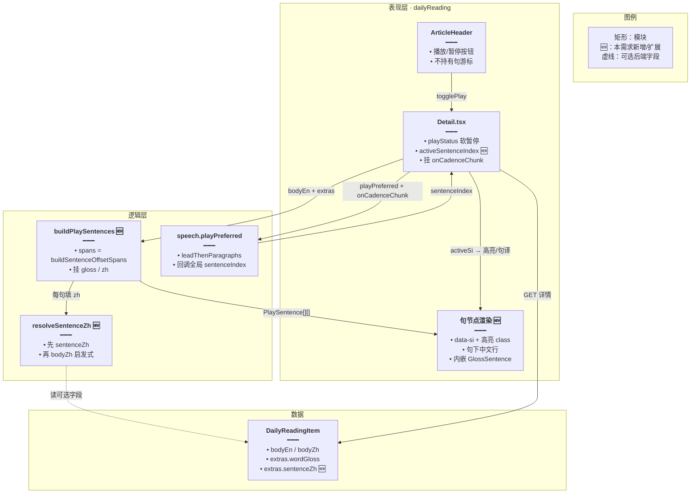
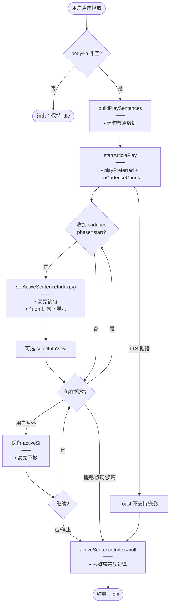
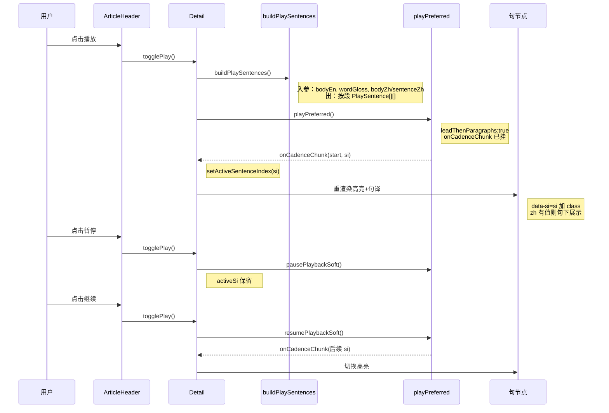
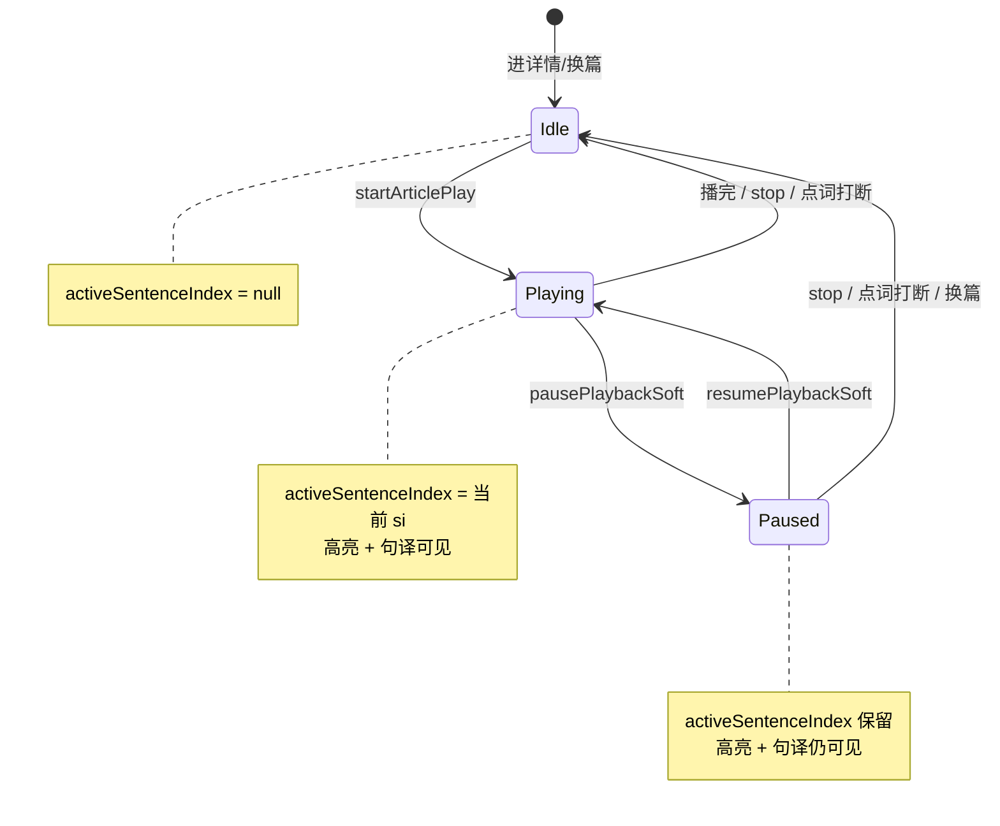

# 每日阅读播放句高亮 — 实现思路

> **状态**：规划（未实现；播放软暂停、cadence 句下标、GlossSentence 点词可复用）  
> **日期**：2026-11-01  
> **需求摘要**：用户在每日阅读详情播放英文时，当前句在正文中高亮，并在该句正下方展示对应中文释义。  
> **一句话方案（预告）**：以 `buildSentenceOffsetSpans(bodyEn)` 为句索引 SSOT，接 `onCadenceChunk` 驱动 React 句节点 CSS 高亮；句下中文优先读 `extras.sentenceZh`，历史篇用 `bodyZh` 启发式对齐兜底。

## 延伸阅读

- [每日阅读](./每日阅读.md)（详情朗读、`leadThenParagraphs`、中文整篇折叠）
- [EPUB听书段落朗读](../epub/EPUB听书段落朗读.md) → 归档 [ebook/EPUB听书段落朗读.md](../../ebook/EPUB听书段落朗读.md)（书库逐句高亮状态机；交互可参考，绘制层勿照搬）
- [TTS按资源库分目录](../tts/TTS按资源库分目录.md)（`ttsCacheScopeDailyReading`）
- [详情侧栏阅读列表](./详情侧栏阅读列表.md)（详情分栏壳，本需求不改列表）

---

## 0. 读本文你将得到什么

- 要解决：播放时正文无当前句反馈；中文只有整篇折叠，跟不上正在听的那一句。
- 选定方案：cadence 全局 `sentenceIndex` + 正文句节点 CSS 高亮（色值对齐书库浅绿）+ 当前句下插一行译文。
- 主要改前端：`Detail.tsx`、`body.tsx`、可选小 Hook；生成侧可选写 `extras.sentenceZh`；不动 EPUB SVG 层。
- 分三阶段：M1 高亮+启发式译文 → M2 生成写 `sentenceZh` → M3 跟读滚动与暂停态保留高亮。
- 最大风险：英文 TTS 句界与 `glossParagraphs` / `bodyZh` 切分不一致导致高亮错位或译文对错句。

---

## 1. 需求与边界

### 1.1 用户故事

| 角色 | 场景 | 行为 | 期望结果 |
|------|------|------|----------|
| 已登录用户 | 每日阅读详情 | 点播放开始听全文 | 当前英文句背景高亮；该句正下方出现对应中文 |
| 已登录用户 | 播放中 | 听下一句 | 高亮与句下中文同步切到下一句；旧句高亮与译文消失 |
| 已登录用户 | 播放中 | 点暂停 | 高亮与句下中文停在当前句，不消失 |
| 已登录用户 | 暂停后 | 点继续 | 从当前位置续播，高亮继续跟 cadence |
| 已登录用户 | 播放结束 / 点词打断 / 换篇 | — | 清除高亮与句下中文，回到 idle |
| 已登录用户 | 无 `sentenceZh` 的旧篇 | 播放 | 仍尽量高亮；译文有启发式则显示，对不齐则只高亮不瞎猜译文 |

### 1.2 范围

| 在范围内 | 不在范围内（非目标） |
|----------|----------------------|
| 详情页全文播放时的句级高亮 | 搬 EPUB marks-pane SVG / iframe 浮层 |
| 当前播放句正下方展示该句中文 | 朗读中文；词级跟读高亮 |
| 与现有软暂停 / 续播共存 | 改「今日记词」单词播 |
| 统一英文句索引与 TTS `sentenceIndex` | 重做整篇「显示中文」折叠交互（可保留作全文对照） |
| 历史篇启发式对齐；新篇可写 `sentenceZh` | 强制回填历史库全量译文；点词 Popover 改版 |

### 1.3 约束与依赖

- 须复用：`playPreferred` / `onCadenceChunk` / `buildSentenceOffsetSpans`（`apps/frontend/src/utils/speech.ts`）；详情已有 `playStatus` 软暂停链路。
- 交互参考书库：句游标 → 换句 clear 旧视觉 → 画新视觉；**绘制**用 React class，不抄 `epubListenMarkHighlight`。
- Ponytail：最少新状态（一个 `activeSentenceIndex`）；不新依赖；不拆无必要抽象层。
- 性能：短文 2～4 段，句数通常 < 30；`scrollIntoView` 节流即可。
- 互斥：点词 `playWord` 会打断全文 → 必须清句高亮；与 `GlossSentence` 词 Popover 可并存（高亮在句容器上）。

---

## 2. 背景

- **谁、场景、卡点**：用户在每日阅读详情听英文短文时，只能靠耳朵跟进度；眼睛看不到「正在播哪一句」，也无法边听边看该句中文。
- **现状缺口**：
  - 播放已接 `leadThenParagraphs` + 软暂停，但 **未传** `onCadenceChunk`，没有 `sentenceIndex` UI 状态。
  - 正文有 `glossParagraphs` 伪分句（靠 `wordGloss.en` 子串），**无** `data-sentence-index`，且切分算法 ≠ TTS 的 `buildSentenceOffsetSpans`。
  - 中文是整篇 `bodyZh` 折叠，**不是**逐句挂在英文句下。
  - 书库听书有句高亮状态机，但是 EPUB Range→SVG；每日阅读是普通 React DOM，不宜照搬绘制层。书库也 **没有**「句下中文」。
- **不解决会怎样**：听力练习时频繁点「显示中文」看整篇，认知负担大；跟读体验明显弱于书库。
- **硬约束**：不能破坏现有软暂停/续播与 TTS 磁盘缓存；不能让错误译文挂在高亮句下（对不齐就宁可不显示句译）。

---

## 3. 现状与复用

| 能力 | 仓库中已有 | 本需求中的用法 |
|------|------------|----------------|
| 详情播放 / 软暂停 | `dailyReading/Detail.tsx`：`startArticlePlay` / `togglePlay` / `playStatus` | **扩展**：起播时挂 `onCadenceChunk`，维护 `activeSentenceIndex` |
| TTS 句下标 | `utils/speech.ts`：`buildSentenceOffsetSpans`、`onCadenceChunk.sentenceIndex`（分包时 `baseSi + local`） | **直接复用**：UI 游标唯一真相 |
| 分段合成 | `leadThenParagraphs` + `splitLeadSentenceThenParagraphs` | **直接复用**：不改成逐句 HTTP |
| 英文展示切分 | `dailyReading/utils/body.tsx`：`glossParagraphs` | **扩展**：改为「SSOT 句列表 + 挂 gloss」，或映射到同一 `si` |
| 点词释义 | `GlossSentence.tsx` / `WordLine` | **直接复用**：仍挂在句内；句容器负责高亮与句译 |
| 整篇中文 | `Detail.tsx`：`showZh` + `paragraphs(bodyZh)` | **保留**：全文对照；播放句译是另一条通道 |
| 书库句高亮状态机 | `useEpubChapterListen` → `onSentence` → clear/show | **参考交互**：换句协议；**不适用** SVG 绘制 |
| 选区朗读句预览 | `SelectionSpeak/useSelectionSpeak.ts`：`applySentence(si)` | **参考**：用同一套 spans 切 plain；每日阅读改画正文而非浮层 preview |
| 后端英文切句 | `daily-reading.rules.ts`：`passageSentences`（供 wordGloss） | **扩展（M2）**：同批生成 `sentenceZh`；注意与前端 SSOT 对齐策略见 §4.5 |
| 播放按钮 | `DailyPlayIconButton` + `ArticleHeader` | **直接复用**：不改 API |
| i18n | `englishLearning` locales | **扩展**：必要时加「无句译」空态（可省略文案，直接不渲染） |

**调研结论**：播放基础设施和 cadence 句下标已就绪，缺口全在详情 UI 与「英文句 ↔ 中文句」对齐。书库只借「句游标状态机」模式；每日阅读应走 React 句节点，而不是 EPUB 浮层。候选方案都必须接上 `onCadenceChunk` 与 `Detail.tsx` 现有 `playPreferred`。

---

## 4. 方案比对与最终方案

### 4.1 候选方案

#### 方案 A：cadence 游标 + React 句节点 CSS（复用 speech，扩展详情）

- **做法**：
  1. 用 `buildSentenceOffsetSpans(row.bodyEn)` 生成全局句列表（与 TTS `sentenceIndex` 同算法）。
  2. 正文按段落渲染，但段内每个句是带 `data-si` 的节点；`activeSentenceIndex === si` 时加高亮 class，并在节点内/正下方渲染句译。
  3. `playPreferred(..., { onCadenceChunk })`：`phase === 'start'`（或 progress 换句）时 `setActiveSentenceIndex(event.sentenceIndex)`。
  4. idle / 点词打断 / 换篇：置 `null`。
- **能工作的原因**：`speech.ts` 在 `leadThenParagraphs` 分包路径里已把局部句号加成全局 `sentenceIndex`；短文 DOM 可直接 class 切换。
- **主要代价**：必须把展示切分从「仅 gloss 子串」收成与 spans 一致，否则高亮会落在错节点上；句译仍依赖对齐策略（§4.5）。

#### 方案 B：仿书库逐句 HTTP 单元播放（扩展播放层）

- **做法**：放弃（或旁路）`leadThenParagraphs` 整包进度估句；改为类似 `playListenUnitsFromCursor`：一文切成 N 个句请求，每句起播回调 `onSentence(si)` 再高亮。
- **能工作的原因**：句界与 HTTP 边界 1:1，不依赖 `currentTime` 估句。
- **主要代价**：更多 TTS 往返；与现网每日阅读缓存粒度、软暂停段间逻辑、首句+段落切分策略冲突；改动 `speech` 调用方式面大。

#### 方案 C：把 EPUB `showListenMarkHighlight` 接到每日阅读 DOM

- **做法**：对当前句 `Range` 调 SVG/绝对定位浮层，色值复用 `rgba(135, 207, 92, 0.15)`。
- **能工作的原因**：书库已验证换句 clear/画。
- **主要代价**：每日阅读无 marks-pane / iframe；为普通 `<article>` 引入 Range 测量、resize relayout、双清协议，复杂度和 EPUB 耦合高；句下中文仍要另做 React 行，浮层帮不上译文。

### 4.2 比对

| 维度 | 方案 A | 方案 B | 方案 C |
|------|--------|--------|--------|
| 正确性（失败路径、边界、数据是否会错） | 依赖 spans 与 DOM 同构；估句偶有提前量（书库/SelectionSpeak 已接受） | 句界最硬；但切句若与展示不一致仍会错 UI | Range 测错或布局抖会漂；短文上无额外正确性收益 |
| 复用 / 与现状契合 | 直接接现有 `playPreferred`+软暂停+`leadThenParagraphs` | 偏离每日阅读刚接好的播放路径 | 复用 EPUB 绘制文件，但页面栈不契合 |
| 改动面 | `Detail` + `body` 渲染 + 小 Hook；speech 只消费回调 | `Detail` + 播放编排大改，可能动缓存假设 | 引入 ebook listen 绘制依赖到 englishLearning |
| 复杂度 | 一个 index 状态 + 句节点；低 | 单元队列/游标/预取；中高 | Range/SVG/relayout；高 |
| 体验 | 高亮跟读接近书库；首包出声即可亮 | 句切换更「脆」；请求多可能顿挫 | 视觉可接近书库，但句译仍另做；过度工程 |
| 风险 | 展示切分迁移时漏句 | 破坏软暂停与缓存；回滚面大 | 跨域依赖；iframe 逻辑误用 |
| 可维护性 | 英语学习域内闭环 | 两套播放策略并存难维护 | 英语详情绑 EPUB util，以后改听书易误伤 |

### 4.3 综合考量

本需求权重最高的是：**与现有每日阅读播放契合**、**改动面**、**体验正确性**。方案 A 在 speech 已提供全局 `sentenceIndex` 的前提下，用最少状态完成跟读高亮，且不掀翻刚落地的软暂停。方案 B 的「句界更硬」在短文 + 已有估句补偿（SelectionSpeak 同款 cadence）下收益有限，却放弃 `leadThenParagraphs` 的缓存与段间体验。方案 C 只解决「怎么画背景」，不解决句译，还引入 EPUB 绘制栈。

**选定方案 A**。明确放弃方案 B「逐句 HTTP 边界最硬」的优点，以及方案 C「与书库像素级同一套绘制」的优点——每日阅读不需要 EPUB 级浮层，React class 足够且利于在句节点下挂中文。

### 4.4 最终方案

#### 背景

详情已能全文播放并软暂停，但 UI 停在篇级 `playStatus`。speech 已能在 `leadThenParagraphs` 下回调全局 `sentenceIndex`，详情未接。正文切分与 TTS 句界两套算法。用户要的「当前句高亮 + 句下中文」必须先统一英文句索引，再在同一 `si` 上挂视觉与译文。

#### 具体思路

1. **模块**：逻辑放 `dailyReading` 内小函数/Hook（如 `useDailyReadingPlayCursor`）；展示仍在 `Detail` + `body.tsx`；不新增 npm 包；不引用 `epubListenMarkHighlight`。
2. **数据**：英文句列表 = `buildSentenceOffsetSpans(bodyEn)` 切片；gloss 用现有子串匹配挂到句上；句译见 §4.5。
3. **状态**：`activeSentenceIndex: number | null` 放在详情页（或上述 Hook）。不进 MobX、不上 URL。暂停时 **保留** index；idle/打断/换篇清掉。
4. **边界**：无 spans → 不播或播但不亮；`si` 越界忽略；点词 `playWord` 先清 cursor；布局后 `scrollIntoView({ block: 'nearest' })` 可选。

#### 实现方案

**一句话**：以 `buildSentenceOffsetSpans(bodyEn)` 为句索引 SSOT，接 `onCadenceChunk` 驱动 React 句节点 CSS 高亮；句下中文优先读 `extras.sentenceZh`，历史篇用 `bodyZh` 启发式对齐兜底。

| 步骤 | 谁 | 做什么 | 输入 → 输出 |
|------|----|--------|-------------|
| 1 | `dailyReading/utils/playSentences.ts`（新） | 建句模型：spans → `{ si, en, words?, zh? }[]`，并保留段落分组 | `bodyEn` + gloss + zh 源 → `PlaySentence[]` / `PlaySentence[][]` |
| 2 | `Detail.startArticlePlay` | `playPreferred` 增加 `onCadenceChunk`；start 相位写 `activeSentenceIndex` | cadence 事件 → `number` |
| 3 | 正文渲染 | 段内 map 句节点；`data-si`；active 时 class + 句下 `<p>` 译文 | `PlaySentence` + activeSi → DOM |
| 4 | 清理 | idle / 点词 / `id` 变化时 `setActiveSentenceIndex(null)` | — → 无高亮无句译 |
| 5 | （M3）跟读 | active 节点 `scrollIntoView` | si 变化 → 滚动 |

#### 选定原因

1. **复用 / 与现状契合**：继续 `playPreferred`+软暂停+`leadThenParagraphs`，只加回调。牺牲：不用逐句 HTTP 的硬边界。
2. **改动面**：集中在每日阅读详情与 `body` 工具。牺牲：不复用 EPUB 现成 SVG 文件。
3. **复杂度**：一个游标状态。牺牲：没有与书库完全同一套绘制抽象（也不需要）。
4. **正确性**：SSOT 与 TTS 同函数，避免「UI 一句、TTS 另一句」。牺牲：估句可能略提前（与书库一致可接受）。
5. **可维护性**：不跨 ebook 域。牺牲：高亮样式要在详情 CSS 里维护一份（可常量对齐书库色值）。

#### 优势

- 相对方案 B：保留现网分段缓存与软暂停路径，避免播放层大改和顿挫风险。
- 相对方案 C：句节点上直接挂译文，高亮与释义同一 DOM 父亲；无 Range/relayout 负担。

#### 怎么实现

1. 新增 `buildPlaySentences(...)`（步骤 1）。
2. `Detail` 用其渲染；`startArticlePlay` 挂 cadence（步骤 2～3）。
3. 清理与暂停保留（步骤 4）。
4. M3 跟读滚动（步骤 5）。  
主要代码见 §9。

### 4.5 其他关键决策：句下中文数据从哪来

#### 4.5.1 候选

##### 方案 Zh-A：仅前端启发式（切 `bodyZh`）

- **做法**：用中文句末标点（`。！？；`）及段落切 `bodyZh`；若句数与英文 spans 相等则按序配对；否则尝试「段内句数相等」再配对；再失败则该 `si` 无句译。
- **能工作的原因**：生成稿中英段落大致平行，短文常能对齐。
- **主要代价**：模型偶尔中英句数不等 → 部分句无译或错位风险（错位时宁可不显示）。

##### 方案 Zh-B：生成时写入 `extras.sentenceZh: string[]`

- **做法**：在 `daily-reading` 生成/校验链路增加与英文句列表等长的中文句数组；前端有则直接 `sentenceZh[si]`。历史篇走 Zh-A 兜底。
- **能工作的原因**：对齐在源头完成；播放只读。
- **主要代价**：要动生成 prompt / extras 类型 / 校验；旧数据仍无字段。

##### 方案 Zh-C：用 `wordGloss.words[].zh` 拼成「句译」

- **做法**：当前句有 gloss 时把词义拼成一行展示。
- **能工作的原因**：数据已在。
- **主要代价**：词义拼接 ≠ 整句译文，不符合「中文释义」跟读预期。

#### 4.5.2 比对

| 维度 | Zh-A | Zh-B | Zh-C |
|------|------|------|------|
| 正确性 | 短文多数可用；不对齐时需放弃显示 | 新篇最高；旧篇仍依赖 A | 语义不是句译，易误导 |
| 复用 | 只用已有 `bodyZh` | 扩展 extras 生成 | 复用 wordGloss |
| 改动面 | 仅前端 | 前端 + 后端生成/类型 | 仅前端 |
| 复杂度 | 对齐启发式中等 | 生成约束清晰，播放最简单 | 低但产品错 |
| 体验 | 旧篇也能尽量有句译 | 新篇稳定；旧篇渐进 | 看起来像词典不是译文 |
| 风险 | 错位译文 | prompt 漏字段 | 用户以为是整句意思 |
| 可维护性 | 启发式需测样例 | 字段契约清晰 | 短期省事长期抱怨 |

#### 4.5.3 综合考量

句译 **正确性** 权重大于「零后端改动」。Zh-C 产品语义不对，直接排除。Zh-A 适合立刻上高亮跟读；Zh-B 让新篇稳定。

**选定：Zh-B 为主契约 + Zh-A 为缺失兜底**（同一实现里 `resolveSentenceZh(si)` 先读 extras，再启发式）。放弃 Zh-C「零新字段」；放弃「只做 Zh-A 永不写后端」在新篇上的不稳定性。

#### 4.5.4 最终方案（句译）

##### 背景

只有 `bodyZh` 整篇文本；`wordGloss` 是词级。播放句下需要 **整句中文**，且必须与 TTS `si` 对齐。

##### 具体思路

1. 类型增加可选 `extras.sentenceZh?: string[]`。
2. **索引约定**：`sentenceZh[i]` 对应 `buildSentenceOffsetSpans(bodyEn)[i]` 切出的英文（前端 SSOT）。生成侧应用 **同一套切句规则** 或切完后按字符串对齐到 spans；若后端暂用 `passageSentences`，入库前按 en 文本匹配到 span 下标再写出数组（空位留 `''`）。
3. 前端 `resolveSentenceZh`：`extras.sentenceZh?.[si]` 非空 → 用；否则启发式；再否则 `undefined`（只高亮）。
4. 不自动改写整篇 `showZh`；用户仍可展开全文中文。

##### 实现方案

**一句话**：新篇生成写 `sentenceZh`；播放按 `si` 取值；旧篇启发式对齐，失败则不显示句译。

| 步骤 | 谁 | 做什么 | 输入 → 输出 |
|------|----|--------|-------------|
| 1 | 后端 extras 组装 | 生成/校验写入 `sentenceZh` | 英文句列 + 模型中文 → `string[]` |
| 2 | 前端 `buildPlaySentences` | 填 `zh` 字段 | extras / bodyZh → 每句 `zh?` |
| 3 | 句节点 | active 且 `zh` 有值时渲染句下译文 | `zh` → DOM |

##### 选定原因

1. **正确性**：源头对齐优于纯猜。牺牲：要改生成。
2. **体验**：旧篇不至于完全没有句译。牺牲：启发式偶发缺失。
3. **复用**：不推翻 `bodyZh` 全文折叠。牺牲：两套中文入口（全文 vs 句下）需在文案上区分使用场景（句下无额外按钮即可）。

##### 优势

- 相对仅 Zh-A：新篇译文稳定，减少错句。
- 相对 Zh-C：展示的是整句意思，不是词表拼接。

##### 怎么实现

M1 先落地 Zh-A + 高亮（不挡跟读）；M2 接 Zh-B。§9 给出前端 `resolveSentenceZh` 与 cadence 接线；生成 prompt 字段在 M2 任务清单中列出。

---

## 5. 架构图



**图内方法说明**：

| 方法 / 模块入口 | 功能 |
|-----------------|------|
| `togglePlay()` | 详情播放开关：playing→软暂停；paused→软续播；否则 `startArticlePlay` |
| `startArticlePlay()` | `stopAllPlayback` 后 `playPreferred(bodyEn)`；挂 cadence；维护 `playStatus` |
| `buildPlaySentences(bodyEn, gloss, zhSource)` | 用 `buildSentenceOffsetSpans` 建全局句列，挂 gloss 与句译，按段落分组供渲染 |
| `resolveSentenceZh(si, …)` | 解析第 `si` 句中文：优先 `extras.sentenceZh`，否则启发式，失败返回 `undefined` |
| `playPreferred(text, opts)` | 统一 TTS 入口；`leadThenParagraphs` 下仍回调全局 `sentenceIndex` |
| `onCadenceChunk(event)` | 播放层句/块相位回调；详情用 `event.sentenceIndex` 更新高亮游标 |
| `buildSentenceOffsetSpans(plain)` | 计算 plain 内句 `[start,end)`，与 cadence 下标对齐 |

**读图要点**：

- 句游标只活在 Detail；Header 只管播控。
- 新增集中在「建句 + 解析句译 + 句节点」，speech / EPUB 绘制不进依赖。
- `sentenceZh` 为虚线可选；无字段时 Resolve 走启发式。

---

## 6. 主流程图



**图内方法说明**：

| 方法 | 功能 |
|------|------|
| `buildPlaySentences(...)` | 开播前（或 row 变更时）建渲染用句模型，保证与 TTS 下标同构 |
| `startArticlePlay()` | 开启全文会话并注册 cadence |
| `setActiveSentenceIndex(si)` | 更新当前句；驱动 class 与句下中文 |
| `scrollIntoView`（DOM） | 将当前句滚入 ScrollArea 可视区（M3） |
| `pausePlaybackSoft` / `resumePlaybackSoft` | 软暂停/续播；暂停不清 `activeSi` |

**读图要点**：

- 入口是详情播放，不是点词。
- 暂停保留高亮；真正结束才 Clear。
- TTS 失败也走 Clear，避免残影。

---

## 7. 核心时序图



**图内方法说明**：

| 方法 | 功能 |
|------|------|
| `togglePlay()` | Header 触发的播控入口，按 `playStatus` 分支 |
| `buildPlaySentences()` | 将篇数据收成与 cadence 同下标的句模型 |
| `playPreferred()` | 启动/驱动全文 TTS，回调全局句号 |
| `onCadenceChunk(start, si)` | 新句开始时把 UI 游标推到 `si` |
| `pausePlaybackSoft()` | 软暂停音频，不拆会话、不清句游标 |
| `resumePlaybackSoft()` | 从暂停点继续；后续仍走 cadence |
| 句节点重渲染 | 根据 `activeSentenceIndex` 切换高亮 class 与句下中文 |

**读图要点**：

- 用户只打在 Header；游标与渲染在 Detail/句节点。
- 暂停不重置 `si`，与书库「停在当前句」一致。
- 无 EPUB 高亮模块参与。

---

## 8. 状态机



**图内方法说明**：

| 方法 | 功能 |
|------|------|
| `startArticlePlay()` | Idle→Playing，注册 cadence |
| `pausePlaybackSoft()` | Playing→Paused，保留句游标 |
| `resumePlaybackSoft()` | Paused→Playing |
| `stopAllPlayback()` / 点词 | 任意播放态→Idle 并清游标 |

---

## 9. 具体实现（主链路代码）

### 9.1 模块一览

| 模块 | 职责 | 新增/改动 | 预估路径 |
|------|------|-----------|----------|
| 句模型 | spans + gloss + zh | 新增 | `apps/frontend/src/views/englishLearning/dailyReading/utils/playSentences.ts` |
| 详情播放 | cadence 游标、清理 | 改动 | `.../dailyReading/Detail.tsx` |
| 正文渲染 | 连续 justify；有句译时 head/zh/tail 切开 | 改动 | `Detail.tsx`（`PlaySentenceRun`） |
| 类型 | `sentenceZh?` | 改动 | `apps/frontend/src/service/index.ts` + 后端 extras |
| 生成（M2） | 写入 `sentenceZh` | 改动 | `apps/backend/src/services/english-learning/daily-reading.rules.ts` 等 |
| 样式 | 高亮色 | 改动 | 详情 className；色值对齐书库 `rgba(135, 207, 92, 0.15)` |

### 9.2 主链路实现

```typescript
// 对应 §4.4 步骤 1。与 TTS 共用 buildSentenceOffsetSpans，避免 UI 句号和 cadence 各算各的
import { buildSentenceOffsetSpans } from '@/utils/speech';

// 渲染与 cadence 共用的一句；si 是全局下标
export type PlaySentence = {
	// 全局句下标，直接等于 onCadenceChunk.sentenceIndex
	si: number;
	// 该句英文，供渲染与 gloss 匹配
	en: string;
	// 点词数据；对不上 wordGloss 时为 null，仍渲染纯文本
	words: { w: string; zh: string }[] | null;
	// 句下中文；对不齐时为 undefined，只高亮不瞎猜
	zh?: string;
};

// 对应 §4.5。先信生成字段，再启发式，避免旧篇完全没有句译
export function resolveSentenceZh(input: {
	// 当前播放/渲染的全局句号
	si: number;
	// 新篇 extras；缺省表示历史数据
	sentenceZh?: string[] | null;
	// 仅句数对齐成功时传入，避免错位译文
	alignedHeuristic?: string[];
}): string | undefined {
	// 新篇：生成侧已按英文句序写好
	const fromExtras = input.sentenceZh?.[input.si]?.trim();
	// 有生成句译就用，不再走启发式，防止两套来源打架
	if (fromExtras) return fromExtras;
	// 旧篇：仅当启发式数组与英文句数对齐时才取值
	const fromHeuristic = input.alignedHeuristic?.[input.si]?.trim();
	// 对不齐时返回 undefined，调用方只高亮不渲染句译
	return fromHeuristic || undefined;
}

// 对应 §4.4 步骤 1。按段落包一层，方便继续用 <p> 排版
export function buildPlaySentences(
	// 与 playPreferred 同一份英文正文
	bodyEn: string,
	// 可选 wordGloss；只挂词，不定义句界
	gloss: { en: string; words: { w: string; zh: string }[] }[] | undefined,
	// 由 resolveSentenceZh 闭包注入，便于单测替换来源
	zhBySi: (si: number) => string | undefined,
): PlaySentence[][] {
	// plain 与 playPreferred 入参一致，保证偏移同坐标系
	const plain = bodyEn.trim();
	// 句界 SSOT：与 speech cadence 同一函数
	const spans = buildSentenceOffsetSpans(plain);
	// 先摊平成全局句列，再按段分组
	const sentences: PlaySentence[] = spans.map((span, si) => {
		// 用 span 切片，保证 en 与 sentenceIndex 一一对应
		const en = plain.slice(span.start, span.end);
		// 复用「子串命中」思路挂 gloss，不强制 gloss 条数等于 spans
		const hit = gloss?.find((g) =>
			en.replace(/\s+/g, ' ').toLowerCase().includes(
				g.en.replace(/\s+/g, ' ').trim().toLowerCase(),
			),
		);
		// words/zh 均可空：无 gloss 仍要能高亮
		return { si, en, words: hit?.words ?? null, zh: zhBySi(si) };
	});
	// ponytail: 段界仍用空行；实现落地时优先按 span 偏移切段，includes 仅作示意
	return paragraphs(bodyEn)
		.map((part) => {
			// 段内空白压平后做包含判断（示意；生产用偏移更稳）
			const flat = part.replace(/\s*\n\s*/g, ' ').trim().toLowerCase();
			// 挑出属于本段的全局句
			return sentences.filter((s) =>
				flat.includes(s.en.replace(/\s+/g, ' ').trim().toLowerCase()),
			);
		})
		.filter((block) => block.length > 0);
}

// 中文启发式：仅当切出条数等于英文句数时返回数组，否则 undefined 表示放弃
export function alignBodyZhHeuristic(
	// 整篇中文；不是逐句 API
	bodyZh: string,
	// 英文 spans.length，必须全等才配对
	enCount: number,
): string[] | undefined {
	// 按常见中文句末切开；不分库，短文够用
	const parts = bodyZh
		.split(/(?<=[。！？；])\s*/)
		.map((s) => s.trim())
		.filter(Boolean);
	// 条数不对就整篇放弃，避免把第 N 句中文挂到第 M 句英文下
	if (parts.length !== enCount) return undefined;
	return parts;
}
```

```typescript
// 对应 §4.4 步骤 2～4。挂在 Detail；暂停保留 activeSi，结束才清空
// null = 无高亮；number = 当前全局句号
const [activeSentenceIndex, setActiveSentenceIndex] = useState<number | null>(
	null,
);

// 开播入口：与现网软暂停共用 playGenRef / articlePlayActiveRef
const startArticlePlay = useCallback(async () => {
	// 无正文不建会话，避免空 TTS
	if (!row?.bodyEn) return;
	// 换代使旧 cadence 回调失效
	const gen = ++playGenRef.current;
	// 清点词播与其它声源，保证全文会话独占
	stopAllPlayback();
	setWordKey(null);
	// 标记 await 仍挂着，供暂停后续播判断
	articlePlayActiveRef.current = true;
	setPlayStatus('playing');
	// 开播前置首句高亮，避免首包 HTTP 等待期正文无反馈
	setActiveSentenceIndex(0);
	try {
		// 保持 leadThenParagraphs：缓存与软暂停路径不动，只加游标回调
		await playPreferred(row.bodyEn, {
			// 云端允许分包；句号仍由 spans 全局累加
			cloudSingleUtterance: false,
			// 每日阅读现网策略：首句+段落，缩短首声
			leadThenParagraphs: true,
			// 英语学习显式落盘
			persistDisk: true,
			// 按篇隔离缓存目录
			cacheFolder: ttsCacheScopeDailyReading(row.id),
			// 旁路标题，便于缓存可读
			cacheTitle: row.titleEn,
			// 跟读游标：只消费 speech 已算好的全局 sentenceIndex
			onCadenceChunk: (event) => {
				// 只在新句开始时推游标，避免 end 相位把高亮提前撤掉
				if (event.phase !== 'start') return;
				// 过期会话回调直接丢
				if (gen !== playGenRef.current) return;
				setActiveSentenceIndex(event.sentenceIndex);
			},
		});
	} catch {
		// 仅当前代提示，避免换篇后误 Toast
		if (gen === playGenRef.current) {
			Toast({ type: 'warning', title: t('assistant.tts.unsupported') });
		}
	} finally {
		// 被更新的一代接管后，本代不再改 UI
		if (gen !== playGenRef.current) return;
		articlePlayActiveRef.current = false;
		setPlayStatus('idle');
		// 会话真正结束（非软暂停）才清高亮；软暂停不会走到这里
		setActiveSentenceIndex(null);
	}
}, [row, t]);
```

```tsx
{/* 对应 §4.4 步骤 3 + §11.1。连续 justify；有句译则在当前句后切开插中文 */}
{blocks.map((block, blockIndex) => {
	const activeAt = block.findIndex((s) => s.si === activeSentenceIndex);
	const activeSent = activeAt >= 0 ? block[activeAt] : null;
	const showZhBelow = !!activeSent?.zh && activeAt >= 0;
	if (!showZhBelow) {
		return (
			<PlaySentenceRun key={blockIndex} sentences={block} {...runProps} />
		);
	}
	return (
		<div key={blockIndex} className="flex flex-col gap-1">
			{/* head 含当前句，仍 text-justify；中文不进该 p */}
			<PlaySentenceRun sentences={block.slice(0, activeAt + 1)} {...runProps} />
			<p className="text-sm leading-6 text-textcolor/80">{activeSent!.zh}</p>
			{block.length > activeAt + 1 ? (
				<PlaySentenceRun
					sentences={block.slice(activeAt + 1)}
					{...runProps}
				/>
			) : null}
		</div>
	);
})}
```

### 9.3 数据模型

| 字段/实体 | 来源 | 存储 | 说明 |
|-----------|------|------|------|
| `activeSentenceIndex` | cadence | 内存 | `number \| null`；暂停保留 |
| `PlaySentence` | 前端派生 | 内存 | `{ si, en, words?, zh? }` |
| `extras.sentenceZh` | 生成（M2） | DB extras JSON | 与 spans 下标对齐的句译；可缺 |
| `bodyZh` | 已有 | DB | 全文对照 + 启发式源 |
| 高亮色 | 常量 | 代码 | 对齐书库 `rgba(135, 207, 92, 0.15)` |

---

## 10. 分阶段实现步骤

| 阶段 | 目标 | 交付物 | 依赖 |
|------|------|--------|------|
| M1 | 播放句高亮 + 启发式句译 | 详情跟读可用 | 无 |
| M2 | 生成写入 `sentenceZh` | 新篇句译稳定 | M1 |
| M3 | 跟读滚动 + 边界打磨 | 长文不丢当前句；验收用例全绿 | M1 |

### M1

- [ ] 新增 `playSentences.ts`：`buildPlaySentences` / `resolveSentenceZh` / `alignBodyZhHeuristic`
- [ ] `Detail` 接 `activeSentenceIndex` + `onCadenceChunk`
- [ ] 正文改为句节点渲染；复用 `GlossSentence`
- [ ] 暂停保留高亮；idle/点词/换篇清除
- [ ] 手工验：播放、暂停、续播、点词打断

### M2

- [ ] FE/BE 类型增加 `sentenceZh?: string[]`
- [ ] 生成 prompt + 校验：条数与英文句对齐（按 §4.5 约定映射到 spans）
- [ ] 前端优先读 `sentenceZh`；旧篇仍启发式
- [ ] 抽 2～3 篇新旧数据对比句译

### M3

- [ ] active 变化时 `scrollIntoView({ block: 'nearest' })`
- [ ] 无 wordGloss 篇（纯 `paragraphs`）同样按 spans 拆句高亮
- [ ] **连续 justify + 句后切开插中文**：非浮层；保留左右对齐（§11.1）
- [ ] 估句提前量若刺眼，对齐 SelectionSpeak 的 lead 延迟（按需）

---

## 11. 风险、边界与待确认

| 项 | 等级 | 说明 | 缓解 |
|----|------|------|------|
| 展示切分 ≠ spans | 高 | gloss 子串切句与 TTS 不一致会高亮错节点 | SSOT 强制 spans；gloss 只挂数据不定义句界 |
| 中英句数不齐 | 中 | 启发式失败或错位 | 失败不显示句译；M2 `sentenceZh` |
| **句下中文 vs 英文排版** | **高** | 见下节 §11.1 | **一句一块**稳定英文；中文进当前句块下方文档流 |
| cadence 估句提前 | 低 | 高亮略早于听感 | 与书库同接受；必要时借 SelectionSpeak lead |
| 段内 `filter(includes)` 漏句 | 中 | 建段分组时字符串规范化不一致 | 用 span 偏移按段落 plain 切分，而不是 includes（实现时优先偏移法） |
| 后端 `passageSentences` ≠ spans | 中 | M2 写入下标错位 | 入库前按 en 文本对齐到 spans；文档写清契约 |

### 11.1 硬约束：句下中文 + 英文排版稳定（非浮层）

**产品约束**：

1. 中文释义必须在**当前句正下方**、进文档流展示（不要 tooltip / absolute 浮层）。
2. 英文必须保持**连续段 + 左右对齐（`text-justify`）**，不能改成一句一块左对齐。
3. 不能出现 justify 字距爆炸。

**缺陷演进**：

| 版本 | 做法 | 结果 |
|------|------|------|
| 初版 | 连续 `text-justify` 段内插 block 中文 | 字距爆炸 |
| 中间版 A | 一句一块 + `text-start` | 句下中文 OK，但**丢掉左右对齐** |
| 中间版 B | absolute / 量盒浮层 | 像 tooltip，不符合「句下方」 |

**根因**：

- 中文插进 **justify 行盒内部** → 字距爆炸。
- 中文用浮层 → 不是句下方文档流。
- 改成一句一块左对齐 → 丢掉原本连续段左右对齐。

**选定方案：连续段 `text-justify` + 有句译时在当前句后切开**

1. **默认 / 无句译**：整段英文仍是一个 `text-justify` 的 `<p>`，句与句 inline 相连——左右对齐与改前一致。
2. **当前句有中文**：在该句**之后**把段落拆成两段英文 `<p>`（仍各 `text-justify`），中间插入中文 `<p>`。中文在文档流、位于当前句下方，但**不**作为 justify 行盒内的 block 子节点 → 无字距爆炸。
3. 高亮仍加在 inline `data-si` span 上；非浮层 / 非 tooltip。
4. 切开后，切点附近折行可能相对 idle 略有变化（后文换到下一段）；这是「句下文档流中文」与「段级 justify」同时成立的最小代价。禁止再改回「一句一块 + text-start」（会丢掉左右对齐）。

**落选方案**：

| 方案 | 为何不选 |
|------|----------|
| 连续段内直接插 block 中文 | justify 字距爆炸 |
| 一句一块 + `text-start` | 丢掉原本左右对齐 |
| absolute 浮层 / tooltip | 不符合「当前句下方」 |

**实现落点**：`Detail.tsx` 的 `PlaySentenceRun` + 按 `activeAt` 切 `head / zh / tail`。

**验收**：

- 未播放：英文连续段，左右对齐（justify）。
- 播放有句译：中文在当前句下方（文档流）；英文仍 justify；无字距爆炸。
- 切句时中文跟随。

**待确认**：

- [ ] 句下中文是否在 **未开「显示中文」** 时也出现？（建议：播放中自动出现，不依赖 `showZh`。验证：产品点头即可。）
- [ ] 高亮是否要词级？（建议：否，YAGNI。验证：需求原文为「当前句」。）
- [ ] M1 是否允许暂不改后端？（建议：是。验证：启发式在现网样例上对齐率抽测 ≥ 大部分篇章。）

---

## 12. 验收清单

| # | 用例 | 步骤 | 期望 |
|---|------|------|------|
| AC1 | 播放高亮 | 打开有 `wordGloss` 的详情 → 播放 | 当前英文句浅绿底；切句时高亮移动 |
| AC2 | 句下中文 | 播放至某句 | 该句下方出现对应中文；非当前句无句译 |
| AC3 | 暂停保留 | 播放中暂停 | 高亮与句译仍停在当前句；续播后继续跟 |
| AC4 | 点词打断 | 播放中点某词朗读 | 全文停；句高亮与句译清除 |
| AC5 | 无句译旧篇 | 启发式对不齐的篇 | 仍高亮；不显示错误句译 |
| AC6 | 换篇 | 播放中切另一篇 | 游标清空；新篇重新从 si=0 |
| AC7 | 左右对齐 | 未播放看英文段 | 连续段 `text-justify`，与改前一致 |
| AC8 | 句下中文（文档流） | 播到有句译的句 | 中文在当前句下方；英文仍 justify；无字距爆炸；非浮层 |

---

## 13. 预估改动面（实现阶段参考）

| 类型 | 路径（预估） |
|------|--------------|
| 前端 | `apps/frontend/src/views/englishLearning/dailyReading/Detail.tsx` |
| 前端 | `apps/frontend/src/views/englishLearning/dailyReading/utils/playSentences.ts`（新） |
| 前端 | `apps/frontend/src/views/englishLearning/dailyReading/utils/body.tsx`（段落工具复用/微调） |
| 前端类型 | `apps/frontend/src/service/index.ts`（`sentenceZh?`） |
| 后端（M2） | `apps/backend/src/services/english-learning/daily-reading.rules.ts` 及生成组装处 |
| 文档（实现后） | `remote-docs/wiki/english/` 归档专题（非本 ideas） |

---

（本文档为规划态实现思路；落地后以源码与 remote-docs wiki 专题为准）
