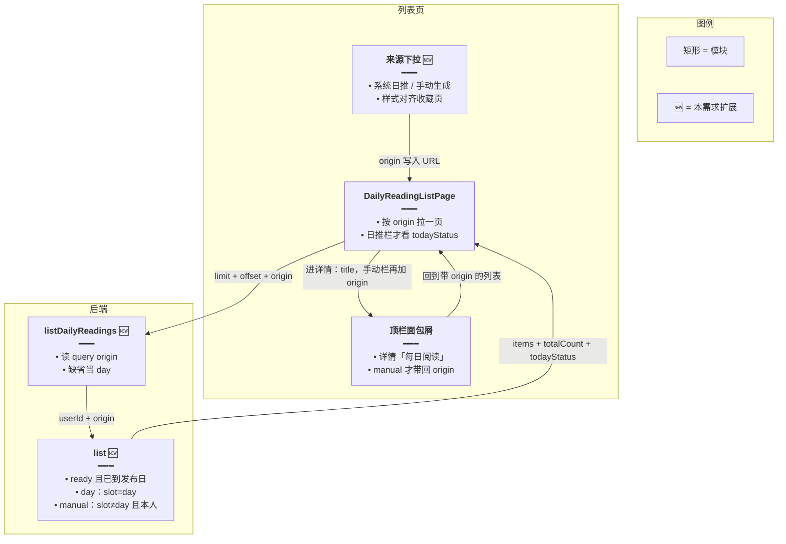
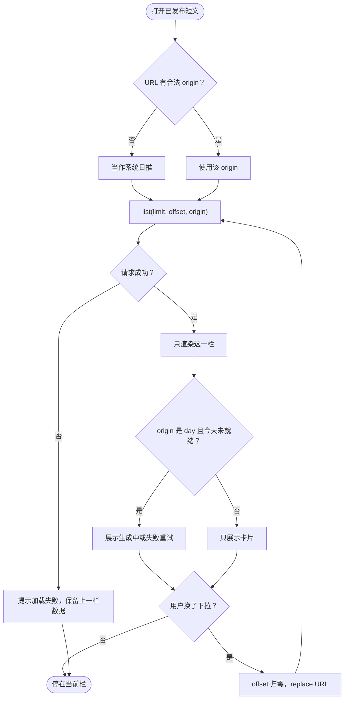
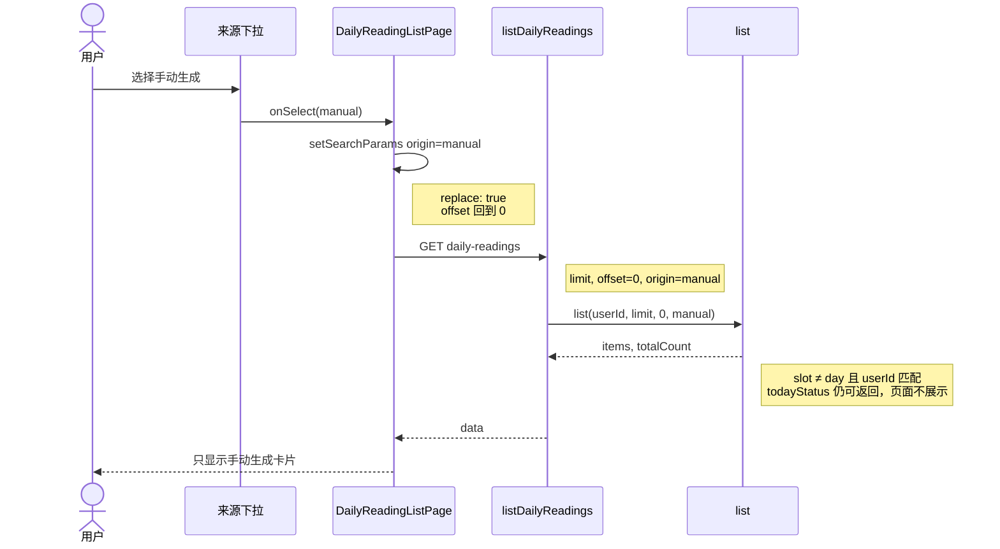
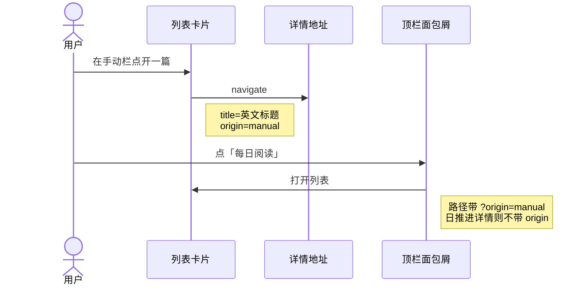
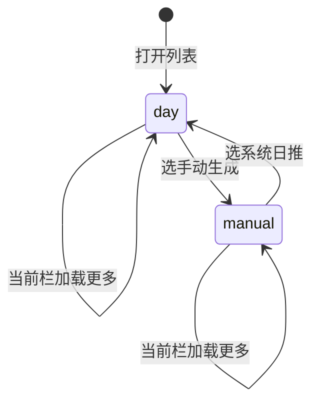

# 每日阅读来源切换 — 实现思路

> **状态**：已落地（列表分栏、详情面包屑带回 `origin`、下拉无聚焦框）  
> **日期**：2026-10-16  
> **需求摘要**：已发布短文列表用收藏页同款下拉，在「系统日推」和「手动生成」之间切换，每栏只显示对应来源，并各自分页、计数；从详情点「每日阅读」回到进入时的那一栏。

## 延伸阅读

- 列表页：`apps/frontend/src/views/englishLearning/dailyReading/List.tsx`
- 列表接口：`GET /english-learning/daily-readings`（`english-learning.controller.ts` → `EnglishDailyReadingService.list`）
- 来源判定：`slot === 'day'` 为系统日推，其余 slot 为该用户的手动篇（`toView` 的 `origin`）
- 切换控件：`apps/frontend/src/views/englishLearning/favorites/components/FavoritesKindTabs.tsx`（名字带 Tabs，实际是顶栏下拉）
- 相关规划：[每日阅读.md](./每日阅读.md)、[每日阅读手动生成.md](./每日阅读手动生成.md)

---

## 0. 读本文你将得到什么

- **问题**：日推和手动篇混在同一列表，卡片上的短标不够，翻页计数也对不上「我现在在看哪一类」。
- **方案**：顶栏放一个和收藏页一样的下拉；选中项写入 URL `origin`；列表接口按 `slot` 过滤后再分页。
- **改动层**：列表页 + `GET daily-readings` 增加 `origin`；详情链接和顶栏面包屑带上同一参数。不改生成。
- **阶段**：M1 接口过滤 → M2 下拉与 URL → M3 计数、空态、今日状态只跟当前栏 → 详情返回不丢栏。
- **最大风险**：手动栏仍能看到别人的篇，或日推栏把 `todayStatus` 丢了导致「正在生成」横幅消失。

---

## 1. 需求与边界

### 1.1 用户故事

| 角色 | 场景 | 行为 | 期望结果 |
|------|------|------|----------|
| 学习者 | 打开已发布短文 | 默认停在系统日推 | 只看到 `slot = day` 的全站篇 |
| 学习者 | 想看自己点过「生成阅读资源」的篇 | 下拉切到手动生成 | 只看到自己的手动篇，分页从头开始 |
| 学习者 | 刷新或分享链接 | 地址带 `?origin=manual` | 仍停在手动生成栏 |
| 学习者 | 从手动栏打开一篇详情 | 点面包屑「每日阅读」 | 回到手动栏，地址仍是 `?origin=manual` |
| 学习者 | 点开或切走来源下拉 | 按钮拿到焦点 | 不出现蓝色聚焦框 |

### 1.2 范围

| 在范围内 | 不在范围内（非目标） |
|----------|----------------------|
| 列表顶栏下拉：系统日推 / 手动生成 | 详情页再做来源筛选 |
| `GET daily-readings` 增加 `origin=day\|manual` | 改 BullMQ 定时生成、改手动生成入队 |
| 当前栏的 `totalCount`、无限滚动、空态 | 两栏数量同时展示（收藏页是各算各的，这里先只返回当前栏） |
| 日推栏保留「今天正在生成 / 失败重试」 | 手动栏展示全站生成进度 |
| 详情链接在手动栏带上 `origin=manual`；面包屑按它回列表 | 系统日推进详情时多写一个无意义的 `origin=day` |
| 下拉按钮去掉 `focus-visible` 描边 | 改收藏页同类下拉 |

### 1.3 约束与依赖

- 来源已经落在行上：`DAY_SLOT = 'day'` 是定时篇；手动篇的 `slot` 等于该行 id，并带 `userId`。
- 现有列表条件是 `status = ready` 且 `publishDate <= 今天`，并且 `slot = day` **或** `userId = 当前用户`。过滤必须收紧，不能放宽。
- 下拉样式对齐 `FavoritesKindTabs`：青绿文字、展开图标、菜单项图标 + 勾选。
- 查询参数用 `replace` 写回 URL，避免每次切换堆一条历史。

---

## 2. 方案总览（一句话 + 要点）

**一句话方案**：收藏页的种类下拉原样挪到每日阅读列表右侧，选中值作为 `origin` 传给列表接口，服务端按 `slot` 分开分页。

| # | 设计要点 | 理由 |
|---|----------|------|
| 1 | 默认 `origin=day` | 和现在「先看当天全站短文」一致 |
| 2 | 服务端过滤，不在前端把一页结果拆开 | 混排分页会漏掉某一类的后页 |
| 3 | `todayStatus` 只在日推栏使用 | 这条状态描述的是定时篇，不是手动篇 |
| 4 | 卡片上的「系统日推 / 手动生成」短标在分栏后去掉 | 和当前下拉重复 |
| 5 | 下拉在「生成资源」右侧；按钮去掉聚焦环 | 与收藏页「导出 + 下拉」同排；环是 Button 默认 `focus-visible:ring` |
| 6 | 只有手动栏进详情时带 `origin=manual` | 日推是缺省值，面包屑没有该参数就回日推 |

---

## 3. 现状与复用

| 能力 | 仓库中已有 | 本需求中的用法 |
|------|------------|----------------|
| 混排列表 + 卡片短标 | `dailyReading/List.tsx` | **扩展**：按栏请求；短标删除 |
| 列表查询 | `EnglishDailyReadingService.list` | **扩展**：增加 `origin`，在现有 `visible` 上再加 `slot` 条件 |
| `origin: 'day' \| 'manual'` | `toView` | **直接复用**：响应字段不变，只是每栏结果更纯 |
| 顶栏下拉切换 | `FavoritesKindTabs` | **直接复用**：抄交互，文案换成日推 / 手动；不抽公共组件 |
| URL `kind` | `favorites/index.tsx` 的 `useSearchParams` | **直接复用**：这里参数名用 `origin` |
| 生成中 / 失败条 | `List.tsx` 里 `todayStatus` | **扩展**：仅 `origin=day` 时展示 |

**调研结论**：数据已经能区分来源，缺的是查询参数和顶栏切换。前端若只隐藏另一类，无限滚动的 `offset` 和 `totalCount` 仍是混排口径，后页会对不齐，所以过滤必须放在 `list()`。

---

## 4. 架构图



**图内方法说明**：

| 方法 | 功能 |
|------|------|
| `listDailyReadings` | 解析 `limit` / `offset` / `origin`，未登录 401，把当前用户和来源交给 `list` |
| `list` | 查出已发布、已到日期的短文；按 `origin` 收紧 `slot`；返回当前栏的条目、总数，以及定时篇的今日状态 |
| `DailyReadingListPage` 的加载函数 | 用当前 `origin` 请求一页，切换来源时从 offset 0 重拉 |
| 面包屑路径拼接 | 读详情地址上的 `origin`；只有 `manual` 时，「每日阅读」链到 `?origin=manual` |

**读图要点**：

- 切换发生在列表页，过滤发生在 `list`，避免前端拆混排页。
- 下拉不新造交互，对齐收藏页已有控件。
- `todayStatus` 仍由服务端计算，但只有日推栏消费它。
- 详情不自己筛列表；返回哪一栏只靠进详情时带上的查询参数。

---

## 5. 主流程图



**图内方法说明**：

| 方法 | 功能 |
|------|------|
| `list` | 按来源返回一页已发布短文和该栏总数 |
| URL `replace` | 切换时改 `origin`，不新增历史记录，刷新仍停在这一栏 |

**读图要点**：

- 非法或缺失的 `origin` 回落到日推，避免空列表。
- 换栏必须重拉第一页，不能沿用上一栏的 `offset`。
- 失败重试条不属于手动栏。

---

## 6. 核心时序图



**图内方法说明**：

| 方法 | 功能 |
|------|------|
| `onSelect` | 把下拉选中项写成查询参数并触发列表重载 |
| `setSearchParams` | 替换当前地址上的 `origin`，不压入新的历史条目 |
| `listDailyReadings` | 校验登录并解析查询参数 |
| `list` | 按 `manual` 只查当前用户的非日推槽位 |

**读图要点**：

- 一次切换对应一次从 0 开始的列表请求。
- 手动栏的可见范围仍是「本人 + 已发布 + 发布日不晚于今天」。

### 6.1 从详情回到原栏



**图内方法说明**：

| 方法 | 功能 |
|------|------|
| 列表卡片 `navigate` | 打开详情；当前栏是手动时把 `origin=manual` 和标题一起放进查询参数，返回时才知道从哪一栏进来 |
| 顶栏面包屑拼接 | 读当前地址的 `origin`，为「每日阅读」生成回列表的路径；缺省或非 `manual` 不带参数，列表仍按日推打开 |

**读图要点**：

- 栏位跟在详情地址上，不另存 localStorage，刷新详情后再点面包屑结果不变。
- 已经打开、地址里还没有 `origin` 的旧详情，点面包屑会回到日推。

---

## 7. 状态机



**图内方法说明**：

| 方法 | 功能 |
|------|------|
| `onSelect` | 在 `day` 与 `manual` 之间切换，并清空已加载条目 |
| 列表加载更多 | 不改变 `origin`，只增加当前栏的 `offset` |

---

## 8. 模块职责与接口草图

### 8.1 模块一览

| 模块 | 职责 | 新增/改动 | 预估路径 |
|------|------|-----------|----------|
| 来源下拉 | 展示当前栏，点选另一栏 | 新增（抄收藏下拉） | `apps/frontend/src/views/englishLearning/dailyReading/List.tsx` 内或同目录小组件 |
| 列表页 | 读 URL、重置分页、按栏渲染横幅 | 扩展 | 同上 `List.tsx` |
| 列表接口 | 接受 `origin` | 扩展 | `english-learning.controller.ts` |
| `list` | 按 slot 过滤并计数 | 扩展 | `english-daily-reading.service.ts` |
| 文案 | 系统日推 / 手动生成 | 扩展 | `i18n` 里已有 `dailyReading.day` / `dailyReading.manual` |
| 顶栏面包屑 | 详情返回时保留手动栏 | 扩展 | `apps/frontend/src/components/design/Header/index.tsx` |

### 8.2 关键接口（草图）

```typescript
// 缺省 day：打开列表时仍先看全站日推
type ReadingOrigin = 'day' | 'manual';

// 在现有 visible 条件上收紧槽位，避免混排分页
function list(
	userId: number,
	limit: number,
	offset: number,
	origin: ReadingOrigin,
): Promise<DailyReadingList>;
```

`origin=day` 时在现有条件上再加 `slot = DAY_SLOT`。`origin=manual` 时改为 `slot != DAY_SLOT` 且 `userId` 为当前用户。其它非法值按 `day` 处理。

### 8.3 数据模型

| 字段/实体 | 来源 | 存储 | 说明 |
|-----------|------|------|------|
| `slot` | 生成时写入 | `english_daily_readings.slot` | `day` 为定时篇；手动篇用行 id |
| `origin` | `toView` 由 slot 推出 | 响应字段 | `day` 或 `manual`，列表栏与之对应 |
| `?origin=` | 列表页 | URL 查询参数 | 刷新和回退保持当前栏 |

---

## 9. 分阶段实现步骤

| 阶段 | 目标 | 交付物 | 依赖 |
|------|------|--------|------|
| M1 | 接口能按来源分页 | `list` + controller query | 无 |
| M2 | 顶栏可切换 | 下拉 + `?origin=` | M1 |
| M3 | 计数和今日状态跟栏走 | 空态、横幅、去掉卡片短标 | M2 |

### M1

- [x] `GET daily-readings` 读取 `origin`，缺省 `day`
- [x] `list` 按上表收紧 `slot`，`totalCount` 只数当前栏
- [x] 手动栏不能返回其他用户的行

### M2

- [x] 列表 `headerRight` 先放「生成资源」，右侧放来源下拉，样式对齐 `FavoritesKindTabs`
- [x] 下拉按钮加上 `focus-visible:ring-0`，去掉蓝色聚焦框
- [x] 切换用 `setSearchParams(..., { replace: true })`，并从第一页重拉
- [x] 文案用已有的「系统日推」「手动生成」

### M3

- [x] 标题旁的已加载 / 总数改为当前栏
- [x] 「正在生成」「生成失败」只在日推栏出现
- [x] 卡片副标题去掉来源短标，只留日期和中文标题
- [x] 当前栏没有篇时用现有空态文案
- [x] 手动栏进详情带 `origin=manual`；面包屑「每日阅读」按该参数回列表

---

## 10. 关键决策与备选方案

| 决策 | 选用 | 备选 | 为何不选备选 |
|------|------|------|--------------|
| 切换控件 | 收藏页同款下拉 | 两个并排按钮 | 用户指定与收藏页一致；顶栏已经有「生成资源」 |
| 过滤位置 | 服务端 `list` | 前端隐藏另一类 | 混排的 offset 无法代表单栏的下一页 |
| 默认栏 | 系统日推 | 记住上次选择到 localStorage | URL 已经能记住；再存一份会和地址不一致 |
| 卡片短标 | 分栏后删除 | 每张卡继续写来源 | 与当前下拉重复 |
| 下拉位置 | 「生成资源」右侧 | 标题行左侧 | 顶栏宽度按收藏页「操作 + 下拉」排，右侧一组更稳 |
| 回列表 | 查询参数 `origin` | 记住上次栏到 localStorage | 和列表自己的 URL 是同一份，不会两处不一致 |
| 聚焦框 | 去掉 | 保留 Button 默认环 | 旁边的「生成资源」没有环，两个控件应一样 |

---

## 11. 风险、边界与待确认

| 项 | 等级 | 说明 | 缓解 |
|----|------|------|------|
| 手动篇串用户 | 高 | 现有 OR 条件若只加一半会泄漏 | `manual` 必须同时限制 `userId` |
| 日推横幅丢失 | 中 | `todayStatus` 绑在同一次 list 上 | 日推栏照旧展示；手动栏忽略 |
| 切换时滚动位置 | 低 | 无限滚动观察器还指着旧列表 | 换栏时清空 `items` 再请求第一页 |

**待确认**：

- [x] 下拉与「生成资源」并排（已落地：生成资源在左，下拉在右）

---

## 12. 验收清单

| # | 用例 | 步骤 | 期望 |
|---|------|------|------|
| AC1 | 默认日推 | 打开已发布短文，不带查询参数 | 只有系统日推；没有手动篇 |
| AC2 | 切到手动 | 下拉选择手动生成 | 只有当前用户的手动篇；地址为 `?origin=manual` |
| AC3 | 分页 | 某一栏超过一页，滚到底 | 下一页仍是同一来源 |
| AC4 | 今日状态 | 定时篇还在生成时打开日推栏，再切到手动栏 | 日推栏有生成中提示；手动栏没有 |
| AC5 | 刷新 | 停在手动栏后刷新 | 仍是手动栏 |
| AC6 | 详情返回 | 手动栏打开一篇，点面包屑「每日阅读」 | 仍是手动栏 |
| AC7 | 日推返回 | 日推栏打开一篇，点同一面包屑 | 回到日推，地址不带 `origin` |
| AC8 | 聚焦 | 点开来源下拉再关掉 | 按钮上没有蓝色聚焦框 |

---

## 13. 预估改动面（实现阶段参考）

| 类型 | 路径（预估） |
|------|--------------|
| 前端 | `apps/frontend/src/views/englishLearning/dailyReading/List.tsx` |
| 前端 | `apps/frontend/src/service/index.ts` 的 `listEnglishDailyReadings` |
| 后端 | `apps/backend/src/services/english-learning/english-learning.controller.ts` |
| 后端 | `apps/backend/src/services/english-learning/english-daily-reading.service.ts` |
| 文案 | 复用 `englishLearning.dailyReading.day` / `manual`，不必新键 |
| 前端 | `apps/frontend/src/components/design/Header/index.tsx` 的每日阅读面包屑 |

（列表分栏与详情返回已按本文落地；生成链路仍以 [每日阅读手动生成](./每日阅读手动生成.md) 为准。）
