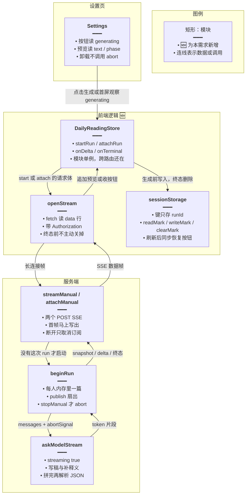
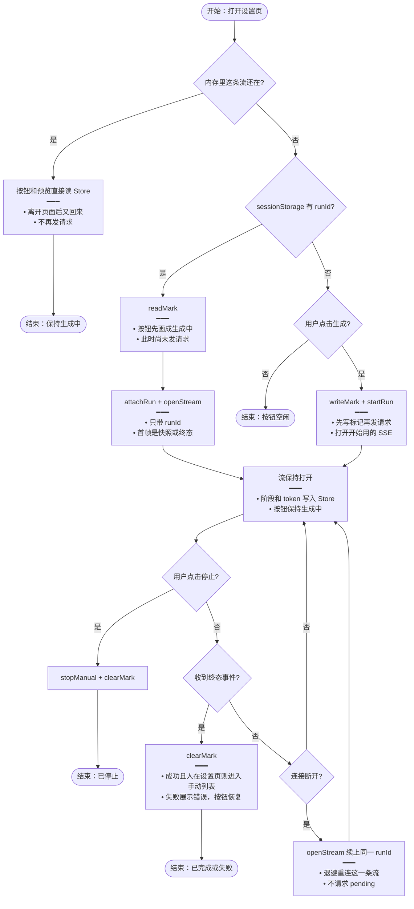
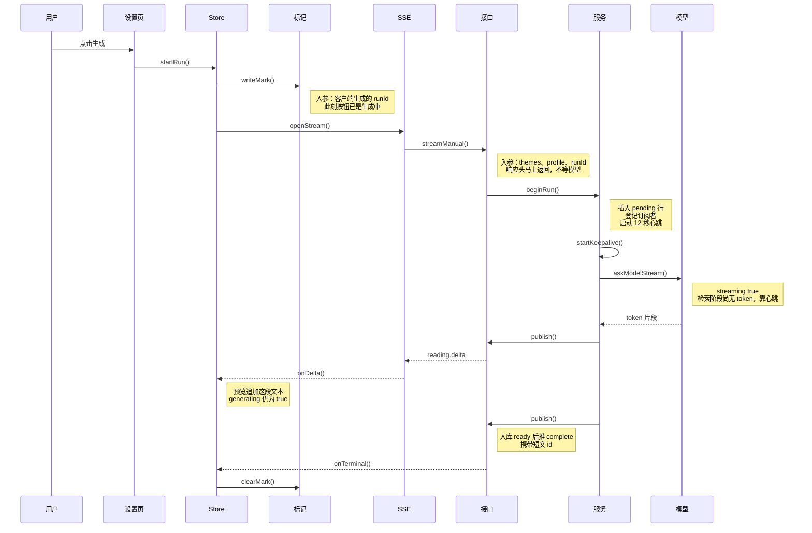
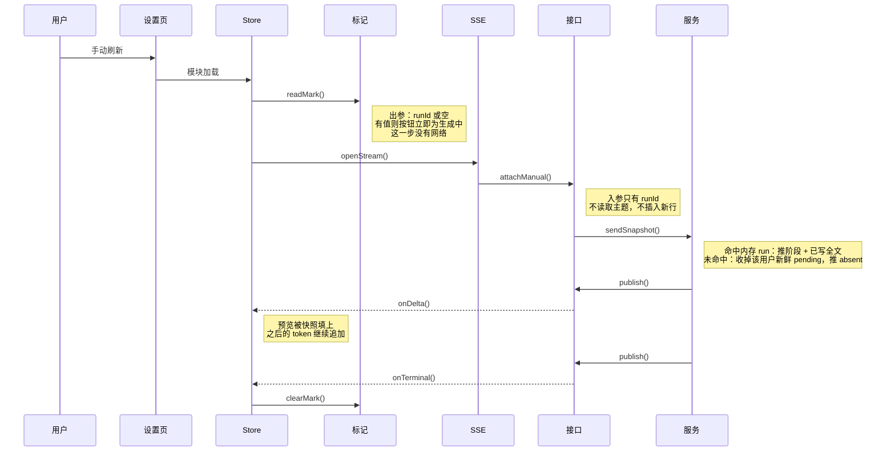
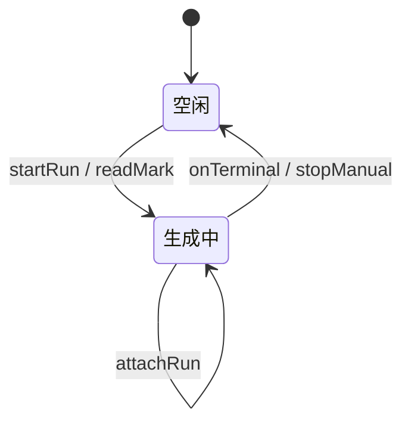

# 每日阅读流式生成 — 实现思路

> **状态**：规划（手动生成、设置页、词汇/语句 SSE 已有，可复用）  
> **日期**：2026-10-17  
> **需求摘要**：设置页「生成阅读资源」改成一条 `streaming: true` 的长连接；离开页面和手动刷新后，按钮都保持「生成中」，输出持续到请求结束，中间不再定时查询状态。

## 延伸阅读

- [每日阅读手动生成](./每日阅读手动生成.md)（底栏按钮、另插一篇、不覆盖定时篇）
- [每日阅读设置](./每日阅读设置.md)（「生成资源」页、档位与联网开关）
- [手动阅读按用户隔离](./手动阅读按用户隔离.md)（手动篇只属于当前用户）

---

## 0. 读本文你将得到什么

- 要解决的问题：手动生成把整次模型调用堵在一条没有字节的 POST 上，线上代理空闲约 60 秒就回 504，按钮停在 loading；设置页再用每 2 秒一次的 pending 请求把「还在生成」找回来。
- 一句话方案：模型改为 `streaming: true`，用一条 SSE 把阶段和 token 推到模块级 Store；按钮跟这条流走，刷新后靠会话标记立刻画成生成中，再续上同一条流。
- 改哪些层：设置页按钮与预览、一个跨路由 Store、一条 SSE 客户端、手动生成接口与 `askModel` / 补释义。
- 分三阶段：M1 服务端流式且断线不停模型；M2 前端接上并删掉 pending 定时请求；M3 停止、预览和旧的 180 秒专用反代。
- 最大风险：刷新会拆掉浏览器里的连接。若照词汇包那样「套接字一断就中止模型」，后续上时已经没有输出可接。

---

## 1. 需求与边界

### 1.1 用户故事

| 角色 | 场景 | 行为 | 期望结果 |
|------|------|------|----------|
| 登录用户 | 在「生成资源」页 | 点击「生成阅读资源」 | 按钮马上变成「停止生成」并保持到这篇写完；预览区持续有输出 |
| 登录用户 | 生成还没结束 | 离开设置页，再进入英语学习其他页，然后回到设置页 | 同一条请求还在，按钮仍是生成中，预览接着增长 |
| 登录用户 | 生成还没结束 | 手动刷新当前页 | 按钮首屏就是生成中；输出从服务端已写内容接上，直到结束 |
| 登录用户 | 生成中 | 点击「停止生成」 | 模型调用中断，按钮恢复，再刷新不再是生成中 |
| 登录用户 | 生成成功且人还在设置页 | 流结束 | 进入手动列表，和现在成功后的跳转一致 |
| 登录用户 | 生成超过 60 秒，含联网检索 | 等待 | 不出现 504，按钮不因为代理超时被卡死 |

### 1.2 范围

| 在范围内 | 不在范围内（非目标） |
|----------|----------------------|
| 设置页手动生成这一次：流式模型、SSE、按钮、预览、离开页面、同标签刷新 | 系统日推列表在 `todayStatus === 'generating'` 时那最多 8 次、每 2 秒一次的列表刷新 |
| 删掉设置页对 `GET .../daily-readings/manual` 的定时请求 | 21:00 定时任务、自动档、超管配置 |
| 断线后续上同一篇，不另开一篇 | 跨标签同步按钮；进程重启后从半截 token 接着写 |
| 停止仍能掐断模型 | 改词汇包 / 语句包「套接字断开就中止模型」的现行为 |
| 按钮文案继续用已有的生成 / 停止 / 正在生成 | 新做一套状态文案；多机共享同一次生成 |

### 1.3 约束与依赖

- 须登录，与现有英语学习接口一致。Web 与 Tauri 都走现有的 `getPlatformFetch`（要带 `Authorization`，不能用原生 `EventSource`）。
- 代理的 `proxy_read_timeout` 按「两次成功读之间的空闲」计，不是按整次生成的总时长计。连接上只要在 60 秒内有字节，就不会 504。
- 词汇包能离开页面还在拉，是因为 `EnglishPackStore` 是模块单例，页面卸载不调用 abort。本需求照这个拿按钮和输出。
- 词汇包的服务端在客户端断开时会中止模型（`wireEnglishLearningSseAbort`）。手动阅读的刷新要求模型继续跑，这条不能照搬。
- 每人同时只允许一篇手动稿。占用看进程内这次 run，不用 90 秒的 `PENDING_STALE_MS` 决定按钮。

---

## 2. 方案总览（一句话 + 要点）

**一句话方案**：点击后先把 `runId` 写入 `sessionStorage`，再打开一条 SSE；模型 `streaming: true` 把 token 推给模块级 Store，按钮在终态之前一直是生成中；刷新只读本地标记并续上同一条流。

| # | 设计要点 | 理由 |
|---|----------|------|
| 1 | `askModel` 与补释义改为 `llm.stream()`，`streaming: true` | 半截 token 就会离开模型网关；检索阶段没有 token，另发 12 秒心跳 |
| 2 | 生成状态放在模块级 Store，设置页卸载不 abort | 离开页面时浏览器里的这条读取还在，回来直接读 Store |
| 3 | 刷新用 `sessionStorage` 同步恢复按钮，再用一条 attach SSE 接输出 | 首屏不发请求就能画成生成中；结束与否由这条流推送 |
| 4 | 套接字断开只取消订阅，点停止才 `abort` | 刷新会拆掉连接；模型停了就没有输出可续 |
| 5 | 开始和续上分成两个 POST | 刷新路径不会再插入一篇 |

---

## 3. 现状与复用

| 能力 | 仓库中已有 | 本需求中的用法 |
|------|------------|----------------|
| 设置页生成按钮、`flight \|\| pending` | `apps/frontend/src/views/englishLearning/dailyReading/Settings.tsx` | 扩展：按钮改读 Store；删掉 2 秒 `setInterval` 和结束后再查一次 pending |
| 阻塞式手动生成 | `POST .../daily-readings/manual`，`english-daily-reading.service.ts` 的 `generateManual` | 扩展：同一套插行、废稿、补释义；HTTP 改为 SSE |
| 模型整包返回 | `askModel` / `fillWordGloss` 里 `streaming: false` + `llm.invoke` | 扩展：这两处改为 `streaming: true` + `llm.stream()` |
| 离开页面仍保持拉取 | `apps/frontend/src/store/englishPack.ts` 的 `vocabLoading` / `classicLoading` | 直接复用这个摆放方式：新建每日阅读 Store，不把 reader 放进组件 `useState` |
| SSE 读行、Bearer、取消 | `apps/frontend/src/utils/englishLearningPackSse.ts` 的 `streamEnglishVocabularyPack` | 直接复用读 `data:` 行的写法；新建每日阅读入口，不改词汇解析 |
| 首包 + 12 秒心跳 | `startEnglishPackSseKeepalive`，`PACK_SSE_KEEPALIVE_INTERVAL_MS`（12 秒） | 直接复用间隔常量；本接口自己 `emit` 心跳，不改词汇事件前缀 |
| 断线中止模型 | `wireEnglishLearningSseAbort` | 不适用：手动阅读断开只 `detach` |
| 停止 | `POST .../manual/stop`，`stopManual` | 直接复用；`runId` 来自会话标记 |
| 反代缓冲 | `apps/backend/nginx.conf` 里 `/api/` 与精确匹配 `.../manual` | 新路径走 `/api/`，与词汇 SSE 相同；精确匹配那条 180 秒配置留到阻塞 POST 删除后再收 |
| 日推列表刷新 | `dailyReading/List.tsx` 在日推 `generating` 时每 2 秒 `load` | 不适用：没有生成按钮，本篇不动 |

**调研结论**：504 出在手动生成这条「首字节要等模型全部写完」的 POST。词汇和语句没有这个问题，是因为 SSE 马上有首帧，之后最多 12 秒就有心跳，代理的读超时被反复清掉；页面状态在 `EnglishPackStore` 里，路由卸载不会拆掉 fetch。每日阅读现在把 `generating` 放在设置页的 `useState` 里，离开页面就丢，回来靠 `getEnglishDailyReadingManualPending` 每 2 秒问一次。`PENDING_STALE_MS` 只有 90 秒，长稿会超过它，不能拿它当按钮的生命周期。`createLlm` 的 `streaming` 默认已是 `true`，每日阅读是显式写成了 `false`。

---

## 4. 架构图



**图内方法说明**：

| 方法 | 功能 |
|------|------|
| `readMark()` | 模块加载时同步读 `sessionStorage` 里的 `runId`；有值就把 `generating` 设为真，让按钮第一次绘制就是「停止生成」 |
| `writeMark(runId)` | 在 `fetch` 之前写入 `runId`；刷新发生在响应头回来之前，按钮也已经有据可画 |
| `clearMark()` | 只在完成、失败、停止、`absent` 时删除标记；断线重连不删，避免稿子还在写时按钮熄灭 |
| `startRun()` | 用户点击生成：写标记、置生成中、打开开始用的那条 SSE；内存里已有 reader 则直接返回 |
| `attachRun()` | 刷新后调用：不带主题和档位，只带 `runId`，接上已经在跑的那篇 |
| `openStream()` | 用 `getPlatformFetch` 读 SSE；解析阶段、token、终态，把回调交给 Store |
| `streamManual()` | 开始接口：校验主题，插入 `pending` 行，启动一次生成，把调用方登记为订阅者 |
| `attachManual()` | 续上接口：按 `runId` 找到内存 run，先推快照再登记订阅；找不到则收掉该用户的新鲜 `pending` 行并推 `absent` |
| `beginRun()` | 每个用户同时只创建一次内存 run 和模型调用；后来的开始请求直接拒绝 |
| `askModelStream()` | `streaming: true` 调 `llm.stream()`，每段 token 调用 `publish`；全文留给现有废稿校验和 `parsePassageJson` |
| `publish()` | 把事件写给这个 run 上的全部订阅者，并更新内存里的阶段和全文，供后来的快照使用 |
| `onDelta()` | 把增量追加到 Store 的预览文本，保持 `generating === true` |
| `onTerminal()` | 按完成 / 失败 / 停止 / `absent` 收起按钮、删标记、清 reader；设置页还挂着且成功时跳进手动列表 |
| `stopManual()` | 用户点击停止：用标记里的 `runId` 调现有停止接口，并 abort 服务端这次模型调用 |

**读图要点**：

- 按钮和预览只读 Store。设置页不保存 `flight` / `pending`，卸载也不碰连接。
- 新增的是 Store、SSE 客户端，以及开始 / 续上两个接口。插行、废稿、补释义、停止仍在现有服务里。
- 会话标记只负责刷新后的第一笔按钮；输出内容的权威副本在服务端这次 run 的内存里。

---

## 5. 主流程图



**图内方法说明**：

| 方法 | 功能 |
|------|------|
| `readMark()` | 刷新后的第一分支：有 `runId` 就先把按钮置为生成中，避免等网络回来才转圈 |
| `writeMark(runId)` | 点击生成时、请求发出前写入；保证刷新点落在请求半路上时标记已经存在 |
| `startRun()` | 真正开始一篇：服务端插入 `pending` 行并启动模型 |
| `attachRun()` | 只订阅已有 run；服务端没有这次 run 时收掉残留 `pending` 并结束按钮 |
| `openStream()` | 建立或重建那一条 SSE；成功挂住后不再按间隔发起新的状态请求 |
| `stopManual()` | 停止分支：中断模型、推 `stopped`、按钮恢复 |
| `clearMark()` | 停止和终态都删除 `runId`；重连分支不调用它 |

**读图要点**：

- 入口有三条：内存里的流还在（离开页面回来）、只有会话标记（刷新）、用户点击。前两条都不会新开一篇。
- 断开后的回路仍是 `openStream` 去续上，按钮保持生成中。终态和停止才离开这个回路。
- 人在检索、写稿、补释义、重连的整个区间里，按钮都是「停止生成」。没有 token 时预览行用已有文案「正在生成」，有 token 后追加原文。

---

## 6. 核心时序图

### 6.1 点击生成



**图内方法说明**：

| 方法 | 功能 |
|------|------|
| `startRun()` | 设置页把点击交给 Store；Store 负责标记、按钮和唯一一条 reader |
| `writeMark()` | 请求发出前落下 `runId`，刷新才能在首屏画出生成中 |
| `openStream()` | 发起开始用的 POST SSE，并循环读帧直到终态或断开 |
| `streamManual()` | 控制器校验登录与主题，把这条 HTTP 订到 run 上 |
| `beginRun()` | 若该用户已有内存 run 则拒绝；否则插 `pending` 行并异步跑检索、写稿、补释义 |
| `startKeepalive()` | 每 12 秒推一帧心跳，覆盖联网检索和两稿之间没有 token 的空档 |
| `askModelStream()` | 流式写稿；废稿则再流式写一稿；flash 缺释义时补释义也走流式 |
| `publish()` | 心跳、阶段、token、终态都从这里发给当前订阅者，并更新快照用的全文 |
| `onDelta()` | 只追加预览，不改变「正在生成」 |
| `onTerminal()` | `complete` 时收按钮；设置页仍挂载则跳到手动列表 |
| `clearMark()` | 终态后删除 `runId`，下次刷新按钮回到「生成阅读资源」 |

**读图要点**：

- 标记写在任何网络往返之前。模型要到 `beginRun` 之后才开始，但按钮从 `startRun` 起就是生成中。
- 字节来自两处：token，以及检索空档的心跳。代理读超时因此不会按整篇时长累计。
- 一次点击只产生一条 SSE。页面离开后这条时序里的 Store 和 SSE 仍在，不重新 `beginRun`。

### 6.2 刷新后续上



**图内方法说明**：

| 方法 | 功能 |
|------|------|
| `readMark()` | 刷新后同步决定按钮；没有标记就保持空闲，不去问服务端「是否还在生成」 |
| `openStream()` | 带已保存的 `runId` 打开续上用的 SSE；连上之后挂住，直到终态 |
| `attachManual()` | 只负责订阅；与 `streamManual` 分开，避免刷新再写一篇 |
| `sendSnapshot()` | 把内存里的阶段和已累积文本作为第一帧推给新连接，预览不用从零开始 |
| `publish()` | 快照之后的心跳、新 token 和终态仍走同一扇出 |
| `onDelta()` | 快照和后续增量都追加到预览，按钮维持生成中 |
| `onTerminal()` | 稿已写完、失败、停止，或服务端已无这次 run 时收按钮 |
| `clearMark()` | 终态后删除标记；若第一帧就是 `absent`，同样删除，按钮回到空闲 |

**读图要点**：

- 刷新后的按钮来自会话标记，不来自一次状态查询，更不来自定时查询。
- 续上接口的第一帧要么是快照，要么是终态。服务端进程还在时，模型从刷新前的位置继续吐 token。
- 刷新发生在请求还没到达服务端时，内存里没有 run，第一帧是 `absent`，按钮收回，用户可以再点一次。

---

## 7. 状态机



**图内方法说明**：

| 方法 | 功能 |
|------|------|
| `startRun()` | 从空闲进入生成中，并写上会话标记 |
| `readMark()` | 刷新加载时若标记还在，直接进入生成中，不等待续上接口返回 |
| `attachRun()` | 生成中的自转移：换一条新的 SSE，按钮和「正在输出」都不退出 |
| `onTerminal()` | 完成、失败、`absent` 都回空闲，并删标记 |
| `stopManual()` | 用户停止：中止模型后回空闲 |

**读图要点**：

- 检索、写稿、补释义、断线重连都留在「生成中」。按钮文案在这个状态里固定为「停止生成」。
- 离开页面不产生状态转移，因为 Store 没有卸载。
- 只有终态和停止会把按钮交还。下一次刷新若标记已删，会停在空闲。

---

## 8. 模块职责与接口草图

### 8.1 模块一览

| 模块 | 职责 | 新增/改动 | 预估路径 |
|------|------|-----------|----------|
| 设置页 | 观察 Store，渲染按钮和预览；卸载时什么都不取消 | 扩展 | `apps/frontend/src/views/englishLearning/dailyReading/Settings.tsx` |
| DailyReadingStore | 生成中、阶段、预览文本、reader、标记 | 新增 | `apps/frontend/src/store/englishDailyReading.ts` |
| SSE 客户端 | 读开始流和续上流 | 新增 | `apps/frontend/src/utils/dailyReadingSse.ts` |
| API 常量 | 两个流地址；设置页不再调用 pending | 扩展 | `apps/frontend/src/service/api.ts`、`service/index.ts` |
| 控制器 | 两个 `@Sse()` POST；心跳；断开时 `detach` | 扩展 | `apps/backend/src/services/english-learning/english-learning.controller.ts` |
| 手动生成服务 | `beginRun`、`askModelStream`、快照、停止 | 扩展 | `apps/backend/src/services/english-learning/english-daily-reading.service.ts` |
| 文案 | 继续用生成 / 停止 / 正在生成 | 不适用 | 已有 `englishLearning.dailyReading.*` |

### 8.2 关键接口（伪代码或 TypeScript 草图）

会话标记只存 `runId`。它决定刷新后按钮的第一帧，不存放正文。

```typescript
// 只活在当前标签：刷新还在，关掉标签就消失
const MARK = 'el-daily-reading-run';

// 模块加载时同步读；按钮第一次绘制就已经是生成中
function readMark(): string | null {
	// 没有标记就当空闲，不去问服务端
	return sessionStorage.getItem(MARK);
}

// 必须写在 fetch 之前，刷新点落在请求半路时标记已经存在
function writeMark(runId: string): void {
	// 只存 runId，正文放在服务端这次 run 里
	sessionStorage.setItem(MARK, runId);
}

// 只有终态能删；断线重连若删掉，按钮会在稿子还在写时熄灭
function clearMark(): void {
	// 删掉之后再刷新，按钮回到「生成阅读资源」
	sessionStorage.removeItem(MARK);
}
```

浏览器刷新会关掉 SSE。订阅去掉即可，模型留在进程里，供下一次 `attach`。

```typescript
// 断开只取消这一条连接的订阅，供刷新后重新订上
function detach(run: ManualRun, emit: Emit): void {
	// 模型调用留在 run 上，不随这条套接字结束
	run.subscribers.delete(emit);
}

// 用户点停止才中断模型；断开连接不走这里
function stopRun(run: ManualRun): void {
	// abort 会停掉 llm.stream，订阅者随后收到 stopped
	run.ac.abort();
}
```

写稿和补释义共用流式调用。联网检索没有 token，用现有的 12 秒间隔单独发心跳。

```typescript
// 半截 token 就要离开网关；全文拼完再交给现有 parsePassageJson
async function askModelStream(signal: AbortSignal, publish: Emit): Promise<string> {
	// 明确打开流式，避免再抄成现在的 streaming false
	const llm = await createLlm(config, {
		// 预设默认虽是 true，写出来防止回退成整包 invoke
		streaming: true,
		// 停止要能掐断这一次模型 HTTP
		abortSignal: signal,
		// 仍要合法 JSON，半截对象不当成一篇短文
		modelKwargs: { response_format: { type: 'json_object' } },
	});
	// 服务端留全文，后来的快照直接用它
	let full = '';
	// 每段推给当前订阅者；后连上的连接不重放每一段
	for await (const chunk of await llm.stream(messages, { signal })) {
		// 抽取规则与现在 invoke 之后拼接 content 相同
		const piece = textOf(chunk);
		// 空段不推，避免预览空转
		if (!piece) continue;
		// 累加后供快照和废稿校验使用
		full += piece;
		// 打开着的页面立刻追加
		publish({ type: 'reading.delta', text: piece });
	}
	// 返回全文给现有废稿校验；不合格就再流式写一稿
	return full;
}
```

事件约定（实现时用这些 `type`，不必再加状态查询字段）：

| type | 何时 | 按钮 |
|------|------|------|
| `reading.phase` | 进入检索、写稿、补释义 | 保持生成中 |
| `reading.delta` | 一段 token | 保持生成中，预览追加 |
| `reading.snapshot` | 续上后的第一帧，带阶段和已写全文 | 保持生成中，预览被填上 |
| `reading.keepalive` | 12 秒内没有别的帧 | 保持生成中，不改预览 |
| `reading.complete` | 行已是 `ready`，带短文 id | 恢复；人在设置页则进手动列表 |
| `reading.error` | 废稿或异常 | 恢复，并展示已有失败文案 |
| `reading.stopped` | 用户停止 | 恢复 |
| `reading.absent` | 内存里没有这次 run | 恢复，并删标记 |

### 8.3 数据模型

| 字段/实体 | 来源 | 存储 | 说明 |
|-----------|------|------|------|
| `runId` | 点击时 `crypto.randomUUID()` | `sessionStorage` 键 `el-daily-reading-run`；服务端 `manualRuns` | 开始与续上、停止都用它。不新增表列 |
| 内存 run | `beginRun` | 进程内 Map，键为 userId | `abort`、订阅者集合、阶段、已写全文、短文行 id |
| 短文行 | 现有表 | `pending` → `ready` / `failed` | 仍在开始时插入；成功前列表不把它当可读篇 |
| `generating` / `text` / `phase` | SSE 回调 | Store 内存 | 离开页面仍在；刷新后 `generating` 来自标记，`text` 来自快照 |

不把预览全文再写进 `sessionStorage`。服务端那份全文是快照的来源，避免两个副本不一致。

---

## 9. 分阶段实现步骤

| 阶段 | 目标 | 交付物 | 依赖 |
|------|------|--------|------|
| M1 | 服务端一条流能写完，断开不停模型 | 两个 SSE、`streaming: true`、心跳、快照 | 现有 `generateManual` |
| M2 | 设置页按钮和预览跟这条流走，刷新后按钮仍是生成中 | Store、SSE 客户端、删掉 pending 定时请求 | M1 |
| M3 | 停止、跳转、旧反代收口 | 停止接标记；阻塞 POST 无调用后可删精确 location | M2 |

### M1

- [ ] `askModel` 与 `fillWordGloss` 改为 `llm.stream()`，`streaming: true`；解析仍用现有 `parsePassageJson`。
- [ ] `POST .../daily-readings/manual/stream` 马上写出首帧，并按 `PACK_SSE_KEEPALIVE_INTERVAL_MS` 发 `reading.keepalive`。
- [ ] 订阅结束时只 `detach`。`stopManual` 才 abort。
- [ ] `POST .../manual/stream/attach` 推 `reading.snapshot` 或 `reading.absent`；`absent` 时把该用户未过期的手动 `pending` 行标成 `failed`。
- [ ] `beginRun` 以内存 run 为占用锁，不拿 90 秒的 `PENDING_STALE_MS` 判断这次流还在不在。

### M2

- [ ] 新增 Store：模块求值时 `readMark()`，有 `runId` 则 `generating = true`，并 `attachRun()` 一次。已有 reader 时重复调用直接返回。
- [ ] 设置页改为 `observer`，按钮用 `generating`。删除 2 秒 `setInterval`，以及 `generate` 的 `finally` 里再请求一次 pending。
- [ ] `useEffect` 的清理函数不调用 abort。
- [ ] 预览区放在现有底栏按钮上方：无 token 时用已有「正在生成」，有 token 时显示累积文本。
- [ ] 前端不再调用 `getEnglishDailyReadingManualPending`。后端 `GET .../daily-readings/manual` 删除，避免以后又被拿去定时查询。
- [ ] 连接意外结束且尚未终态时，退避再次 `openStream` 续上（1 秒、2 秒、4 秒，上限 8 秒）。连上后只保持这一条。

### M3

- [ ] 停止按钮调用现有 `POST .../manual/stop`，`runId` 用标记里的值；本地 reader 一并关掉。
- [ ] `reading.complete` 且设置页仍挂载时，跳到 `/english-learning/daily-reading?origin=manual`。人已离开则只把 Store 收回空闲。
- [ ] 阻塞式 `POST .../manual` 无前端调用后删除。`nginx.conf` 里两处精确匹配 `.../daily-readings/manual` 的 180 秒 location 随之删除，新流走与词汇包相同的 `/api/`。
- [ ] 换账号时清标记和 Store，与 `EnglishPackStore.resetOnUserSwitch` 放在同一处。

---

## 10. 关键决策与备选方案

| 决策 | 选用 | 备选 | 为何不选备选 |
|------|------|------|--------------|
| 刷新后的按钮 | `sessionStorage` 同步标记 + 一条 attach SSE | 每 2 秒 `GET pending`；或刷新后再发一次开始请求 | 定时查询打的是状态接口，按钮还要等第一次响应才转圈。再发开始请求会另写一篇 |
| 断线时模型 | 只 `detach` | 照 `wireEnglishLearningSseAbort`，套接字一断就 abort | 刷新必断套接字。模型停了，按钮画成生成中也没有输出可接 |
| 空闲超时 | 12 秒心跳 + token 字节 | 把 `proxy_read_timeout` 再加长 | 现在精确路径已是 180 秒仍会 504。超时按空闲计，有字节就会清零；加长盖不住更慢的稿，也盖不住没改到的那一层代理 |
| 离开页面 | 模块级 Store 握住 reader | 继续放在设置页 `useState` | 卸载会丢掉 `flight`。回来只能再问一次状态，问完还要定时问 |
| 标记放哪 | `sessionStorage` | `localStorage` | 关标签后 `localStorage` 还在。进程里的 run 已经没了时，下次打开会一直显示生成中，又得靠查询来拆穿 |
| 开始与续上 | 两个 POST | 同一个 POST，有 `runId` 就续上 | 一个入口里既插行又订阅，刷新路径更容易误插一篇 |
| 全文放哪 | 只放进程内 run | 每个 token 写库，或再写一份到 `sessionStorage` | 短文要等 JSON 合法才入库。两个正文副本会不一致 |
| 重连 | 同一条 SSE 退避重连 | 失败后改回 pending 查询 | 连上之后是一条挂住的流，不是按间隔问状态 |

---

## 11. 风险、边界与待确认

| 项 | 等级 | 说明 | 缓解 |
|----|------|------|------|
| 刷新拆掉连接 | 高 | 浏览器一定会中止旧 fetch | 模型不跟套接字走；按钮靠标记；输出靠快照和后续 token |
| 首包之前就刷新 | 中 | 标记已写，服务端还没有 run | `absent` 收按钮并失败掉残留 `pending`，用户可再点 |
| 进程重启 | 中 | 内存 run 消失，库里可能仍是 `pending` | attach 时收成 `failed` 并推 `absent`。不从半截 token 续写 |
| 多实例 | 低 | 当前反代到一台 `127.0.0.1:9226` | 单进程内存订阅。多机要另做共享，本篇不做 |
| JSON 模式是否逐 token 下发 | 中 | `response_format: json_object` 在部分网关上可能攒完再给 | 心跳仍能避免 504；预览先停在「正在生成」，token 一到再追加 |
| 9002 的 `/api/` 没关 `proxy_buffering` | 低 | 词汇 SSE 走的就是这条，线上没有 504 | 新路径与词汇包相同。心跳短于 60 秒空闲上限 |
| 另一标签再点生成 | 低 | `sessionStorage` 不跨标签，另一标签按钮是空闲的 | 服务端内存锁拒绝第二篇，沿用现在的「正在生成」 |
| 日推列表仍会定时 `load` | 低 | 那是系统篇的准备提示，没有生成按钮 | 本篇不改 `List.tsx` |

**待确认**：

- [ ] `englishLearning` 预设在 `streaming: true` 且 `response_format: json_object` 时，首个 content 片段是否在检索结束后陆续到达。验证：对同一预设调用一次 `llm.stream()`，看 chunk 间隔。若网关攒完全文才吐，M1 仍保留心跳，预览只在最终帧前显示「正在生成」。

---

## 12. 验收清单

| # | 用例 | 步骤 | 期望 |
|---|------|------|------|
| AC1 | 点击后保持生成中 | 打开生成资源页，点击生成，等到有文本 | 按钮立即为「停止生成」，并一直保持到流结束；预览持续增长 |
| AC2 | 离开页面 | 生成过程中进入英语学习其他页，再回到设置页 | 按钮仍是生成中，预览比离开时更长；这期间没有 pending 请求 |
| AC3 | 手动刷新 | 生成过程中刷新设置页 | 按钮第一帧就是「停止生成」；网络里没有周期性的 `GET .../daily-readings/manual`，只有一条 attach 流；预览被快照填上后继续增长 |
| AC4 | 结束后再刷新 | 等到成功或失败，再刷新 | 按钮是「生成阅读资源」；成功的那篇在手动列表里 |
| AC5 | 长于 60 秒 | 打开联网，生成一篇中篇或长篇 | 不出现 504；按钮不会停在无法停止的 loading |
| AC6 | 停止 | 生成中点击停止，再刷新 | 模型不再继续写这行；按钮恢复；刷新后仍是空闲 |
| AC7 | 连点 | 生成中再点一次按钮 | 第二次是停止，不会插入第二篇 |
| AC8 | 断开后恢复 | 生成中让该连接失败一次 | 按钮保持生成中，随后同一 `runId` 又接上；没有改去查询 pending |

---

## 13. 预估改动面（实现阶段参考）

| 类型 | 路径（预估） |
|------|----------------|
| 前端 | `apps/frontend/src/store/englishDailyReading.ts`（新增）、`apps/frontend/src/utils/dailyReadingSse.ts`（新增）、`apps/frontend/src/views/englishLearning/dailyReading/Settings.tsx`、`apps/frontend/src/service/api.ts`、`apps/frontend/src/service/index.ts`、`apps/frontend/src/store/resetUserState.ts` |
| 后端 | `apps/backend/src/services/english-learning/english-learning.controller.ts`、`apps/backend/src/services/english-learning/english-daily-reading.service.ts` |
| 反代 | `apps/backend/nginx.conf` 两处 `location = /api/english-learning/daily-readings/manual`（M3，阻塞 POST 删除之后） |
| 文档（实现后） | `wiki/english/` 下的实现归档，不写回本规划文 |

---

（本文档为规划态实现思路；落地后以源码与 `wiki/english/` 专题为准）
