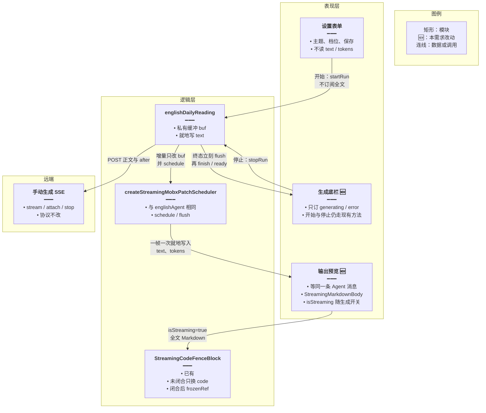
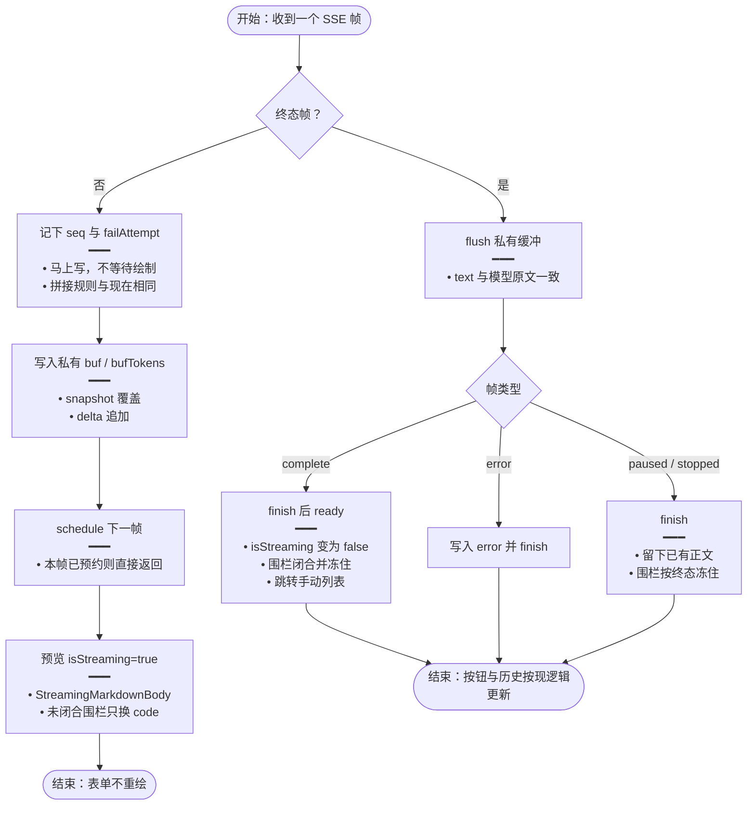
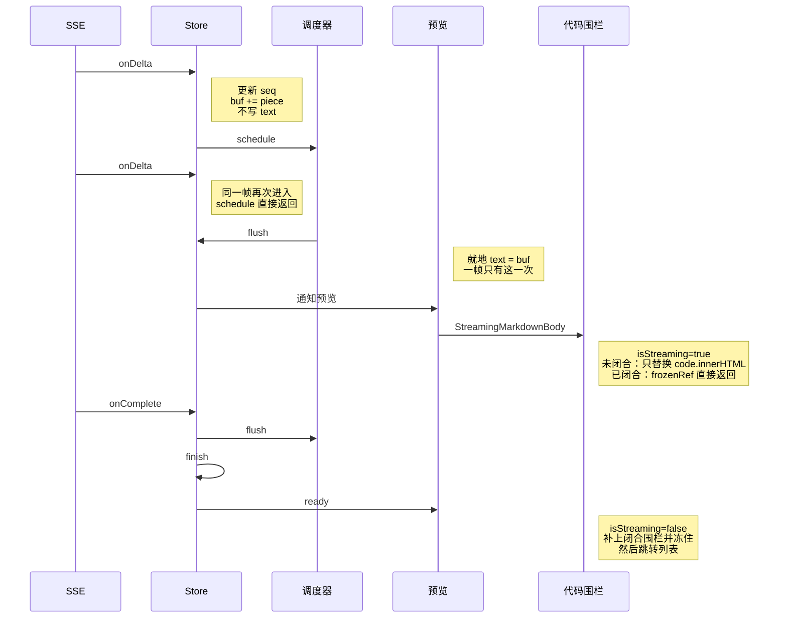
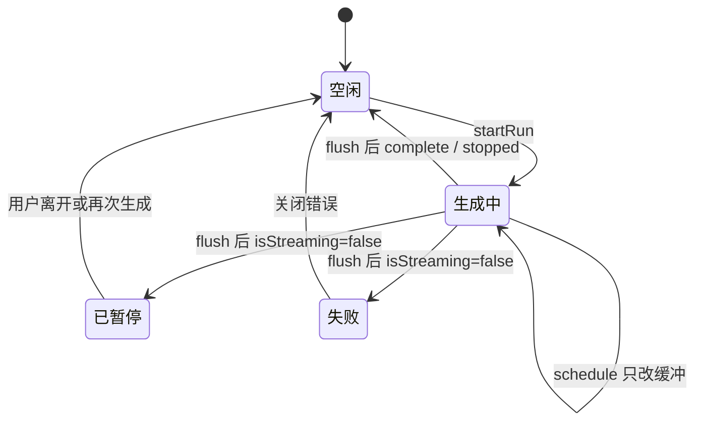

# 每日阅读流式防卡 — 实现思路

> **状态**：规划（未实现）  
> **日期**：2026-10-20  
> **需求摘要**：手动生成仍是同一条 SSE、同一套停止/续接/历史/完成后跳转；预览继续用与英语 Agent 相同的流式 Markdown 高亮。界面改为每帧最多画一次，并且只有预览订阅全文，桌面端窗口不再被这条流打成白屏。

## 延伸阅读

- [每日阅读流式生成](./每日阅读流式生成.md)（SSE、离开页面不断流）
- [刷新续接生成流](./刷新续接生成流.md)（按序号重放）
- [阅读生成历史](./阅读生成历史.md)（历史行只解析第一段已闭合 JSON）
- 英语 Agent 流式：`apps/frontend/src/store/englishAgent.ts`、`apps/frontend/src/views/englishLearning/agent/EnglishAgentMessageList.tsx`、`apps/frontend/src/components/design/ChatAssistantMessage/index.tsx`

---

## 0. 读本文你将得到什么

- 要解决的问题：生成过程中整个 Tauri 窗口变白，刷新无效，只能重启应用。
- 一句话方案：预览照英语 Agent 的消息气泡来画——一帧写一次正文、就地修改、只有这一块订阅全文，流式阶段继续 `StreamingMarkdownBody`，未闭合围栏只换代码节点，闭合后冻住。
- 主要改前端 Store 和设置页的订阅边界，不改 SSE 协议、模型轮次、落库和历史接口。
- 分三阶段，三阶段都要上。不把生成中的预览改成纯文本。
- 最大风险：历史弹层若仍在父组件里读取全文，会把表单又拖回来。

---

## 1. 需求与边界

### 1.1 用户故事

| 角色 | 场景 | 行为 | 期望结果 |
|------|------|------|----------|
| 用户 | 设置页点「生成阅读资源」，并打开输出预览 | 短文、附件、释义连续流出 | 预览仍是高亮中的 JSON 代码块，与现在一致；窗口可点、可滚、可刷新 |
| 用户 | 生成中离开设置页，或预览关着 | 后台继续收 SSE | 主题、档位不跟着每个 token 重绘 |
| 用户 | 生成结束、暂停、失败或点停止 | 看按钮、错误、历史、跳转列表 | 与现在同一时机、同一结果；结束后围栏冻住，不再反复高亮 |

### 1.2 范围

| 在范围内 | 不在范围内（非目标） |
|----------|----------------------|
| Store 的界面写入频率，对齐 `englishAgent` 的 `flushAssistantPatch` | 后端模型轮次、提示词、8192、缺词分批 |
| 设置页谁订阅 `text` / `tokens`，对齐 `EnglishAgentMessageList` | SSE 路径、`after` 序号、停止接口、历史表 |
| 预览继续走 `StreamingMarkdownBody` + `StreamingCodeFenceBlock` | 生成中改成纯文本 `<pre>` |
| 流式中不在页面上补全文闭合围栏 | 重写 highlight.js 或另做一套高亮 |

### 1.3 约束与依赖

- 桌面端与浏览器共用这条前端路径。卡死发生在 WebView 主线程，不在 Nest。
- 必须复用三处已有实现，不新写渲染器：
  - `createStreamingMobxPatchScheduler`
  - `StreamingMarkdownBody` / `StreamingCodeFenceBlock`（与 `ChatAssistantMessage` 相同）
  - 消息列单独 `observer` 的拆法（`EnglishAgentMessageList`）
- 序号 `seq` 仍在每个帧到达时立刻更新。续接用它做 `after`，不能等下一帧绘制。
- 完成、失败、停止、暂停仍同步收尾：立刻刷出已有正文，再 `finish()` / `ready()`。
- 功能底线：同一段拼接结果、同一次跳转、同一条历史、生成过程中预览仍然是高亮代码块。

---

## 2. 方案总览（一句话 + 要点）

**一句话方案**：把设置页预览当成英语 Agent 的一条正在流式输出的助手消息来更新和绘制，不改它已经在用的 Markdown 高亮组件。

| # | 设计要点 | 理由 |
|---|----------|------|
| 1 | 增量先进入私有缓冲，`requestAnimationFrame` 合并后就地写 `text` / `tokens` | `englishAgent` 的 `flushAssistantPatch` 就是这样。现在每个 SSE 帧都 `runInAction`，整页观察者按 token 执行 |
| 2 | 设置表单不读 `text`。预览自己读，相当于 `AssistantMessageRow` 只读自己那条 `content` | `EnglishAgentMessageList` 单独订阅消息，不带动输入框和侧栏。现在设置页一个 `observer` 读了全文 |
| 3 | 生成中把 `isStreaming={true}` 交给 `StreamingMarkdownBody`。页面不调用 `patchIncompleteNonMermaidFence` | `ChatAssistantMessage` 只在流结束后才补全文闭合围栏。未闭合的尾巴由 `StreamingCodeFenceBlock` 局部 patch：外壳建一次，之后只替换 `code.innerHTML`；围栏闭合后 `frozenRef` 冻住，不再碰 DOM |
| 4 | 终态帧先 `flush()` 再走现有 `finish` / `ready`，并把 `isStreaming` 置否 | 跳转、错误、历史必须落在同一拍。流结束时围栏闭合，高亮 DOM 冻住，与一条 Agent 消息结束相同 |

---

## 3. 现状与复用

| 能力 | 仓库中已有 | 本需求中的用法 |
|------|------------|----------------|
| 一帧最多一次 MobX 写入 | `apps/frontend/src/utils/scheduleStreamingMobxPatch.ts` | 直接复用。每日阅读 Store 目前没有调用它 |
| 就地改正在流的正文，不换数组元素 | `apps/frontend/src/store/englishAgent.ts` 的 `flushAssistantPatch` | 照做：写同一个 `text` 字段，历史列表不要因为新对象整表重建 |
| 只有消息列订阅流 | `apps/frontend/src/views/englishLearning/agent/EnglishAgentMessageList.tsx` | 设置表单留在页面；预览拆成单独 `observer` |
| 流式高亮、未闭合围栏只更新代码节点、闭合后冻住 | `ChatAssistantMessage`、`StreamingMarkdownBody`、`StreamingCodeFenceBlock` | 预览继续用这三件。生成中 `isStreaming={true}`，不要在页面上先把全文围栏补闭合 |
| 流式阶段不修补全文未闭合围栏 | `ChatAssistantMessage` 里 `if (!message.isStreaming) patchIncompleteNonMermaidFence` | 设置页现在自己拼 ` ```json ` 且生成中不闭合，这点可以留；不要再套一层全文 patch |
| 手动生成 SSE、离开不断流、按序号续接 | `apps/frontend/src/store/englishDailyReading.ts`、`apps/frontend/src/utils/dailyReadingSse.ts` | 协议和拼接规则保持；只把「写可观察字段」挪到帧末 |
| 历史标题只扫第一段闭合 JSON | `Settings.tsx` 的 `firstJsonObject` / `recordTitle` | 保留，但放到不订阅每个 token 的列表里。进行中的标题最多随预览那一帧更新 |

**调研结论**：英语 Agent 生成长文时同样走 Tauri 的 SSE，并且生成过程中一直高亮。它不卡，是因为一帧才把 `content` 就地写进当前这条消息，页面其余部分不订这串字；`StreamingMarkdownBody` 把已闭合围栏冻住，未闭合的只有尾部代码节点在换 `innerHTML`。每日阅读把同一套高亮组件嵌进了整页 `observer`，并且每个 token 都写 Store，所以主题、档位和预览一起在主线程上重做。修的是订阅和写入节奏，不是把高亮换成纯文本。

---

## 4. 架构图



**图内方法说明**：

| 方法 | 功能 |
|------|------|
| `createStreamingMobxPatchScheduler` | 把多次 `schedule()` 收成下一动画帧一次 `flush`。英语 Agent 用它合并 token。终态调用 `flush()` 时立刻写 Store 并取消尚未执行的帧 |
| `flushAssistantPatch` | 英语 Agent 的写入方式：找到当前助手消息，就地改 `content`，不替换数组元素。每日阅读对 `text` 做同样的事 |
| `StreamingMarkdownBody` | 流式阶段按围栏拆段。已闭合的代码块不再进入后续绘制；未闭合的非 mermaid 围栏交给 `StreamingCodeFenceBlock` |
| `StreamingCodeFenceBlock` | 未闭合时外壳只渲染一次，之后用高亮结果替换 `code.innerHTML` 并保住滚动位置。`complete` 后 `frozenRef` 为真，后续更新直接返回 |
| `patchIncompleteNonMermaidFence` | 给未闭合围栏临时补上闭合行，否则 markdown-it 会把后面的正文吞进代码。助手只在 `isStreaming === false` 时对全文调用；流式中由围栏组件局部调用 |
| `startRun` | 用户点击生成：清空缓冲、记下 `runId`、接上 stream。触发时机与现在相同 |
| `stopRun` | 用户点击停止：先刷出已缓冲正文，再走现有中止和 `historyRev` |
| `finish` | 终态收尾：停计时、清 `generating`、增加 `historyRev`。只在 `flush` 之后调用 |
| `ready` | `reading.complete` 后的现有回调，跳到手动列表 |

**读图要点**：

- 高亮组件不换。预览和 `ChatAssistantMessage` 使用同一条流式路径。
- 设置表单与预览拆开，对应 Agent 页「消息列」和「输入框 / 侧栏」拆开。
- 远端协议不动。变化在 Store 何时把字符串交给那一个预览观察者。

---

## 5. 主流程图



**图内方法说明**：

| 方法 | 功能 |
|------|------|
| `schedule` | 标记本帧已脏并注册 `requestAnimationFrame`。同一帧内后续 delta 不再注册第二次 |
| `flush` | 取消待执行的动画帧，立刻把 `buf` 就地写入 `text`、把 `bufTokens` 写入 `tokens` |
| `StreamingMarkdownBody` | 用当前 `text` 和 `isStreaming` 拆段绘制。生成中为 true，与助手消息相同 |
| `finish` | 现有收尾：计算耗时、`generating = false`、`historyRev += 1`、清定时器。`generating` 变 false 后预览的 `isStreaming` 跟着变 false |
| `ready` | 仅 `reading.complete` 调用，导航到手动生成列表 |

**读图要点**：

- 增量帧不碰可观察的 `text`，设置表单不会因 token 醒过来。
- 预览醒过来之后仍走流式高亮，不是纯文本。未闭合围栏只更新代码节点。
- 终态不走动画帧。`isStreaming` 在这一拍关掉，围栏闭合后冻住，避免结束后还整段高亮。

---

## 6. 核心时序图



**图内方法说明**：

| 方法 | 功能 |
|------|------|
| `onDelta` | 处理 `reading.delta` / `reading.snapshot`：维护序号和私有缓冲。拼接规则与现在的 `onFrame` 相同，但不在这里通知界面 |
| `schedule` | 预约下一帧绘制。本帧已经预约过就返回 |
| `flush` | 把缓冲就地提交到 `text` 和 `tokens`。预览只因这一次提交重绘 |
| `StreamingMarkdownBody` | 按围栏把这一帧的全文拆开。只有未闭合的尾部围栏会进入高亮更新 |
| `onComplete` | 处理 `reading.complete`：先 `flush` 保证最后一段可见，再 `finish` 和 `ready` |
| `ready` | 现有完成回调，离开设置页去手动列表 |

**读图要点**：

- 两个 delta 只产生一次预览通知，和 `englishAgent` 的 `patchAssistant` + 调度器相同。
- 高亮发生在这一次预览绘制里，范围是未闭合围栏的代码节点，不是整页，也不是每个 token。
- 完成后 `isStreaming` 变为 false，围栏冻住。这是助手消息结束时的同一条路径，不是等到用户打开历史才第一次上色。

---

## 7. 状态机



**图内方法说明**：

| 方法 | 功能 |
|------|------|
| `startRun` | 进入生成中：新 `runId`、空缓冲、接上 SSE。预览 `isStreaming` 为 true，按钮文案仍是「停止生成」 |
| `schedule` | 留在生成中。只更新缓冲，不改变 `generating`，也不把围栏标成闭合 |
| `flush` | 离开生成中之前先提交正文。随后 `isStreaming` 变为 false，`StreamingCodeFenceBlock` 闭合围栏并冻住 |

**读图要点**：

- 生成中的自环仍然是高亮预览，只是一帧一次，且不带动表单。
- 离开生成中的边与现在的 `reading.paused` / `error` / `stopped` / `complete` 一一对应。
- 没有「生成中纯文本、结束后才上色」这个状态。上色从第一帧预览就开始，结束时冻住。

---

## 8. 模块职责与接口草图

### 8.1 模块一览

| 模块 | 职责 | 新增/改动 | 预估路径 |
|------|------|-----------|----------|
| 帧合并 | 增量进缓冲，一帧就地写 `text` / `tokens`；终态同步 `flush` | 扩展 | `apps/frontend/src/store/englishDailyReading.ts` |
| 设置页 | 主题和档位不再读取 `text` / `tokens` | 扩展 | `apps/frontend/src/views/englishLearning/dailyReading/Settings.tsx` |
| 生成底栏 | 单独观察 `generating`、`error`、`historyRev` | 扩展（从页面拆出） | 同上，页面内子组件 |
| 输出预览 | 单独观察 `text`；`StreamingMarkdownBody` 的 `isStreaming` 等于 `generating` | 扩展 | 同上，`StreamPreview` |
| SSE / 后端 / 高亮组件 | 不改 | 已有 | `dailyReadingSse.ts`、`StreamingCodeFenceBlock.tsx` |

### 8.2 关键接口（伪代码或 TypeScript 草图）

```typescript
// 与 englishAgent.flushAssistantPatch 相同的合并器：一帧最多写一次可观察正文
const paint = createStreamingMobxPatchScheduler(() => {
	runInAction(() => {
		// 就地改 text，不换 Store、不重建历史数组，表单观察者没有读这个字段
		this.text = this.buf;
		// token 与正文同一拍提交，顶栏数字不会比预览更勤
		this.tokens = this.bufTokens;
	});
});

// 非终态帧：序号立刻推进，正文先不通知界面
function onDelta(frame: ReadingFrame): void {
	// seq 给断线续接的 after 用，晚一帧会把同一段 delta 再拼一次
	if (typeof frame.seq === 'number' && frame.seq > this.seq) this.seq = frame.seq;
	// snapshot 覆盖、delta 追加，与现在 onFrame 的分支相同
	this.buf = frame.type === 'reading.snapshot' ? (frame.text ?? '') : this.buf + (frame.text ?? '');
	// 本帧已预约则 schedule 内部直接返回
	paint.schedule();
}
```

```tsx
// 预览等价于 ChatAssistantMessage：流式全程高亮，结束才让围栏闭合
function StreamPreview({ text, generating }: { text: string; generating: boolean }) {
	// 生成中不在这里补闭合行，避免把未完成 JSON 当成已冻住的整段围栏反复整页解析
	const markdown = generating ? '```json\n' + text : '```json\n' + text + '\n```';
	// isStreaming 交给 StreamingMarkdownBody，未闭合尾巴由 StreamingCodeFenceBlock 局部更新
	return <StreamingMarkdownBody markdown={markdown} isStreaming={generating} />;
}
```

### 8.3 数据模型

| 字段/实体 | 来源 | 存储 | 说明 |
|-----------|------|------|------|
| `buf` / `bufTokens` | SSE 帧 | Store 私有字段，不观察 | 本帧已拼好的原文和 token |
| `text` / `tokens` | `flush` | 可观察字段 | 语义不变。写入从「每 token」改为「每动画帧或终态」，并且就地赋值 |
| `seq` | 每个 SSE 帧 | 界面不读 | 仍逐帧更新，续接游标不变 |
| 历史 `records[].text` | 现有列表接口 | 服务端 | 不改。打开一条历史时 `isStreaming` 为 false，围栏闭合后冻住 |

---

## 9. 分阶段实现步骤

三阶段都要做完才算修好。只做帧合并时，设置页仍整页订阅全文。只拆订阅时，每个 token 仍会让预览里的围栏更新。预览必须继续走 `StreamingMarkdownBody`，不能改成纯文本。

| 阶段 | 目标 | 交付物 | 依赖 |
|------|------|--------|------|
| M1 | Store 一帧写一次，终态不丢最后一段 | `onFrame` 改缓冲 + `flush` | 无 |
| M2 | 设置表单不再因全文重绘 | 底栏 / 预览自己订阅 | M1 |
| M3 | 预览与助手消息同一条高亮路径 | `isStreaming` 与围栏闭合时机对齐 | M2 |

### M1

- [ ] `reading.delta` / `reading.snapshot` 只改 `buf`、`seq`、`failAttempt`，再 `schedule`。
- [ ] `reading.complete` / `error` / `paused` / `stopped` 先 `flush()`，再执行现在的 `finish` / `ready`。
- [ ] `stopRun` 同样先 `flush`，避免停止时预览少一段已收原文。
- [ ] 拼接规则保持：snapshot 在 `reset` 或更长时覆盖，delta 追加。

### M2

- [ ] 页面组件删除对 `text`、`tokens` 的读取。
- [ ] 生成按钮、错误条放进只订阅 `generating` / `error` / `historyRev` 的子组件。
- [ ] 预览子组件自己读 `text`，父组件不要把 `text` 当 props 传下去，否则父组件仍会按帧重绘。
- [ ] `recordTitle` 仍只解析第一段闭合 JSON。历史列表不要在每个 token 上扫描进行中的全文。

### M3

- [ ] `StreamPreview` 在 `generating === true` 时 `isStreaming={true}`，Markdown 不补闭合围栏。
- [ ] `generating === false` 时补上闭合围栏并 `isStreaming={false}`，让 `StreamingCodeFenceBlock` 走 `frozenRef`。
- [ ] 不新增纯文本分支，不换 `MarkdownParser`。
- [ ] 贴底仍用现有 `useStickToBottomScroll`。`contentRevision` 用 `text.length`，避免为了滚动去比较整段字符串。

---

## 10. 关键决策与备选方案

| 决策 | 选用 | 备选 | 为何不选备选 |
|------|------|------|--------------|
| 绘制频率 | 复用 `createStreamingMobxPatchScheduler`，就地写 `text` | 每个 token `runInAction` | 英语 Agent 已避免后者。每个 action 结束都会同步通知读过 `text` 的观察者 |
| 谁重绘 | 表单不订全文，预览单独订 | 整页一个 `observer` | `EnglishAgentMessageList` 已经把消息列和页面其余部分拆开。整页订阅会把主题和档位卷进每一帧 |
| 生成中的样子 | 继续 `StreamingMarkdownBody`，`isStreaming=true` | 生成中用 `<pre>` 纯文本，结束再高亮一次 | 助手和 Agent 生成过程中就在高亮。纯文本改变了预览，而且不是那些页面的实现 |
| 未闭合围栏 | 交给 `StreamingCodeFenceBlock` 局部更新，闭合后冻住 | 页面上对全文调用 `patchIncompleteNonMermaidFence` | 助手明确只在流结束后补全文。流式中补全文会让整段被当成已闭合围栏反复解析 |
| 协议 | 不改后端 | 服务端合并 token 再推 | 前端订阅不拆开的话，合并后的大块仍会带动整页重绘 |

---

## 11. 风险、边界与待确认

| 项 | 等级 | 说明 | 缓解 |
|----|------|------|------|
| 进行中的 JSON 仍是一个未闭合围栏 | 中 | 多轮输出都接在同一块里，闭合冻住要等到暂停或结束。这一块每帧仍会换一次 `code.innerHTML` | 与 Agent 里一个未闭合代码块相同。表单不再参与，频率从每个 token 降到每帧 |
| 父组件把 `text` 当 props | 高 | 拆了子组件但父组件仍读取全文，整页重绘还在 | M2 要求预览自己读 Store，父组件不读 `text` |
| 终态丢最后一段 | 中 | complete 没先 flush，跳转前预览少一截 | M1 规定终态和 `stopRun` 都先 `flush` |
| 续接重复拼接 | 中 | `seq` 若改成下一帧再写，`after` 会偏小 | `seq` 保持逐帧同步写，且界面不订阅它 |
| 历史弹层扫描进行中全文 | 低 | `recordTitle` 对未闭合 JSON 会扫一遍 | 历史列表不随 token 重建；进行中行只用 `generating` 显示转圈 |

**待确认**：无。生成中保持高亮是本方案的约束，不再改成纯文本。

---

## 12. 验收清单

| # | 用例 | 步骤 | 期望 |
|---|------|------|------|
| AC1 | 预览开着生成完整篇 | 点生成，打开输出，等到短文和释义都结束 | 生成过程中就是高亮 JSON 代码块。窗口可滚动、可点停止，不必重启 |
| AC2 | 预览关着，人留在设置页 | 点生成后不打开输出 | 主题和档位不随 token 闪动。按钮仍变为「停止生成」 |
| AC3 | 离开设置页 | 生成开始后打开别的英语页再回来 | 流还在。回来后预览接上当前全文，不重复拼接，仍是流式高亮 |
| AC4 | 完成与停止 | 等完成；另一次点停止 | 完成仍跳手动列表。停止后历史多一条，正文含停止前已收到的原文，围栏不再反复高亮 |
| AC5 | 历史 | 打开一条已结束记录 | `isStreaming` 为 false，高亮一次后冻住。行标题仍来自第一段闭合 JSON |
| AC6 | 刷新 | 生成中刷新桌面窗口 | 窗口能重新画出界面。序号续接行为与现在相同 |

---

## 13. 预估改动面（实现阶段参考）

| 类型 | 路径（预估） |
|------|--------------|
| 前端 | `apps/frontend/src/store/englishDailyReading.ts` |
| 前端 | `apps/frontend/src/views/englishLearning/dailyReading/Settings.tsx` |
| 不改 | `StreamingMarkdownBody.tsx`、`StreamingCodeFenceBlock.tsx`、后端 SSE |
| 文档（实现后） | 落地后再按 diff 归档，不在本篇写实现 |

---

（本文档为规划态实现思路；落地后以源码为准）
