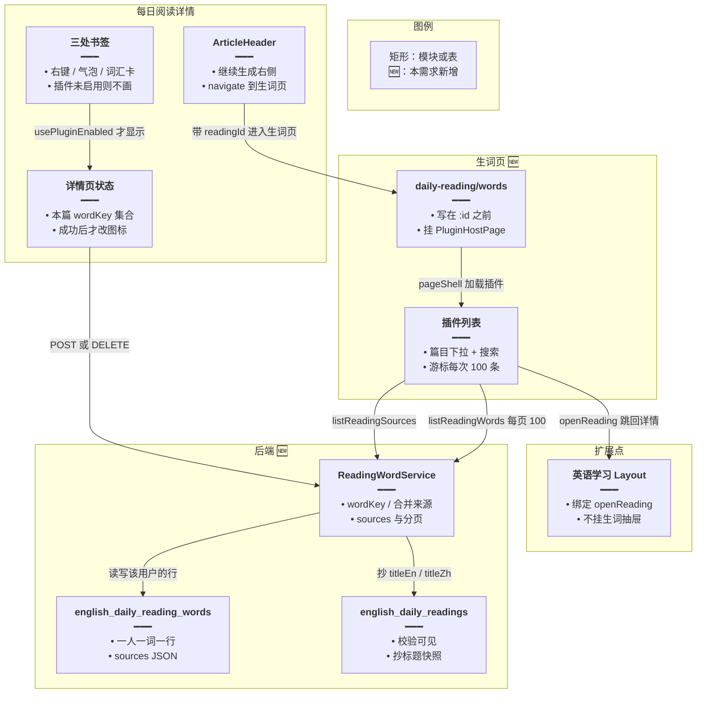
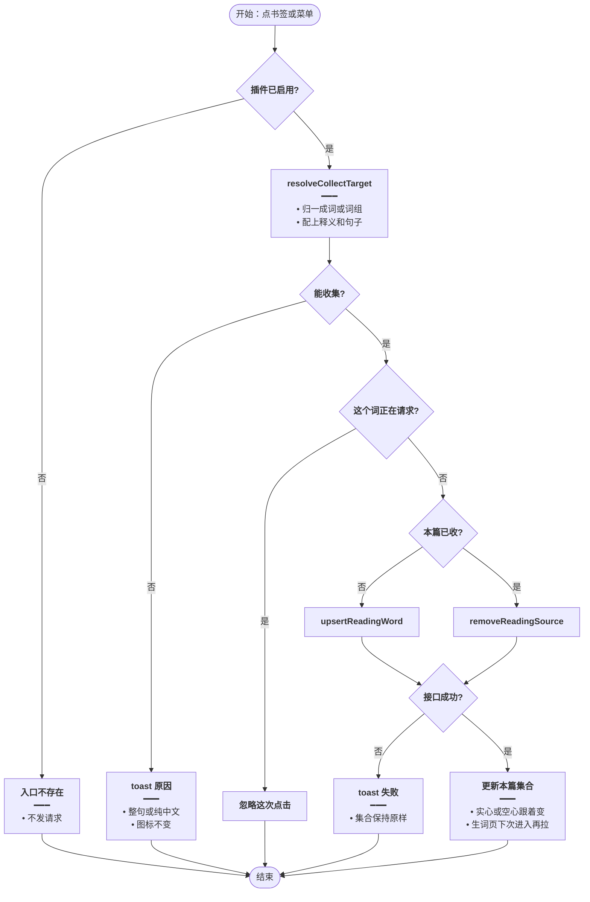
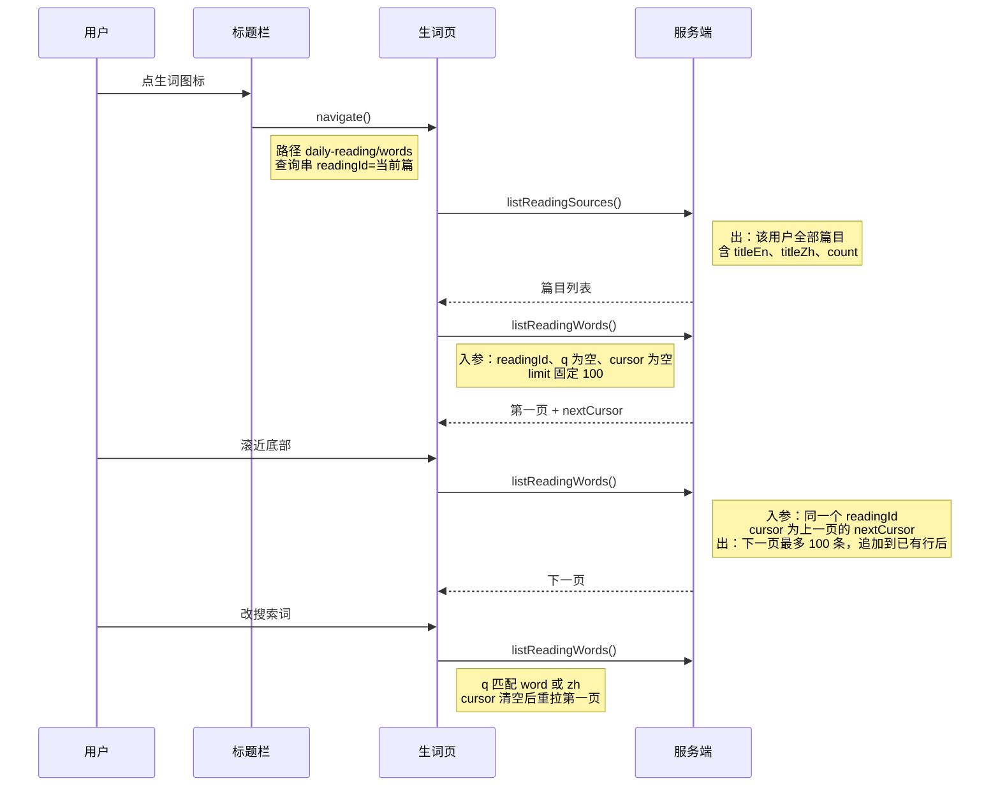
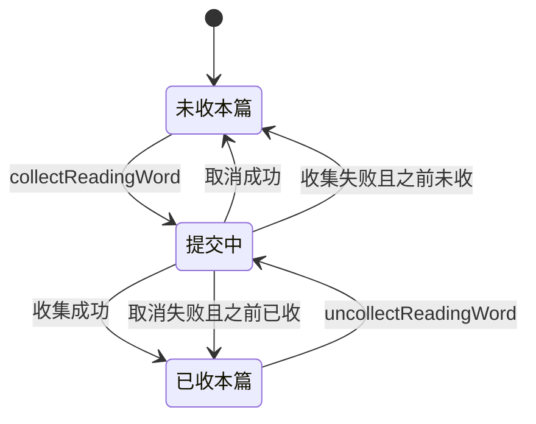

# 每日阅读生词 — 实现思路

> **状态**：规划（未实现；详情页点词气泡、选区菜单、词汇卡和英语学习子路由可复用）  
> **日期**：2026-11-14；收集页改为独立页面并补充分页与筛选于 2026-11-15  
> **需求摘要**：已登录的学习者在每日阅读正文里收藏单词或文末词表中的一条，并从「继续生成」右侧进入独立生词页，按篇目标题、单词或中文释义找回自己的词。  
> **一句话方案（预告）**：宿主在右键、气泡和词汇卡上收集并写入新表；标题栏进入独立生词页。该页滚动每次加载 100 条，用篇目 id 选定一篇，并用同一个关键词搜单词或中文释义。同一用户同一词一行，多篇来源记在这一行里。

## 延伸阅读

- [插件预留扩展点](../plugins/插件预留扩展点.md)（每日阅读列表点已登记，详情页还没有文章级的点）
- [真文点词](./真文点词.md)（自带文本点词并进入今日复习；本篇不进复习队列）
- [单词详解插件](./单词详解插件.md)（词卡 action 打开抽屉的现成接法；本篇收集不能复用那一下就开抽屉的点击）

---

## 0. 读本文你将得到什么

- 要解决的问题：每日阅读能点词看释义，但不能把这个词连同这篇的 id 和标题留在自己的生词本里。
- 比对后的方案：宿主在右键、气泡和词汇卡上收集，写入新表；独立生词页滚动加载，可按一篇的标题选定，并搜索单词或中文释义。
- 主要改动层：每日阅读详情、一条排在 `:id` 前面的子路由、英语学习新接口和新表、插件仓里的生词页。
- 分三阶段：先能收、能进独立页、能滚动加载和筛选；再补改释义；最后补失败和快连点。
- 最大风险：选区把整句收成一个「单词」，或和已有单词收藏、今日复习抢同一条词。

---

## 1. 需求与边界

截图里的右键出现在英文正文选区，气泡是正文点词，红框在文末词汇卡右上角。原话里的「中文中」按「正文中」处理。展开后的中文译文不挂收集。

### 1.1 用户故事

| 角色 | 场景 | 行为 | 期望结果 |
|------|------|------|----------|
| 已登录学习者 | 读一篇每日阅读 | 在英文正文里选中一个单词，右键点「收集单词」 | 词、当时的中文释义、这篇 id、英文标题、中文标题和所在句写入自己的生词本 |
| 同一人 | 正文里点开一个已标注的词 | 在气泡里点书签 | 与右键收的是同一条；已收过则按钮为实心，再点只从本篇移除 |
| 同一人 | 看到文末词汇卡 | 点卡片右上角书签 | 用卡片上的词和释义收集；词组（最多 4 个英文词）允许 |
| 同一人 | 想回看收过的词 | 点标题栏「继续生成」右侧的图标 | 进入独立生词页，而不是抽屉。从这篇进去时，标题筛选预先选中这一篇 |
| 同一人 | 生词变多 | 在生词页往下滚 | 每页 100 条，滚近底部再请求下一页，已加载的行留着 |
| 同一人 | 只想看某一篇里收过的词 | 在标题筛选里选中那篇的标题 | 列表只剩来源里包含这篇 id 的词，不受标题文字是否相同影响 |
| 同一人 | 记得词或中文，不记得是哪篇 | 在搜索框输入单词或中文释义 | 在当前标题筛选之下，命中单词或中文释义的行出现；清空搜索恢复这一筛选下的全部 |
| 同一人 | 这篇没有给出释义 | 仍然收集 | 释义留空，生词页里可以补；之后再收同一个词不会盖掉手改过的释义 |
| 未启用插件的人 | 打开同一篇 | 看正文和标题栏 | 三处书签和标题栏入口都不出现 |

### 1.2 范围

| 在范围内 | 不在范围内（非目标） |
|----------|----------------------|
| 插件仓 `dnhyxc-ai-plugins` 的生词页 `dailyReadingWords`，由主站子路由挂上 | 把收集请求放进插件远程包里执行（见 §4，远程包未打开时跑不到） |
| 宿主三处入口：正文选区右键、点词气泡、文末词汇卡右上角 | 中文译文段落、语法笔记、测验选项 |
| 标题栏「继续生成」与列表开关之间的图标，进入 `/english-learning/daily-reading/words` | 右侧抽屉；每日阅读列表页再加一个入口；插件侧栏再占一项 |
| 新表，按 `userId` 隔离；保存词、释义、来源篇 id 和标题快照 | 复用 `english_vocabulary_favorite`，或写入今日复习 / 错题本 |
| 再点一次取消本篇来源；来源空了才删整行 | 大模型补释义、导出 Word、会员门槛、离线 |
| 插件未启用时入口消失 | 为这个功能新增一种扩展点槽位类型 |

### 1.3 约束与依赖

- 登录沿用英语学习接口的 `JwtGuard`，用户 id 取 `req.user.userId`。Web 和 Tauri 走同一套接口。
- 扩展点只登记 `openReading`。`action` 一点就会开抽屉，所以标题栏不用 `HostPoint`，直接 `navigate` 到生词页。一个插件的 `host.slot` 只能对上一个槽。
- 详情页已经在英文正文上挂了 `useSelectionContextMenu`。收集项只加在这一页，不进聊天和助手的共用菜单。
- 点词气泡用的是 `WordLine`。右键不能把气泡里的词变成按钮，否则会清掉跨词选区（`GlossSentence` 里已有这条约定）。
- 词库收藏和 [真文点词](./真文点词.md) 的复习队列保持原样。本篇不调用 `addVocabularyFavorite`，也不改 `nextReviewAt`。
- 遵守 Ponytail：不新加 npm 依赖；不改 `runtime/index.ts`、`points/api.ts` 的裁剪逻辑。

### 1.4 相对原话补上的能力

| 原话 | 补上的行为 | 原因 |
|------|------------|------|
| 收藏单词 | 再点一次是取消，图标区分未收 / 已收本篇 | 只增不减的话，收错只能到列表里找 |
| 带上这篇 id 和 title | 同一词一行，来源是数组；标题在收集时从阅读行抄下来 | 同一词在多篇里出现时，列表不会重复，删掉原文后标题还在 |
| 保存中文释义 | 词表释义优先于气泡；空释义允许；手改后加锁 | 文末词表通常比句中单词释义完整；后一次收集不该把改过的释义盖掉 |
| 选中就能收 | 只收 1 个英文词，或正好等于某一张词汇卡的词组（最多 4 词） | 截图里的选区可以是 “exquisite dishes” 这种短语，整句收进去就不是生词 |
| 打开列表 | 独立页；滚动每页 100 条；按篇目 id 选标题；搜索匹配单词或中文释义 | 抽屉装不下滚动列表。用标题文字搜索会把同名的两篇混在一起，也看不到还没滚到的标题 |

---

## 2. 背景

- **谁、在什么场景、卡在哪**：学习者在每日阅读详情里点词能看到释义、能朗读，文末也有词汇卡。词看过就没了，下一篇再遇到要重新找。
- **现状缺口**：`english.dailyReading` 只挂在列表页，上下文只有 `origin`。详情标题栏、选区菜单、气泡和词汇卡都没有扩展点。`english_vocabulary_favorite` 按「用户 + 词形」唯一，没有阅读篇 id。今日复习只认记词和错题。
- **不解决会怎样**：从这篇收的词要么混进词库收藏，丢掉「从哪篇来的」；要么只存在浏览器里，换设备就没了。
- **硬约束**：书签只收集，不离开详情。标题栏图标进入独立生词页，不打开抽屉。入口必须跟现有图标一行高，并且插件关掉就消失。不能改聊天选区菜单，不能把生词写进错题或复习间隔。生词页路由必须写在 `daily-reading/:id` 之前。

---

## 3. 现状与复用

| 能力 | 仓库中已有 | 本需求中的用法 |
|------|------------|----------------|
| 详情页、标题栏「继续生成」 | `apps/frontend/src/views/englishLearning/dailyReading/Detail.tsx`、`components/ArticleHeader.tsx` | 扩展。在「继续生成」和列表开关之间加跳转按钮 |
| 正文选区右键（朗读 / 复制） | `Detail.tsx` 调用 `createSelectionSpeakMenu`；实现在 `apps/frontend/src/components/design/SelectionSpeak/createSelectionSpeakMenu.ts` | 扩展。只在详情页的菜单数组后面追加一项，不改共用工厂 |
| 点词气泡 | `components/GlossSentence.tsx`、`components/WordLine.tsx` | 扩展。`WordLine` 增加一个可选尾槽，气泡把书签放在复制按钮后面 |
| 文末词汇卡 | `Detail.tsx` 里 `row.extras.glossary` 的卡片 | 扩展。卡片加 `relative`，书签绝对定位在右上角 |
| 阅读行 id、标题、词表、逐词释义 | `EnglishDailyReading`；前端类型 `EnglishDailyReadingItem.extras` | 直接复用。释义和标题都从已加载的这一行取，收集时不打模型 |
| 按用户收藏的接口形状 | `EnglishLearningController` 的 `vocabulary-favorites`，`req.user.userId` | 扩展时只借鉴守卫和返回 `{ success, data }`。不调用现有收藏方法 |
| 单词收藏表 | `entity/english-vocabulary-favorite.entity.ts`，唯一键 `userId + wordKey` | 不适用。没有篇目，字段是音标、词性和例句 |
| 列表页扩展点 | `POINT.dailyReading` = `english.dailyReading`，槽是 `toolbar` / `item-action` / `drawer` | 不适用。那个点挂在列表，上下文只有 `origin` |
| 动作槽打开抽屉 | `HostPoint` 的 `action` + `opens` | 不适用。生词列表是整页，标题栏用普通按钮 `navigate` |
| 布局挂抽屉 | `views/englishLearning/Layout.tsx` 扫描 `layoutDrawerSlots` | 不适用。不新增抽屉槽。`openReading` 仍绑在这一层 |
| 子路由顺序 | `apps/frontend/src/router/routes.ts` 里 `daily-reading/settings` 在 `daily-reading/:id` 前面 | 直接复用。新增 `daily-reading/words`，同样放在 `:id` 前面 |
| 滚动加载 | `hooks/useEnglishLearningList.ts`，offset 加续读位置 | 不适用。收集或取消后 offset 会错位。生词页用游标追加，每页 100 |
| 插件整页 | `federation/host/PluginHostPage.tsx` 的 `pageShell` | 直接复用。路由组件把 `dailyReadingWords` 挂成一页 |
| 插件是否启用 | `usePluginEnabled` | 直接复用。标题栏图标和三处书签都看 `dailyReadingWords` |
| 插件 HTTP | `api.http`，权限 `http:plugin-api`；宿主 `apps/frontend/src/utils/fetch` 的 `http` | 直接复用。宿主收集和插件列表打同一组路径 |
| 今日复习 / 真文点词 | `english_practice_review_state`，ideas `english/真文点词.md` | 不适用。本篇不插入复习行 |

**调研结论**：详情页的菜单、气泡和词汇卡都能加上按钮。列表页的 `english.dailyReading` 没有文章 id。收藏表和复习队列都表达不了「这篇里的这个词」。英语学习子路由里，静态路径必须写在 `daily-reading/:id` 前面。缺的是一张按用户存来源的表，以及一个独立生词页，而不是再挂一个抽屉。

---

## 4. 方案比对与最终方案

### 4.1 候选方案

#### 方案 A：宿主收集，插件做独立生词页（新增路由 + 新表）

- **做法**：书签留在详情页，调用宿主 `http` 写入新表。标题栏在「继续生成」右侧放一枚图标，`navigate` 到 `/english-learning/daily-reading/words`。这条路由写在 `daily-reading/:id` 前面，页面用 `PluginHostPage` 挂 `dailyReadingWords`。从某篇进去时带上 `?readingId=`。页内滚动每次 100 条；标题筛选按篇目 id；搜索匹配单词或中文释义。图标和书签都用 `usePluginEnabled('dailyReadingWords')`。
- **能工作的原因**：收集不依赖远程包已经执行。生词页是插件，关掉插件后入口一起消失。整页有地址，刷新后筛选还在，返回键回到刚才那篇。
- **主要代价**：主站要加一条路由。收集 POST 不在插件仓。列表路径字符串主站和插件各有一份。

#### 方案 B：常驻 toolbar 插件执行收集（新增点 + 新表）

- **做法**：插件 `host.slot` 写 `toolbar`，标题栏挂 `HostPoint` 的 `toolbar`。这个远程组件渲染「打开列表」按钮，并订阅上下文里的 `collectNonce`。三处书签只调用 `publishPointContext` 把词和 nonce 交出去。插件里 `api.http` 完成写入，再用新信号 `marks` 把已收词形写回按钮。打开抽屉走一条新命令 `openList`，在 `points/commands.ts` 里 `openPoint(..., 'dailyReadingWords', 'drawer')`。
- **能工作的原因**：一个插件只能声明一个 `host.slot`。声明成 `toolbar` 后，远程模块会随标题栏挂上，收集逻辑可以留在插件仓。信号回写后，宿主按钮不必自己请求状态。
- **主要代价**：`PluginHostPage` 的 toolbar 加载态会在图标行里显示 “loading...”。还要给 `publishSignal` 增加 `marks` 分支，并在 `commands.ts` 写死插件 id。远程包没订上之前的那一次点击会丢。

#### 方案 C：写入现有单词收藏（复用表，抽屉可有可无）

- **做法**：三处按钮调用已有 `POST /english-learning/vocabulary-favorites`。为了带上篇目，给 `english_vocabulary_favorite` 增加可空的 `readingId`、`titleEn`、`titleZh`。唯一键维持 `userId + wordKey`，后来的篇目覆盖先前的 id 和标题。列表用现成「我的收藏」，或仍做一个插件抽屉去读这张表。
- **能工作的原因**：收藏接口、去重和按用户查询都已经在线上。少一张表，也少一套守卫。
- **主要代价**：同一词只能留下最后一篇。词库收藏页会混进阅读生词，而那些行没有音标和例句。取消收藏会连词库里的星一起取消。

### 4.2 比对

| 维度 | 方案 A | 方案 B | 方案 C |
|------|--------|--------|--------|
| 正确性（失败路径、边界、数据是否会错） | 请求成功后才改图标。同一词多篇来源都留着。手改释义有锁。远程包失败时收集仍可写入，列表打开会看到宿主已有的错误页 | nonce 在插件订阅前发出会丢。`marks` 和数据库可能短暂不一致。多篇来源同样能做对 | 后一篇覆盖前一篇的 id。取消收藏误伤词库星。空释义和词库收藏的必填例句对不上 |
| 复用 / 与现状契合 | 复用详情页菜单、`WordLine`、`PluginHostPage` 整页和 `usePluginEnabled`。路由顺序照抄 `settings`。不复用收藏表，也不复用 offset 列表 hook | 复用插件 `api.http`。要改 `publishSignal` 和 toolbar 加载态 | 复用收藏接口最多。和篇目快照、独立生词页都不契合 |
| 改动面（要动哪些路径） | 路由、标题栏、详情页、`WordLine`、新 service / 控制器 / 表、插件生词页、注册表 | 在 A 之外再改 `session.ts` 的信号和 `commands.ts` | 收藏实体、DTO、收藏列表展示；详情页按钮 |
| 复杂度（新概念、新状态、新依赖） | 一张表、详情页一个 `Set<string>`、生词页的游标和筛选。无新依赖 | 额外的 nonce、`marks` 信号、写死的插件 id。无新依赖 | 不新表，但收藏行增加可空篇目字段，列表要分辨「词库星」和「阅读生词」 |
| 体验（延迟、步骤数、失败时用户看到什么） | 标题栏图标和「继续生成」同一行。收集失败图标不变，并 toast。生词页可滚动、可刷新、可用浏览器返回 | 第一次进入标题栏会闪出 toolbar 的 “loading...”。插件未就绪时点击无反馈 | 能立刻出现在「我的收藏」，但同一词只剩最后一篇 |
| 风险（迁移、互斥、并发、回滚） | 新表可单独丢弃。与朗读、选区菜单互不抢事件。唯一键挡住并发重复行 | 信号分支写错会影响词卡 `pending` 和词库 `stats`。命令里的插件 id 改名就打不开 | 迁移改的是线上收藏表。回滚要删列，已混入的阅读词无法和词库星分开 |
| 可维护性（以后改一处还是改多处） | 词形规则和来源数组合并只在新 service。入口分散在详情页三处，但都调用同一个函数 | 收集规则在插件，图标状态在信号，打开抽屉在命令，三处要一起看 | 阅读篇目规则长在词库收藏上，以后改收藏会碰到每日阅读 |

### 4.3 综合考量

权重放在三件事上：篇目不能丢、标题栏不能闪出加载文案、关掉插件后入口必须消失。这三件来自 §1 的入口位置和 §3 的槽位限制。

方案 A 在这三件上都成立。标题栏是主站按钮，书签用主站请求写入，所以不等远程包执行。生词页仍是插件，注册表里没有这个插件时，图标和书签一起不渲染。页怎么挂、怎么翻页，放在 §4.6 和 §4.7，不改这里「谁写入」的结论。

明确放弃方案 B 的一项优点：收集 POST 可以只放在插件仓。这项抵不过 toolbar 加载文案，以及 `publishSignal` 今天只实现了 `pending` 和 `stats`、再加一种会碰到无关按钮。也放弃方案 C 的一项优点：少一张表、少一套接口。词库收藏的唯一键留不下多篇来源，和「用 id、title 找回那篇」直接冲突。

### 4.4 最终方案

#### 背景

详情页能点词、能选区朗读，但没有地方记住「这个词来自哪一篇」。列表扩展点只有 `origin`。收藏表没有篇目，复习队列不该被点一下就改期间隔。生词会越积越多，需要一整页来滚动，并按某一篇的标题把词收拢，再在里面搜单词或中文。

#### 具体思路

1. 模块切开：三处书签和「这篇是否已收」放在详情页。写入、去重、来源合并、分页和标题列表放在新的后端 service。生词页放在插件仓，由主站一条子路由挂出来。
2. 数据从已打开的 `EnglishDailyReadingItem` 取出词和释义，连同 `readingId` 交给接口。标题由服务端从阅读行抄进来源，不信客户端传来的标题。
3. 「本篇已收词形」放在详情页 `useState` 的 `Set`。不放 MobX，因为只有这一页的书签在读。生词页自己请求列表，不靠详情页推 revision。
4. 边界：插件未启用则不画书签和图标。选区不合格就 toast，不请求。请求失败不改图标。同一个词的请求进行中时按钮禁用。手改过的释义不再被新的收集覆盖。筛选或搜索一变，已加载的行丢掉，从第一页重来。

#### 实现方案

**一句话**：宿主在右键、气泡和词汇卡上收集并写入新表；标题栏进入独立生词页。该页滚动每次加载 100 条，用篇目 id 选定一篇，并用同一个关键词搜单词或中文释义。同一用户同一词一行，多篇来源记在这一行里。

| 步骤 | 谁 | 做什么 | 输入 → 输出 |
|------|----|--------|-------------|
| 1 | `routes.ts` | 在 `daily-reading/:id` 前注册 `daily-reading/words`，页内挂 `PluginHostPage` | 地址不会被文章 id 吃掉 |
| 2 | `ArticleHeader.tsx` | 「继续生成」右侧放图标，插件启用才显示 | 点击进入生词页，并带上当前 `readingId` |
| 3 | `Detail.tsx`、`WordLine.tsx`、`GlossSentence.tsx` | 插件启用时追加菜单项、气泡尾槽、卡片右上角书签 | 点击得到 `{ word, zh, sentence, surface }` 或一条失败原因 |
| 4 | 详情页 `collectReadingWord` | 已收则 DELETE 来源，未收则 POST | 成功后只更新本篇 `Set` |
| 5 | 新 service | 归一词形，校验阅读可见，合并来源，尊重释义锁 | 一行 `english_daily_reading_words` |
| 6 | 插件生词页 | 先拉篇目标题，再按 `readingId` 和 `q` 游标取词，每页 100 | 滚到底追加；改筛选则清空重拉 |

#### 选定原因

1. **正确性**：来源数组和「成功后再改图标」对得上多篇和失败路径。牺牲：收集代码不在插件仓，主站多一个 service。
2. **复用**：菜单、`WordLine`、整页插件壳和启用开关都沿用。牺牲：不复用单词收藏表，也不复用 offset 滚动 hook。
3. **体验**：标题栏没有 toolbar 加载文案，书签不离开详情。生词页能滚动和刷新。牺牲：从详情进生词页多一次路由，而不是在原地拉开抽屉。
4. **风险**：新表和新控制器可以单独撤下，不改收藏表和 `publishSignal`。牺牲：主站和插件各写一次列表 URL。
5. **可维护性**：词形、来源合并和分页条件只在 service。牺牲：三处按钮都在详情页，改文案要动这一页而不是只动插件。

#### 优势

- 相对方案 B：远程包还没执行时收集已经能落库；标题栏不会出现 “loading...”；不必改 `publishSignal`。
- 相对方案 C：同一词可以留下每一篇的 id 和标题；取消本篇不会取消词库里的收藏星。

#### 怎么实现

1. `routes.ts` 在 `daily-reading/settings` 旁边、`daily-reading/:id` 之前增加 `daily-reading/words`。路由组件渲染 `PluginHostPage`，`pluginId` 为 `dailyReadingWords`，`pageShell` 打开。`injectRoute` 保持 `false`，不进插件侧栏。
2. `ArticleHeader` 在「继续生成」后面放一枚 `HEADER_ICON_BTN`。`usePluginEnabled('dailyReadingWords')` 为真才渲染。点击 `navigate('/english-learning/daily-reading/words?readingId=' + row.id)`。
3. 详情页同样用 `usePluginEnabled`。选区菜单在朗读、复制之后追加「收集单词」或「从本篇移除」。`GlossSentence` 经 `renderMark(word, zh, sentence)` 把书签放进 `WordLine` 的尾槽。词汇卡外层 `relative`，书签 `absolute right-2 top-2`，卡片加右内边距。
4. 详情页进入文章后 `GET .../status?readingId=`，得到本篇词形集合。点击时若集合里已有该词形，`DELETE` 这一篇来源；否则 `POST`。进行中的词形放进 `pending`，按钮禁用。失败 toast，集合不变。
5. 服务端 `wordKey` 做唯一性。阅读行不存在，或手动篇的 `userId` 不是当前用户，返回 404。标题从阅读行写入来源。`zhEdited` 为真时忽略本次释义。
6. 生词页读取地址栏里的 `readingId` 作为初始标题。`GET .../sources` 拿全部已收集篇目，供下拉选择。词列表 `GET .../words?readingId=&q=&cursor=`，`limit` 固定 100。滚动接近底部且 `nextCursor` 非空时追加。`q` 或篇目一变，丢掉已加载行和游标。点来源标题调用 `command('openReading', readingId)`。`nav:subtree` 到不了每日阅读详情。`EnglishLearningLayout` 绑定这条命令。扩展点只保留命令，不再登记抽屉槽。页的筛选和滚动细节见 §4.6、§4.7。

### 4.5 其他关键决策

数据怎么落表会改变存储形状，单独比对。图标状态放哪已经由方案 A 决定，不再单列。

#### 4.5.1 候选方案

##### 方案 A：一人一词一行，来源放 JSON（选定）

- **做法**：表 `english_daily_reading_words`。唯一键 `(user_id, word_key)`。列包含展示词、释义、`zh_edited`、`sources` JSON、时间。`sources` 的元素是 `{ readingId, titleEn, titleZh, sentence, surface, collectedAt }`。本篇状态用 `JSON_SEARCH(sources, 'one', :readingId, NULL, '$[*].readingId')`。取消只删掉匹配的元素，数组空了再删行。
- **能工作的原因**：个人生词规模是千级，按用户取出再滤一篇可以接受；唯一键保证并发下不会出现两行同一个词。满足「一张表」和「带 id、title」。
- **主要代价**：按篇过滤走 JSON 函数，没有来源表上的普通索引。词条过万以后这条查询要拆表。

##### 方案 B：一人、一篇、一词一行

- **做法**：唯一键 `(user_id, reading_id, word_key)`。标题、释义、句子都是普通列。取消就是删这一行。列表要 `GROUP BY word_key` 才能合成一本生词。
- **能工作的原因**：按篇查询是普通索引，删除路径最短。
- **主要代价**：列表里同一个词出现多次。手改释义要决定改哪一行，容易只改中一篇。

##### 方案 C：词表 + 来源表

- **做法**：`english_daily_reading_words` 存词和释义，`english_daily_reading_word_sources` 存篇目，外键加 `(user_id, reading_id)` 索引。
- **能工作的原因**：按篇查询和「一词一行」同时成立，释义锁只在词表上。
- **主要代价**：两张表、一次事务、多一个实体。当前没有第二份读者要按来源做统计。

#### 4.5.2 比对

| 维度 | 方案 A | 方案 B | 方案 C |
|------|--------|--------|--------|
| 正确性 | 多篇都在；释义锁在唯一的一行上。JSON 写坏会让整行来源不可读，要用事务读改写 | 多篇都在，但列表不聚合就会重复。释义锁没有自然的唯一行 | 多篇和释义锁都自然。多一次事务，写到一半要回滚 |
| 复用 / 与现状契合 | 和单词收藏「一人一词一行」同形，只是多了 JSON 来源。本仓库已有 JSON 列（阅读 `extras`） | 更像日志表，和收藏、详解的「一词一行」不一致 | 关系最完整。英语学习里还没有这种两表收藏 |
| 改动面 | 一张表、一个实体、一条迁移 | 一张表，列表查询要聚合 | 两张表、两个实体、服务里要开事务 |
| 复杂度 | 一个数组合并函数 | 查询时再拼装 | 两个仓库对象加事务 |
| 体验 | 列表天然一词一行，来源标题排在词下面 | 不聚合则同一词刷屏 | 与 A 的列表相同 |
| 风险 | 个人词条过万后 `JSON_SEARCH` 变慢。升级路径是拆出来源表，把 JSON 迁走 | 低。代价在列表重复和释义分叉 | 迁移和回滚都要动两张表 |
| 可维护性 | 合并来源只在一个函数 | 聚合散在列表 SQL | 改来源要记得词表行还在不在 |

#### 4.5.3 综合考量

列表是「我的生词」而不是「收集日志」，一词一行的权重大于按篇索引。规模是单个用户的生词本，不是全站词表。方案 A 在这个前提下够用。

放弃方案 B 的短删除路径和普通索引：列表会重复，手改释义没有唯一行。放弃方案 C 的可索引外键：现在没有第二个查询需要它，两张表是提前拆分。词条到大约一万、按篇查询变慢时，再把 `sources` 拆成方案 C，那是升级路径而不是第一版。

#### 4.5.4 最终方案

##### 背景

用户要一张按人存储的表，并且要能用篇目 id 和标题找回原文。同一个词会从气泡、词卡和另一篇文章再次出现。释义可能为空，也可能被用户改对。

##### 具体思路

1. 一行表示「这个用户的这个词」。篇目是这行上的数组，不是又一行。
2. 展示用的 `word` 保留用户点到的大小写；去重用 `word_key`。
3. 释义存在这一行。来源只记句子和入口，不各存一份释义。
4. 本篇图标问的是「数组里有没有这个 readingId」，不是「这个词在不在表里」。

##### 实现方案

**一句话**：同一用户同一词一行，篇目 id、标题和句子放在 `sources` JSON 里。

| 步骤 | 谁 | 做什么 | 输入 → 输出 |
|------|----|--------|-------------|
| 1 | `wordKey` | 归一并拒绝整句、纯中文 | 原文字符串 → 键或 `null` |
| 2 | `upsertReadingWord` | 可见性检查、合并来源、释义锁 | 请求体 → 最新行 |
| 3 | `removeReadingSource` | 删掉一个 `readingId`；数组空则删行 | 词 + 篇目 → `{ collected: false }` |

##### 选定原因

1. **正确性**：释义锁和多篇来源在同一行，不会出现改了 A 篇、B 篇仍是旧释义。牺牲：来源查询不是普通 B-tree。
2. **体验**：生词页一词一行，标题排在下面。牺牲：按篇筛选要扫该用户的 JSON。
3. **复杂度**：一个实体。牺牲：方案 C 那种可以用 SQL 直接连接的来源行。
4. **风险**：表可以整张丢弃。牺牲：将来拆表要写一次 JSON 迁移。

##### 优势

- 相对方案 B：同一个词在列表里只有一行，手改释义只改这一行。
- 相对方案 C：第一版少一张表、少一次事务，仍然能按篇目 id 找到标题。

##### 怎么实现

1. 迁移创建表，唯一键 `(user_id, word_key)`，另建 `(user_id, updated_at)` 给列表翻页。
2. 收集时在事务里按唯一键查找；没有则插入；有则改 `sources`。并发撞唯一键时再读一次再合并。
3. `zh_edited = 1` 时不改 `zh`。否则仅当新释义非空且旧释义为空时填上。
4. 状态接口只返回「sources 含该 readingId」的 `word_key` 列表。

主链路代码见 §9.2，对应上面的步骤 1 和步骤 2。

### 4.6 收集页放哪

列表从抽屉改成独立页，会改变入口和路由，单独比对。

#### 4.6.1 候选方案

##### 方案 A：英语学习子路由挂插件页（选定）

- **做法**：`routes.ts` 增加 `daily-reading/words`，位置在 `daily-reading/:id` 之前。组件渲染 `PluginHostPage`，`pluginId="dailyReadingWords"`，`pageShell`。注册表 `injectRoute: false`。标题栏按钮 `navigate`，从详情进入时查询串带 `readingId`。
- **能工作的原因**：页面在英语学习布局里，返回和刷新都是普通路由。插件仍负责列表。`settings` 已经用同样的办法避开 `:id`。
- **主要代价**：主站多一个路由文件上的登记。插件不能用 `nav:subtree` 跳回详情，仍要 `openReading`。

##### 方案 B：右侧抽屉

- **做法**：沿用 `header-action` 打开 `drawer`，列表画在抽屉里，滚动和筛选都放进抽屉。
- **能工作的原因**：少一条路由。收集完不用离开详情。
- **主要代价**：抽屉宽度大约 420px，100 条滚动和标题下拉挤在一起。刷新丢筛选。浏览器返回不会回到「刚才打开的抽屉」。

##### 方案 C：插件自己的顶层路由

- **做法**：注册表 `injectRoute: true`，并写 `menu`，生词页变成插件侧栏里的一项。
- **能工作的原因**：主站不用手写路由，`mf.onRoutesChange` 会注入。
- **主要代价**：侧栏多一个与每日阅读平级的入口。`routePath` 若不以英语学习为前缀，页面不在现有布局里。

#### 4.6.2 比对

| 维度 | 方案 A | 方案 B | 方案 C |
|------|--------|--------|--------|
| 正确性 | `words` 写在 `:id` 前才不会被当成文章 id。查询串里的 `readingId` 刷新后还在 | 抽屉会话在内存里，刷新后筛选丢失 | 路由能打开。从每日阅读标题栏跳进去要知道注入后的 `routePath` |
| 复用 / 与现状契合 | 复用 `PluginHostPage` 和 `settings` 的路由顺序 | 复用 `HostPoint` 抽屉。和「要一整页」不符 | 复用注入路由。和英语学习子页的布局不符 |
| 改动面 | `routes.ts`、标题栏、插件页 | 扩展点槽和 `HostPoint` | 注册表 `menu`。标题栏仍要跳转 |
| 复杂度 | 一条静态路由 | 抽屉槽加筛选状态 | 侧栏菜单加一套独立壳 |
| 体验 | 整页滚动，地址可刷新，返回回到详情 | 不离开详情。100 条和标题下拉挤在窄抽屉里 | 要从插件侧栏找，和「继续生成右侧」不是同一条路 |
| 风险 | 路由若登记到 `:id` 后面，`words` 会去拉一篇不存在的阅读 | 低。代价在装不下 | 注入路由和英语学习布局脱节 |
| 可维护性 | 页的 UI 在插件仓，路由只在主站登记一次 | 抽屉开关和列表状态分两处 | 侧栏、路由、每日阅读入口三处都要认得这个插件 |

#### 4.6.3 综合考量

这一页要滚动加载 100 条，还要放标题选择和搜索框，整页的权重高于「不离开详情」。方案 A 用现成的整页插件壳，又留在英语学习布局里。

放弃方案 B 的少一次路由：窄抽屉装不下这次的列表。放弃方案 C 的不用手写路由：会在侧栏再长一个入口，而标题栏才是指定入口。

#### 4.6.4 最终方案

##### 背景

生词列表要滚动、要选一篇的标题、要搜索。抽屉没有地址，刷新后条件没了，宽度也不够放这些控件。

##### 具体思路

1. 主站只提供路由和标题栏跳转。
2. 列表 UI 仍在插件仓，用 `PluginHostPage` 铺满内容区。
3. 从某一篇进来时用查询串选中那篇，页上可以清空，看到全部。

##### 实现方案

**一句话**：生词列表是 `/english-learning/daily-reading/words` 上的插件整页，不是抽屉。

| 步骤 | 谁 | 做什么 | 输入 → 输出 |
|------|----|--------|-------------|
| 1 | `routes.ts` | `words` 登记在 `:id` 之前 | 打开的是生词页 |
| 2 | `ArticleHeader` | 图标 `navigate`，带上当前 `readingId` | 生词页预先选中这一篇 |
| 3 | `PluginHostPage` | 渲染 `dailyReadingWords` | 插件画出筛选和列表 |

##### 选定原因

1. **体验**：整页能滚动 100 条，地址能刷新。牺牲：收集后要点图标才看见新词，不会在详情旁边自动弹层。
2. **复用**：整页插件壳和 `settings` 的路由顺序都是现成的。牺牲：不复用抽屉槽。
3. **风险**：路由顺序写错会把 `words` 当成文章。牺牲：主站 `routes.ts` 多三行。

##### 优势

- 相对方案 B：刷新后 `readingId` 还在，列表有整页高度。
- 相对方案 C：没有额外的侧栏入口，页面仍在英语学习布局里。

##### 怎么实现

1. 路由路径使用字面量 `daily-reading/words`，不要写成可选参数。
2. 插件注册表不写 `menu`，`injectRoute` 为 `false`。
3. 页内返回使用浏览器返回；点某一条来源标题仍走 `openReading`。

### 4.7 怎么筛、怎么翻页

筛选字段和分页方式会改变接口形状，单独比对。

#### 4.7.1 候选方案

##### 方案 A：篇目 id 选择 + 单词/释义关键词 + 游标 100（选定）

- **做法**：`GET /sources` 返回这个用户已收集过的篇目：`readingId`、`titleEn`、`titleZh`、`count`、最近 `collectedAt`。下拉按标题文字在本地过滤，选中后请求带 `readingId`。搜索框 `q` 只匹配 `word` 和 `zh`，和篇目条件同时生效。列表 `limit` 固定 100，`cursor` 为 `updatedAt|id`，滚近底部再取下一页并追加。
- **能工作的原因**：标题列表和词列表分开，未滚到的词也不会让某篇标题从下拉里消失。同名标题靠 `readingId` 分开。游标在收集新词时不会把正在看的后半页挤重复。
- **主要代价**：多一个 sources 接口。按篇过滤仍走 `JSON_SEARCH`。

##### 方案 B：一个输入框同时搜标题、单词和释义

- **做法**：`q` 对 `titleEn`、`titleZh`、`word`、`zh` 做 LIKE。不单独选篇。
- **能工作的原因**：少一个下拉，一次请求。
- **主要代价**：输入标题的一部分会命中所有同名篇，不能「选中这一篇就得到它的全部词」。标题快照在 JSON 里，LIKE 也扫不到还没设计的索引。下拉需要的完整篇目列表，不能从已经加载的 100 条里凑。

##### 方案 C：offset 每页 100，复用 `useEnglishLearningList`

- **做法**：`limit=100&offset=`，滚到底 `offset += 100`。筛选变化时 offset 归零。
- **能工作的原因**：和词库列表的滚动习惯一致。
- **主要代价**：用户滚到第二页时若在详情里又收集或取消，后面的 offset 会漏行或重复。这个 hook 还绑了续读位置，生词页不需要续读。插件仓引用不到主站这个 hook。

#### 4.7.2 比对

| 维度 | 方案 A | 方案 B | 方案 C |
|------|--------|--------|--------|
| 正确性 | 选中的是 `readingId`，同名两篇不会混。`q` 与篇目是并且关系。短页说明没有下一页 | 标题子串串篇。选不中「这一篇的全部词」 | 翻页过程中增删行会漏或重。筛选切换若忘了把 offset 归零，会看到空页 |
| 复用 / 与现状契合 | 游标形状和练习会话的「下一页记号」同类。不复用 offset hook | 一个查询参数。和「选中标题」不符 | 复用 `useEnglishLearningList`。那个 hook 在主站，并且为续读服务 |
| 改动面 | sources 接口 + 列表的 `readingId`、`q`、`cursor` | 只改列表的 WHERE | 插件里重写一套 offset |
| 复杂度 | 两个接口，页上一个请求序号丢掉过期响应 | 一个接口 | offset 加一条「筛选已变就丢弃」 |
| 体验 | 下拉能看到全部篇目，不用先把词滚完。滚到底才加载，已看过的行还在 | 输入标题才能找篇，同名分不开 | 滚动手感相同。中途收集后列表会跳 |
| 风险 | 篇目很多时下拉一次返回全部来源。个人篇目到几百仍是小 JSON | 低。代价在筛不准 | 和词库续读缓存搅在一起 |
| 可维护性 | 篇目列表和词页各一个函数 | 搜索语义以后一改就会碰到标题 | offset 和游标两套分页并存 |

#### 4.7.3 综合考量

「选中某篇标题就返回该篇全部单词」要求选中的是篇目，不是标题子串。单词和中文释义是在这个结果上的搜索。滚动不能把已经看过的行清掉，所以用追加，不用整表替换。

放弃方案 B 的少一个接口：它做不到按篇取全。放弃方案 C 的现成滚动 hook：offset 在这张会增删的表上站不稳，插件也用不了主站 hook。

#### 4.7.4 最终方案

##### 背景

用户要在独立页里按某篇的标题取出该篇全部单词，并继续用单词或中文释义缩小范围。数据会超过一屏，每次 100 条往下加。

##### 具体思路

1. 篇目下拉的数据来自 sources，不来自当前已加载的词。
2. 选中项的值是 `readingId`。展示用 `titleEn`，副文案用 `titleZh`。`titleEn` 相同的多篇再附上最近收集日期。
3. `q` 去掉首尾空白后，匹配 `word` 或 `zh`，不匹配标题。空 `q` 表示这一篇（或全部）里的词都要。
4. 两者都有时是并且：先限定篇，再在词和释义里搜。
5. 游标用 `updatedAt` 加 `id`。滚到距底部约 320px 时，若有 `nextCursor` 且没有进行中的请求，就追加。筛选变化时递增请求序号，旧响应丢弃。

##### 实现方案

**一句话**：下拉按篇目 id 限定来源，搜索框匹配单词或中文释义，列表按游标每次追加 100 条。

| 步骤 | 谁 | 做什么 | 输入 → 输出 |
|------|----|--------|-------------|
| 1 | `listReadingSources` | 汇总该用户 sources 里的篇目 | `{ readingId, titleEn, titleZh, count, collectedAt }[]` |
| 2 | `listReadingWords` | `readingId` 与 `q` 同时可选，固定 100 条 | `{ items, nextCursor, total }` |
| 3 | 生词页滚动 | 接近底部且还有游标就追加 | 已加载行变长 |

##### 选定原因

1. **正确性**：同名标题不会并成一篇；翻页不会因为新收集而重复。牺牲：多一次 sources 请求。
2. **体验**：下拉立刻有全部篇目，滚动不跳动。牺牲：不把标题放进同一个搜索框。
3. **可维护性**：分页条件只在 `listReadingWords`。牺牲：不复用词库的 offset hook。

##### 优势

- 相对方案 B：选中一篇得到的是这篇 id 下的全部词，同名的另一篇不会混进来。
- 相对方案 C：滚动过程中再收集，已加载的下一页不会漏行或重复。

##### 怎么实现

1. `q` 用 300ms 防抖后再改地址栏并重拉。篇目选择立即重拉。
2. 服务端忽略大于 100 的 `limit`，一律按 100。
3. 返回行数小于 100 时 `nextCursor` 为 null，页尾不再请求。
4. 主链路代码见 §9.2 的滚动函数。

---

## 5. 架构图



**图内方法说明**：

| 方法 | 功能 |
|------|------|
| `usePluginEnabled(pluginId)` | 读 `dailyReadingWords` 是否启用。未启用时标题栏图标和三处书签都不渲染 |
| `navigate(to)` | 标题栏进入 `/english-learning/daily-reading/words`，查询串带上当前篇的 `readingId` |
| `collectReadingWord` / `uncollectReadingWord` | 详情页按本篇集合决定收集或取消。成功后只改这个集合，不刷新尚未打开的生词页 |
| `listReadingSources()` | 返回该用户已收集篇目的 id、标题、条数和最近收集时间，供下拉选择 |
| `listReadingWords()` | 按可选的 `readingId`、`q` 和游标返回最多 100 条。`q` 匹配单词或中文释义 |
| `upsertReadingWord` / `removeReadingSource` | 服务端合并或删除来源。标题从阅读行抄，不采用客户端传来的标题 |
| `openReading(readingId)` | 插件经扩展点命令请主站打开这篇详情。绑定在英语学习布局上 |

**读图要点**：

- 书签停在详情页，列表在独立生词页。两边只通过 HTTP 对齐，没有抽屉，也没有 revision。
- 新增的是生词路由、生词服务和表。阅读表只被读取，用来确认这篇用户看得见，并抄下标题。
- 列表页那个 `english.dailyReading` 不在这条链上。

---

## 6. 主流程图



**图内方法说明**：

| 方法 | 功能 |
|------|------|
| `resolveCollectTarget(text, extras)` | 把选区、气泡词或词汇卡收成 `{ word, zh, sentence, surface }`。整句、纯中文、对不上词表的多词选区返回原因，不请求 |
| `upsertReadingWord(input)` | 插入或合并来源。阅读不可见时 404。`zhEdited` 为真时不改释义 |
| `removeReadingSource(word, readingId)` | 从该用户这一行去掉本篇。没有别的来源时删除整行 |

**读图要点**：

- 入口是否存在，在点击之前就由插件是否启用决定。
- 图标只在接口成功后变化。失败、连点和不合格选区都留在原地。
- 这次点击不打开生词页。列表在用户点标题栏之后才加载。

---

## 7. 核心时序图



**图内方法说明**：

| 方法 | 功能 |
|------|------|
| `navigate()` | 标题栏进入生词页，并把当前文章 id 放进查询串，下拉预先选中这一篇 |
| `listReadingSources()` | 进入页面时拉一次篇目。下拉用它显示标题，选中值是 `readingId` |
| `listReadingWords()` | 按篇目和关键词取一页。没有 `nextCursor` 时不再请求。`q` 或篇目变化时丢弃已加载行，从空游标重拉 |

**读图要点**：

- 这一条是打开生词页并往下滚，不是详情页上的收集点击。收集仍走 §6。
- 篇目列表和词列表是两次请求。词还没滚完，下拉里已经有全部标题。
- 搜索和换篇都从第一页重来；只有滚近底部才追加。

---


## 8. 状态机

书签只表示「当前这篇是不是来源」。词在别的文章里收过，这篇仍是空心。



**图内方法说明**：

| 方法 | 功能 |
|------|------|
| `collectReadingWord()` | 本篇集合中没有这个 `wordKey` 时发起 POST，并把该词放进进行中集合，按钮禁用 |
| `uncollectReadingWord()` | 本篇集合中已有这个 `wordKey` 时发起 DELETE。失败则图标保持实心 |

**读图要点**：

- 进行中不是第三种外观，只是禁用。外观仍停在点击前的空心或实心，直到成功。
- 别的文章里已经有这个词，不会让本篇变成实心。

---

## 9. 具体实现（主链路代码）

### 9.1 模块一览

| 模块 | 职责 | 新增/改动 | 预估路径 |
|------|------|-----------|----------|
| 文章扩展点 | 只登记 `openReading`，不登记抽屉槽 | 扩展 | `apps/frontend/src/federation/points/catalog.ts` |
| 生词路由 | `daily-reading/words` 写在 `:id` 之前，挂插件整页 | 新增 | `apps/frontend/src/router/routes.ts` |
| 标题栏入口 | 「继续生成」右侧进入生词页，并带上当前 `readingId` | 扩展 | `apps/frontend/src/views/englishLearning/dailyReading/components/ArticleHeader.tsx` |
| 书签与菜单 | 解析选区、请求、本篇集合 | 扩展 | `dailyReading/Detail.tsx`、`components/WordLine.tsx`、`components/GlossSentence.tsx` |
| 选项目标 | 词、词组、整句的判定 | 新增 | `dailyReading/utils/collectTarget.ts` |
| 前端请求 | 收集、取消、本篇词形、篇目列表、游标列表 | 新增 | `apps/frontend/src/service/index.ts` 旁的阅读生词函数 |
| 表和接口 | 归一、合并、列表、改释义 | 新增 | `apps/backend/src/services/english-learning/english-daily-reading-word.service.ts` 与同名 controller、entity、migration |
| 模块注册 | 挂上实体和控制器 | 扩展 | `english-learning.module.ts` |
| 生词页 | 篇目下拉、搜索、滚动每页 100、改释义、跳转 | 新增 | 插件仓 `src/views/daily-reading-words/` |
| 远程入口 | expose | 扩展 | 插件仓 `vite.config.ts` 的 `./DailyReadingWords` |
| 注册表 | 上架 | 扩展 | COS `plugins-registry.json` 增加一条，不进 git |

注册表条目的 `id` 用 `dailyReadingWords`，`injectRoute` 为 `false`，不写 `menu`，也不写会一点就开抽屉的 `host.slot`。生词页由主站路由上的 `PluginHostPage` 按这个插件 id 加载。`permissions` 含 `http:plugin-api`、`modules:point`、`ui:toast`。不声明 `nav:subtree`。`openReading` 仍登记在 `english.dailyReading.article`。`trust` 与单词详解一样用 `first-party`。

### 9.2 主链路实现

```typescript
// 对应 §4.4 步骤 5，也是 §4.5.4 步骤 1。词形只在服务端归一，避免主站和插件各收成不同的键
function wordKey(raw: string): string | null {
	// 折叠空白并小写，使 Gourmet 与 gourmet 命中同一行
	const text = raw.trim().replace(/\s+/g, ' ').toLowerCase();
	// 去掉首尾标点，保留词内撇号，don't 仍是一个词
	const stripped = text.replace(/^[^a-z']+|[^a-z']+$/g, '');
	// 没有英文字母就拒绝，纯中文选区停在这里
	if (!stripped || !/[a-z]/.test(stripped)) return null;
	// 与 word_key 列长一致，超长选区不入库
	if (stripped.length > 80) return null;
	// 按词切开，用来拦住整句
	const tokens = stripped.split(' ');
	// 超过 4 个词视为句子，不收进生词本
	if (tokens.length > 4) return null;
	// 只允许字母、词内撇号和连字符，挡住夹杂的中文
	const tokenOk = /^[a-z]+(?:'[a-z]+)?(?:-[a-z]+(?:'[a-z]+)?)?$/;
	// 有一个词不合格就整段拒绝
	if (tokens.some((token) => !tokenOk.test(token))) return null;
	// 唯一索引用这个键，展示仍用用户点到的原文
	return stripped;
}
```

```typescript
// 对应 §4.4 步骤 5 与 §4.5.4 步骤 2。同一用户同一词只维持一行，篇目合并进 sources
async function upsertReadingWord(userId: number, input: CollectInput) {
	// 不合格的词形直接 400，不把整句写进表
	const key = wordKey(input.word);
	// 没得到键就停止，调用方用同一套文案提示选区
	if (!key) throw new BadRequestException('不是可收集的英文单词');
	// 标题以库里的这篇为准，客户端传的标题不能冒充别人的文章
	const reading = await readings.findOne({ where: { id: input.readingId } });
	// 不存在，或手动篇不属于当前用户，都按找不到处理，避免探出别人的 id
	if (!reading || (reading.userId != null && reading.userId !== userId)) {
		// 404 不区分「没有这篇」和「这篇是别人的」，调用方只 toast
		throw new NotFoundException('阅读不存在');
	}
	// 先按唯一键找行，没有再插入
	let row = await words.findOne({ where: { userId, wordKey: key } });
	// 新来源用库里的标题，句子和入口用这次点击
	const source = {
		// 篇目 id 用来取消本篇和跳回原文
		readingId: reading.id,
		// 标题在这一刻抄下来，之后原文被删，列表仍能显示
		titleEn: reading.titleEn,
		// 中文标题一并快照，生词页不必再查阅读表
		titleZh: reading.titleZh,
		// 词汇卡可能没有句子，空串表示列表里不展示例句
		sentence: input.sentence ?? '',
		// 只记入口，便于以后看是从选区、气泡还是词卡来的
		surface: input.surface,
		// 同一篇再收一次时用新时间盖掉旧元素
		collectedAt: new Date().toISOString(),
	};
	// 第一次收集：释义可为空，锁还没加上
	if (!row) {
		row = words.create({
			// 行属于当前登录用户，查询一律再带这个条件
			userId,
			// 唯一键的另一半，展示大小写不参与去重
			wordKey: key,
			// 保留用户点到的大小写，以后再收不改这个字段
			word: input.word.trim(),
			// 允许空释义，生词页里再补
			zh: input.zh?.trim() ?? '',
			// 新建行还没被手改过
			zhEdited: false,
			// 第一篇来源
			sources: [source],
		});
	} else {
		// 同一篇再收一次只更新时间和句子，不追加第二份
		const rest = row.sources.filter((item) => item.readingId !== reading.id);
		// 新来源放在最后，列表展示时仍按行的 updatedAt 排序
		row.sources = [...rest, source];
		// 手改过的释义保持不动；只在原来为空时填上新释义
		if (!row.zhEdited && !row.zh && input.zh?.trim()) row.zh = input.zh.trim();
	}
	// 唯一键冲突时由调用方再读一次合并；这里先保存这一次的结果
	return words.save(row);
}
```

```typescript
// 对应 §4.4 步骤 3。选区先在本地判定，气泡和词汇卡沿用界面上已经显示的释义
function resolveCollectTarget(
	text: string,
	givenZh: string,
	extras: EnglishDailyReadingExtras | null,
	surface: 'selection' | 'gloss' | 'glossary',
	sentence: string,
): CollectTarget {
	// 本地预检用和数据库相同的 wordKey；服务端仍会再判一次
	const key = wordKey(text);
	// 纯中文或整句只提示，不发请求
	if (!key) return { ok: false, reason: 'pick-word' };
	// 词表里归一后相同的那一条；没有则是 undefined
	const card = (extras?.glossary ?? []).find((item) => wordKey(item.word) === key);
	// 多个词必须正好是一张词汇卡，避免把随意短语收成生词
	if (key.split(' ').length > 1 && !card) return { ok: false, reason: 'pick-word' };
	// 选区命中词卡时用卡上的词面，否则保留用户选中的大小写
	const word = surface === 'selection' && card ? card.word : text.trim();
	// 气泡和词汇卡用界面上的释义；选区先取词卡，再取句中逐词释义，都没有则为空
	const zh = surface === 'selection' ? (card?.zh ?? lookupGloss(extras, key)) : givenZh.trim();
	return {
		// 合格才允许详情页继续 POST 或 DELETE
		ok: true,
		// 展示词
		word,
		// 可以是空串
		zh,
		// 气泡传入整句；词汇卡可以是空串
		sentence,
		// 写进来源，列表不靠它做筛选
		surface,
	};
}
```

`lookupGloss` 在 `extras.wordGloss` 里找第一个 `wordKey(w) === key` 的 `zh`，找不到返回 `''`。

```typescript
// 对应 §4.7 步骤 3。滚动只追加下一页，筛选一变就丢掉已加载行
function onWordsScroll(event: UIEvent<HTMLElement>, state: WordListState) {
	// 滚动容器用来算还剩多少高度
	const el = event.currentTarget;
	// 距底部不足 320px 才预取，避免必须滚到像素级贴底
	const nearEnd = el.scrollHeight - el.scrollTop - el.clientHeight < 320;
	// 没有下一页，或上一页还没回来，这次滚动不发请求
	if (!nearEnd || !state.nextCursor || state.loading) return;
	// 记下这次筛选，响应对不上就丢弃，避免慢请求把旧词拼进新筛选
	const ticket = state.ticket;
	// 固定 100。服务端再大也会按 100 截断
	void listReadingWords({
		// 没选篇时为空，表示当前用户全部生词
		readingId: state.readingId,
		// 匹配单词或中文释义，不匹配标题
		q: state.q,
		// 上一页带回的游标，按更新时间和 id 倒序接着取
		cursor: state.nextCursor,
		// 固定 100，和服务端上限一致
		limit: 100,
		// 响应对不上当前筛选就丢掉，避免慢请求把旧词拼进新结果
	}).then((page) => {
		// 期间换了篇或改了搜索词，这次追加作废
		if (ticket !== state.ticket) return;
		// 新行接在已看过的行后面，不替换第一页
		state.append(page.items, page.nextCursor);
	});
}
```

```typescript
// 对应 §4.4 步骤 6。nav:subtree 到不了每日阅读路由，跳转由布局层命令完成
function bindOpenReading(navigate: (to: string) => void) {
	// 生词页和详情页都在英语学习布局下，命令绑在这一层，离开生词页仍然能从详情跳
	return bindPointCommand(POINT.dailyReadingArticle, 'openReading', (arg) => {
		// 插件只传阅读 id 字符串，其它形状直接拒绝
		if (typeof arg !== 'string' || !arg.trim()) return false;
		// 走主站路由，标题由详情页自己补进地址栏
		navigate(`/english-learning/daily-reading/${encodeURIComponent(arg.trim())}`);
		// true 表示已经交给路由，插件不必再 toast
		return true;
	});
}
```

`lookupGloss` 在 `extras.wordGloss` 里找第一个 `wordKey(w) === key` 的 `zh`，找不到返回 `''`。换篇或改搜索词时把 `state.ticket` 加一，并清空 `items` 与 `nextCursor`，再用空游标请求第一页。

### 9.3 数据模型

| 字段 | 来源 | 存储 | 说明 |
|------|------|------|------|
| `id` | 服务端生成 | `uuid` PK | 生词页改释义和删除整行用它 |
| `user_id` | `req.user.userId` | `int` | 所有查询都带这个条件 |
| `word_key` | `wordKey(word)` | `varchar(80)` | 与 `user_id` 组成唯一键 |
| `word` | 第一次收集的原文 | `varchar(200)` | 保留大小写；以后不因再收一次而改写 |
| `zh` | 气泡、词卡或选区命中的释义 | `text` | 允许空串 |
| `zh_edited` | 生词页 PATCH | `boolean` | 为真后，收集不再改 `zh` |
| `sources` | 每次收集合并 | JSON | 元素含 `readingId`、`titleEn`、`titleZh`、`sentence`、`surface`、`collectedAt` |
| `created_at` / `updated_at` | 行的创建和最近一次收集 | timestamp | 列表按 `updated_at` 倒序，游标用它加 `id` |

`surface` 只接受 `selection`、`gloss`、`glossary`。句子最长 500 字，释义最长 500 字。状态接口 `GET /english-learning/daily-reading-words/status?readingId=` 返回 `{ keys: string[] }`。篇目接口 `GET /english-learning/daily-reading-words/sources` 返回该用户已收集篇目，不随词列表分页。列表 `GET /english-learning/daily-reading-words` 接受可选的 `readingId`、`q`、`cursor`，`limit` 固定 100，更大的值也按 100。`q` 匹配 `word` 或 `zh`，不匹配标题。`readingId` 与 `q` 同时存在时是并且关系。没有下一页时 `nextCursor` 为 null。收集是 `POST`，取消本篇是 `DELETE`，正文为 `{ word, readingId }`。改释义是 `PATCH /:id`，正文 `{ zh }`，并把 `zh_edited` 设为真。删除整行是 `DELETE /:id`。

---

## 10. 分阶段实现步骤

### M1 能收、能进独立页、能滚动筛选

- [ ] 迁移和实体 `english_daily_reading_words`，service 完成收集、取消、本篇 keys、sources、游标列表
- [ ] `daily-reading/words` 写在 `:id` 之前，标题栏图标进入该页并带上当前 `readingId`
- [ ] 详情页三处书签在插件启用时出现；选区不合格只 toast
- [ ] 生词页下拉按篇目 id 筛选，搜索匹配单词或中文释义，滚动每次追加 100 条
- [ ] 点来源标题进入 `/english-learning/daily-reading/:id`；插件未启用时入口都不在

### M2 改释义

- [ ] 空释义可在生词页里补上，保存后 `zh_edited` 挡住后续收集
- [ ] 来源下显示句子；没有句子的词汇卡只显示标题
- [ ] 换篇或改搜索词时丢弃已加载行，从第一页重拉，慢响应不能拼进新结果

### M3 失败和连点

- [ ] 同一 `wordKey` 请求未返回时忽略下一次点击
- [ ] 404 与网络失败都 toast，图标保持点击前的样子
- [ ] 原文已删除时，列表仍显示快照标题；点进去走详情页现有的「找不到」
- [ ] 并发插入撞唯一键时再读再合并，不把错误抛成两条词

---

## 11. 风险、边界与待确认

| 项 | 等级 | 说明 | 缓解 |
|----|------|------|------|
| 整句被收成词 | 高 | 选区可以很长 | `wordKey` 拒绝超过 4 词、非英文词；多词还必须命中词汇卡 |
| 和词库收藏搞混 | 高 | 两套「收藏」并存 | 不调用 `vocabulary-favorites`。文案用「收集单词 / 生词」 |
| 手改释义被盖掉 | 中 | 后一次气泡释义可能不同 | `zh_edited` 为真则跳过；未改时只填空释义 |
| 按篇查询变慢 | 低 | `JSON_SEARCH` 扫该用户全部行 | 个人词条过万再拆来源表。第一版在 service 上注明这个上限 |
| 路由被 `:id` 吃掉 | 中 | `daily-reading/words` 若写在参数路由后面，会去请求一篇 id 为 words 的阅读 | 与 `settings` 一样写在 `daily-reading/:id` 之前 |
| 同名标题串篇 | 中 | 两篇英文标题相同 | 下拉的值是 `readingId`，同名时副文案加最近收集日期 |
| 手动篇 id 被别人收集 | 中 | uuid 猜中即可写入 | 服务端核对 `reading.userId` 为空或等于当前用户 |
| 插件加载失败 | 低 | 生词页打不开 | 收集仍由主站完成；页面显示现有插件错误页 |

**待确认**：无。跳回原文走扩展点命令 `openReading`，不走 `nav:subtree`。

---

## 12. 验收清单

| # | 用例 | 步骤 | 期望 |
|---|------|------|------|
| AC1 | 气泡收集 | 启用插件，打开一篇有逐词释义的阅读，点一个词，在气泡里点书签 | 书签变实心。进入生词页并选中这一篇后，能看到该词、释义和标题 |
| AC2 | 右键单词 | 只选中一个英文单词，右键「收集单词」 | 与 AC1 同一行；若词表有这条，释义用词表 |
| AC3 | 词汇卡右上角 | 点文末卡片右上角 | 词组也可以收集；图标不挡字 |
| AC4 | 取消只影响本篇 | 同一词在两篇里都收过，在其中一篇再点书签 | 这一篇变空心；另一篇仍是实心；全部列表里这行还在，来源少一篇 |
| AC5 | 不合格选区 | 选中一整句，或只选中中文译文 | 中文译文上没有这项菜单；整句点击后 toast，表中无新行 |
| AC6 | 插件关闭 | 关掉 `dailyReadingWords` 后刷新详情 | 标题栏无新图标，右键无收集，气泡和卡片无书签 |
| AC7 | 手改释义 | 在生词页把释义改掉，再从气泡收一次 | 释义仍是改过的那句 |
| AC8 | 失败保持 | 断网时点书签 | toast，图标不变 |
| AC9 | 标题栏位置 | 看详情标题栏 | 新图标在「继续生成」右侧、列表开关左侧 |
| AC10 | 别人的手动篇 | 用别人的手动篇 id 调用 POST | 404，自己的生词表无新行 |
| AC11 | 独立页 | 点「继续生成」右侧图标 | 地址是 `/english-learning/daily-reading/words`，页面占满内容区，不是抽屉 |
| AC12 | 滚动加载 | 词超过 100 个，滚近列表底部 | 再请求一页，每页 100 条，已看过的行还在；没有下一页时不再请求 |
| AC13 | 按标题选篇 | 两篇标题相同，选中其中一篇 | 只返回来源含该篇 id 的词，另一篇的词不出现 |
| AC14 | 搜索单词或释义 | 在已选篇目下输入单词的一部分，或中文释义的一部分 | 列表同时满足这篇和关键词；清空搜索后恢复这篇的词 |

---

## 13. 预估改动面（实现阶段参考）

| 类型 | 路径（预估） |
|------|--------------|
| 前端 | `apps/frontend/src/router/routes.ts`、`federation/points/catalog.ts`、`views/englishLearning/Layout.tsx`、`views/englishLearning/dailyReading/Detail.tsx`、`components/ArticleHeader.tsx`、`components/WordLine.tsx`、`components/GlossSentence.tsx`、`dailyReading/utils/collectTarget.ts`、`service` 中的阅读生词请求、`i18n` 的菜单和 toast 文案 |
| 后端 | `english-daily-reading-word.entity.ts`、`english-daily-reading-word.service.ts`、`english-daily-reading-word.controller.ts`、`english-learning.module.ts`、一条序号大于 `1794414159799` 的 migration |
| 插件仓 | `dnhyxc-ai-plugins/src/views/daily-reading-words/`、`vite.config.ts` exposes、预览路由 |
| 注册表 | `plugins-registry.json` 增加 `dailyReadingWords` |
| 文档（实现后） | `remote-docs/wiki/english/每日阅读生词.md` |

不改 `apps/frontend/src/federation/runtime/index.ts`，不改 `createSelectionSpeakMenu` 的共用菜单，不改 `english_vocabulary_favorite`。

---

（本文档为规划态实现思路；落地后以源码与 remote-docs wiki 专题为准）
