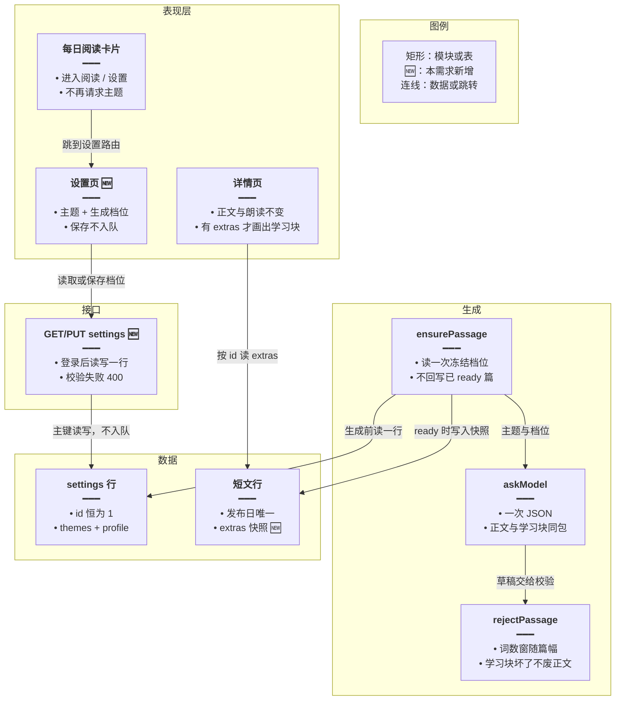
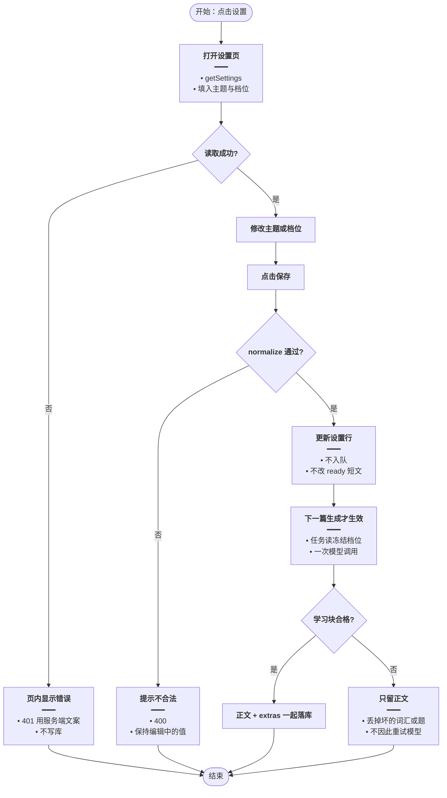
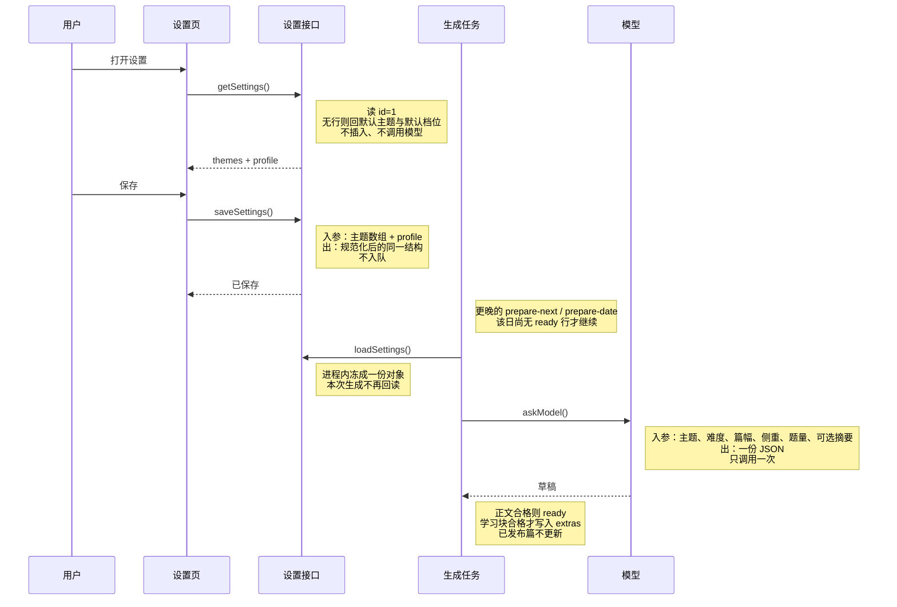
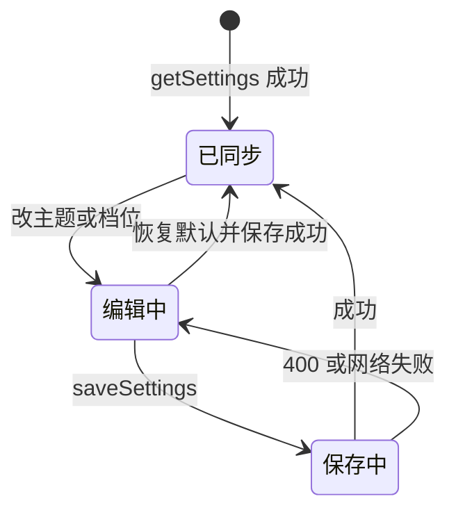
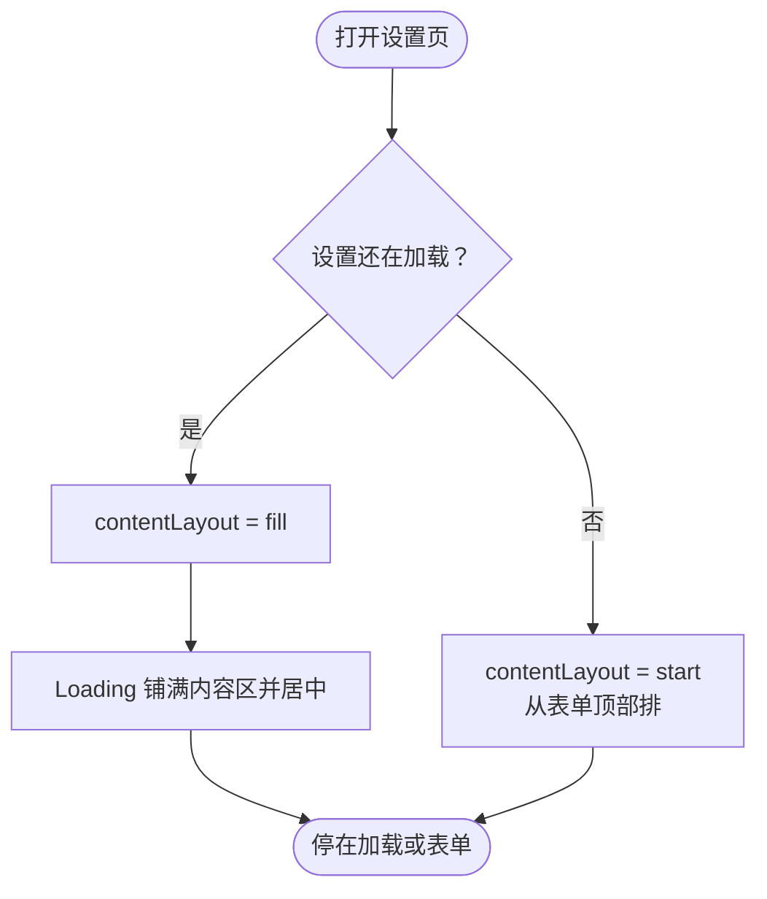

# 每日阅读设置 — 实现思路

> **状态**：设置页已有。2026-10-16 补进页上文案、联网开关文案，以及首屏 Loading 在内容区居中覆盖。权限拆分见 [每日阅读超管配置](./每日阅读超管配置.md)。  
> **日期**：2026-10-16  
> **需求摘要**：每日阅读卡片进入独立设置页；主题与生成档位在该页修改。保存不重写已发布短文。入口文案是「生成资源」，页标题是「资源生成配置」。

## 延伸阅读

- [每日阅读](./每日阅读.md)（侧栏卡片、提前一天生成、列表/详情、朗读；本篇不改那条主链路的发布日规则）
- [每日阅读手动生成](./每日阅读手动生成.md)（底栏「手动生成」：同步另写一篇并进入列表）
- [今日记词与今日复习](./今日记词与今日复习.md)（另一张侧栏卡片，数据无关）

---

## 0. 读本文你将得到什么

- 要解决的问题：主题塞在侧栏卡片里又高又挤，也没有难度、篇幅这类能让短文更像学习材料的开关。
- 总体方案：卡片只留「进入阅读」和「设置」。设置是整页。全站仍每天一篇，所以生成配置全站一份；改配置不重跑模型，下一篇生成时读一次并写进该篇快照。
- 改动层：侧栏卡片、新路由与设置页、现有设置表加一列 JSON、短文行加学习块 JSON、生成提示与校验窗口、详情展示。
- 分三阶段：M1 把主题挪进设置页；M2 生成档位进同一次模型调用；M3 详情展示词汇/语法/理解题，缺了就降级不重试。
- 最大风险：配置是全站共用，后保存的人覆盖先保存的人。这是「每天一篇」的代价，不做按人各生成一篇。

---

## 1. 需求与边界

### 1.1 用户故事

| 角色 | 场景 | 行为 | 期望结果 |
|------|------|------|----------|
| 登录用户 | 英语学习首页 | 点每日阅读卡片上的「设置」 | 进入独立设置页，卡片上不再堆主题芯片 |
| 登录用户 | 设置页 | 增删主题、改难度/篇幅/侧重 | 保存成功；已发布的篇目一字不改 |
| 登录用户 | 次日打开详情 | 阅读按新配置写成的短文 | 正文仍是一篇；若打开了词汇或理解题，附在同一篇详情里 |
| 未登录 | 打开设置页或接口 | 请求设置 | 401，与现有英语学习接口一致 |

### 1.2 范围

| 在范围内 | 不在范围内（非目标） |
|----------|----------------------|
| 侧栏第二按钮「设置」，次按钮样式 | 在卡片里保留主题编辑 |
| 路由 `/english-learning/daily-reading/settings` | 抽屉、弹层、对话分栏里嵌设置 |
| 主题编辑原样搬进设置页（默认 12 项、可自定义、恢复默认） | 按用户各存一份主题、按用户各生成一篇 |
| 难度、篇幅、学习侧重、理解题数量、是否联网取材 | 语速、字体、默认展开中文（展示偏好，与生成无关） |
| 下一篇一次模型调用，学习块写在同一份 JSON | 为词汇或题目再打第二次模型 |
| 已发布篇保持原正文；新篇把当时配置快照进该行 | 保存后立刻重写今天或明天已 `ready` 的篇 |
| 详情展示词汇 / 一句语法 / 理解题（有则显示） | 把理解题接进练习、错题、收藏 |

### 1.3 约束与依赖

- 整段 `EnglishLearningController` 已有 `JwtGuard`。设置读写同样要求登录，不另做会员门槛。朗读仍走现有 `playPreferred`。
- 短文按上海日历日全站一行（`english_daily_readings.publish_date` 唯一）。生成配置必须是全站一行，不能改成「用户 + 日期」。
- 列表接口禁止等模型。设置保存禁止入队、禁止调用模型。
- 篇幅上限停在现有校验天花板 220 个英文词以内，避免单篇把 TTS 分段和 token 撑大。
- 复用 `PracticePageShell`、`EnglishSidebarActions` 的 `secondary`、`normalizeThemeList`、`themeForDate`。

---

## 2. 方案总览（一句话 + 要点）

**一句话方案**：侧栏只负责跳进设置页；页上改的是全站一行生成配置；夜间任务读这一行，用同一次模型写出正文和学习块，并把当时配置快照进该篇，已发布篇不回写。

| # | 设计要点 | 理由 |
|---|----------|------|
| 1 | 卡片去掉主题区，首页不再请求主题接口 | 主题只在打开设置时拉一次，侧栏挂载变轻 |
| 2 | 静态路由 `daily-reading/settings` 写在 `daily-reading/:id` 前面 | 否则 `settings` 会被当成文章 id，直接 400 |
| 3 | 主题列保留；其余档位进同一行的 `profile` JSON | 不拆多表，一次主键读写；旧主题数据不用搬家 |
| 4 | 默认档位等于今天的生成行为：B1、中篇、只写作文、0 道题、允许联网 | 用户没改过时，产出与现在一致 |
| 5 | 保存只 `UPDATE` 设置行 | 不入 Bull 队列，不碰 `ready` 行 |
| 6 | 生成时把档位冻成对象传入提示和校验；成功后写入该篇 `extras` | 之后再改设置，旧篇详情仍按写成时的样子展示 |
| 7 | 词汇、语法、理解题是同一份 JSON 的可选键；不合格就丢掉这块，正文照收 | 不为附件再耗一次模型，也不让坏附件废掉整天的短文 |
| 8 | 关闭联网时 `loadMaterial` 直接返回空素材 | 少一次检索，失败路径更短 |

---

## 3. 现状与复用

| 能力 | 仓库中已有 | 本需求中的用法 |
|------|------------|----------------|
| 侧栏卡片与双按钮 | `apps/frontend/src/views/englishLearning/sidebar/components/EnglishSidebarCard.tsx`、`EnglishSidebarActions.tsx`（`variant: 'secondary'` 已有，今日复习用过两个按钮） | 直接复用：主按钮「进入阅读」，次按钮「设置」 |
| 主题内嵌编辑 | `sidebar/components/DailyReadingSession.tsx` 在卡片 `children` 里拉 `getEnglishDailyReadingThemes` | 扩展后删除这段；首页不再发这个请求 |
| 主题接口 | `GET/PUT english-learning/daily-reading-themes`；`EnglishDailyReadingService.themeSettings` / `saveThemes` | 扩展为 `daily-reading-settings`，旧路径删除，避免两套契约 |
| 主题校验 | `daily-reading.rules.ts` 的 `normalizeThemeList`、`DEFAULT_THEMES`、`themeForDate` | 直接复用；新增 `normalizeProfile` 与按篇幅给出的词数窗 |
| 设置表 | `english_daily_reading_settings`（`id=1`，`themes` JSON）；实体 `entity/english-daily-reading-setting.entity.ts` | 扩展：加 `profile` JSON 列，不新表 |
| 生成任务 | `english-daily-reading.service.ts` 的 `ensurePassage`；Bull 队列 `english-daily-reading`；提示词写死 B1–B2、120–180 词 | 扩展：任务开始读一次配置，提示和 `rejectPassage` 共用这份冻结档位 |
| 正文校验 | `rejectPassage` 固定 80–220 词 | 扩展：传入篇幅窗口，仍不得超过 80–220 |
| 联网素材 | `loadMaterial` 调 `WebSearchService.formatSearchContextForPrompt` | 扩展：`useWeb === false` 时不调用 |
| 列表/详情壳 | `dailyReading/List.tsx`、`Detail.tsx` 用 `PracticePageShell` | 直接复用壳做设置页；详情在正文下按 `extras` 追加学习块 |
| 路由 | `apps/frontend/src/router/routes.ts` 已有 `daily-reading`、`daily-reading/:id` | 扩展：在 `:id` 之前插入 `daily-reading/settings` |
| 登录守卫 | 控制器级 `JwtGuard`；`userId == null` 抛 `未授权` | 直接复用 |

**调研结论**：设置不需要新队列、新模型入口或按用户分表。缺的是独立页、`profile`/`extras` 两列 JSON，以及「保存不触发生成、生成只读一次配置」。侧栏卡片的 `children` 主题区应删掉，否则首页仍会为用不到的芯片打接口。

---

## 4. 架构图



**图内方法说明**：

| 方法 | 功能 |
|------|------|
| `getDailyReadingSettings()` | 设置页打开时拉全站主题和档位；只查 `id=1`，没有行就回默认值，不插入 |
| `saveDailyReadingSettings()` | 校验通过后更新这一行；不调用模型、不向 `english-daily-reading` 入队 |
| `normalizeThemeList()` | 清洗主题：去空、去重、1–16 字、禁 `<>`、1–24 项；不合格返回 null |
| `normalizeProfile()` | 把难度、篇幅、侧重、题量、是否联网收成合法对象；未知枚举回默认，不把脏值写进库 |
| `themeForDate()` | 用发布日哈希在当前主题列表里取一项；列表来自设置行，缺省用 `DEFAULT_THEMES` |
| `ensurePassage()` | 夜间或补跑任务的入口：抢到行之后读一次配置，生成并在成功时把快照写入该篇 |
| `askModel()` | 按冻结档位拼一条系统提示，只 `invoke` 一次，解析同一份 JSON |
| `rejectPassage()` | 判正文是否可发布；词数窗由篇幅决定，学习块不在这里否决整篇 |
| `loadMaterial()` | `useWeb` 为真且检索已配置时取一条网页摘要；否则马上返回空素材 |

**读图要点**：

- 表现层分成「卡片跳转」和「设置页编辑」；卡片不再订阅设置数据。
- 设置表与短文表分开：设置是下一篇的输入，`extras` 是某一篇写成时的副本。
- 模型只出现在生成侧，保存路径到设置表为止。

---

## 5. 主流程图



**图内方法说明**：

| 方法 | 功能 |
|------|------|
| `getDailyReadingSettings()` | 进入页面时取当前主题、默认主题、当前档位、默认档位，供表单和「恢复默认」比较 |
| `saveDailyReadingSettings()` | 提交整份表单；服务端再次 `normalize`，通过才写 `id=1` |
| `normalizeThemeList()` | 保存前清洗主题；客户端可先挡空串和 `<>`，服务端结果为准 |
| `normalizeProfile()` | 保存前把档位收成枚举；缺字段用默认，而不是整单拒绝 |
| `ensurePassage()` | 保存之后的某个发布日任务才运行；若该日已经 `ready`，直接返回，不读新配置重写 |
| `askModel()` | 该任务里唯一的模型调用 |
| `rejectPassage()` | 正文不合格才废稿并标记 `failed`；学习块不合格不走这条失败 |

**读图要点**：

- 入口是侧栏「设置」，不是列表页，也不是生成任务。
- 保存成功的终止点是「下一篇才用」；今天已经发布的行不在这条写路径上。
- 学习块失败被收成降级分支，避免一次附件错误触发 Bull 再跑整篇。

---

## 6. 核心时序图



**图内方法说明**：

| 方法 | 功能 |
|------|------|
| `getSettings()` | 设置页加载：返回主题、默认主题、档位、默认档位 |
| `saveSettings()` | 持久化用户提交；规范化失败抛 400，成功不创建生成任务 |
| `loadSettings()` | 生成任务内部读同一行并冻结；与页面保存用的是同一套 `normalize*` |
| `askModel()` | 把冻结档位写进系统提示，解析模型返回的一份 JSON |

**读图要点**：

- 用户操作在前半段结束；生成任务是之后另一条时间线上的调用，中间没有「保存触发任务」。
- `loadSettings` 在单次 `ensurePassage` 里只发生一次，避免提示词、抢锁时的主题、校验窗口各读各的。
- 模型往返只有一趟，学习块不是后续请求。

---

## 7. 状态机

设置页表单：



**图内方法说明**：

| 方法 | 功能 |
|------|------|
| `getSettings()` | 进入「已同步」：表单等于服务端当前值 |
| `saveSettings()` | 「保存中」期间禁用按钮；成功后用响应覆盖表单，避免本地脏值和库不一致 |

短文行与配置的关系（不是页面状态）：

| 状态 | 行为 |
|------|------|
| 无行 / `pending` / `failed` | 下一次抢到生成权时使用**当时**的设置 |
| `ready` | 忽略之后的设置变更；详情只读该行 `extras` |

---

## 8. 模块职责与接口草图

### 8.1 模块一览

| 模块 | 职责 | 新增/改动 | 预估路径 |
|------|------|-----------|----------|
| 侧栏卡片 | 两个跳转按钮 | 改 | `apps/frontend/src/views/englishLearning/sidebar/components/DailyReadingSession.tsx` |
| 设置页 | 主题区 + 档位表单 | 新增 | `apps/frontend/src/views/englishLearning/dailyReading/Settings.tsx` |
| 路由 | `settings` 在 `:id` 前 | 改 | `apps/frontend/src/router/routes.ts` |
| 前端 API | 读写设置 | 改 | `apps/frontend/src/service/api.ts`、`service/index.ts` |
| 文案 | 按钮、档位、校验 | 改 | `apps/frontend/src/i18n/locales/zh-CN/englishLearning.ts` 与 `en-US` 同文件、`route.ts` |
| 规则 | 档位规范化、词数窗 | 改 | `apps/backend/src/services/english-learning/daily-reading.rules.ts` 与其 spec |
| 设置实体 | `profile` 列 | 改 | `entity/english-daily-reading-setting.entity.ts` |
| 短文实体 | `extras` 列 | 改 | `entity/english-daily-reading.entity.ts` |
| 生成服务 | 读档位、快照、降级 | 改 | `english-daily-reading.service.ts` |
| 控制器 | 替换主题路由 | 改 | `english-learning.controller.ts` |
| 迁移 | 两列 JSON | 新增 | `apps/backend/src/migrations/1792200000000-english_daily_reading_profile.ts` |
| 详情 | 渲染学习块 | 改 | `dailyReading/Detail.tsx` |

### 8.2 关键接口（伪代码或 TypeScript 草图）

路由必须让静态段先匹配：

```typescript
// settings 写在 :id 前，避免把单词 settings 当成文章 id
{ path: 'daily-reading/settings', Component: EnglishDailyReadingSettingsPage }
// 文章详情仍只接受真正的 id
{ path: 'daily-reading/:id', Component: EnglishDailyReadingDetailPage }
```

档位契约（缺省等于当前生成行为）：

```typescript
// 全站下一篇的生成档位；不放展示偏好
type ReadingProfile = {
	// 只影响提示词用词，校验不拿它否决正文
	level: 'A2' | 'B1' | 'B2' | 'C1';
	// 决定提示词目标词数，以及 rejectPassage 的窗口
	length: 'short' | 'medium' | 'long';
	// reading 不要附件；vocab / grammar 才解析对应键
	focus: 'reading' | 'vocab' | 'grammar';
	// 0 表示不要题；2 或 3 才保留 questions
	questions: 0 | 2 | 3;
	// false 时跳过网页检索，少一次外部请求
	useWeb: boolean;
};
```

词数窗（都落在现有 80–220 内）：

| length | 提示词目标 | 校验接受 |
|--------|------------|----------|
| `short` | 约 100 词 | 80–120 |
| `medium` | 120–180（与现在相同） | 120–180 |
| `long` | 约 190 词 | 160–220 |

学习块放在短文行，不放设置行。设置只记录「下一篇要不要这些块」。

```typescript
// 写成当时的副本；旧篇为 null，详情保持现在的版式
type ReadingExtras = {
	// 写成时的难度，详情徽章用它，不回读设置表
	level: ReadingProfile['level'];
	// 写成时的篇幅，避免之后改档位让旧篇对不上词数
	length: ReadingProfile['length'];
	// 写成时的侧重，决定详情要不要画词汇或语法
	focus: ReadingProfile['focus'];
	// focus=vocab 且每词都出现在正文里才保留，最多 6 条
	glossary?: { word: string; zh: string }[];
	// focus=grammar 时的一句中文说明，过长则整段丢掉
	grammarNote?: string;
	// 题量不足或选项不合法则整组丢掉，正文仍发布
	questions?: { q: string; options: string[]; answer: number }[];
};
```

保存接口替换现有主题路由（实现时删掉 `daily-reading-themes`）：

```typescript
// 设置页一次提交的正文；替换旧的 daily-reading-themes
type ReadingSettingsBody = {
	// 与现有主题列同一份数组，避免再拆一个保存接口
	themes: string[];
	// 下一篇的难度和篇幅等；缺省字段由服务端补默认
	profile: ReadingProfile;
};
```

详情 `toView` 增加可选 `extras`。列表沿用现在的字段，不把词汇和题目塞进列表卡片。

### 8.3 数据模型

| 字段/实体 | 来源 | 存储 | 说明 |
|-----------|------|------|------|
| `themes` | 已有列 | `english_daily_reading_settings.themes` | 继续存主题数组；无行时接口回 `DEFAULT_THEMES` |
| `profile` | 设置页 | 同表新列 JSON，可空 | 空则 `normalizeProfile(undefined)` 得默认档位 |
| `extras` | 生成成功时 | `english_daily_readings` 新列 JSON，可空 | 仅 `ready` 更新时写入；列表不展示 |
| 默认档位 | 代码常量 | 不入库 | `{ level:'B1', length:'medium', focus:'reading', questions:0, useWeb:true }` |

迁移只 `ADD COLUMN`，不改发布日唯一键，不回填历史篇的 `extras`。

---

## 9. 分阶段实现步骤

| 阶段 | 目标 | 交付物 | 依赖 |
|------|------|--------|------|
| M1 | 设置从卡片挪到独立页，生成结果不变 | 路由、设置页、主题搬迁、侧栏双按钮 | 现有主题接口可先改名再接页 |
| M2 | 档位进入下一次生成，仍一次模型调用 | `profile` 列、提示词、词数窗、`useWeb` | M1 的保存接口 |
| M3 | 详情能用上词汇、语法、理解题 | `extras` 列、降级规则、详情区块 | M2 的冻结档位 |

### M1

- [ ] `routes.ts` 在 `daily-reading/:id` 之上注册 `daily-reading/settings`，并加 `route.ts` 标题文案。
- [ ] 新页用 `PracticePageShell`，返回 `/english-learning`。主题芯片、输入、恢复默认从 `DailyReadingSession` 剪过来。
- [ ] 卡片 `actions` 增加 `variant: 'secondary'` 的「设置」；删掉 `children` 主题区和首页的 `getEnglishDailyReadingThemes`。
- [ ] 接口改名为 `daily-reading-settings`，响应仍含 `themes` 与 `defaults`。此阶段 `profile` 可先固定回默认值。

### M2

- [ ] 迁移为设置表增加可空 `profile` JSON。`normalizeProfile` 加一条 jest：脏枚举回默认，合法值原样返回。
- [ ] `ensurePassage` 开头读一次设置，把 `themeForDate`、`loadMaterial`、`askModel`、`rejectPassage` 都绑在这份对象上。
- [ ] `useWeb === false` 或检索未配置时，`loadMaterial` 不打网页搜索。
- [ ] 保存实现确认：不调用 `enqueuePassage`。已 `ready` 的明天若已生成，保持原篇，直到下一个尚未写入的发布日。

### M3

- [ ] 迁移为短文表增加可空 `extras` JSON。`ready` 的 `update` 写入快照；列表 `toView` 不带 `extras`。
- [ ] 解析学习块：词汇必须能在 `bodyEn` 里找到；题必须是 3 个选项加合法下标。不合格则该键省略。
- [ ] 正文仍失败时维持现在的废稿与 `failed`，不把学习块失败算进废稿。
- [ ] 详情在「参考来源」之下渲染词汇、语法一句、理解题；点选项再显示对错。无 `extras` 的旧篇版式不变。朗读文本仍只用 `bodyEn`。

---

## 10. 关键决策与备选方案

| 决策 | 选用 | 备选 | 为何不选备选 |
|------|------|------|--------------|
| 配置归属 | 全站一行 | 每用户一份，或每用户每天一篇 | 发布日唯一，多份配置无法对应一篇正文；按人生成会把夜间一次调用变成按用户乘上去 |
| 生效时机 | 下一篇尚未 `ready` 的生成 | 保存后重写今天和明天 | 重写要再打模型，且读者可能正在看已发布篇 |
| 学习块 | 同一份 JSON，坏了丢块 | 第二次模型专门出题 | 多一次延迟和失败面；题失败不应让整天没有短文 |
| 设置入口 | 独立路由 | 继续堆在卡片里，或用弹窗 | 卡片高度已经不适合再加档位；弹窗装不下恢复默认和分组说明 |
| 接口 | 一个 settings 路由替换 themes | 主题与档位两个接口 | 设置页会多一次往返；两路保存还会互相覆盖 |
| 篇幅 | 三档且不超过 220 词 | 用户自填词数 | 自填容易超出校验或把 TTS 分段拉得很碎 |
| 首页数据 | 卡片不拉设置 | 卡片展示当前难度摘要 | 摘要要在每次进首页打接口，和「设置页才需要数据」相反 |

---

## 11. 风险、边界与待确认

| 项 | 等级 | 说明 | 缓解 |
|----|------|------|------|
| 全站覆盖 | 中 | 任一登录用户保存都会改下一篇的主题和难度 | 页上写明「全站下一篇按这里生成」；不做按人生成 |
| 明天已生成 | 中 | 21:00 之后再改设置，明天那篇已经 `ready`，要再下一天才看得到 | 保存成功文案写「已写好的篇目不变」；不提供「立即重写」 |
| 路由顺序 | 高 | `settings` 若写在 `:id` 后面，会 400「文章不存在」 | M1 先注册静态路由；验收直接打开该 URL |
| 学习块质量 | 中 | 模型可能给了正文里没有的词，或少于要求的题数 | 校验失败只丢 `extras` 对应键；正文窗口仍由 `rejectPassage` 把关 |
| 列表体积 | 低 | TypeORM `find` 仍会取出 `extras` 列 | 响应体不序列化到列表项；列本身只有一小段 JSON |
| 旧客户端 | 低 | 若还有人调用 `daily-reading-themes` | 本功能未对外承诺旧路径；实现时删路由，只留 settings |

**待确认**（若有）：

- [ ] 难度默认用单级 `B1` 还是保持现在提示词里的区间 `B1–B2`。验证方式：对照 `askModel` 现有系统提示；本方案取 `B1`，因为设置项需要一个确定档，区间无法和单选控件对应。若要保持原句，把默认档的提示词写成 `B1–B2` 即可，表结构不用改。

---

## 12. 验收清单

| # | 用例 | 步骤 | 期望 |
|---|------|------|------|
| AC1 | 卡片入口 | 打开英语学习首页 | 每日阅读卡片有「进入阅读」「设置」，没有主题芯片，网络面板没有 settings/themes 请求 |
| AC2 | 独立页 | 点「设置」 | 地址为 `/english-learning/daily-reading/settings`，不是详情 400；未改过时主题为默认 12 项 |
| AC3 | 主题搬迁 | 加一项自定义主题并保存，再删到只剩一项时再删 | 保存后刷新仍在；最后一项删不掉并有提示 |
| AC4 | 不触发生成 | 保存难度为 A2 | 请求很快返回；不新增 Bull 任务；已发布详情正文不变 |
| AC5 | 下一篇 | 在尚无 `ready` 行的发布日跑生成，篇幅选短、侧重词汇、题量 2、关闭联网 | 词数落在 80–120；无检索请求；只有一次模型调用；详情能看到词汇和两道题 |
| AC6 | 降级 | 模型正文合格但词汇不在正文中 | 篇目仍发布；详情没有词汇块；状态不是 `failed` |
| AC7 | 路由 | 直接打开 `.../daily-reading/settings` 与一篇真实 id | 前者是设置页，后者仍是详情 |
| AC8 | 未登录 | 不带 token 调 PUT | 401，库中的 `profile` 不变 |

---

## 13. 预估改动面（实现阶段参考）

| 类型 | 路径（预估） |
|------|----------------|
| 前端 | `sidebar/components/DailyReadingSession.tsx`、`dailyReading/Settings.tsx`、`dailyReading/Detail.tsx`、`router/routes.ts`、`service/api.ts`、`service/index.ts`、`i18n/locales/*/englishLearning.ts`、`i18n/locales/*/route.ts` |
| 后端 | `daily-reading.rules.ts`、`daily-reading.rules.spec.ts`、`english-daily-reading.service.ts`、`english-learning.controller.ts`、两份 entity、`migrations/1792200000000-english_daily_reading_profile.ts` |
| 文档（实现后） | 落地后再写 remote-docs 实现归档；本篇保持规划 |

（上文 §1–§13 仍是最初的设置页方案。下面只记后来改过、且已经写进页面的部分。）

---

## 14. 落地补充（2026-10-16）

页上后来改过的文案和加载方式，以本节为准。

| 位置 | 文案键 | 现文案 |
|------|--------|--------|
| 侧栏第二按钮、列表顶栏、设置面包屑 | `settingsNav` / `route.englishLearning.dailyReading.settings` | 生成资源 |
| 设置页壳标题 | `settingsHint` | 资源生成配置 |
| 联网取材两个选项 | `useWebOn` / `useWebOff` | 开启智能搜索 / 关闭智能搜索 |
| 底栏主按钮 | `generate` | 生成阅读资源 |
| 壳右侧返回列表 | `openList` | 今日阅读 |

联网开关仍是原来的 `useWeb` 布尔值。按钮里只改了给人看的字，打开时仍先检索再写，关闭时 `loadMaterial` 直接返回空素材。

「恢复默认 / 保存设置」与「联网取材」同一行、各占一半；这两个操作和底栏「生成阅读资源」用练习页主题色实心按钮（`PRACTICE_PRIMARY_ACTION_BTN_CLASS`），选项芯片仍是淡青绿。

首屏 `Loading` 要盖住内容区并居中。设置页平时是 `contentLayout="start"`，内容区高度跟着表单走，`Loading` 自带的 `h-full` 撑不满，图标会贴在顶部。加载中改成 `fill`，壳把滚动视口拉满，`Loading` 才能在这一块里居中。



**图内方法说明**：

| 方法 | 功能 |
|------|------|
| `PracticePageShell` 的 `contentLayout` | `fill` 时让滚动内容区有确定高度，`Loading` 的 `h-full` 才能居中盖住这一块；表单出来后改回 `start`，避免设置项被垂直居中 |

**读图要点**：

- 只在 `loading` 为真时铺满，不改表单排版。
- 顶栏标题在加载时仍在，覆盖的是标题下面的内容区。
