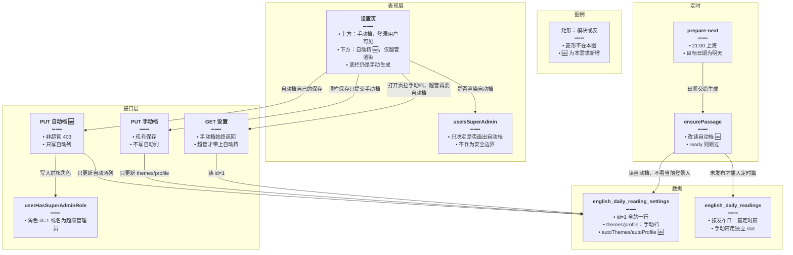
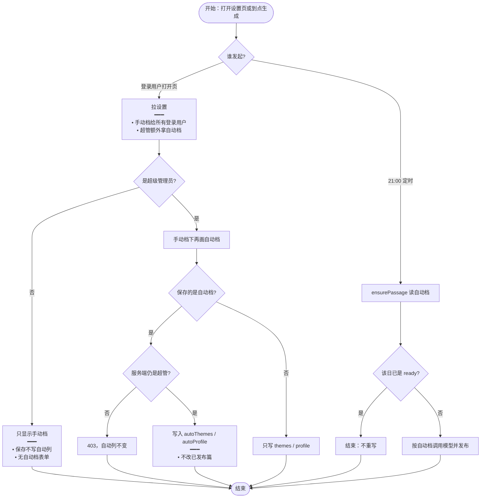
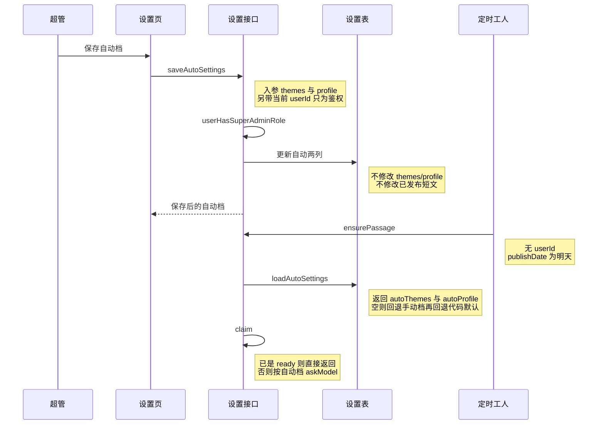

# 每日阅读超管配置 — 实现思路

> **状态**：自动档与页上文案已按本节落地。定时任务是否只读自动档，仍以服务端 `loadAutoSettings` 为准。  
> **日期**：2026-10-16  
> **需求摘要**：设置页在手动档下方为超级管理员增加自动生成配置；壳标题保持「资源生成配置」，两块表单分别叫「手动生成配置」和「自动生成配置」。

## 延伸阅读

- [每日阅读](./每日阅读.md)（一篇、发布日、21:00 调度；本篇不改这些规则）
- [每日阅读设置](./每日阅读设置.md)（现有全站一份 `themes` + `profile`；本篇把它降为手动档）
- [每日阅读手动生成](./每日阅读手动生成.md)（底栏按钮仍用当次表单，不写自动档）
- [每日阅读按用户生成](./每日阅读按用户生成.md)（已放弃：不按人各写一篇，也不用某人的 Key 写全站短文）

---

## 0. 读本文你将得到什么

- 要解决的问题：设置页谁都能保存，而定时任务读的就是这一行，后保存的人会改掉全站下一篇。
- 总体方案：同一张设置表拆成手动档和自动档；自动档只有超级管理员能写；`ensurePassage` 只读自动档。
- 主要改动层：设置页多一块表单、设置读写接口加权限、设置表加两列、定时入口改读自动档。
- 分三阶段：M1 库表与定时改读，M2 超管表单，M3 文案与越权验收。
- 最大风险：上线时若不把现有 `themes` / `profile` 抄进自动档，下一篇会退回代码默认，文风突然变掉。

---

## 1. 需求与边界

### 1.1 用户故事

| 角色 | 场景 | 行为 | 期望结果 |
|------|------|------|----------|
| 超级管理员 | 设置页，手动档（主题、难度、篇幅等）下方 | 填写并保存自动生成配置 | 只更新自动档；已发布短文不变 |
| 超级管理员 | 次日 21:00 之后 | 打开尚未写过的那一天 | 短文按自动档的主题、难度、篇幅、侧重、理解题、联网取材生成 |
| 普通登录用户 | 打开同一设置页 | 改手动档并保存，或点「手动生成」 | 看不到自动档；保存和手动生成都不改定时任务所用配置 |
| 普通登录用户 | 直接调用自动档保存接口 | 提交与页面相同的 JSON | 403，库中自动档不变 |
| 未登录 | 打开设置或调接口 | 请求设置 | 401，与现有英语学习接口一致 |

### 1.2 范围

| 在范围内 | 不在范围内（非目标） |
|----------|----------------------|
| 超级管理员在手动档下方看到第二套主题与档位，并单独保存 | 按每个用户各生成一篇每日短文 |
| 定时任务只读自动档 | 用某一位用户自己的模型 Key 写全站短文 |
| 手动生成仍提交当前手动表单，不写入自动档 | 重写已经 `ready` 的篇目 |
| 迁移时把当前全站配置复制为自动档初值 | 把手动档改成每人一份（仍是全站一份回填） |
| 后端拒绝非超管写入自动档 | 改 21:00、发布日、列表对所有登录用户可见 |

### 1.3 约束与依赖

- 登录后才能进设置页；超级管理员判断前后端各自已有：前端 `useIsSuperAdmin`，后端 `UserService.userHasSuperAdminRole`（角色 id 为 1，或角色名为「超级管理员」）。前端多认「Super Admin」，后端目前不认这个英文名，权限以服务端为准。
- 定时任务没有登录用户。自动档是全站一行，不是「查出某一位超管再读他的个人设置」。
- 多位超级管理员写的是同一行，后保存覆盖先保存。与全站「仅 BGE」由超管写入、全员共用的方式相同。
- 已发布篇目仍由 `claim` 在 `status === 'ready'` 时直接放弃，不按新配置重跑模型。

---

## 2. 方案总览（一句话 + 要点）

**一句话方案**：设置表增加 `autoThemes` 与 `autoProfile`；只有超级管理员能保存它们；每天定时生成改读这两列，现有表单继续只服务手动生成和页面回填。

| # | 设计要点 | 理由 |
|---|----------|------|
| 1 | 自动档与手动档分列存放，不新增第二张表 | 本来就是全站一行（`id = 1`），加列即可，定时任务不用按用户扫描 |
| 2 | 页面隐藏不够，保存接口返回 403 | 普通用户可以自己发请求；前端 `useIsSuperAdmin` 只负责不渲染 |
| 3 | 迁移把现有 `themes` / `profile` 抄进自动列 | 避免上线后下一篇退回 `DEFAULT_THEMES` / `DEFAULT_PROFILE` |
| 4 | 手动档的「保存设置 / 恢复默认」不碰自动列 | 普通用户保存不再改变 21:00 的结果 |
| 5 | 自动档表单放在「联网取材」之下、底栏「手动生成」之上 | 与「在手动生成的设置下方」一致，底栏按钮仍固定 |

---

## 3. 现状与复用

| 能力 | 仓库中已有 | 本需求中的用法 |
|------|------------|----------------|
| 全站设置一行 | `apps/backend/src/services/english-learning/entity/english-daily-reading-setting.entity.ts`（`id = 1`，`themes` + `profile`） | 保留为手动档；新增自动档两列 |
| 定时读设置并写一篇 | `english-daily-reading.service.ts` 的 `ensurePassage` → `loadSettings`；`english-daily-reading.processor.ts` 在 21:00 写明天 | `ensurePassage` 改为 `loadAutoSettings` |
| 已发布则跳过 | `claim`：已有 `ready` 行返回 false | 直接复用 |
| 手动生成用当次表单 | `generateManual` 读请求体里的 `themes` / `profile`，注释写明不写入设置 | 直接复用，不读自动档 |
| 设置页表单与底栏 | `apps/frontend/src/views/englishLearning/dailyReading/Settings.tsx` | 上方保持手动档；其下新增自动档，仅超管渲染 |
| 超管判断 | `apps/frontend/src/hooks/useIsSuperAdmin.ts`；`apps/backend/src/services/user/user.service.ts` 的 `userHasSuperAdminRole` | 前端隐藏区块；后端写自动档前调用 |
| 超管专属写入先例 | `llm-config.service.ts` 对非超管设置「仅 BGE」抛错 | 自动档保存同样拒绝 |
| JSON 列迁移先例 | `apps/backend/src/migrations/1792200000000-english_daily_reading_profile.ts` | 新迁移加列并回填 |

**调研结论**：定时任务已经在生成当时读库，不把配置冻进队列任务，所以只要改 `loadSettings` 的读取列，无需改 BullMQ 的 job 数据。缺的是自动档字段、写接口的角色校验，以及设置页上的第二套表单。不要恢复「按用户生成」那条已放弃方案。

---

## 4. 架构图



**图内方法说明**：

| 方法 | 功能 |
|------|------|
| `useIsSuperAdmin()` | 用本地用户信息判断要不要渲染自动档；刷新权限仍以保存接口为准 |
| `readingSettings` | GET 设置：手动档给所有登录用户，自动档只拼进超管响应 |
| `saveSettings` | PUT 手动档：只更新 `themes` / `profile` |
| `saveAutoSettings` | PUT 自动档：先鉴权，再只更新自动两列 |
| `userHasSuperAdminRole(userId)` | 查该用户角色；自动档保存前调用，不是超管则拒绝 |
| `prepare-next` | 每天 21:00 的调度名，只负责把「明天」交给 `ensurePassage` |
| `ensurePassage(publishDate)` | 工人写某一天的定时篇；本需求改为只读自动档，已发布则返回 |

**读图要点**：

- 手动档和自动档共用一行设置，靠列分开，定时链路不出现 userId。
- 新增的是自动档保存接口和两列，不是新的生成队列。
- 短文表不变：定时篇仍是每天一行，手动篇仍是额外 slot。

---

## 5. 主流程图



**图内方法说明**：

| 方法 | 功能 |
|------|------|
| `readingSettings(isSuperAdmin)` | 组装页面初始值；非超管的响应里不带自动档，避免把全站自动配置下发给所有人 |
| `saveSettings` | 现有手动档保存；实现时去掉对自动列的写入 |
| `saveAutoSettings` | 新接口；校验角色后只更新自动两列 |
| `ensurePassage(publishDate)` | 定时路径；先读自动档，再走现有的抢占与模型调用 |

**读图要点**：

- 页面上的「是超管」只决定画不画；真正写入以服务端角色为准，所以有一条 403 分支。
- 定时分支不经过设置页，也不会因为普通用户刚保存过手动档而换档。
- 已发布日期在 `claim` 处结束，配置再新也不回写旧篇。

---

## 6. 核心时序图



**图内方法说明**：

| 方法 | 功能 |
|------|------|
| `saveAutoSettings` | 超管保存自动档；非超管在角色检查处失败，不写库 |
| `userHasSuperAdminRole(userId)` | 确认调用者可以改全站自动档 |
| `ensurePassage(publishDate)` | 次日生成入口；只消费自动档 |
| `loadAutoSettings()` | 读 `autoThemes` / `autoProfile`；迁移完成前若列为空，用手动档顶上，避免空白配置 |
| `claim(publishDate, theme)` | 抢占该日定时行；已发布则放弃，防止新配置覆盖旧文 |
| `askModel(...)` | 现有一次模型调用；难度、篇幅、侧重、题量、是否联网都来自自动档 |

**读图要点**：

- 保存和生成是两段时间上分开的调用，中间没有「把超管 userId 放进队列」。
- 工人不重新鉴权，因为它不代表某个用户；权限只挡在写入自动档的门口。
- `loadAutoSettings` 的回退只为上线窗口，回填迁移跑完后正常路径只读自动列。

---

## 8. 模块职责与接口草图

### 8.1 模块一览

| 模块 | 职责 | 新增/改动 | 预估路径 |
|------|------|-----------|----------|
| 设置实体 | 增加自动档两列 | 扩展 | `apps/backend/src/services/english-learning/entity/english-daily-reading-setting.entity.ts` |
| 迁移 | 加列，并把现有手动档抄进自动档 | 新增 | `apps/backend/src/migrations/1792400000000-english_daily_reading_auto_profile.ts` |
| 生成服务 | 定时改读自动档；拆开两种保存 | 扩展 | `apps/backend/src/services/english-learning/english-daily-reading.service.ts` |
| 控制器 | 自动档路由与 403 | 扩展 | `apps/backend/src/services/english-learning/english-learning.controller.ts` |
| 前端 API | 增加自动档保存与响应字段 | 扩展 | `apps/frontend/src/service/index.ts` |
| 设置页 | 手动档下增加自动档区块 | 扩展 | `apps/frontend/src/views/englishLearning/dailyReading/Settings.tsx` |
| 文案 | 顶栏说明改为手动档；自动档单独一句 | 扩展 | `apps/frontend/src/i18n/locales/zh-CN/englishLearning.ts` 与 `en-US` 同名文件 |

### 8.2 关键接口（伪代码）

```typescript
// 自动档入参与手动档相同，便于复用现有主题与档位校验
type AutoSettingsInput = {
	// 主题列表；非法时沿用现有 400，不写库
	themes: unknown;
	// 难度、篇幅、侧重、题量、是否联网
	profile: unknown;
};

// 只有超管能改全站定时配置，所以先鉴权再落库
function saveAutoSettings(userId: number, input: AutoSettingsInput): void {
	// 与仅 BGE 开关一样，角色不对就拒绝，避免只靠页面隐藏
	if (!userHasSuperAdminRole(userId)) throw new ForbiddenException();
	// 只更新自动列，手动档保存仍走原来的 saveSettings
	settings.update({ id: 1 }, { autoThemes, autoProfile });
}
```

### 8.3 数据模型

| 字段/实体 | 来源 | 存储 | 说明 |
|-----------|------|------|------|
| `themes` / `profile` | 顶栏「保存设置」 | `english_daily_reading_settings` id=1 | 手动档，打开页面时回填；手动生成仍以当次请求体为准 |
| `autoThemes` / `autoProfile` | 自动档区块的保存 | 同上，新 JSON 列 | 仅超管可写；`ensurePassage` 只读它们 |
| 定时短文 | 21:00 `prepare-next` | `english_daily_readings`，`slot` 为日槽 | 不新增用户维度 |
| 手动短文 | 底栏「手动生成」 | 同一表，独立 `slot` | 不读、不写自动档 |

---

## 9. 分阶段实现步骤

| 阶段 | 目标 | 交付物 | 依赖 |
|------|------|--------|------|
| M1 | 定时任务改读自动档，且上线前后下一篇档位不变 | 迁移 + `loadAutoSettings` + 403 接口 | 无 |
| M2 | 超管能在页面上编辑自动档 | 设置页第二套表单与文案 | M1 |
| M3 | 普通用户改手动档不影响定时篇 | 验收通过，顶栏说明不再写「全站下一篇按这里生成」 | M2 |

### M1

- [ ] 新增迁移：`auto_themes`、`auto_profile` JSON 列；用现有 `themes`、`profile` 回填，空 profile 写成当前 `DEFAULT_PROFILE`。
- [ ] `ensurePassage` 改为 `loadAutoSettings`；列为空时才回退手动档，再回退代码默认。
- [ ] `PUT` 自动档：非超管 403；`GET` 仅超管响应带自动档。
- [ ] 现有 `saveSettings` 不得再写入自动列。

### M2

- [ ] `useIsSuperAdmin()` 为真时，在「联网取材」下方渲染自动档（主题、难度、篇幅、侧重、理解题、联网），交互与手动档相同。
- [ ] 自动档使用自己的保存与恢复默认，不走顶栏那两个按钮。
- [ ] 顶栏说明改为手动档用途；自动档旁注明每天 21:00 的全站短文按这里生成，已写好的篇目不变。

### M3

- [ ] 普通账号保存手动档后，再触发一次尚未发布日期的生成，确认用的仍是自动档。
- [ ] 普通账号调用自动档接口得到 403，数据库自动列不变。
- [ ] 已是 `ready` 的日期在改自动档后内容不变。

---

## 10. 关键决策与备选方案

| 决策 | 选用 | 备选 | 为何不选备选 |
|------|------|------|--------------|
| 自动档存在哪 | 设置表加两列，仍是 id=1 | 每个超管一行，定时再挑一个超管 | 定时任务没有用户；挑谁会和「按用户生成」那篇已放弃方案缠在一起 |
| 谁能改自动档 | 任一超级管理员，后写覆盖 | 只允许某一个用户 id | 角色已经是现成判断；写死 id 会在换账号后无法改配置 |
| 手动档是否每人一份 | 否，仍全站一份，只供回填和手动生成 | 手动档按 userId 存 | 本需求只隔离定时配置；手动生成已经提交当次表单 |
| 旧配置如何过渡 | 迁移抄到自动列 | 上线后自动档留空，走代码默认 | 留空会让下一篇难度和主题突然变成默认值 |

---

## 11. 风险、边界与待确认

| 项 | 等级 | 说明 | 缓解 |
|----|------|------|------|
| 回填漏做 | 高 | 下一篇退回默认主题和 B1/中篇等代码默认 | 迁移里 `UPDATE` 抄列；空自动档时 `loadAutoSettings` 再退回手动档 |
| 只做前端隐藏 | 高 | 普通用户仍可 PUT 改掉定时配置 | 服务端 `userHasSuperAdminRole`，失败抛 `ForbiddenException` |
| 多位超管互改 | 中 | 后保存覆盖先保存，没有草稿合并 | 与现有全站一行相同；页面保存成功有 Toast |
| 顶栏文案未改 | 低 | 用户仍以为手动档决定全站下一篇 | M2 改 `settingsHint` |
| 英文角色名 | 低 | 前端承认 `Super Admin`，后端 `userHasSuperAdminRole` 不承认 | 以服务端为准；这类账号会看到表单但保存得到 403 |

**待确认**：

- [ ] 手动档要不要改成每个用户一份？（验证方式：若产品只要隔离定时任务，保持全站一份即可，本篇不实现按人存储）

---

## 12. 验收清单

| # | 用例 | 步骤 | 期望 |
|---|------|------|------|
| AC1 | 超管看见并保存自动档 | 超管打开设置，改自动档难度后保存，再刷新 | 自动档回填为新值；手动档不变 |
| AC2 | 定时篇按自动档 | 自动档与手动档设成不同难度，对一个尚未 `ready` 的日期执行 `ensurePassage` | 该篇提示与成稿符合自动档，而不是手动档 |
| AC3 | 普通用户不影响定时 | 普通用户修改并保存手动档，重复 AC2 | 成稿仍符合自动档 |
| AC4 | 越权写接口 | 普通用户调用自动档保存 | 403，自动列与保存前一致 |
| AC5 | 已发布不重写 | 某日已是 `ready`，超管修改自动档后再跑该日 | 标题与正文不变 |
| AC6 | 非超管界面 | 普通用户打开设置页 | 无自动档区块；顶栏保存与「手动生成」仍可用 |

---

## 13. 预估改动面（实现阶段参考）

| 类型 | 路径（预估） |
|------|--------------|
| 前端 | `apps/frontend/src/views/englishLearning/dailyReading/Settings.tsx`、`apps/frontend/src/service/index.ts`、`apps/frontend/src/i18n/locales/zh-CN/englishLearning.ts`、`apps/frontend/src/i18n/locales/en-US/englishLearning.ts` |
| 后端 | `apps/backend/src/services/english-learning/entity/english-daily-reading-setting.entity.ts`、`english-daily-reading.service.ts`、`english-learning.controller.ts`、新建 `apps/backend/src/migrations/1792400000000-english_daily_reading_auto_profile.ts` |
| 文档（实现后） | 落地后再在 `wiki/english/` 写实现归档；本篇保持规划 |

（上文是自动档的数据与权限方案。页上标题以下面一节为准。）

---

## 14. 落地补充（2026-10-16）

壳和区块标题拆开，避免把「这一页叫什么」和「这一块配置管什么」写成同一句。

| 位置 | 文案键 | 现文案 | 谁能看见 |
|------|--------|--------|----------|
| `PracticePageShell` 标题 | `settingsHint` | 资源生成配置 | 所有打开设置页的人 |
| 手动档区块标题 | `manualTitle` | 手动生成配置 | 仅超级管理员；普通用户没有这一行，表单直接开始 |
| 手动档右侧说明 | `manualHint` | 手动生成按这里的档位，已写好的篇目不变 | 同上 |
| 自动档区块标题 | `autoTitle` | 自动生成配置 | 仅超级管理员 |
| 自动档右侧说明 | `autoHint` | 每天 21:00 的全站短文按这里生成，已写好的篇目不变 | 同上 |

说明在标题右侧、靠右对齐，句末不加句号。超管页从上到下是：手动生成配置、手动档表单、分隔线、自动生成配置、自动档表单。底栏「生成阅读资源」仍只按当次手动档提交，不写自动档。
