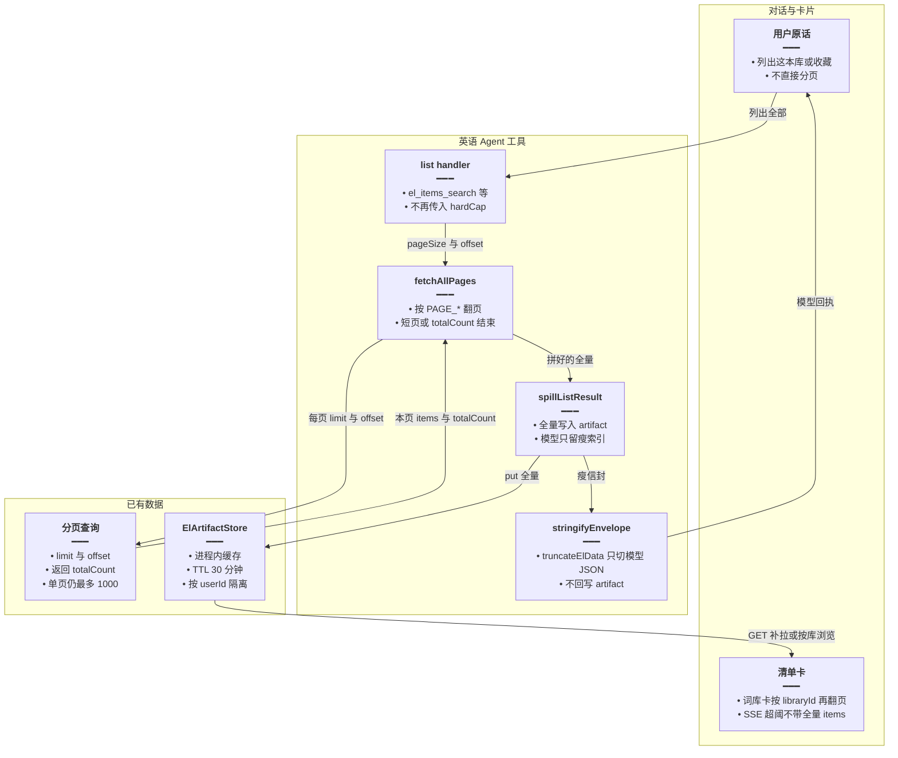
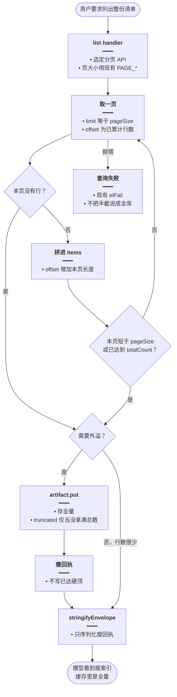
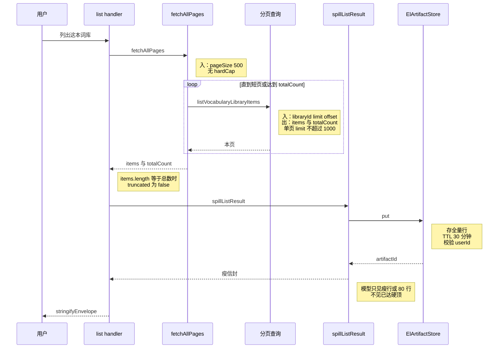

# 清单按库取全 — 实现思路

> **状态**：规划（未实现）  
> **日期**：2026-10-28  
> **需求摘要**：英语 Agent 拉「整份清单」时不再在 2000（以及同类的 500 / 200）条处停下并说「未穷尽」，翻页直到数据库没有下一行，条数以当次查询的 `totalCount` 为准。  
> **一句话方案（预告）**：`fetchAllPages` 去掉条数硬顶，按短页或 `totalCount` 结束；全量行只进 artifact，对话模型仍只看现有瘦索引。

## 延伸阅读

- 整类收藏读的就是这次 list 写下的 artifact：[english/整类词一次收藏.md](./整类词一次收藏.md)。该文图里的「最多 2000」描述的是**当前代码**；本篇落地后，分类器的输入改为库内全部行
- 为什么全量不能塞进对话上下文：[english/Agent大结果旁路展示.md](./Agent大结果旁路展示.md)、[english/清单索引可筛选.md](./清单索引可筛选.md)
- 用户卡片按库翻页、不靠把 artifact 整表画进 DOM：[english/整库全量出卡.md](./整库全量出卡.md)

---

## 0. 读本文你将得到什么

- 要去掉的是 Agent 把清单装进内存时自己设的条数硬顶，不是页面滚动，也不是导出 Word 的 20000
- 比对后的做法：继续用现有分页接口往下翻，直到本页不足一页或已经达到数据库返回的总数
- 改动集中在 `fetchAllPages` 和它的调用点；`spillListResult` 仍把全量放进 artifact，模型回执仍是瘦索引
- 分三阶段：先改翻页结束条件，再删掉「已达硬顶，未穷尽」文案，最后用假分页自检
- 最大风险是一本八千行的词库会整表留在进程内缓存 30 分钟；模型上下文不跟着变大

---

## 1. 需求与边界

### 1.1 用户故事

| 角色 | 场景 | 行为 | 期望结果 |
|------|------|------|----------|
| 登录用户 | 对英语 Agent 说「列出这本词库 / 收藏 / 错题 / 笔记标题」 | 工具按库翻页 | 取回的行数等于这次查询的数据库总数，回执不再写「已达硬顶，未穷尽」 |
| 登录用户 | 词库超过 2000 条，接着说「把其中某一类全部收藏」 | 整类收藏读本轮 artifact | artifact 里有后半本，不把第 2001 条以后标成未取到 |
| 登录用户 | 在词库页面自己往下翻 | 前端按页请求 | 行为与现在相同，不因本篇改页面每页条数 |

### 1.2 范围

| 在范围内 | 不在范围内（非目标） |
|----------|----------------------|
| `fetchAllPages` 的全部调用：词库目录、库内词条/语句、收藏、错题、记词、资料历史与明细、笔记标题、生成结束后回读词条、日推列表 | 不改前端 `useEnglishLearningList` 的页大小；页面本来就翻到短页为止 |
| `missingNoteCard` 找最早/最新一篇时，标题列表翻到 `page.total`，不再停在 2000 | 不把每一篇笔记正文读进数组；正文仍只 `findOne` 选中的那一篇 |
| 删掉由条数硬顶产生的「已达硬顶 N，未穷尽」 | 不删提示词里「只有回执写了未穷尽才许说未穷尽」；字符保险丝仍可能截断模型看见的 JSON |
| 全量行写入现有 artifact，模型仍走 `spillListResult` 的瘦索引 | 不把八千行塞进对话上下文；不抬 `agentStreamRecursionLimit`（56）和 `ENGLISH_EL_TOOL_RUN_LIMIT`（10） |
| 搜索 `q` 继续用单独的 500 条匹配窗 | 不把 `el_items_search` 的 `search` 改成无上限 `LIKE` |
| | 不改 DOCX 导出硬顶 20000、生成上限 12000/6000、字段 `varchar(2000)`、`PROPOSE_ITEM_CAP`、`EL_SLIM_*`、`EL_LIST_MAX`（抽样默认 20） |

### 1.3 约束与依赖

- 须登录；沿用现有英语学习查询，不新增表、不新增会员档。
- 必须复用：`list*Page` 一类带 `limit` / `offset` / `totalCount` 的查询、`spillListResult`、`ElArtifactStore`（进程内缓存，TTL 30 分钟）。
- 单次 SQL 的 `limit` 仍受服务层 `Math.min(1000, …)` 约束（`english-learning.service.ts` 词库词条约 2842、2869 行）。Agent 现在每页 500，靠多页拼齐，不必放宽单页上限。
- 体验底线：用户卡片仍按库 id 或现有 SSE 补拉浏览；模型回执的条数不能被说成「用户只看得到这些」。

---

## 2. 背景

- **谁、在什么场景、卡在哪**：用户让英语 Agent 列出一本词库、一批收藏或笔记标题。`domain-tools.ts` 里的 `fetchAllPages` 会一直翻页，但循环条件是 `items.length < hardCap`。词条和用户行的 `hardCap` 是 `EL_FULL_LIST_MAX`（2000）。库还没翻完就停，`truncated: true`，回执写「已达硬顶，未穷尽」。
- **现状缺口**：词库页面自己滚动时没有这道 2000。Agent 这条全量路径有。账号里四千到八千条的词库，后半本既进不了 artifact，也进不了下一篇整类收藏要读的清单。提示词规定模型只有在回执写了未穷尽时才能说库没列完，所以这句「未穷尽」会变成用户看到的结论。
- **不解决会怎样**：同一本库，页面上能翻完，Agent 却声称没列完。整类收藏即使按 artifact 挑词，也只在前 2000 行里挑。
- **硬约束**：全量不能回到模型上下文（旁路展示就是为 `maxTokens` 截断做的）。图步数和领域工具次数不提高。搜索不是「把库列完」，不能借这次把 `LIKE` 的匹配窗拿掉。

---

## 3. 现状与复用

| 能力 | 仓库中已有 | 本需求中的用法 |
|------|------------|----------------|
| 按页拉到硬顶 | `apps/backend/src/services/agent/tools/english/domain-tools.ts` 的 `fetchAllPages`（约 104 行）。结束条件：空页、短页、`items.length >= totalCount`，外加 `hardCap` | 扩展：去掉 `hardCap` 参数，其余三个结束条件保留 |
| 2000 这个数 | `envelope.ts` 的 `EL_FULL_LIST_MAX = 2000`。`LIB_ITEMS_HARD_CAP` 与 `USER_ROWS_HARD_CAP` 都等于它 | 拉清单不再引用它。它只留在 `truncateElData`，截的是交给模型的 JSON |
| 另外两道同类硬顶 | 同文件 `LIBS_HARD_CAP = 500`（词库目录）、`READING_HARD_CAP = 200`（日推） | 同一处 `fetchAllPages` 去掉，避免目录和日推仍说未穷尽 |
| 找最早/最新笔记 | `missingNoteCard`（约 273 行）用 `rows.length < USER_ROWS_HARD_CAP` 停 | 改成翻到 `page.total` 或短页。只累积 `findPage` 的列表行，正文仍 `findOne` 一篇 |
| 外溢 | `spill.ts` 的 `spillListResult`：`always` 时整表 `items` 进 artifact；模型拿到瘦行或 80 行一页 | 直接复用。调用顺序已经是先 `spill` 再 `stringifyEnvelope`，artifact 不会被后面的 2000 保险丝砍掉 |
| 模型 JSON 保险丝 | `stringifyEnvelope` → `truncateElData`，默认最多 2000 条，再按 `EL_DATA_MAX_CHARS`（10 万字符）缩最大数组 | 直接复用，且必须留在 spill 之后。防的是某次忘记外溢时把整库塞进上下文 |
| 今日复习预览的字符裁剪 | `el_review` `peek_queue` 先 `fitItemsByChars`，再把裁过的数组放进信封 | 扩展：信封里的 `items` 改为裁之前的全量，让 spill 存全表。字符裁剪不再充当这份数据的唯一副本 |
| 词面搜索 | `search` 使用 `searchLimit = Math.min(LIB_ITEMS_HARD_CAP, 500)`，一次查询，不是翻页 | 不适用本篇的「取尽」。硬顶常量化删除后，这里改成独立常数 500，避免搜索跟着变成无上限 |
| 页面翻页 | `useEnglishLearningList.ts`：本页长度达到 `pageSize` 才认为还有下一页 | 不改。说明 2000 不是页面限制 |
| 单页 SQL 上限 | `english-learning.service.ts` 词库词条 `limit` 最高 1000 | 不改。`PAGE_LIB_ITEMS = 500` 已经小于它 |

**调用点（都要一起改，否则会留下某一种清单仍报未穷尽）**：

| 入口 | 现在的硬顶 | 数据 |
|------|------------|------|
| `el_libraries` list | 500 | 词库 / 语料库目录 |
| `el_items_search` list，vocab / classic | 2000 | 某一本库的词条或语句 |
| `el_favorites` list | 2000 | 单词收藏、语句收藏 |
| `el_mistakes` list | 2000 | 错题 |
| `el_daily_memo` 记录 | 2000 | 记词 |
| `el_packs` history / items | 2000 | 生成历史、一份资料的明细 |
| `generateVocab` / `generateClassic` 结束后回读 | 2000 | 刚生成的词条（生成条数另有 12000/6000，不是这道硬顶） |
| `el_notes` list | 2000 | 笔记标题 |
| `missingNoteCard` | 2000 | 笔记标题，用来挑最早或最新一篇 |
| `el_review` peek_queue | 2000，且可能再被 10 万字符裁短 | 今日到期队列 |
| `el_daily_reading` | 200 | 日推篇目 |
| `el_items_search` search | 单次 500 | **不取尽**，见非目标 |

**调研结论**：全量清单已经有分页 API 和 artifact。缺的是翻页停在一个与数据库无关的常数上，以及若干调用点把这个常数写进回执。前端列表、导出、搜索、抽样不是同一条限制，不能顺手删掉。

---

## 4. 方案比对与最终方案

### 4.1 候选方案

#### 方案 A：维持 `hardCap`（复用现状）

- **做法**：`fetchAllPages(pageSize, hardCap, fetchPage)` 保持不变。词条和用户行停在 2000，目录停在 500，日推停在 200。`truncated === items.length < totalCount` 时回执写「已达硬顶，未穷尽」。`spillListResult` 把截过的数组写入 artifact。
- **能工作的原因**：这就是现在线上的路径。2000 以内的库（例如小学三年级上册 107 条）一次能取完，`truncated` 为 false。
- **主要代价**：超过常数的库，后半本不在 artifact 里。页面上能看到的行，Agent 会说没列完。

#### 方案 B：把 2000 抬到导出硬顶 20000（扩展现有常数）

- **做法**：`EL_FULL_LIST_MAX` 改为 20000，与 DOCX 导出 `@ArrayMaxSize(20000)` 对齐。`LIBS_HARD_CAP`、`READING_HARD_CAP` 同样抬高或改成同一个数。`fetchAllPages` 的循环和「未穷尽」文案保留。
- **能工作的原因**：当前账号里最大的词库约八千条，20000 盖得住今天的数据。调用形状不变，只改一个数字和两道更小的硬顶。
- **主要代价**：库一旦超过新数字，仍停、仍说未穷尽。导出 20000 是 Word 内存上限，拿来当清单条数没有数据库依据。八千行照样整表进缓存，并没有少占内存。

#### 方案 C：按数据库总数翻完（扩展 `fetchAllPages`）

- **做法**：`fetchAllPages` 只保留三个结束条件：本页没有行、本页短于 `pageSize`、已累计行数达到本页返回的 `totalCount`。删除 `hardCap` 参数，以及 `LIBS_HARD_CAP`、`LIB_ITEMS_HARD_CAP`、`USER_ROWS_HARD_CAP`、`READING_HARD_CAP`。各 list 把拼好的全量放进现有信封；`wrap` 里先 `spillListResult` 再 `stringifyEnvelope`。模型侧的 `EL_FULL_LIST_MAX` 不删。搜索改为独立的 `SEARCH_MATCH_LIMIT = 500`。
- **能工作的原因**：分页 API 已经返回 `totalCount`，短页也能表示「没有下一行」。外溢已经把大数组从模型回执里拿走。页面列表用的是同一套「翻到短页为止」。
- **主要代价**：一次 list 的查询次数是 `ceil(总数 / 页大小)`，约八千行、每页 500 时大约 18 次串行查询，结果在进程内缓存里留 30 分钟。

### 4.2 比对

| 维度 | 方案 A | 方案 B | 方案 C |
|------|--------|--------|--------|
| 正确性（失败路径、边界、数据是否会错） | 总数超过硬顶时 artifact 缺后半本，回执却用「未穷尽」交代，和页面不一致 | 今天的库能取完。超过 20000 仍缺行，失败形态与 A 相同 | 行数等于本次 `totalCount`（或短页提前结束时少于总数，`truncated` 仍为真，但原因是查询提前结束，不是常数） |
| 复用 / 与现状契合 | 零改动 | 复用同一函数，只改常数；和 DOCX 硬顶绑在一起，两套产品语义被混成一个数 | 复用分页 API、spill、artifact。结束条件和前端「本页不足 pageSize 即没有更多」一致 |
| 改动面（要动哪些路径） | 无 | `EL_FULL_LIST_MAX` 一处，文案里的数字跟着变 | `fetchAllPages` 签名，加上 §3 表里每个 list 的 `hardCap` 实参和「未穷尽」文案 |
| 复杂度（新概念、新状态、新依赖） | 无新概念 | 无新概念，只是更大的同一个顶 | 无新存储。调用方少一个参数 |
| 体验（延迟、步骤数、失败时用户看到什么） | 大库立刻返回，但告诉用户没列完 | 大库变慢的程度和 C 接近（八千行都要翻完），超过新顶仍说没列完 | 大库多几次查询后，回执不再说未穷尽。模型仍只看瘦索引，用户卡片仍按库翻页 |
| 风险（迁移、互斥、并发、回滚） | 无 | 20000 行进一次工具调用的内存，和现在导出整本 Word 的风险同级，但是发生在对话里 | 同上，且没有「到顶就停」这道内存阀。缓存是进程内的，多实例不共享，重启即丢，和现在的 artifact 一样 |
| 可维护性（以后改一处还是改多处） | 四道硬顶（2000、2000、500、200）继续各写各的未穷尽文案 | 数字仍散落在文案里，下次还要一起改 | 结束条件只在 `fetchAllPages`。搜索的 500 单独命名，不再从清单硬顶里 `Math.min` 出来 |

### 4.3 综合考量

权重在正确性，其次是和现有外溢的契合。需求是「按数据库里的内容取全部」，不是「把顶调高到暂时够用」。方案 B 对当前八千行的库和 C 同样要翻完、同样占缓存，却保留了下一次仍会说未穷尽的常数，还把清单和 Word 导出绑在一个数上。方案 A 改动最小，但四千条以上的库继续缺后半本，整类收藏读到的 artifact 也缺。因此选 C。

放弃的优点：A 的零改动，以及 A/B 在超大库上「到顶就停、内存有上界」的那一刀。上界改由查询本身结束；若以后单库大到撑住进程，再把 artifact 改成按 offset 分 key，而不是先写回一个新的条数顶。

### 4.4 最终方案

#### 背景

Agent 的全量清单走 `fetchAllPages`，在 2000（目录 500、日推 200）处停下，并把截断写进回执。页面列表没有这道顶。外溢已经能把大数组放进 artifact、只给模型瘦索引，所以条数顶并不是在保护上下文。搜索、导出、生成上限、字段长度是别的产品限制，不在这次去掉的范围内。

#### 具体思路

1. 只扩展 `domain-tools.ts` 的 `fetchAllPages` 和它的 list 调用点，以及 `missingNoteCard` 的标题循环。不新增模块，不改 `english-learning.service.ts` 的单页 1000。
2. 数据从现有 `list*Page(limit, offset)` 来，拼成一个数组，经 `spillListResult` 进入 `ElArtifactStore`。模型拿到的是 spill 之后的瘦信封，再经 `stringifyEnvelope`。
3. 全量状态放在现有 artifact（进程内、30 分钟、按用户 id 隔离）。不放进 MobX，也不把全量写进聊天消息。
4. 空页、短页、达到 `totalCount` 三个结束条件保留，用来防止 `totalCount` 缺失时死循环。查询中途抛错仍走 `wrap` 里现有的失败信封，不把半截数组说成全库。`truncated` 仅当累计行数仍小于有限的 `totalCount` 时为真（短页提前结束）。由硬顶造成的未穷尽文案删除。

#### 实现方案

**一句话**：`fetchAllPages` 去掉条数硬顶，按短页或 `totalCount` 结束；全量行只进 artifact，对话模型仍只看现有瘦索引。

| 步骤 | 谁 | 做什么 | 输入 → 输出 |
|------|----|--------|-------------|
| 1 | 领域工具 list（如 `el_items_search`） | 调用不再带 `hardCap` 的 `fetchAllPages` | `libraryId` → `{ items, totalCount, truncated }` |
| 2 | `fetchAllPages` | 按 `PAGE_*` 翻页，直到短页或达到 `totalCount` | 每页 `items` + `totalCount` → 拼好的全量 |
| 3 | `wrap` → `spillListResult` | 全量写入 artifact；模型信封换成瘦索引或预览 | 全量信封 → `{ model, full }` |
| 4 | `stringifyEnvelope` | 只序列化模型信封；`truncateElData` 仍防未外溢的大数组 | 瘦信封 → JSON 字符串 |

#### 选定原因

1. **正确性**：行数跟这次查询的总数走，不再在无关的 2000 处缺后半本。牺牲：超大库不再有「到顶就停」的内存上界。
2. **复用**：分页、外溢、artifact、前端「短页即结束」都还在。牺牲：每个 list 的未穷尽文案都要删，不是改一个数字。
3. **改动面**：集中在 Agent 工具文件。牺牲：比方案 B 多改调用点，服务层和前端不动，用来换「不再留一道新顶」。
4. **复杂度**：少一个参数。牺牲：无。
5. **体验**：大库多几次串行查询，换回执不再说没列完；模型上下文大小不变。牺牲：方案 A 那种大库立刻返回。
6. **风险**：内存形态与「已经要把八千行翻完」的方案 B 相同，但回滚就是加回 `hardCap`。牺牲：A/B 那道显式上界。
7. **可维护性**：结束条件只有一处。牺牲：搜索必须自己写出 500，不能再从清单硬顶推导。

#### 优势

- 相对方案 A：超过 2000 的词库、收藏和笔记标题能进 artifact，整类收藏不会只在前 2000 行里挑。
- 相对方案 B：不把 Word 导出的 20000 当成清单条数；库再长大也不必再改一次常数才能「取全部」。

#### 怎么实现

1. 改 `fetchAllPages` 签名，循环不再和 `hardCap` 比较。`truncated` 只表示「有限的 `totalCount` 没有拿满」，例如接口在中途返回短页。
2. §3 表中的 list 去掉硬顶实参，删除「已达硬顶 N，未穷尽」。`meta.limit` 改为本次 `items.length`（实际取回的行数），不再写已经不存在的顶。
3. `missingNoteCard` 的 `for` 改为 `rows.length < page.total`（并保留短页 break）。不要为了取消 2000 去循环 `findOne`。
4. `peek_queue` 把 `fitItemsByChars` 之前的全量放进信封。体积大时现有 `shouldSpill` 会外溢，模型只看预览。
5. `search` 写成 `const SEARCH_MATCH_LIMIT = 500`，不要引用已删除的 `LIB_ITEMS_HARD_CAP`。
6. `EL_FULL_LIST_MAX` 留在 `truncateElData`。不要在 `spillListResult` 之前对全量 `slice(0, 2000)`。
7. 主要实现代码见 §9。

### 4.5 其他关键决策：模型回执仍保留 2000 条保险丝

这会改变「同一份清单的两份拷贝」各自由谁截断，所以单独比对。

#### 候选

**方案 D：连 `truncateElData` 的 2000 一起删掉。**  
`stringifyEnvelope` 只受 10 万字符约束。能工作，因为外溢后的模型信封通常远小于 2000 行。代价：某次 list 忘记外溢时，整库 JSON 直接进模型。

**方案 E：拉清单不截，序列化给模型时仍截。**  
`fetchAllPages` 取尽；`wrap` 保持先 `spillListResult` 再 `stringifyEnvelope`。artifact 里是全量。`truncateElData` 的 `EL_FULL_LIST_MAX` 只作用在模型字符串上。`peek_queue` 不再在外溢前用 `fitItemsByChars` 替换唯一副本。能工作，因为 spill 读的是 `env.data.items`，写缓存发生在 `truncateElData` 之前。代价：模型侧仍可能看到 `meta.truncated`，但那表示「这句话太大」，不表示库只存了 2000 行；提示词里的未穷尽规则要能对上这种区别。

#### 比对

| 维度 | 方案 D | 方案 E |
|------|--------|--------|
| 正确性 | 忘记外溢时模型拿到全库，上下文被截断或超 token，用户看到半截回答 | artifact 与库一致；模型字符串仍有上界 |
| 复用 | 删掉现有保险丝 | 保留 `truncateElData` 和现有 wrap 顺序 |
| 改动面 | `envelope.ts` 加 `domain-tools.ts` | 只要求调用点不要在 spill 前按 2000 切片；`peek_queue` 停止预裁剪 |
| 复杂度 | 少一个常数的两处语义 | 一个常数只剩一处语义：模型 JSON |
| 体验 | 失败时回答中断 | 和大库 list 的现有外溢相同 |
| 风险 | 回归就是整库进上下文 | 低；外溢失败时保险丝仍在 |
| 可维护性 | 以后分不清「库没取完」和「这句话太大」 | `EL_FULL_LIST_MAX` 不再被叫做「全量拉取硬顶」 |

#### 综合考量

正确性权重最高：用户要的是库里的行都在，不是模型上下文变大。方案 D 少留一个常数，但把旁路展示已经防过的事故放回来。选 E。放弃 D「模型侧也不再出现 2000」的干净程度。

#### 背景

`EL_FULL_LIST_MAX` 现在同时表示「向数据库最多要 2000 行」和「给模型的 JSON 最多 2000 条」。两件事叠在一个常数上，去掉前者时如果连后者一起删，未外溢的工具结果就没有条数上界。

#### 具体思路

全量只活在 artifact。模型字符串继续走 `truncateElData`。调用点禁止在 spill 之前按这个常数切片。`peek_queue` 今天先裁再返回，spill 只能看到裁过的数组，要改成先放全量。

#### 实现方案

**一句话**：库取尽进 artifact；`EL_FULL_LIST_MAX` 只截交给模型的 JSON。

| 步骤 | 谁 | 做什么 | 输入 → 输出 |
|------|----|--------|-------------|
| 1 | list handler | 信封 `data.items` 为取尽的数组 | 全量 |
| 2 | `spillListResult` | `put` 全量，返回瘦 `model` | artifact + 瘦信封 |
| 3 | `stringifyEnvelope` | 对瘦信封调用 `truncateElData` | 模型 JSON |

#### 选定原因

1. **正确性**：库的完整行在缓存里，模型仍有上界。牺牲：模型侧的截断标志还在，文案不能再写成「库未穷尽」。
2. **复用**：wrap 的顺序不用颠倒。牺牲：不能删掉 `EL_FULL_LIST_MAX`。
3. **风险**：外溢抛错时模型最多看到 2000 条，库的后半本仍在这次尚未写入的内存数组里，请求失败即可，不会把半截当全库提交。牺牲：方案 D 更少的分支。

#### 优势

- 相对方案 D：忘记外溢时不会把八千行词条推进对话上下文。

#### 怎么实现

`wrap` 里现有顺序保持不动。`envelope.ts` 里把 `EL_FULL_LIST_MAX` 的注释改成「只用于 `truncateElData`」。`peek_queue` 返回 `all.items` 的瘦字段全量，不要先 `fitItemsByChars`。字符过长由 spill 或 `truncateElData` 处理模型字符串，不替换已经准备写入 artifact 的数组。

---

## 5. 架构图



**图内方法说明**：

| 方法 / 模块入口 | 功能 |
|-----------------|------|
| `list handler` | 某个 `el_*` 的 `list`：决定查哪张表，调用 `fetchAllPages`，把返回数组放进信封。不再计算 2000/500/200 |
| `fetchAllPages` | 循环调用分页函数，把每页 `items` 依次拼上，直到没有下一行或累计数达到 `totalCount` |
| `spillListResult` | 大列表或 `always` 时把 `data.items` 原样 `put` 进缓存，另造一份只含瘦行或预览的信封给模型 |
| `stringifyEnvelope` | 把模型信封变成 JSON。内部 `truncateElData` 若仍超过 2000 条或 10 万字符，只改这份字符串 |
| `truncateElData` | 截模型 JSON 里的 `items` / `candidates` / `rows`。不读取、不修改 artifact |
| 分页查询 | 已有 `listVocabularyLibraryItems` 等。输入 `limit`、`offset`，输出本页行和库内总数。单页 `limit` 在服务层被压到 1000 以内 |
| `ElArtifactStore.put` / `get` | 按 `artifactId` 存取整份清单，校验 `userId`。TTL 30 分钟，存在当前进程的 cache 里 |

**读图要点**：

- 全量只出现在 `fetchAllPages` 的返回值和 artifact 里。通向用户的那条是瘦回执，通向卡片的那条是缓存或按 `libraryId` 再查库。
- 没有新服务。`stringifyEnvelope` 在 spill 之后，所以它的 2000 切不到已经 `put` 的数组。
- 卡片不把八千个 DOM 节点一次画出来；词库卡继续按库翻页。

---

## 6. 主流程图



**图内方法说明**：

| 方法 | 功能 |
|------|------|
| `list handler` | 进入某一种清单。失败时走现有 `elFail`，不新增错误码 |
| 取一页 | 调用对应的 `list*Page`。用返回的 `totalCount` 更新结束线；没给总数时只靠空页和短页 |
| 拼进 `items` | 保持数据库分页顺序。不去重，避免把库里故意重复的行吃掉 |
| `artifact.put` | 写入本轮全量。`truncated` 为真只表示累计行数小于有限的总数，文案不再提硬顶 |
| 瘦回执 | `spillListResult` 的模型信封：放得下则瘦字段，放不下则 80 行加 `nextOffset`。`nextOffset` 仍是给模型筛选用的上下文页 |
| `stringifyEnvelope` | 最后一道，只处理瘦回执 |
| `elFail` | 分页查询抛错时走 `wrap` 里已有的失败信封，不把已经拼上的半截数组说成全库 |

**读图要点**：

- 循环回到「取一页」的唯一条件是：本页是满的，且还没达到 `totalCount`。没有与 2000 的比较。
- 行数很少时可以不外溢，整页进模型，这和现在的小库一致。
- 查询抛错直接结束，不用截断标志掩盖失败。

---

## 7. 核心时序图



**图内方法说明**：

| 方法 | 功能 |
|------|------|
| `fetchAllPages` | 串行翻页并拼接。不并发打满连接池 |
| `listVocabularyLibraryItems` | 图中的代表查询。收藏、错题、笔记标题换成各自的 `list*Page`，结束条件相同 |
| `spillListResult` | 决定外溢后，先 `put` 再造模型信封 |
| `ElArtifactStore.put` | 生成 `artifactId`，写入带 `userId` 的缓存项 |
| `stringifyEnvelope` | 把瘦信封变成工具返回字符串。图中不把全量送回用户 |

**读图要点**：

- 数据库往返次数由总数和页大小决定，页大小沿用 `PAGE_LIB_ITEMS` 等现成常数。
- 缓存写入发生在模型回执生成之前，所以后面的 JSON 保险丝影响不到已存的行。
- 这是一条 list 的快乐路径。搜索 `q` 不走这个循环。

---

## 8. 状态

无独立界面状态。`truncated` 只在「有限总数没拿满」时为真，不再表示「碰到 2000」。

---

## 9. 具体实现（主链路代码）

对应 §4.4 步骤 1～2。落在 `apps/backend/src/services/agent/tools/english/domain-tools.ts`，替换现有 `fetchAllPages`。

```ts
// 对应 §4.4 步骤 2。按页拼到数据库没有下一行，结束条件不再包含条数硬顶，避免 2000 把后半本标成未穷尽
async function fetchAllPages<T>(
	// 沿用 PAGE_LIB_ITEMS 等现成页大小，单页仍小于服务层 1000 的上限
	pageSize: number,
	// 调用方按 offset 取一页；总数用查询结果，不用常数代替
	fetchPage: (
		// 本页条数，由 pageSize 传入，不再为了凑硬顶改小
		limit: number,
		// 跳过已拼上的行，保证页与页不重叠
		offset: number,
	// 一页的行和库内总数；总数可选，缺了就只靠空页和短页结束
	) => Promise<{ items: T[]; totalCount?: number }>,
// 拼好的全量、总数，以及「没拿满」而不是「碰到硬顶」
): Promise<{ items: T[]; totalCount: number; truncated: boolean }> {
	// 顺序与分页一致，供 artifact 和整类收藏按同一顺序扫描
	const items: T[] = [];
	// 第一页回来之前还不知道总数，不能把 0 当成「库是空的」
	let totalCount = Number.POSITIVE_INFINITY;
	// 下一页起点，等于已经拼上的行数
	let offset = 0;
	// 空页、短页、达到总数三选一即停，防止总数缺失时死循环
	while (true) {
		// 每页都请求满 pageSize，不再为了凑硬顶去缩小最后一页的 limit
		const page = await fetchPage(pageSize, offset);
		// 有总数就记下，后面用它判断是否拿满
		if (typeof page.totalCount === 'number') totalCount = page.totalCount;
		// 空页表示没有更多行
		if (!page.items.length) break;
		// 接上本页，保持数据库给出的顺序
		items.push(...page.items);
		// 起点后移本页长度，下一轮不会重复读同一行
		offset += page.items.length;
		// 短页表示后面没有满页，即使总数暂时对不上也停止
		if (page.items.length < pageSize) break;
		// 已经拿满数据库声明的总数
		if (Number.isFinite(totalCount) && items.length >= totalCount) break;
	}
	// 接口没给总数时，用实际拿到的行数，避免返回 Infinity
	if (!Number.isFinite(totalCount)) totalCount = items.length;
	return {
		// 取到的全部行，调用方原样放进信封
		items,
		// 库内总数；没声明时等于 items.length
		totalCount,
		// 只有声明了总数却没拿满才为真，例如中途短页；不再因为碰到 2000 而为真
		truncated: Number.isFinite(totalCount) && items.length < totalCount,
	};
}
```

对应 §4.4 步骤 1 的一个调用点（词库 list，classic 与其余 list 同样删掉第二个实参和未穷尽文案）：

```ts
// 对应 §4.4 步骤 1。词条按库取尽，第二个参数不再传 LIB_ITEMS_HARD_CAP
const all = await fetchAllPages(PAGE_LIB_ITEMS, async (limit, offset) => {
	// 仍走现有分页，单页 limit 由服务层压到 1000 以内
	const page = await deps.learning.listVocabularyLibraryItems(deps.userId, {
		// 只取用户点名的那一本，避免把别的库拼进来
		libraryId,
		// 本页条数，与 fetchAllPages 的 pageSize 相同
		limit,
		// 已累计行数，由翻页函数传入
		offset,
	});
	return {
		// 本页词条，交给外层拼接
		items: page.items,
		// 这本书的总数，用来判断是否已经取尽
		totalCount: page.totalCount,
	};
});
// 回执不再写「已达硬顶」。meta.limit 改为实际行数，避免模型复述一个已删除的顶
return elOk(
	{
		// 单词或语句，沿用这次 list 的 kind
		kind,
		// 卡片和后续按库翻页仍用这个 id
		libraryId,
		// 取尽的全量，spill 会原样写入 artifact
		items: all.items,
		// 本次数到的行数，供回执引用
		returned: all.items.length,
		// 数据库总数，和 items.length 一致时表示拿满
		totalCount: all.totalCount,
	},
	{
		// 给模型和提示词看的元数据，不再携带硬顶文案
		meta: {
			// 库内总数
			total: all.totalCount,
			// 实际取回的行数，不是已经删除的 2000
			limit: all.items.length,
			// 仅当没拿满总数时为真
			truncated: all.truncated,
		},
	},
);
```

`EL_FULL_LIST_MAX` 不删除。`envelope.ts` 注释改为只描述 `truncateElData`。`search` 处改为独立常数：

```ts
// 搜索是匹配窗，不是把库列完；与清单取尽分开，避免删掉硬顶后 LIKE 变成无上限
const SEARCH_MATCH_LIMIT = 500;
```

---

## 10. 分阶段步骤

### M1：翻页取尽

- [ ] `fetchAllPages` 去掉 `hardCap`，结束条件只留空页、短页、`totalCount`。
- [ ] 删除 `LIBS_HARD_CAP`、`LIB_ITEMS_HARD_CAP`、`USER_ROWS_HARD_CAP`、`READING_HARD_CAP`。
- [ ] §3 表中每个 `fetchAllPages` 调用去掉第二个实参。
- [ ] `missingNoteCard` 翻到 `page.total` 或短页，不循环读取正文。
- [ ] `SEARCH_MATCH_LIMIT = 500` 替换 `Math.min(LIB_ITEMS_HARD_CAP, 500)`。
- [ ] `peek_queue` 的信封使用裁剪前的全量瘦行。

### M2：回执与注释

- [ ] 删除「已达硬顶 N，未穷尽」以及日推「已达每类硬顶」。`all.truncated` 仍为真时只说明查询没有拿满总数，不提条数顶。
- [ ] `agent.prompt.ts` 仍保留「只有回执写了未穷尽才许说未穷尽」。不要新增「最多 2000 条」的说法。
- [ ] `EL_FULL_LIST_MAX` 的注释改为仅用于模型 JSON。
- [ ] `pack-ask.ts` 里「列表硬顶仍是 EL_FULL_LIST_MAX」改成「列表按总数取尽，生成条数仍是另一套数字」。

### M3：自检

- [ ] 用一段不启动 Nest 的脚本调用抽出来的 `fetchAllPages`：假分页每页 500、共 2500 行，断言 `items.length === 2500` 且 `truncated === false`。
- [ ] 同一脚本再断言：总数 2500 但第 2 页返回 100 行时，`truncated === true` 且行数为 600，避免把提前结束说成取尽。
- [ ] 不把这道自检写成新的测试框架。

---

## 11. 风险、边界与待确认

| 项 | 等级 | 说明 | 缓解 |
|----|------|------|------|
| 进程内存 | 中 | 约八千行带例句的词库会整表留在 cache 里 30 分钟。缓存注释写明是进程内，不是跨进程 Redis | 不在模型上下文里再放一份。若单库大到影响堆，再把 artifact 拆成按 offset 的多个 key，而不是先写回条数顶 |
| 串行查询变长 | 低 | 约八千行、每页 500，大约 18 次查询 | 保持串行，不并发扇出。超时仍走现有工具失败，不把半截标成全库 |
| 短页与总数不一致 | 低 | 接口提前返回短页时 `truncated` 为真 | 回执说明没有拿满总数，不说硬顶。自检覆盖这条 |
| 搜索被误改成取尽 | 中 | 删掉 `LIB_ITEMS_HARD_CAP` 后若仍写 `Math.min(硬顶, 500)` 会编译失败或变成无上限 | M1 单独写出 `SEARCH_MATCH_LIMIT` |
| 笔记超过 2000 篇 | 低 | `missingNoteCard` 今天可能把第 2001 篇之后的「最早」漏掉 | 翻完标题列表再 `reduce`。若 `findPage` 能按 `createdAt` 排序，可再改成取一条，那是后续优化，不阻塞本篇 |

**待确认**：`LearningNotesService.findPage` 是否支持按 `createdAt` 升序或降序只取一条。验证方式：看 `findPage` 的查询参数；支持则 `missingNoteCard` 不必把全部标题装进内存。不支持就按本篇翻完标题。

**明确不改**：前端页大小、DOCX 20000、生成 12000/6000、字段长度 2000、提案条数 40（或整类那篇里的 400）、瘦索引 80/400、抽样 `EL_LIST_MAX`、图步数 56、领域工具次数 10。

---

## 12. 验收清单

- [ ] 一本超过 2000 条的词库，`el_items_search` list 的 artifact `items.length` 等于该库 `totalCount`，回执没有「已达硬顶」或「未穷尽」。
- [ ] 同一轮里模型回执不是这八千行的全文，仍是瘦索引或带 `nextOffset` 的一页。
- [ ] 收藏、错题、笔记标题、日推、词库目录的 list 同样不再出现硬顶文案；目录不再停在 500，日推不再停在 200。
- [ ] `search` 仍最多返回 500 条匹配，不因本篇变成整库扫描结果。
- [ ] 107 条的小库行为与现在一致：`truncated` 为 false，不必外溢时模型仍能看到全部瘦行。
- [ ] 假分页自检：2500 行取尽；中途短页则 `truncated` 为 true。
