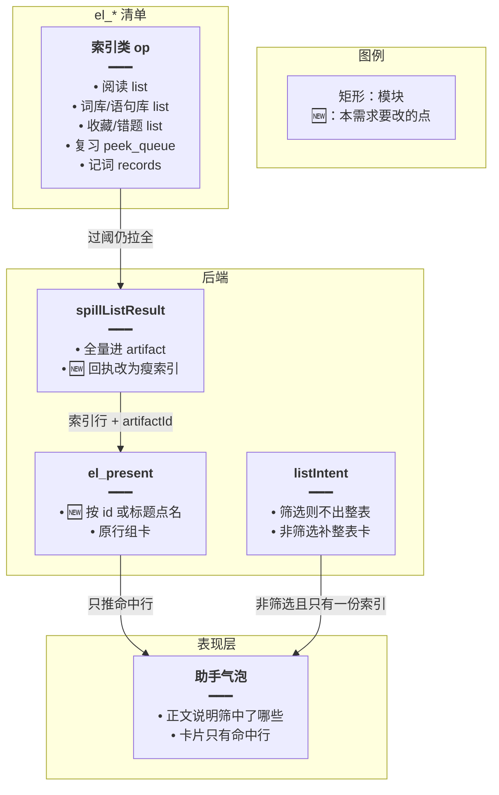
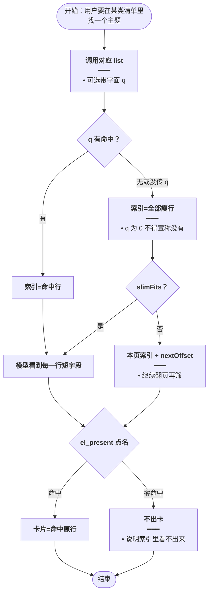
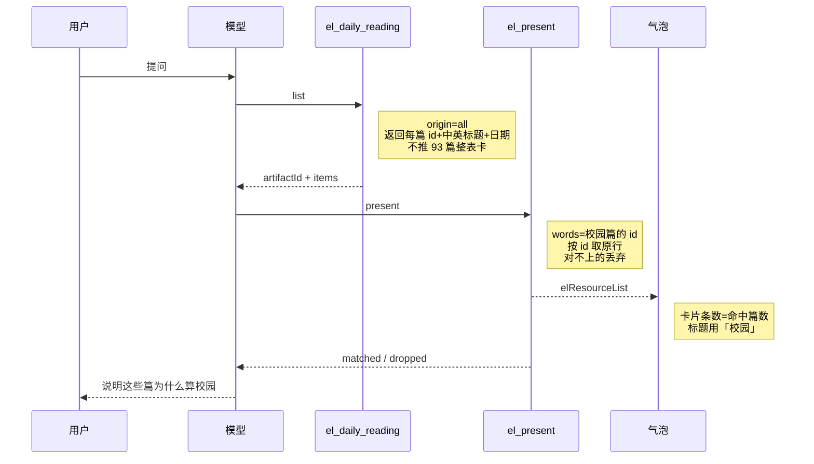
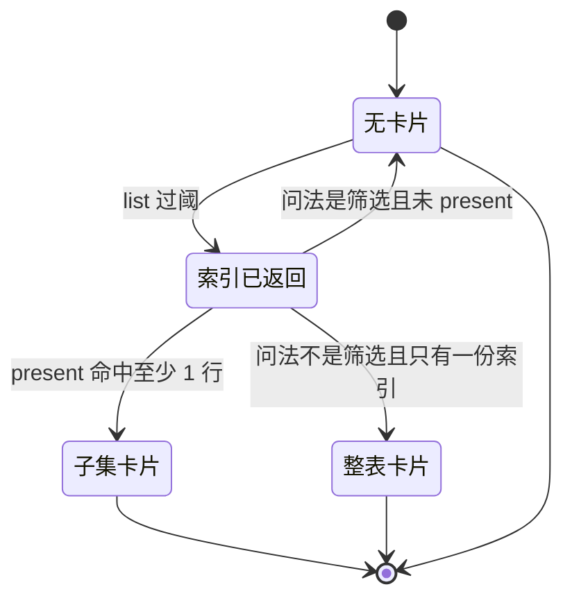

# 清单索引可筛选 — 实现思路

> **状态**：规划 | **日期**：2026-10-26 | **需求摘要**：每日阅读、词库、语句库、收藏、错题、复习、记词的大清单都要把可筛选的瘦索引交给模型，不能只给 5 条预览。

## 延伸阅读

- [问答清单按需出卡.md](./问答清单按需出卡.md) — 词库 `list` 已改成瘦字段 + `el_present`；本篇把同一规则铺到其余清单，并补上阅读的 `id` 点名
- [Agent大结果旁路展示.md](./Agent大结果旁路展示.md) — 外溢本身保留；本篇只改「外溢后模型还能看见什么」

---

## 0. 读本文你将得到什么

- 问题：93 篇阅读一外溢，模型只剩总数和 5 条标题，于是拒绝筛「校园」。
- 一句话方案：所有大清单都返回完整瘦索引（id / 标题或词面 / 释义），筛选后再用 `el_present` 出卡；字面关键词可先在服务端过滤。
- 改动层：后端 spill 与 `el_present` 的匹配键、各 list 的可选 `q`、提示词。前端卡片不改。
- 阶段：M1 索引可见且阅读能按 id 出卡 → M2 字面 `q` 与筛完再翻页 → M3 非筛选问法仍自动出整表卡。
- 最大边界：主题只写在正文里、标题和首句都看不出来时，不能对 93 篇逐篇 `get`。

---

## 1. 需求与边界

### 1.1 用户故事

| 角色 | 场景 | 行为 | 期望结果 |
|------|------|------|----------|
| 学习者 | 「哪些每日阅读是校园主题」 | 拉全部阅读再筛 | 看到的是标题里能判断为校园的那几篇，不是「工具不支持」 |
| 学习者 | 「这个词库 / 语句库里和校园有关的」 | 拉该库再筛 | 卡片只有命中的词或句子 |
| 学习者 | 「收藏 / 错题 / 今日复习 / 记词记录里哪些和身体有关」 | 拉对应清单再筛 | 同样只出命中行 |
| 学习者 | 「有哪些阅读 / 把复习队列列出来」 | 不是筛选 | 仍给整份清单卡片 |

### 1.2 范围

| 在范围内 | 不在范围内 |
|----------|------------|
| `el_daily_reading list`、`el_items_search list`、`el_favorites list`、`el_mistakes list`、`el_review peek_queue`、`el_daily_memo records` | 给每篇文章打主题标签或做向量检索 |
| 瘦索引含判断所需的短字段；`el_present` 能按 id / 词面 / 标题对上原行 | 把 93 篇正文塞进同一次工具回执 |
| 各 list 增加可选字面 `q`（标题、词面、释义子串） | 改清单卡片的过滤 / 双语 / 导出按钮 |
| 非筛选问法仍出整表卡 | 提高本轮工具次数上限（仍是 10 次） |

### 1.3 约束与依赖

- 外溢阈值仍是 ≥30 条或 JSON ≥4000 字。过阈后现在的模型回执只有 `preview` 5 条，并写着「清单已在下方卡片」。这就是模型拒绝筛选的直接原因。
- 词库 `list` 已走瘦字段（`EL_SLIM_MAX_ITEMS = 400`、`EL_SLIM_MAX_CHARS = 12000`），其余工具还没有。
- `el_present` 已能按 `word` / `english` 前 120 字对上原行，对不上的进 `dropped`。阅读行没有这两个字段，只有 `id`、`titleEn`、`titleZh`。
- 阅读实体没有主题字段，只有 `titleEn`、`titleZh`、`bodyEn`、`bodyZh`。

---

## 2. 方案总览（一句话 + 要点）

**一句话方案**：大清单外溢后把瘦索引整表留给模型，不再只留 5 条预览；模型筛完用 `el_present` 按 id 或词面出卡，字面词可以先 `q`。

| # | 设计要点 | 理由 |
|---|----------|------|
| 1 | 索引和卡片分开 | 5 条预览不够判断 93 篇里谁是校园；整表卡片也不是筛选结果 |
| 2 | 索引只有短字段 | 93 行标题约 1 万字，放得进一次回执；正文不行 |
| 3 | 点名键加上 `id` 和标题 | 现有 `presentRows` 只认词面，阅读全部会被丢掉 |
| 4 | `q` 只做子串 | 「校园」可能写在中文标题里；「school」不一定含这俩汉字。`q` 为 0 不能当成没有 |
| 5 | 没说筛选时仍出整表卡 | 「有哪些阅读」「今日复习队列」的交付物就是整份清单 |

---

## 3. 现状与复用

| 能力 | 仓库中已有 | 本需求中的用法 |
|------|------------|----------------|
| 外溢成 5 条 preview | `el-spill.ts` `spillListResult`：`shouldSpill` 后 `toPreview` + `EL_LIST_BAN` | 索引类 op 改走已有 `slim` 分支，禁止再写「已在下方卡片」 |
| 词库 list 的瘦字段 | `wrap` 里仅 `el_items_search` 且 `op=list` 传 `slim` | 扩到下表全部索引 op |
| 阅读 list 原行 | `english-learning-domain-tools.ts`：`id`、`titleEn`、`titleZh`、`publishDate`；`origin=all` 时分 `system` / `manual` | 外溢前已由 `collectItems` 合成一张表，索引沿用这些字段 |
| 收藏字面过滤 | `el_favorites` 的 `list`/`search` 已按 `q` 滤 `word` / `translationZh` | 保留；`list` 无 `q` 时改出索引。阅读、错题、记词补同样的子串 `q` |
| 复习队列瘦行 | `peek_queue` 已只返回词面 + 释义，再用 `fitItemsByChars` | 条数 ≥30 时仍会被外溢收成 5 条；改为留下瘦行 |
| 点名出卡 | `el_present`、`presentRows`、`presentTooWide` | 匹配键增加 `id`、`titleEn`、`titleZh` |
| 整表兜底 | `inventoryFallback` 只认「全部 / 导出」且只看词库 list | 改为：不是筛选问法、且本轮只有一份索引时出整表卡 |
| 单篇正文 | `el_daily_reading get` 已含 `bodyEn` 前 3500 字 | 只对索引里拿不准的少数篇调用，禁止逐篇 get |

**调研结论**：服务端其实已经拉全了 93 篇标题。模型看不见，是因为外溢把回执换成了 5 条 preview。词库 list 的瘦字段路径可以直接复用。阅读筛「校园」不能靠新增一个必填的主题参数，实体上没有这个字段。

索引覆盖：

| 工具 | op | 索引字段 | 现在模型过阈后看见 |
|------|----|----------|--------------------|
| `el_daily_reading` | `list` | `id`、`titleEn`、`titleZh`、`publishDate` | 5 条 preview |
| `el_items_search` | `list` | `word` 或 `english` + `translationZh` | 已是瘦字段 |
| `el_favorites` | `list` | 同上，保留 `id` | 5 条 preview |
| `el_mistakes` | `list` | 词面或句子前 120 字 + 释义 | 5 条 preview |
| `el_review` | `peek_queue` | 词面 + 释义 | 5 条 preview |
| `el_daily_memo` | `records` | 词面 + 释义 + `lastCorrect` | 5 条 preview |
| `el_favorites` / `el_items_search` | `search` | 不改成索引 | 命中集仍直接出卡 |

---

## 4. 架构图



**图内方法说明**：

| 方法 | 功能 |
|------|------|
| `spillListResult` | 大 list 写入 artifact；索引类 op 的模型回执改为全部瘦行，不再是 5 条 preview |
| `el_present` | 用模型点名的 id、词面或标题到 artifact 取原行，推到气泡 |
| `listIntent` | 判断用户原话是不是筛选；筛选时禁止收尾再挂整表 |

**读图要点**：

- 七类清单共用这一条路，不给每个工具各写一套筛选器。
- `search` 不进这张图：检索命中集本身就是答案，继续直接出卡。
- 卡片组件不改，只接收已经点过名的行。

---

## 5. 主流程图



**图内方法说明**：

| 方法 | 功能 |
|------|------|
| `slimFits` | 瘦索引不超过 400 行且 JSON 不超过 1.2 万字时，一次回执给全 |
| `el_present` | 只展示点名命中的原行；一个都对不上则不推 SSE |
| `list` | 各工具原有的拉全逻辑；`q` 只滤标题、词面、释义，不拉正文 |

**读图要点**：

- `q=校园` 命中就可以少看行；命中 0 条时必须退回完整索引，因为主题可能只出现在英文标题的 school。
- 放不进一次回执才翻页。93 篇标题索引预期一次就够。
- 失败出口是「索引里无法判断」，不是「工具没有筛选参数」。

---

## 6. 核心时序图



**图内方法说明**：

| 方法 | 功能 |
|------|------|
| `list` | 拉阅读标题索引。词库、收藏、错题、复习、记词走各自的 list / peek_queue / records，回执形状相同：瘦行 + artifactId |
| `el_present` | 用 id 或词面核对 artifact，把命中原行推给当前气泡 |
| `onElResourceList` | 前端把 payload 写入 `elResources`，刷新后卡片还在 |

**读图要点**：

- 用户先拿到的不是 93 篇卡片，也不是「无法筛选」。
- 词库和复习的时序相同，只是点名用词面而不是阅读 id。
- 模型只能 present 索引里出现过的 id；编造的 id 进 `dropped`。

---

## 7. 状态机



**图内方法说明**：

| 方法 | 功能 |
|------|------|
| `el_present` | 从「索引已返回」进入子集卡片的唯一路径 |
| `listIntent` | 仅在收尾、且没有成功 present 时，决定非筛选问法要不要整表卡 |

**读图要点**：筛选问法不会因为 list 过阈就挂上 93 篇卡片。「有哪些阅读」这类非筛选问法仍会有整表卡。

---

## 8. 模块职责与接口草图

### 8.1 模块一览

| 模块 | 职责 | 新增/改动 | 预估路径 |
|------|------|-----------|----------|
| 索引 op 判断 | `list` / `records` / `peek_queue` 走瘦索引 | 扩展 | `apps/backend/src/services/agent/english-learning-domain-tools.ts` `wrap` |
| `slimRow` / `faceKey` | 阅读行留 id 和标题；点名能对上 | 扩展 | `apps/backend/src/services/agent/el-spill.ts` |
| 字面 `q` | 阅读、错题、记词在拉全后滤子串 | 扩展 | 同上 domain tools 三个 handler |
| `inventoryFallback` | 非筛选 + 只有一份索引才出整表 | 扩展 | `el-spill.ts`、`agent.service.ts` |
| 提示词 | 禁止因只有 preview 而拒绝筛选；`q` 为 0 要改看索引 | 扩展 | `apps/backend/src/services/agent/agent.prompt.ts` |

### 8.2 关键接口（伪代码）

```typescript
// 这些 op 过阈后把瘦索引给模型，不自动推整表卡
const INDEX_OPS = ['list', 'records', 'peek_queue'] as const;

// 阅读留下 id 和标题；词条留下词面和释义。不放正文
function indexRow(item: { id?: string; titleZh?: string; word?: string }): Record<string, string>;

// 一行可被 id、词面、英文标题或中文标题点中，阅读不再因没有 word 被丢光
function keysOf(item: { id?: string; word?: string; titleEn?: string; titleZh?: string }): string[];
```

### 8.3 数据与规则

| 项 | 决定 |
|----|------|
| 阅读索引 | `id`、`titleEn` 前 80 字、`titleZh` 前 40 字、`publishDate`。另加 `lead`：`bodyZh` 或 `bodyEn` 的前 24 字，让「标题没写校园、开头写了 school」仍可判断 |
| 词 / 句 / 收藏 / 错题 / 复习 / 记词 | 保持现在的瘦字段；收藏和错题保留 `id` |
| 放不下 | 回本页最多 80 行，带 `nextOffset` 与 `totalCount`。同一 `artifactId` 仍是全量，翻页只影响模型看见的索引 |
| `q` | 可选。阅读滤 `titleEn`/`titleZh`/`lead`；错题和记词滤词面与释义。收藏已有此逻辑 |
| 筛选词 | 在现有 `FILTER_RE` 上补「主题」。`q` 命中 0 且问法是主题时，回执写明「字面未命中，索引仍是全量」 |
| 拿不准的篇 | 最多再 `get` 3 篇。工具上限 10 次，不允许对索引逐条 get |
| 整表卡 | `listIntent !== 'filter'` 且本轮索引 artifact 只有一份时，收尾推出那一份。筛选问法不推 |

`lead` 是否已在 `dailyReading.list` 的分页结果里：**待确认**。当前 agent 的 `mapItem` 只用了标题和日期。若 list 接口的 item 不含正文，就在 `get` 用的同一实体上取 `bodyZh`/`bodyEn` 前 24 字再映射；验证方式是看 `english-daily-reading.service.ts` 的 `list` 返回项有没有正文，没有则 list 查询补这两个列，不要为了索引去逐篇 `get`。

---

## 9. 分阶段实现步骤

| 阶段 | 目标 | 交付物 | 依赖 |
|------|------|--------|------|
| M1 | 「校园」阅读能筛，且其它清单不再只剩 5 条 preview | 索引 op + id 点名 | 无 |
| M2 | 字面词少看行；超长清单能翻页 | `q` 与 `nextOffset` | M1 |
| M3 | 「有哪些阅读 / 今日队列」仍有整表卡 | 兜底条件放宽 | M1 |

- [ ] M1：`wrap` 对 `list`、`records`、`peek_queue` 传 `slim: true`，且不 `onResourceList`
- [ ] M1：`slimRow` 保留阅读的 `id`、`titleEn`、`titleZh`、`publishDate`
- [ ] M1：`presentRows` 为每行登记 `id`、`word`、`english`、`titleEn`、`titleZh`，先登记的键优先
- [ ] M1：提示词写明索引类回执没有卡片；筛选必须 `el_present`，阅读传 `id`
- [ ] M2：阅读、错题、记词的 list/records 接受可选 `q`；命中 0 且用户在问主题时仍返回全量索引
- [ ] M2：`slimFits` 失败时回执带 `nextOffset`，同一 artifact 翻下一页瘦行
- [ ] M2：阅读索引增加 24 字 `lead`（见 §8.3 待确认）
- [ ] M3：`inventoryFallback` 在问法不是 `filter`、且只有一份索引时出整表卡
- [ ] M3：`el_items_search search` 与 `el_favorites search` 仍直接出卡

---

## 10. 关键决策与备选方案

| 决策 | 选用 | 备选 | 为何不选备选 |
|------|------|------|--------------|
| 模型靠什么筛选 | 一次看完整瘦索引 | 只加 `q` 参数 | `q=校园` 会漏掉标题是 School Day 的篇；模型也会继续以「没有过滤参数」拒绝 |
| 正文放哪 | 索引只带 24 字开头；少数篇再 `get` | 93 篇正文放进 list | 一篇正文最多 3500 字，十次工具调用也不够逐篇读 |
| 谁出卡片 | 沿用 `el_present` | 每个工具返回已过滤卡片 | 主题判断在模型；服务端没有校园分类器 |
| 非筛选问法 | 收尾出整表卡 | 也必须 present | 「有哪些阅读」会变成只有一段导语 |
| 复习 / 记词 | 与阅读同一索引规则 | 维持 5 条 preview | 用户要求这些清单都能筛，5 条 preview 同样做不到 |

---

## 11. 风险、边界与待确认

| 项 | 等级 | 说明 | 缓解 |
|----|------|------|------|
| 主题只在正文中后部 | 中 | 标题和前 24 字都没有 school / 校园 | 如实说索引看不出来，不要猜。不对 93 篇逐个 `get` |
| `q` 误杀 | 中 | 先滤掉「校园」会漏掉英文标题 | 命中 0 时回执强制改看全量索引 |
| 索引超过 1.2 万字 | 中 | 两类阅读各 200 篇，或词库超过 400 条 | `nextOffset` 翻页；present 仍核对全量 artifact，但模型只能点它见过的 id |
| 工具次数 | 低 | 翻页 + present + 3 次 get 会碰到 10 次上限 | 提示词限制 get 不超过 3；翻页到预算用尽就说明未看完 |
| 同名标题 | 低 | 两篇中文标题相同 | 提示词要求阅读传 `id`；标题键只作备用，先登记的行获胜 |
| 筛选几乎全中 | 低 | 现有规则会拒绝 ≥80% 的 present | 沿用 [问答清单按需出卡](./问答清单按需出卡.md) 的 `presentTooWide`，不在本篇放宽 |
| 历史气泡 | 低 | 旧消息已是 5 条 preview 的那一轮 | 不回写；新提问按索引 |

**待确认**：

- [ ] `dailyReading.list` 的单项是否已带 `bodyZh`/`bodyEn`（验证：读 `english-daily-reading.service.ts` 的 list 映射；没有则只补 24 字，不把整篇正文放进 list）

---

## 12. 验收清单

| # | 用例 | 步骤 | 期望 |
|---|------|------|------|
| AC1 | 校园阅读 | 约 93 篇里问校园主题 | 模型回执含全部标题索引；卡片只有它点名的篇；不出现「工具无法筛选」 |
| AC2 | 英文标题 | 标题是 School Day、中文标题没有「校园」 | `q=校园` 为 0 之后仍能从索引里挑出该篇 |
| AC3 | 词库 / 语句库 | 问和校园或身体有关的条目 | 索引含全部词面；卡片不是整库 |
| AC4 | 收藏、错题、复习、记词 | 分别问其中哪些相关 | 四类都不再只给 5 条 preview；卡片是子集 |
| AC5 | 整表问法 | 「有哪些阅读」「今日复习有哪些」 | 有整份清单卡 |
| AC6 | 编造 id | present 一个索引里没有的 id | 卡片没有该篇；回执有 dropped |
| AC7 | 正文里才出现的主题 | 标题和 lead 都看不出 | 不编造篇目；说明索引无法判断 |

---

## 13. 预估改动面（实现阶段参考）

| 类型 | 路径（预估） |
|------|----------------|
| 后端 | `apps/backend/src/services/agent/el-spill.ts`、`english-learning-domain-tools.ts`、`agent.prompt.ts`、`agent.service.ts` |
| 自检 | `el-spill.check.ts`：阅读 id 能 present、`q` 为 0 仍留全量索引、非筛选兜底一张卡、筛选不兜底 |
| 前端 | 无 |

（本文档为规划态实现思路；落地后以源码为准）
