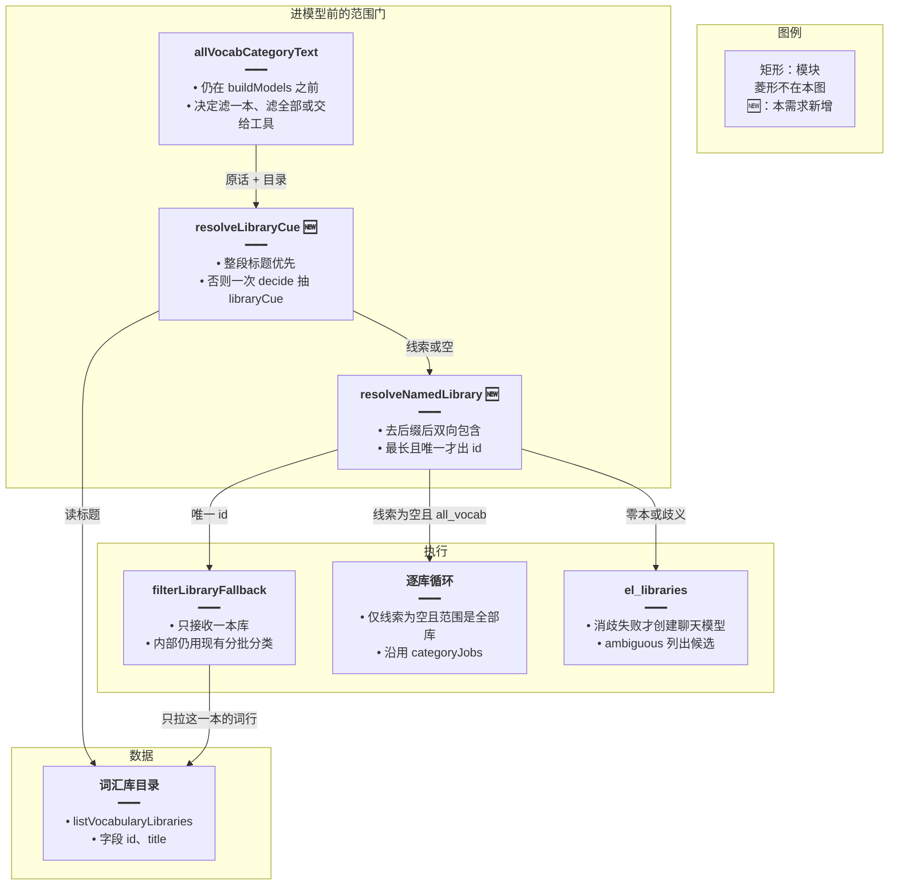
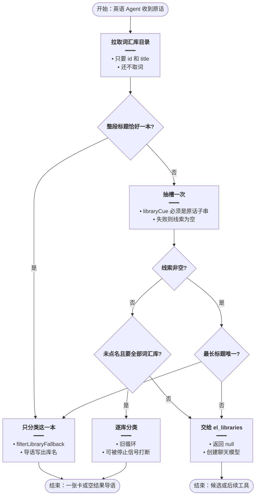
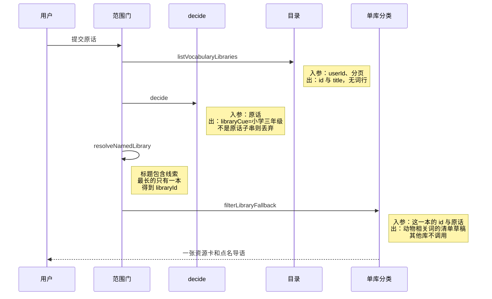
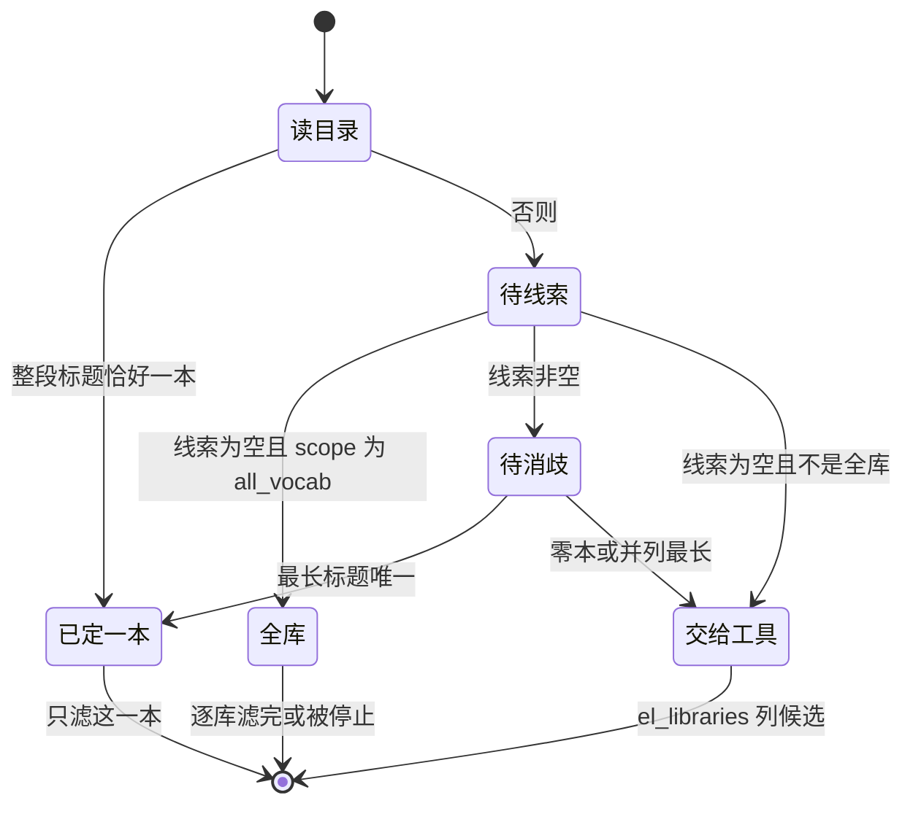

# 点名库先定位 — 实现思路

> **状态**：规划（未实现 / 分类器与库列表可复用）  
> **日期**：2026-10-28  
> **需求摘要**：用户点名一本词汇库并要求按主题分类列出时，先对上那一本，再只滤这一本；对不上就停，不扫其余库。  
> **一句话方案（预告）**：一次抽槽得到库名线索，用目录消歧成唯一 id 后只跑现有单库分类；线索空才允许扫全部库，消歧失败则把候选交给已有的 `el_libraries`。

## 延伸阅读

- [所有词库一次分类](./所有词库一次分类.md)：未点名库时的全库扫描仍由那篇负责，本文把它收窄到「原话里没有库名线索」
- [分类截断续批](./分类截断续批.md)：单库内部怎么分批，本文不改
- [库内筛选不中断](./库内筛选不中断.md)：模型停在列库之后的收尾，消歧失败时仍走这条工具链
- [决策改用千问](./决策改用千问.md)：抽槽继续走 `decide()` / `decideLlmOptions`，不新开模型档

---

## 0. 读本文你将得到什么

- 点名「小学三年级词汇库」却扫完全部库、并且不调 `el_*` 工具，是进聊天模型之前的全库门认错了范围
- 选定方案：抽槽 → 目录消歧 → 只滤命中的一本；没有库名才扫全部
- 只改后端英语 Agent 的范围判断，卡片、确认条、分批分类器保持不动
- 分三阶段：消歧、收窄全库门、消歧失败回落到列库工具
- 最大风险是库名和目录标题差太远，消歧落空后要用户改口，不能靠扫完全部库来补

---

## 1. 需求与边界

### 1.1 用户故事

| 角色 | 场景 | 行为 | 期望结果 |
|------|------|------|----------|
| 已登录用户 | 英语学习 Agent | 问「将小学三年级词汇库中所有与动物相关的单词进行分类，并列出来」 | 只打开这一本库，按「动物」滤出词，一张卡列出 |
| 同一用户 | 没点库名 | 问「将词汇库中所有与动物相关的单词进行分类，并全部列出来」 | 仍逐库分类，导语说明范围是各词汇库 |
| 同一用户 | 库名对上不止一本，或一本都对不上 | 说出含糊库名 | 不分类；列出候选或进入 `el_libraries`，由用户选定 |

### 1.2 范围

| 在范围内 | 不在范围内（非目标） |
|----------|----------------------|
| 点名一本词汇库的「关于 / 相关」分类 | 语句库、收藏、错题、日推 |
| 全库扫描的入口条件收窄 | 重写 `buildCategoryProposal` 的分批与 1500 token 续批 |
| 消歧失败时回到现有列库工具 | 新增向量检索、新表、新依赖 |
| 停止信号仍能打断正在进行的单库分类 | 改聊天模型、改前端卡片样式 |

### 1.3 约束与依赖

- 必须复用 `decide()`、`listVocabularyLibraries`、`filterLibraryFallback`、`el_libraries` 的 `ambiguous` 回包
- 线索必须是用户原话里的连续子串，模型编出来的库名不能打开扫描
- 同一轮同一库仍走 `categoryJobs`，失败不删键
- 点名库的分类次数只跟这一本的词量有关，不能再乘上库的本数
- 不改会员档，抽槽不换成对话模型

---

## 2. 背景

- **谁、在什么场景、卡在哪**：用户在英语 Agent 里点名「小学三年级词汇库」，要的是这一本里与动物相关的词。服务端还没创建聊天模型，就已经按库循环创建分类模型（`Qwen/Qwen3.6-35B-A3B`，`maxTokens: 1500`，`response_format: json_object`）。
- **现状缺口**：`isAllVocabCategory` 看到「词汇库 + 所有 / 全部 + 相关」就认定要扫全部库。`matchLibraries` 要求目录里的**整段标题**出现在原话里；标题多一个字或少一个字，命中数不是 1，于是 `allVocabCategoryText` 对每一本都调用 `filterLibraryFallback`。这一步在 `buildModels` 之前返回，`el_libraries` / `el_items_search` 不会执行。
- **不解决会怎样**：点名库和「所有词汇库」共用一条全库路径。库越多，分类模型创建次数按库数乘上去；用户看到的也不是那一本的词。
- **硬约束**：词表在自己的库表里，范围必须先落到 `libraryId` 再取词。任务型对话的成熟做法是先定意图和槽位，再把槽位消歧成业务对象，然后才查询（Schubert 等，LWDA 2024：意图语法填槽后执行查询，不让模型现编计划；Moveworks Slot Resolvers：槽位要解析成对象，多个候选先给人挑，标识不交给模型改写）。开放式工具循环适合库名还没定时的追问，不适合已经能从目录定出 id 的这一问。

---

## 3. 现状与复用

| 能力 | 仓库中已有 | 本需求中的用法 |
|------|------------|----------------|
| 原句是否像「全部词汇库的某一类」 | `apps/backend/src/services/agent/tools/english/spill.ts` 的 `isAllVocabCategory`、`resolveAllVocabAsk` | 扩展：原话里能抽出库名线索时不得返回「扫全部」 |
| 整段标题包含 | 同文件 `matchLibraries` | 直接复用，作为消歧的第一优先；不够时不再把它当成「否则扫全部」 |
| 抽槽且线索必须是原话子串 | 同文件 `acceptAllVocabCue`、`decide()`（`apps/backend/src/utils/glm-decide.ts`） | 扩展槽位，增加 `libraryCue` |
| 进聊天模型前的全库循环 | `apps/backend/src/services/agent/agent.service.ts` 的 `allVocabCategoryText` | 扩展：唯一库只滤一本；零本或一本以上不进循环 |
| 单库拉全表再分类 | `apps/backend/src/services/agent/tools/english/domain-tools.ts` 的 `filterLibraryFallback` | 直接复用，只对消歧后的那本调用 |
| 按标题列库、多本则 `ambiguous` | 同文件 `el_libraries` 的 `list` + `title` | 消歧失败时直接复用，把候选交回工具链 |
| 同库只分类一次 | `ElListSurface.categoryJobs` | 直接复用 |
| 聊天模型与领域工具 | `buildModels` 之后的 `el_*` | 点名且唯一命中时不进入；消歧失败时才进入 |

**调研结论**：分类器、库列表、歧义回包都已经有。缺的是「先把库名收成一个 id」这一步。现在的全库门把「所有」和「词汇库」当成范围，把库名丢掉了。`el_libraries` 的标题匹配是「标题包含用户给的片段」，方向和 `matchLibraries` 相反，所以工具本来找得到简称，但这句根本走不到工具。

---

## 4. 方案比对与最终方案

### 4.1 候选方案

#### 方案 A：抽槽后按目录消歧，只滤命中的一本（扩展现有门）

- **做法**：`allVocabCategoryText` 仍在 `buildModels` 之前。先拉词汇库目录（只要 `id` 和 `title`）。原话整段包含恰好一个标题，就直接用这个 id。否则调用一次 `decide()`，槽位为 `scope` 和 `libraryCue`，线索必须是原话子串。主题仍用整句原话交给分类器，不再单独抽一个主题槽。用去掉「词汇库 / 单词库 / 词库」后的线索对标题做双向包含；多个命中只保留最长标题，最长的仍不止一本则视为歧义。唯一 id 调用一次 `filterLibraryFallback`。`libraryCue` 为空且 `scope` 为 `all_vocab` 时，才沿用逐库循环。零命中或歧义返回 `null`，后面的 Agent 调用 `el_libraries`。
- **能工作的原因**：范围在取词之前就变成一个 `libraryId`。分类模型的创建次数只跟这一本有关。目录是用户自己的库，不依赖模型记得库名怎么写。
- **主要代价**：库名和标题完全对不上时，这一轮不分类，要用户从候选里再点一次。聊天模型在唯一命中时不会出场。

#### 方案 B：拆掉全库门，整句交给聊天模型和 `el_*`（复用工具链）

- **做法**：删掉 `runChatStream` 里对 `allVocabCategoryText` 的提前返回。系统提示要求模型先 `el_libraries`（`kind: vocab`，`title` 为库名片段），`ambiguous` 时停下来把候选告诉用户；唯一 id 再 `el_items_search`。关于类且带 `libraryId` 时，现有劫持仍会进入 `filterLibraryFallback`。
- **能工作的原因**：工具的标题匹配本来就是「标题包含片段」，点名「小学三年级」可以落在「小学三年级词汇库」上。多本时已有 `ambiguous`，不会猜。
- **主要代价**：这句要先创建聊天模型，再至少两轮工具。历史上列库之后模型会停，或把检索做成全库。唯一命中之前，范围仍在模型手里。

#### 方案 C：只改全库正则，原话里出现库名片段就不当全库（最小补丁）

- **做法**：`isAllVocabCategory` 增加否定条件：原话在「词汇库」前后还有至少两个汉字的库名。为真则 `allVocabCategoryText` 返回 `null`，其余不变。整段标题仍只靠 `matchLibraries`。
- **能工作的原因**：示例句不再进入逐库循环，分类模型不会按库数创建。
- **主要代价**：返回 `null` 之后仍要聊天模型自己找库。标题对不上整段时，`shouldFilterContinue` 也不会在收尾时补滤。用户还是可能看不到这一本的卡。

### 4.2 比对

| 维度 | 方案 A | 方案 B | 方案 C |
|------|--------|--------|--------|
| 正确性（失败路径、边界、数据是否会错） | 唯一 id 才取词；零本或歧义不取词；未点名才扫全部 | 模型选错 id 或停在列库时，卡是空的或是另一本 | 只是不扫全部；点名库仍可能没有卡 |
| 复用 / 与现状契合 | 复用 `decide`、目录拉取、`filterLibraryFallback`、`el_libraries` | 复用整条 `el_*` 与劫持 | 只改一个正则，其余原样 |
| 改动面（要动哪些路径） | `spill.ts` 的槽位与消歧，`agent.service.ts` 的全库门 | 提前返回删除，提示词改写；分类器不动 | 一个布尔条件 |
| 复杂度（新概念、新状态、新依赖） | 多一个消歧结果：唯一 / 歧义 / 没有 / 全库。无新依赖 | 无新状态；范围放在模型的工具参数里 | 无新状态 |
| 体验（延迟、步骤数、失败时用户看到什么） | 点名成功：一次抽槽加这一本的分类。失败：候选列表，不空等全库 | 点名成功也要聊天模型加两轮工具；失败时模型用自己的话解释 | 点名句不再全库空转，但是否出卡取决于模型 |
| 风险（迁移、互斥、并发、回滚） | 未点名的全库句必须仍能进旧循环，否则 [所有词库一次分类](./所有词库一次分类.md) 退步 | 可能重新出现「只列库就停」和递归超限 | 低，但也没盖住点名对不上标题的路径 |
| 可维护性（以后改一处还是改多处） | 范围只在消歧函数；分类器仍只接收一本库 | 范围散在提示词和两次工具参数 | 范围仍拆在正则、包含匹配、模型三处 |

### 4.3 综合考量

这句的权重在正确性和调用次数：先定是哪一本，再滤。方案 B 的优点是点名失败时本来就在工具对话里，少写一套消歧；这个优点抵不过「id 还没定下来就可能取词」以及多一次聊天模型。方案 C 的优点是改动只有一行附近，但它把点名句推回方案 B 已经证明会停住的那条路。目录只有几十到上百本，字符串消歧够用，不引入向量。选定方案 A：抽槽加目录消歧，唯一才分类；消歧失败才把候选交给方案 B 里的 `el_libraries`，这样工具仍在「库还没定」时使用，而不是在库已经能定下时使用。

### 4.4 最终方案

#### 背景

示例句同时含有「小学三年级词汇库」「所有」「相关」。`isAllVocabCategory` 因此为真。`matchLibraries` 只有整段 `title` 出现在原话里才算命中；命中数不是 1 时，`allVocabCategoryText` 对目录里的每一本调用 `filterLibraryFallback`，每本都会 `createLlm`。函数在 `buildModels` 之前返回导语，领域工具没有机会按标题片段去对库。未点名的「所有词汇库」仍要逐库分类，这个能力要留下。线索不能由模型编造。

#### 具体思路

1. 模块只动后端两处：`spill.ts` 增加槽位验收和消歧；`agent.service.ts` 的 `allVocabCategoryText` 按消歧结果分支。分类器、卡片、`categoryJobs` 不新写。
2. 数据从用户原话到目录标题，再到一个 `libraryId`，然后才是这一本的词行。词行仍由 `filterLibraryFallback` 拉全表并分类。
3. 消歧结果只活在这一次请求里，不进 MobX，不落库。候选列表沿用工具返回的 JSON，不新做前端状态。
4. 零命中或歧义：不调用分类器，返回 `null`，让后面的 Agent 走 `el_libraries`。用户停止仍用现有的 `AbortSignal`。未点名全库保持逐库、可中止。

#### 实现方案

**一句话**：一次抽槽得到库名线索，用目录消歧成唯一 id 后只跑现有单库分类；线索空才允许扫全部库，消歧失败则把候选交给已有的 `el_libraries`。

| 步骤 | 谁 | 做什么 | 输入 → 输出 |
|------|----|--------|-------------|
| 1 | `resolveLibraryCue` | 整段标题优先；否则一次 `decide()` 抽出必须出现在原话里的 `libraryCue` | 原话 + 目录 → 线索或空 |
| 2 | `resolveNamedLibrary` | 线索去后缀后双向包含；最长标题唯一才返回那本 | 线索 + 目录 → `one` / `ambiguous` / `none` |
| 3 | `allVocabCategoryText` | `one` 只滤这本并返回导语；`ambiguous` 或 `none` 返回 `null`；线索空且范围是全部库才逐库 | 消歧结果 → 导语或 `null` |
| 4 | 现有 Agent | 只在返回 `null` 时创建聊天模型并调用 `el_libraries` | 原话 → 候选或后续工具 |

#### 选定原因

1. **正确性**：取词前必须有唯一 `libraryId`。牺牲：标题和原话毫无公共片段时，这一轮不出卡。
2. **体验**：点名成功不再按库数创建分类模型。牺牲：比方案 C 多一次最多 400 token 的抽槽（整段标题已经唯一时跳过这次抽槽）。
3. **复用**：分类、列库、歧义回包都不新写。牺牲：唯一命中时不展示聊天模型的工具轨迹。
4. **风险**：未点名全库仍走旧循环。牺牲：要为「线索为空」单测一条，避免把旧句误伤。

#### 优势

- 相对方案 B：库 id 在分类之前就固定，模型不能改 id，也不会在列库之后停住却已经扫过别的库。
- 相对方案 C：对不上整段标题时仍能用线索对上「小学三年级」，而不是把这句退回一个可能不调工具的聊天回合。

#### 怎么实现

1. 在 `spill.ts` 写出 `LibrarySlot`、`resolveLibraryCue`、`resolveNamedLibrary`。整段标题恰好一本时直接返回，不调用 `decide()`。
2. `allVocabCategoryText` 先取目录，再消歧。`one` 时只对这一本 `filterLibraryFallback`，导语点出库名。`ambiguous` 和 `none` 返回 `null`。
3. 仅当线索为空且 `resolveAllVocabAsk` 仍认定是全部词汇库时，保留现有逐库循环。
4. 返回 `null` 后的 `runChatStream` 保持现状，由模型调用 `el_libraries`。主要代码见 §9。

### 4.5 其他关键决策

#### 决策：多个标题都包含线索时听谁的

##### 候选

###### 方案 A2：只接受最长标题，且最长的必须只有一本

- **做法**：命中集合按标题长度排序。第一名比第二名长，才返回第一名。长度相同则 `ambiguous`，列出这些标题，不分类。
- **能工作的原因**：「小学三年级词汇库」长过「三年级」，点名长名不会落进短名。两本一样长时不强行挑。
- **主要代价**：两本等长标题都包含线索时，用户要再选一次。

###### 方案 B2：命中的每一本都分类

- **做法**：消歧结果为多本时，只循环这些本，不循环其余库。
- **能工作的原因**：相关库都会出卡，用户不用再选。
- **主要代价**：一句点名被拆成多张卡，和「找到对应的那一本」不符；创建次数仍随命中本数增加。

##### 比对

| 维度 | 方案 A2 | 方案 B2 |
|------|---------|---------|
| 正确性 | 等长冲突不取词 | 可能把另一本的词混进展示 |
| 复用 | 歧义形状沿用 `el_libraries` 的候选列表 | 沿用逐库循环，只是循环变短 |
| 改动面 | 消歧函数内的排序 | 全库循环改为命中子集循环 |
| 复杂度 | 一个长度比较 | 此项相同 |
| 体验 | 冲突时看到候选 | 冲突时直接看到多张卡 |
| 风险 | 用户多一轮选择 | 短标题误伤仍会多滤几本 |
| 可维护性 | 规则集中在一处比较 | 范围再次变成一个列表 |

##### 综合考量

点名的成功标准是一本。方案 B2 少一轮追问，但追问换来的是可能错的卡，这个优点不要。选定 A2。

##### 最终方案

###### 背景

目录里可以同时有「三年级」和「小学三年级词汇库」。双向包含会让短标题也命中。必须有一条确定性的取舍，不能把多本都拿去分类。

###### 具体思路

命中按 `title.length` 从长到短。只有第一名严格更长才算 `one`。否则 `ambiguous`，候选最多 10 条，交给返回 `null` 之后的 `el_libraries`。不把候选写进新的表。

###### 实现方案

**一句话**：最长标题唯一才滤；并列最长则视为歧义。

| 步骤 | 谁 | 做什么 | 输入 → 输出 |
|------|----|--------|-------------|
| 1 | `resolveNamedLibrary` | 过滤出标题与线索互相包含的库，按长度取第一名 | 线索 + 目录 → 一本或候选 |

###### 选定原因

1. **正确性**：并列时不猜。牺牲：少一次「顺便把相关库都滤了」的展示。
2. **体验**：长标题胜过短标题，常见的全称能一次命中。牺牲：等长时多一轮选择。

###### 优势

- 相对方案 B2：点名冲突时不会把没点到的库送进分类器。

###### 怎么实现

长度比较写在 `resolveNamedLibrary` 里，见 §9.2。没有第二套循环。

---

## 5. 架构图



**图内方法说明**：

| 方法 | 功能 |
|------|------|
| `allVocabCategoryText` | 聊天模型创建前决定这句是滤一本、滤全部，还是改走工具；返回导语表示这句已经处理完 |
| `resolveLibraryCue` | 目录标题整段出现且只有一本时直接用该标题；否则用 `decide()` 抽出原话里的库名片段 |
| `resolveNamedLibrary` | 把线索和每条 `title` 做双向包含，只接受严格更长的那一条 |
| `filterLibraryFallback` | 按库 id 拉全表并分类，产出一张清单草稿 |
| `el_libraries` | 消歧失败后由聊天模型按标题片段列库；多本时返回 `ambiguous` 和候选 |
| `listVocabularyLibraries` | 分页列出当前用户的词汇库 id 和标题，供消歧，不在这一步取词 |

**读图要点**：

- 范围门在聊天模型之前，但只有消歧失败才把控制权交给工具。
- 分类器只出现在「唯一一本」和「确认过的全库」两条边上，点名失败不会碰到它。
- 目录只提供 id 和标题；词行要等 id 定下来再拉。

---

## 6. 主流程图



**图内方法说明**：

| 方法 | 功能 |
|------|------|
| `resolveLibraryCue` | 对应「整段标题」和「抽槽一次」：能从目录直接定库就不再打模型 |
| `resolveAllVocabAsk` | 线索为空时才判断这句是不是「全部词汇库里的某一类」；点了库名就不会进这里 |
| `resolveNamedLibrary` | 对应「最长标题唯一」：不唯一就离开分类 |
| `filterLibraryFallback` | 对应「只分类这一本」和逐库循环里的单次调用 |
| `el_libraries` | 对应消歧失败后的列库；由返回 `null` 之后的 Agent 调用 |

**读图要点**：

- 示例句走「抽槽 → 线索非空 → 最长唯一 → 只分类这一本」。
- 「所有词汇库」没有线索，才走逐库。
- 两条失败边都落到工具，分类器不在失败边上。

---

## 7. 核心时序图



**图内方法说明**：

| 方法 | 功能 |
|------|------|
| `listVocabularyLibraries` | 范围门读取当前用户的库标题，供消歧 |
| `decide` | 整段标题不唯一时抽一次槽；`libraryCue` 不是原话连续子串就当没抽到 |
| `resolveNamedLibrary` | 在范围内把门上把线索收成一个 id，或判定不能收 |
| `filterLibraryFallback` | 只对这个 id 拉词并分类，草稿交给现有的 artifact 与 SSE |

**读图要点**：

- 参与者里没有聊天模型：这句在消歧成功时不到 `buildModels`。
- `decide` 只产出线索，不产出 `libraryId`。
- 词行请求发生在 id 确定之后，且只有一次库范围。

---

## 8. 状态机



**图内方法说明**：

| 方法 | 功能 |
|------|------|
| `resolveLibraryCue` | 驱动「读目录 → 已定一本 / 待线索」 |
| `resolveAllVocabAsk` | 线索为空时决定进入全库还是交给工具 |
| `resolveNamedLibrary` | 驱动「待消歧 → 已定一本 / 交给工具」 |
| `filterLibraryFallback` | 「已定一本」和「全库」里实际取词分类的调用 |

**读图要点**：

- 「交给工具」和「已定一本」互斥，同一句不会既扫库又开聊天模型。
- 全库是线索为空的单独状态，点名句进不去。

---

## 9. 具体实现（主链路代码）

### 9.1 模块一览

| 模块 | 职责 | 新增/改动 | 预估路径 |
|------|------|-----------|----------|
| 库名消歧 | 线索验收、双向包含、最长唯一 | 新增函数 | `apps/backend/src/services/agent/tools/english/spill.ts` |
| 范围门 | 按消歧结果滤一本、滤全部或返回 null | 扩展 | `apps/backend/src/services/agent/agent.service.ts` |
| 单库分类 | 拉词与分批 | 直接复用 | `apps/backend/src/services/agent/tools/english/domain-tools.ts` |
| 列库工具 | 消歧失败时的候选 | 直接复用 | 同文件 `el_libraries` |

### 9.2 主链路实现

```typescript
// 对应 §4.4 步骤 1。槽位只带范围和库名线索，id 不让模型填，避免编出一个不存在的库
type LibrarySlot = {
	// all_vocab 只在用户没点库名时有意义；点了名必须是 one_vocab，后面才能去目录里找
	scope: 'all_vocab' | 'one_vocab' | 'classic' | 'none';
	// 库名片段；验收时要求它是原话的连续子串，编出来的名字在这一步被丢掉
	libraryCue: string;
};

// 对应 §4.4 步骤 2 与 §4.5。消歧只有三种结果，调用方按这个分支，不再用「命中数不是 1 就扫全部」
type NamedLibrary =
	// 唯一一本，后面只把这个 id 交给分类器
	| { kind: 'one'; lib: { id: string; title: string } }
	// 并列最长，最多 10 条交给 el_libraries，本轮不分类
	| { kind: 'ambiguous'; candidates: { id: string; title: string }[] }
	// 没有任何标题和线索相交，本轮不分类
	| { kind: 'none' };

// 对应 §4.4 步骤 2。去掉结尾泛称再去对标题，否则线索「小学三年级词汇库」对不上标题「小学三年级」
function normalizeCue(cue: string): string {
	// 只删结尾的泛称，中间的字保留，避免把真正的库名删空
	return cue.replace(/(词汇库|单词库|词库)$/u, '').trim();
}

// 对应 §4.4 步骤 2 与 §4.5。双向包含覆盖「原话比标题长」和「标题比原话长」；最长唯一才返回一本
function resolveNamedLibrary(
	// 已经过子串验收的库名片段；空串由函数内直接返回 none
	cue: string,
	// 当前用户的词汇库目录，只含 id 和 title，这里还不取词
	libs: { id: string; title: string }[],
): NamedLibrary {
	// 归一化后再比，泛称本身不能当成库名去命中每一本
	const key = normalizeCue(cue);
	// 短于两个字的线索容易命中「英语」这类碎片，直接放弃
	if (key.length < 2) return { kind: 'none' };
	// 标题包含线索，或线索包含整段标题，都先收进候选，长度稍后再比
	const hits = libs.filter((lib) => {
		// 去掉空白再比，避免目录标题尾部空格造成假的不匹配
		const title = lib.title.trim();
		// 任一方向包含即命中；空标题排除，避免空串包含一切
		return title.length > 0 && (title.includes(key) || key.includes(title));
	});
	// 一本都对不上就结束，调用方改走工具，不能改成扫全部库
	if (hits.length === 0) return { kind: 'none' };
	// 长标题优先，短标题「三年级」不能压过「小学三年级词汇库」
	const ranked = [...hits].sort((a, b) => b.title.length - a.title.length);
	// 第一名是当前最具体的标题
	const top = ranked[0];
	// 第二名用来判断是不是并列，没有第二名就是唯一
	const second = ranked[1];
	// 没有第二名，或第一名严格更长，才算唯一；等长必须让用户选
	if (!second || top.title.length > second.title.length) {
		// 只返回这一本的 id 和标题，分类器不再看到目录里的其他库
		return { kind: 'one', lib: top };
	}
	// 候选截到 10 条，形状与 el_libraries 的 ambiguous 一致，前端不用新组件
	return { kind: 'ambiguous', candidates: ranked.slice(0, 10) };
}
```

```typescript
// 对应 §4.4 步骤 1。整段标题已经唯一就不再抽槽，省掉一次 decide
function cueFromExactTitle(
	// 用户原话，包含判断用整段标题，不用模型改写
	text: string,
	// 同一份目录，和后面的消歧共用，避免再查一次库列表
	libs: { id: string; title: string }[],
): string {
	// 沿用现有 matchLibraries：整段 title 必须出现在原话里
	const hits = libs.filter((lib) => lib.title.length > 0 && text.includes(lib.title));
	// 不是恰好一本就交回抽槽；这里返回空串表示还没定
	if (hits.length !== 1) return '';
	// 唯一标题本身就是线索，后面的消歧会再次落到这本
	return hits[0].title;
}

// 对应 §4.4 步骤 1。整段标题优先；没有唯一标题才 decide，并且丢掉不是原话子串的线索
async function resolveLibraryCue(
	// 用户原话，子串校验和整段标题匹配都用它
	text: string,
	// 目录只在整段标题快路径里使用，抽槽本身不看 id
	libs: { id: string; title: string }[],
): Promise<string> {
	// 整段标题已经唯一就不再打模型
	const exact = cueFromExactTitle(text, libs);
	// 快路径命中则直接返回标题，调用方拿它去消歧
	if (exact) return exact;
	// 复用 decide：失败、超时或线索不是原话连续子串时得到空串
	const slot = await decide(config, {
		// 只问范围和库名片段，不让模型返回 libraryId
		task: '只返回 JSON {"scope":"all_vocab|one_vocab|classic|none","libraryCue":""}。点名一本库时 scope 为 one_vocab，libraryCue 必须是原话里连续的库名，不要编。',
		// 输入只有原话，避免把目录塞进抽槽把 token 放大
		input: text,
		// 形状不对就当没抽到，后面不会扫全部库
		parse: (raw) => (raw && typeof raw === 'object' && !Array.isArray(raw) ? (raw as LibrarySlot) : null),
		// 线索必须出现在原话里，编出来的库名在这里被拒绝
		accept: (value, input) => (value.libraryCue.length >= 2 && input.includes(value.libraryCue) ? value : null),
	});
	// 没抽到就返回空串，routeCategory 才会去判断是不是未点名的全库
	return slot?.libraryCue.trim() ?? '';
}

// 对应 §4.4 步骤 3。替换「命中数不是 1 就逐库」；one 只滤一本，失败不分类
async function routeCategory(
	// 本轮用户原话，消歧和分类都用它，不改写成模型摘要
	text: string,
	// 已拉好的词汇库目录
	libs: { id: string; title: string }[],
	// 用户停止时 abort，分类器里的 createLlm 会跟着停
	signal: AbortSignal,
): Promise<'one' | 'all' | 'tools'> {
	// 整段标题恰好一本时直接用这本，避免去后缀后和另一本变成等长
	const exactHits = libs.filter((lib) => lib.title.length > 0 && text.includes(lib.title));
	// 唯一整段标题不再抽槽，也不再做双向包含
	if (exactHits.length === 1) {
		// 停止发生在拉词之前就结束，不再创建这一本的分类模型
		if (signal.aborted) throw abortError();
		// 现有单库分类，kind 固定 vocab；其他库不会进入这次调用
		await filterLibraryFallback(learning, config, userId, exactHits[0], text, logger, 'vocab', signal);
		// 告诉范围门这句已经处理完，不要再创建聊天模型
		return 'one';
	}
	// 没有唯一整段标题时才抽槽；抽到的线索不是原话子串会被丢掉
	const cue = await resolveLibraryCue(text, libs);
	// 有线索就只在目录里找这一本，找不到也不扩大成全库
	if (cue) {
		// 最长唯一才是 one；歧义和落空都离开分类
		const named = resolveNamedLibrary(cue, libs);
		// 唯一 id 才拉词，避免点名句把目录里的每一本都送进分类器
		if (named.kind === 'one') {
			// 停止发生在拉词之前就结束，不再创建这一本的分类模型
			if (signal.aborted) throw abortError();
			// 现有单库分类，kind 固定 vocab；其他库不会进入这次调用
			await filterLibraryFallback(learning, config, userId, named.lib, text, logger, 'vocab', signal);
			// 告诉范围门这句已经处理完，不要再创建聊天模型
			return 'one';
		}
		// 零本或歧义都不取词，让 runChatStream 继续去 el_libraries
		return 'tools';
	}
	// 没有库名时才允许旧的全库认定；点了名的句子不会落到这里
	if (await resolveAllVocabAsk(config, text)) return 'all';
	// 既不是点名也不是全库，交给原来的 Agent 工具
	return 'tools';
}
```

### 9.3 数据模型

| 字段/实体 | 来源 | 存储 | 说明 |
|-----------|------|------|------|
| `libraryCue` | `decide()` 或整段标题 | 请求内存 | 必须是原话子串；不落库 |
| `libraryId` | 目录消歧 | 请求内存 | 只有 `kind === 'one'` 才传给分类器 |
| 候选标题 | 消歧的 `ambiguous` | 工具回包 | 最多 10 条，不新做表 |
| 清单草稿 | `filterLibraryFallback` | 现有 artifact | 与现在的资源卡相同 |

---

## 10. 分阶段实现步骤

| 阶段 | 目标 | 交付物 | 依赖 |
|------|------|--------|------|
| M1 | 点名句只滤消歧后的一本 | `resolveNamedLibrary` 与范围门的 `one` 分支 | 无 |
| M2 | 未点名的全库句保持原行为 | 线索为空才进入旧循环 | M1 |
| M3 | 消歧失败回到列库工具 | 返回 `null`，不创建分类模型 | M1 |

### M1

- [ ] 实现 `normalizeCue`、`resolveNamedLibrary`，整段标题恰好一本时不调用 `decide()`
- [ ] `allVocabCategoryText` 在 `one` 时只调用一次 `filterLibraryFallback`
- [ ] 用示例句验收：分类模型的库范围只有消歧结果那一本

### M2

- [ ] 「将词汇库中所有与动物相关的单词进行分类，并全部列出来」仍逐库，导语仍是各词汇库
- [ ] 原话里既有库名又有「所有」时不得进入逐库
- [ ] 停止信号在逐库和单库两条路径上都能打断未开始的下一本

### M3

- [ ] 零命中、并列最长时返回 `null`，本轮 `createLlm` 的 1500 token 分类调用次数为 0
- [ ] 随后的 Agent 能调用 `el_libraries`，多本时走现有 `ambiguous`
- [ ] 不新增前端状态；候选仍在工具回包里

---

## 11. 风险、边界与待确认

| 项 | 等级 | 说明 | 缓解 |
|----|------|------|------|
| 标题和原话没有公共片段 | 中 | 消歧为 `none`，这一轮不出卡 | 交给 `el_libraries` 列候选，不扫其余库 |
| 未点名全库被误伤 | 高 | 线索抽错成某个词，会把全库句收成一本 | 线索必须是原话子串；空线索才允许 `all_vocab` |
| 短标题误命中 | 中 | 「英语」这类短标题包含在很多库名里 | 只接受严格更长的一本，等长则歧义 |
| 抽槽失败 | 低 | `decide()` 超时返回空 | 整段标题不唯一且无线索时，不扫全部，改走工具 |

**待确认**：

- [ ] 用户目录里该库的 `title` 是否就是「小学三年级词汇库」，还是更长的教材名（验证方式：用该用户调用 `listVocabularyLibraries`，看 `title` 与原话的公共片段能否让 `resolveNamedLibrary` 返回 `one`）

---

## 12. 验收清单

| # | 用例 | 步骤 | 期望 |
|---|------|------|------|
| AC1 | 点名一本 | 发送「将小学三年级词汇库中所有与动物相关的单词进行分类，并列出来」 | 只对消歧出的那本分类；卡片来自这一本；不按目录本数创建分类模型 |
| AC2 | 未点名 | 发送「将词汇库中所有与动物相关的单词进行分类，并全部列出来」 | 仍逐库分类，导语为各词汇库 |
| AC3 | 对不上或两本等长 | 原话里的库名片段匹配 0 本，或两本标题等长且都包含线索 | 分类模型不创建；随后调用 `el_libraries`，多本时为 `ambiguous` |
| AC4 | 整段标题已唯一 | 原话包含完整 `title` 且只有这一本 | 不调用 `decide()`，直接滤这一本 |
| AC5 | 停止 | 单库分类进行中停止 | 未开始的下一次分类不再 `createLlm`；已有卡则保留 |

---

## 13. 预估改动面（实现阶段参考）

| 类型 | 路径（预估） |
|------|----------------|
| 前端 | 无 |
| 后端 | `apps/backend/src/services/agent/tools/english/spill.ts`、`apps/backend/src/services/agent/agent.service.ts` |
| 文档（实现后） | `wiki/english/` 下的实现归档，不改本规划文的结论 |

---

（本文档为规划态实现思路；落地后以源码与 remote-docs wiki 专题为准）
