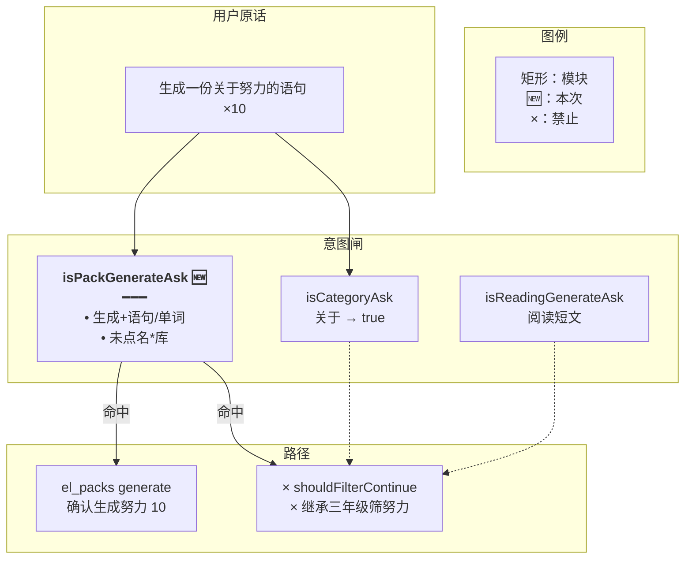
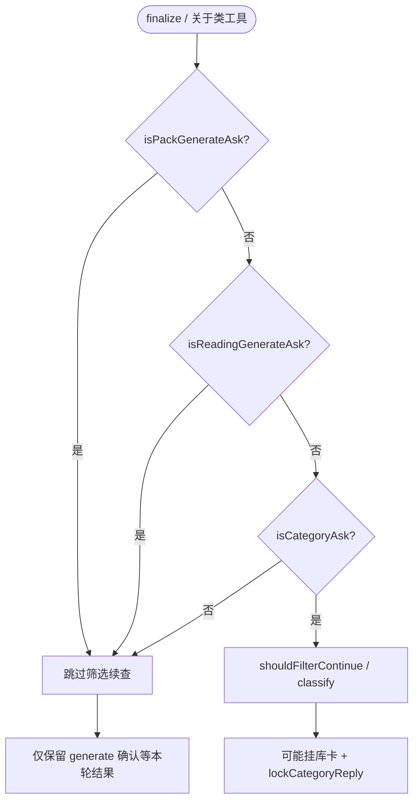
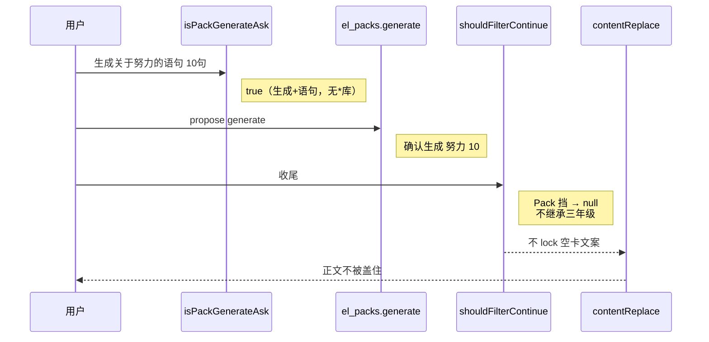
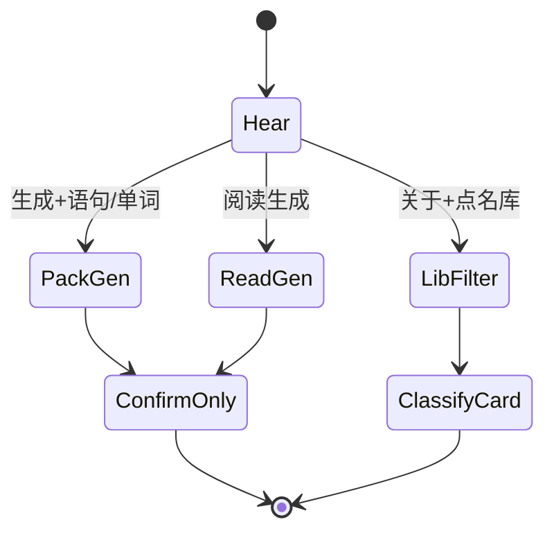

# 生成不跑库筛选 — 实现思路

> **状态**：规划（M1 工作区已落地）  
> **日期**：2026-10-30  
> **需求摘要**：用户说「帮我生成一份关于努力的语句，数量为 10句」时，应只挂「确认生成 语句「努力」10 条」，正文不被长对话里的三年级单词空卡 +「没有可展示的行」盖住。  
> **一句话方案（预告）**：把词书/语句 **生成** 与库内 **关于类筛选** 拆开——识别 `isPackGenerateAsk` 后，与自选阅读生成一样，禁止收尾 `shouldFilterContinue` / 分类出卡 / `lockCategoryReply`，避免沿用上一本库把生成轮正文 replace 掉。

## 延伸阅读

- [收藏先出筛选卡](./收藏先出筛选卡.md)：收藏+关于要先分类；本文是 **生成+关于**，绝不能走库筛选
- [关于类一次出卡](./关于类一次出卡.md)：关于类筛库逻辑；生成句必须排除
- [库内筛选不中断](./库内筛选不中断.md)：收尾续查入口；生成轮不得进入

---

## 0. 读本文你将得到什么

- 为何确认条已是「生成努力 10 句」，气泡却变成三年级单词「没有可展示的行」
- 根因：`关于` 触发 `isCategoryAsk`，收尾按**上一本库**筛「努力」出空卡，再 `contentReplace`
- 选定方案：新增词书/语句生成闸，与 `isReadingGenerateAsk` 并列挡住筛选续查
- 改动集中在 `spill`/`pack-ask` 判定 + `agent.service` / `domain-tools` 入口；生成确认链路不改
- 最大风险：真·「生成语句库里关于…」仍要分类——用「点名 *库」排除，与阅读生成一致

---

## 1. 需求与边界

### 1.1 用户故事

| 角色 | 场景 | 行为 | 期望结果 |
|------|------|------|----------|
| 登录用户 | 长会话刚聊过三年级词库 | 「帮我生成一份关于努力的语句，数量为 10句」 | 仅生成确认条；无三年级空卡；正文不被「没有可展示的行」盖住 |
| 登录用户 | 要筛库 | 「找出三年级语句库中关于努力的语句」 | 仍走分类筛选（点名库） |
| 登录用户 | 自选阅读 | 「生成一篇关于努力的短文」 | 仍走阅读生成闸（已有） |

### 1.2 范围

| 在范围内 | 不在范围内 |
|----------|------------|
| 生成意图 vs 库筛选收尾互斥 | 改 el_packs generate 提案文案 |
| `isPackGenerateAsk` + 各入口加闸 | 换模型；前端卡片组件 |
| 禁止生成轮 lockCategoryReply 污染 | 收藏复合句（另文） |

### 1.3 约束与依赖

- 复用 `isReadingGenerateAsk` 的互斥模式；复用 `parsePackAsk` / 生成确认
- 点名「语句库/单词库」的关于类仍走筛选
- Ponytail：加一个判定函数 + 三处 `&& !isPackGenerateAsk`

---

## 2. 背景

### 2.1 实录（如图）

| 层 | 内容 | 对错 |
|----|------|------|
| 用户 | 帮我生成一份关于努力的语句，数量为 10句 | 生成 |
| 底栏 | 确认生成 语句「努力」10 条 | **对**（el_packs generate） |
| 正文/卡 | 小学三年级上册英语单词：没有可展示的行。/ 0 条 | **错** |

### 2.2 根因链

1. 原话含「关于」→ `isCategoryAsk === true`。  
2. `isReadingGenerateAsk` **只认阅读/短文**，不认「生成…语句」→ 收尾分类闸 **未挡**。  
3. 当前句未点名唯一库 → `shouldFilterContinue` **继承**长对话上一本（三年级单词库）。  
4. `categoryLabels` 抽出「努力」→ 对该库 `classifyLibrary` → **0 行** → 挂空卡 → `lockCategoryReply` → `contentReplace` 成「…没有可展示的行。」  
5. 模型侧 generate 提案已正确挂条，但被分类收尾盖住观感。

这不是「上下文记忆乱了」，而是 **生成主题里的「关于」被误当成库内筛选**，再叠加上一本库继承。

### 2.3 不解决会怎样

凡在聊过某库后说「生成关于 X 的语句/单词」，都会稳定出现：正确生成确认条 + 错误空筛选卡/错误 replace。

### 2.4 硬约束

- 生成确认与库筛选互斥（除非原话点名 *库*）。  
- 生成轮不得因空筛选卡 `contentReplace`。  
- 与现有「生成语句库里关于…」分类路径不冲突。

---

## 3. 现状与复用

| 能力 | 仓库中已有 | 本需求用法 |
|------|------------|------------|
| 关于类 | `isCategoryAsk` | 生成时要排除 |
| 阅读生成互斥 | `isReadingGenerateAsk` | **并列**加词书/语句生成 |
| 收尾续查 | `shouldFilterContinue` + agent finalize | 加闸 |
| 工具侧关于类 | domain-tools `isCategoryAsk && !isReadingGenerateAsk` | 同步加闸 |
| 生成解析 | `parsePackAsk` / el_packs generate | 直接复用意图特征 |
| 正文锁定 | `lockCategoryReply` | 生成轮不触发分类空卡 |

**调研结论**：生成链路已对；缺的是「生成关于…」不要进筛选收尾。候选必须接上 `isReadingGenerateAsk` 同一互斥点。

---

## 4. 方案比对与最终方案

### 4.1 候选

#### 方案 A：只禁空卡 `contentReplace`（治标）

- **做法**：`categoryReply` 若全是 0 条则不 lock。  
- **能工作原因**：少盖正文。  
- **代价**：仍可能挂空卡；生成轮仍白跑分类。

#### 方案 B：`isPackGenerateAsk` 与阅读生成并列挡筛选（推荐）

- **做法**：  
  1. `isPackGenerateAsk`：有生成动词 +（语句/单词/词书…），且**未**点名 *库*。  
  2. `shouldFilterContinue` / agent 收尾 / domain-tools 关于类入口：`&& !isPackGenerateAsk`。  
  3. 可选：本轮已有 `pack_generate` openProposal 时跳过筛选续查（双保险）。
- **能工作原因**：从源头不继承三年级、不 classify、不 lock。  
- **代价**：要维护与「库内生成筛选」的边界（点名库排除）。

#### 方案 C：`isCategoryAsk` 本身排除一切「生成」

- **做法**：`isCategoryAsk` 内若见生成则 false。  
- **能工作原因**：一处改。  
- **代价**：「生成语句库里关于家庭的句子」也会被挡，破坏已有产品语义。

### 4.2 比对

| 维度 | 方案 A | 方案 B | 方案 C |
|------|--------|--------|--------|
| 正确性 | 仍挂空卡/白跑分类 | 生成与筛库拆开 | 误伤库内生成筛选 |
| 复用 | categoryReply | 对齐 isReadingGenerateAsk | 改总闸 |
| 改动面 | 小 | 小～中 | 表面小、风险大 |
| 复杂度 | 低 | 低 | 低 |
| 体验 | 半好 | 确认条+干净正文 | 库内场景回退 |
| 风险 | 治标 | 边界靠「点名库」 | 回归关于类一次出卡 |
| 可维护性 | 差 | 与阅读生成对称 | 差 |

### 4.3 综合考量

权重是**正确性**与**不回归库内关于类**。选定 **B**。放弃 A 的改动更少。放弃 C 的「一刀切」。

### 4.4 最终方案

#### 背景

「生成关于努力的语句」被 `关于` 送进库筛选收尾，继承三年级单词库筛空后 replace 正文；生成确认条本身正确。

#### 具体思路

1. 在 `pack-ask.ts`（或 spill）增加 `isPackGenerateAsk`。  
2. 所有「关于类收尾/工具」入口与阅读生成同样排除。  
3. 不改 generate 挂条与 commit。

#### 实现方案

**一句话**：识别词书/语句生成问法后，禁止库内关于类筛选续查与分类空卡 replace。

| 步骤 | 谁 | 做什么 |
|------|----|--------|
| 1 | `isPackGenerateAsk` | 生成+语句/单词且无*库 |
| 2 | `shouldFilterContinue` | 命中则 null |
| 3 | agent finalize 分类块 | `&& !isPackGenerateAsk` |
| 4 | domain-tools 关于类分支 | 同上 |

#### 选定原因

1. **正确性**：生成轮不再继承旧库。牺牲：多一个函数。  
2. **复用**：照搬阅读生成互斥。牺牲：不用 C 的单点改 isCategoryAsk。  
3. **风险**：点名库仍可筛选。牺牲：放弃 A 的只改 replace。

#### 优势

- 相对 A：不白跑分类、不挂空卡。  
- 相对 C：保住「生成语句库里关于…」。

#### 怎么实现

见 §9。

### 4.5 决策：判定放哪

##### 候选

**A**：放 `spill.ts` 旁阅读生成。  
**B**：放 `pack-ask.ts` 旁 parsePackAsk。

##### 比对

| 维度 | A | B |
|------|---|---|
| 复用 | 与 isReadingGenerateAsk 同文件好找 | 与生成语义同域 |
| 依赖 | spill 已被 agent 引用 | agent 已间接用 pack |

选定 **B 为主导出，spill 的 shouldFilterContinue 引用 B**（或 A 内实现再被 pack 复用）。为少循环依赖：实现放 **spill.ts** 与阅读生成并列，pack-ask 不强制反向依赖——与现网 `isReadingGenerateAsk` 位置一致更省事。

**最终**：实现放 `spill.ts` 的 `isPackGenerateAsk`，与 `isReadingGenerateAsk` 并列。

---

## 5. 架构图



**图内方法说明**：

| 方法 | 功能 |
|------|------|
| `isCategoryAsk` | 检测关于类字样 |
| `isReadingGenerateAsk` | 已有。挡阅读生成进筛选 |
| `isPackGenerateAsk` | 新增。挡词书/语句生成进筛选 |
| `shouldFilterContinue` | 收尾是否继承库做分类 |
| `el_packs generate` | 挂生成确认条 |

**读图要点**：Pack 命中后 Filter 整条关掉；Gen 单独存活。

---

## 6. 主流程图



**图内方法说明**：同 §5。

**读图要点**：生成轮走 Skip，不再 Cont。

---

## 7. 核心时序图



**图内方法说明**：

| 方法 | 功能 |
|------|------|
| `isPackGenerateAsk` | 判定生成 |
| `el_packs.generate` | 挂确认 |
| `shouldFilterContinue` | 被挡返回 null |
| `lockCategoryReply` / replace | 本轮不因空筛选触发 |

**读图要点**：确认条保留；三年级空卡路径切断。

---

## 8. （可选）状态机



**图内方法说明**：PackGen / LibFilter 互斥靠是否点名库。

**读图要点**：关于二字不足以进 LibFilter。

---

## 9. 具体实现（主链路代码）

### 9.1 模块一览

| 模块 | 职责 | 类型 | 路径 |
|------|------|------|------|
| `isPackGenerateAsk` | 生成问法 | 新增 | `spill.ts` |
| `shouldFilterContinue` | 加闸 | 扩展 | 同上 |
| agent finalize | 加闸 | 扩展 | `agent.service.ts` |
| domain-tools 关于类 | 加闸 | 扩展 | `domain-tools.ts` |
| 单测 | 实录句 / 库内句 | 扩展 | spill 或 pack 旁 spec |

### 9.2 判定

```typescript
// 对应 §4.4 步骤 1。词书/语句生成里的「关于」不是在筛已有库
export function isPackGenerateAsk(userText: string): boolean {
	const text = userText.trim();
	if (!text) return false;
	// 点名进库：仍走分类（与 isReadingGenerateAsk 同一边界）
	if (/语句库|语料库|词汇库|单词库|词库/.test(text)) return false;
	// 要有生成类动作
	if (!/生成|写一|来一|做一|出一|来份|来一份/.test(text)) return false;
	// 目标是语句或单词资料，不是阅读短文（阅读另有 isReadingGenerateAsk）
	return /语句|句子|经典句|单词资料|词书|单词|词汇/.test(text);
}
```

### 9.3 加闸

```typescript
// shouldFilterContinue 开头
if (isReadingGenerateAsk(userText) || isPackGenerateAsk(userText)) return null;

// agent.service 收尾
if (
	!elSurface.presented &&
	isCategoryAsk(elSurface.userText) &&
	!isReadingGenerateAsk(elSurface.userText) &&
	!isPackGenerateAsk(elSurface.userText) &&
	!elSurface.catalog.length
) { /* 现有续查 */ }

// domain-tools 同类条件同步加上 !isPackGenerateAsk(userText)
```

### 9.4 单测要点

```typescript
expect(isPackGenerateAsk('帮我生成一份关于努力的语句，数量为 10句')).toBe(true);
expect(isPackGenerateAsk('找出小学三年级语句库中关于努力的语句')).toBe(false);
expect(
	shouldFilterContinue(
		'帮我生成一份关于努力的语句，数量为 10句',
		catalog,
		false,
		prior,
	),
).toBeNull();
```

---

## 10. 分阶段

| 阶段 | 目标 | 交付 |
|------|------|------|
| M1 | 生成轮不进筛选续查 | isPackGenerateAsk + 三处闸 + 单测 |
| M2（可选） | 已有 pack_generate 提案时硬跳过分类 | openProposal kind 检查 |

M1

- [x] 实录句 `isPackGenerateAsk === true`
- [x] 点名库的关于句 === false
- [x] shouldFilterContinue(实录) === null

---

## 11. 风险与待确认

| 项 | 等级 | 缓解 |
|----|------|------|
| 「生成关于努力的内容」过宽 | 低 | 要求语句/单词等宾语 |
| 「写十句关于努力的话」无「生成」 | 低 | 可扩 写一/来一；不足再加 |

**待确认**：无。

---

## 12. 验收清单

| # | 用例 | 期望 |
|---|------|------|
| AC1 | 实录句（长会话有三年级上下文） | 有生成确认条；无三年级空卡；正文无「没有可展示的行」 |
| AC2 | 找出三年级语句库关于努力 | 仍可出筛选卡 |
| AC3 | 阅读生成关于努力的短文 | 仍被 isReadingGenerateAsk 挡住筛选 |

---

## 13. 预估改动面

| 类型 | 路径 |
|------|------|
| 后端 | `spill.ts`、`agent.service.ts`、`domain-tools.ts` |
| 测试 | 就近 spec |
| 文档 | README；互链收藏先出筛选卡 |

---

（规划态；落地后以源码为准）
