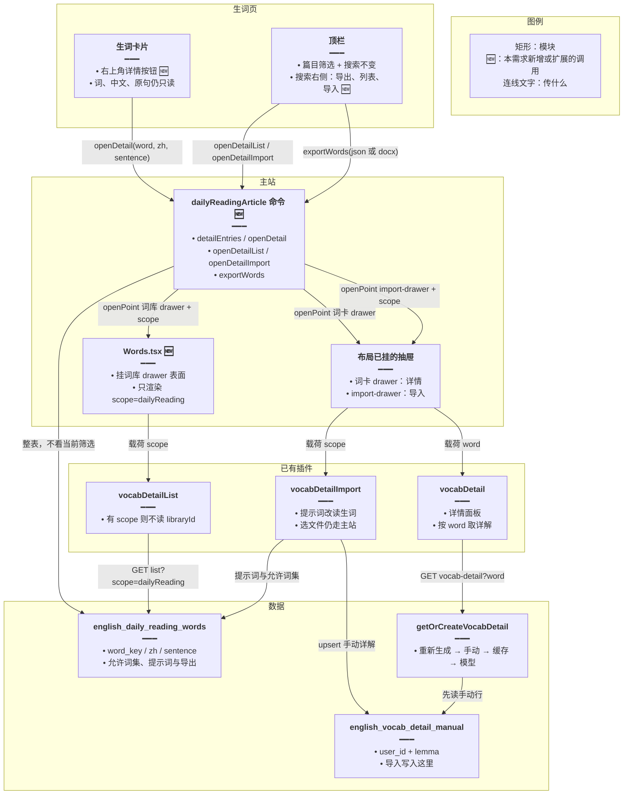
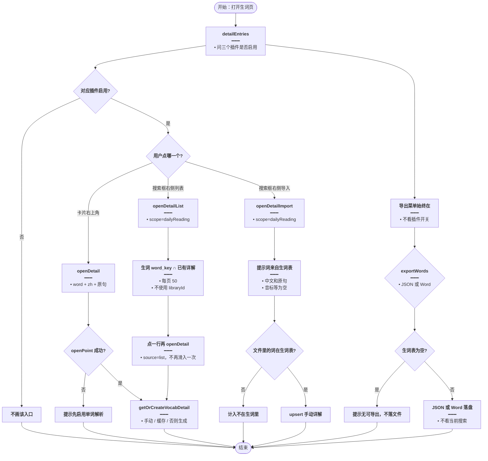
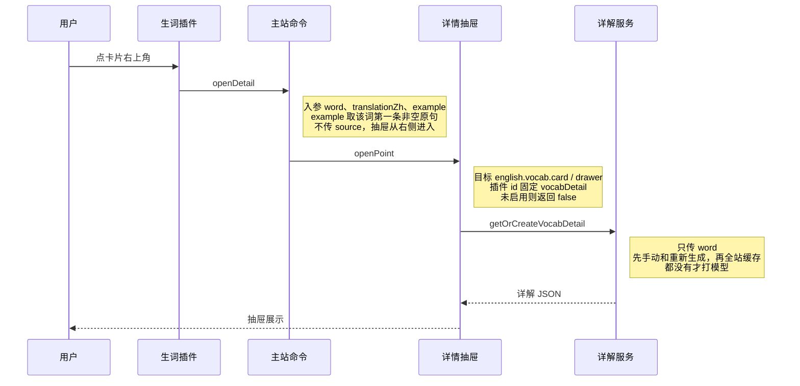

# 生词接入单词解析 — 实现思路

> **状态**：已落地。实现说明见 [生词接入解析](../../english/生词接入解析.md)、[生词按条件导出](../../english/生词按条件导出.md)、[生词解析叠层](../../english/生词解析叠层.md)。导出已改为跟当前篇目和搜索，不再每次导出整表。  
> **日期**：2026-11-15  
> **需求摘要**：在每日阅读生词页，卡片右上角打开已有的单词解析详情抽屉；搜索框右侧打开单词解析列表，并像单词库一样导出 JSON 和 Word；生词行的词面、中文和原句足够作为导入输入，因此再提供导入入口，写入现有的按用户手动详解表。  
> **一句话方案（预告）**：不新做解析 UI。生词插件用扩展点命令打开词库上已有的三个插件；列表和导入用 `scope: 'dailyReading'` 把允许词集从「某一本词库」换成「当前用户的生词表」。导出也走主站命令，JSON / Word 都带上没有音标的生词。

## 延伸阅读

- 生词页本身：[每日阅读生词.md](./每日阅读生词.md)
- 详情抽屉与全站缓存：[单词详解插件.md](./单词详解插件.md)
- 列表必须带词库、三份详解求交集：[解析列表绑定词库.md](./解析列表绑定词库.md)
- 手动导入只接受库内词、写入 `(user_id, lemma)`：[手动导入单词详解.md](./手动导入单词详解.md)

---

## 0. 读本文你将得到什么

- 生词页要接上的是已有的单词解析详情、列表和导入，不是再做一套释义面板。
- 选定方案：生词插件发命令，主站打开词卡抽屉和词库上的列表 / 导入抽屉；后两者带 `scope: 'dailyReading'`。搜索框右侧另有 JSON / Word 导出，由主站落盘。
- 改动在生词插件卡片和顶栏、主站 `Layout` / `Words.tsx`、列表与导入插件的取数参数、详解服务的允许词集，以及一份生词导出。不新建表，不把生词抄进词库。
- 分三阶段：先能从卡片打开详情；再在搜索框右侧开列表；最后补导出、导入提示词和允许词集。
- 最大风险是生词页打开的列表抽屉沿用词库页残留的 `libraryId`，列出另一本书的词。

---

## 1. 需求与边界

### 1.1 用户故事

| 角色 | 场景 | 行为 | 期望结果 |
|------|------|------|----------|
| 已登录且启用了单词解析详情的用户 | 生词页某张卡片 | 点卡片右上角入口 | 打开现有单词解析详情抽屉，内容按该词面读取；未启用详情插件时这个入口不出现 |
| 同上 | 详情还没有生成过 | 从卡片打开 | 与词库单词卡相同：有手动导入或重新生成就用那一份，否则全站缓存，都没有才打模型 |
| 已启用单词解析列表的用户 | 生词页搜索框右侧 | 点「单词解析」 | 打开现有列表抽屉，只列出「自己的生词」和「已有详解」的交集，点一项仍进同一个详情抽屉 |
| 已登录用户 | 生词页搜索框右侧 | 点导出，选 JSON 或 Word | 得到自己的全部生词。JSON 与词库导出同形，音标等为空但不被丢掉；Word 用词库同一套文档。不跟当前搜索或篇目筛选走 |
| 已启用导入插件的用户 | 导出菜单旁边 | 点导入 | 打开现有导入抽屉。提示词与上面的 JSON 是同一批词，导入文件里的词必须在自己的生词表里，结果写入自己的手动详解 |
| 未启用对应插件的用户 | 看生词页 | 浏览顶栏和卡片 | 列表和导入不出现；导出仍在。生词收集、筛选、朗读保持原样 |
| 词库页用户 | 在单词库里开列表或导入 | 不从生词页进来 | 仍按当前词库，不因本需求改成生词范围 |

### 1.2 范围

| 在范围内 | 不在范围内（非目标） |
|----------|----------------------|
| 生词卡片右上角一个详情入口 | 在生词页重画词根、记忆、例句面板 |
| 搜索框右侧的列表入口 | 把列表改成「所有生词」，包括还没有详解的词 |
| 评估后支持导入，入口紧挨列表 | 用生词行直接充当详解 JSON；生词表没有词根和详解栏目 |
| 搜索框右侧导出 JSON 和 Word，词集与导入允许词集相同 | 只导出当前搜索或当前篇目；把词库 `exportVocabularyJson` 原样套来（它会丢掉没有音标的行） |
| 允许词集 = 当前用户 `english_daily_reading_words.word_key` | 新建一本隐藏词库再走旧导入 |
| 导入正文仍进 `english_vocab_detail_manual` | 把详解写回生词行，或改卡片上的中文 |
| 详情插件未启用时卡片入口隐藏 | 入口还在、点了才 toast |

### 1.3 约束与依赖

- 生词页是插件 `dailyReadingWords`，挂在扩展点 `english.dailyReading.article`。它不能引用主站的 `HostPoint`。入口由插件自己画，打开动作走 `point.command`。
- 单词解析详情抽屉由英语学习布局挂上（`english.vocab.card` / `drawer`，`persist`）。生词路由在这个布局下面，所以从生词页 `openPoint` 能打开它。
- 单词解析列表的槽是 `english.vocab.library` / `drawer`，并且 `layout.page = true`：布局不挂，只有当前页自己挂 `PluginHostSurface`。生词页今天没挂，所以只发 `openPoint` 看不见列表。
- 导入抽屉由布局挂上（`import-drawer`，`persist`）。生词页可以直接 `openPoint`，但现有导入先查词库所有者，再生词表对不上。
- 须登录，与现有 `GET /english-learning/vocab-detail` 相同。不新增会员条件。
- 生词卡片上的朗读按钮、中文只读、篇目链接保持不动。中文不再就地编辑。
- 插件页不能引用主站 `ExportMenu`，也拿不到文件选择器和 Word 二进制。导出菜单由插件自画，落盘由主站命令完成。
- 词库 JSON 导出（`exportVocabulary.ts`）在没有 `ipa` 时直接跳过该行。生词没有音标，原样调用会得到空文件。生词导出必须保留这些行。

### 1.4 导入可行性（结论先给，论证在 §4.5）

生词一行有 `word`、`zh`、`sources[].sentence`，没有音标、词性和音节。词库导出给外部 agent 的形状是 `{ word, ipa, pos, segmentation, translationZh, example }`。词面、一行中文、一条例句已经够外部 agent 写详解；音标和词性在提示词里可以空着。

现有 `importManualDetails` 做不到直接吃这份数据：它要求 `libraryId`，允许词集是那本库的 `lemma`。生词不在词库表里，原样导入会被全部记入 `skippedNotInLibrary`。

所以：**数据够做导入输入，现有接口的词库门闩不够。** 要支持导入，就扩展门闩，不新做一套详解存储。

---

## 2. 背景

- **谁、在什么场景、卡在哪**：用户在生词页看见收集来的词、中文和原句，想看词根和详解，把这批词导出后交给外部 agent，或把写好的详解导回来。卡片和顶栏都没有这些入口，也没有和单词库一样的 JSON / Word 导出。
- **现状缺口**：详情、列表、导入三个插件都绑在词库扩展点上。列表和导入的允许词集都是某一本词库。生词页只有 `english.dailyReading.article` 上的 `openReading` / `play` / `stop`。生词表也没有详解 JSON。
- **不解决会怎样**：同一词在词库卡片上能开解析，在生词页只能朗读和跳回原文。外部写好的详解进不了这些生词，除非用户先把词放进某本自己的词库再导入。
- **硬约束**：不复制详情面板；不把一个人的导入变成全站缓存；不改词库页在没有 `scope` 时的列表和导入；插件页不能引用主站 `HostPoint`。

---

## 3. 现状与复用

| 能力 | 仓库中已有 | 本需求用法 |
|------|------------|------------|
| 生词页 | 插件 `micro-apps/dnhyxc-ai-plugins/src/views/daily-reading-words/index.tsx`；宿主只挂 `apps/frontend/src/views/englishLearning/dailyReading/Words.tsx` | 扩展：卡片右上角和搜索框右侧由插件自画 |
| 生词命令 | `apps/frontend/src/views/englishLearning/Layout.tsx` 绑定 `openReading` / `play` / `stop` | 扩展：同点增加 `detailEntries`、`openDetail`、`openDetailList`、`openDetailImport`、`exportWords` |
| 详情抽屉 | `english.vocab.card` 的 `drawer`；`openPoint(..., 'vocabDetail', 'drawer', { word, source })` | 直接复用。生词命令内部调用同一次 `openPoint` |
| 词卡载荷 | 插件 `src/views/vocab-detail/point.ts` 的 `cardFromPayload` | 直接复用。生词只传 `word`、`translationZh`、`example` |
| 解析读取顺序 | `VocabDetailService.getOrCreateVocabDetail`：重新生成、手动导入、全站缓存，都没有才打模型 | 直接复用。生词入口不另写读取 |
| 列表抽屉 | `vocabDetailList`，表面 `english.vocab.library`，槽 `drawer`，`layout.page = true` | 扩展：生词宿主页也挂 `PluginHostSurface`；载荷带 `scope` |
| 列表数据 | `vocab-detail.service.ts` 的 `buildLibraryDetailRows`，词库 lemma ∩ 三份详解，Redis 按 `libraryId` | 扩展：增加生词 `word_key` ∩ 三份详解，另用一套 Redis 键 |
| 列表取库 id | 插件 `libraryIdFromContext` | 扩展：载荷 `scope === 'dailyReading'` 时不再读 `libraryId` |
| 导入抽屉 | `vocabDetailImport`，槽 `import-drawer`，布局已挂 | 直接复用打开方式。扩展载荷和允许词集 |
| 导入门闩 | `importManualDetails` → `assertOwner` + `lemmasInLibrary` | 扩展：`scope: 'dailyReading'` 时改为当前用户的生词 `word_key`，不查词库所有者 |
| 手动详解表 | `english_vocab_detail_manual`，唯一键 `(user_id, lemma)` | 直接复用。导入成功后，词库卡片和生词卡片打开的是同一行 |
| 词面归一 | `normalizeVocabLemma`（空白合并、小写、超过 120 拒绝） | 直接复用。生词 `word_key` 更短（最多 80、最多 4 个词），是它的子集 |
| 生词行 | `english_daily_reading_words`：`word`、`zh`、`sources[].sentence` | 直接复用为提示词和允许词集。不增加详解列 |
| 词库导出菜单 | `components/export/Export.tsx` + `ExportMenu.tsx`：JSON 与 Word 两项 | 直接复用交互，不复用组件。插件自画同样两项，调用 `exportWords` |
| 词库 JSON | `exportVocabulary.ts`：分页拉全后 `{ title, items }`，`!ipa` 的行丢弃 | 扩展形状，不复用这个跳过规则。生词没有音标也要写入 |
| 词库 Word | `exportVocabularyLibraryDocxBuffer` → `buildVocabularyFavoritesDocxBuffer` | 直接复用文档生成。行里音标等用空串，标题用「每日阅读生词」 |

**调研结论**：详情抽屉已经由布局挂着，生词页缺的是命令和按钮。列表抽屉必须由生词页自己挂，否则 `openPoint` 没有渲染出口。导入抽屉能打开，但允许词集必须从词库换成生词表，否则文件会被全部跳过。三份详解的存储和读取顺序不用新做。导出不能调用 `exportVocabularyJson`，否则没有音标的生词会被全部丢掉；Word 可以复用词库那份文档生成。

---

## 4. 方案比对与最终方案

### 4.1 候选方案

#### 方案 A：命令打开现有三个插件，列表和导入带 `scope: 'dailyReading'`（扩展）

- **做法**：生词插件在卡片右上角、搜索框右侧自画按钮。挂载时 `command('detailEntries')` 问主站哪几个插件已启用，没启用的按钮不画。点详情调用 `openDetail`，主站 `openPoint('english.vocab.card', 'vocabDetail', 'drawer', { word, translationZh, example })`。点列表调用 `openDetailList`，主站 `openPoint('english.vocab.library', listId, 'drawer', { scope: 'dailyReading' })`，并且 `Words.tsx` 挂上这个 `drawer` 的 `PluginHostSurface`。点导入同样 `openPoint` 到 `import-drawer`，载荷 `{ scope: 'dailyReading' }`。列表和导入看到这个 scope 就不再要 `libraryId`。
- **能工作的原因**：详情抽屉布局已经挂着；导入抽屉也已经挂着；列表只要生词页补上词库页同款的表面即可。详解正文仍走 `getOrCreateVocabDetail`。
- **主要代价**：生词页要挂一个本来属于词库页的表面。离开生词页时必须关掉带这个 scope 的抽屉，避免词库页接着显示生词范围。

#### 方案 B：再生三个只服务生词的插件（新增）

- **做法**：注册 `dailyReadingVocabDetail`、`dailyReadingVocabList`、`dailyReadingVocabImport`，表面改到 `english.dailyReading.article`，槽位照抄词卡和词库。面板从现有插件复制。后端另写一套按生词表查询的接口。
- **能工作的原因**：插件中心可以单独开关，和词库插件互不影响。表面和生词页的 `point` 模块一致，不必跨点 `openPoint`。
- **主要代价**：详情面板、列表滚动、导入校验要维护两份。用户要多开三个开关，词库上已经打开的解析在生词页默认看不见。

#### 方案 C：生词插件自己请求详解并画在卡片里（不复用抽屉）

- **做法**：卡片右上角展开本卡下方的详解区，插件直接 `GET /english-learning/vocab-detail?word=`。列表做成生词页里的第二块滚动区。导入用插件内的文件选择，不打开词库导入抽屉。
- **能工作的原因**：不依赖另外三个插件是否启用，也不碰词库扩展点。
- **主要代价**：详情 UI、生成中的等待、朗读和版本切换要在生词插件里再写一遍。搜索框右侧不再是「打开单词解析列表插件」，而是另一套列表。

### 4.2 比对

| 维度 | 方案 A 命令 + scope | 方案 B 三套新插件 | 方案 C 生词页自绘 |
|------|---------------------|-------------------|-------------------|
| 正确性 | 打开的就是现有读取顺序；scope 缺失时词库行为不变 | 若复制漏了读取顺序，生词页会先打模型、盖住手动导入 | 自己画的面板容易漏掉「重新生成优先于手动导入」 |
| 复用 / 与现状契合 | 复用三个插件、`openPoint`、`getOrCreateVocabDetail`、手动表 | 只复用 HTTP，UI 和注册各写一套 | 只复用 GET 详解，列表和导入抽屉都不用 |
| 改动面 | 生词插件、`Layout.tsx`、`Words.tsx`、列表/导入插件的取数分支、服务里一个允许词集分支 | 三个新插件、新槽、新接口 | 生词插件内部变大，主站几乎不动 |
| 复杂度 | 多一个 scope 和「离开页面关掉抽屉」 | 多三个插件 id，开关和文档都要双份 | 生词插件承担详情状态机 |
| 体验 | 抽屉层级和词库页一致：列表在下，详情在上 | 用户要再启用一套开关才看得到入口 | 详情嵌在卡片里，长文把生词网格撑开；和「进抽屉」不一致 |
| 风险 | 词库 `libraryId` 残留会列错词，离开页面时要按 scope 关闭 | 两套面板以后改一处漏一处 | 低耦合，但和已有抽屉的打开、停止朗读不一致 |
| 可维护性 | 详情 UI 仍只在 `vocab-detail` | 同一交互两处改 | 生词页和词库页各有一份详解 |

### 4.3 综合考量

权重按这个顺序：详情只有一份 UI、生词页是插件不能挂 `HostPoint`、列表和导入的词集必须换成生词而不是空库。

方案 A 在前两项上直接接上现成的 `openPoint` 和布局已挂的抽屉。方案 B 的优点是开关完全隔离，不必在离开生词页时辨别 scope；这个优点抵不过双份面板和多三个开关。方案 C 的优点是主站改动最小；这个优点抵不过卡片里塞不下详解，也抵不过搜索框右侧不再是现有列表插件。

选定方案 A。放弃 B 的「独立开关」，放弃 C 的「主站几乎不改」。

### 4.4 最终方案

#### 背景

生词页要进单词解析详情、列表和导入，并像单词库一样导出 JSON 和 Word。详情抽屉布局已经挂着，列表抽屉只有词库页挂着，导入抽屉挂着但只认词库 id。生词插件拿不到 `HostPoint`，也拿不到主站的导出组件和文件选择器，只能发命令。生词行没有详解 JSON，但有词面、中文和原句，够做导入提示词和导出文件；不够的是导入接口的词库门闩，以及词库 JSON 导出会丢掉没有音标的行。

#### 具体思路

1. 按钮留在生词插件。主站只增加命令和生词页上的列表表面。详情、列表、导入的远程组件不复制。
2. 详情的数据仍是 `word` 字符串进 `getOrCreateVocabDetail`。卡片把 `zh` 和第一条非空 `sentence` 放进载荷，只给抽屉标题和等待态，不参与生成。
3. 列表和导入的范围放在抽屉载荷的 `scope`，不放进生词页的 React 状态，也不写进词库上下文的 `libraryId`。这样词库页没带 scope 时仍读原来的库。
4. 插件未启用：`detailEntries` 不返回该项，按钮不渲染。命令打开失败（插件后来被关掉）时生词页 toast，与词库列表点词失败同一句。
5. 离开生词页：若词库列表抽屉或导入抽屉的载荷 `scope === 'dailyReading'`，关掉它们。避免回到词库页还停在生词范围。
6. 导出不看插件开关，也不看当前搜索和篇目。菜单在搜索框右侧、列表按钮左边。JSON 和 Word 都是该用户全部生词，字段与词库导出相同，音标等为空。

#### 实现方案

**一句话**：生词插件用扩展点命令打开已有的三个单词解析插件；列表和导入用 `scope: 'dailyReading'` 把允许词集换成当前用户的生词表；导出由主站把这张生词表写成词库同形的 JSON 和 Word。

| 步骤 | 谁 | 做什么 | 输入 → 输出 |
|------|----|--------|-------------|
| 1 | 生词插件挂载 | `detailEntries` | 无 → `{ detail, list, import }` 三个布尔 |
| 2 | 卡片右上角 | `openDetail` | `{ word, translationZh, example }` → 详情抽屉打开或 `false` |
| 3 | `Layout` 里的 `openDetail` | `openPoint` 词卡抽屉 | 同上载荷，`source` 不设，抽屉从右侧进入 |
| 4 | 搜索框右侧列表按钮 | `openDetailList` | 无 → 打开词库 `drawer`，载荷 `{ scope: 'dailyReading' }` |
| 5 | `Words.tsx` | 挂 `PluginHostSurface` | 槽打开且 scope 匹配时画出 `vocabDetailList` |
| 6 | 列表插件 | 按 scope 请求 | `scope=dailyReading` → 生词 ∩ 已有详解，每页 50 |
| 7 | 搜索框右侧导入按钮 | `openDetailImport` | 无 → 打开 `import-drawer`，载荷 `{ scope: 'dailyReading' }` |
| 8 | 导入服务 | 允许词集改走生词表 | 文件词面 ∈ 用户 `word_key` 才 upsert 手动表 |
| 9 | 搜索框右侧导出菜单 | `exportWords` | `'json'` 或 `'docx'` → 该用户全部生词落成文件；空表不落文件 |

#### 选定原因

1. **复用**：三个插件和 `getOrCreateVocabDetail` 都不复制。牺牲：生词页要挂词库的列表表面，并在离开时按 scope 关闭。
2. **正确性**：允许词集和读取顺序仍是现有服务里的一个分支，词库不带 scope 时走原路径。牺牲：多一个字符串 scope，调用方传错就会列错词。
3. **体验**：入口在卡片右上角和搜索框右侧，详情仍是抽屉。牺牲：用户必须已经启用对应插件，生词页不自带一份总能打开的详解。
4. **改动面**：不新表、不新插件 id。牺牲：列表和导入插件要认识第二种范围，不能假设永远有 `libraryId`。

#### 优势

- 相对方案 B：详情面板、生成中状态和版本切换只留在 `vocab-detail`，词库上已经启用的插件在生词页直接出现，不用再开三个开关。
- 相对方案 C：搜索框右侧打开的就是现有列表抽屉和导入抽屉；详情不会把生词网格撑高，朗读仍走词卡上已有的 `play` / `stop`。

#### 怎么实现

1. `Layout.tsx` 在现有 `bindPointCommand(POINT.dailyReadingArticle, ...)` 旁注册四个命令。`openDetail` 的函数体与词库 `openCard` 相同，都是 `openPoint(POINT.vocabCard, 'vocabDetail', 'drawer', ...)`。
2. 生词插件用返回值决定按钮。卡片右上角绝对定位，不挪动单词旁边的朗读按钮。
3. `Words.tsx` 在 `PluginHostPage` 旁挂词库 `drawer` 的 `PluginHostSurface`，只响应载荷 `scope === 'dailyReading'` 的打开。卸载时 `closePoint`。
4. 列表插件：载荷里有这个 scope 就请求 `GET /english-learning/vocab-detail/list?scope=dailyReading`，否则保持 `libraryId`。
5. 导入插件：同样看载荷。提示词接口按生词表拼 `{ title, items }`。`importManualDetails` 增加 scope 分支，允许词集改为该用户的 `word_key`。
6. 主链路代码见 §9。

### 4.5 其他关键决策

下面两处会改变数据从哪张表来，单独比对。

#### 决策 1：列表里出现哪些词

##### 候选

**方案 L1：生词 `word_key` 与三份详解求交集（扩展现有列表算法）**

- **做法**：照 `buildLibraryDetailRows`，把 `lemmasInLibrary` 换成当前用户生词表的 `word_key`。Redis 键用 `src:dailyReading`，不复用 `lib:${libraryId}`。分页仍是 50，游标仍是 `updatedAt|lemma`。
- **能工作的原因**：词库列表已经定义「只列出有详解的词」。生词页用同一份交集，点开一定命中，不会在列表里触发模型。
- **主要代价**：还没有详解的生词不在这个列表里，只能从卡片右上角进去。

**方案 L2：直接打开当前词库的列表（复用且不改查询）**

- **做法**：`openDetailList` 不带 scope，列表继续读上下文里的 `libraryId`。
- **能工作的原因**：列表插件一行都不用改。
- **主要代价**：生词页没有当前词库。上下文常常是空的，或是用户上次打开的另一本书，列表要么失败要么不是这些生词。

**方案 L3：列出全部生词，没有详解的也显示**

- **做法**：列表接口直接分页 `english_daily_reading_words`，点开再 `getOrCreate`。
- **能工作的原因**：和生词网格是同一批词，用户不会疑惑「为什么列表比卡片少」。
- **主要代价**：列表变成第二份生词列表。点一项可能打模型，和词库「解析列表」的含义不一致。

##### 比对

| 维度 | L1 交集 | L2 沿用词库 | L3 全部生词 |
|------|---------|-------------|-------------|
| 正确性 | 只含已有详解，点开不生成 | 词集与生词页无关，会列错或为空 | 点开可能生成，列表语义变成生词本 |
| 复用 | 复用交集和 Redis 分页，换词集来源 | 查询完全复用 | 复用生词分页，不复用详解交集 |
| 改动面 | 服务加一个词集函数和一套键 | 只加打开命令 | 新的列表查询，插件还要显示没有详解的行 |
| 复杂度 | 多一套 Redis 键 | 无新状态 | 列表和生词网格两套分页 |
| 体验 | 和词库「单词解析」按钮一致 | 用户看到别的书或空列表 | 列表和卡片重复，点开可能要等模型 |
| 风险 | 键和词库键混用会串数据 | 残留 `libraryId` 会静默列错 | 低 |
| 可维护性 | 两套词集、同一套分页 | 无分支，但产品是错的 | 生词列表规则要在两个接口维护 |

##### 综合考量

列表按钮的名字是「单词解析」，词库上它的含义是「已经有详解的词」。这个权重大于「和卡片张数一致」。L2 改动最小，但会列出错误的书，放弃。L3 不会漏词，但把解析列表做成了另一份生词本，放弃。选定 L1。

##### 六块

- **背景**：搜索框右侧要打开单词解析列表。现有列表是「当前词库 ∩ 已有详解」。生词页没有词库 id。
- **具体思路**：词集来源换成该用户全部生词的 `word_key`，不跟搜索框当前的篇目和关键字走。搜索只过滤卡片。列表回答「这些生词里哪些已经有解析」。Redis 键与词库分开。M1 在写入新详解时删掉生词范围的 ready 键，下次打开重建；不在 M1 做词库那种单行补丁。
- **实现方案**：`GET .../list?scope=dailyReading` 走新的词集函数，返回形状与词库列表相同（`lemma`、`glossZh`、`updatedAt`、`nextCursor`、`total`）。
- **选定原因**：正确性上点开不生成；体验上和词库按钮一致。牺牲：没有详解的生词不出现在列表，用户要从卡片进去。
- **优势**：相对 L2，不会显示另一本词库。相对 L3，列表不会在滚动时触发生成。
- **怎么实现**：服务按 `user_id` 读出 `word_key`，与手动、重新生成、全站缓存的 lemma 求交，写入 `src:dailyReading` 的有序集合。见 §9.4。

#### 决策 2：导入是否做、允许哪些词

##### 候选

**方案 I1：做导入。允许词集改为该用户的生词 `word_key`，仍写入手动表（扩展）**

- **做法**：提示词由生词拼出，字段与词库导出对齐，`ipa` / `pos` / `segmentation` 置空，`translationZh` 用 `zh`，`example` 用该词最近一条非空原句。导入文件的词面经 `normalizeVocabLemma` 后必须在生词 `word_key` 里。通过 `parseVocabDetail` 后 upsert 手动表。不在生词表里的词计入原来的 `skippedNotInLibrary`，抽屉在这个 scope 下把文案显示成「不在生词里」。
- **能工作的原因**：手动表本来就是 `(user_id, lemma)`，不挂库 id。导入成功后，生词卡片和词库卡片打开同一行。空音标不影响 `parseVocabDetail`，详解正文不包含音标。
- **主要代价**：外部 agent 看不到音标和词性。超过 2000 个生词时提示词截断，并在抽屉里说明未包含的数量。

**方案 I2：不做导入（数据不够就停）**

- **做法**：搜索框右侧只有列表。文档说明生词没有音标和库 id，导入插件不出现。
- **能工作的原因**：零改动导入服务，不会把非库内词写进手动表。
- **主要代价**：用户不能把外部写好的详解用在这些生词上，除非先把词放进自己的词库。

**方案 I3：先自动建一本「每日阅读生词」隐藏词库，再调用现有导入（复用门闩）**

- **做法**：第一次点导入时把生词 upsert 进一本系统词库，再把那本库的 `libraryId` 交给现有导入。
- **能工作的原因**：`assertOwner` 和 `lemmasInLibrary` 不用分叉。
- **主要代价**：用户的词库列表里多一本书，或要做隐藏库。生词的中文和原句会写成词库词条，和「收集」不是同一份数据，以后两边会分叉。

##### 比对

| 维度 | I1 换允许词集 | I2 不做导入 | I3 隐藏词库 |
|------|----------------|-------------|-------------|
| 正确性 | 只接受自己的生词，详解进手动表，不进全站缓存 | 不会写错，但需求里「若行则要支持」没做 | 门闩正确，但生词和词库词条变成两份 |
| 复用 | 复用解析器、手动表、导入抽屉 | 完全复用，无新代码 | 复用整条导入，多一本库的写入 |
| 改动面 | 导入函数一个分支、提示词一个接口、抽屉文案 | 无 | 建库、同步词条、还要决定这本库是否出现在列表 |
| 复杂度 | 一个 scope 分支 | 无 | 隐藏库的生命周期 |
| 体验 | 搜索框右侧能导入，提示词就是这些生词 | 没有导入入口 | 用户可能在词库列表看见这本库 |
| 风险 | 文案仍用 `skippedNotInLibrary` 字段名，界面必须改字 | 无 | 同步失败时导入和生词不一致 |
| 可维护性 | 允许词集两处（词库 / 生词），存储仍一张表 | 无分支 | 词条同步要长期跟着生词表 |

##### 综合考量

§1.4 已经说明词面、中文、原句够做提示词，缺的是门闩。权重是「导入结果和词库导入进同一张手动表」以及「不要另造一本词库」。I2 最安全，但把「行则支持导入」做成了不支持，放弃。I3 能原样调用旧接口，但多一本库和两份词条，放弃。选定 I1。

##### 六块

- **背景**：生词行没有详解栏目，也没有 `libraryId`。现有导入会把不在词库里的词全部跳过。
- **具体思路**：提示词只从生词表来，不要求音标。允许词集用 `word_key`，因为收集时已经按这把钥匙去重，并且它比 `normalizeVocabLemma` 更严。文件里的 `word` 先归一，再和 `word_key` 比较。存储仍是手动表，所以之后从卡片打开不必再认 scope。
- **实现方案**：`POST /english-learning/vocab-detail/import` 在 body 里接受 `scope: 'dailyReading'` 且不要求 `libraryId`。有 `libraryId` 时行为与现在完全相同。
- **选定原因**：正确性上不会创建词库词条，也不会写入全站缓存。牺牲：提示词里没有音标和词性，外部 agent 只能靠词面、中文和原句。
- **优势**：相对 I2，搜索框右侧有导入，导入后的详解词库页也能读到。相对 I3，词库列表不出现一本系统书，生词中文也不会被写进词库词条。
- **怎么实现**：见 §9.2 的 `allowedLemmas`。提示词与导出 JSON 共用 §9.3 的字段表，不单写一套文件选择 UI。

#### 决策 3：导出整表，还是导出当前筛选

| 维度 | E1：导出该用户全部生词 | E2：导出当前搜索和篇目筛选 | E3：直接调用 `exportVocabularyJson` |
|------|------------------------|----------------------------|--------------------------------------|
| 正确性 | 与导入允许词集、导入提示词是同一批词 | 筛到一篇时文件更小，但和导入提示词不是同一份 | 生词没有 `ipa`，函数会跳过每一行，文件为空 |
| 数据一致性 | JSON 可交给外部 agent，再导回时词都在允许集里 | 导回仍然合法（子集），用户却以为导出的就是全部 | 空文件，导入侧无词可写 |
| 体验 | 与单词库「导出整库、不看当前搜索」一致 | 和屏幕上看到的条数一致 | 点了导出却得到空文件或报空 |
| 性能 | 分页拉全表；Word 走词库同一套同步文档，硬顶与词库相同 | 条数更少 | 同样要分页，结果被丢掉 |
| 可维护性 | 新一条导出路径，复用文档生成函数 | 导出还要接搜索框状态，和导入提示词分叉 | 零新代码，但跳过规则写死在词库导出里 |
| 风险 | 词很多时 Word 同步生成偏慢 | 用户换筛选后不知道文件里少了哪些词 | 必现空导出 |
| 改动面 | 插件菜单 + 主站命令 + 后端取生词行 | 同 E1，再加筛选参数 | 调用一处，结果不可用 |

选定 E1，放弃 E2 和 E3。

##### 六块

- **背景**：单词库搜索框旁的导出有 JSON 和 Word 两项，导出的是整库。生词页要同样两项。生词行没有音标，词库 JSON 导出会把这种行丢掉。
- **具体思路**：插件在搜索框右侧画导出菜单（JSON、Word），不引用主站 `ExportMenu`。点击调用 `exportWords`。主站分页读该用户全部生词，不看当前 `q` 和 `readingId`。JSON 字段与词库导出相同，音标、词性、音节写空串。Word 把同一批行交给 `buildVocabularyFavoritesDocxBuffer`。空表不落文件，由主站提示。
- **实现方案**：`POST /english-learning/daily-reading-words/export-docx` 返回整表 Word。JSON 由主站把同一查询结果交给已有的文件选择器，不新开下载通道。菜单两项可分别进行，一项进行中不禁用另一项。
- **选定原因**：和单词库一样导出整份集合，并且这份 JSON 就是导入提示词，导回来不会被门闩丢掉。牺牲：当前只筛了一篇时，文件里仍是全部生词。
- **优势**：相对 E2，导入抽屉里的提示词和下载的 JSON 不会各算一遍范围。相对 E3，没有音标的词仍在文件里。
- **怎么实现**：见 §9.2 的 `exportWords`。字段表见 §9.3。

---

## 5. 架构图



**图内方法说明**：

| 方法 | 功能 |
|------|------|
| `detailEntries()` | 读注册表里 `vocabDetail`、`vocabDetailList`、`vocabDetailImport` 是否启用，供生词页决定画哪些按钮 |
| `openDetail(payload)` | 用词面打开词卡上的 `vocabDetail` 抽屉；插件未启用或词为空时返回 `false` |
| `openDetailList()` | 打开词库列表槽，载荷只带 `scope: 'dailyReading'`，不写 `libraryId` |
| `openDetailImport()` | 打开已由布局挂着的导入抽屉，载荷同样只带 scope |
| `exportWords(format)` | 把该用户全部生词落成 JSON 或 Word；空表不落文件 |
| `openPoint(...)` | 把插件 id、槽和载荷写入扩展点会话；返回值表示该插件是否真的挂在这个槽上 |
| `getOrCreateVocabDetail(word)` | 按既有顺序读详解，没有才生成；生词入口不改变这个顺序 |
| `libraryIdFromContext()` | 词库列表原来的库 id 来源；scope 为生词时列表插件不再调用它 |

**读图要点**：

- 生词页只负责按钮和命令，详情正文仍在 `vocabDetail`。
- 列表表面是生词宿主页新挂的；详情和导入抽屉不用新挂。
- 生词表提供允许词集、提示词和导出正文，详解正文只进手动表和既有读取函数。
- 导出不经过详情插件，直接读生词表。

---

## 6. 主流程图



**图内方法说明**：

| 方法 | 功能 |
|------|------|
| `detailEntries()` | 决定三个入口各自出不出现，避免点了才发现插件没开 |
| `openDetail()` | 打开详情抽屉；从列表点词时带 `source: 'list'`，避免抽屉再播一次进入动画 |
| `openDetailList()` | 打开生词范围的解析列表 |
| `openDetailImport()` | 打开生词范围的导入抽屉 |
| `exportWords()` | 导出全部生词为 JSON 或 Word；空音标的行仍写入 |
| `getOrCreateVocabDetail()` | 取或生成该词详解，顺序与词库单词卡相同 |
| `normalizeVocabLemma()` | 把导入文件里的 `word` 收成和生词 `word_key` 可比的小写词面 |

**读图要点**：

- 三个入口共用「插件没开就不画」；详情命令失败才 toast。
- 列表不生成详解，生成只发生在从卡片打开且三份详解都没有的时候。
- 导入先过生词词集，再写入手动表。
- 导出不经过「插件是否启用」那一问，空表只提示、不下载。

---

## 7. 核心时序图



**图内方法说明**：

| 方法 | 功能 |
|------|------|
| `openDetail()` | 生词插件把卡片上的词面、中文和原句交给主站 |
| `openPoint()` | 主站打开词卡详情槽；返回 `false` 时生词页提示先启用单词解析 |
| `getOrCreateVocabDetail()` | 按词面读取或生成详解，不读取生词表 |

**读图要点**：

- 这是从卡片进详情的主路径。列表点词多一步 `source: 'list'`，其余相同。
- 中文和原句只进抽屉载荷，不进生成请求。
- 服务端不因为从生词页打开就换一套缓存。

---

## 9. 具体实现（主链路代码）

### 9.1 模块一览

| 模块 | 职责 | 新增/改动 | 预估路径 |
|------|------|-----------|----------|
| 生词页按钮 | 按启用情况画入口并发命令 | 扩展 | `micro-apps/dnhyxc-ai-plugins/src/views/daily-reading-words/index.tsx` |
| 命令 | 打开三个已有插件，并导出整表 | 扩展 | `apps/frontend/src/views/englishLearning/Layout.tsx` |
| 列表表面 | 生词页能画出 `page: true` 的列表抽屉 | 扩展 | `apps/frontend/src/views/englishLearning/dailyReading/Words.tsx` |
| 列表查询 | 生词词集 ∩ 已有详解 | 扩展 | `apps/backend/src/services/english-learning/vocab-detail.service.ts` |
| 导入门闩 | scope 为生词时不查词库 | 扩展 | 同上 `importManualDetails` |
| 生词导出 | 整表 JSON 与 Word | 扩展 | `english-daily-reading-word.service.ts` 取行；Word 复用 `buildVocabularyFavoritesDocxBuffer` |
| 列表 / 导入插件 | 认 scope，不认残留 libraryId | 扩展 | `micro-apps/dnhyxc-ai-plugins/src/views/vocab-detail-list/list.tsx`、`vocab-detail-import/panel.tsx` |

### 9.2 主链路实现

```typescript
// 对应 §4.4 步骤 2～3。生词插件不能挂 HostPoint，详情抽屉仍由词卡槽打开
function openDetail(arg: unknown): boolean {
	// 字符串和 { word } 都收成词面，和词库 openCard 同一把钥匙，避免两套解析
	const word = wordOf(arg);
	// 空词不开抽屉，否则会盖住生词列表却没有内容
	if (!word) return false;
	// 中文和原句只给抽屉等待态；生成请求仍只认 word
	const extra = arg && typeof arg === 'object' ? (arg as { translationZh?: unknown; example?: unknown; source?: unknown }) : {};
	// 固定打开已启用的 vocabDetail。未启用时 openPoint 返回 false，按钮侧 toast
	return openPoint(POINT.vocabCard, 'vocabDetail', 'drawer', {
		// 详解查询只用这个字段
		word,
		// 卡片上的中文，没有就空，不把生词 id 送进抽屉
		translationZh: typeof extra.translationZh === 'string' ? extra.translationZh : '',
		// 第一条原句，让等待态能看到这个词从哪句来
		example: typeof extra.example === 'string' ? extra.example : '',
		// 只有解析列表点进来才带 list，卡片右上角不带，抽屉照常从右侧进入
		...(extra.source === 'list' ? { source: 'list' as const } : {}),
	});
}
```

```tsx
// 对应 §4.4 步骤 2。按钮贴在卡片右上角，朗读仍留在单词旁边
function DetailEntry({ word, zh, sentence, enabled, onOpen }: {
	// 展示和请求用同一个词面，不另做 lemma
	word: string;
	// 收集时的中文，只随载荷走，不在这里编辑
	zh: string;
	// 没有原句就传空串，抽屉不因此打不开
	sentence: string;
	// detailEntries 说详情插件没开时，整颗按钮不渲染
	enabled: boolean;
	// 交给 openDetail；false 时由页面 toast
	onOpen: (payload: { word: string; translationZh: string; example: string }) => boolean;
}) {
	// 没启用就不占右上角，避免一个点了没反应的图标
	if (!enabled) return null;
	// 绝对定位在卡片内，不挤进单词和朗读按钮那一行
	return (
		// 原生按钮即可，插件不引用主站 HostPoint
		<button
			// 不用 submit，避免以后卡片被包进表单时误提交
			type="button"
			// 贴右上角，给朗读按钮留在词的旁边
			className="absolute top-2 right-2"
			// 点击只负责打开，不在这里请求详解
			onClick={() => {
				// 失败说明插件在本次会话里被关掉了，不把卡片当成已打开
				const opened = onOpen({ word, translationZh: zh, example: sentence });
				// false 交给页面 toast，按钮自己不提示第二句
				if (!opened) return;
			}}
		/>
	);
}
```

```typescript
// 对应 §4.5 决策 2 / §4.4 步骤 8。有词库 id 时走原门闩；生词范围不再查所有者
async function allowedLemmas(userId: number, scope: string | undefined, libraryId: string | undefined): Promise<Set<string>> {
	// 生词导入不创建词库，允许词集就是这个用户已经收集的 word_key
	if (scope === 'dailyReading') {
		// 只取钥匙，不把整段原句载进判断
		const rows = await this.readingWords.find({ where: { userId }, select: { wordKey: true } });
		// Set 用于文件里上千词的包含判断，重复 word_key 只留一个
		return new Set(rows.map((row) => row.wordKey));
	}
	// 词库路径保持原样：不是所有者就 403，随后只用这本书里的 lemma
	await this.assertOwner(userId, libraryId ?? '');
	return new Set(await this.lemmasInLibrary(libraryId ?? ''));
}
```

```typescript
// 对应 §4.5 决策 1。列表词集是生词钥匙和已有详解的交，不是生词表全文
async function buildDailyReadingDetailRows(userId: number): Promise<ListRow[]> {
	// 与导入允许词集同一来源，避免「能导入却不在列表」或相反
	const keys = await this.allowedLemmas(userId, 'dailyReading', undefined);
	// 三份详解沿用词库列表已经合并好的读法，这里只换成生词钥匙做过滤
	const details = await this.loadDetailIndex(userId);
	// 没有详解的生词不进列表，点卡片才会生成
	return details.filter((row) => keys.has(row.lemma));
}
```

```typescript
// 对应 §4.5 决策 3 / §4.4 步骤 9。词库 JSON 导出会丢掉没有音标的行，这里不能调用它
async function exportWords(format: unknown): Promise<void> {
	// 菜单只有两项，其它值直接忽略，避免插件传错写出半截文件
	if (format !== 'json' && format !== 'docx') return;
	// 与导入允许词集同一张表，不带当前搜索和篇目，保证导出文件能再导回
	const rows = await this.readingWordRows(userId);
	// 空表不弹文件框，主站提示「无可导出」
	if (rows.length === 0) throw new Error('empty');
	// 字段与词库导出对齐；音标等生词没有，写空串而不是跳过
	const items = rows.map((row) => ({
		// 展示词面，与 word_key 对应的那一行
		word: row.word,
		// 生词表没有音标，留空，不能因此丢掉这一行
		ipa: '',
		// 生词表没有词性
		pos: '',
		// 生词表没有音节
		segmentation: '',
		// 收集时的一行中文，没有则空串
		translationZh: row.zh,
		// 最近一条非空原句，导入提示词用同一句
		example: row.example,
	}));
	// JSON 走主站文件选择器，标题固定，不跟当前篇目变
	if (format === 'json') {
		await saveExportJson('每日阅读生词', items);
		return;
	}
	// Word 走与词库相同的文档生成，行集与 JSON 相同
	await saveExportDocx('每日阅读生词', items);
}
```

### 9.3 数据模型

| 字段/实体 | 来源 | 存储 | 说明 |
|-----------|------|------|------|
| `word_key` | 收集时的归一词面 | `english_daily_reading_words` | 允许词集和列表交集的钥匙 |
| `zh` | 收集时的一行中文 | 同上 | 提示词的 `translationZh`；不写进详解表 |
| `sources[].sentence` | 收集时的原句 | 同上 JSON | 提示词的 `example`，取该词最近一条非空句 |
| `scope` | 生词页命令 | 抽屉载荷，不落库 | `'dailyReading'` 或缺失；缺失表示词库 |
| 手动详解 | 导入文件的 `detail` | `english_vocab_detail_manual` | 不新增列，不记录来自生词还是词库 |
| 列表缓存 | 交集结果 | Redis `src:dailyReading` | 与 `lib:${libraryId}` 分开 |

提示词一条的形状与词库导出对齐，缺的字段用空串：

| 字段 | 生词来源 |
|------|----------|
| `word` | `word` |
| `ipa` / `pos` / `segmentation` | `''` |
| `translationZh` | `zh` |
| `example` | 最近一条非空 `sentence` |

导出 JSON 与上表相同，包在 `{ title: '每日阅读生词', items }` 里。Word 用同一批 `items` 调 `buildVocabularyFavoritesDocxBuffer`，不另写一套版式。词库 `exportVocabularyJson` 里 `if (!word || !ipa) continue` 不用于生词。

---

## 10. 分阶段实现步骤

| 阶段 | 目标 | 交付物 | 依赖 |
|------|------|--------|------|
| M1 | 卡片能进详情抽屉 | 右上角按钮 + `openDetail` | 详情插件已启用 |
| M2 | 搜索框右侧能开列表 | `Words.tsx` 表面 + `scope` 列表查询 | M1 |
| M3 | 导出整表，并导入生词范围的详解 | JSON / Word、提示词、允许词集 | M2 的 scope 约定；导出不依赖列表 |

### M1

- [ ] `Layout.tsx` 注册 `detailEntries` 和 `openDetail`。
- [ ] 生词卡片右上角在 `detail === true` 时显示按钮，成功打开现有详情抽屉。
- [ ] 未启用详情插件时不显示按钮；命令返回 `false` 时 toast。
- [ ] 词库单词卡的打开方式不变。

### M2

- [ ] `openDetailList` 写入 `{ scope: 'dailyReading' }`，且不修改词库上下文的 `libraryId`。
- [ ] `Words.tsx` 挂列表表面；离开页面时若 scope 是生词则 `closePoint`。
- [ ] 列表接口在 scope 下用生词 `word_key` ∩ 已有详解，每页 50。
- [ ] 无 scope 的词库列表仍按原 `libraryId`。
- [ ] 列表点词调用 `openDetail` 且 `source: 'list'`。

### M3

- [ ] 搜索框右侧始终有导出菜单，位于列表按钮左边；未启用列表或导入插件时导出仍在。
- [ ] JSON 与 Word 都是该用户全部生词，不看当前搜索和篇目；没有音标的词仍在文件里，音标等为空串。
- [ ] 生词表为空时提示无可导出，不弹出保存框，也不下载 Word。
- [ ] 搜索框右侧在导入插件启用时显示导入按钮，位于导出和列表旁边。
- [ ] 提示词来自该用户全部生词，音标等为空；超过 2000 条时截断并说明。
- [ ] 导入 body 带 `scope: 'dailyReading'` 时不要求 `libraryId`，不在生词表中的词被跳过。
- [ ] 导入成功后，从生词卡片再打开详情，命中手动行，不打模型。
- [ ] 带 `libraryId` 的原导入请求行为不变。

---

## 11. 风险、边界与待确认

| 项 | 等级 | 说明 | 缓解 |
|----|------|------|------|
| 残留 libraryId | 高 | 生词页如果沿用词库上下文，列表会是另一本书 | 载荷 scope 优先；生词打开时不写 libraryId；离开页面关闭该抽屉 |
| 套用词库 JSON 导出 | 高 | `exportVocabularyJson` 丢掉没有 `ipa` 的行，生词会导出空文件 | 生词导出单独组装，空音标写 `''` |
| 短语词面 | 中 | 生词允许最多 4 个词，详解 lemma 通常是一个词 | 整段 `word_key` 当作一个 lemma，不拆开生成 |
| 提示词缺音标 | 中 | 外部 agent 拆词可能更飘 | 提示词里写明音标可空，以词面和原句为准；不因此拒绝导入 |
| 两个入口的朗读 | 低 | 生词页和详情抽屉各有播放 | 打开详情不自动停生词朗读；沿用现在换页才停的行为 |
| 列表不是全部生词 | 低 | 没有详解的词不在列表 | 卡片右上角仍可打开并触发生成 |

**待确认**：

- [ ] 生词超过 2000 时提示词只给前 2000 个（按 `updated_at` 倒序）是否可接受。（验证方式：用超过 2000 行的账号打开导入抽屉，看说明文案和文件词数。）

---

## 12. 验收清单

| # | 用例 | 步骤 | 期望 |
|---|------|------|------|
| AC1 | 卡片进详情 | 启用详情插件，打开一张有中文和原句的生词，点右上角 | 现有详情抽屉打开；已有手动或缓存时不打模型 |
| AC2 | 插件关闭 | 关掉详情插件后刷新生词页 | 卡片右上角没有入口；搜索和朗读仍在 |
| AC3 | 解析列表 | 启用列表插件，点搜索框右侧 | 只列出自己的生词里已经有详解的词；点一项打开详情且不再次滑入 |
| AC4 | 不串词库 | 先打开某本词库再进生词页打开列表 | 列表不是那本词库；回到词库页时生词范围的抽屉已关 |
| AC5 | 导入 | 用仅含这些生词的详解 JSON 导入 | 在生词表中的词写入手动详解；不在表中的被跳过；再次从卡片打开看到导入内容 |
| AC6 | 旧导入 | 在词库卡片上按原步骤导入 | 仍只接受那本库里的词，不接受「只在生词表里」的词 |
| AC7 | 导出 JSON 和 Word | 先把搜索或篇目筛到一部分，再导出两种格式 | 文件都是全部生词；没有音标的词仍在，`ipa` 等为空；空表只提示、不落文件 |
| AC8 | 词库导出不变 | 在单词库导出 JSON | 仍跳过没有音标的词库行，不因本需求改规则 |

---

## 13. 预估改动面（实现阶段参考）

| 类型 | 路径（预估） |
|------|----------------|
| 前端宿主 | `apps/frontend/src/views/englishLearning/Layout.tsx`、`dailyReading/Words.tsx` |
| 生词插件 | `micro-apps/dnhyxc-ai-plugins/src/views/daily-reading-words/index.tsx` |
| 列表 / 导入插件 | `micro-apps/dnhyxc-ai-plugins/src/views/vocab-detail-list/list.tsx`、`vocab-detail-import/panel.tsx` |
| 后端 | `apps/backend/src/services/english-learning/vocab-detail.service.ts`、`english-daily-reading-word.service.ts` 及对应 controller |
| 文档（实现后） | `micro-apps/remote-docs/wiki/english/` 下的生词或单词解析专题 |

---

（本文档为规划态实现思路；落地后以源码与 remote-docs wiki 专题为准）
