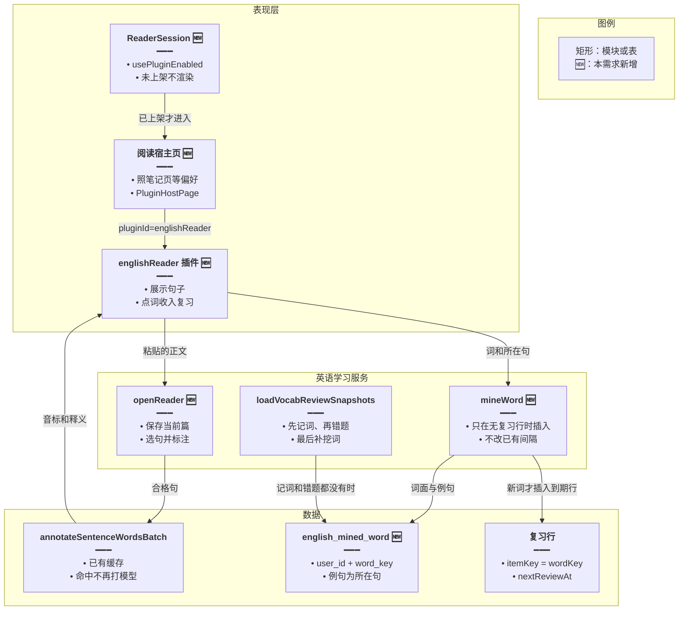
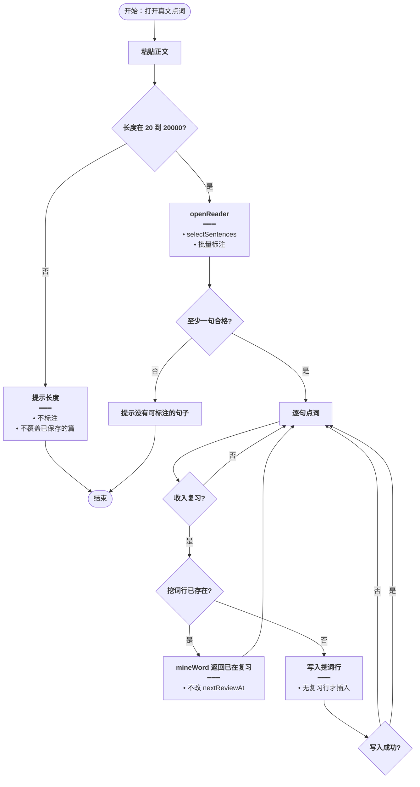
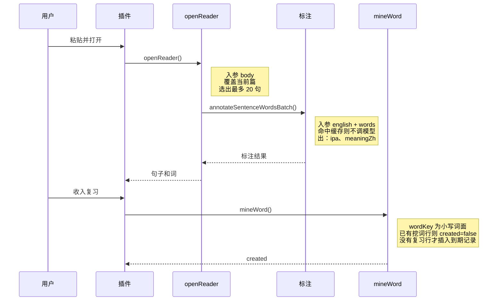
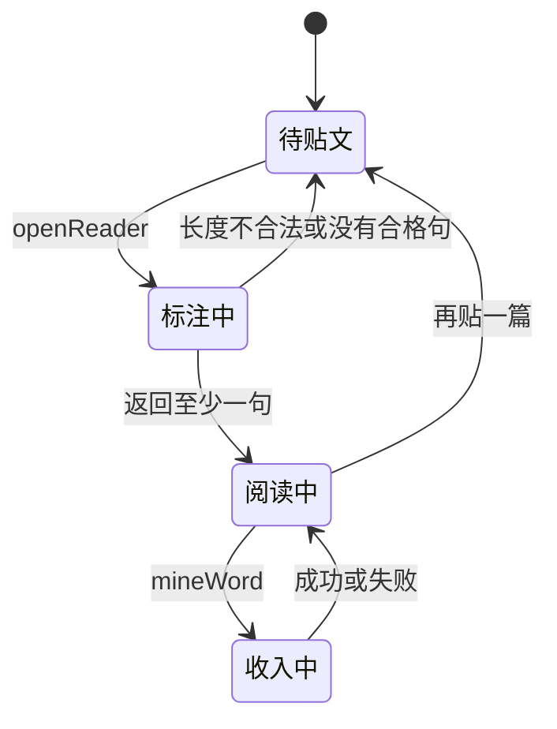

# 真文点词 — 实现思路

> **状态**：规划（未实现；分词、句词标注缓存、复习行可复用）  
> **日期**：2026-11-09  
> **需求摘要**：学习者贴进一篇自己要读的英文，点不认识的词看释义，并让这个词带着原句进入今天的复习。  
> **一句话方案（预告）**：新增远程插件 `englishReader`。服务端用现有分词和 `annotateSentenceWordsBatch` 给贴进来的句子标释义；点「收入复习」写入新的挖词行，并只在还没有复习行时插入一条到期记录。不进错题本，不嵌 YouTube。

## 延伸阅读

- [语境选择速练](./语境选择速练.md)（不采纳：只把已到期的词换成四选一，没有新的可理解输入）
- [短文批改插件](./短文批改插件.md)（不采纳：一轮一篇作文，不增加阅读量）
- [学习笔记远程](../../english/学习笔记远程.md)（子应用挂载方式）
- [今日记词与今日复习](./今日记词与今日复习.md)（复习队列怎样读到词的快照）

---

## 0. 读本文你将得到什么

- 学得快靠的是自己选的真文里反复遇到词，不是把已经到期的词再点一遍，也不是改一篇作文。
- 比对后选定 **贴文点词插件**。视频字幕插件、四选一速练、把点过的词塞进错题本都落选。
- 插件只负责阅读和点选。分词、释义缓存、SM-2 仍在现有后端。挖词用一张新表，并让复习队列在记词和错题都没有时读到它。
- 两阶段：先能贴文、看释义、收入今日复习；再在复习快照里接上挖词行。
- 最大风险是每点一次都把 `nextReviewAt` 拨回现在，把已经记住的词又拉进今天。

---

## 1. 需求与边界

### 1.1 用户故事

| 角色 | 场景 | 行为 | 期望结果 |
|------|------|------|----------|
| 已登录学习者 | 手里有一段想读的英文（文章、歌词、字幕稿） | 贴进真文点词，点不认识的词 | 看到音标和中文释义，不必离开这句 |
| 同一人 | 这个词还不会 | 点「收入复习」 | 词和所在原句进入今日复习；错题本不出现这条 |
| 同一人 | 这个词已经在复习里 | 再点一次 | 只显示释义，不把下次复习时间改回现在 |
| 未上架插件的用户 | 看英语学习侧栏 | 浏览 | 没有这个入口 |

### 1.2 范围

| 在范围内 | 不在范围内（非目标） |
|----------|----------------------|
| 远程插件 `englishReader`，路由 `/english-learning/reader` | 在每日阅读详情页上加按钮（那是系统生成的短文，不是用户自己的材料） |
| 粘贴纯文本。服务端切开最多 20 句并标注 | YouTube / Netflix 内嵌播放和双语字幕（Language Reactor 的视频部分） |
| 点词看 `ipa` / `meaningZh`，可选收入复习 | LingQ 的四级熟词状态、课程库、社区课 |
| 新挖词进入现有今日复习队列 | 用四选一取代听写；用作文批改代替阅读 |
| 每个用户只保留当前这一篇 | 文章历史列表 |

### 1.3 约束与依赖

- 登录沿用 `EnglishLearningController` 的 `JwtGuard`。
- 分词必须用后端已有的 `segmentEnglishSentence`，和标注接口的 `words` 一致。插件不自己再写一套正则。
- 释义走已有 `annotateSentenceWordsBatch`。同一句命中 `sentence_word_annotation_cache` 时不再打模型。
- 单句限制与标注 DTO 相同：一句最多 2000 字、80 个词。一次最多 20 句，低于 `ENGLISH_PRACTICE_SESSION_MAX`（100），避免一篇贴文打满练习用的模型额度。
- 复习队列今天只从「今日记词」和「错题」取词面。挖词要被复习读到，必须扩 `loadVocabReviewSnapshots`，不能只插复习行。
- `markReviewDueNow` 对已有复习行会把 `nextReviewAt` 改成现在。挖词不能调用它。
- 错题本的重置逻辑只删 `source=dailyMemorize`。即便如此，也不把看过的词写进错题表。

### 1.4 成熟产品里哪一段真的加快学习

| 产品 | 加快学习的动作 | 和本仓库 |
|------|----------------|----------|
| Readlang | 把任意文本放进阅读器，点词翻译，查过的词变成卡片 | 没有「用户自带文本」的阅读器。每日阅读的词是生成时写死的，点开不能进复习 |
| LingQ | 导入文章或音频稿，点词记为在学，SRS 复习 | 复习调度已有。缺的是导入和「点一下就进入调度」 |
| Language Reactor | Netflix / YouTube 双字幕，点词，存词 | 视频和字幕不在本仓库。桌面 WebView 里嵌视频是另一套产品 |
| Beelinguapp | 中英对照朗读 | 每日阅读已有句级中文和 TTS，但是生成稿 |
| Clozemaster / 四选一 | 用已有句子快速认词 | 只消耗到期队列，不增加新输入。上一版因此不采纳 |
| 批改网 / Grammarly | 写完再改 | 不增加阅读量。已单独写过，不作为这个插件 |

可理解输入要快，材料得是用户此刻想读的，并且生词要在同一次阅读里进入已有的复习，而不是停在气泡里。

---

## 2. 背景

- **谁、在什么场景、卡在哪**：学习者已经能生成词库、听写、按 SM-2 复习、读系统生成的每日短文。他想读的是自己复制来的一段英文。每日阅读点词只弹出生成时带上的释义，不会把这个词放进今日复习。
- **现状缺口**：`segmentEnglishSentence` 和 `annotateSentenceWordsBatch` 能给任意一句英文标音标和释义，但只被练习和语句库调用。`loadVocabReviewSnapshots` 只认记词记录和错题。用户的文本、点词、复习之间没有通路。
- **不解决会怎样**：阅读量被每日一篇生成稿卡住。四选一只是把到期词点得更快，队列空了就无事可做。作文批改不增加能读的句子。
- **硬约束**：不能为了省一张表把生词写进错题本；不能每次点词都把已经安排好的复习日改回今天；不能在插件里复制一份分词正则。

---

## 3. 现状与复用

| 能力 | 仓库中已有 | 本需求中的用法 |
|------|------------|----------------|
| 分词 | `sentence-segment.util.ts` 的 `segmentEnglishSentence` | 直接复用：服务端切开贴文 |
| 词义 | `annotateSentenceWordsBatch`，缓存表按句+词序列 | 直接复用：整篇一次批量标注 |
| 单句上限 | `AnnotateSentenceWordsDto`：2000 字、80 词 | 直接复用：超限的句跳过 |
| 词形键 | `normalizeVocabularyFavoriteWordKey`：trim + 小写 | 直接复用：挖词主键与复习 `itemKey` 相同 |
| 新复习行的默认间隔 | `defaultReviewStateForNewMistake` | 直接复用：仅当该词还没有复习行 |
| 复习快照 | `loadVocabReviewSnapshots` 读记词、错题 | 扩展：两者都没有时读挖词表 |
| 插件壳 | `views/englishLearning/notes/index.tsx` | 直接复用挂载 |
| 每日阅读点词 | `GlossSentence` | 不适用：不改生成稿页面 |
| 错题批插 | `batchAddVocabularyMistakes` 会 `markMistakesDueForReview` | 不适用：会把生词算作错题，并重置间隔 |
| 拨回今天 | `markReviewDueNow` | 不适用：已有复习行也会被改到现在 |
| 四选一 / 短文批改 | 前两篇规划 | 不适用 |

**调研结论**：释义和分词不用新做。缺的是「用户的一篇文本」和「点中的词成为复习快照」。错题接口和 `markReviewDueNow` 看起来能省事，但会写脏错题本或打乱已有间隔。

---

## 4. 方案比对与最终方案

### 4.1 候选方案

#### 方案 A：贴文点词插件（新增插件 + 挖词表）

- **做法**：registry 增加 `englishReader`，路由 `/english-learning/reader`，宿主页照笔记页挂 `PluginHostPage`。插件把纯文本 `POST /english-learning/reader/open`。服务端保存该用户当前这一篇（后写覆盖），用 `segmentEnglishSentence` 取前 20 个合格句，调用 `annotateSentenceWordsBatch`，返回句子和每个词的 `ipa`、`meaningZh`。点「收入复习」走 `POST /english-learning/reader/mine`：按小写 `wordKey` 写入 `english_mined_word`（词、音标、释义、原句）。仅当 `practice_review_state` 还没有这个 `itemKey` 时插入一行，`nextReviewAt` 为现在。`loadVocabReviewSnapshots` 在记词和错题都没有该 key 时用挖词行填上。已有挖词行则只返回「已在复习」，不改 `nextReviewAt`。
- **能工作的原因**：标注缓存和复习队列都在。挖词行补上快照之后，今日复习和以后的听写都能拿到词面和原句。
- **主要代价**：一张挖词表、一个当前篇字段、复习快照多一次查询。没有视频。

#### 方案 B：四选一速练插件（上一版）

- **做法**：插件只读 `GET practice/review/queue`，四个词面点选，每题 `POST practice/review/record`。见 [语境选择速练](./语境选择速练.md)。
- **能工作的原因**：到期队列和 SM-2 已上线，不调模型也能刷完今天的词。
- **主要代价**：不读任何新文章。没有到期词时插件是空的。学习速度停在「复习得更快」。

#### 方案 C：Language Reactor 式视频插件

- **做法**：插件里贴 YouTube 地址，拉字幕，双行显示，点词后同样收入复习。
- **能工作的原因**：字幕文本一旦到手，后半段和方案 A 的挖词相同。市场里这是听真实说话最快的工具。
- **主要代价**：本仓库没有字幕抓取、视频播放和版权材料的通路。Tauri WebView 里嵌 YouTube 还要处理自动播放和跨域。第一版就会卡在「字幕从哪来」。

### 4.2 比对

| 维度 | 方案 A 贴文点词 | 方案 B 四选一 | 方案 C 视频字幕 |
|------|-----------------|---------------|-----------------|
| 正确性 | 新词才插入复习行；已有间隔不动。释义来自标注缓存，点词不另打模型 | 只复习已有到期词，不会把生词写进复习表，也不会读到新句子 | 挖词若复用 A 则间隔正确，但字幕错位时例句是错的 |
| 复用 | 分词、标注批处理、复习行默认值、插件壳 | 复习队列和记账。阅读和标注用不上 | 挖词可复用 A。视频和字幕全是新链路 |
| 改动面 | 插件、路由、侧栏、`open`/`mine`、挖词表、快照函数一处查询 | 插件和 registry。后端复习服务不改 | 在 A 之上再加播放器和字幕源 |
| 复杂度 | 一篇当前文本 + 挖词行。无新调度公式 | 题面打乱。无新表 | 播放、时间轴、字幕语言 |
| 体验 | 贴上就能点。标注走缓存，同一句第二次打开不重新生成 | 点选很快，但材料只能是系统里已经会的词 | 看着剧学是最强输入，第一天却可能因为没有字幕而打不开 |
| 风险 | 20 句截断会丢掉后文。当前篇后写覆盖，没有历史 | 不增加生词，学习积压的是「没有新输入」 | 字幕接口失效或版权材料进库 |
| 可维护性 | 分词只留在 `segmentEnglishSentence` | 听写仍是另一套题面，两套都要懂 | 播放器升级会反复碰到 WebView |

### 4.3 综合考量

权重最高的是：有没有新的可理解输入，以及生词会不会进今天的复习。方案 A 用用户自己的文本制造输入，用现有标注给出释义，用现有复习行安排下次出现。

不选方案 B。它的优点是完全不打模型、实现面更小。这个优点抵不过它不带来任何新句子。用户已经否定了「只把复习点得更快」。

不选方案 C。它的优点是市场里和真实口语贴得最近。这个优点抵不过仓库里没有字幕和播放。贴文本已经覆盖「把字幕稿粘进来」这一条，视频壳可以以后再加，而不是第一版的前提。

### 4.4 最终方案

#### 背景

每日阅读不能导入用户的文本，点词也不进复习。标注和分词已经能处理任意英文句子。复习快照只认记词和错题。错题批插会重置间隔并把生词显示成错题。`markReviewDueNow` 会把已有复习日改到现在。

#### 具体思路

1. **模块**：插件显示句子和气泡。`open` 与 `mine` 在英语学习服务里。宿主只挂路由和上架开关。
2. **数据**：当前篇按用户覆盖存一行。挖词按 `(user_id, word_key)` 存一行，例句用点词时所在的那句。复习行的 `itemKey` 等于 `wordKey`。
3. **状态**：气泡开关在插件里。下次复习时间只在复习行里。插件不保存间隔。
4. **边界**：空文本、短于 20 字、长于 20000 字拒绝。超长句和超过 80 词的句跳过。没有任何合格句则不调用标注。已经挖过的词不再写复习行。记词或错题里已有快照时，复习仍用那一份，挖词行不覆盖。

#### 实现方案

**一句话**：新增远程插件 `englishReader`。服务端用现有分词和 `annotateSentenceWordsBatch` 给贴进来的句子标释义；点「收入复习」写入挖词行，并只在还没有复习行时插入一条到期记录。

| 步骤 | 谁 | 做什么 | 输入 → 输出 |
|------|----|--------|-------------|
| 1 | 侧栏 | 已上架才进入 | 点击 → `/english-learning/reader` |
| 2 | 插件 | 提交粘贴文本 | `body` → `POST reader/open` |
| 3 | `openReader` | 存当前篇、选句、批量标注 | 文本 → 句子和词标注 |
| 4 | 插件 | 点词显示释义 | 词 → 气泡 |
| 5 | `mineWord` | 新词写入挖词表；没有复习行才插入 | 词 + 原句 → `{ created }` |
| 6 | `loadVocabReviewSnapshots` | 记词、错题都没有时读挖词表 | `itemKey` → 词面、释义、例句 |

#### 选定原因

1. **正确性**：已有复习行不动。牺牲：同一个词后来的句子不会替换第一次保存的例句。
2. **复用**：分词和标注缓存不重写。牺牲：多一次快照查询。
3. **改动面**：每日阅读、听写、Agent 不改。牺牲：宿主加路由和 registry。
4. **复杂度**：没有视频时间轴，也没有新的 SM-2。牺牲：一篇只保留当前文本。
5. **体验**：贴上就能读。牺牲：一次最多 20 句，后面的句子这次看不到。
6. **风险**：不调用 `markReviewDueNow`。牺牲：已经在复习里的词，再点不会提前出现。
7. **可维护性**：正则只在 `segmentEnglishSentence`。牺牲：插件必须等 `open` 返回词列表，不能在本地切词后自行标号。

#### 优势

- 相对方案 B：用户能读自己的材料，生词会进入今天的复习；四选一在队列为空时没有东西可学。
- 相对方案 C：不依赖字幕服务和视频壳。用户若只有字幕稿，贴进来就是同一条挖词路径。

#### 怎么实现

1. 侧栏在 `usePluginEnabled('englishReader')` 为假时不渲染。
2. 宿主页复制笔记页的就绪判断，挂 `PluginHostPage`。
3. `openReader` 校验长度，覆盖保存当前篇，`selectSentences` 选出最多 20 句。
4. 有句子才调用 `annotateSentenceWordsBatch`，把返回的 `meaningZh`、`ipa` 按词序填回。
5. 插件点「收入复习」时把该词和所在句交给 `mineWord`。
6. `mineWord` 用 `normalizeVocabularyFavoriteWordKey` 做键。已有挖词行直接 `created: false`。没有复习行才按 `defaultReviewStateForNewMistake` 插入，`nextReviewAt` 用现在。
7. `loadVocabReviewSnapshots` 在记词和错题都未命中时读取挖词行。

代码在 §9。

### 4.5 其他关键决策：生词落在哪张表

总体方案已经定了贴文插件。还会改变数据归属的是：生词写入现有错题表，还是单独的挖词表。

#### 4.5.1 候选

##### 方案 A：挖词表（选定）

- **做法**：`english_mined_word` 存词面、音标、释义、例句。复习快照第三顺位读取。错题列表的查询不改。
- **能工作的原因**：今日复习只要快照里有词面就能练。错题页的 SQL 仍只读错题表。
- **主要代价**：多一张表，快照函数多一个查询。

##### 方案 B：直接调用错题批插，`source` 写 `reader`

- **做法**：插件 `POST vocabulary-mistakes/batch`，例句放进 `example`，释义放进 `translationZh`。现有函数会把新行标成今日到期。
- **能工作的原因**：快照函数已经读错题表，复习不用改。
- **主要代价**：错题本出现「我只是点开看过」的词。已存在的错题若 `lastUserInput` 变化，会重置间隔。

#### 4.5.2 比对

| 维度 | 方案 A 挖词表 | 方案 B 错题批插 |
|------|---------------|-----------------|
| 正确性 | 看词不等于答错。已有间隔不重置 | 错题列表被看过的词填满。更新 `lastUserInput` 会把间隔打回新错 |
| 复用 | 复习行的插入字段复用默认值。列表查询不复用错题 | 完全复用批插和快照 |
| 改动面 | 新表 + 快照补查询 | 插件多一次已有 POST |
| 复杂度 | 一张窄表 | 无新表 |
| 体验 | 错题本仍是答错的词。今日复习里能见到新点的词 | 错题本突然变长，用户分不清 |
| 风险 | 快照漏改则复习行没有词面，队列会丢掉该 key | 重置「今日记词错题」不会删 `source=reader`，这些词会一直留在错题本 |
| 可维护性 | 错题导出、错题练习不用知道阅读器 | 每个错题功能都要记得排除 `reader` |

#### 4.5.3 综合考量

这里的权重是错题本的含义不能坏。方案 B 少一张表，但今日复习能用，是因为把生词伪装成错题。这个省事抵不过错题练习、导出和重置都会把「点过的词」当成答错。

#### 4.5.4 最终做法

##### 背景

复习快照不读收藏，只读记词和错题。点词需要一条能被快照读到的词面，又不能进错题查询。

##### 具体思路

挖词表只服务阅读器。快照先用记词，再用错题，最后才用挖词。因此练习里已经有的快照不会被阅读器盖掉。

##### 实现方案

**一句话**：生词写入 `english_mined_word`，复习快照只在记词和错题都没有该 key 时读取它。

| 步骤 | 谁 | 做什么 | 输入 → 输出 |
|------|----|--------|-------------|
| 1 | `mineWord` | 插入挖词行 | 词 + 句 → 一行 |
| 2 | `loadVocabReviewSnapshots` | 补齐仍缺的 key | key → 词面和例句 |

##### 选定原因

1. **正确性**：错题查询不变。牺牲：快照多一次查询。
2. **风险**：不走会重置间隔的错题批插。牺牲：不能用现成的错题导出把挖词导出成 Word。
3. **可维护性**：错题页不用加 `source` 过滤。牺牲：挖词没有单独的列表页，要在今日复习里看到。

##### 优势

- 相对方案 B：错题本、错题导出和「只清除今日记词错题」都不用改；看过的词不会显示成答错。

##### 怎么实现

插入和快照补齐见 §9.3、§9.4。不调用 `batchAddVocabularyMistakes`。

---

## 5. 架构图



**图内方法说明**：

| 方法 | 功能 |
|------|------|
| `usePluginEnabled('englishReader')` | 读上架偏好；为假时不挂插件 |
| `PluginHostPage` | 按插件 id 加载远程模块 |
| `openReader(userId, body)` | 校验并覆盖当前篇，选出最多 20 句，批量标注后返回词列表 |
| `annotateSentenceWordsBatch` | 已有方法：按句查缓存，未命中才调模型 |
| `mineWord(userId, input)` | 写入挖词行；没有复习行才新建到期记录 |
| `loadVocabReviewSnapshots` | 已有方法：为复习队列拼词面。本需求在末尾补挖词 |

**读图要点**：

- 插件不切词、不调用模型。句子和释义都从 `openReader` 来。
- 挖词表和复习行分开。有复习行只表示「要排期」，词面在挖词、记词或错题里。
- 错题批插不在这张图上。

---

## 6. 主流程图



**图内方法说明**：

| 方法 | 功能 |
|------|------|
| `openReader(userId, body)` | 长度通过后才覆盖当前篇并标注；失败不改已保存的篇 |
| `selectSentences(body)` | 按句号、问号、叹号和换行切开，丢掉超长句，最多留 20 句 |
| `mineWord(userId, input)` | 已有挖词行则直接返回未新建；否则插入词面，并在缺少复习行时补一条到期记录 |

**读图要点**：

- 长度不合法不会清掉上一篇。
- 收入复习失败时文章和已点开的释义还在，用户可以再点。
- 已经挖过的词不会进入「写入挖词行」之后的分支。

---

## 7. 核心时序图



**图内方法说明**：

| 方法 | 功能 |
|------|------|
| `openReader()` | 插件只提交正文。分句和标注都在服务端完成 |
| `annotateSentenceWordsBatch()` | 按句返回词标注。缓存命中时不新增模型调用 |
| `mineWord()` | 以词形为键保存原句。返回 `created` 表示这次是不是新挖的词 |

**读图要点**：

- 点开气泡不产生第二次模型请求，释义已经在 `open` 的结果里。
- `mineWord` 不负责改间隔。已有复习行时它只保证挖词表里有这个词。
- 今日复习是之后另一次打开复习页，不在这条打开文章的时序里。

---

## 8. 状态机



**图内方法说明**：

| 方法 | 功能 |
|------|------|
| `openReader` | 从待贴文进入标注中。长度不合法或标注失败都不写当前篇，阅读区仍留着上一篇成功的结果 |
| `mineWord` | 收入中忽略连点；结束后回到阅读中，文章不关闭 |

**读图要点**：

- 阅读中可以连续挖多个词，不必重新打开。
- 再贴一篇会覆盖当前篇，已经挖进复习的词不删除。

---

## 9. 具体实现（主链路代码）

### 9.1 模块一览

| 模块 | 职责 | 新增/改动 | 预估路径 |
|------|------|-----------|----------|
| 阅读插件 | 粘贴、点词、收入复习 | 新增 | `apps/remote-plugins` 暴露 `./EnglishReader` |
| 宿主页 | 上架判断 + `PluginHostPage` | 新增 | `apps/frontend/src/views/englishLearning/reader/index.tsx` |
| 侧栏卡 | 未上架不显示 | 新增 | `apps/frontend/src/views/englishLearning/sidebar/components/ReaderSession.tsx` |
| 打开与挖词 | 选句、标注、写复习 | 新增 | `apps/backend/src/services/english-learning/english-reader.service.ts` |
| 当前篇 / 挖词 | 各用户一篇；词形一行 | 新增 | 迁移 + 两个 entity |
| 复习快照 | 补挖词词面 | 扩展 | `english-learning.service.ts` 的 `loadVocabReviewSnapshots` |
| 注册表 | 描述符 | 扩展 | `apps/backend/uploads/remotes/plugins-registry.json` |

### 9.2 选句

```typescript
// 对应 §4.4 步骤 3。一次打开最多 20 句，避免一篇贴文占满练习标注的额度
const READER_MAX_SENTENCES = 20;
// 与 AnnotateSentenceWordsDto 的 english 上限一致，超长句标不了
const READER_MAX_SENTENCE_CHARS = 2000;
// 与标注 DTO 的 words 上限一致
const READER_MAX_WORDS = 80;

// 对应 §4.4 步骤 3。只保留标注接口能接受的句子，正则仍交给 segmentEnglishSentence
function selectSentences(body: string): { english: string; words: string[] }[] {
	// 句号、问号、叹号后的空白，以及换行，都当作句界
	const parts = body.split(/\n+|(?<=[.!?])\s+/);
	// 合格句按出现顺序收集，调用方不再排序
	const picked: { english: string; words: string[] }[] = [];
	// 按原文顺序扫描，不把后文的短句提前
	for (const part of parts) {
		// 丢掉纯空白片段
		const english = part.trim();
		// 空白片段不能当一句去标注
		if (!english) continue;
		// 超长句跳过，不把整篇 open 判失败
		if (english.length > READER_MAX_SENTENCE_CHARS) continue;
		// 词序列必须和标注请求的 words 同源
		const words = segmentEnglishSentence(english).map((token) => token.raw);
		// 没有词或词太多，标注 DTO 都会拒绝
		if (words.length === 0 || words.length > READER_MAX_WORDS) continue;
		// 这一句可以进批量标注
		picked.push({ english, words });
		// 够 20 句就停，后面的正文这次不标注
		if (picked.length >= READER_MAX_SENTENCES) break;
	}
	// 可能为空，调用方据此不打模型
	return picked;
}
```

### 9.3 收入复习

```typescript
// 对应 §4.4 步骤 5 和 §4.5。新词才进复习；已有挖词行或已有复习行都不改下次时间
async function mineWord(
	// 只挖当前登录用户的词，不能用插件传来的用户 id
	userId: number,
	// 词面来自 open 返回的 token，例句是它所在的那一句
	input: { word: string; ipa: string; pos: string; translationZh: string; example: string },
// created 为 false 表示这次没有新建，复习日也不许改
): Promise<{ created: boolean }> {
	// 与收藏、错题同一个小写键，复习 itemKey 才能对上
	const wordKey = this.normalizeVocabularyFavoriteWordKey(input.word);
	// 空词形不能当主键
	if (!wordKey) throw new BadRequestException('EMPTY_WORD');
	// 已经挖过就不要再拨复习日
	const mined = await this.minedWordRepo.findOne({ where: { userId, wordKey } });
	// 重复点击直接返回，后面的插入和复习行都跳过
	if (mined) return { created: false };
	// 第一次保存词面和点词时的那一句
	await this.minedWordRepo.save(
		this.minedWordRepo.create({
			// 与复习行使用同一个用户
			userId,
			// 小写键，避免 Hello 和 hello 各占一行
			wordKey,
			// 展示用原词形，复习卡上不要变成小写
			word: input.word.trim(),
			// 来自标注结果，没有就存空串，不编造音标
			ipa: input.ipa.trim(),
			// 词性列比错题表更短，先截断以免写入失败
			pos: input.pos.trim().slice(0, 32),
			// 气泡里的中文，复习时还要看
			translationZh: input.translationZh.trim(),
			// 点词时的原句，作为这条词的语境
			example: input.example.trim(),
		}),
	);
	// 记词或错题可能已经有复习行，那种情况保留原来的 nextReviewAt
	const state = await this.practiceReviewStateRepo.findOne({
		// 只查单词复习行，语句复习的 key 不是这个词形
		where: { userId, contentKind: 'vocab', itemKey: wordKey },
	});
	// 没有行才插入；有行就结束，避免把已安排的日子改到现在
	if (!state) {
		// 新行的间隔和熟练度与第一次答错相同，这样今天就会出现在复习队列
		const defaults = defaultReviewStateForNewMistake();
		await this.practiceReviewStateRepo.save(
			this.practiceReviewStateRepo.create({
				// 复习行按用户隔离，不能写成公共词
				userId,
				// 今日复习的单词队列只认 vocab
				contentKind: 'vocab',
				// 与挖词表 word_key 相同，快照才能对上
				itemKey: wordKey,
				// 现在到期，不必等用户再答错一次
				nextReviewAt: new Date(),
				// 沿用新错题的间隔，不单独发明一套天数
				intervalDays: defaults.intervalDays,
				// 还没答对过
				repetitions: defaults.repetitions,
				// 库存的是字符串，和现有复习行一致
				easeFactor: defaults.easeFactor.toFixed(2),
				// 队列不按这个字段过滤；占位成 wrong，表示还没有答对记录
				lastResult: 'wrong',
				// 还没练过，和 markMistakesDueForReview 的新行一样留空
				lastPracticedAt: null,
			}),
		);
	}
	// 挖词行已经写下，调用方可以提示已收入
	return { created: true };
}
```

### 9.4 数据模型

| 字段 | 来源 | 存储 | 说明 |
|------|------|------|------|
| `english_reader_passage.body` | 用户粘贴 | DB，每用户一行 | 后一次打开覆盖；不保留历史 |
| `english_mined_word.word_key` | `normalizeVocabularyFavoriteWordKey` | DB，`(user_id, word_key)` 唯一 | 等于复习 `itemKey` |
| `example` | 点词时所在句 | 挖词表 | 已存在则不更新 |
| `practice_review_state` | 仅首次挖到且原先没有行 | 已有复习表 | `nextReviewAt` 为插入时的现在 |
| 标注 | `annotateSentenceWordsBatch` | 已有句词缓存 | 插件不另存一份释义 |

`ponytail:` 当前篇只留一行。天花板是不能回看昨天贴的文章。升级路径是把这一行改成按 `passage_id` 列表，挖词行加上 `passage_id`。

快照补齐：在 `loadVocabReviewSnapshots` 现有记词、错题两次查找之后，对 `out` 里还没有的 key 查 `english_mined_word`，填 `word`、`ipa`、`pos`、`translationZh`、`example`。已有快照不覆盖。

---

## 10. 分阶段实现步骤

| 阶段 | 目标 | 交付物 | 依赖 |
|------|------|--------|------|
| M1 | 贴文能点开释义 | `openReader`、插件、宿主页、当前篇表 | 现有标注 |
| M2 | 点过的词出现在今日复习 | `mineWord`、挖词表、快照补齐 | M1 |

### M1

- [ ] registry 增加 `englishReader`，`routePath` 为 `/english-learning/reader`，`injectRoute: false`。
- [ ] 宿主页和侧栏照笔记页接上架开关。
- [ ] `open` 拒绝短于 20 字或长于 20000 字的文本，且失败时不覆盖旧篇。
- [ ] 最多标注 20 个合格句。超长句跳过并在响应里给出跳过数。
- [ ] 点词气泡使用返回的 `meaningZh` 和 `ipa`，不再请求模型。

### M2

- [ ] 「收入复习」写入挖词表。重复点击返回已存在，且复习行的 `nextReviewAt` 不变。
- [ ] 该词原先没有复习行时，今日复习能看到词面和原句。
- [ ] 该词已在错题或记词里时，复习仍显示原来的快照。
- [ ] 错题列表不出现这条挖词。

---

## 11. 风险、边界与待确认

| 项 | 等级 | 说明 | 缓解 |
|----|------|------|------|
| 点一次就把复习日拉回今天 | 高 | `markReviewDueNow` 和错题批插都会改已有行 | `mineWord` 只在没有复习行时插入 |
| 快照漏接 | 高 | 只有复习行、没有词面时，队列会丢掉这个 key | M2 必须改 `loadVocabReviewSnapshots`，不能只插复习行 |
| 20 句截断 | 中 | 长文后半看不到 | 响应里返回跳过数；历史篇留到 ponytail 升级 |
| 覆盖当前篇 | 中 | 再贴一篇，上一篇正文没了 | 挖过的词还在。升级前在界面写明只保留当前篇 |
| 标注失败 | 中 | 模型不可用时整篇没有释义 | `open` 失败不覆盖旧篇；气泡不能收入没有释义的词 |
| 视频 | 不适用 | 第一版不播 YouTube | 字幕稿可以当纯文本贴入 |

**待确认**：

- [ ] 复习列表是否只展示 `lastResult === 'wrong'` 的行。验证方式：查前端复习页和 `getPracticeReviewQueue` 的过滤条件。目前队列只按 `nextReviewAt` 过滤。若前端另外过滤 `wrong`，新挖词的 `lastResult` 保持 `'wrong'` 才能出现；若没有这层过滤，这个字段只是占位。

---

## 12. 验收清单

| # | 用例 | 步骤 | 期望 |
|---|------|------|------|
| AC1 | 贴文点词 | 贴入含两句英文的文本并打开 | 两句可点；词上有中文释义；第二遍打开同一句不新增模型调用（缓存命中） |
| AC2 | 收入复习 | 对一个不在记词、不在错题里的词点收入复习 | 挖词表有一行；今日复习能看到该词和原句；错题本没有它 |
| AC3 | 重复点 | 对 AC2 的词再点一次 | 提示已在复习；`nextReviewAt` 与第一次插入后相同 |
| AC4 | 已有错题 | 对一个已在错题本的词点收入 | 挖词表可以有行；今日复习仍显示错题里的词面，而不是把错题行改掉 |
| AC5 | 过短 | 贴入少于 20 字 | 不覆盖上一篇；不调用标注 |
| AC6 | 超长句 | 其中一句超过 2000 字，另一句正常 | 只标注正常句，并告知有句子被跳过 |
| AC7 | 下架 | 关掉 `englishReader` | 侧栏无入口；打开路由不调用 `open` |

---

## 13. 预估改动面（实现阶段参考）

| 类型 | 路径（预估） |
|------|--------------|
| 前端宿主 | `apps/frontend/src/views/englishLearning/reader/index.tsx`、`sidebar/components/ReaderSession.tsx`、`sidebar/EnglishSidebar.tsx`、`router/routes.ts`、`i18n/locales/*/englishLearning.ts` |
| 远程插件 | `apps/remote-plugins` 中新的阅读暴露模块 |
| 后端 | `english-reader.service.ts`、`english-learning.controller.ts`、`english-learning.service.ts` 的快照函数、两张表的迁移、`uploads/remotes/plugins-registry.json` |
| 文档（实现后） | `micro-apps/remote-docs/wiki/english/` 下的实现归档 |

---

（本文档为规划态实现思路；落地后以源码与 remote-docs wiki 专题为准）
