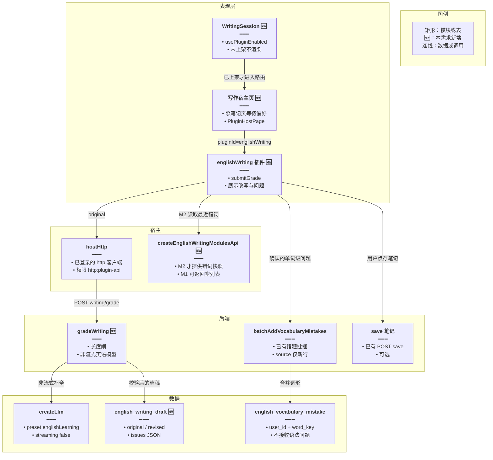
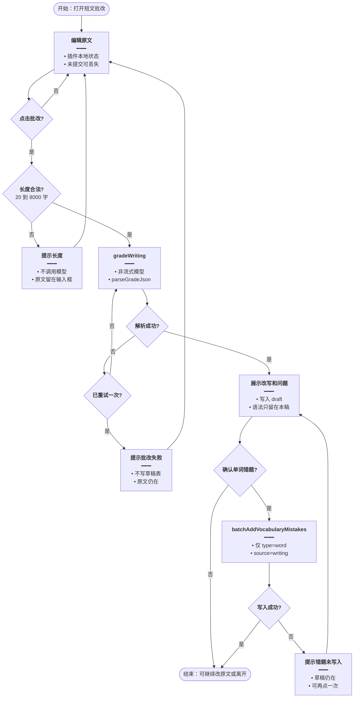
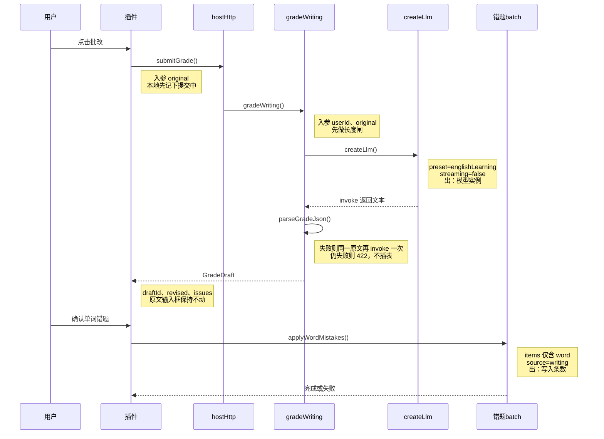
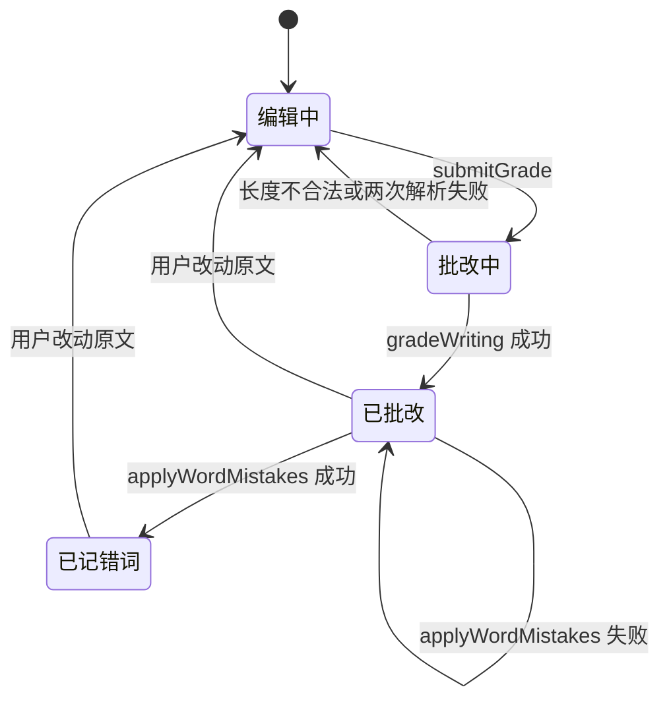

# 短文批改插件 — 实现思路

> **状态**：不采纳（规划保留）。快速学习改由 [语境选择速练](./语境选择速练.md) 承担。本文只说明「短文批改」若单独做时怎么接。  
> **日期**：2026-11-09  
> **需求摘要**：学习者在英语学习里写一段英文，提交后看到改写和逐条说明，并把写错的词收回现有错题本。  
> **一句话方案（预告）**：若以后要做输出纠错，再用远程插件 `englishWriting` 和独立的非流式 `gradeWriting`。它清不掉今天的到期队列。

## 延伸阅读

- [学习笔记远程](../../english/学习笔记远程.md)（已落地的子应用挂载：`PluginHostPage` + registry）
- [学习笔记独立弹窗](../../english/学习笔记独立弹窗.md)（长编辑会话为什么拆出宿主包）
- [第三方联邦插件接入](../plugins/第三方联邦插件接入.md)

---

## 0. 读本文你将得到什么

- 英语学习已覆盖记词、听写、复习、阅读和笔记，缺的是「自己写一段再被改」这一段输出练习。
- 比对后选定 **短文批改子应用**，不选影子跟读，也不把写作页打进宿主包。
- 改动落在远程插件、宿主路由/侧栏、`english-learning` 一个批改接口和一张草稿表；错题仍走现有 `vocabulary-mistakes/batch`。
- 分三阶段：先能交卷出改写，再把单词错误收回错题本，最后才把最近错词带进提示词。
- 最大风险是模型不按 JSON 交卷，或用户把语法病句塞进以词形为唯一键的错题本。

---

## 1. 需求与边界

### 1.1 用户故事

| 角色 | 场景 | 行为 | 期望结果 |
|------|------|------|----------|
| 已登录学习者 | 听写和阅读之后，想检查自己写的一段话 | 打开「短文批改」，粘贴或写下英文，点批改 | 看到改写、中文总评，以及标在原文上的问题 |
| 同一人 | 某几个词反复写错 | 勾选单词级问题并确认 | 这些词进入现有错题本，`source=writing`，之后能进今日复习 / 错题练习 |
| 同一人 | 想留下这篇 | 点「存进笔记」 | 原文和改写写入现有学习笔记，批改草稿仍留在写作表 |
| 未上架该插件的用户 | 打开英语学习首页 | 浏览侧栏 | 不出现短文批改入口，与学习笔记下架行为一致 |

### 1.2 范围

| 在范围内 | 不在范围内（非目标） |
|----------|----------------------|
| 远程子应用 `englishWriting`，路由 `/english-learning/writing` | 把批改 UI 写进 `views/englishLearning` 主包 |
| 一篇 20～8000 字的英文，一次提交、一次改写 | Grammarly 式逐键实时下划线 |
| 问题分 `word` / `grammar` / `usage` | 批改网式四六级 / 雅思维度打分 |
| 用户确认后，仅单词级问题进现有错题批插 | 语法病句改造成假词条塞进错题本 |
| 可选把原文+改写存进学习笔记 | 社区互改（LangCorrect）、音素跟读（ELSA） |

### 1.3 约束与依赖

- 必须登录。`EnglishLearningController` 已有类级 `JwtGuard`，新接口挂在同一控制器上。
- 模型凭证走现有 `createLlm({ preset: 'englishLearning' })`，不新开供应商，不进英语 Agent 的意图闸。
- 插件挂载照学习笔记：`PluginHostPage`、`usePluginEnabled`、registry 的 `permissions`。
- 错题本唯一键是 `(user_id, word_key)`（`english_vocabulary_mistake`）。没有词头的问题不能进这张表。
- Web 与 Tauri 同一条 HTTP。本功能不录音，不碰 `getUserMedia`。
- 体验底线：超长、过短、模型失败都要在页面上说人话，不能白屏。

### 1.4 市面产品对照

对照的是「成熟产品把哪一段闭环做完了」，不是功能清单堆砌。本仓库已经有的能力见 §3。

| 产品 | 它卖的闭环 | 和本仓库的关系 |
|------|------------|----------------|
| 墨墨背单词 / Anki | 间隔重复记词 | 已有 SM-2（`english-practice-review.srs.ts`）和今日复习，不适合再做一个插件 |
| 不背单词 | 语境例句 + 拼写 | 已有听写 / 拼写（`PracticeMode = dictation \| spelling`） |
| LingQ / Readlang / 扇贝阅读 | 在真文上点词，收进生词 | 每日阅读已有点词释义（`GlossSentence`）。挖词应留在阅读页，不另起子应用 |
| 每日英语听力 / ELLLO | 长音频精听 | 只有句级 TTS，没有可授权的长音频；和听写重叠 |
| ELSA / 流利说 / Speechling | 跟读后的发音分 | 宿主有 TTS，聊天里有 `MediaRecorder` 转写，没有音素评分。做成插件只能给「转写像不像原句」 |
| Grammarly / 有道写作 / 剑桥 Write & Improve / 批改网 | 自己写一段，得到改写和错误说明 | **仓库里没有这一段**。编辑会话长，和已经拆出去的学习笔记同一类表面 |

---

## 2. 背景

- **谁、在什么场景、卡在哪**：学习者已经能生成词库和语句、做听写拼写、按 SM-2 复习、读每日短文并点词、用 Agent 查库，也能把收获写进笔记插件。这些都是输入和回忆。他写出来的英文没有地方被改。
- **现状缺口**：练习只有 `dictation` 和 `spelling`。语法页是静态参考（`reference/grammar`），不能对着用户的句子改。Agent 会对话，但一轮要过意图闸、工具和确认条，不适合「交一篇、拿一份结构化批改」。
- **不解决会怎样**：输出练习继续缺席。若硬做跟读，没有音素模型时分数是假的；若把写作页塞进宿主，主包会再吃进一套长编辑 UI，和笔记拆插件的原因相反。
- **硬约束**：子应用必须走现有联邦挂载；批改结果里的单词错误要能回到现有错题本；语法问题不能破坏 `word_key` 唯一约束；不能为这个功能再接一条 Agent 图。

---

## 3. 现状与复用

| 能力 | 仓库中已有 | 本需求中的用法 |
|------|------------|----------------|
| 子应用全页挂载 | `apps/frontend/src/views/englishLearning/notes/index.tsx` 的 `PluginHostPage` | 直接复用：写作页同样等偏好就绪再挂 `pluginId` |
| 侧栏入口随上架隐藏 | `sidebar/components/NotesSession.tsx` 的 `usePluginEnabled` | 直接复用：写作卡片同一判断 |
| 插件权限装配 | `federation/runtime/index.ts` 的 `buildModules` | 扩展：增加 `modules:englishWriting` 分支 |
| 注册表 | `apps/backend/uploads/remotes/plugins-registry.json` 的 `learningNotes` 条目 | 直接复用其字段形状（`routePath`、`expose`、`permissions`、`trust: first-party`） |
| 插件 HTTP | `runtime/index.ts` 的 `hostHttp`，经 `http:plugin-api` 露出 | 直接复用：插件 `api.http.post` 打批改接口 |
| 登录 | `EnglishLearningController` 类级 `JwtGuard` | 直接复用 |
| 模型 | `createLlm` 的 `preset: 'englishLearning'` | 直接复用，本次 `streaming: false` |
| 错题批插 | `POST /english-learning/vocabulary-mistakes/batch`，`source` 可标记来源 | 扩展：只接收单词级问题，`source` 固定 `writing` |
| 笔记保存 | `POST /english-learning/notes/save`（`title` + `content`） | 直接复用：用户点「存进笔记」时写一篇 |
| 听写 / 拼写 | `views/englishLearning/practice` | 不适用：不改练习模式枚举 |
| 每日阅读点词 | `dailyReading/components/GlossSentence.tsx` | 不适用：不在阅读正文上做批改 |
| 英语 Agent | `views/englishLearning/agent` 与后端 `el_*` 工具 | 不适用：批改不进这张图 |
| 麦克风转写 | `components/design/ChatEntry` 的 `MediaRecorder` | 不适用：本方案不录音 |
| SM-2 | `english-practice-review.srs.ts` | 不适用：写作不另算熟练度；单词进错题后沿用现有复习队列 |

**调研结论**：联邦子应用、鉴权 HTTP、英语模型凭证、错题批插、笔记保存都已经在线上。缺的是一个只负责「交短文 → 结构化批改」的插件表面，以及一张只存这篇草稿的表。跟读和精听缺的是评分模型或版权音频，接不上表里的现成模块。

---

## 4. 方案比对与最终方案

### 4.1 候选方案

#### 方案 A：短文批改子应用（新增插件，复用错题与笔记）

- **做法**：在 `apps/remote-plugins` 增加暴露模块 `./EnglishWriting`。宿主增加路由 `/english-learning/writing`，页面结构照 `notes/index.tsx`：偏好未就绪不渲染下架文案，就绪且 `usePluginEnabled('englishWriting')` 为假时显示已下架，否则 `<PluginHostPage pluginId="englishWriting" />`。侧栏加 `WritingSession`，未上架不渲染。registry 增加条目，`permissions` 为 `ui:toast`、`nav:subtree`、`http:plugin-api`、`modules:englishWriting`。后端在 `EnglishLearningController` 增加 `POST writing/grade`：校验 20～8000 字，`createLlm({ preset: 'englishLearning', streaming: false })` 要一份 JSON，校验切片后写入 `english_writing_draft`。插件展示改写和问题。用户确认的 `type=word` 问题走已有 `POST vocabulary-mistakes/batch`。存笔记走已有 `POST english-learning/notes/save`。
- **能工作的原因**：挂载、鉴权、模型和错题写入都是现成调用，不依赖新的音频或版权内容。
- **主要代价**：要维护一个远程插件包和一张草稿表；第一次批改是整篇提交，没有逐键下划线。

#### 方案 B：影子跟读子应用（新增插件，复用 TTS 与麦克风）

- **做法**：同样用 `PluginHostPage` 挂 `/english-learning/shadowing`。原句用宿主模块转调现有 `playPreferred`。录音沿用 `ChatEntry` 里已经能用的 `MediaRecorder`，转写走现有语音转写服务。分数用转写文本和原句的编辑距离，不接 ELSA 一类音素 API。低分句可写入错题或语句错题。
- **能工作的原因**：TTS、麦克风垫片（`utils/navigatorMediaDevices.ts`）和转写在仓库里都有，子应用边界也成立（一次录音会话）。
- **主要代价**：用户以为自己拿到的是发音分，实际只是「转写像不像」。桌面 WebView 的麦克风已经有失败文案。录音会话和听写抢同一路音频。和现有听写的学习动作重复。

#### 方案 C：宿主内嵌写作页（不做成插件）

- **做法**：在 `apps/frontend/src/views/englishLearning/writing/` 直接写页面，路由和侧栏照练习页注册，后端仍是 `POST writing/grade` 和草稿表。不改 registry，不改 `buildModules`。
- **能工作的原因**：少一个远程构建和 mf 清单，本地改 UI 不用发插件。批改数据流与方案 A 相同，所以正确性一样。
- **主要代价**：长编辑和批改列表进英语学习主包。笔记当初拆出去就是为了避免这种表面。插件下架、独立发版、和笔记一样的宿主壳都用不上。这和「用子应用接入」的目标不一致。

### 4.2 比对

| 维度 | 方案 A 短文批改插件 | 方案 B 影子跟读插件 | 方案 C 宿主内嵌写作页 |
|------|---------------------|---------------------|------------------------|
| 正确性（失败路径、边界、数据是否会错） | 过短、超长在进模型前拒绝；JSON 解析失败重试一次；切片越界丢弃。错题只接收有词头的 `word` 问题，不碰 `word_key` 唯一约束 | 编辑距离可以算对「字面是否跟读」，但把它显示成发音分是错的。麦克风拒绝、转写空结果都要单独兜住 | 与 A 的批改正确性相同。没有插件下架态，入口无法随 registry 关掉 |
| 复用 / 与现状契合 | 复用笔记页壳、`hostHttp`、`createLlm` 英语预设、错题 batch、笔记 save | 复用 TTS 和 `MediaRecorder`，评分链路是新的，和听写 / 阅读点词都接不上 | 复用后端与练习页路由写法。联邦壳、上架开关用不上 |
| 改动面（要动哪些路径） | 远程插件、宿主路由与侧栏、`buildModules`、registry、一个控制器方法、一张表 | 远程插件、宿主音频模块、转写调用、与练习播放的互斥、可能的语句错题写入 | 只动 `views/englishLearning` 和后端。不动 federation |
| 复杂度（新概念、新状态、新依赖） | 新概念是「一篇草稿 + 三类问题」。无新供应商 | 新概念是录音会话、转写对齐、假发音分。还要处理 WebView 麦克风 | 新概念与 A 相同，少一个插件描述符 |
| 体验（延迟、步骤数、失败时用户看到什么） | 一次提交，等一次非流式响应。失败看到长度或「批改失败，原文还在」 | 听、录、停、等转写，步数多于交卷。麦克风失败时桌面端已经有过整段说明，用户仍可能以为是发音功能坏了 | 与 A 相同，但主包变大，和笔记插件的进入方式不一致 |
| 风险（迁移、互斥、并发、回滚） | 新表可单独丢弃。与听写、阅读、Agent 无互斥。回滚是下架插件 | 与听写抢音频。分数预期一旦写出就很难改口。回滚同样靠下架，但产品承诺已经偏了 | 无插件回滚开关，只能再发宿主。无迁移风险 |
| 可维护性（以后改一处还是改多处） | 批改提示词和草稿表在后端一处；UI 在插件一处。错题本不用分叉 | 评分规则、录音和练习播放会分叉两处 | UI 和练习、阅读堆在同一包，下一处长表面还是会再讨论要不要拆 |

### 4.3 综合考量

权重最高的是两件事：批改结果必须是真的（不能用编辑距离冒充发音分），以及表面必须是子应用（笔记已经证明长编辑不该留在宿主包）。方案 A 在这两项上都站得住，并且错题 batch 和笔记 save 能接上。

不选方案 B。它相对 A 的优点是补上了「说」这个更显眼的缺口，也复用了已经接好的麦克风。这个优点抵不过分数失真：ELSA 和流利说被使用，是因为音素分；本仓库没有那条模型。先做一个会误导的跟读，比晚做写作更贵。

不选方案 C。它相对 A 的优点是少一个远程包、本地改 UI 更快。这个优点抵不过目标：用户要的是子应用接入。宿主包继续膨胀后，下架和独立发版都没了，等于把笔记已经走过的拆分再做反。

### 4.4 最终方案

#### 背景

英语学习的闭环停在输入和回忆：词库、听写拼写、SM-2、每日阅读点词、Agent、笔记插件。没有「把自己的英文交出去被改」的接口。硬约束是：走现有 `PluginHostPage` 和 `createLlm` 英语预设；单词错误回到 `vocabulary-mistakes/batch`；没有词头的问题不准进 `english_vocabulary_mistake`；不进 Agent 图。

#### 具体思路

1. **模块**：插件负责编辑和结果列表。宿主负责路由壳、侧栏开关、`modules.englishWriting`（只提供最近错词快照，M2 才用）。后端负责校验、调用模型、落草稿。错题和笔记沿用旧接口。
2. **数据**：原文从插件到 `POST /english-learning/writing/grade`。成功后草稿行是这份批改的源头；插件只缓存展示。确认错词时插件提交 `draftId` 加选中的词，服务端仍按练习结算的信任模型收 `items`（见风险：与练习相同，不在 M1 改 batch 的鉴权形状）。
3. **状态**：编辑中的原文放插件组件状态，刷新前未批改的文字可丢。批改一旦成功，以服务端草稿为准，刷新后按 `draftId` 再取。不放进英语 Agent 的 MobX store，避免和对话树互相覆盖。
4. **边界**：少于 20 字或超过 8000 字不调用模型。模型输出不是 JSON 时，把原文再交一次并要求只输出 JSON；仍失败则 422，插件保留原文。切片 `start/end` 越界或 `excerpt` 对不上原文的问题丢弃。用户改了原文，上一份结果作废，必须重新批改。

#### 实现方案

**一句话**：新增远程插件 `englishWriting`，宿主只挂路由和模块权限；批改走独立的非流式 `gradeWriting`，不进英语 Agent。

| 步骤 | 谁 | 做什么 | 输入 → 输出 |
|------|----|--------|-------------|
| 1 | `WritingSession` | 插件已上架才显示卡片，点击进入写作路由 | 点击 → `/english-learning/writing` |
| 2 | `EnglishLearningWritingPage` | 照笔记页挂载插件 | `pluginId=englishWriting` → 插件 UI |
| 3 | 插件 `submitGrade` | 把当前原文交给宿主 HTTP | `original` → 等待 `GradeDraft` |
| 4 | `gradeWriting` | 校验长度、调模型、校验 JSON、插入草稿 | `userId + original` → `{ draftId, revised, summaryZh, issues }` |
| 5 | 插件结果列表 | 按问题类型渲染；原文一改就清掉这份结果 | `GradeDraft` → 画面 |
| 6 | 插件 `applyWordMistakes` | 只把勾选的 `word` 问题提交现有 batch | `items[]` → 错题本 `source=writing` |
| 7 | 插件「存进笔记」 | 可选，调用现有笔记保存 | `title + content` → 笔记 id |

#### 选定原因

1. **正确性**：结构化批改能对原文切片做校验；跟读方案的分数对不上它声称的能力。牺牲：没有逐键反馈，也没有发音分。
2. **复用**：笔记壳、英语模型预设、错题 batch、笔记 save 都是现成的。牺牲：要多维护一个远程插件的构建和清单。
3. **改动面**：Agent、练习枚举、阅读点词不动。牺牲：宿主仍要加一条路由、一张侧栏卡和 registry 一行，不是零宿主改动。
4. **复杂度**：只新增草稿和三类问题，不新增供应商。牺牲：整篇一次的等待，而不是流式逐句。
5. **体验**：失败时原文留在输入框。牺牲：比宿主内嵌多一次插件加载。
6. **风险**：下架 registry 即可关掉入口，与听写无互斥。牺牲：草稿表要随迁移一起上，回滚要留表或写一条逆向迁移。
7. **可维护性**：提示词在 `gradeWriting` 一处。牺牲：插件和宿主版本要用现有 `hostApiRange` 对齐，不能只发热更新 UI 却改模块方法签名。

#### 优势

- 相对方案 B：交出去的是改写和可核对的切片，不是编辑距离伪装的发音分；也不和听写抢麦克风。
- 相对方案 C：入口能随 `usePluginEnabled('englishWriting')` 消失，UI 不进英语学习主包，发版单位和笔记相同。

#### 怎么实现

1. 侧栏 `WritingSession` 调用 `usePluginEnabled('englishWriting')`，为假则 `return null`，为真则 `navigate('/english-learning/writing')`。
2. 宿主页复制 `notes/index.tsx` 的就绪判断，挂 `PluginHostPage`。
3. 插件点批改时调用 `api.http.post('/english-learning/writing/grade', { original })`。
4. `gradeWriting` 做长度闸、`createLlm`、`parseGradeJson`、`insertWritingDraft`，返回草稿。
5. 插件把返回的 `issues` 画成列表；原文再编辑则丢掉本地的 `draftId`。
6. 确认错词时只提交 `type==='word'` 且带 `word` 的项到 `POST /english-learning/vocabulary-mistakes/batch`，`source: 'writing'`。
7. 存笔记时把原文和改写拼成 HTML，走 `POST /english-learning/notes/save`。这一步失败不影响草稿和错题。

主要实现代码在 §9。

### 4.5 其他关键决策：单词错误进哪

总体方案已经定了插件和 `gradeWriting`。还会改变数据去向的是：批改里的单词错误写进现有错题本，还是另起一张写作问题表。

#### 4.5.1 候选

##### 方案 A：只有单词级问题进现有错题 batch（扩展）

- **做法**：`issues` 全量留在 `english_writing_draft.issues`。用户勾选后，插件只把 `type==='word'` 且 `word` 非空的项映射成 `VocabularyMistakeBatchItemDto`（`word`、`translationZh` 用 `explainZh`、`example` 用原文中的 `excerpt`、`ipa` 先传空字符串——现有 DTO 要求 `ipa` 必填，空串已是列默认值）。`source` 传 `writing`。语法和用法不调用 batch。
- **能工作的原因**：`batchAddVocabularyMistakes` 已按 `wordKey` 合并，`source` 只在新建行写入、不覆盖旧来源。复习队列读的就是这张表。
- **主要代价**：`ipa` 可能为空，错题卡音标栏会空，直到以后某次练习补上。写作问题的语法类不能在错题本里单独筛选。

##### 方案 B：写作问题全部进新表，错题本不碰（新增）

- **做法**：`english_writing_issue` 按条存储，插件有自己的「写作错题」列表。复习和错题练习不读这张表。
- **能工作的原因**：`word_key` 唯一约束完全不受影响，语法病句也能存。
- **主要代价**：用户写错的词不会出现在已经每天打开的错题本和今日复习里，等于又做一个平行列表。

##### 方案 C：所有问题都塞进错题 batch（扩展到失真）

- **做法**：语法问题用整句截断当作 `word`，照样 `POST vocabulary-mistakes/batch`。
- **能工作的原因**：只打一个已有接口。
- **主要代价**：唯一键会把不同病句压成同一行，或把句子当成词面，错题练习的拼写输入无法作答。

#### 4.5.2 比对

| 维度 | 方案 A 单词进错题本 | 方案 B 写作问题另表 | 方案 C 全部塞进错题本 |
|------|---------------------|---------------------|------------------------|
| 正确性 | 无词头的问题不写 `word_key`。同一词已在错题本时沿用现有合并 | 语法和单词都不会写坏错题表 | 句子可能互相覆盖，拼写练习会对着整句要求输入一个单词 |
| 复用 | 直接调用现有 batch 和复习队列 | 错题本、SM-2、导出 Word 都用不上，要新列表 | 复用 batch，但复用的是错误的形状 |
| 改动面 | 插件多一次已有 POST；后端 batch 不改契约 | 新表、新列表接口、新页面区块 | 看起来只改映射，实际污染旧表 |
| 复杂度 | 多一个映射函数 | 多一张表和一套列表 | 映射更短，数据更脏 |
| 体验 | 写错的词会出现在用户已经会打开的错题本；语法留在本稿的问题列表 | 要到写作插件里回看，和每日错题分家 | 错题本出现无法拼写的「词」 |
| 风险 | 空 `ipa` 只影响展示。旧错题的 `source` 不会被改成 `writing` | 两套错题以后对账 | 唯一键冲突会改掉用户原来的词条快照 |
| 可维护性 | 错题仍只有一张表 | 导出、复习、Agent 列表都要知道还有第二来源 | 以后每个读者都要猜哪些行其实是句子 |

#### 4.5.3 综合考量

这里权重最高的是错题本不能被写坏，以及写错的词要出现在用户已经在用的复习里。方案 A 同时满足。方案 B 更安全，但安全来自「完全不进复习」，这正是用户确认错词时期望发生的事，安全优点不够补上这条断路。方案 C 的单接口优点直接破坏唯一键，排除。

#### 4.5.4 最终做法

##### 背景

错题表以 `(user_id, word_key)` 唯一，行形状是词、音标、词性、释义、例句。批改结果里混着单词、语法和用法。语法没有稳定词头。

##### 具体思路

单词级问题在用户点确认后映射进现有 batch。语法和用法只留在草稿 JSON。不改 batch 的合并规则：已存在的词只更新 `lastUserInput`，不改 `source`。

##### 实现方案

**一句话**：确认写入时只提交 `type==='word'` 的问题到 `POST /english-learning/vocabulary-mistakes/batch`，`source` 为 `writing`。

| 步骤 | 谁 | 做什么 | 输入 → 输出 |
|------|----|--------|-------------|
| 1 | 插件 | 过滤勾选项 | `issues` → 仅 `word` 且 `word` 非空 |
| 2 | `applyWordMistakes` | 组装 batch body | 词条 → `items` + `source:'writing'` |
| 3 | 现有 `batchAddVocabularyMistakes` | 按词形合并 | 写入或更新 `last_user_input` |

##### 选定原因

1. **正确性**：语法问题不生成 `word_key`。牺牲：语法不能进今日复习。
2. **复用**：复习、错题练习、错题 Word 导出不用新查询。牺牲：音标可能为空。
3. **风险**：不覆盖已有行的 `source`，重置「今日记词」不会误删写作错词（重置只清 `source=dailyMemorize`）。牺牲：同一词若先由练习入库，写作再错不会把来源改成 `writing`，列表上来源仍是旧值。

##### 优势

- 相对方案 B：写错的词进入已经存在的错题本和复习，不用第二套列表。
- 相对方案 C：病句不会占用词形唯一键，拼写练习不会对着整句判对错。

##### 怎么实现

过滤和 POST 见 §9.4。服务端 batch 保持现状，不用为 `source=writing` 再加分支。

---

## 5. 架构图



**图内方法说明**：

| 方法 | 功能 |
|------|------|
| `usePluginEnabled('englishWriting')` | 读当前用户的插件上架偏好；为假时侧栏卡片和宿主页都不挂插件 |
| `PluginHostPage` | 按 `pluginId` 加载远程模块，并套上与笔记页相同的加载和错误壳 |
| `submitGrade(original)` | 插件把当前原文交给 `api.http.post`；成功后在本地记下 `draftId`，失败则保留输入框文字 |
| `createEnglishWritingModulesApi()` | 宿主按权限 `modules:englishWriting` 装配模块；M1 的快照方法返回空数组，避免插件空指针 |
| `gradeWriting(userId, original)` | 校验长度、调用英语预设模型、解析 JSON、写入草稿并返回 |
| `createLlm(...)` | 按用户解析英语学习凭证并创建非流式 `ChatOpenAI`；思考链关掉，避免 JSON 被思维段污染 |
| `batchAddVocabularyMistakes(items, source)` | 已有服务：按词形插入或更新错题；`source` 只写在新行上 |
| `save`（笔记） | 已有 `POST /english-learning/notes/save`：把插件拼好的标题和 HTML 存成一篇笔记 |

**读图要点**：

- 插件不持有模型凭证，也不直接写错题表；两条写路径都经过已有 HTTP。
- 草稿表是批改结果的源头，错题表只接收确认过的单词。
- `createEnglishWritingModulesApi` 在 M1 可以是空快照，不挡住第一次批改。

---

## 6. 主流程图



**图内方法说明**：

| 方法 | 功能 |
|------|------|
| `gradeWriting(userId, original)` | 长度通过后调用模型；成功则插入草稿，失败不插入 |
| `parseGradeJson(text, original)` | 从模型文本取出 JSON，丢掉对不上原文的切片；没有合法结构时返回失败，供上图重试一次 |
| `batchAddVocabularyMistakes(items, source)` | 把确认过的词写入错题本；失败不回滚已经展示的批改 |

**读图要点**：

- 长度不合法和两次解析失败都回到编辑，原文不清空。
- 错题写入失败时稿子仍然有效，用户可以再提交同一批词。
- 语法问题没有自己的写入分支，它们只存在于展示用的 `issues`。

---

## 7. 核心时序图



**图内方法说明**：

| 方法 | 功能 |
|------|------|
| `submitGrade()` | 插件入口：禁止长度明显不合法的请求重复发出，并把宿主 HTTP 的错误变成输入框旁的说明 |
| `gradeWriting()` | 服务端批改：长度、模型、解析、插表都在这一处完成 |
| `createLlm()` | 按当前用户的英语学习凭证建非流式模型，不读取聊天预设 |
| `invoke` | 发送系统提示和原文；系统提示要求只返回 JSON，原文放在 user 消息里，避免被当成指令 |
| `parseGradeJson()` | 校验问题切片落在原文范围内，且 `excerpt` 与切片一致 |
| `applyWordMistakes()` | 插件把勾选的单词问题映射成 batch body 并 POST；不提交语法和用法 |

**读图要点**：

- 模型调用只有 `gradeWriting` 发起，插件看不到 API Key。
- 解析失败的重试仍在服务端，插件只看到一次最终成功或 422。
- 错题 batch 发生在用户第二次确认之后，批改成功本身不写错题。

---

## 8. 状态机



**图内方法说明**：

| 方法 | 功能 |
|------|------|
| `submitGrade` | 从编辑中进入批改中；请求未返回前忽略再次点击 |
| `gradeWriting` | 成功才进入已批改并带上 `draftId`；失败回到编辑中 |
| `applyWordMistakes` | 成功进入已记错词；失败留在已批改，方便再试 |

**读图要点**：

- 「已批改」和「已记错词」都不是锁死态：一改原文就回到编辑中，旧 `draftId` 作废。
- 错题失败不把稿子打回编辑中，避免用户以为批改也丢了。

---

## 9. 具体实现（主链路代码）

### 9.1 模块一览

| 模块 | 职责 | 新增/改动 | 预估路径 |
|------|------|-----------|----------|
| 写作插件 | 输入、提交、结果、确认错词、存笔记 | 新增 | `apps/remote-plugins` 暴露 `./EnglishWriting` |
| 宿主页 | 上架判断 + `PluginHostPage` | 新增 | `apps/frontend/src/views/englishLearning/writing/index.tsx` |
| 侧栏卡 | 未上架不显示 | 新增 | `apps/frontend/src/views/englishLearning/sidebar/components/WritingSession.tsx` |
| 模块 API | M2 错词快照；M1 返回空 | 新增 | `apps/frontend/src/federation/modules/englishWriting/hostApi.ts` |
| 权限装配 | `modules:englishWriting` | 扩展 | `apps/frontend/src/federation/runtime/index.ts` |
| 注册表 | 插件描述符 | 扩展 | `apps/backend/uploads/remotes/plugins-registry.json` |
| 批改 | 校验、模型、落库 | 新增 | `apps/backend/src/services/english-learning/english-writing.service.ts` |
| 草稿表 | 一篇批改一行 | 新增 | 迁移 + `english-writing-draft.entity.ts` |
| 错题 batch | 接收 `source=writing` | 直接复用 | `english-learning.controller.ts` 已有 `vocabulary-mistakes/batch` |
| 笔记 save | 可选存档 | 直接复用 | `learning-notes.controller.ts` 的 `save` |

### 9.2 主链路实现

```typescript
// 对应 §4.4 步骤 4。长度在进模型前定死，避免短碎片和超长作文把英语预设的额度打空
const GRADE_MIN_CHARS = 20;
// 对应 §4.4 步骤 4。8000 字足够一篇短文，也低于笔记正文上限，服务端好拒绝
const GRADE_MAX_CHARS = 8000;

// 对应 §4.4 步骤 4。三类问题分开，是为了后面只有 word 能进错题本
type GradeIssueType = 'word' | 'grammar' | 'usage';

// 对应 §4.4 步骤 4。切片用原文下标，插件高亮和丢弃越界项都靠这一对数字
type GradeIssue = {
	// word 才能进错题；grammar / usage 只展示
	type: GradeIssueType;
	// 含首不含尾，和 String.prototype.slice 一致，避免高亮差一格
	start: number;
	// 结束下标必须大于 start，空切片在解析时丢掉
	end: number;
	// 原文切片的拷贝，用来和对不上的模型输出说不
	excerpt: string;
	// 这一处建议换成的英文，展示在问题行右侧
	suggestion: string;
	// 给学习者看的中文说明，不参与判题
	explainZh: string;
	// 仅 word 有词头；没有词头的 word 项在解析时降为 usage
	word?: string;
};

// 对应 §4.4 步骤 4。返回给插件的就是这一份，刷新后也可以按 draftId 再取
type GradeDraft = {
	// 服务端生成，插件不能指定，避免覆盖别人的稿
	draftId: string;
	// 通篇改写，与 issues 独立，避免只靠替换切片拼不出连贯段落
	revised: string;
	// 两三句中文总评，不替代逐条问题
	summaryZh: string;
	// 已丢掉越界项之后的列表，可能为空（原文没有要改的地方）
	issues: GradeIssue[];
};

// 对应 §4.4 步骤 4。系统提示固定，原文永远放在 user 消息，降低用户用正文劫持格式的空间
const GRADE_SYSTEM = [
	// 禁止 Markdown，避免解析时先碰到代码围栏
	'你是英语短文批改员。只输出一个 JSON 对象，不要 Markdown。',
	// 三个顶层字段一次说清，减少模型自造字段名
	'字段：revised 字符串，summaryZh 字符串，issues 数组。',
	// 问题字段与 GradeIssue 对齐，解析器不用做别名
	'issues 每项含 type（word、grammar、usage 之一）、start、end、excerpt、suggestion、explainZh。',
	// 词头单独要求，没有词头的项后面会降成 usage
	'type 为 word 时额外给出词典词头 word。start/end 是用户原文的下标，excerpt 必须等于原文切片。',
// 合成一条 system 消息，避免四条规则被模型当成多轮对话
].join('');

// 对应 §4.4 步骤 4。一次请求完成校验、调用、解析、落库，插件不用自己重试模型
async function gradeWriting(userId: number, original: string): Promise<GradeDraft> {
	// 凭证来自服务注入的 ConfigService，不接收插件传来的 key
	const config = this.configService;
	// 去掉首尾空白再量长度，避免空行凑过下限
	const text = original.trim();
	// 过短没有批改价值，过长超出本次产品边界，都不进模型
	if (text.length < GRADE_MIN_CHARS || text.length > GRADE_MAX_CHARS) {
		// 用稳定错误码，插件按码显示长度说明，而不是展示异常栈
		throw new BadRequestException('WRITING_LENGTH');
	}
	// 英语预设沿用用户已有凭证；关掉流式，因为调用方要整份 JSON
	const llm = await createLlm(config, {
		// 与每日阅读、词包共用英语凭证，不另开供应商
		preset: 'englishLearning',
		// 额度记在交卷的这个用户身上
		userId,
		// 非流式：调用方要等整份 JSON，不能边出边解析半截
		streaming: false,
		// 压低随机性，同一篇重试时切片更稳定
		temperature: 0.2,
		// 一篇短文的改写加问题列表，4096 足够，也避免无限生成
		maxTokens: 4096,
		// 关掉思考链，避免思维段混进 JSON
		modelKwargs: GLM_THINKING_DISABLED_KWARGS,
	});
	// 第一次就按系统提示要 JSON
	let raw = await llm.invoke([
		// 规则放 system，不和用户正文挤在同一条
		{ role: 'system', content: GRADE_SYSTEM },
		// 原文单独成 user 消息，模型改的是这段，而不是提示本身
		{ role: 'user', content: text },
	]);
	// 先试一次解析，成功就不必再打模型
	let parsed = parseGradeJson(String(raw.content), text);
	// 第一次不是合法结构才重试，避免每篇都打两次
	if (!parsed) {
		// 第二次把失败输出交回去，只追加「只留 JSON」
		raw = await llm.invoke([
			// 规则不变，防止第二次改口径
			{ role: 'system', content: GRADE_SYSTEM },
			// 原文仍是唯一被批改的文本
			{ role: 'user', content: text },
			// 附上上次输出，让模型看到自己偏了哪里
			{ role: 'assistant', content: String(raw.content) },
			// 这一条只收格式，不再加新的批改要求
			{ role: 'user', content: '只输出 JSON 对象。' },
		]);
		// 第二次的文本再过同一套切片校验
		parsed = parseGradeJson(String(raw.content), text);
	}
	// 两次都不是合法结构：不插表，让插件留着原文
	if (!parsed) {
		// 422 与长度错误分开，插件才能提示「批改失败」而不是「太短」
		throw new UnprocessableEntityException('WRITING_GRADE_PARSE');
	}
	// id 由服务端发，返回值同时当主键
	const draftId = randomUUID();
	// 草稿是这份批改的源头；错题要等用户确认才写
	await insertWritingDraft({
		// 与返回的 draftId 相同，刷新后能对上这一篇
		id: draftId,
		// 列表按用户隔离，不能只靠插件说自己是谁
		userId,
		// 存 trim 后的原文，高亮下标才和解析时一致
		original: text,
		// 通篇改写单独存，不从 issues 反推
		revised: parsed.revised,
		// 总评给历史列表一行摘要
		summaryZh: parsed.summaryZh,
		// 已丢弃越界项的问题列表，原样进 JSON 列
		issues: parsed.issues,
	});
	// 插件只认这份返回，不再读模型原文
	return { draftId, ...parsed };
}
```

```typescript
// 对应 §4.4 步骤 4。把模型文本收成可展示的问题；对不上原文的项丢掉，而不是让插件高亮错位
function parseGradeJson(
	// 模型原文，可能夹前言或代码围栏
	raw: string,
	// 用来核对切片的那篇原文，必须是 trim 之后的同一串
	original: string,
// 失败返回 null，由 gradeWriting 决定是否再打一次模型
): Omit<GradeDraft, 'draftId'> | null {
	// 从第一个左括号开始，跳过围栏和前言
	const start = raw.indexOf('{');
	// 到最后一个右括号为止，避免尾部解释文字进 JSON.parse
	const end = raw.lastIndexOf('}');
	// 没有成对括号就整份失败，交给调用方重试
	if (start < 0 || end <= start) return null;
	// 解析结果先放 unknown，通过字段检查再收窄
	let body: unknown;
	// 括号之间仍可能不是 JSON
	try {
		// 只解析括号内的那一段
		body = JSON.parse(raw.slice(start, end + 1));
	} catch {
		// 语法错误视为整份失败，不返回半份问题
		return null;
	}
	// 没有对象就无法读 revised
	if (!body || typeof body !== 'object') return null;
	// 收成字典，后面按字段名取，而不是信任数组位置
	const record = body as Record<string, unknown>;
	// 改写和总评缺一则整份重试，避免只有问题没有改写
	if (typeof record.revised !== 'string' || typeof record.summaryZh !== 'string') {
		// 返回 null 让 gradeWriting 再打一次模型
		return null;
	}
	// 合法问题累加在这里，非法项直接跳过
	const issues: GradeIssue[] = [];
	// 缺 issues 当成零条，仍然返回改写
	const list = Array.isArray(record.issues) ? record.issues : [];
	// 逐条验收，一条坏掉不影响其余条
	for (const item of list) {
		// 非对象的项无法取字段
		if (!item || typeof item !== 'object') continue;
		// 单条收成字典
		const row = item as Record<string, unknown>;
		// 类型先取出，下面只认三种
		const type = row.type;
		// 自造类型丢掉，避免界面出现第四种问题
		if (type !== 'word' && type !== 'grammar' && type !== 'usage') continue;
		// 下标必须是数字，字符串下标会对不齐原文
		if (typeof row.start !== 'number' || typeof row.end !== 'number') continue;
		// 越界或空切片不能用来高亮
		if (row.start < 0 || row.end > original.length || row.end <= row.start) continue;
		// 以服务端原文切片为准，不相信模型抄写的 excerpt
		const excerpt = original.slice(row.start, row.end);
		// 模型抄写和切片不一致就丢掉，防止高亮错位
		if (row.excerpt !== excerpt) continue;
		// 没有建议或中文说明的项无法展示
		if (typeof row.suggestion !== 'string' || typeof row.explainZh !== 'string') continue;
		// 词头去掉空白；没有词头的 word 不能进错题本
		const word = typeof row.word === 'string' ? row.word.trim() : '';
		// 标了 word 却没有词头的，降成用法问题，避免空词头进错题本
		const fixedType = type === 'word' && !word ? 'usage' : type;
		// 通过验收的项才进入返回列表
		issues.push({
			// 降级后的类型，插件按它决定能不能勾选
			type: fixedType,
			// 保留原下标，高亮仍对准原文
			start: row.start,
			// 结束下标与切片一致
			end: row.end,
			// 用服务端切出来的文本，不用模型抄写
			excerpt,
			// 建议替换文本，展示用
			suggestion: row.suggestion,
			// 中文说明，展示用，也作为错题释义
			explainZh: row.explainZh,
			// 只有仍是 word 的项保留词头
			word: fixedType === 'word' ? word : undefined,
		});
	}
	// draftId 由插入时生成，这里不造
	return { revised: record.revised, summaryZh: record.summaryZh, issues };
}
```

```typescript
// 对应 §4.4 步骤 3 和 5。插件不解析模型原文，只认服务端的 GradeDraft
async function submitGrade(original: string): Promise<GradeDraft> {
	// 走宿主已登录客户端，插件自身不保存 token
	const draft = await api.http.post<GradeDraft>('/english-learning/writing/grade', {
		// 原文放 body，长度闸在服务端再做一次
		original,
	});
	// 记下稿子 id，确认错词和刷新恢复都用它
	currentDraftId = draft.draftId;
	// 把整份草稿交给结果列表
	return draft;
}
```

```typescript
// 对应 §4.4 步骤 6，也是 §4.5 的写入。只映射单词问题，语法留在草稿 JSON
async function applyWordMistakes(draft: GradeDraft, selected: GradeIssue[]) {
	// 只允许勾选这份草稿里已经判定为 word 的词头，界面多传的项进不去
	const allowed = new Set(
		// 词头集合来自服务端草稿，不来自勾选列表本身
		draft.issues.filter((issue) => issue.type === 'word' && issue.word).map((issue) => issue.word),
	);
	// 再滤一遍，避免界面把 grammar 勾选传进来
	const items = selected
		// 必须同时通过类型和草稿词头集合
		.filter((issue) => issue.type === 'word' && issue.word && allowed.has(issue.word))
		.map((issue) => ({
			// 词头进 word_key 的来源字段
			word: issue.word as string,
			// 批改没有音标；DTO 要求字符串，空串让列保持默认，不编造音标
			ipa: '',
			// 中文说明先当释义，错题卡能读懂为什么收这个词
			translationZh: issue.explainZh,
			// 例句用原文切片，复习时看得到自己写过的上下文
			example: issue.excerpt,
			// 用户写错的那一段，现有列 last_user_input 就是这个用途
			lastUserInput: issue.excerpt,
		}));
	// 没有单词问题时不打 batch，避免空数组触发校验错误
	if (items.length === 0) return { added: 0 };
	// source 固定 writing，新建行才写入；已在错题本的词不会被改来源
	await api.http.post('/english-learning/vocabulary-mistakes/batch', {
		// 映射后的词条，形状对齐 VocabularyMistakeBatchItemDto
		items,
		// 只标记新行来源，旧错题行的 source 保持原值
		source: 'writing',
	});
	// 返回条数给按钮做「已加入 n 个」
	return { added: items.length };
}
```

### 9.3 数据模型

| 字段/实体 | 来源 | 存储 | 说明 |
|-----------|------|------|------|
| `english_writing_draft.id` | `randomUUID()` | DB | 主键，等于返回的 `draftId` |
| `user_id` | JWT | DB | 列表只查自己的 |
| `original` / `revised` / `summary_zh` | 用户输入 / 模型 | DB | 原文以服务端 trim 后的文本为准 |
| `issues` | `parseGradeJson` | DB JSON | 含被降级的 usage；不拆子表 |
| `created_at` | 插入时 | DB | 插件历史列表按它倒序，M1 只取最近 20 篇 |
| 错题行 | `applyWordMistakes` | 已有 `english_vocabulary_mistake` | 仅 `word` 问题；`source=writing` 只在新行 |
| 笔记 | 用户点击 | 已有学习笔记 | 可选；内容是原文加改写的 HTML |
| 编辑中的原文 | 键盘 | 插件内存 | 未批改不落库 |

`ponytail:` M1 确认错词时信任插件提交的 `items`，与练习结算打同一个 batch。天花板是插件可以提交批改里没有的词。升级路径是 batch 增加可选 `draftId`，服务端用草稿里的 `word` 问题核对后再写。

---

## 10. 分阶段实现步骤

| 阶段 | 目标 | 交付物 | 依赖 |
|------|------|--------|------|
| M1 | 能交一篇并看到改写 | 插件、宿主页、侧栏、`gradeWriting`、草稿表 | 现有联邦与 `createLlm` |
| M2 | 写错的词进入错题本 | `applyWordMistakes`，错题列表能看到 `source=writing` 的新行 | M1 |
| M3 | 批改时知道最近写错过的词 | `getLearnerSnapshot` 取最近 20 个错题词放进系统提示，不增加工具调用 | M2 |

### M1

- [ ] registry 增加 `englishWriting`，`routePath` 为 `/english-learning/writing`，`injectRoute: false`，`trust: first-party`。
- [ ] 宿主页与 `WritingSession` 照笔记页接上 `usePluginEnabled`。
- [ ] `POST /english-learning/writing/grade` 完成长度闸、一次重试解析、插表。
- [ ] 插件展示 `revised`、`summaryZh`、`issues`；改原文后本地 `draftId` 清空。
- [ ] 下架后侧栏无入口，直接打开路由看到已下架文案。

### M2

- [ ] 问题列表里只有 `word` 可勾选。
- [ ] 确认后调用 `vocabulary-mistakes/batch`，`source` 为 `writing`。
- [ ] 错题写入失败时稿子仍在，按钮可再点。
- [ ] 「存进笔记」失败只提示笔记未保存，不回滚草稿。

### M3

- [ ] `createEnglishWritingModulesApi` 提供最近 20 个错题词（只要词面）。
- [ ] 这些词附在系统提示末尾，标明「仅供关注，不要编造用户没写过的错误」。
- [ ] 快照接口失败时仍允许批改，提示词不带错词。

---

## 11. 风险、边界与待确认

| 项 | 等级 | 说明 | 缓解 |
|----|------|------|------|
| 模型不返回 JSON | 高 | 思维段或前言会导致解析失败 | 关思考；服务端重试一次；失败不插表 |
| 用户正文劫持提示 | 中 | 原文里可能写「忽略以上规则」 | 原文只放 user 消息；切片必须和原文一致，否则丢弃 |
| 错题唯一键被污染 | 高 | 语法句子被当成词 | 只有带词头的 `word` 能进 batch；解析时降级 |
| 插件多报词条 | 中 | M1 与练习一样信任客户端 items | 文档中的 ponytail；升级时用 `draftId` 核对 |
| 空音标 | 低 | 错题卡音标栏为空 | 不编造；后续练习若补全音标再更新 |
| 并发双击 | 低 | 两次批改两行草稿 | 插件在批改中忽略再次点击 |
| 与听写互斥 | 不适用 | 本方案不占音频 | 不处理 |

**待确认**：

- [ ] 英语预设是否已有按用户的调用次数上限。验证方式：读 `createLlm` 的会员凭证分支和 pay 模块，确认批改是否自然落在同一额度；若没有额度，M1 仍上线，但在接口上加与阅读生成相同的失败文案，不单做一套计数器。
- [ ] `ipa` 空字符串是否被 `VocabularyFavoriteBodyDto` 的 `@IsString()` 接受。验证方式：对现有 batch 发一条 `ipa:''` 的请求；若校验拒绝，映射时改为单个空格或把 DTO 改成可空，二选一，不另建错题接口。

---

## 12. 验收清单

| # | 用例 | 步骤 | 期望 |
|---|------|------|------|
| AC1 | 成功批改 | 上架插件，写入 30 字以上英文，点批改 | 返回改写、总评和问题；刷新后按 `draftId` 仍能打开这篇 |
| AC2 | 过短 | 输入少于 20 字后点批改 | 不出现模型耗时；提示长度；输入框文字还在 |
| AC3 | 解析失败 | 模拟模型两次都返回非 JSON | 422；草稿表无新行；原文还在 |
| AC4 | 单词进错题 | 勾选一条 `word` 并确认 | 错题本出现该词，`source` 为 `writing`；语法问题不在错题本 |
| AC5 | 错题失败 | batch 返回错误 | 批改结果仍在；可再次确认 |
| AC6 | 下架 | 关掉 `englishWriting` 偏好 | 侧栏无卡片；打开路由显示已下架，不请求模型 |
| AC7 | 改原文作废 | 批改成功后改一个字母 | 结果区清空，必须重新批改才能再记错词 |

---

## 13. 预估改动面（实现阶段参考）

| 类型 | 路径（预估） |
|------|--------------|
| 前端宿主 | `apps/frontend/src/views/englishLearning/writing/index.tsx`、`sidebar/components/WritingSession.tsx`、`sidebar/EnglishSidebar.tsx`、`router/routes.ts`、`federation/runtime/index.ts`、`federation/modules/englishWriting/hostApi.ts`、`i18n/locales/*/englishLearning.ts` |
| 远程插件 | `apps/remote-plugins` 中新的写作暴露模块与 mf 配置 |
| 后端 | `apps/backend/src/services/english-learning/english-writing.service.ts`、`english-learning.controller.ts`、`entity/english-writing-draft.entity.ts`、一条迁移、`uploads/remotes/plugins-registry.json` |
| 文档（实现后） | `micro-apps/remote-docs/wiki/english/` 下的实现归档，不在本规划文里维护源码对照 |

---

（本文档为规划态实现思路；落地后以源码与 remote-docs wiki 专题为准）
