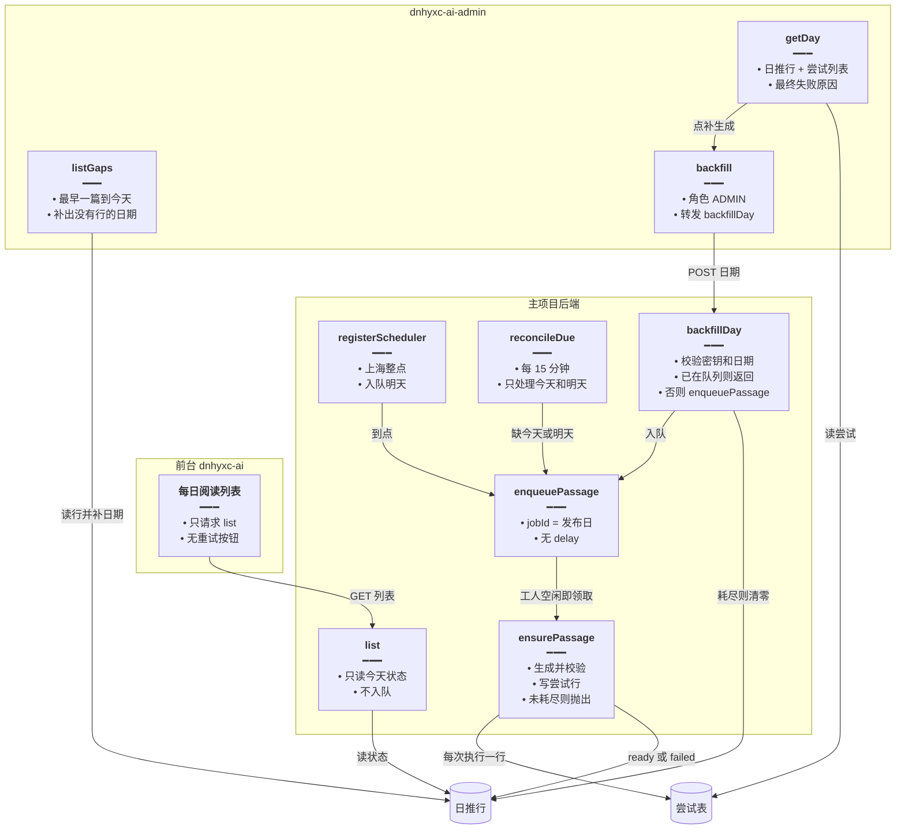
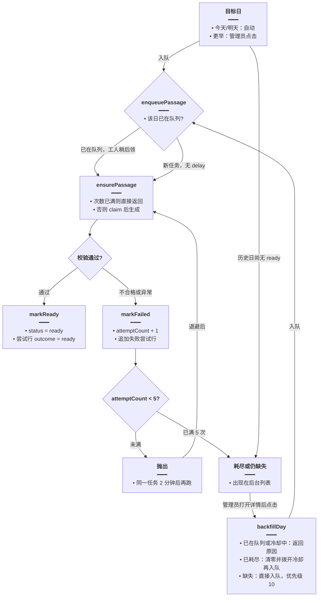
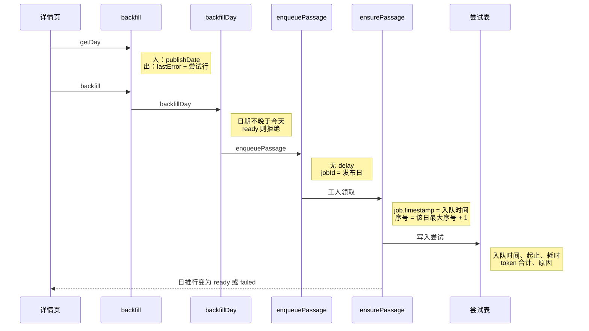
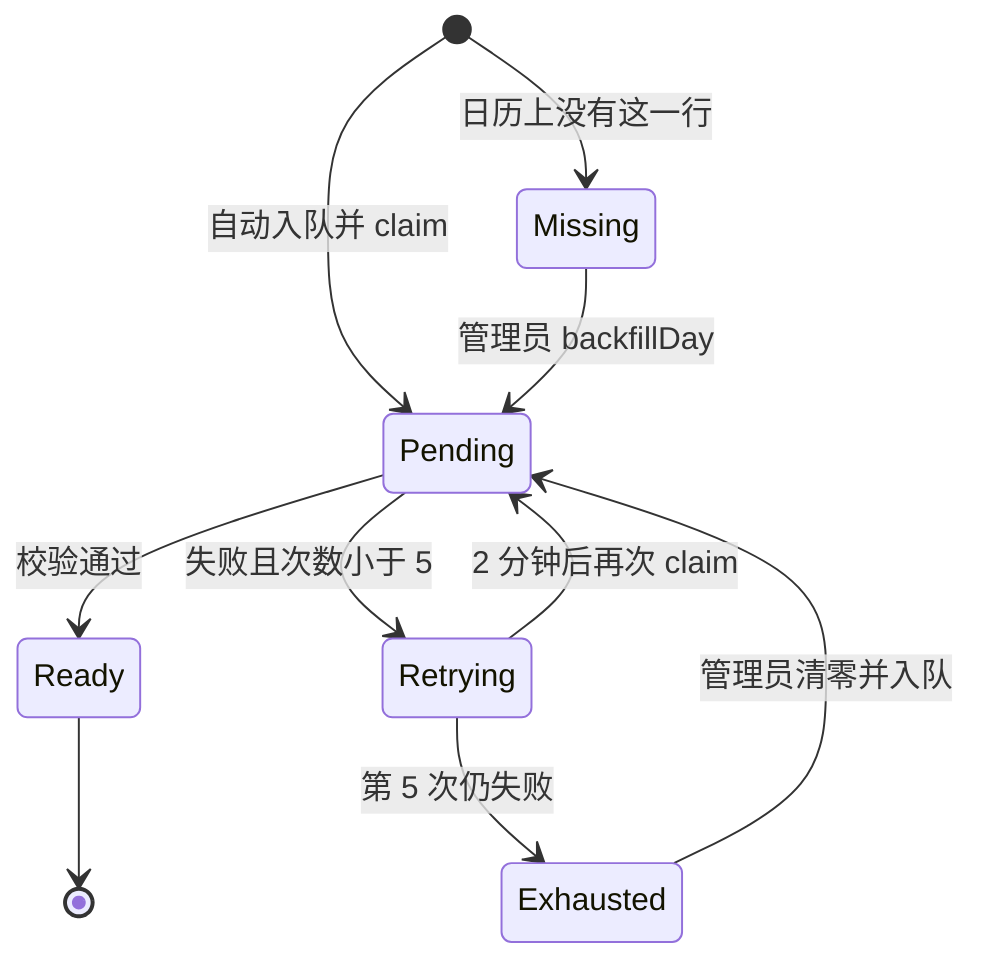

# 系统日推稳定生成 — 实现思路

> **状态**：规划 | **日期**：2026-10-24 | **需求摘要**：系统日推由工人自动重试到成功或次数耗尽；前台不能点重试。管理后台列出全部历史缺口和失败日，点进详情看每次失败原因和用量，再点一次立即入队补生成。

## 0. 读本文你将得到什么

- 现在为什么会「没生成」：内容不合格直接当成功结束，列表接口又会因为有人打开页面再去调模型。
- 一句话方案：今天和明天仍由队列自动重试；历史缺口只在管理后台展示。管理员点「立即补生成」走入队，工人空闲就马上生成，不在管理端请求里直接调模型。
- 每次工人执行记一行尝试：入队时间、第几次、开始/结束、耗时、token、失败原因。详情页读这些行。
- 用户页删掉「重试」。打开前台列表不再入队。
- 入队会不会马上生成、尝试表在记什么、补生成为什么走入队、复核改了哪几处：见 §12、§13。

**延伸阅读**：[日推入队时刻.md](./日推入队时刻.md)（现有定时入队）、[每日阅读系统生成.md](./每日阅读系统生成.md)（生成链路）。本文只补「失败后谁来重试、后台如何查看和补历史」。

## 1. 背景与目标

### 1.1 一句话

全站每天一篇系统短文，由工人在无人打开页面时生成成功；自动次数用尽或历史某天根本没有行时，只有系统管理员能在后台打开该日详情，并立即入队补这一天。

### 1.2 谁在用

| 角色 | 场景 | 结果 |
| --- | --- | --- |
| 所有前台用户 | 打开每日阅读列表 | 只看状态，不能发起模型调用 |
| 日推工人 | 到点、补今天/明天、队列重试、管理员入队 | 同一天最多一个任务；多天排队逐篇跑 |
| 系统管理员 | 后台看历史缺口和失败日，点进详情 | 看到最终原因和每次用量；确认后该日立即入队 |

### 1.3 成功标准

- 内容不合格、模型报错、进程在整点宕机，今天和明天都不需要用户点击，仍会再生成。
- 同一 `publishDate` 同时只有一个队列任务（沿用现有 `jobId`）。
- 自动尝试满 5 次后停止，不再因为有人刷新前台列表而继续调模型。
- 管理后台能列出「从最早一条定时篇到今天」之间所有没有 `ready` 的日期，包括昨天、前天，以及中间空着的那些天（表里没有行也要出现）。
- 点列表进入该日详情。详情给出最终失败原因，以及每一次尝试的入队时间、序号、生成起止、耗时、token。
- 详情里点补生成后，任务马上进入队列；工人空闲则马上调用 `ensurePassage`。不在这次 HTTP 里等待模型返回。

### 1.4 非目标

- 不改手动生成（用户自己点「生成」的那条链路）。
- 不在管理后台里接模型、不复制 `ensurePassage`。
- 不把历史上所有缺口在无人点击时一次性跑完。自动补队仍只看今天和明天。
- 不在尝试记录里保存完整模型原文。原因用 `rejectPassage` 的结论或异常摘要，最多 500 字。
- 不给前台做「通知我已生成」。

## 2. 方案摘要

### 2.1 一句话方案

前台列表只读。软失败改为抛出，让现有 BullMQ 的 5 次、间隔 2 分钟覆盖今天和明天。每次工人执行追加一条尝试记录。管理后台用日历补齐历史缺口，详情只读这些记录；补生成调用主项目入队接口，由并发为 1 的工人立即开始。

### 2.2 模块边界

| 模块 | 归属 | 动作 |
| --- | --- | --- |
| 列表接口 `list` | 已有，改为只读 | 不再调用 `enqueuePassage` |
| 前台横幅 | 已有，删按钮 | 重试中显示「正在准备」；耗尽显示「暂时没有」，无按钮 |
| `ensurePassage` | 已有，扩展 | 软失败也抛出；写日推行次数，并插入尝试行 |
| 尝试表 | 新增 | 一次工人执行一行，供详情页 |
| 补队任务 | 新增 | 每 15 分钟只检查今天、明天 |
| 内部补生成接口 | 新增 | 校验密钥；缺失或已耗尽则入队；已在队列则直接返回 |
| 管理后台列表 | 新增 | 读业务库，在内存里补出没有行的日期 |
| 管理后台详情 | 新增 | 路由 `/ai-daily-reading/:publishDate`，展示尝试记录和补生成按钮 |

### 2.3 关键决策

| 决策 | 选择 | 原因 |
| --- | --- | --- |
| 自动次数放哪 | 继续用队列 `attempts: 5`，间隔 2 分钟 | 已有 `JOB_OPTS`，不必再写一套定时器 |
| 软失败 | `markFailed` 之后抛出 | 现在直接 `return`，队列当成成功，5 次重试根本不会跑 |
| 今天/明天谁入队 | 整点任务、15 分钟补队 | 这两天要在没人打开后台时也能生成 |
| 历史缺口谁入队 | 只有管理员点击 | 一次把几十天都自动跑会打出一长串模型调用。展示可以全量，生成必须一笔一笔确认 |
| 补生成走入队还是当场生成 | **入队**，`queue.add` 不加 `delay`，优先级低于自动任务 | 见 §2.4。工人空闲就立即执行；多天按并发 1 排队；今天和明天可以插到尚未开始的历史任务前面 |
| 尝试记录放哪 | 新表 `english_daily_reading_attempts` | 日推行会被 `markFailed` 清空正文并覆盖 `startedAt`。`english_daily_reading_gens` 只记手动生成，且失败直接不写 |
| token 从哪来 | 现有 `readStream` / `chunkUsage` | 系统路径的 `askModel` 今天没把 `onUsage` 接出去。同一次尝试里的起草、改写、注释相加，记一个总数 |
| 耗尽怎么判断 | `status = failed` 且 `attemptCount >= 5` | 不新增状态枚举。没有行的历史日单独叫「缺失」，次数为 0 |
| 前台失败文案 | 自动重试期间仍算生成中 | 避免用户以为要自己点 |

### 2.4 为何补生成用入队

管理端请求里直接调用 `ensurePassage` 能少一次队列往返，但和现有工人冲突：

- 一次生成要等模型返回，管理端 HTTP 会一直占着连接，容易超时。页面上的「立即」变成「一直转圈直到模型结束」。
- 工人 `concurrency: 1` 是为了全站同时只有一篇在打模型。请求里直接跑会绕过这个限制。管理员连点昨天、前天、再往前几天，就会并行多路模型调用。
- `enqueuePassage` 已用 `jobId = publishDate` 去掉同一天的重复任务，并且 **没有 `delay`**。接口返回时任务已经在等待队列里；工人没有别的篇要跑，就马上 `process` → `ensurePassage`。
- 不同日期是不同 `jobId`，可以都排上，由这一个工人按顺序跑。点击的响应是「已入队」，生成开始时刻是工人领取的时刻，中间没有 2 分钟、也没有 15 分钟。2 分钟只用于这一篇失败后的自动退避。
- 自动任务用 BullMQ 默认优先级 `0`（最高）。管理员补历史用 `10`。正在跑的那一篇不会被打断；它结束后，今天或明天的自动任务先于还排着的历史日。本队列一天只有几篇，优先级带来的额外开销可以忽略。
- 现有 `enqueuePassage` 在 `failed` 未满 5 秒、`pending` 未满 90 秒时会直接返回，调用方看不出没入队。`backfillDay` 必须先自己判断并返回原因。耗尽后的补生成要把 `startedAt` 拨到冷却之前，否则 `claim` 也会拒绝，任务入队后空跑一轮。

连点五天如何排队、同一天如何去重的白话说明见 §12.5。

### 2.5 为何不用另外两种记法

- 不把尝试日志塞进日推行的 JSON：详情要按次排序、按次加 token，一行会被下次失败覆盖，历史次数对不上。
- 不复用 `english_daily_reading_gens`：该表要求 `userId`，定时篇没有主人；`rememberGen` 在 `status === 'error'` 时直接返回，失败原因存不进去。

## 3. 现状与复用

| 能力 | 已有位置 | 本需求用法 |
| --- | --- | --- |
| 队列名、槽位、冷却 | `apps/backend/src/services/english-learning/daily-reading.constants.ts`：队列 `english-daily-reading`，`FAIL_COOLDOWN_MS = 5s`，`PENDING_STALE_MS = 90s` | 原样复用。入队前仍看冷却，避免和正在跑的任务抢同一行 |
| 5 次、2 分钟 | `english-daily-reading.service.ts` 的 `JOB_OPTS` | 软失败改为抛出后，这组参数才覆盖「内容不合格」。第一次入队没有 delay |
| 一天一个任务 | `enqueuePassage`：`jobId = publishDate`，等待中/执行中/延迟中直接返回 | 整点、今天/明天补队、管理员补历史都调用它 |
| 工人并发 1 | `english-daily-reading.processor.ts` 的 `@Processor(..., { concurrency: 1 })` | 历史多天入队后逐篇立即开跑，不会并行打模型 |
| 整点生成明天 | `registerScheduler`，任务名 `prepare-next`，上海时区 | 保留。15 分钟补队只替补今天和明天 |
| 领行 | `claim`：`ready` 不领；新鲜 `pending` 不领；`failed` 未过 5 秒不领 | 重试前仍靠它 |
| 软失败不重试 | `ensurePassage`：草稿不合格时 `markFailed` 后 `return` | **要改**。改为抛出 |
| 硬失败会重试 | 同函数 `catch` 里 `markFailed` 再 `throw` | 保留，并在抛出前写入尝试行 |
| 打开列表就入队 | `list`：失败超过 5 秒，或 `pending` 超过 90 秒，就 `enqueuePassage` | **要删** |
| 前台重试按钮 | `apps/frontend/src/views/englishLearning/dailyReading/List.tsx` | **要删** |
| 日推行字段 | `english-daily-reading.entity.ts`：`status`、`startedAt`、标题正文。没有次数、原因、token | 日推行只加 `attempt_count`、`last_error`。明细进尝试表 |
| 失败会覆盖 | `markFailed` 把 `startedAt` 改成现在，并清空标题正文 | 所以入队时间和 token 不能只放在日推行上 |
| 手动生成快照 | `english_daily_reading_gens`，`rememberGen` 不记 `error` | **不复用**。那是用户弹窗快照 |
| token 解析 | `chunkUsage`、`readStream` 末尾 `usage \|\| live()` | 系统 `askModel` 增加把这次总量返回。供应商没回 usage 时沿用现有估算 |
| 管理后台读业务库 | dnhyxc-ai-admin：`DB_CONNECTIONS.AI`，`ai-ebook` 只读主库 | 列表和详情都走这条连接，`synchronize: false` |
| 管理后台页面注册 | `apps/frontend/src/router/index.tsx`、`router/menu.ts` | 增加列表页和 `/ai-daily-reading/:publishDate` 详情页 |
| 设置表没有创建时间 | `english_daily_reading_settings` 只有 `id`、主题、小时 | 历史起点用最早一条 `slot = day` 的 `publishDate`。一张定时篇都没有时，列表为空 |

**待确认**：主项目是否已有内部密钥中间件。验证方式：在 `apps/backend/src` 搜索 `x-internal` 或同类 header。没有就为本接口单独校验环境变量 `DAILY_READING_INTERNAL_TOKEN`。

**已知缺口**：最早一条定时篇之前的日期无法从库里推出来。设置表没有 `created_at`。不为此加列。功能启用后至少成功或失败过一天，其后的空洞（含昨天、前天、中间空的若干天）都能列出来。

## 4. 架构



### 图内方法说明

| 方法 | 做什么 | 输入 / 输出 |
| --- | --- | --- |
| `list` | 给前台拼今天的展示状态，不碰队列 | 入：当前用户。出：`todayStatus = ready / generating / exhausted` |
| `registerScheduler` | 按设置的上海整点注册「生成明天」 | 入：设置里的小时。出：重复任务 `prepare-next` |
| `reconcileDue` | 进程错过整点时，只为今天和明天补入队 | 入：无。出：0～2 次入队。历史缺口不在这里 |
| `backfillDay` | 管理员指定某一天立即入队 | 入：`publishDate`、内部密钥。出：`queued` 或拒绝原因 |
| `enqueuePassage` | 按发布日去重后投入队列，不设置延迟 | 入：发布日，可选优先级。出：已在等待/执行/延迟则直接返回 |
| `ensurePassage` | 领行、调模型、校验、写尝试行。`claim` 失败不写尝试行 | 入：发布日、任务入队时间。出：`ready`，或 `failed` 并在本轮未满 5 次时抛出 |
| `listGaps` | 列出需要人工看的日期，含表里不存在的天 | 入：无。出：日期、状态、次数、原因摘要、累计 token |
| `getDay` | 拼详情 | 入：发布日。出：日推行字段 + 按序号排列的尝试行 |
| `backfill` | 校验管理员后转发，自己不调模型 | 入：发布日。出：主项目的入队结果 |

**读图要点**：模型只出现在 `ensurePassage`。历史日期的「获取」是管理后台读库补日历，不产生模型调用。补生成按钮和整点、15 分钟补队汇合到同一个无延迟的 `enqueuePassage`。尝试表只由工人写，详情只读。

## 5. 主流程



### 图内方法说明

| 方法 | 做什么 | 输入 / 输出 |
| --- | --- | --- |
| `enqueuePassage` | 没有在途任务才新增；已有则跳过。新增的任务不带延迟 | 入：发布日。出：队列里最多一个该日任务 |
| `ensurePassage` | 次数已满时不再打模型。未满则生成，不合格再改写一轮（现有逻辑） | 入：发布日、入队时间、尝试序号。出：成功或失败，并写尝试行 |
| `markReady` | 短文落库并对外可见，同时记成功的那次尝试 | 入：正文、标题、来源、token 合计。出：`status = ready` |
| `markFailed` | 日推行记失败，尝试表追加这一次的原因和 token | 入：错误摘要、入队时间、耗时、token。出：次数加一 |
| `backfillDay` | 把指定历史日或已耗尽的今天放进队列，并说明没有入队的原因 | 入：发布日。出：已入队，或 `ready` / `busy` / `cooldown` / `future` |

**读图要点**：今天和明天在「抛出 → 2 分钟 → 再跑」里自己闭合。更早的缺失日不进这个自动环，先出现在后台列表。管理员点击后走的仍是 `enqueuePassage`，工人空闲就立即生成，而不是在按钮请求里生成。

## 6. 时序



### 图内方法说明

| 方法 | 做什么 | 输入 / 输出 |
| --- | --- | --- |
| `getDay` | 读这一天的日推行和全部尝试，供详情展示 | 入：`YYYY-MM-DD`。出：最终原因、次数、每次的时间和 token。没有行时尝试列表为空 |
| `backfill` | 后台控制器，只允许管理员，转发到主项目 | 入：发布日。出：`{ queued: true }` 或错误信息 |
| `backfillDay` | 决定这次点击要不要入队 | 入：发布日、密钥。出：已入队，或 `ready` / `busy` / `cooldown` / `future` |
| `enqueuePassage` | 把这一天放进 BullMQ | 入：发布日、可选优先级。出：等待中的任务；工人空闲则马上被领走 |
| `ensurePassage` | 真正调模型，并把这一次写成尝试行 | 入：发布日、`job.timestamp`。序号由尝试表现有最大号加 1。出：更新日推行 |

**读图要点**：详情数据来自业务库，不经过队列。按钮的 HTTP 在 `enqueuePassage` 返回后就结束，不等模型。入队时间用 BullMQ 任务的 `timestamp`，生成起止用工人实际执行前后的时钟，这样退避重跑的第二次仍带有同一次入队时间、但有自己的起止和 token。

## 7. 状态



| 状态 | 怎么认 | 后台列表 | 详情按钮 |
| --- | --- | --- | --- |
| Missing | 从最早一篇到今天，没有 `slot = day` 的行 | 显示「缺失」 | 立即补生成 |
| Pending | `pending`；或 `failed` 且次数 &lt; 5 且 `startedAt` 在 3 分钟内 | 显示「生成中」。管理后台读不到 Redis，用 2 分钟退避加一点余量判断 | 仍可点。任务还在队列则返回已入队；`pending` 未满 90 秒则返回 `busy`，不入队 |
| Ready | `ready` | 不出现在问题列表 | 只读，按钮不可用 |
| Exhausted | `failed` 且 `attemptCount >= 5` | 显示「已耗尽」和 `lastError` | 立即补生成（清零后再入队） |

前台只关心今天：自动重试期间显示「正在准备」；耗尽显示「暂时没有」，没有按钮。

## 8. 数据与接口草图

### 8.1 日推行

`english_daily_readings` 增加两列（迁移在主项目，管理后台只读）：

| 列 | 类型 | 含义 |
| --- | --- | --- |
| `attempt_count` | int，默认 0 | 本轮已经失败的次数。成功后保留，不清零，详情仍能看出失败过几次。管理员再次补生成时才把本轮次数清零 |
| `last_error` | varchar(500)，可空 | 最后一次失败摘要。详情页的「最终原因」优先用尝试表最后一行，这列给列表摘要 |

不新增 `exhausted` 状态。

### 8.2 尝试表

新表 `english_daily_reading_attempts`。一次 `ensurePassage` 执行插入一行。同一次里的起草、改写、注释合成这一行的 token，不按 HTTP 次数拆开。白话说明见 §12.3、§12.4。

| 列 | 类型 | 含义 |
| --- | --- | --- |
| `id` | bigint 自增 | 主键 |
| `publish_date` | varchar(10) | 发布日，和日推行一致 |
| `attempt_no` | int | 该发布日的第几行，从 1 起，取当前最大序号加 1。不用 `job.attemptsMade`，否则再次补生成会从 1 重号，撞上唯一索引 |
| `enqueued_at` | datetime | `job.timestamp`。同一次入队的自动重试共用这个时间 |
| `started_at` | datetime | 这次 `claim` 成功、开始打模型的时间 |
| `finished_at` | datetime | 这次结束的时间 |
| `elapsed_ms` | int | `finished_at - started_at` |
| `tokens` | int | 这次起草 + 改写 + 注释的 token 合计 |
| `outcome` | varchar(16) | `ready` 或 `failed` |
| `reason` | varchar(500)，可空 | 失败原因。成功为空 |

索引：`(publish_date, attempt_no)`。管理后台详情按 `attempt_no` 升序读。

### 8.3 失败时记一行

```ts
// 本轮预算。尝试表序号可以大于 5，管理员再次补生成后从 6 继续
const MAX_ATTEMPTS = 5;
// 本轮已满。队列多投递的一次直接结束，不再打模型，也不再写尝试行
if (attemptCount >= MAX_ATTEMPTS) return;
// 用加一后的次数决定抛不抛。job.attemptsMade 在新任务里会从 0 重计，不能当预算
const next = attemptCount + 1;
// 日推行和尝试表一起写。claim 失败在这之前返回，不插入尝试行
await this.markFailed(publishDate, reason.slice(0, 500), next);
// 未满才抛出，同一个任务才会隔 2 分钟再执行
if (next < MAX_ATTEMPTS) throw err;
```

`claim` 返回 false 时函数直接结束，不写尝试行。`askModel` 把 `readStream` 已经算出的 `usage || live()` 返回给 `ensurePassage` 累加；中途抛错时把已经拿到的用量一并写入这次失败行。`finishReading` 里的注释请求同样加上。限流时 `withRateRetry` 在这一轮内部最多再请求 3 次，仍算同一行。

`resetAttempts` 只把 `attempt_count` 置 0，并把 `startedAt` 改到 `FAIL_COOLDOWN_MS` 之前。不删除尝试行。

### 8.4 历史列表怎么补日期

管理后台不做日期序列 SQL。一次查出 `slot = day` 且 `publishDate` 介于起点和今天的行，再在内存里逐日填洞。

```ts
// 起点用最早一条定时篇。没有行就无法知道功能从哪天开始，列表为空
const start = await this.earliestDay();
// 终点含今天，这样已耗尽的今天也能点进去
const days = eachDate(start, shanghaiToday());
// 有行用行上的状态；没行标成 missing，次数和 token 都是 0
const status = row ? row.status : 'missing';
```

问题列表只保留 `missing`、`failed`、`pending`。`ready` 不占行。按日期倒序。`failed` 且次数未满、`startedAt` 在 3 分钟以内的，列表标成「生成中」，避免把还在 2 分钟退避里的日期看成已经耗尽。

### 8.5 内部补生成

`POST /api/internal/daily-reading/backfill`

请求头 `x-internal-token`。管理后台用服务端环境变量调用，不把密钥放到浏览器。

```ts
// 密钥不符直接拒绝，这个接口不走前台用户登录态
if (token !== process.env.DAILY_READING_INTERNAL_TOKEN) throw new UnauthorizedException();
// 只补今天及以前。明天仍由整点任务生成，避免管理员提前打出尚未到点的一篇
if (publishDate > shanghaiToday()) return { ok: false, reason: 'future' };
// 已经发布的日期不再生成，防止覆盖正文
if (row?.status === 'ready') return { ok: false, reason: 'ready' };
// 等待、执行、延迟中不再入队，也不清零，避免打断自动退避
if (await this.jobInFlight(publishDate)) return { ok: true, queued: true };
// pending 未满 90 秒时 claim 会拒绝。这时入队只会空跑，告诉后台稍后再试
if (row?.status === 'pending' && Date.now() - row.startedAt.getTime() < 90_000) return { ok: false, reason: 'busy' };
// 本轮还没耗尽且失败未满 5 秒。现有 enqueuePassage 会直接 return，这里改成明确原因
if (row?.status === 'failed' && row.attemptCount < 5 && Date.now() - row.startedAt.getTime() < 5_000) return { ok: false, reason: 'cooldown' };
// 耗尽才清零，并把 startedAt 拨出冷却。不清掉尝试表里已有的行
if (row && row.attemptCount >= 5) await this.resetAttempts(publishDate);
// 优先级 10，低于自动任务的 0。无 delay。同一天仍靠 jobId 去重
await this.enqueuePassage(publishDate, { priority: 10 });
```

管理后台拿到 `reason` 后显示对应文案，不能把 `cooldown` 和 `busy` 显示成「已开始生成」。自动任务的 `enqueuePassage` 不传 `priority`，保持默认 `0`。

### 8.6 前台状态映射

| 行 | `todayStatus` | 横幅 |
| --- | --- | --- |
| 无行，或 `pending`，或 `failed` 且次数 &lt; 5 | `generating` | 今天的短文正在准备 |
| `ready` | `ready` | 不显示横幅 |
| `failed` 且次数 ≥ 5 | `exhausted` | 今天的短文暂时没有 |

删除 `List.tsx` 里失败横幅的按钮和 `retryLocked`。`generating` 时每 5 秒拉一次列表，直到变成 `ready` 或 `exhausted`，最长 10 分钟。现有的最多 8 次大约 40 秒，生成一慢横幅就停在「正在准备」。

### 8.7 管理后台页面

| 项 | 做法 |
| --- | --- |
| 后端模块 | `ai-daily-reading`，实体映射日推行和尝试表，连接 `DB_CONNECTIONS.AI` |
| 列表 | `GET /ai-daily-reading`。列：日期、状态、重试次数、原因摘要、累计 token、最近入队时间。行点击 `navigate(/ai-daily-reading/${publishDate})` |
| 详情 | `GET /ai-daily-reading/:publishDate`。顶上是最终失败原因（最后一条 `outcome = failed` 的 `reason`，没有尝试时用「尚未生成」）。下面是尝试表：序号、入队时间、开始、结束、耗时、token、结果、原因 |
| 按钮 | 详情里「立即补生成」。`POST /ai-daily-reading/:publishDate/backfill`，`@Roles(Role.ADMIN)`。返回后列表状态改为生成中，不在浏览器里等模型 |
| 路由 | `apps/frontend/src/router/index.tsx` 增加 `ai-daily-reading` 和 `ai-daily-reading/:publishDate`。`menu.ts` 在前台分组加「日推失败」 |
| 连点 | 请求返回前禁用按钮。主项目 `jobInFlight` 再挡一层 |

### 8.8 自动补队仍只看两天

```ts
// 历史缺口交给管理员逐日点击，这里不扫描更早的日期
const dates = [shanghaiToday(), addCalendarDays(shanghaiToday(), 1)];
// 已成功或次数已满的跳过。未满的今天、明天才入队
if (row?.status === 'ready' || (row?.attemptCount ?? 0) >= 5) continue;
// 与管理员补生成共用去重，补队不会叠一次模型调用
await this.enqueuePassage(date);
```

重复任务名 `reconcile-due`，不要占用 `jobId = 发布日`。

## 9. 分阶段

| 阶段 | 改动 | 验收 |
| --- | --- | --- |
| M1 主项目 | 日推两列 + 尝试表；软失败抛出并写尝试；`list` 去掉入队；今天/明天补队；`backfillDay` | 连续失败 5 次后尝试表有 5 行，token 和原因都在；第 6 次队列回调不再打模型；打开前台列表没有入队日志 |
| M2 前台 | 删重试按钮；耗尽文案；重试中仍显示正在准备 | 两个浏览器同时打开失败日，模型日志只有队列里的那一次 |
| M3 管理后台 | 缺口列表、详情、立即补生成 | 删掉某天的定时行后，列表仍出现该日且状态为缺失。点详情能看到空尝试。点补生成后日志立刻出现 `enqueuePassage`，工人空闲时马上出现 `ensurePassage`。成功后该日从问题列表消失，详情里有一条 `ready` 尝试 |

## 10. 风险

| 风险 | 处理 |
| --- | --- |
| 一次任务里原有「不合格再改写一次」，5 次任务最多约 10 次模型调用 | 接受。token 按这一次尝试加总，管理员能看到这笔消耗 |
| 管理员连点多个历史日 | 多个 `jobId` 排队，工人并发 1。历史任务优先级 10，今天和明天的自动任务用 0，能插到尚未开始的历史日前面 |
| 耗尽后马上点补生成 | `resetAttempts` 把 `startedAt` 拨出 5 秒冷却，否则现有 `enqueuePassage` 和 `claim` 都会空返回 |
| 补生成时行还是新鲜 `pending` | 返回 `busy`，不入队。90 秒内 `claim` 会拒绝，入队只会空跑一轮 |
| 已在退避的任务又被点击 | `jobInFlight` 看到 `delayed` 就返回，不新加任务，也不清零次数 |
| 次数已满后 BullMQ 仍再投递一次 | `ensurePassage` 开头看见 `attemptCount >= 5` 直接返回，不调用模型 |
| 供应商不返回 usage | 用 `readStream` 现有的 `live()` 估算，和手动生成同一口径，详情不留空 |
| 最早一篇之前的日期列不出来 | 已知缺口，见 §3。不猜设置启用日 |
| 内部接口密钥泄漏 | 只放两端服务器环境变量；日志不打印密钥 |
| 管理后台连不上主项目 | 列表和详情仍能从业务库打开；按钮返回错误，不在后台本地假装已入队 |

## 11. 验收清单

- 内容不合格时，同一发布日隔约 2 分钟出现下一次尝试，尝试表增加一行，而不是一次就停。
- 前台没有「重试」。失败未耗尽时文案是「正在准备」。
- 用多个账号同时打开前台列表，模型调用次数不随人数增加。
- 次数到 5 后，再等多于 15 分钟，今天不会再自动入队。尝试表停在 5 行。
- 后台列表能同时看到：有失败行的日期，以及中间没有行的日期（例如前天有、昨天没有、大前天也没有）。
- 点击某一行进入详情。最终原因与最后一条失败尝试的 `reason` 一致。表里能看到每次的入队时间、起止、耗时、token。
- 对一个缺失日点「立即补生成」：接口马上返回；工人没有别的任务时，立刻开始生成这一天。不需要再等 15 分钟。
- 对五个不同的缺失日连续点击：队列里有五个任务，模型调用是一个接一个，不是五个并行。若此时今天的自动任务也进了队列，它排在还没开始的历史日前面。
- 已有 5 条失败尝试后再补生成成功，新的尝试序号从 6 起，不和旧行冲突。耗尽后立刻点击也会入队，不会被 5 秒冷却吃掉。
- 前台「正在准备」在生成超过 40 秒后仍会更新，直到成功、耗尽或满 10 分钟。
- 已经 `ready` 的日期点补生成被拒绝，正文不被覆盖。
- 普通后台角色没有补生成按钮，直接调接口返回 403。
- 用户手动生成的短文不在这个列表里。

## 12. 说明

本节把方案评审里的问题写清楚，避免和正文里的表结构、队列参数混在一起读。

### 12.1 入队后会立即生成吗

会。`enqueuePassage` 调用 `queue.add` 时没有 `delay`。任务进队列后处于等待执行。工人空闲就马上领取，调用 `ensurePassage`，开始调模型。

间隔 2 分钟只出现在失败之后。`JOB_OPTS` 里的 `backoff` 是任务抛错后的退避，第一次入队不等这 2 分钟。

三种情况不会马上开始：

- 工人正在跑另一篇。队列并发是 1，新任务排在后面，当前这篇结束就接着跑。
- 这一天已经是 `ready`，或者 `pending` 还没超过 90 秒，或者 `failed` 还在 5 秒冷却里。`enqueuePassage` 直接返回，队列里没有新任务。
- 短文要等模型返回并写成 `ready` 才会出现在列表里。入队只表示开始生成。

### 12.2 本方案里的入队也是立即生成吗

是。整点触发、每 15 分钟检查今天和明天、管理员在详情里点「立即补生成」，最后都走到同一个 `enqueuePassage`，都没有 `delay`。

失败后的下一次不重新入队。任务抛出后，队列按退避隔 2 分钟再跑同一次任务，最多 5 次。

15 分钟只决定自动补队多久检查一次今天和明天。检查发现缺篇并且次数未满，随后那次入队同样立即开始。历史缺口不在这 15 分钟里自动跑，要点详情里的按钮，按钮触发的入队也是立即开始。

### 12.3 尝试表是什么意思

后台要点进某一天，看这一天试了几回、每回为什么失败。现有两张表都存不下这个过程，所以另加尝试表。

系统生成在 `english_daily_readings` 里一天只有一行。失败时 `markFailed` 会把这一行的 `startedAt` 改成刚才失败的时刻，并把标题和正文清空。下一回再失败，还是改这一行。库里最后只剩最近一次失败，更早的入队时间、耗时和 token 都被盖掉了。

`english_daily_reading_gens` 是前台「自选生成」的快照。定时篇没有所属用户，而且 `rememberGen` 在失败时直接不写。这张表不能当作系统日推的失败详情。

尝试表改成工人每跑完一轮就新增一行，不覆盖旧行。例如 10 月 23 日自动试了 3 次，详情里是 3 行：

| 第几次 | 入队时间 | 开始 | 结束 | 耗时 | token | 原因 |
| --- | --- | --- | --- | --- | --- | --- |
| 1 | 23:00 | 23:00:02 | 23:00:40 | 38 秒 | 2100 | 正文太短 |
| 2 | 23:00 | 23:02:02 | 23:02:35 | 33 秒 | 1800 | 模型超时 |
| 3 | 23:00 | 23:04:02 | 23:04:50 | 48 秒 | 2400 | JSON 解析失败 |

入队时间用队列任务上的 `timestamp`。第 2、第 3 次是失败后隔 2 分钟再跑的同一次入队，所以入队时间相同，开始和结束各自不同。

一轮里面模型可能被叫好几次：先起草，不合格再改写一次，通过后还要做注释。这几次都算同一轮尝试，token 加在这一行上，不拆成三行。后台看到的「第 2 次」是队列重试，不是同一次里的改写。

后台列表点 10 月 23 日，打开 `/ai-daily-reading/2026-10-23`。页面最上面是最后一条失败原因，也就是上表最后一行的「JSON 解析失败」。下面是这张尝试表。

### 12.4 「每跑完一轮新增一行」指系统生成还是自选生成

指系统生成，不是自选生成。

系统生成由后台队列里的工人执行，一天一篇，失败后隔 2 分钟再跑一轮。尝试表只记这个工人的每一轮。

自选生成是用户在前台自己点的，不进这个队列，也不写入尝试表。它仍用 `english_daily_reading_gens` 记那次手动生成的快照。

### 12.5 补生成为什么选入队，而不是在按钮请求里直接生成

管理员点「补生成」时，按钮只把这一天放进队列，然后马上返回。真正调模型的仍然是后台那个工人，而且同一时间只跑一篇。

系统里现在就有一个工人，并发是 1。整点生成、失败后隔 2 分钟再试，都排在它后面，一篇结束才跑下一篇。`enqueuePassage` 入队时没有设置等待时间，工人如果正好空着，这篇会马上开始，不用再等 2 分钟或 15 分钟。

另一条做法是让按钮的这次请求自己去调模型，等短文写完再给页面返回。这样有两个问题：

- 模型要几十秒。这几十秒里，管理后台的这次请求一直占着，页面只能转圈。
- 连点 10 月 19 日到 23 日这五天，后台会同时收到五个请求，五个请求一起调模型。工人「同时只跑一篇」的限制被绕开，又变成一次点出多次模型调用。

入队之后这五天是五个任务，排在同一个工人后面，按顺序一篇一篇跑。点 19 日时如果工人空闲，19 日马上开始；20 日到 23 日在后面等。19 日跑完再跑 20 日。

同一天再点一次不会多排出一篇。队列用发布日当 `jobId`，例如 `2026-10-19`。这一天已经在排队或正在生成时，第二次入队发现任务还在，就直接返回，不会再调一次模型。

今天和明天的自动任务优先级更高（数字 `0`）。历史补生成是 `10`。正在写的那一篇会写完；它结束后先写今天或明天，再写还排着的历史日。

点下去如果这一天刚失败不到 5 秒，或者行还处于未过期的 `pending`，接口返回原因，页面不能显示成「已经开始生成」。否则现有入队函数会悄悄返回，按钮看起来点过了，队列里却没有任务。

## 13. 复核

对照现有 `enqueuePassage`、`claim` 和 BullMQ 5.70 的优先级之后，改了下面几处。入队而不是在按钮请求里直接生成，这个选择保持不变。

| 原方案 | 问题 | 现在 |
| --- | --- | --- |
| 耗尽后直接 `enqueuePassage` | `failed` 不满 5 秒会直接 return；`claim` 同样拒绝。点了补生成，队列里没有任务 | 先返回 `cooldown` 或 `busy`。耗尽重试时把 `startedAt` 拨出冷却再入队 |
| 序号用 `job.attemptsMade + 1` | 再次补生成时新任务从 0 计，序号回到 1，和旧行的唯一索引冲突 | 序号取该日已有最大号加 1。本轮还要不要抛错，只看清零后的 `attempt_count` |
| 成功后 `attempt_count` 归零 | 详情顶上的次数和下面的尝试行对不上 | 成功后保留次数。只有管理员再次补生成才把本轮次数清零，尝试行不删 |
| 历史补生成和自动任务同一优先级 | 连点很多天后，今天的自动任务排在历史日后面 | 自动任务优先级 `0`，历史补生成 `10`。正在跑的一篇不抢占 |
| `claim` 失败也走失败记账 | 会多出一行假失败 | `claim` 失败直接返回，不写尝试行 |
| 前台生成中最多轮询 8 次 | 大约 40 秒后横幅停住，生成还在进行 | 每 5 秒一次，直到成功、耗尽或满 10 分钟 |

下面这些看过，保持原样：

- 补生成走入队，不在管理端请求里调模型。
- 尝试表只记系统生成，不记自选生成。
- 自动补队只处理今天和明天。历史缺口要管理员逐日点击。
- 最早一条定时篇之前的日期列不出来。设置表没有启用时间，不猜。

