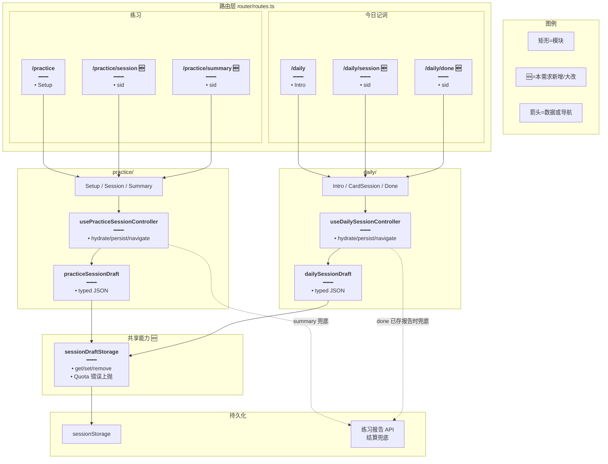
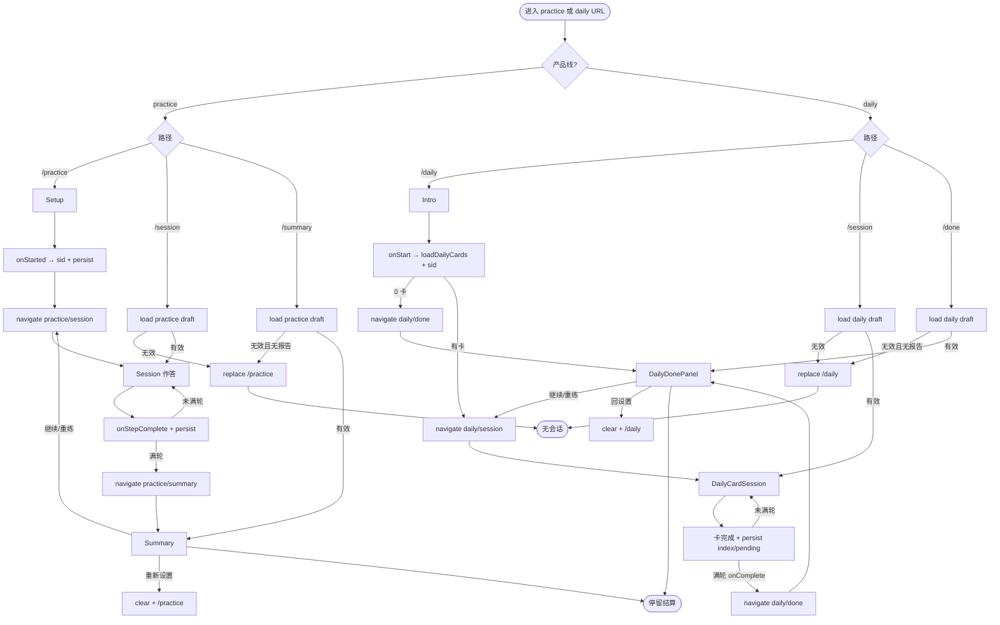
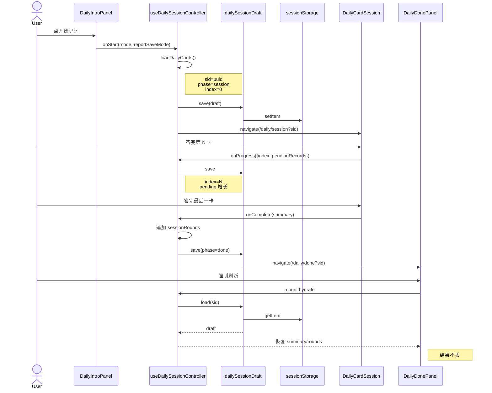
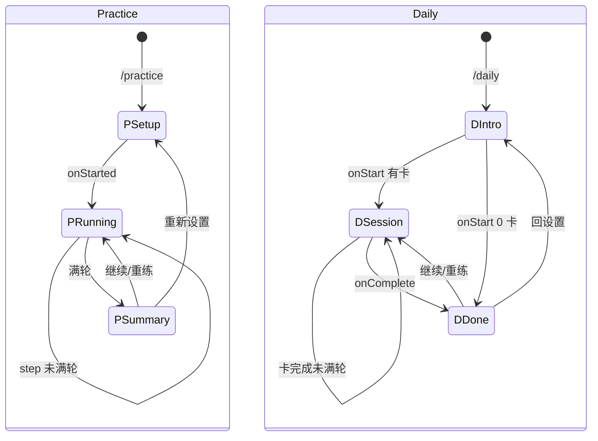
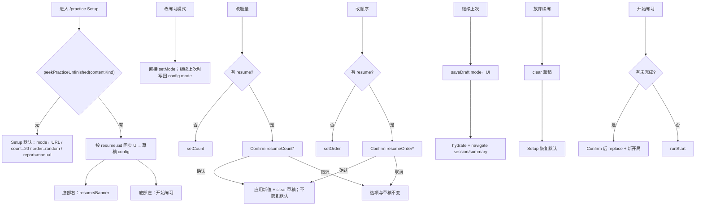
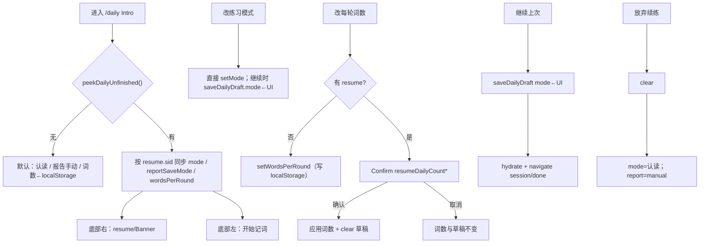

# 练习与今日记词独立路由续档 — 实现思路

> **状态**：**M1–M6 均已落地**（独立路由续档 + contentKind 分槽 + practice/daily Setup 续练联动）  
> **日期**：2026-10-11（2026-10-14 起：按库细化见延伸）  
> **需求摘要**：practice + daily 独立路由续档；vocab/classic 分槽；根路径「继续上次 / 放弃续练」；**practice**：改模式可带入续练、题量/顺序 Confirm 清档、刷新回显草稿配置；**daily**：改模式可带入续练并写回草稿、刷新回显 mode/报告保存/每轮词数、切换每轮词数 Confirm 清档、放弃续练恢复默认。

## 延伸阅读

- **按库/来源再分槽（已落地）**：[练习草稿按库分槽.md](./练习草稿按库分槽.md) — 同 kind 多库草稿并存，互不覆盖
- 多轮结算与报告续练（已落地）：[练习多轮结算与报告续练.md](./练习多轮结算与报告续练.md)
- 练习报告存档（已落地）：[练习报告存档.md](./练习报告存档.md)
- 今日记词与今日复习（已落地）：[今日记词与今日复习.md](./今日记词与今日复习.md)
- 听写 TTS 预取：[听写TTS分批预取.md](./听写TTS分批预取.md)
- 列表续读（另一类进度，勿混用）：主仓 `apps/frontend/src/views/englishLearning/utils/elResumeModule.ts`

> **文件更名说明**：本稿由原「练习拼写结算独立路由」扩展为 **practice + daily** 双产品线；索引已指向本文件名。

---

## 0. 读本文你将得到什么

- **问题**：`practice/index` 与 `daily/index` 都用内存 `phase` 同页切换配置 / 作答 / 结算；整页刷新后进度与结果归零。二者都有无效的 `run=1`（只防 SPA 清态，不保 remount）。
- **一句话方案**：两条产品线各拆三路由 + URL `sid`；sessionStorage 快照续档；practice 内再按 `contentKind`（vocab / classic）分 active 槽；根路径用对应槽展示 **继续上次 / 放弃续练**（必做）。
- **改动层**：前端路由、`paths`、控制器、`*SessionDraft`、根路径续练条 UI；**默认不改后端**。
- **阶段**：M1 路由拆分 → M2 快照续档 → M3「继续上次」→ M4 单词/语句草稿分槽 → M5 practice Setup 联动 → M6 daily Intro 联动。
- **最大风险**：daily 进度外提；Tauri 主窗草稿长期残留须靠继续/丢弃/新开局回收；旧单槽 active 需迁移。

---

## 1. 需求与边界

### 1.1 用户故事

| 角色 | 场景 | 行为 | 期望结果 |
|------|------|------|----------|
| 学习者 | 拼写/听写做到第 N 题 | F5 | 仍停在第 N 题；本轮已答不丢 |
| 学习者 | 练习结果页 | F5 | 历轮对错与统计仍在 |
| 学习者 | 今日记词做到第 N 张卡 | F5 | 仍停在第 N 卡；本轮已答记录不丢 |
| 学习者 | 今日记词结果页（done） | F5 | summary / 历轮仍在 |
| 学习者 | 任一侧「继续 / 重练」后再做到一半 | F5 | 新一轮进度保持；历轮仍在 |
| 学习者 | 「重新设置」或回 intro/setup | 离开会话 | 清本 `sid`；回到配置页 |
| 学习者 | 作答中途去词库等，再从侧栏进练习/记词 | 看到「继续上次」并点继续 | 回到原 `sid` 的 session 或 summary/done，进度不丢 |
| 学习者 | 同上，但不想接着做 | 点「放弃续练」后重新配置开始 | 旧草稿清除；Setup **恢复默认配置**；新开局为新 `sid` |
| 学习者 | 旧入口链（仅 source / 侧栏进 daily） | 打开 | 仍进配置/intro；有草稿则显示续练条 |

### 1.2 范围

| 在范围内 | 不在范围内（非目标） |
|----------|----------------------|
| **练习**：`/practice` · `/practice/session` · `/practice/summary` | 跨设备服务端草稿表 |
| **今日记词**：`/daily` · `/daily/session` · `/daily/done` | `/daily/records` 改造（已是独立路由） |
| 刷新恢复题号级进度 + 历轮结算 | 单题未提交的 `slotValues` / 认读半选 |
| sessionStorage + URL `sid`（两线键前缀分离） | 改报告 / 记词 attempts API schema |
| **离开后再继续**：根路径「继续上次 / 丢弃」**必做** | 自动跳进旧 session（禁止，免打断新开局意图） |
| 听写与拼写、认读与拼写模式共用各线路由 | 列表续读 `elResumeModule` 语义混入 |

### 1.3 约束与依赖

- **登录**：快照键带 `userId`；登出清 **practice + daily** 两套 draft。
- **复用**：现有 `Setup`/`Session`/`Summary`、`DailyIntroPanel`/`DailyCardSession`/`DailyDonePanel`、报告 API、`loadDailyCards`。
- **Ponytail**：共用一个极薄的 `sessionDraftStorage` 读写壳；两线各有 typed draft，不硬揉成一个巨型 store。
- **体验**：刷新无「先 intro/setup 再跳」闪屏；非法直达 replace 回配置页。
- **互斥**：同一浏览上下文内，**practice×vocab、practice×classic、daily** 各最多一条活跃 `sid`；单词练习与语句练习互不覆盖。
- **双端生命周期**：sessionStorage 挂在 **WebView / Tab 上下文**上，不是「浏览器 Tab UI」。Web 关 Tab ≈ 清；Tauri **没有关 Tab**，等价事件是 **关窗口 / 退出应用**（主窗常驻时草稿会一直留到替换、登出或显式 clear）。

---

## 2. 方案总览（一句话 + 要点）

**一句话方案**：practice 与 daily 各自把内存三相映射为三条 URL；统一用 `sid` + sessionStorage 快照续档，模式相同、类型与路径分开。

| # | 设计要点 | 理由 |
|---|----------|------|
| 1 | practice：`session` / `summary`；daily：`session` / `done` | 与现有 `PagePhase` 命名对齐；地址栏可刷新 |
| 2 | `sid` 开局生成；两线互不复用同一 sid 空间 | 避免串档；键前缀 `el-practice-draft` / `el-daily-draft` |
| 3 | 写快照：步进完成一题 / 进结算 / 继续·重练改队列后 | 覆盖进度与结果；不必每键入 |
| 4 | daily 须把 `index`+`pendingRecords` 纳入快照（现藏子组件） | 否则刷新只能回到第 1 卡 |
| 5 | 结算兜底：有 `reportId` 可拉报告（practice / daily 已存报告处） | 上下文销毁丢快照时的次优路径 |
| 6 | 废除两线「仅靠 `run=1`」续档 | remount 无效；改路由 + 快照 |
| 7 | practice 按 `contentKind` 分槽，**同槽最多一条**活跃草稿；新开局换 `sid` 并只替换同槽旧键 | 单词与语句可同时各留一档；离开页 ≠ 自动清档 |

**离开再进入（定稿策略）**：

| 用户动作 | sessionStorage | 说明 |
|----------|----------------|------|
| 练习中离开去别的页（侧栏/返回英语首页等），**未**点「重新设置」 | **保留** | 路由卸载不 `clear`；同窗口/同 Tab 内草稿仍在 |
| 再进 `/practice` 或 `/daily`（配置/intro 根路径） | **仍保留**，但 UI 显示 Setup/Intro | **不自动**跳回 session；避免「想新开一局却被拽进旧进度」 |
| 根路径存在**当前 contentKind** 的有效 `activeSid` | **必显**「继续上次 / 放弃续练」 | 见下方 §2.1；进单词 Setup 只看 vocab 槽 |
| 在配置页再次点「开始」 | **新 `sid` + 写入新快照，并删除同 contentKind 旧活跃草稿** | **同槽替换**；语句开局不碰单词档 |
| 结算页「重新设置」/ 回 intro | **删除**当前 `sid` | 主动结束；根路径不再显示续练条 |
| 登出 | **主动清空**前缀键 | Web / Tauri 都必须做 |
| Web：关闭浏览器 Tab | 随上下文销毁 | 浏览器行为 |
| Tauri：关闭该 WebView 窗口 / 退出应用 | 随窗口销毁 | **无 Tab**；主窗常驻靠继续/丢弃/新开局回收 |

指针键：

- `el-practice-draft:active:${userId}:vocab` → 单词练习当前 `sid`
- `el-practice-draft:active:${userId}:classic` → 语句练习当前 `sid`
- `el-daily-draft:active:${userId}` → 今日记词当前 `sid`
- 兼容：若仍存在旧键 `el-practice-draft:active:${userId}`，首次读取时按草稿 `config.contentKind` 迁入对应分槽后删除旧键

### 2.1 「继续上次」交互（必做）

**放置**：各线**根路径**底部操作区——与「开始练习 / 开始记词」**同一行左右布局**（左开始、右续练条）；session/summary/done 不挂条。practice `Setup` / daily `DailyIntroPanel` 均持有结构化 `resume` props 并渲染 `resume/Banner`。

**出现条件**（同时满足）：

1. **当前入口对应槽**的 `active` 指针有 `sid`（practice：URL/`initialContentKind` 的 vocab 或 classic；daily：唯一槽）
2. `load(sid)` 成功且 `v` 兼容；practice 草稿 `contentKind` 与槽一致
3. `phase` 为 `running|session` 或 `summary|done`（有可恢复内容）

**文案要点**（i18n；示意）：

- 进行中：`未完成的练习 · {source} · 已做到第 {n}/{total} 题` / 记词：`未完成的记词 · 已做到第 {n}/{total} 题`
- 已结算：`有未查看的练习结果 · {source}` / `有未查看的记词结果`
- 主按钮：**继续上次**；次按钮：**放弃续练**

**行为**：

| 操作 | 行为 |
|------|------|
| 继续上次（practice） | hydrate 同 `sid`；**`config.mode` 取 Setup 当前选择**并写回快照；queue/index 不变 |
| 继续上次（daily） | hydrate 同 `sid`；**`mode` 取 Intro 当前选择**并 `saveDailyDraft`；cards/index 不变 |
| 放弃续练 | `clear(sid)`；条消失；配置区 **恢复默认**（见下表） |
| 有续练时改会破坏队列的项 | 选项上 Confirm → 确认则应用新值并清草稿；取消则不变（practice：题量/顺序；daily：每轮词数） |
| 不点条、直接点「开始」 | 等同新开局：**替换**旧草稿（Confirm） |

**practice Setup 与续练联动（M5）**：

| Setup 项 | 交互 |
|----------|------|
| 练习模式 / 题量 / 顺序 / 报告保存 | 草稿 `config` 全量记录；进入/刷新 **回显** |
| 练习模式 | 可直接切换；「继续上次」写回 `config.mode` |
| 题目数量 / 出题顺序 | 有续练时切换 → Confirm（`resumeCount*` / `resumeOrder*`）→ 清档，保留新选项 |
| 放弃续练 | 清档后恢复默认：`initialMode` / 20 / random / manual |

**daily Intro 与续练联动（M6）**：

| Intro 项 | 交互 |
|----------|------|
| 练习模式 / 报告保存 / 每轮词数 | `peekDailyUnfinished` 带出 `mode` / `reportSaveMode` / `wordsPerRound`（=cards.length）；进入/刷新 **回显**（词数须落在 10–50 选项内才同步） |
| 练习模式 | 可直接切换；「继续上次」写回草稿 `mode` 后进 session（与 practice 同构，避免 Intro 默认「认读」覆盖已改模式） |
| 每轮词数 | 有续练时切换 → Confirm（`resumeDailyCount*`）→ 应用新词数并清档，**不**恢复默认 |
| 放弃续练 | 清档后恢复默认：认读 / 报告手动（每轮词数保留本地偏好，与 practice 题量「默认 20」策略不同：词数偏好在 `localStorage`） |
| 报告保存 | 可直接切换；回显与继续 hydrate 用草稿值 |

**组件**：`components/resume/Banner.tsx`；practice Confirm：`resumeCount*` / `resumeOrder*`；daily Confirm：`resumeDailyCount*`；嵌套占位 `routes.ts` 内联 `EnglishLearningStageOutlet`。

**路由对照**：

| 阶段 | 练习 (practice) | 今日记词 (daily) |
|------|-----------------|------------------|
| 配置 | `/english-learning/practice` | `/english-learning/daily` |
| 作答 | `/english-learning/practice/session?sid=` | `/english-learning/daily/session?sid=` |
| 结果 | `/english-learning/practice/summary?sid=` | `/english-learning/daily/done?sid=` |
| 已有列表 | `/practice/reports`… | `/daily/records`（不动） |

---

## 3. 现状与复用

| 能力 | 仓库中已有 | 本需求中的用法 |
|------|------------|----------------|
| 练习三相 | `practice/index.tsx`（`setup\|running\|summary`） | **扩展**：拆路由 + 控制器 |
| 记词三相 | `daily/index.tsx`（`intro\|session\|done`） | **扩展**：拆路由 + 控制器（原标「非目标」作废） |
| `run=1` | practice / daily 均有 | **替换**：不再作刷新依据 |
| 练习 UI | `Setup` / `Session` / `Summary` | **直接复用** |
| 记词 UI | `DailyIntroPanel` / `DailyCardSession` / `DailyDonePanel` | **直接复用**；Session 需支持受控初始 `index`/已答 |
| 记词卡进度 | `DailyCardSession` 内 `index` / `pendingRecords` | **扩展**：上提或 `initialProgress` + `onProgress` |
| 练习路径 | `practice/utils/paths.ts` | **扩展** session/summary URL |
| 记词路径 | 散落 `navigate('/english-learning/daily')` | **新增** `daily/utils/paths.ts`（或同级常量） |
| 报告续练 | `resumeFromReport` → practice | **扩展**：navigate → `/practice/session` |
| 记词拉卡 | `loadDailyCards` | **直接复用**；继续练习仍 exclude practicedKeys |
| 路由表 | `routes.ts`：`practice`、`daily`、`daily/records` | **新增** 四条子路由（两 session + summary/done） |
| 列表续读 | `elResumeModule` | **不适用** |

**调研结论**：两线问题同构（内存 phase + 无效 `run=1`）。daily 多一步：进度态在 `DailyCardSession` 内部，续档必须把「当前卡下标 + 本轮已答」暴露给父级快照。共用存储壳、分类型实现即可，不必合并业务状态机。

---

## 4. 架构图



**图内方法说明**：

| 方法 | 功能 |
|------|------|
| `sessionDraftStorage.get/set/remove(key)` | 统一 JSON 读写与 `QuotaExceededError` 处理；两线共用 |
| `usePracticeSessionController()` | 练习态机：开局/步进/结算/继续/重练 + 快照 |
| `useDailySessionController()` | 记词态机：开局/完成卡/进 done/继续/重练 + 快照 |
| `practiceSessionDraft.load/save/clear` | 练习 typed 快照；键前缀 `el-practice-draft`；active 按 contentKind 分槽 |
| `dailySessionDraft.load/save/clear` | 记词 typed 快照；键前缀 `el-daily-draft` |
| `beginPracticeSession` / `beginDailySession` | 分配 sid、写初始快照、navigate 到各自 session |
| `onStepComplete`（practice） | 推进 index；满轮 → summary |
| `onCardResolved` / `persistDailyProgress`（daily） | 卡答完后写 index+pendingRecords；满轮 → done |
| `savePracticeReportOnce`（Summary / DailyDone） | 已有入库；回写 `sessionReportId` 到快照 |

**读图要点**：

- 两产品线 **平行**：路由与 draft 类型分离，只共享存储壳。
- daily 控制器必须能读写「子组件内进度」，否则架构图右侧续档不成立。
- 报告 API 仍是结算弱恢复，不是进行中主存。

---

## 5. 主流程图



**图内方法说明**：

| 方法 | 功能 |
|------|------|
| `load` / `persist`（practice|daily draft） | 路由守卫与步进落盘 |
| `onStarted` / `onStart` | 两线开局；daily 先 `loadDailyCards` |
| `onStepComplete` | 练习满轮进 summary |
| `onComplete`（daily 父级） | 记词满轮写 rounds/summary 并进 done；现有重练就地改对逻辑保留 |
| `beginSession`（daily） | 继续/重练改 cards 后 persist + 跳 session |
| `clearSnapshot` | 回配置；防幽灵恢复 |
| `loadDailyCards(excludeKeys?)` | 已有；继续练习带 practicedKeys |

**读图要点**：

- 两线流程对称；daily 多「0 卡直接 done」分支（现网已有，须变成 navigate）。
- 非法 sid 一律 replace 回配置根路径。
- 继续/重练 **不换 sid**，与报告同 id 覆盖一致。

---

## 6. 核心时序图

以 **今日记词刷新续档** 为主路径（练习线同构，见前一版时序，实现时两线共用模式）。



**图内方法说明**：

| 方法 | 功能 |
|------|------|
| `onStart(mode, reportSaveMode)` | 拉卡、建 sid、写快照、跳 session（0 卡则跳 done） |
| `dailySessionDraft.save/load` | 记词会话序列化 |
| `onProgress(...)` | **新增契约**：每卡结算后把 index/pending 交给控制器落盘 |
| `onComplete(summary)` | 满轮归档 rounds、phase=done、navigate |
| `navigate(...)` | 阶段切换；刷新落在正确 URL |
| `hydrate`（done/session mount） | 无快照则 replace `/daily` |

**读图要点**：

- 练习线把 `onProgress` 换成已有 `onStepComplete` 即可，不必再画一张。
- 记词续档的关键新增点是 **Card → Ctrl 的进度回调**（或受控 props）。
- 刷新 done 只读盘，不重新 `loadDailyCards`。

---

## 7. 状态机



**图内方法说明**：

| 方法 | 功能 |
|------|------|
| `onStarted` / `onStart` | 进入作答（或 daily 空队列进 done） |
| `onStepComplete` / 卡完成 + `onComplete` | 自环或迁结算 |
| `onContinuePractice` / `onRetryWrong` | 结算→作答，保留 sid |
| `clearSnapshot` + 回根路径 | →配置 |

---

## 8. 模块职责与接口草图

### 8.1 模块一览

| 模块 | 职责 | 新增/改动 | 预估路径 |
|------|------|-----------|----------|
| 路由表 | 注册 4 条子路由 | 改动 | `apps/frontend/src/router/routes.ts` |
| 共享存储壳 | JSON get/set/remove | **新增** | 如 `views/englishLearning/utils/sessionDraftStorage.ts` |
| 练习路径 | session/summary URL | 改动 | `practice/utils/paths.ts` |
| 记词路径 | session/done URL | **新增** | `daily/utils/paths.ts` |
| 练习 draft / 控制器 | 快照 + 态机 | **新增** | `practice/utils/practiceSessionDraft.ts`、`hooks/usePracticeSessionController.ts` |
| 记词 draft / 控制器 | 快照 + 态机 | **新增** | `daily/utils/dailySessionDraft.ts`、`hooks/useDailySessionController.ts` |
| DailyCardSession | 受控进度或 onProgress | **改动** | `daily/components/DailyCardSession.tsx` |
| 侧栏入口 | 仍进 `/daily` intro | 小改或不动 | `sidebar/.../DailySession.tsx` |
| 报告详情续练 | 跳 practice session | 小改 | `practice/reports/Detail.tsx` |
| 登出 | 清两套 draft 前缀 | 小改 | `authSession` 或统一 clearAll |

### 8.2 关键接口（草图）

```typescript
// 两线共用：避免各写一套 try/catch sessionStorage
function sessionDraftSet(key: string, value: unknown): void;

// 记词快照版本；字段不兼容则丢弃
const DAILY_DRAFT_VERSION = 1 as const;

// 可序列化记词会话；不含播放器/AbortSignal
type DailySessionDraft = {
	// 兼容校验
	v: typeof DAILY_DRAFT_VERSION;
	// 与 URL sid 对账
	sid: string;
	// 允许停留的阶段
	phase: 'session' | 'done';
	// 认读 / 听写 / 拼写
	mode: DailyMemorizeMode;
	// 报告手动/自动
	reportSaveMode: PracticeReportSaveMode;
	// 本轮卡片队列
	cards: DailyVocabCard[];
	// 当前卡下标（续档关键）
	index: number;
	// 本轮已答、待 flush 的 attempts
	pendingRecords: Array<{
		key: string;
		correct: boolean;
		origin: DailyVocabCard['origin'];
	}>;
	// 历轮；done 页主数据
	sessionRounds: DailySessionRound[];
	// 最新一轮 summary；done 展示
	summary: DailySessionSummary | null;
	// 是否重练错题轮
	isRetryWrong: boolean;
	// 继续练习 exclude
	practicedKeys: string[];
	// 若已存报告则兜底用
	sessionReportId: string | null;
	updatedAt: string;
};

// 子组件进度外提：答完一卡后调用，供父级 persist
function onDailyProgress(input: {
	index: number;
	pendingRecords: DailySessionDraft['pendingRecords'];
}): void;
```

### 8.3 数据模型

| 字段/实体 | 来源 | 存储 | 说明 |
|-----------|------|------|------|
| `sid` | UUID | URL + 快照 | 会话主键（线内唯一） |
| `PracticeSessionDraft` | 练习控制器 | sessionStorage | 见原练习字段：queue/index/results/rounds… |
| `DailySessionDraft` | 记词控制器 | sessionStorage | cards/index/pending/rounds/summary… |
| `sessionReportId` | 结算保存 | 快照 + 后端 | 两线均可选 |
| 单题半填 | 子组件本地 | **不存** | 题号/卡号级即可 |

**键名**：

- `el-practice-draft:${userId}:${sid}` / `el-daily-draft:${userId}:${sid}` — 正文快照
- `el-practice-draft:active:${userId}:vocab` / `:classic` — practice 分槽活跃 `sid`
- `el-daily-draft:active:${userId}` — 记词活跃 `sid`
- 旧键 `el-practice-draft:active:${userId}` — 读时一次性迁移后删除

**新开局伪代码要点**：`kind = config.contentKind` → `clear(oldActiveSid[kind])` → `sid = uuid()` → `setActive(kind, sid)` → `save(fullDraft)` → `navigate(session?sid=)`。

---

## 9. 分阶段实现步骤

| 阶段 | 目标 | 交付物 | 依赖 |
|------|------|--------|------|
| M1 | 双线路由拆分（可不续档） | 6 个阶段 URL + navigate | — |
| M2 | 双线 sessionStorage 续档 | draft + hydrate；daily 进度外提 | M1 |
| M3 | 继续上次 + 边界 | 根路径 Banner、登出清理、报告兜底、旧 `run=1` | M2 |
| M4 | practice 单词/语句分槽 | active 键带 contentKind；peek/replace 按槽 | M3 |
| M5 | practice Setup 续练联动 | 草稿回显；题量/顺序 Confirm 清档；放弃恢复默认 | M4 |
| M6 | daily Intro 续练联动 | 模式写回+回显；每轮词数 Confirm 清档 | M5 |

### M1 — 独立路由

- [x] `routes.ts`：`practice/session`、`practice/summary`、`daily/session`、`daily/done`
- [x] practice / daily 开局·满轮·回设置改为 `navigate`
- [x] daily 现网「0 卡 → done」改为 navigate done
- [x] 报告详情续练 → practice session
- [x] 侧栏「今日记词」仍进 `/daily`；不刷新时流程与现网一致
- [x] Header 面包屑按子路径识别（不再依赖 `run=1`）

### M2 — 续档

- [x] `sessionDraftStorage` + `practiceSessionDraft` + `dailySessionDraft`
- [x] `DailyCardSession`：`initialIndex` / `initialPending` + `onProgress`（或完全受控）
- [x] 步进/卡完成/进结算/继续·重练后 persist（URL `sid` + 整队快照）
- [x] 刷新 session：停在原题/原卡；刷新 summary/done：结果不丢
- [x] 登出 `resetUserState` 清两套 draft 前缀

### M3 — 「继续上次」+ 边界（必做）

- [x] 共用 `resume/Banner`：practice 底部与开始同行；daily Intro 底部同行
- [x] 读 `active` + `load(sid)`；按 `phase` 展示进度/结果文案
- [x] **继续** → hydrate 内存态后 navigate session 或 summary/done（同 sid，不重抽题）
- [x] **放弃续练** → clear 正文 + active；条消失（practice 并恢复 Setup 默认）
- [x] 根路径点「开始」且仍有 active：Confirm 后替换（`replaceConfirm`）
- [x] 登出清 draft 前缀（M2 已接 `resetUserState`）
- [x] 新开局：新 sid、写快照、**替换**旧 active 草稿（M2）
- [x] 根路径**禁止**自动跳进旧 session（只能点「继续」）
- [ ] 结算无快照且有 reportId → get 报告弱恢复（可选增强，未做）
- [x] 删除两线 `run=1` reset effect（M1）
- [x] Header：子路径兼容（M1）
- [x] i18n：续练条文案（zh/en）


### M4 — 单词 / 语句练习草稿独立（必做）

- [x] `active` 键改为 `…:active:${userId}:vocab|classic`
- [x] `get/setPracticeActiveSid(kind)`、`peekPracticeUnfinished(kind)`、`replacePracticeDraft` 只动同槽
- [x] Setup 续练条按 URL `contentKind` 探测；语句开局不替换单词未完成档
- [x] 旧单槽 active 首次读取迁移到对应 kind 后删除
- [x] vocab 与 classic 可并存、互不覆盖（active 分槽）


### M5 — Setup 续练与配置联动（practice）

- [x] `peek` / `SetupResumeInfo` 带出草稿完整配置：`mode` / `order` / `count` / `reportSaveMode`（+ `sid`）
- [x] 有续练时进入或**刷新** Setup：UI 回显上述草稿配置
- [x] 有续练时切换题量/顺序选项 → Confirm；确认后应用新值并 `clear` 草稿
- [x] 「放弃续练」：`clear` 后 Setup **恢复默认**配置
- [x] 「继续上次」：用 Setup 当前 `mode` 写回快照后 hydrate
- [x] 「开始练习」：有未完成则 Confirm 后 `replace` 新开局
- [x] i18n：`resumeCount*` / `resumeOrder*` / `resumeQueueConfirm`

### M6 — Intro 续练与配置联动（daily）

- [x] `peekDailyUnfinished` 带出 `mode` / `reportSaveMode` / `wordsPerRound`（+ `sid`）
- [x] Intro 结构化 `resume` + `onContinueResume(mode)` / `onDiscardResume`（对齐 practice，不再外抛已绑死的 Banner）
- [x] 「继续上次」：Intro 当前 `mode` 写回 `saveDailyDraft` 后 hydrate（修：否则回 Intro 默认认读会盖掉缓存）
- [x] 进入/刷新 Intro：按 `resume.sid` 回显 mode / 报告保存 / 每轮词数（词数∈选项时）
- [x] 有续练时切换**每轮词数** → Confirm（`resumeDailyCount*`）→ 应用并清档
- [x] 「放弃续练」：清档；Intro mode→认读、报告→手动
- [x] 「开始记词」：有未完成则 Confirm 后替换新开局（既有）

---

## 10. 关键决策与备选方案

| 决策 | 选用 | 备选 | 为何不选备选 |
|------|------|------|--------------|
| daily 是否本篇范围 | **是，与 practice 同做** | 另开 ideas | 需求已明确；问题同构，分开易漂移 |
| 记词结果路径名 | `/daily/done` | `/daily/summary` | 对齐现有 `phase: 'done'`；减少改名噪音 |
| 进度外提方式 | `onProgress` + initial 恢复 | 整页重写 CardSession | 最小改动保住 UI |
| 存储 | sessionStorage 分前缀 | 合并单一 draft | 避免练习/记词字段污染 |
| practice 内分槽 | **vocab / classic 各一条 active** | 全 practice 共用一条 | 语句练习会冲掉单词续档（产品不可接受） |
| 续练改模式 | **采用 Setup 当前模式** | 忽略 UI、死用草稿 mode | 用户已改模式时期望立即生效 |
| 续练改题量/顺序 | **选项上 Confirm → 清草稿** | 挂在「继续上次」上 / 确认后自动开局 | 切换意图在选项本身；清档后由用户再点开始 |
| 续练时 Setup 回显 | **刷新/进入对齐草稿 config** | 始终用页面默认 20/random | 否则续练条题量与选项不一致，易误触 Confirm |
| daily 续练改模式 | **Intro 当前 mode 写回草稿** | 继续时死用草稿 mode | 与 practice 一致；否则「能进听写但回 Intro 又变认读」 |
| daily 续练改每轮词数 | **选项 Confirm → 清档** | 静默改偏好 / 挂在继续上 | 队列已冻结，改词数须新开局 |
| 离开页是否清草稿 | **否，保留** | unmount 即 clear | 清了就无法「出去再回来继续」 |
| 再进根路径 | **配置页 + 必做续练条** | 自动跳回 session | 自动跳打断「想重新配置」；无条则只能靠后退 |
| 「继续上次」 | **必做** | 不做 / 仅建议 | 产品已确认；Tauri 主窗无「关 Tab」更依赖此入口 |
| 再次点开始 | **新 sid 替换**；建议 Confirm | 静默覆盖 | Confirm 防误丢进度 |
| 服务端草稿 | 否 | 新表 | YAGNI |
| 单题半填恢复 | 否 | 存 slot/quiz 态 | 题号级足够 |

---

## 11. 风险、边界与待确认

| 项 | 等级 | 说明 | 缓解 |
|----|------|------|------|
| Daily 进度在子组件 | **高** | 不外提则刷新必回第 1 卡 | M2 强制 `onProgress` / 受控 index |
| sessionStorage 配额 | 中 | practice 经典句 queue 偏大 | Quota Toast；必要时瘦身字段 |
| Header pathname 硬编码 | 中 | 只判断 `=== '/english-learning/daily'` | 改为前缀或 `startsWith` |
| 多窗口/多 Tab | 中 | Web 多 Tab 或 Tauri 多 WebView 各有一份 sessionStorage，一般不共享 | 练习放在主窗；笔记弹窗等勿复用同套 draft 键逻辑误清 |
| `pendingRecords` 与已 flush attempts | 中 | 刷新后可能重复提交记词 | hydrate 后沿用现有提交门闸；或快照标记已 flush 区间 |
| location.state 报告续练 | 中 | 刷新丢 state | 进 session 立刻 persist |
| 根路径与旧草稿并存 | 低 | 用户以为已结束但 Storage 仍在 | 续练条必显；丢弃/新开局/重新设置必 clear |

**待确认**：

- [x] 离开再进入：草稿 **保留**；新开局 **新 sid 替换**（§2）
- [x] 根路径「继续上次 / 丢弃」：**必做**（§2.1；产品已确认）
- [x] 点「开始」覆盖未完成局时 Confirm（已做）
- [ ] 记词 `pendingRecords` 与已 flush attempts 去重（验证 `DailyCardSession` 提交时机）
- [ ] Tauri 多 WebView 的 sessionStorage 是否隔离？（笔记弹窗 vs 主窗）

---

## 12. 验收清单

| # | 用例 | 步骤 | 期望 |
|---|------|------|------|
| AC1 | 练习拼写中刷新 | 第 5/20 题 → F5 | 仍 session；第 5 题；前 4 题结果在 |
| AC2 | 练习结算刷新 | 进 summary → F5 | 统计/错题一致 |
| AC3 | 记词作答中刷新 | 第 5 卡 → F5 | URL 为 daily/session；第 5 卡；已答不丢 |
| AC4 | 记词结果刷新 | 进 done → F5 | summary/rounds 一致 |
| AC5 | 记词继续后再刷新 | done→继续→做到一半→F5 | 新一轮进度保持；历轮仍在 |
| AC6 | 两线互不串档 | 同时开过 practice 与 daily 会话 | 刷新各回各的 sid/数据 |
| AC7 | 非法直达 | 无 sid 开 `/daily/done` 或 `/practice/summary` | replace 回配置根路径 |
| AC8 | 重新设置 / 回 intro | 清快照后 F5 | 不幽灵恢复旧结算 |
| AC9 | 旧入口 | 侧栏进 daily / 收藏进 practice | 进配置；开始后 URL 变 session |
| AC10 | 报告续练 | 详情继续练习 | 进 practice/session；刷新不丢历轮 |
| AC11 | 离开再进根路径 | session 做到一半 → 去词库 → 再点练习入口 | 进 Setup；**出现续练条**；**不**自动进 session |
| AC12 | 继续上次 | 点「继续」 | 回到原 sid 的 session；题号/队列与离开前一致（随机顺序不变） |
| AC13 | 放弃续练 | 点「放弃续练」 | 条消失；Storage 无该 sid；Setup 恢复默认；可正常新开局 |
| AC14 | 再次开始替换 | 同 contentKind 有未完成时再点开始（经 Confirm 后） | 新 sid；**同槽**旧草稿删除；另一 contentKind 档仍在 |
| AC15 | 单词/语句互不串档 | 单词做到一半 → 去开语句练习 → 再回单词 Setup | 语句有自己的续练条；单词续练条仍在且进度不变 |
| AC16 | 续练改模式 | 未完成时改听写↔看中写 → 继续上次 | 同 sid/同题号；作答 UI 为新模式 |
| AC17 | 续练时改题量/顺序 | 未完成时点选其他题量或顺序 | 选项上 Confirm；确认后草稿清除、续练条消失、选项生效；取消则选项与草稿不变 |
| AC18 | 续练只改模式 | 改听写↔看中写 → 继续上次 | 无 Confirm；同题续练且为新模式 |
| AC19 | 续练刷新回显 | 未完成且配置非默认 → F5 Setup | 模式/题量/顺序/报告保存与草稿一致 |
| AC20 | 放弃续练恢复默认 | 点「放弃续练」 | 草稿清除；Setup 回到默认配置 |
| AC21 | daily 续练改模式 | Intro 改听写/看中写 → 继续上次 | session 为新模式；草稿 `mode` 已更新 |
| AC22 | daily 续练刷新回显 | 改模式后续练中途离开再进 Intro / F5 | 模式与报告保存与草稿一致（非默认认读） |
| AC23 | daily 切换每轮词数 | 有续练时改 10→20 | Confirm；确认后清档、词数生效；取消不变 |
| AC24 | daily 放弃续练 | 点「放弃续练」 | 清档；模式回认读、报告回手动 |

---

## 13. 落地改动面（与源码对照）

路径相对本仓 `dnhyxc-ai` 根；前缀 `apps/frontend/src/` 省略时写在表内。

| 类型 | 路径 |
|------|------|
| 路由 | `router/routes.ts`（practice/daily 嵌套子路由 + 内联 `EnglishLearningStageOutlet`） |
| 练习控制器 | `views/englishLearning/practice/index.tsx` |
| 练习 Setup / 续练联动 | `views/englishLearning/practice/Setup.tsx`、`practice/types.ts`（`SetupResumeInfo`） |
| 练习草稿 | `views/englishLearning/practice/utils/practiceSessionDraft.ts`（active 按 `contentKind` 分槽） |
| 练习路径 | `views/englishLearning/practice/utils/paths.ts` |
| 记词控制器 | `views/englishLearning/daily/index.tsx` |
| 记词 Intro / 续练联动 | `daily/components/DailyIntroPanel.tsx`（`resume` + 每轮词数 Confirm + 配置回显） |
| 记词草稿 / 进度 | `daily/utils/dailySessionDraft.ts`、`DailyCardSession.tsx` |
| 存储壳 | `views/englishLearning/utils/sessionDraftStorage.ts` |
| 续练条 UI | `views/englishLearning/components/resume/Banner.tsx` |
| 登出清理 | `store/resetUserState.ts` → `clearAllPracticeDrafts` / `clearAllDailyDrafts` |
| Header | `components/design/Header/index.tsx` |
| i18n | `i18n/locales/zh-CN.ts`、`en-US.ts`（`englishLearning.sessionDraft.*`） |
| 后端 | 无 |

---

## 14. M5 实现思路摘要（Setup ↔ 续练）

**目标**：有「继续上次」时，配置区与草稿一致；改会破坏队列的项须先确认清档；改模式可静默带入续练。



| 符号 / 职责 | 说明 |
|-------------|------|
| `peekPracticeUnfinished(kind)` | 读分槽 active → load 正文 → 返回进度 + **完整 config 字段**（mode/order/count/reportSaveMode/sourceTitle） |
| `SetupResumeInfo` | Setup 的 `resume` prop；含 `sid` 供「按 sid 同步一次」 |
| `syncedResumeSidRef` | 避免父级每渲新建 resume 对象时反复打回用户已改的模式 |
| `requestCountChange` / `requestOrderChange` | 有续练则挂起 `pendingQueueChange` 并开 Confirm；无续练直接改 |
| `onConfirmResumeQueueChange` | 应用 pending + `onDiscardResume`（清档）；**不** `resetSetupDefaults` |
| `onDiscardClick` | `resetSetupDefaults` + `onDiscardResume` |
| `onContinueResume(mode)` | 父页写回 `config.mode`、hydrate、navigate |

**与「开始练习」Confirm 的区别**：开始 Confirm 文案是「开始新的练习 / 放弃并开始」并会 `runStart`；题量/顺序 Confirm 只清续练缓存、不自动开局。

---

## 15. M6 实现思路摘要（daily Intro ↔ 续练）

**目标**：与 M5 同构——回显草稿、模式可带入续练并落盘、改每轮词数须 Confirm 清档。



| 符号 / 职责 | 说明 |
|-------------|------|
| `peekDailyUnfinished` | 返回进度 + `mode` / `reportSaveMode` / `wordsPerRound`（cards.length） |
| `DailyIntroPanel` `resume` | 结构化续练条；`onContinueResume(mode)` / `onDiscardResume` |
| `syncedResumeSidRef` | 按 sid 同步一次，避免重渲冲掉用户临时改的模式 |
| `requestWordsPerRoundChange` | 有续练则 Confirm；无续练直接改本地偏好 |
| `onContinueResume`（daily/index） | `{...draft, mode}` → `saveDailyDraft` → `applyDraftToState` → navigate |

**根因备忘（M6）**：仅「继续时写 mode」不够——Intro 重挂载默认认读，若不回显，用户再点继续会把草稿 **盖回认读**。必须 **回显 + 继续写回** 成对做。

---

（本稿已从规划态滚动为 **已落地对照**；若与仓库最新源码不一致，以源码为准。正式归档专题可另写入 `remote-docs/wiki/english/`。）
