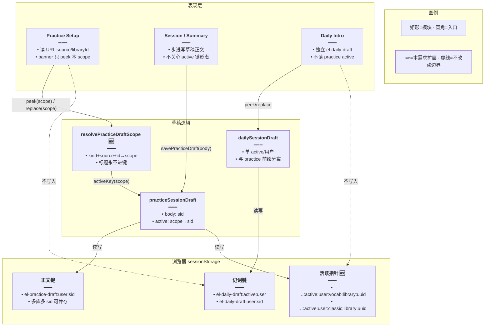
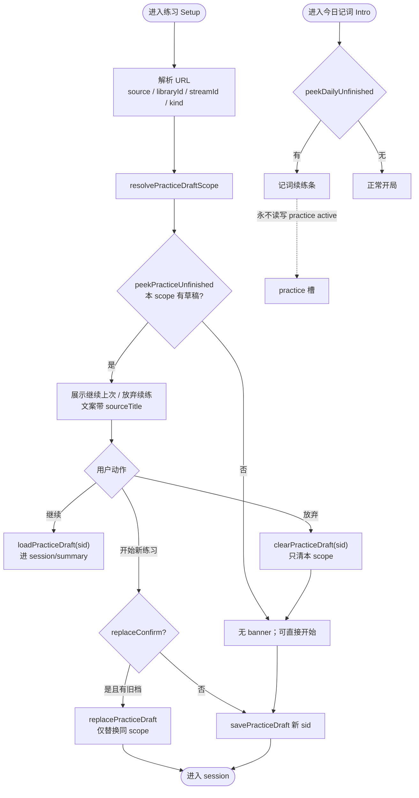
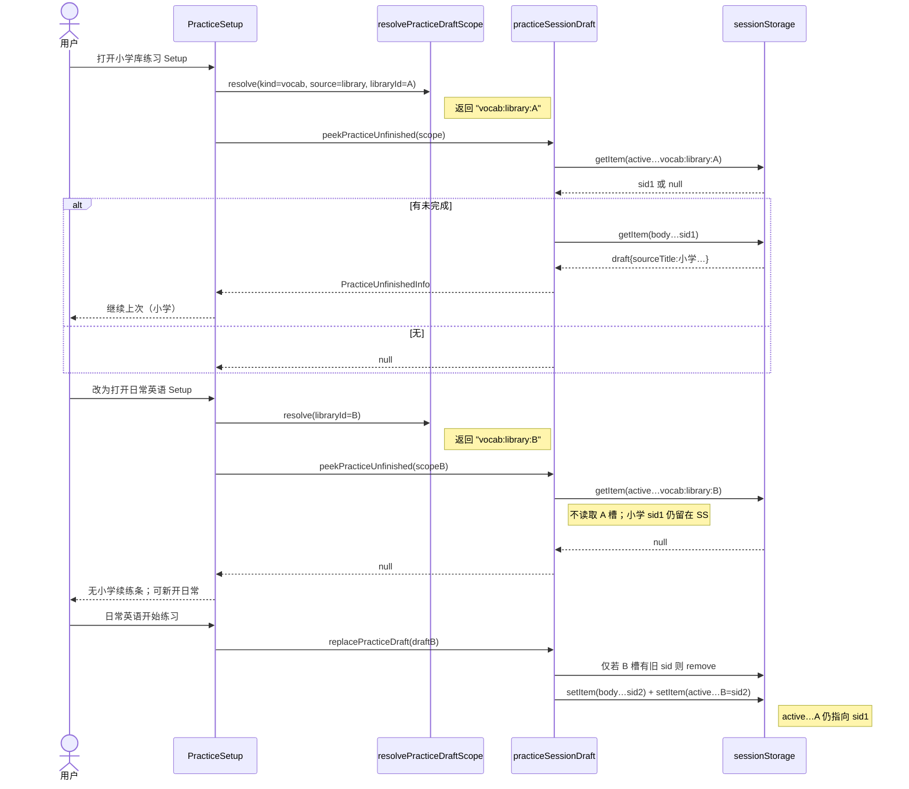
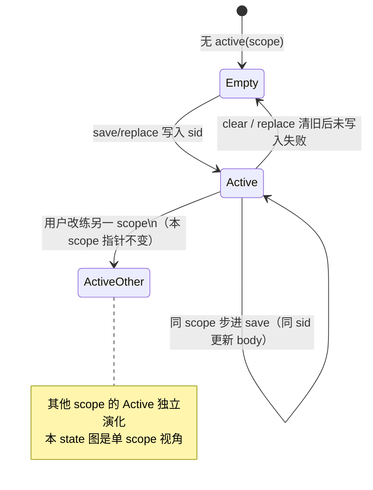

# 练习草稿按库分槽 — 实现思路

> **状态**：**M1–M4 已落地**（`active` 按 `kind:source[:id]` 分槽；旧 kind 指针懒迁移）  
> **日期**：2026-10-14  
> **需求摘要**：单词库 / 语句库 / 今日记词的听写·拼写续档须按**来源实体**隔离；练「小学三年级上册」与练「日常英语」各留一档、互不覆盖；今日记词继续走独立草稿前缀，不与练习库槽串档。

## 延伸阅读

- 现行续档底座（**已落地**，按 `contentKind` 分槽）：[练习与记词独立路由续档.md](./练习与记词独立路由续档.md)
- 今日记词产品线：[今日记词与今日复习.md](./今日记词与今日复习.md)
- 多轮结算与报告：[练习多轮结算与报告续练.md](./练习多轮结算与报告续练.md)
- TTS 按库稳定 scope（键形态可类比）：[TTS按资源库分目录.md](../tts/TTS按资源库分目录.md)

---

## 0. 读本文你将得到什么

- **问题**：`active` 仅按 `vocab` / `classic` 分槽 → 同 kind 下换库会顶掉上一库未完成进度。
- **一句话方案**：`active` 键升级为 **`contentKind + source + 实体 id`**（对齐 `englishPracticePoolKeys`）；今日记词保持 `el-daily-draft` 独立前缀。
- **改动层**：几乎只动前端 `practiceSessionDraft` / Setup 探测 / 少量调用签名；**不改后端**。
- **阶段**：M1 算 scope + 读写 API → M2 迁移旧槽 → M3 Setup/替换语义 → M4 验收。
- **最大风险**：旧 `active:vocab` 指针迁错库；换库后 banner 仍显示「别库」续练。

---

## 1. 需求与边界

### 1.1 用户故事

| 角色 | 场景 | 行为 | 期望结果 |
|------|------|------|----------|
| 学习者 | 「小学三年级上册英语单词」拼写做到一半 | 离开去练「日常英语」 | 小学那档**仍在**；日常有**自己的**草稿 |
| 学习者 | 再从侧栏进小学库练习 Setup | 看到「继续上次」 | 续的是小学库那一档，不是日常英语 |
| 学习者 | 语句库 A / 语句库 B | 同上 | classic 下各库互不覆盖 |
| 学习者 | 今日记词做到一半 | 去词库练习再回来 | 记词草稿仍在（`el-daily-draft`）；练习草稿不进记词槽 |
| 学习者 | 同库内「开始新的练习」 | Confirm 放弃并开始 | **仅清同 scope** 旧 sid，不影响其他库 |

### 1.2 范围

| 在范围内 | 不在范围内（非目标） |
|----------|----------------------|
| practice：`active` 按来源实体分槽 | 跨设备服务端草稿表 |
| library / pack / live / favorites / mistakes / review / dailyMemorize（practice 入口） | 改报告 API / DB schema |
| daily：维持独立前缀；与 practice 槽互不写入 | 今日记词再按「虚拟库」多槽（YAGNI：记词本就单产品线） |
| 旧 `active:vocab\|classic` 懒迁移 | 列表续读 `elResumeModule`（另一类进度） |

### 1.3 约束与依赖

- **登录**：键继续带 `sessionDraftUserScope()`；登出仍 `clearAllPracticeDrafts` + `clearAllDailyDrafts`。
- **复用**：`sessionDraftStorage`、正文 `bodyKey(sid)`、`PracticeSetupConfig.libraryId|streamId|source`、`englishPracticePoolKeys` 命名习惯。
- **Ponytail**：只加 `resolvePracticeDraftScope` + 改 active 键；不新建 Store。
- **体验**：进入某库 Setup 时 banner **只探测该库 scope**；禁止展示跨库「继续上次」。

---

## 2. 方案总览（一句话 + 要点）

**一句话方案**：把 practice 的「同 kind 单活跃」改成「同 **draftScope** 单活跃」；scope = `kind:source[:entityId]`；daily 继续单独前缀、不进 practice 多槽矩阵。

| # | 设计要点 | 理由 |
|---|----------|------|
| 1 | scope 含稳定 id（`libraryId` / `streamId`），不用可变标题 | 与 TTS §13 同理：改名不丢槽 |
| 2 | 无实体来源用固定段（`favorites` / `mistakes` / `review` / `daily-memorize`） | 语义固定，无需 id |
| 3 | `peek` / `replace` 一律带当前 URL 解析出的 scope | banner 与 Confirm 不会串库 |
| 4 | 正文仍按 `sid` 存；多库可并存多份 body | 只改「谁是活跃指针」 |
| 5 | daily **不**并入 practice scope 矩阵 | 前缀已隔离；避免把记词硬塞进 library 模型 |

---

## 3. 现状与复用

| 能力 | 仓库中已有 | 本需求中的用法 |
|------|------------|----------------|
| sessionStorage 读写壳 | `apps/frontend/src/views/englishLearning/utils/sessionDraftStorage.ts` | **直接复用** |
| practice 草稿正文 + kind 级 active | `practice/utils/practiceSessionDraft.ts`（`active:…:vocab\|classic`） | **扩展**为 scope 级 active |
| daily 独立草稿 | `daily/utils/dailySessionDraft.ts`（`el-daily-draft:active:…`） | **直接复用**（强调不混入） |
| 配置里已有 libraryId/streamId/source | `practice/types.ts` · `PracticeSetupConfig` | **直接复用** 算 scope |
| 池元数据键形态 | `store/englishPracticePool.ts` · `englishPracticePoolKeys` | **复用命名习惯**（可对齐字符串） |
| Setup 续练条 / replace Confirm | `practice/Setup.tsx` · `practice/index.tsx` | **扩展** peek 入参 |
| 路由 URL 上的 source/libraryId | `practice/utils/paths.ts` · `index.tsx` parse | **直接复用** |

**调研结论**：M4 已把单词/语句拆成两槽，但仍是「每个 kind 全局一条」；痛点正是同 kind 多库互顶。`config` 里已有算 scope 所需字段，缺的是 active 键维度与 `peek`/`replace` 签名。今日记词前缀本已独立，本需求只需在文档与验收上钉死「不串 practice」。

---

## 4. 架构图



**图内方法说明**：

| 方法 | 功能 |
|------|------|
| `resolvePracticeDraftScope(input)` | 🆕 由 `contentKind`+`source`+`libraryId`/`streamId` 得到稳定 scope 字符串；缺 id 时回退固定段或标待确认 |
| `activeKey(scope)` | 拼 `el-practice-draft:active:{user}:{scope}`；替代旧 `…:vocab\|classic` |
| `getPracticeActiveSid(scope)` | 读该 scope 的活跃 sid；附带旧 kind 槽懒迁移 |
| `setPracticeActiveSid(scope, sid)` | 写/清单一 scope 指针 |
| `peekPracticeUnfinished(scopeInput)` | 只探测**当前入口**对应 scope；供 Setup banner |
| `replacePracticeDraft(draft)` | 仅清**同 scope** 旧 sid 再存新草稿 |
| `savePracticeDraft(draft)` | 写 body，并把 active 指到 `resolve(draft.config)` |
| `peekDailyUnfinished()` / `replaceDailyDraft()` | 记词线入口；不读 practice active |

**读图要点**：

- 分层：UI 只带「当前入口身份」；scope 计算集中在一处。
- 新增核心是 **active 维度**；正文键与 daily 前缀不动。
- practice ↔ daily 双向前缀隔离，避免「记词当一个库」硬揉进矩阵。

---

## 5. 主流程图



**图内方法说明**：

| 方法 | 功能 |
|------|------|
| `resolvePracticeDraftScope(...)` | Setup 开场算当前槽身份 |
| `peekPracticeUnfinished(...)` | 决定是否出 banner；**输入必须含当前库 id** |
| `loadPracticeDraft(sid)` | 按 sid 取正文（与 scope 无关） |
| `clearPracticeDraft(sid)` | 删正文；若某 active 指向该 sid 则清空该指针 |
| `replacePracticeDraft(draft)` | 同 scope 换新 sid，保护其他库草稿 |
| `peekDailyUnfinished()` | 记词线探测；与上表无共享 active |

**读图要点**：

- 入口身份（URL）决定 peek 哪个槽——这是防串库的关键闸门。
- 「开始新练习」Confirm 的杀伤范围从「整个 vocab」缩小到「当前库」。
- 记词支路并行画出，强调零交叉写入。

---

## 6. 核心时序图



**图内方法说明**：

| 方法 | 功能 |
|------|------|
| `resolvePracticeDraftScope(...)` | 两次进入不同库得到不同 scope |
| `peekPracticeUnfinished(scope)` | 按槽探测；跨库互不可见 |
| `replacePracticeDraft(draft)` | 写入 B 时不动 A 的 active/body |
| `sessionStorage.getItem/setItem` | 实际持久化；键空间按 scope 分裂 |

**读图要点**：

- Happy path 证明「换库 ≠ 顶档」。
- 异步仅限同步 storage；无网络。
- Note 标明 A 槽在 B 开局后仍然存活。

---

## 7. 状态机（活跃指针）



**图内方法说明**：

| 方法 | 功能 |
|------|------|
| `savePracticeDraft` | Empty→Active 或 Active 内刷新 body |
| `replacePracticeDraft` | Active→短暂 Empty→新 Active（同 scope） |
| `clearPracticeDraft` | Active→Empty（仅当指针命中该 sid） |

---

## 8. 模块职责与接口草图

### 8.1 模块一览

| 模块 | 职责 | 新增/改动 | 预估路径 |
|------|------|-----------|----------|
| scope 解析 | kind+source+id → 稳定字符串 | 新增函数（可同文件） | `practice/utils/practiceSessionDraft.ts` 或 `practiceDraftScope.ts` |
| practice 草稿 API | active 按 scope；peek/replace 带 scope | 改动 | `practice/utils/practiceSessionDraft.ts` |
| 练习控制器 | Setup 用 URL 身份 peek；persist 不变 | 改动 | `practice/index.tsx` |
| Setup 类型 | `unfinished` 已含 sourceTitle；确认文案可点名库名 | 小改 | `practice/Setup.tsx` / i18n（可选） |
| daily 草稿 | 保持单槽独立前缀 | 不改逻辑；验收钉死 | `daily/utils/dailySessionDraft.ts` |
| 旧文档互链 | 标明 kind 分槽已被本需求细化 | 改动文首 | `练习与记词独立路由续档.md` |

### 8.2 关键接口（草图）

```typescript
// 与 PracticeSetupConfig 对齐的最小入参；算槽只用稳定字段
export type PracticeDraftScopeInput = {
	// 单词 / 语句槽前缀
	contentKind: PracticeContentKind;
	// 决定实体段：library|pack|live|favorites…
	source: PracticeSource;
	// 词库实体；source=library 时必填
	libraryId?: string;
	// 拉取流实体；source=pack|live 时优先
	streamId?: string;
};

// 稳定槽名：永不含可变标题，避免改名丢指针
export function resolvePracticeDraftScope(
	input: PracticeDraftScopeInput,
): string {
	// 统一 kind 前缀，与 englishPracticePoolKeys 习惯一致
	const kind = input.contentKind === 'classic' ? 'classic' : 'vocab';
	// 按来源拼实体段；缺 id 时用固定占位避免误并槽（实现期再定严格校验）
	if (input.source === 'library' && input.libraryId?.trim()) {
		return `${kind}:library:${input.libraryId.trim()}`;
	}
	if (
		(input.source === 'pack' || input.source === 'live') &&
		input.streamId?.trim()
	) {
		return `${kind}:pack:${input.streamId.trim()}`;
	}
	if (input.source === 'favorites') return `${kind}:favorites`;
	if (input.source === 'mistakes') return `${kind}:mistakes`;
	if (input.source === 'review') return `${kind}:review`;
	if (input.source === 'dailyMemorize') return `${kind}:daily-memorize`;
	// 兜底：仍按 kind 分，行为兼容旧单槽（应尽量不走到）
	return `${kind}:unknown`;
}

// 活跃指针：user × scope → sid
function activeKey(scope: string): string {
	return `${PRACTICE_DRAFT_KEY_PREFIX}:active:${sessionDraftUserScope()}:${scope}`;
}

// Setup banner：必须传入当前入口 scope，禁止只传 contentKind
export function peekPracticeUnfinished(
	input: PracticeDraftScopeInput,
): PracticeUnfinishedInfo | null;
```

### 8.3 数据模型

| 字段/实体 | 来源 | 存储 | 说明 |
|-----------|------|------|------|
| `PracticeSessionDraft` 正文 | 现有 | sessionStorage `…:user:sid` | **不变** |
| `active` 指针 | 现有改键 | `…:active:user:{scope}` | scope 见上 |
| 旧 `…:active:user:vocab\|classic` | 历史 | 懒读迁移后删除 | 见 §9 M2 |
| `DailySessionDraft` | 现有 | `el-daily-draft:*` | **不改键**；与 practice 隔离 |
| `sourceTitle` | draft.config | 仅展示 | 不进 active 键 |

**scope 对照表（实现契约）**：

| source | scope 示例 | 说明 |
|--------|------------|------|
| library | `vocab:library:<uuid>` | 用户点名的「每库一档」 |
| pack / live | `vocab:pack:<streamId>` | 直播有 streamId 时与历史包对齐 |
| favorites | `vocab:favorites` | 无实体 id |
| mistakes | `vocab:mistakes` | 无实体 id |
| review | `vocab:review` | 无实体 id |
| dailyMemorize（practice 入口） | `vocab:daily-memorize` | 与 **daily 路由草稿** 仍是两套键 |
| （daily 路由） | `el-daily-draft:active:user` | 单独产品线，不进上表 |

---

## 9. 分阶段实现步骤

| 阶段 | 目标 | 交付物 | 依赖 |
|------|------|--------|------|
| M1 | ✅ scope 解析 + active API 改签名 | `resolvePracticeDraftScope`；`get/set/peek/replace` 走 scope | — |
| M2 | ✅ 旧 kind 槽懒迁移 | 读到 `active:vocab` 时用 draft.config 重算 scope 再安置 | M1 |
| M3 | ✅ Setup / index 接线 | peek 带 URL 身份；replace 仅同 scope | M1 |
| M4 | ✅ 验收 + 文档回写 | 本文状态→已落地；旧续档文互链 | M3 |

### M1

- [x] 新增 `resolvePracticeDraftScope`（单测或自检：两库两串、改 title 不变）
- [x] `activeKey(scope)`；`get/setPracticeActiveSid(scope, …)`
- [x] `save` / `clear` / `replace` 用 `resolve(draft.config)`
- [x] `peekPracticeUnfinished(input)` 改为 scope 入参（打破只传 kind）

### M2

- [x] 保留短时兼容：若新 scope 无指针，尝试读旧 `active:vocab|classic`，校验 draft 的 scope 与当前请求一致再认领
- [x] 认领成功后写新键、删旧 kind 键
- [x] 不一致（旧指针是别的库）→ **不**自动占当前槽；留给用户从原入口续

### M3

- [x] `practice/index.tsx`：`unfinished = peek({ kind, source, libraryId, streamId })`
- [x] 开局 `replacePracticeDraft` 行为人工测：A 有档时开 B 不弹「放弃 A」
- [x] （可选）Confirm 文案带上 `sourceTitle`，减少误杀感
- [x] daily：确认 Intro 仍只 `peekDailyUnfinished`，无 practice import 写 active

### M4

- [x] 跑 §12 验收表
- [x] 本文文首状态改为已落地；`练习与记词独立路由续档.md` 文首加「active 已按库细化 → 本文」
- [x] `ideas/README.md` 索引行更新状态

---

## 10. 关键决策与备选方案

| 决策 | 选用 | 备选 | 为何不选备选 |
|------|------|------|--------------|
| 分槽键 | `kind:source:id` | 仅用 `libraryId` | favorites 等无 id；且 classic/vocab 可能撞 id 空间（低）也宜带 kind |
| 标题是否进键 | **否** | `sanitize(title)` | 改名丢槽；与 TTS §13 教训一致 |
| 换库时旧档 | **保留** | 自动清其它库 | 违背「不能相互干扰」 |
| 今日记词 | **独立前缀不动** | 并入 practice scope 矩阵 | 路由/类型/相位（done vs summary）不同，硬并收益低 |
| live 无 streamId | 有 id 用 pack 段；否则 `kind:live` 单槽 | 禁止开局 | 现网 live 可能短暂无 id；单槽兜底可接受 |

---

## 11. 风险、边界与待确认

| 项 | 等级 | 说明 | 缓解 |
|----|------|------|------|
| 旧指针迁移错槽 | 中 | 只按 kind 认领会把 A 的档挂到 B | 迁移时校验 `resolve(draft.config)===请求 scope` |
| sessionStorage 体积 | 低 | 多库多份 queue 变大 | 同前：仅活跃+历史未 GC 的 body；可后续 LRU 清非 active body |
| Tauri 主窗常驻 | 中 | 多库草稿长期残留 | 继续/放弃/同 scope 新开局回收；登出清前缀 |
| live 与 pack 是否合并键 | 低 | 同 streamId 应命中同档 | 方案用统一 `pack:` 段（待确认） |

**待确认**：

- [ ] `source=live` 与 `source=pack` 在同一 `streamId` 时是否**必须**共用 scope？（验证：直播中练一半 → 历史抽屉同流再进，是否应续同一档）
- [ ] `library` 缺 `libraryId` 的异常 URL：禁止开局 vs 落入 `kind:unknown`？（验证：抓一条坏链）
- [ ] 同库切换听写↔拼写：是否仍同 scope（推荐**是**，mode 在 draft.config 内）？

---

## 12. 验收清单

| # | 用例 | 步骤 | 期望 |
|---|------|------|------|
| AC1 | 两库并存 | 小学库练到一半 → 日常英语新开并做 1 题 → 回小学 Setup | 小学有「继续上次」且题号正确；日常也有自己的档 |
| AC2 | 不互顶 | 在日常英语点「开始」且小学有未完成 | **不**出现「放弃小学档」的 replace；storage 中小学 body 仍在 |
| AC3 | 语句库对称 | classic 库 X / Y 同上 | 互不覆盖 |
| AC4 | 今日记词独立 | 记词做到一半 → 去任意词库练习 → 回 `/daily` | 记词续练条仍在；practice active 键无 daily 正文 |
| AC5 | 同库替换 | 同库有未完成时点「放弃并开始」 | 仅该库旧 sid 被清；其他库草稿保留 |
| AC6 | 刷新 | 某库 session 中 F5 | 仍续该 sid；与分槽无关的路由续档仍成立 |
| AC7 | 改库名 | 改标题后再进练习 Setup | 仍命中原 scope（id 未变）；banner 可用新 title |

---

## 13. 预估改动面（实现阶段参考）

| 类型 | 路径（预估） |
|------|--------------|
| 前端核心 | `apps/frontend/src/views/englishLearning/practice/utils/practiceSessionDraft.ts` |
| 前端接线 | `apps/frontend/src/views/englishLearning/practice/index.tsx`（peek 入参） |
| 可选文案 | `apps/frontend/src/i18n/locales/*/englishLearning.ts` |
| 今日记词 | **默认不改**；仅回归 `daily/utils/dailySessionDraft.ts` |
| 规划文档 | 本文；落地后回写文首状态 + [练习与记词独立路由续档.md](./练习与记词独立路由续档.md) 指针 |
| 后端 | 无 |

---

（本文档为规划态实现思路；落地后以源码与 remote-docs 归档专题为准。）
