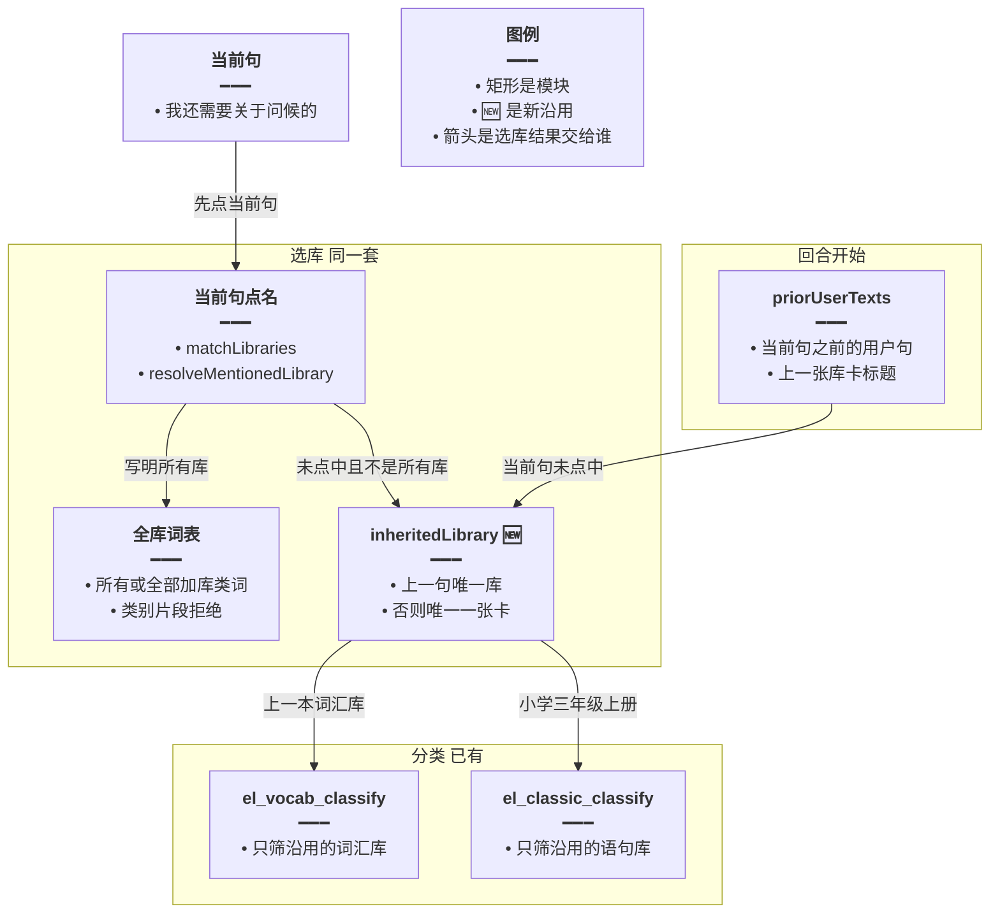
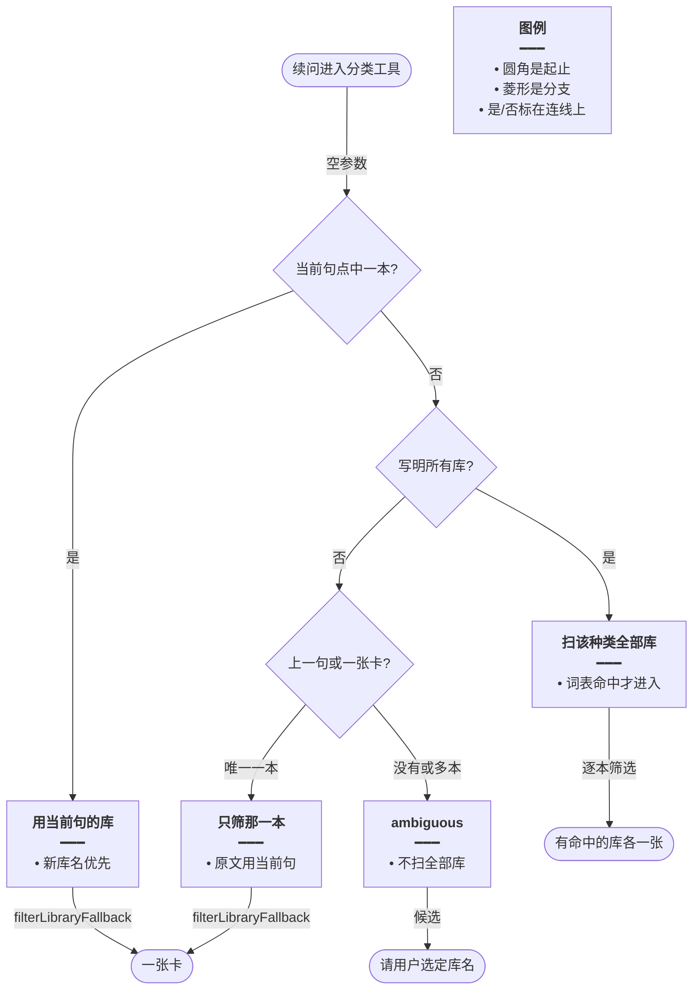
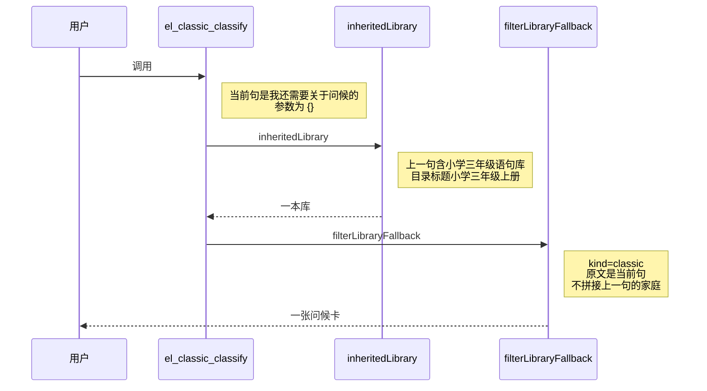

# 续问沿用原库 — 实现思路

> **状态**：规划（未实现）  
> **日期**：2026-10-29  
> **需求摘要**：用户先说「找出小学三年级语句库中有关家庭的所有语句」，下一句只说「我还需要关于问候的」；分类应仍只查小学三年级上册，但现在会把每一本语句库都筛一遍。单词库的同类续问也是这个缺口。  
> **一句话方案（预告）**：当前句没有点名库时，沿用上一句已经点中的那一本；只有原话写明所有库才扫全部。单词分类和语句分类共用这一套，全库判定不再接受「关于问候」这种类别片段。

## 延伸阅读

- 语句分类入口：[english/语句库分类列出.md](./语句库分类列出.md)。本篇不改工具名和空参数，只改「没点名时选哪本库」
- 点名消歧：[english/点名库先定位.md](./点名库先定位.md)。当前句里的库名仍然优先，续问不能盖过新点的库名
- 全库扫描的原规则：[english/所有词库一次分类.md](./所有词库一次分类.md)。本篇收紧判定：类别词片段不能打开全库

---

## 0. 读本文你将得到什么

- 「我还需要关于问候的」会扫到日常交流，是因为选库只读当前这一句，而全库判定把「关于问候」当成了有效线索。
- 选定方案：当前句点不中库时，沿用上一句点中的那一本。单词库、语句库同一套。写了「所有库」才扫全部。
- 改动在两个分类工具的选库分支、全库验收，以及回合开始时带上的上一句原文。分类模型和卡片不换。
- 分两阶段：M1 语句续问沿用原库，M2 单词分类走同一函数。
- 最大风险是用户其实想换库，但没把新库名说全，结果仍筛了上一本。

---

## 1. 需求与边界

### 1.1 用户故事

| 角色 | 场景 | 行为 | 期望结果 |
|------|------|------|----------|
| 已登录用户 | 上一句点了小学三年级语句库并筛过「家庭」 | 「我还需要关于问候的」 | 只筛小学三年级上册，不出现日常交流的卡 |
| 已登录用户 | 上一句点了一本词汇库 | 「我还需要关于颜色的」 | 只筛那本词汇库 |
| 已登录用户 | 续问里改了库名 | 「换成日常交流里关于问候的」 | 只筛日常交流 |
| 已登录用户 | 明确要全部库 | 「所有语句库里关于问候的」 | 每本语句库各筛一次 |
| 已登录用户 | 第一句就没点库 | 「关于问候的语句」且会话里没有上一本库 | 返回候选，不扫全部库 |

### 1.2 范围

| 在范围内 | 不在范围内（非目标） |
|----------|----------------------|
| `el_classic_classify` 与 `el_vocab_classify` 的选库 | 让模型在参数里传 `libraryId` |
| 全库判定的验收收紧 | 新的分类模型或新卡片 |
| 收尾补卡 `shouldFilterContinue` 使用同一套沿用 | 收藏「将这些」的合并规则（见语句整类一次收藏） |
| 上一句原文、上一张库卡的标题 | 把整段对话历史塞进分类提示词 |

### 1.3 约束与依赖

- 必须复用：`matchLibraries`、`resolveMentionedLibrary`、`isCategoryAsk`、`isAllClassicCategory`、`isAllVocabCategory`、`filterLibraryFallback`。
- 当前句里的唯一库名仍然优先于上一句。
- 工具仍是空参数。库不由模型传入。
- 沿用失败时保持现在的 `ambiguous`，不要改成扫全部库。

---

## 2. 背景

- **谁、在什么场景、卡在哪**：用户先要求从小学三年级语句库列出有关家庭的语句，卡片只有这一本库。下一句是「我还需要关于问候的」。回复里同时挂出「小学三年级上册 6 条」和「日常交流 16 条」。没有命中的库不会挂卡，所以画面上是两张，服务端已经按全部语句库各筛了一次。
- **现状缺口**：`el_classic_classify` 和 `el_vocab_classify` 都只用 `surface.userText`，也就是当前这一句。`matchLibraries` 要求库标题整段出现在这一句里，「我还需要关于问候的」对不上「小学三年级上册」。后缀点名也要求这一句里有「语句库」。抽槽 `resolveLibraryCue` 只把当前句交给 `decide()`，库名必须是当前句的连续子串，上一句里的「小学三年级」用不上。抽不到之后 `resolveAllClassicAsk` 再问一次。`acceptAllClassicCue` 只要求 `scope` 为 `all_classic` 且 `cue` 出现在当前句里。「关于问候」满足这个条件，于是 `targets` 变成目录里的每一本库。单词侧的 `acceptAllVocabCue` 是同一段验收。
- **不解决会怎样**：凡是续问只换类别、不重复库名，语句和单词都会要么扫全部库，要么回「没有唯一库」。用户以为还在上一本库里。
- **硬约束**：点了新库名或写了「所有库」时，不能被上一句拖回去。第一句没点库时，不能借此开始扫全部库。

---

## 3. 现状与复用

| 能力 | 仓库中已有 | 本需求中的用法 |
|------|------------|----------------|
| 当前句整段库名 | `spill.ts` 的 `matchLibraries` | 直接复用。先看当前句 |
| 后缀点名 | `resolveMentionedLibrary`。语句后缀是「语句库 / 语料库 / 经典语句」，词汇默认「词汇库 / 单词库 / 词库」 | 直接复用。当前句和上一句都用它 |
| 关于类 | `isCategoryAsk`：含「关于 / 相关 / 有关 / 属于」，且不是整库清单口吻 | 直接复用。续问「关于问候」会走进分类分支 |
| 全库快路径 | `isAllClassicCategory`、`isAllVocabCategory`。要同时有关于类、「所有 / 全部 / 各个」和库类词 | 直接复用。这是唯一允许扫全部库的词表 |
| 全库模型判定 | `resolveAllClassicAsk`、`resolveAllVocabAsk`。验收只查 `cue` 是否为当前句子串 | 扩展验收。类别片段不能通过 |
| 抽槽 | `resolveLibraryCue`，输入只有当前句 | 当前句仍用。上一句不再为了沿用库名去 `decide()` |
| 上一句原文 | `agent.service.ts` 回合开始已 `listMessagesAsc`，并算出 `quoteCategoryText` | 扩展。把当前句之前的用户句放到 `priorUserTexts` |
| 上一张卡 | 语句卡会以 `fromPrior` 放进 `libraryLists`。分类卡载荷没有 `libraryId`，标题是库名 | 扩展。标题对目录，只作上一句点不中时的兜底。词汇卡同样带上 |
| 收尾补卡 | `shouldFilterContinue` 只在当前句恰好含一个库名时补 | 扩展。当前句点不中时走同一套沿用 |
| 分类与出卡 | `filterLibraryFallback` | 直接复用。只是 `targets` 从「全部库」改成「沿用的一本」 |

**调研结论**：模型没有传库 id 的入口，空参数工具的选库完全在服务端。续问扫全库不是卡片组件的问题，是当前句点不中之后，全库验收过宽。

---

## 4. 方案比对与最终方案

### 4.1 候选方案

#### 方案 A：维持只看当前句（复用）

- **做法**：不改选库。提示词要求模型在续问里复述上一本库的全名，例如把用户的话理解成「小学三年级上册里关于问候的」。工具仍只读 `userText`。
- **能工作的原因**：库名一旦出现在当前句，现有的 `matchLibraries` 或后缀点名就会只筛那一本。全库判定可以不动。
- **主要代价**：用户已经说了「我还需要关于问候的」，模型经常不会把库名写回工具能看见的那一句。服务端看不到库名时，`acceptAllClassicCue` 仍可能用「关于问候」打开全部库。提示词挡不住这段验收。

#### 方案 B：续问由模型传入上一本库的 id（扩展工具参数）

- **做法**：`el_classic_classify` 和 `el_vocab_classify` 增加可选 `libraryId`。系统提示在每轮附上上一张库卡的 id，要求续问把这个 id 传进去。服务端收到 id 就只筛那一本。
- **能工作的原因**：id 对上目录时不会扫其他库。当前句里的新库名仍可覆盖这个 id。
- **主要代价**：两个工具现在写明不要传 `libraryId`。模型漏传时回到方案 A。模型把目录里看到的多个 id 分多次传入时，仍会多本一起筛。同轮第二次调用没有被这张卡挡住。

#### 方案 C：服务端沿用上一句点中的库（新增沿用，收紧全库验收）

- **做法**：抽出 `inheritedLibrary(priorUserTexts, priorCards, catalog, mark)`。当前句按现有顺序点库：整段标题、后缀点名、抽槽。点中一本就用它。当前句符合 `isAllClassicCategory` 或 `isAllVocabCategory` 时才扫该种类的全部库。两者都不是时，从近到远看 `priorUserTexts`，用 `matchLibraries` 和 `resolveMentionedLibrary` 找唯一一本；某一句点出多本就停止，不再往更早的句子猜。上一句也没有时，用上一张同种类库卡的标题对目录，恰好一本才用。还没有就 `ambiguous`。`acceptAllClassicCue` 与 `acceptAllVocabCue` 增加和快路径相同的词表：语句要有「所有 / 全部 / 各个」以及「语句库 / 语料库」，词汇要有这些范围词以及「词汇库 / 单词库」。只有类别片段时判定作废。`el_vocab_classify`、`el_classic_classify`、`shouldFilterContinue` 都走这个顺序。回合开始时写入 `priorUserTexts`，并把上一张词汇库卡和语句库卡的标题放进沿用列表。
- **能工作的原因**：「我还需要关于问候的」点不中当前句，也过不了收紧后的全库验收，于是用上一句「小学三年级语句库」对上小学三年级上册。分类原文仍是当前句，所以筛的是问候，不是家庭。
- **主要代价**：上一句的库名对上两本时不再沿用，要用户选一次。沿用列表要在回合开始时准备好。

### 4.2 比对

| 维度 | 方案 A 只看当前句 | 方案 B 模型传 libraryId | 方案 C 服务端沿用上一句 |
|------|-------------------|-------------------------|-------------------------|
| 正确性 | 续问句没有库名时仍可能扫全部库 | id 传对才对。漏传或连传多个 id 会错 | 当前句的新库名和「所有库」优先。其余沿用唯一的上一本 |
| 复用 / 与现状契合 | 不改代码 | 改工具参数，和现有「不要传 libraryId」相反 | 复用 `matchLibraries`、`resolveMentionedLibrary`、两个分类工具 |
| 改动面 | 只改提示词 | 两个工具的参数、提示词、模型是否照做 | `spill.ts`、两个分类工具、收尾补卡、回合开始时的上一句 |
| 复杂度 | 无新分支 | 多一个可选参数 | 多一个沿用函数。不增加 `decide()` |
| 体验 | 用户必须把库名再说一遍，否则看到其他库的卡 | 说对了就只有一本库的卡 | 「我还需要关于问候的」直接出小学三年级上册的问候卡 |
| 风险 | 全库验收过宽仍然存在 | 模型传错 id | 库名没说全时可能沿用上一本，而用户想换库 |
| 可维护性 | 漏洞留在两套几乎相同的选库分支里 | 单词和语句各认各的 id | 两个工具和一个收尾函数调用同一个沿用函数 |

### 4.3 综合考量

权重在选库是否还只依赖当前句，以及全库扫描能否被类别词误开。方案 A 不碰验收，截图里的「关于问候」仍能通过 `acceptAllClassicCue`。方案 B 把库 id 交回模型，而这次失败正是模型侧没有把范围限制在上一本库；漏传 id 时服务端行为不变。

选定方案 C。放弃 A 的零改动，也放弃 B 少写一个沿用函数的做法。沿用时不再为上一句调用 `decide()`，避免续问多一次 400 token 的抽槽。

### 4.4 最终方案

#### 背景

两个分类工具的选库输入只有当前句。续问「我还需要关于问候的」含「关于」，会进入分类分支，但整段标题和后缀都对不上小学三年级上册。抽槽要求线索是当前句的子串，上一句里的库名无效。随后全库判定只检查线索是否出现在当前句，「关于问候」因此能把 `targets` 设成全部语句库。有命中的库各挂一张卡，所以日常交流和小学三年级上册会同时出现。单词工具在同一位置调用 `resolveAllVocabAsk`，续问「我还需要关于颜色的」会同样扫全部词汇库。

#### 具体思路

1. 当前句的唯一库名、以及写明的「所有库」，仍在沿用之前决定。新库名不会被上一句盖住。
2. 沿用的数据来自回合开始已经读到的用户句，外加上一张库卡的标题。不把历史写进分类模型的提示词。分类模型看到的仍是当前句，所以类别从「家庭」换成「问候」。
3. 状态放在本轮 `priorUserTexts` 和上一张卡的标题上。工具参数仍然是 `{}`。
4. 上一句点出多本、或第一句就没有库时，停止沿用并返回候选。收紧后的全库验收拒绝只有类别词的线索。

#### 实现方案

**一句话**：当前句没有点名库时，沿用上一句已经点中的那一本；只有原话写明所有库才扫全部。单词分类和语句分类共用这一套，全库判定不再接受「关于问候」这种类别片段。

| 步骤 | 谁 | 做什么 | 输入 → 输出 |
|------|----|--------|-------------|
| 1 | 回合开始 | 当前句之前的用户句写入 `priorUserTexts`。上一张词汇卡和语句卡的标题写入沿用列表 | 历史 → 本轮可沿用的库名 |
| 2 | `el_classic_classify` / `el_vocab_classify` | 先用当前句点库 | 当前句 → 一本、全部或未点中 |
| 3 | `isAllClassicCategory` / `isAllVocabCategory` | 只有词表命中才 `targets = libs` | 「所有语句库」→ 全部库 |
| 4 | `inheritedLibrary` | 当前句未点中时，从近到远点上一句，再对上一张卡的标题 | 上一句「小学三年级语句库」→ 小学三年级上册 |
| 5 | `acceptAllClassicCue` / `acceptAllVocabCue` | 线索必须同时带范围词和库类词 | 「关于问候」→ 拒绝全库 |
| 6 | `filterLibraryFallback` | 只对选中的库分类，原文用当前句 | 小学三年级上册 + 「关于问候」→ 一张卡 |
| 7 | `shouldFilterContinue` | 当前句点不中时调用同一步沿用 | 模型没调工具 → 仍只补那一本 |

#### 选定原因

1. **正确性**：续问不再因为「关于问候」扫到日常交流。牺牲：上一句库名对上两本时要用户再选，不会挑第一本。
2. **复用**：点名函数和分类器都不新写。牺牲：两个分类工具的未点中分支都要改成调用沿用，不能只改语句工具。
3. **改动面**：工具参数保持 `{}`。牺牲：回合开始要多放上一句和上一张卡的标题。
4. **复杂度**：沿用不再调用 `decide()`。牺牲：比方案 A 多一个函数。
5. **体验**：用户不用把「小学三年级」再说一遍。牺牲：想换库但没说全名时，仍会看到上一本库的结果。
6. **风险**：全库验收与快路径使用同一组词。牺牲：只靠模型说「全部」而原话没有「所有 / 全部 / 各个」时，不再扫全部库。
7. **可维护性**：单词和语句的未点中分支共用 `inheritedLibrary`。牺牲：收尾补卡也要接这个函数，不能让补卡再扫全库。

#### 优势

- 相对方案 A：服务端不依赖模型把库名复述进当前句。类别片段过不了全库验收。
- 相对方案 B：续问不必传 `libraryId`。模型连着传多个 id 这条路不存在。

#### 怎么实现

1. `ElListSurface` 增加 `priorUserTexts: string[]`。回合开始时填入当前用户句之前的用户原文。上一张助手消息里 `source === 'library'` 的词汇卡和语句卡，用标题对应当前目录；语句卡现在已有 `fromPrior`，词汇卡按同样方式放进沿用列表，不参与整库兜底挂卡。
2. `inheritedLibrary` 先走上一句的 `matchLibraries` 和 `resolveMentionedLibrary`。语句传入语句后缀，词汇用默认后缀。一句里多本则返回空。都没有时，上一张卡的标题在目录里恰好一本才返回。
3. 两个分类工具在抽槽失败、且快路径不是全库时，调用 `inheritedLibrary`。返回一本就只筛它。返回空则 `ambiguous`，不再调用 `resolveAllClassicAsk` / `resolveAllVocabAsk`。
4. `acceptAllClassicCue` 在现有子串检查之后，再要求原话匹配 `isAllClassicCategory` 的范围词和库类词。`acceptAllVocabCue` 同样要求 `isAllVocabCategory` 的范围词和库类词。快路径本身不变。
5. `shouldFilterContinue` 在当前句不是恰好一本时，若 `isCategoryAsk` 且未出卡，改问 `inheritedLibrary`。沿用到一本才补卡。
6. 分类仍把当前句交给 `filterLibraryFallback`。不要把上一句「有关家庭」拼进分类原文。

### 4.5 沿用来源

沿用先看哪一份材料，会改变续问选中的库。

| 候选 | 做法 | 取舍 |
|------|------|------|
| 只看上一张卡的标题 | 卡片标题对目录 | 标题「小学三年级上册」能对上。上一轮若扫过两本，卡片不止一张，无法知道用户要的是哪本 |
| 先看上一句原文，再用一张卡兜底 | 上一句用现有点名；点不中才看卡。卡多于一张则不用 | 截图的上一句写了「小学三年级语句库」，不依赖卡片张数。两张卡不会被拿来猜 |

选定先看上一句，再用唯一的一张卡兜底。上一轮已经扫出多张卡时，不从这些卡里挑一本。

---

## 5. 架构图



**图内方法说明**：

| 方法 / 模块入口 | 功能 |
|-----------------|------|
| `matchLibraries` | 库标题整段出现在句子里才算点中 |
| `resolveMentionedLibrary` | 按「某某语句库」或「某某词汇库」抽出库名再对目录 |
| `inheritedLibrary` | 当前句没有库名时，从上一句或唯一一张卡得到一本库 |
| `el_vocab_classify` | 只对选中的词汇库做分类 |
| `el_classic_classify` | 只对选中的语句库做分类 |

**读图要点**：

- 当前句里的库名和「所有库」先于沿用。
- 沿用函数同时供给单词分类和语句分类。
- 分类模型不读上一句，只筛当前这句的类别。

---

## 6. 主流程图



**图内方法说明**：

| 方法 | 功能 |
|------|------|
| `filterLibraryFallback` | 对选中的库按当前句分类并返回命中行 |
| `isAllClassicCategory` | 判断这句是不是要扫全部语句库。词汇侧用 `isAllVocabCategory` |
| `inheritedLibrary` | 在未点中且不是全库时给出沿用的那一本 |

**读图要点**：

- 「我还需要关于问候的」走未点中、不是所有库、沿用成功，只出一张卡。
- 「关于问候」不再进入扫全部库。
- 沿用失败时停在候选，不把目录里的库都筛一遍。

---

## 7. 核心时序图



**图内方法说明**：

| 方法 | 功能 |
|------|------|
| `el_classic_classify` | 语句分类入口。当前句点不中库时改问沿用 |
| `inheritedLibrary` | 用上一句的库名在语句目录里确定一本 |
| `filterLibraryFallback` | 只拉这一本库的句子，按「关于问候」筛选 |

**读图要点**：

- 日常交流不在这次调用里。
- 分类类别来自当前句，库范围来自上一句。
- 单词续问把图里的工具换成 `el_vocab_classify`，沿用函数相同。

---

## 9. 具体实现（主链路代码）

### 9.1 模块一览

| 模块 | 职责 | 新增/改动 | 预估路径 |
|------|------|-----------|----------|
| 沿用库 | 上一句或唯一一张卡 | 新增 | `apps/backend/src/services/agent/tools/english/spill.ts` |
| 全库验收 | 拒绝类别片段 | 扩展 | `spill.ts` 的两个 `acceptAll*Cue` |
| 语句选库 | 未点中时沿用，不再因此扫全部 | 扩展 | `domain-tools.ts` 的 `el_classic_classify` |
| 单词选库 | 与语句相同 | 扩展 | `domain-tools.ts` 的 `el_vocab_classify` |
| 上一句 | 写入本轮 surface | 扩展 | `apps/backend/src/services/agent/agent.service.ts` |
| 收尾补卡 | 沿用同一本 | 扩展 | `shouldFilterContinue` 的调用处 |

### 9.2 主链路实现

```typescript
// 当前句已经点中的库优先。续问不能把「换成日常交流」拉回小学三年级
const named = resolveCurrentLibrary(text, libs, mark);
// 写明所有库才允许 targets 变成整份目录。关于问候不算
const all = isAllClassicCategory(text);
// 两处都没有时才看上一句。避免新库名被历史盖住
const inherited = named ?? (all ? null : inheritedLibrary(priorUserTexts, priorCards, libs, mark));
// 沿用到一本就只筛它。全库词表命中才筛目录里的每一本
const targets = named ? [named] : all ? libs : inherited ? [inherited] : [];
// 空目标是候选，不是全部库。分类原文保持当前句，所以上一句的家庭不会混进问候
if (!targets.length) return elFail('ambiguous', '没有唯一语句库。请让用户选定库名');
```

词汇工具把 `isAllClassicCategory` 换成 `isAllVocabCategory`，`mark` 用默认的词汇后缀。`resolveCurrentLibrary` 是现有整段标题、后缀点名和抽槽的合称，不新做第四套点名。

### 9.3 数据模型

| 字段/实体 | 来源 | 存储 | 说明 |
|-----------|------|------|------|
| `priorUserTexts` | 当前句之前的用户消息 | 本轮 `ElListSurface` | 不含当前句 |
| 上一张库卡 | 上一条助手消息里 `source === 'library'` 的卡 | 沿用列表 | 用标题对目录。多于一张则不用 |
| 选中库 | 当前句、全库词表或沿用 | 分类工具的 `targets` | 不写入新表 |
| 分类原文 | 当前句 `userText` | `filterLibraryFallback` 的参数 | 不改成拼接历史 |

---

## 10. 分阶段实现步骤

| 阶段 | 目标 | 交付物 | 依赖 |
|------|------|--------|------|
| M1 | 语句续问只筛上一本语句库 | 沿用函数、语句工具、全库验收、上一句 | 无 |
| M2 | 单词续问和收尾补卡使用同一规则 | 词汇工具、`shouldFilterContinue` | M1 |

### M1

- [ ] `priorUserTexts` 在英语回合开始时写入。
- [ ] `inheritedLibrary`：上一句唯一库，否则唯一一张语句卡。
- [ ] `el_classic_classify` 在未点中且不是所有语句库时沿用。沿用失败返回 `ambiguous`。
- [ ] `acceptAllClassicCue` 拒绝没有「所有 / 全部 / 各个」和语句库类词的线索。

### M2

- [ ] `el_vocab_classify` 调用同一个 `inheritedLibrary`，后缀用词汇库。
- [ ] `acceptAllVocabCue` 与 `isAllVocabCategory` 的范围词、库类词对齐。
- [ ] `shouldFilterContinue` 当前句点不中时沿用一本，不按目录逐本补卡。

---

## 11. 风险、边界与待确认

| 项 | 等级 | 说明 | 缓解 |
|----|------|------|------|
| 沿用了不想要的库 | 中 | 用户想换库但只说了类别 | 当前句里出现另一本库的标题或后缀时，不再沿用 |
| 上一句对上两本 | 中 | 「三年级」可能同时像上册和下册 | 返回 `ambiguous` 和候选，不挑第一本 |
| 上一张卡没有库 id | 低 | 分类卡载荷只有标题 | 用标题对目录。对不上就不当沿用 |
| 收尾又扫一遍 | 中 | 模型没调工具时 `shouldFilterContinue` 仍可能补卡 | M2 让补卡使用同一本，而不是目录 |

**待确认**：

- [ ] 语句目录里是否同时存在标题包含「小学三年级」的上册和下册（验证方式：看 `listClassicQuotesLibraries` 的 `title`。若有两本，上一句「小学三年级语句库」会 `ambiguous`，需要用户说上册或下册）。

---

## 12. 验收清单

| # | 用例 | 步骤 | 期望 |
|---|------|------|------|
| AC1 | 语句续问 | 上一句点明小学三年级语句库并筛过家庭，再说「我还需要关于问候的」 | 只有小学三年级上册的问候卡，没有日常交流 |
| AC2 | 全库验收 | 当前句只有「关于问候」，没有「所有语句库」 | 不调用全部语句库的筛选 |
| AC3 | 换库 | 「换成日常交流里关于问候的」 | 只筛日常交流 |
| AC4 | 明确全库 | 「所有语句库里关于问候的」 | 每本语句库最多筛一次 |
| AC5 | 单词续问 | 上一句点了一本词汇库，再说「我还需要关于颜色的」 | 只筛那本词汇库 |
| AC6 | 没有上一本 | 新会话直接说「关于问候的语句」 | `ambiguous`，不扫全部库 |
| AC7 | 类别不串 | 同 AC1 | 分类原文是问候，结果里不因为上一句而改筛家庭 |
| AC8 | 收尾补卡 | 模型没有调用分类工具，但上一句有唯一语句库且这句是关于类 | 只补那一本，不补其他语句库 |

---

## 13. 预估改动面（实现阶段参考）

| 类型 | 路径（预估） |
|------|----------------|
| 后端 | `spill.ts`、`domain-tools.ts`、`agent.service.ts` |
| 前端 | 无 |
| 文档（实现后） | 实现完成后再归档。本篇不改业务代码 |
