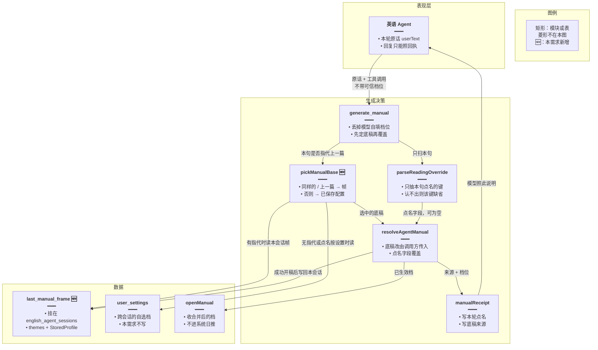
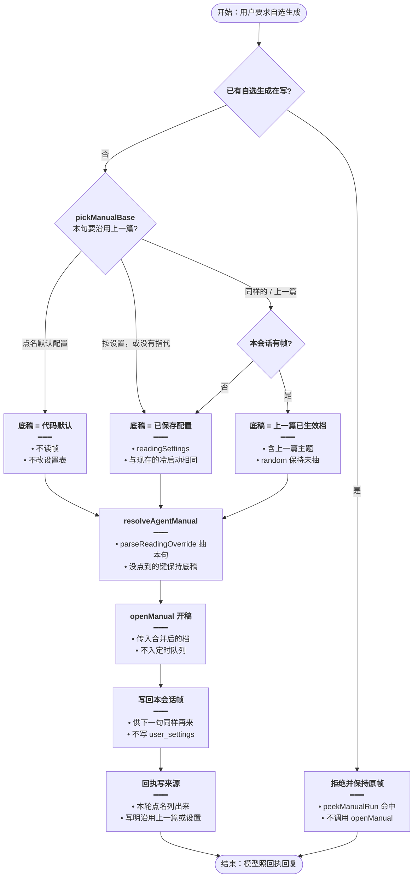
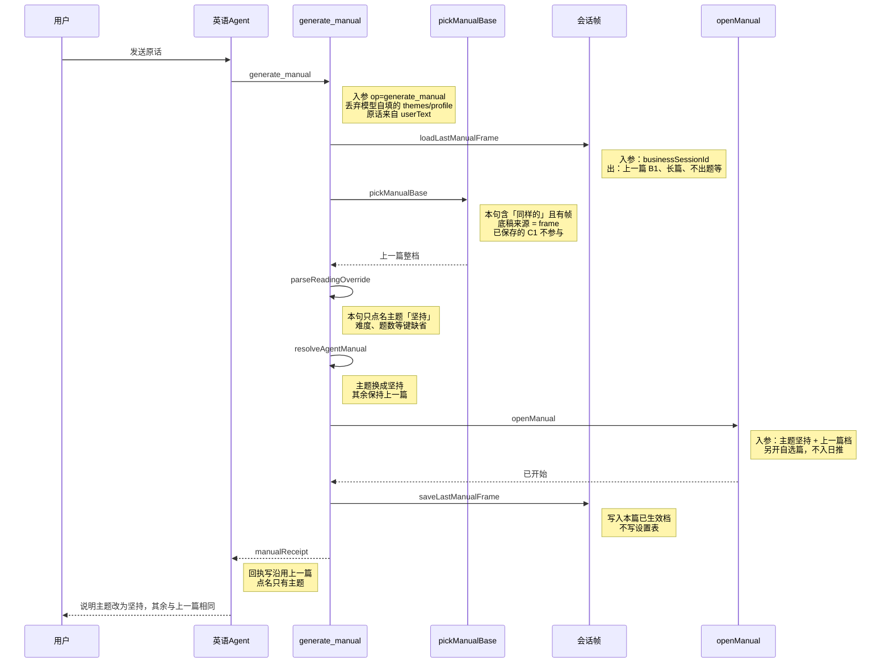
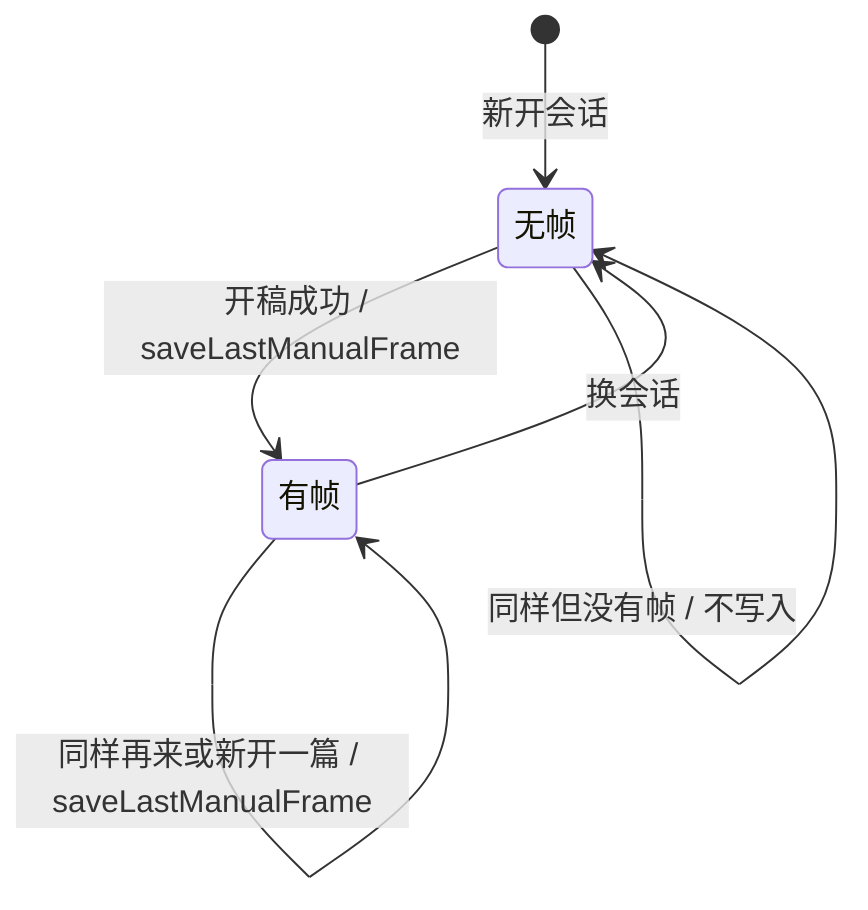

# 自选沿用上一篇 — 实现思路

> **状态**：规划（未实现；单句覆盖已保存配置已经落地，本需求在其上加「本会话上一篇」这一层底稿）  
> **日期**：2026-10-27  
> **需求摘要**：用户在同一英语 Agent 会话里说「再生成一篇同样的，主题改成坚持」时，难度、篇幅、侧重、理解题、联网沿用上一篇已经生效的档，只把主题换成坚持。

## 延伸阅读

- [Agent自选认配置.md](./Agent自选认配置.md)（冷启动：没点名的字段用已保存自选档；本需求不推翻这条）
- [每日阅读手动生成.md](./每日阅读手动生成.md)（`openManual` 另插一篇，不进系统日推）
- [阅读档位随机.md](./阅读档位随机.md)（`random` 留到 `resolveProfile` 再抽；本需求原样继承，不提前抽死）
- [通用决策封装.md](../通用决策封装.md)（`decide()` 只看当前原文、不带历史；本需求不用它填档位）

---

## 0. 读本文你将得到什么

- 要解决的问题：第二句「同样再来一篇，主题换成坚持」被收成设置页里的 C1、3 道理解题，上一句已经生效的 B1、不出题没有留下来。
- 总体方案：服务端多记一层「本会话上一篇已生效档」。本句出现「同样的 / 上一篇」时用它当底稿，本句点名的字段再覆盖；没说沿用时，底稿仍是已保存配置。
- 主要改后端规则、回执和一句系统提示。设置页、系统日推、模型入参都不改。
- 分三阶段：M1 纯函数定底稿，M2 把帧写进会话行并改回执，M3 补指代说法。
- 最大风险：把闲聊里的「同样」收成沿用上一篇，或把「再生成一篇」误当成沿用。

---

## 1. 需求与边界

### 1.1 用户故事

这次对话的实际两句：

| 轮次 | 原话 | 应当生效的档 |
|------|------|----------------|
| 1 | 帮我生成一份主题关于学习的长篇，B1 带字词语，不要题目的阅读资料 | 主题「学习」；难度 B1；篇幅长篇；理解题不出题。侧重、联网原话词表对不上，用已保存配置（这次是附词汇加语法、开启智能搜索） |
| 2 | 再生成一篇同样的，但是主题为坚持的 | 主题改成「坚持」。难度 B1、篇幅长篇、侧重附词汇加语法、理解题不出题、联网开启，全部沿用第 1 轮已经生效的档 |

第 2 轮现在的结果是：主题「坚持」，难度 C1，理解题 3 题。篇幅、侧重、联网碰巧和上一篇一样，是因为设置页本身就是长篇、附词汇加语法、开启智能搜索。回执写「没点名的字段来自已保存配置」，模型就照着告诉用户：这次是 C1、带 3 题，和上一句不一样。

| 角色 | 场景 | 行为 | 期望结果 |
|------|------|------|----------|
| 登录用户 | 本会话刚按上表第 1 轮开过一篇 | 说「再生成一篇同样的，但是主题为坚持」 | 开一篇主题「坚持」的自选稿，其余五档与上一篇已生效档相同 |
| 登录用户 | 新会话，设置是 C1、3 题 | 只说「生成一篇关于咖啡的长篇」，不说同样 | 仍按 [Agent自选认配置.md](./Agent自选认配置.md)：只覆盖主题和篇幅，其余用已保存配置 |
| 登录用户 | 本会话已有上一篇 B1 | 说「按我的设置再生成一篇，主题用坚持」 | 底稿回到已保存配置，再覆盖主题 |
| 登录用户 | 本会话已有上一篇 | 说「用默认配置生成一篇」 | 仍走现有默认档，不沿用上一篇，也不改设置表 |
| 登录用户 | 本会话还没有成功开过自选稿 | 说「再来一篇同样的」 | 退回已保存配置，回执写明本对话没有上一篇 |
| 登录用户 | 换了一个英语 Agent 会话 | 说「同样再来一篇」 | 新会话没有帧，不把上一个聊天的档带过来 |
| 登录用户 | 已有自选生成在写 | 再说同样再来一篇 | 现有 `peekManualRun` 拒绝，不新开，也不改帧 |

### 1.2 范围

| 在范围内 | 不在范围内（非目标） |
|----------|----------------------|
| `generate_manual` 选择底稿：上一篇帧 / 已保存配置 / 代码默认 | 把帧写回 `english_daily_reading_user_settings` |
| 本会话一行 JSON：上一篇交给 `openManual` 的 themes + `StoredProfile` | 跨会话记忆、跨用户记忆 |
| 回执写清「本轮点名」和「底稿来源」；系统提示改一句 | 让模型传入 `themes` / `profile`（继续丢弃） |
| 指代说法：同样的、一样的、同上、上一篇、刚才那、照着上 | 把单独的「再生成一篇」「再来一篇」当成沿用 |
| 纯函数测试覆盖第 1.1 节两句 | 用 `decide()` 改写整句再抽档 |
| | 给「带字词语」补侧重词表（第 1 轮的「词汇和语法」来自已保存档，第 2 轮应原样继承，不在本需求里重判） |
| | 系统日推、设置页按钮、SSE 进度条 |

### 1.3 约束与依赖

- 须登录，与现有英语 Agent 相同。
- 档位真源仍在服务端。`el_daily_reading` 的工具说明已经禁止模型传 `themes` / `profile`。
- 覆盖结果不写设置表。`resolveAgentManual` 现有注释就是「不写回设置」。
- `random` 留在帧里，由现有 `resolveProfile` 在写提示词前再抽。本需求不把上一篇抽中的具体档钉死。
- 体验底线：没说「同样 / 上一篇」的新开一篇，结果必须和现在的「已保存配置 + 本句覆盖」一致。

---

## 2. 方案总览（一句话 + 要点）

**一句话方案**：自选生成仍走 `generate_manual` → `openManual`。先用规则决定底稿是「本会话上一篇」还是「已保存配置」，再用现有 `parseReadingOverride` 覆盖本句点名的字段，然后把这份已生效档写回本会话。

| # | 设计要点 | 理由 |
|---|----------|------|
| 1 | 两层记忆：用户偏好（设置表）和任务帧（本会话上一篇） | 第 2 句的「同样」指上一篇已经生效的整档，不是设置页 |
| 2 | 只有「同样的 / 上一篇」这类指代才换底稿 | 单独「生成一篇关于…」必须继续用已保存配置，否则推翻现有认配置 |
| 3 | 字段覆盖继续用 `parseReadingOverride`，模型入参继续丢弃 | 本仓已经证明模型会自填主题、漏掉档位 |
| 4 | 帧存在 `english_agent_sessions` 的一列 JSON | 工具回执没有进结构化历史；摘要折叠会把 B1 / 不出题说丢 |
| 5 | 回执按字段写来源 | 现在一句「没点名就来自已保存配置」，模型会把已经点名的「不要题目」也说成设置 |
| 6 | 不调用 `decide()` | `decide()` 的 `input` 只有当前原文，不带上一篇；让它填档会编出新的难度 |

### 2.1 这次两句在现有代码里怎么走偏

`resolveAgentManual` 的底稿永远是 `readingSettings()` 读出的已保存档。`parseReadingOverride` 只扫**本句**。

第 1 句能抽出：主题「学习」、篇幅 `long`、难度 `B1`、理解题 `0`（「不要题目」命中词表里的「不要题」）。「带字词语」对不上「附词汇 / 只要词汇」，「联网」也没点名，这两项留下已保存值。所以第 1 篇的已生效档是 B1、长篇、附词汇加语法、不出题、开启智能搜索。这一步和用户看到的成品一致。

第 2 句只能抽出主题「坚持」。「同样的」不在词表里，底稿又回到设置：C1、3 题。`manualReceipt` 固定补一句「未在原话里点名的字段来自已保存的自选生成配置」。`ENGLISH_LEARNING_SYSTEM_APPEND` 要求说明只能照回执。模型于是正确复述了错误的档。

对话模型看得到上一轮助手正文（`EnglishTableMemory.buildLangChainMessagesFromDb` 只放 user / assistant 散文），但 `generate_manual` 不读那段正文，只读 `elSurface.userText`。理解发生在回复里，档位发生在工具里，两边用的不是同一份记忆。

### 2.2 市面做法和取舍

任务型对话把槽位按寿命分开，本句没说的槽不会自动退回账号偏好。

| 做法 | 代表 | 和本需求的关系 |
|------|------|----------------|
| 会话槽位和用户偏好分库存 | Rasa：对话 tracker 里的 slot，和按 `user_id` 保存的偏好分开；槽在本段对话里保留，换话题或新会话才按配置丢掉。Dialogflow CX 的 session params 对 user params、Lex 的 session attributes 对 user attributes、Bot Framework 的 conversation/dialog 记忆对 user 记忆，是同一分层 | 直接对应。设置表是用户偏好；上一篇已生效档是本会话任务槽 |
| 「再来一单」是显式对话行为 | 订票、点餐机器人把 repeat-last 做成一次拷贝上一张已提交订单，再套本句改动的字段 | 「同样的，但是主题为…」就是拷贝上一篇再改主题 |
| 先把追问改写成独立问句，再解析 | 搜索和 RAG 的 conversational query rewriting；LangChain history-aware retriever 用历史把「同样再来一篇」补成完整句子 | 能补出 B1，也能编出 C2。本仓禁止模型填档，不采用为唯一路径 |
| 把上一轮工具参数塞回模型，让它重传 | 通用 ReAct：历史里有 tool call 参数，模型照抄 | 英语消息表不存 tool call，只存助手散文。而且现有设计明确丢弃模型自填的 `themes` / `profile` |
| 只改系统提示，让模型「理解」 | 在提示里写「同样要沿用上一句」 | 生成档位在 `resolveAgentManual`，提示改了，`openManual` 收到的仍是 C1 和 3 题 |

本仓已经有「规则先认、对不上原话就丢掉」的闸门（`reading-ask.ts`、`glm-decide.ts`）。最优解是把这套闸门的**底稿**从「永远是设置」改成「指代时用上一篇，否则用设置」，而不是把决定权交回对话模型。

---

## 3. 现状与复用

| 能力 | 仓库中已有 | 本需求用法 |
|------|------------|------------|
| 单句覆盖已保存档 | `apps/backend/src/services/english-learning/daily-reading.rules.ts` 的 `parseReadingOverride`、`resolveAgentManual` | 扩展：底稿由调用方传入，覆盖算法不动 |
| 主题 / 篇幅的 flash 补抽 | `apps/backend/src/services/agent/tools/english/reading-ask.ts` 的 `resolveAgentManualAsk` | 扩展：先选底稿，再把这份底稿交给现有函数。指代不走 `decide()` |
| 回执与提示 | `domain-tools.ts` 的 `manualReceipt`；`agent.prompt.ts` 里 `el_daily_reading` 那一句 | 扩展：回执带来源；提示改为「照回执里的来源说」 |
| 本轮原话 | `agent.service.ts` 把 `dto.content` 放进 `ElListSurface.userText` | 直接复用：词表和指代都只扫这一句 |
| 助手可见的上一轮正文 | `english-table-memory.ts` 的 `buildLangChainMessagesFromDb` | 不适用：散文和摘要不能当档位真源 |
| 决策模型 | `apps/backend/src/utils/glm-decide.ts`，`input` 只有当前原文 | 不适用：不把上一篇塞进 flash |
| 开稿 | `english-daily-reading.service.ts` 的 `openManual`、`peekManualRun` | 直接复用。帧在调用 `openManual` 之前就算好 |
| 会话行 | `english-agent-session.entity.ts`，与运行句柄同 id | 扩展：加一列 JSON。`runChatStream` 里已有 `businessSessionId`，工具 deps 今天没传它 |
| 文章上的 `extras` | `english-daily-reading.entity.ts` | 不适用：生成完成才有，且是抽完 `random` 的 `ReadingProfile`，也分不出是哪次聊天 |
| 进行中互斥 | `peekManualRun` | 直接复用：拒绝时不覆盖帧 |
| 冷启动认配置 | [Agent自选认配置.md](./Agent自选认配置.md) 已落到 `resolveAgentManual(saved, userText)` | 直接复用：无指代时行为保持 |

**调研结论**：第 2 句的主题解析是对的，错在底稿。工具不读历史，回执又把所有没点名的字段都说成设置，所以模型和用户看到的解释与「同样」相反。不需要新接口、新页面，也不要把 `decide()` 接上历史。

---

## 4. 架构图



**图内方法说明**：

| 方法 | 功能 |
|------|------|
| `generate_manual` | 英语 Agent 的自选生成入口。忽略模型传入的 themes/profile，读本句和本会话帧，算出档位后调用 `openManual` |
| `pickManualBase(text, saved, frame)` | 决定底稿。本句有「同样的 / 上一篇」且本会话有帧时用帧；点名「按设置」或没有帧时用已保存配置；点名「默认配置」用代码默认 |
| `parseReadingOverride(userText, themes)` | 从本句抽出点名的难度、篇幅、侧重、题数、联网、主题。缺的键不填默认值 |
| `resolveAgentManual(base, userText)` | 用底稿填满五档和主题，再用本句点名的键覆盖。不写设置表 |
| `manualReceipt(manual, from)` | 生成给模型的说明：哪些键是本句点的，底稿来自上一篇、已保存配置还是默认 |
| `openManual(userId, input)` | 按合并结果另开一篇自选稿。进行中则拒绝，拒绝时不更新帧 |

**读图要点**：

- 表现层不新增输入。档位仍在工具里算完，模型只负责把回执说成人话。
- 新增的只有底稿选择和会话上的一列帧。设置表继续当冷启动底稿。
- 帧在 `openManual` 接受这次开稿之后才写。拒绝「已有生成进行中」时，上一篇帧保持不动。

---

## 5. 主流程图



**图内方法说明**：

| 方法 | 功能 |
|------|------|
| `peekManualRun(userId)` | 查看该用户是否已有自选生成在写。有则本轮直接失败，帧不更新 |
| `pickManualBase(text, saved, frame)` | 按本句指代、按设置、默认配置三选一底稿。没有帧时「同样」退回已保存配置 |
| `readingSettings(userId)` | 读取已保存自选档。无行时是现有的代码默认，不插入设置行 |
| `parseReadingOverride(userText, themes)` | 抽出本句点名的字段，作为覆盖层 |
| `resolveAgentManual(base, userText)` | 底稿加覆盖，得到这次交给生成的 themes 和 StoredProfile |
| `openManual(userId, input)` | 用合并结果开始自选生成 |
| `saveLastManualFrame(sessionId, frame)` | 把这次已生效档写入本会话。下一句「同样」读的就是它 |
| `manualReceipt(manual, from)` | 写出带字段来源的回执，供模型说明 |

**读图要点**：

- 入口仍是一次 `generate_manual`。指代只影响底稿，不影响开稿函数。
- 「同样」且没有帧，与「没说同样」走同一条已保存配置分支，回执多用一句说明没有上一篇。
- 成功开稿才写帧。失败停在拒绝，用户下一句还能沿用更早的那一篇。

---

## 6. 核心时序图

以第 2 句「再生成一篇同样的，但是主题为坚持的」为准。第 1 句已经把 B1、长篇、附词汇加语法、不出题、联网开写进本会话帧。



**图内方法说明**：

| 方法 | 功能 |
|------|------|
| `generate_manual` | 接收工具调用，只信任本句原文和会话帧，不信任模型填的档位 |
| `loadLastManualFrame(sessionId)` | 读本会话上一篇已生效档。列为空表示这句还不能沿用 |
| `pickManualBase(text, saved, frame)` | 本句有「同样的」且帧存在，返回上一篇作为底稿 |
| `parseReadingOverride(userText, themes)` | 从「主题为坚持」抽出主题；其他键保持缺省 |
| `resolveAgentManual(base, userText)` | 用上一篇填满档位，再用「坚持」覆盖主题 |
| `openManual(userId, input)` | 按合并结果开始生成 |
| `saveLastManualFrame(sessionId, frame)` | 把这次的已生效档写回同一会话，供再下一句使用 |
| `manualReceipt(manual, from)` | 返回带「沿用上一篇」的说明。模型据此回复，不能改口成设置里的 C1 |

**读图要点**：

- 用户只发一句。指代消解在工具内完成，不增加一轮确认。
- 已保存配置这一跳在本路径里不出现。冷启动那条时序才读 `readingSettings`。
- 回执在开稿成功之后返回。模型看到的来源和真正写入 `openManual` 的档是同一份。

---

## 7. 状态机



**图内方法说明**：

| 方法 | 功能 |
|------|------|
| `saveLastManualFrame(sessionId, frame)` | 开稿成功后进入或停留在「有帧」，帧内容换成这一篇 |
| `pickManualBase(text, saved, frame)` | 「有帧」且本句指代上一篇时选帧；「无帧」时一律选已保存配置或默认 |

**读图要点**：

- 帧的寿命是一个英语 Agent 会话。新开一篇成功也会覆盖帧，所以「上一篇」永远是本会话最近一次开成的自选稿。
- 拒绝进行中、或「同样」时还没有帧，都不写列。换会话是另一行，天然无帧。

---

## 8. 模块职责与接口草图

### 8.1 模块一览

| 模块 | 职责 | 新增/改动 | 预估路径 |
|------|------|-----------|----------|
| 底稿选择 | 指代 / 按设置 / 默认，三选一 | 新增 | `apps/backend/src/services/english-learning/daily-reading.rules.ts` |
| 覆盖 | 本句点名字段盖住底稿 | 扩展：底稿参数已存在，调用处传入选中的底稿 | 同上 `resolveAgentManual` |
| 开稿工具 | 读帧、写帧、回执 | 扩展 | `apps/backend/src/services/agent/tools/english/domain-tools.ts` |
| 会话列 | 存上一篇 themes + profile | 新增列 | `english-agent-session.entity.ts` + 一条 migration |
| 工具依赖 | 把 `businessSessionId` 送进领域工具 | 扩展 | `agent.service.ts` 的 `buildEnglishLearningDomainTools` 入参 |
| 系统提示 | 说明必须照回执里的来源 | 扩展一句 | `apps/backend/src/services/agent/agent.prompt.ts` |
| 回归 | 两句样例和冷启动 | 新增 | `apps/backend/src/services/english-learning/daily-reading.rules.frame.spec.ts` |

### 8.2 关键接口（伪代码）

```typescript
// 本会话最近一次开成的自选档；换会话不共享，避免串到别的聊天
type LastManualFrame = {
	// 上一篇交给 openManual 的主题；本句没换主题时沿用
	themes: string[];
	// 抽随机之前的档；同样再来时原样继承，不提前抽死
	profile: StoredProfile;
};

// 先定底稿。指代只换底稿，字段仍由现有词表覆盖，避免模型填档
function pickManualBase(text: string, saved: LastManualFrame, frame: LastManualFrame | null) {
	// 点名默认时不读帧，也不改用户保存的设置
	if (/默认配置|恢复默认/.test(text)) return { base: defaultFrame(), from: 'default' as const };
	// 点名设置时，即使本会话有上一篇，也回到已保存档
	if (/按设置|用我的配置|按保存的配置/.test(text)) return { base: saved, from: 'saved' as const };
	// 只有明确指代上一篇才换底稿；没有帧就退回已保存档
	if (frame && /同样的|一样的|同上|上一篇|刚才那|照着上/.test(text)) {
		// 底稿换成上一篇已生效档，本句点名的键仍在后面覆盖
		return { base: frame, from: 'frame' as const };
	}
	// 新开一篇没说同样：底稿保持已保存配置，和现在的冷启动一致
	return { base: saved, from: 'saved' as const };
}
```

`resolveAgentManual(base, userText)` 保持现在的合并：`said.themes ?? base.themes`，五档同理。调用处把 `pickManualBase` 的 `base` 传进去，不再写死 `readingSettings()` 的结果。

回执在沿用上一篇时写：本轮点名的键（这次只有主题「坚持」）；其余键沿用本对话上一篇（B1、长篇、附词汇加语法、不出题、开启智能搜索）。冷启动仍写：没点名的键来自已保存配置，并列出这些键。`agent.prompt.ts` 里「没在原话点名的字段来自已保存的自选生成配置」改成「来源以回执为准；回执写沿用上一篇时，按上一篇说明」。

### 8.3 数据模型

| 字段/实体 | 来源 | 存储 | 说明 |
|-----------|------|------|------|
| `last_manual_frame` | 本次 `openManual` 入参 | `english_agent_sessions` JSON，可空 | `{ themes, profile }`，profile 用 `StoredProfile`，含 `random` |
| 已保存自选档 | 设置页 | `english_daily_reading_user_settings` | 只读。无指代时的底稿 |
| 本轮原话 | `dto.content` | 不落新列 | 指代和覆盖都扫这一句 |
| 文章 `extras` | 生成结束 | `english_daily_readings` | 不拿来当帧。它来得晚，而且随机已经被抽成具体档 |

---

## 9. 分阶段实现步骤

| 阶段 | 目标 | 交付物 | 依赖 |
|------|------|--------|------|
| M1 | 底稿选择可单测 | `pickManualBase` + 现有合并 + jest | 无 |
| M2 | 同一会话里第二次生成沿用上一篇 | 会话列、工具读写、回执、提示一句 | M1 |
| M3 | 补到真实说法，且不误伤冷启动 | 词表只加日志里出现过的指代 | M2 |

### M1

- [ ] 在 `daily-reading.rules.ts` 增加 `pickManualBase`，指代词只用 §8.2 那一串。
- [ ] `resolveAgentManual` 的第一个参数改为选中的底稿（今天已经是 `{ themes, profile }`，调用处改成传入帧或设置）。
- [ ] jest 覆盖：第 1 句底稿为设置、覆盖出 B1 和不出题；第 2 句底稿为该结果、只改主题；「生成一篇关于咖啡」无帧时仍用设置；「按设置」在有帧时用设置；「同样的」在无帧时用设置；「默认配置」不读帧。

### M2

- [ ] `english_agent_sessions` 增加可空 JSON 列 `last_manual_frame`。
- [ ] `buildEnglishLearningDomainTools` 传入 `businessSessionId`。开稿成功后写入帧；`already_running` 不写。
- [ ] `manualReceipt` 列出本轮点名的键和底稿来源。
- [ ] `ENGLISH_LEARNING_SYSTEM_APPEND` 的 `el_daily_reading` 说明改为照回执来源复述。
- [ ] 用第 1.1 节两句走一次 Agent：第二篇回执含 B1、不出题、主题坚持，且不含「改成 C1」。

### M3

- [ ] 若用户实际还说「还是那篇」「照旧」，把这些词补进同一正则，并加一条 jest。
- [ ] 单独的「再生成一篇」保持冷启动。不在这一阶段把它收成沿用。

---

## 10. 关键决策与备选方案

| 决策 | 选用 | 备选 | 为何不选备选 |
|------|------|------|--------------|
| 谁决定沿用 | 服务端规则 `pickManualBase` | 对话模型看历史后重传 profile | 模型入参今天会被丢弃；重传会把编造的档写进生成 |
| 「同样」的底稿 | 本会话上一篇已生效的 `StoredProfile` | 永远用已保存配置 | 后者就是这次 C1、3 题的原因 |
| 帧放哪 | 会话行 JSON | 从助手正文或摘要里反解；或读文章 `extras` | 正文会被模型改写，摘要会丢掉档位；`extras` 在成文之后才有，且随机已抽死，也不知道属于哪个会话 |
| 指代范围 | 同样的、一样的、同上、上一篇、刚才那、照着上 | 凡是「再生成 / 再来一篇」都沿用 | 后一种会把「再生成一篇关于咖啡」从设置档改成上一篇，推翻认配置 |
| 抽槽 | 继续 `parseReadingOverride` | `decide()` 带上上一篇 JSON 做整句改写 | flash 不看历史；把历史塞进任务文案后，验收闸门挡不住它改写难度 |
| 是否多问一句确认 | 指代明确就直接开稿，回执说明来源 | 先问「是否沿用上一篇」 | 用户已经说了同样。多一轮会让这次生成停住 |

---

## 11. 风险、边界与待确认

| 项 | 等级 | 说明 | 缓解 |
|----|------|------|------|
| 指代过宽 | 中 | 「这两篇难度同样的」若和生成要求写在一句里，会沿用上一篇 | 词表用「同样的」整词，不用单独的「同样」。M1 用反例句子做 jest |
| 指代过窄 | 中 | 「再来一篇，主题坚持」不会沿用 | 已知上限。M3 只在真实说法出现后再加词，不预先把「再来一篇」算进去 |
| 进行中按用户互斥 | 低 | `manualRuns` 的键是 userId。另一会话正在生成时，本会话的「同样」会被拒绝 | 现有行为。拒绝时不写帧，上一篇还在 |
| 随机档 | 低 | 「同样」继承的是 `random` 这个存值，下一篇会再抽一次 | 与设置页一致。回执继续写「随机」，不写上一篇抽中的具体级别 |
| 摘要折叠 | 低 | 长对话摘要不再负责记住档位 | 帧在会话列，折叠只影响模型散文 |

**待确认**：

- [ ] 「带字词语」要不要单独收成「附词汇」。本次用户要的第 2 篇侧重是上一篇已经生效的「词汇和语法」，所以本需求不改侧重词表。若要改第 1 句的理解，另开词表需求。（验证：看设置页侧重是否本来就是附词汇加语法。）
- [ ] 指代是否还要包含「还是那篇」「照旧」。上线前先看这批说法是否出现；没有就不加。（验证：英语 Agent 历史里搜这些词。）

---

## 12. 验收清单

| # | 用例 | 步骤 | 期望 |
|---|------|------|------|
| AC1 | 本文两句 | 设置保存为 C1、长篇、附词汇加语法、3 题、联网开。第 1 句按 §1.1，第 2 句「再生成一篇同样的，但是主题为坚持的」 | 第 2 篇：主题坚持，难度 B1，篇幅长篇，侧重附词汇加语法，理解题不出题，联网开。回执写沿用上一篇。设置页仍是 C1、3 题 |
| AC2 | 冷启动不被带偏 | 新会话说「生成一篇关于咖啡的」 | 主题咖啡，其余全部是已保存配置。回执写来自已保存配置 |
| AC3 | 点名设置 | 已有 B1 帧后说「按我的设置生成，主题用坚持」 | 难度 C1，理解题 3 题，主题坚持 |
| AC4 | 没有上一篇 | 新会话说「再生成一篇同样的，主题坚持」 | 用已保存配置加主题坚持。回执写本对话没有上一篇 |
| AC5 | 换会话 | 会话 A 生成过 B1 篇，会话 B 说「同样再来一篇」 | 会话 B 用自己的已保存配置，不读 A 的帧 |
| AC6 | 进行中 | 上一篇还在生成时再说同样 | `already_running`，帧仍是上一篇成功的那份 |
| AC7 | 第 1 句回执 | 原话含「不要题目」和 B1 | 回执把难度和理解题列在本轮点名里，不把它们说成设置 |

---

## 13. 预估改动面（实现阶段参考）

| 类型 | 路径（预估） |
|------|----------------|
| 后端规则 | `apps/backend/src/services/english-learning/daily-reading.rules.ts` |
| 后端测试 | `apps/backend/src/services/english-learning/daily-reading.rules.frame.spec.ts` |
| 后端工具 | `apps/backend/src/services/agent/tools/english/domain-tools.ts`、`reading-ask.ts`（只改传入的底稿） |
| 后端接线 | `apps/backend/src/services/agent/agent.service.ts`、`agent.prompt.ts` |
| 表 | `english-agent-session.entity.ts` 与一条 migration |
| 前端 | 无 |
| 文档（实现后） | 在 remote-docs wiki 的 english 专题归档；本文保持规划 |

---

（本文档为规划态实现思路；落地后以源码为准）
