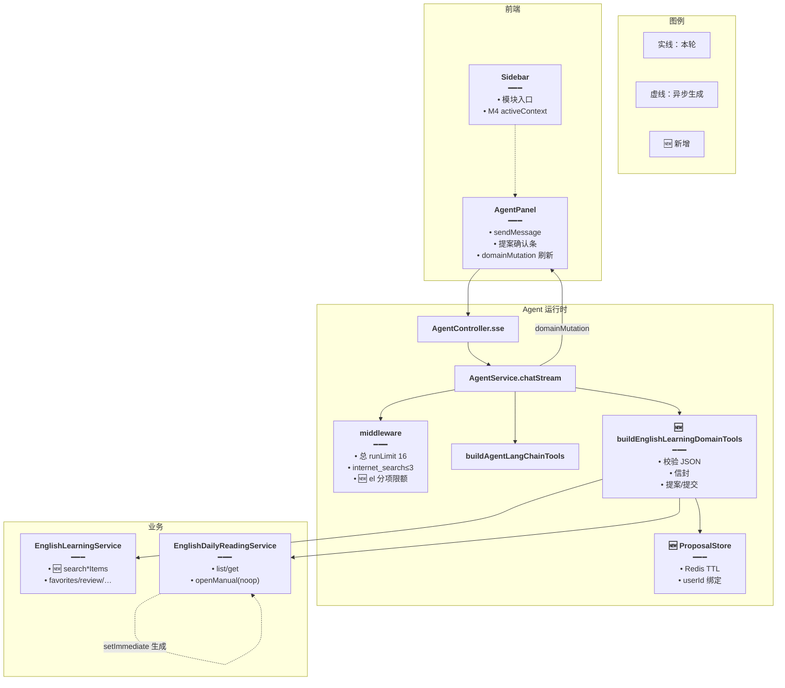
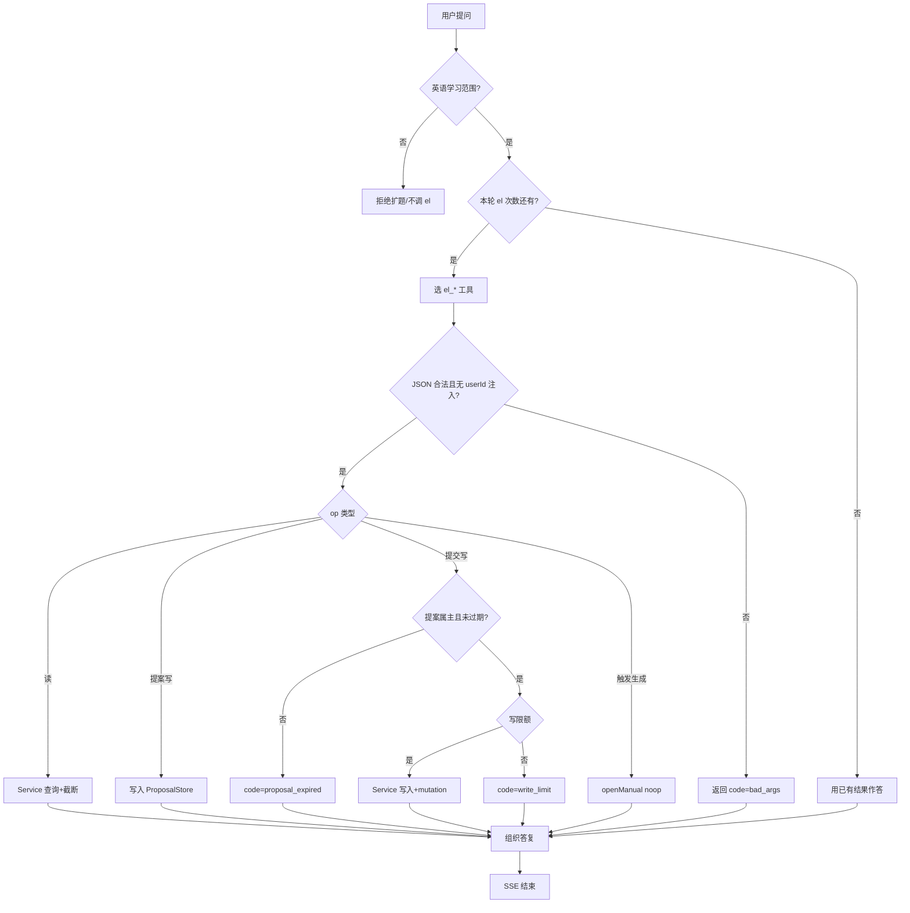
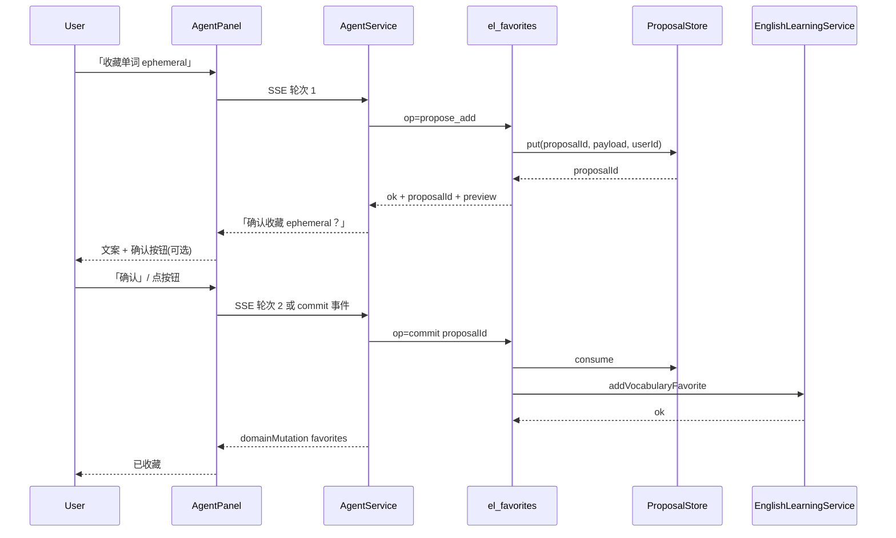
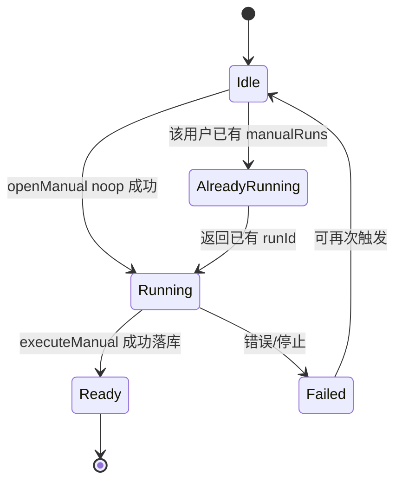

# 英语学习 Agent 关联侧栏模块 — 实现思路（修订最优版）

> **状态**：M0–M4 已落地（2026-10-25）  
> **日期**：2026-10-25  
> **修订**：同日根据方案审查补齐不足、边界与硬缺口，并按 M0→M4 实现  
> **需求摘要**：右侧英语 Agent 通过聊天安全读写侧栏业务（词汇库、语料库、日推、收藏、复习、记词等）；方案须可落地、可限流、可审计。

## 延伸阅读

- 本仓手册：[guide/19-系统日推.md](../../../../dnhyxc-ai/guide/19-系统日推.md)
- 本仓手册：[guide/09-英语学习.md](../../../../dnhyxc-ai/guide/09-英语学习.md) §9.3
- 规划姊妹：[english/系统日推稳定生成.md](./系统日推稳定生成.md)、[english/每日阅读.md](./每日阅读.md)
- 续篇：[Agent词句生成.md](./Agent词句生成.md)、[Agent笔记检索.md](./Agent笔记检索.md)（仍走本文的 `wrap` 与信封；拉数、意图和整表卡与后来落地的 `fetchAllPages`、`listIntent`、`spillListResult` 相同，不另做预览协议）
- 代码要点：`agent-middleware.ts`（英语模式 `runLimit: 8`）、`openManual`（可无订阅者继续生成）、`listVocabularyLibraryItems`（**必须** `libraryId`）

---

## 0. 读本文你将得到什么

- **问题**：Agent 碰不到侧栏业务表；上一版方案方向对，但漏了工具配额冲突、无跨库检索、写确认同轮失效、`openManual` 契约等硬问题。
- **一句话方案**：英语模式挂载 **7 个 `el_*` 领域工具**（闭包 `userId`）→ 只调现有 Service；统一结果信封；写操作用 **提案/提交**；自选生成用 **noop emit + 服务端 runId**；并 **上调英语模式 tool 总限额** 与领域工具分项限额。
- **改哪些层**：Agent 工具工厂 + middleware 限额 +（必要）只读搜索方法 + 系统提示；前端工具文案 / `domainMutation` / 可选提案确认条；不新开平行 REST。
- **分几阶段**：M0 契约与限额 → M1 只读 → M2 提案写入 → M3 触发自选生成 → M4 上下文与 UI。
- **最大风险**：工具死循环占满 8 次上限、误写、同名库歧义、大结果污染记忆；用分项限额、提案制、歧义返回候选、截断与摘要压住。

---

## 0.5 上一版不足与本次修正（必读）

| # | 原方案问题 | 后果 | 最优修正 |
|---|------------|------|----------|
| 1 | 未考虑英语模式已有 **全工具 `runLimit: 8`**（`toolCallLimitMiddleware`） | 领域工具与联网抢配额，复杂问答未完成就停 | M0：英语 `runLimit` 提到 **16**；另加 `el_*` 合计限额（如 10）与写限额（如 5）；联网仍 3 |
| 2 | 假设「跨库 / 主题检索」可直接调现有 list | `listVocabularyLibraryItems` **强制 libraryId**，无 q 参数 | M1 **新增**只读 `searchVocabularyLibraryItems(userId, { libraryId?, q, limit })`（语料对称）；禁止在工具里循环拉全库 |
| 3 | 写操作用同轮 `confirm=true` | 模型总会传 true，确认形同虚设 | **提案制**：`propose_*` 写入 Redis/`el_proposal:{id}`（TTL 5～10min）→ 用户下轮「确认」或前端点确认再 `commit` |
| 4 | `generate_manual` 直接调「流式 API」表述含糊 | `openManual` 需要 `emit`；Agent 无 SSE 订阅 | 工具内 `openManual(userId, { themes, profile, runId }, noopEmit)`；runId **服务端生成**；用户稍后 `attach`；已有进行中则返回 `already_running` |
| 5 | 未定义工具 I/O 信封 | 模型难解析、前端难做卡片 | 统一 `{ ok, code?, message?, data, meta, ui? }` |
| 6 | DynamicTool 单字符串入参未约束 | 乱 JSON、注入式参数 | 入参必须是 JSON；zod/手工校验；**忽略任何 `userId` 字段** |
| 7 | 「今天」时区未钉死 | UTC/上海错日 | 一律 `shanghaiToday()` / 业务已有上海日历 |
| 8 | 库名歧义时默认猜一个 | 抽错库、写错收藏 | 多候选时 `code=ambiguous`，列出 id+标题，禁止猜 |
| 9 | 写成功后侧栏状态不刷新 | 用户以为没写上 | SSE 增 `domainMutation`（如 `favorites`），前端 invalidate |
| 10 | 大工具结果进入 `english_agent_messages` | 上下文膨胀、摘要失真 | 回传模型用截断版；落库可存摘要；meta.truncated=true |
| 11 | 能力表含「Agent 出测验题」易再打模型 | 工具内二次 LLM，延迟与费用不可控 | M2 测验改为 **规则组题**（收藏词填空/选义）；禁止 tool 内再调 chat 模型 |
| 12 | Pack 触发与日推混谈 | 侧栏「资源生成」含词包流，契约不同 | M3 **只做日推自选**；Pack 列为 M3b 可选，同等 noop 触发模式 |
| 13 | 缺可观测性 | 线上难排「为何没调工具」 | 结构化日志：tool、op、latencyMs、ok、code、userId；不含全文 |
| 14 | 公开词库可读未写清 | 可能越权展示或误写 | 读：`assert*Readable`；写收藏/改库：仅本人资源；公开库只读抽取 |
| 15 | 练习报告 / 笔记未显式排除理由 | 范围蔓延 | 非目标；见 §1.2 |

---

## 1. 需求与边界

### 1.1 用户故事

| 角色 | 场景 | 行为 | 期望结果 |
|------|------|------|----------|
| 学习者 | `/english-learning` 右侧 Agent | 「我有哪些词汇库？旅行相关抽 10 个词」 | 列库 → 若多名匹配则反问 → 检索 → 词表 |
| 学习者 | 读过系统日推 | 「今天日推讲什么？生词收藏」 | 读当日篇 → **提案收藏** → 用户确认后写入 |
| 学习者 | 复习 | 「单词复习到期多少？前 5 个」 | summary + peek；引导复习页，不代评分 |
| 学习者 | 要材料 | 「科技主题自选生成中篇」 | 触发手动生成，返回 runId；可去设置页看流 |
| 学习者 | 记词 | 「上周记词怎么样」 | records 摘要；不代打卡 |

### 1.2 范围

| 在范围内 | 不在范围内 |
|----------|------------|
| 词汇库/语料库：列表、**搜索**、抽样、对比（只读） | 批量导入文件、删整库、改库结构 |
| 日推：读系统/自选、触发作自选、查状态与设置（读） | 用户触发 **系统日推补生成** |
| 收藏/错题：查、提案写、确认写 | 全量导出 DOCX（可给导航） |
| 复习：summary、peek_queue、导航 | 默认代交 SRS `record` |
| 记词记录：summary、records | 默认代打卡 |
| 侧栏 activeContext、domainMutation | 笔记编辑、练习报告深析、词法/语法参考页内容库 |

### 1.3 约束与依赖

- Jwt + 工具闭包 `userId`；参数中的 `userId` 一律忽略。
- 系统日推 `slot=day` 只读；手动篇按 `userId`。
- 复用 `chatStream` 拼 tools；英语 middleware 已有联网 3 次 + 总 runLimit（须上调，见 M0）。
- Ponytail：一个工厂 + 少量 Service 搜索方法；不复制业务逻辑。
- 单次 `data` 序列化 ≤ **6KB** 或 ≤ **20** 条（先到为准）；超出截断并 `meta.truncated=true`。

---

## 2. 方案总览

**一句话方案**：领域工具桥 + 统一信封 + 提案写 + 限额分层 + 自选生成 noop 触发；缺的搜索 API 先补再挂工具。

| # | 设计要点 | 理由 |
|---|----------|------|
| 1 | 工具只调 Service | 鉴权与分页已存在 |
| 2 | 读 / 提案写 / 提交写 / 触发 四级 | 同轮 confirm 不可靠 |
| 3 | 7 个 `el_*` + `op` | 选型成本与可控性平衡 |
| 4 | 统一信封 + 可选 `ui[]` | 模型与前端同源契约 |
| 5 | 限额：总工具 / `el_*` / 写 / 联网 分开 | 避免互抢导致说半句 |
| 6 | 歧义显式返回 | 禁止默默选错库 |
| 7 | `domainMutation` SSE | 侧栏与 Agent 数据一致 |
| 8 | 否决前端代调 REST、否决 el_sql、否决 30+ 细工具 | 安全与可选性 |

### 2.1 能力总表（修订优先级）

#### A/B 词汇库 · 语料库（对称）

| ID | 能力 | 阶段 | 备注 |
|----|------|------|------|
| A1/B1 | 列本人库（+可读的公开库标记） | M1 | |
| A2/B2 | 按 libraryId 或全库关键词搜索 | M1 | **依赖新 search API** |
| A3/B3 | 抽样（随机/与收藏错题交叉） | M1 | 抽样在 Service 或工具内对搜索结果再切 |
| A4/B4 | 两库重合对比 | M2 | 限制每库扫描上限 |
| A5/B5 | 提案「加入某库」 | M2 | 不直接写库项，除非产品明确要；优先收藏 |
| A6/B6 | 练习深链参数 | M4 | 只返回 ui.navigate |

> 默认可写路径以 **收藏** 为主；往 library **写入词条** 涉及导入校验，M2 仅提案或不做。

#### C 日推

| ID | 能力 | 阶段 | 备注 |
|----|------|------|------|
| C1 | today / 指定日系统篇摘要或全文 | M1 | 无篇返回 generating/exhausted |
| C2 | 最近系统 + 本人自选列表 | M1 | |
| C3 | 详情 extras（题目标答可选） | M1 | 全文可先摘要模式 |
| C4 | 触发自选生成 | M3 | noop emit + server runId |
| C5 | gen_status / 历史 | M3 | |
| C6 | 读 settings | M1 | 写设置仍进设置页 |
| C7 | ❌ 系统补生成 | — | |

#### D/E/F/G 收藏 · 复习 · 错题 · 记词

| ID | 能力 | 阶段 | 备注 |
|----|------|------|------|
| D1–D2 | 列表/搜索收藏 | M1 | |
| D3–D4 | 提案 add/remove → commit | M2 | |
| D5 | 从日推 glossary **提案**批量收藏 | M2 | |
| D6 | 规则组题 | M2 | 不二次 LLM |
| E1–E3 | summary / peek / 导航 | M1 | |
| E4 | ❌ 默认代评分 | — | |
| F1–F2 | 错题 list / 提案 add | M1/M2 | |
| G1–G3 | 记词 summary/records/导航 | M1 | |
| G4 | ❌ 默认代打卡 | — | |

#### H 横切

| ID | 能力 | 阶段 |
|----|------|------|
| H0 | M0 限额与信封、校验器 | M0 |
| H1 | activeContext | M4 |
| H2 | ui 卡片 | M4 |
| H3 | 分项限额 | M0 |
| H4 | 系统提示工具地图 | M1 |
| H5 | domainMutation | M2 |
| H6 | 工具审计日志 | M0 |

---

## 3. 现状与复用

| 能力 | 已有位置 | 本需求用法 |
|------|----------|------------|
| Agent SSE / 英语记忆 | `AgentService`、`english_agent_*` | 直接复用 |
| 工具限额中间件 | `buildAgentLangchainMiddleware` english `runLimit:8` | **扩展上调** + 领域分项 |
| 通用工具 | `buildAgentLangChainTools` | concat 领域工具 |
| RAG 工具模式 | `createAgentKnowledgeRagTool(userId)` | 同构闭包 |
| 词库 items | `listVocabularyLibraryItems(userId, libraryId, page)` | 复用分页；**搜索新建** |
| 收藏/复习/记词/错题 | `EnglishLearningService` | 工具包装 |
| 日推 | `list/get/openManual/attachManual` | 读复用；触发用 openManual+noop |
| 系统补生成 | internal token | 不适用 |
| intentPrefix | Toolbar | M4 升级为 structured context |

**调研结论**：桥接层仍是缺口；此外必须补 **搜索 API**、**限额策略**、**提案存储**、**noop 触发生成** 四块，否则方案不可运行或会误伤。

---

## 4. 架构图



**图内方法说明**：

| 方法 / 模块 | 功能 |
|-------------|------|
| `sendMessage` | 发起轮次；可带 activeContext |
| `chatStream` | 拼工具与提示；推流；推 mutation |
| `buildAgentLangchainMiddleware` | 限额；英语模式须改 runLimit |
| `buildEnglishLearningDomainTools` | 领域工具工厂 |
| `ProposalStore.put/get/consume` | 写前提案，防同轮假确认 |
| `searchVocabularyLibraryItems` 🆕 | 跨库或单库关键词检索 |
| `openManual(..., noop)` | 无 SSE 订阅也启动 executeManual |

**读图要点**：提案与限额是一等公民；生成与对话解耦。

---

## 5. 主流程图



**图内方法说明**：

| 步骤 | 功能 |
|------|------|
| Budget | `el_*` 调用计数，独立于联网 |
| Parse | 强制 JSON schema；剥除 userId |
| ProposalStore | TTL 提案；commit 一次性消费 |
| openManual noop | 后台生成；返回 runId |
| mutation | 通知前端刷新对应列表 |

**读图要点**：读可多；写必须提案或带「上轮工具给出的 id 白名单」（见 §8.6）；触发生成不占写限额但占 el 次数。

---

## 6. 时序图（收藏：提案 → 确认）



**图内方法说明**：

| 方法 | 功能 |
|------|------|
| `propose_add` | 不写业务表，只存提案 |
| `commit` | 校验属主与 TTL 后写表 |
| `addVocabularyFavorite` | 幂等收藏 |
| `domainMutation` | 侧栏/列表刷新 |

**读图要点**：确认跨轮；按钮可缩短路径但仍走 commit。

---

## 7. 状态图（自选日推）



**图内方法说明**：

| 方法 | 功能 |
|------|------|
| `openManual` | 每用户内存一对一 run；已有则订阅/返回已有 |
| `attachManual` | 前端事后接流 |
| `gen_status` | 查内存 run 或历史 gens 表 |

---

## 8. 模块与接口草图

### 8.1 工具清单（仍为 7 个）

| 工具 | 主要 op | 覆盖 |
|------|---------|------|
| `el_libraries` | `list` / `compare` | A1 A4 |
| `el_items_search` | `search` / `sample` | A2 A3 |
| `el_daily_reading` | `today` / `get` / `list` / `settings` / `generate_manual` / `gen_status` | C* |
| `el_favorites` | `list` / `search` / `propose_add` / `propose_remove` / `commit` | D* |
| `el_review` | `summary` / `peek_queue` | E* |
| `el_mistakes` | `list` / `propose_add` / `commit` | F* |
| `el_daily_memo` | `summary` / `records` | G* |

语料与词汇通过参数 `kind=vocab|classic` 共用工具，避免工具数翻倍。

### 8.2 统一信封

```ts
// 所有 el_* 返回给模型的字符串：JSON.stringify(envelope)
type ElEnvelope<T> = {
	// 业务是否成功
	ok: boolean;
	// 稳定错误码：bad_args | ambiguous | not_found | write_limit | el_limit | proposal_expired | forbidden | unavailable
	code?: string;
	// 给人看的短中文
	message?: string;
	// 业务数据；失败时可为候选列表
	data?: T;
	// 截断与分页
	meta?: { truncated?: boolean; total?: number; limit?: number; offset?: number };
	// 前端可渲染动作；模型也可读 navigate 向用户说明
	ui?: Array<{ type: 'navigate' | 'confirm_proposal' | 'open_reading'; href?: string; proposalId?: string; label: string }>;
};
```

### 8.3 入参校验草图

```ts
// DynamicTool.func 收到的是字符串，必须当 JSON 解析
function parseElArgs(raw: string): Record<string, unknown> {
	// 拒绝非对象，避免模型传纯文本导致误调用
	const v = JSON.parse(raw) as unknown;
	if (!v || typeof v !== 'object' || Array.isArray(v)) {
		throw new Error('bad_args');
	}
	const obj = v as Record<string, unknown>;
	// 防止提示注入改成操他人数据
	delete obj.userId;
	delete obj.user_id;
	return obj;
}
```

### 8.4 搜索 API 缺口（M1 阻塞项）

```ts
// EnglishLearningService 新增只读方法；内部 where userId 可读库
async searchVocabularyLibraryItems(
	userId: number,
	query: {
		// 可空：空则在用户可读的所有库中搜
		libraryId?: string;
		// 词形/释义模糊；空则不允许（防全表 dump）
		q: string;
		limit?: number;
	},
): Promise<{ items: Array<{ libraryId: string; libraryTitle: string; word: string; meaning?: string }> }> {
	// … 实现阶段：ILIKE/索引 + limit 硬顶 20
	return { items: [] };
}
```

### 8.5 自选生成触发

```ts
// 工具内：不依赖浏览器 SSE
const runId = randomUUID();
// 空发射器：只满足类型，生成靠 setImmediate(executeManual)
const noop = (_ev: Record<string, unknown>) => undefined;
this.dailyReading.openManual(userId, { themes, profile, runId }, noop);
// 若已有 run，openManual 会 subscribe 到已有任务——工具应先 findManual 语义化 already_running
return envelope({ ok: true, data: { runId, status: 'started' }, ui: [{ type: 'navigate', href: '/english-learning/daily-reading/settings', label: '查看生成' }] });
```

### 8.6 同轮白名单写（提案制的补充）

若产品坚持「一句话收藏」：

- 仅当 `wordKey`/`id` 出现在 **本轮更早成功的 el 工具 data** 中时，允许 `add` 跳过提案。
- 白名单由 AgentService 在 tool 包装器里维护 `Set<string>`，不信任模型「随便写的词」。
- 用户口述新词收藏仍走提案，避免幻觉词入库。

### 8.7 限额（M0 必须改 middleware）

| 限额 | 建议值 | 作用 |
|------|--------|------|
| 全工具 runLimit（英语） | **16**（现 8） | 领域+联网+日期够用 |
| internet_search | 3（不变） | 控外网 |
| el_* 合计 | 10 | 防领域死循环 |
| el 写（commit） | 5 | 防刷收藏 |
| 单工具 limit | ≤20 | 控 token |

### 8.8 系统提示增量要点

- 侧栏数据 **优先 el_***，禁止先联网。
- 多库重名 → 调用 list 后请用户选 id，禁止猜测。
- 系统日推不能「重新生成」。
- 复习/记词以引导打开页面为主。
- 工具失败看 `code`，向用户说人话，不要伪造数据。

---

## 9. 分阶段落地

### M0 — 契约与限额（先于功能）

- [ ] 定义 `ElEnvelope`、`parseElArgs`、错误码表
- [ ] 英语 `runLimit` 8→16；增加 el 分项计数中间件或工厂内计数
- [ ] ProposalStore（Redis 或内存+TTL，多实例必须 Redis）
- [ ] 工具调用日志字段

### M1 — 只读

- [ ] `searchVocabularyLibraryItems` / 语料对称方法
- [ ] 挂载 7 工具的 **读 op**
- [ ] 日推 today/get/list/settings；复习 summary/peek；记词 summary/records；收藏/错题 list
- [ ] 歧义 `ambiguous`；截断 meta
- [ ] 提示词工具地图；前端 tool 文案
- [ ] 单测：越权、无 libraryId 搜索、limit、忽略 userId 参数

**验收**：真实数据问答；故意重名库会反问。

### M2 — 提案写入

- [ ] favorites/mistakes propose + commit
- [ ] 可选同轮白名单 add
- [ ] domainMutation SSE + 前端刷新
- [ ] 前端确认条（commit）
- [ ] 规则组题 D6（可选）

**验收**：未确认不落库；确认后侧栏可见；写爆限额有提示。

### M3 — 触发自选生成

- [ ] generate_manual + gen_status（noop openManual）
- [ ] already_running 处理
- [ ] （M3b）Pack 同等模式可选

**验收**：聊天触发生成后设置页能 attach；无法触发系统补生成。

### M4 — 体验

- [ ] activeContext
- [ ] ui 卡片
- [ ] 练习深链
- [ ] 评估是否开放显式 SRS record（默认关）

---

## 10. 边界情况矩阵

| 场景 | 期望行为 |
|------|----------|
| 无词库 | list 空数组 + 引导导入页 ui |
| 库名匹配 0 个 | not_found |
| 库名匹配多个 | ambiguous + candidates |
| 搜索 q 空 | bad_args |
| 今日系统日推 generating | ok + status，不假装有正文 |
| 今日 exhausted | 说明暂时没有，引导稍后/联系管理（不暴露内部补生成） |
| 用户已有手动生成在跑 | already_running + 原 runId |
| 进程重启后内存 run 丢失 | gen_status 查 DB 历史；提示刷新页 |
| 提案过期 | proposal_expired，请重新提出 |
| 提案属主不符 | forbidden |
| 收藏已存在 | ok 幂等 |
| 公开库 | 可读搜索；不可用工具改库内容 |
| 工具 JSON 非法 | bad_args，不重试死循环 |
| el 次数用尽 | 用已有 tool 结果作答 |
| 用户说非英语话题 | 不调 el_* |
| 超大 glossary 批量收藏 | 提案里最多 N 条，其余 truncated |
| 多 Tab 同时 Agent | 限额按 run；写仍按 userId 幂等 |

---

## 11. 预估改动路径

| 路径 | 变更 |
|------|------|
| `agent/english-learning-domain-tools.ts` | 🆕 工厂 |
| `agent/el-proposal.store.ts` | 🆕 提案 |
| `agent/agent-middleware.ts` | runLimit 与文档一致 |
| `agent/agent.service.ts` | 挂载、mutation 事件、白名单 Set |
| `agent/agent.module.ts` | 注入 Learning / DailyReading / Redis |
| `agent/agent.prompt.ts` | 工具地图 |
| `english-learning.service.ts` | 🆕 search* |
| `english-daily-reading.service.ts` | 可选暴露 `getManualRunStatus(userId)` |
| 前端 agent 文案 / mutation 订阅 / 确认条 | M2–M4 |

---

## 12. 风险与权衡

| 风险 | 缓解 |
|------|------|
| 限额过小对话残废 | M0 上调并分项 |
| 限额过大烧钱 | el 10 + 写 5 + 截断 |
| 假确认 | 提案跨轮 |
| openManual 无订阅 | noop 已支持继续生成 |
| 搜索打爆 DB | q 必填、limit、索引 |
| 记忆膨胀 | 截断落库、依赖现有 summarizationMiddleware |
| 多实例提案丢失 | Redis ProposalStore |
| 模型编造 wordKey 写入 | 白名单或提案 |

**否决**：前端代调 REST；el_sql；细粒度 30+ tool；tool 内再调聊天模型组题；用户 Agent 系统补生成。

---

## 13. 验收清单

- [ ] 非英语模式无 el_*；英语模式有  
- [ ] runLimit 与 el 分项在压测下不会「刚搜完库就不能回答」  
- [ ] 跨库搜索不拉全表；无 q 拒绝  
- [ ] 重名库 ambiguous  
- [ ] 今日日推三态正确（ready/generating/exhausted）  
- [ ] 收藏未经 commit 不落库；commit 后有 mutation  
- [ ] 自选生成 noop 可跑；系统补生成不可用  
- [ ] 参数带 userId 无法越权  
- [ ] 大结果 truncated  
- [ ] 无关话题不调 el_*  

---

## 14. 待确认

| 项 | 验证 |
|----|------|
| ProposalStore 用 Redis 还是单机内存（开发） | 部署拓扑；生产多 pm2/多机必须 Redis |
| 是否允许「白名单同轮直写收藏」 | 可用性 vs 幻觉词 |
| M3b 是否做 Pack | 产品是否把词包算「资源生成」 |
| 公开库是否出现在 list | 与 `assert*Readable` 产品文案 |

---

## 15. 决策记录

| 决策 | 选择 | 原因 |
|------|------|------|
| 集成 | 后端 Domain Tool | 与知识库工具同构 |
| 写确认 | 跨轮提案 | 同轮 confirm 无效 |
| 搜索 | 新建 Service 方法 | 现有 list 不足 |
| 触发生成 | openManual + noop | 已支持无订阅者继续跑 |
| 限额 | 总 16 + el 10 + 写 5 | 修复与联网抢 8 次的致命问题 |
| 组题 | 规则题 | 禁 tool 内二次 LLM |
| 系统日推生成 | 不开放 | 防刷 |
| SRS/打卡 | 默认只读 | 数据真实性 |
