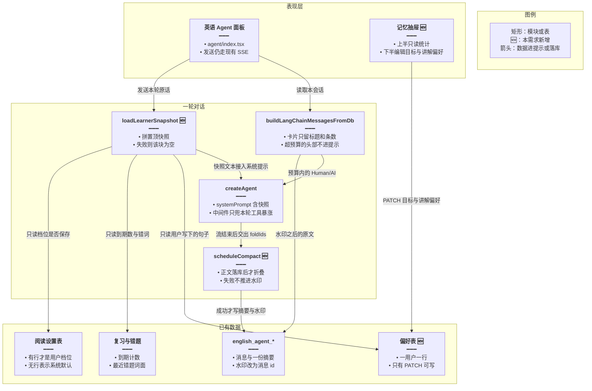
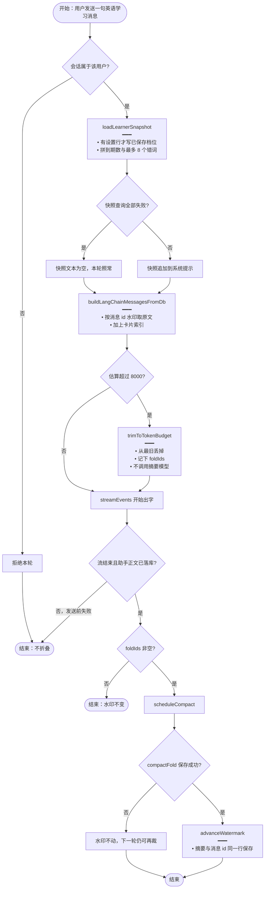
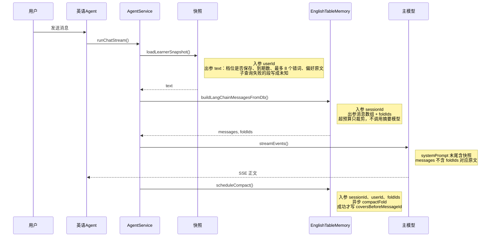
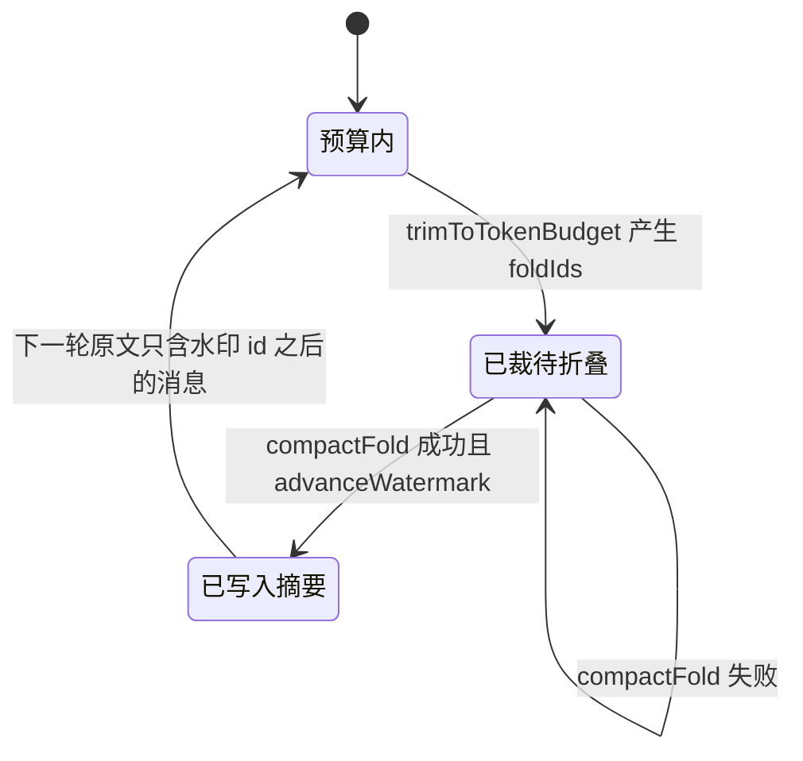

# 英语 Agent 记忆 — 实现思路

> **状态**：规划（会话水印摘要已上线；学习者长期记忆未做）  
> **日期**：2026-11-06  
> **需求摘要**：英语学习 Agent 在新会话、长会话和换话题时仍能按该用户的真实档位、错题和复习进度说话，且长对话不再靠两套互不相通的摘要挡上下文。  
> **一句话方案（预告）**：每轮把已有学习表拼成一块置顶快照，会话原文改按 token 预算裁剪并在回合结束后折叠；不把学习进度再复制进向量库。

## 延伸阅读

- 现网分表与水印：[`Agent业务消息分表方案`](../../Agent业务消息分表方案.md)
- 侧栏工具（记忆不应取代这些写路径）：[英语Agent关联侧栏](./英语Agent关联侧栏.md)
- 大列表为何不能塞进模型： [Agent大结果旁路展示](./Agent大结果旁路展示.md)
- 自选档位以已保存配置为准： [Agent自选认配置](./Agent自选认配置.md)

---

## 0. 读本文你将得到什么

- 现网英语 Agent 的记忆只有「本会话消息 + 一份中文水印摘要」，和阅读档位、错题、SRS 复习是断开的。
- 比对后选定：置顶学习者快照（只读业务表 + 一行用户可改的偏好）+ 单层 token 工作记忆；不引入 Mem0 / 新 Qdrant 集合。
- 改动在后端记忆组装与英语中间件阈值，外加一张偏好表和 Agent 顶栏里的记忆抽屉；`el_*` 工具仍是写侧栏数据的唯一入口。
- 分三期：M1 快照与 token 裁剪，M2 异步折叠与可编辑偏好，M3 才考虑「模型提议、用户点确认」的事实写入。
- 最大风险是快照把「系统默认 B1」说成用户档位，或折叠失败却把原文标成已覆盖。

---

## 1. 需求与边界

### 1.1 用户故事

| 角色 | 场景 | 行为 | 期望结果 |
|------|------|------|----------|
| 已登录学习者 | 新开一场英语 Agent 对话 | 直接说「出一篇阅读」 | 回复使用他已保存的阅读档；没保存过则说明这是系统默认，不自称「你的设置是 B1」 |
| 已登录学习者 | 同一会话写了很多轮、贴过长文 | 继续追问上一张词卡 | 模型看得到卡片标题和条数；超预算的旧轮被折叠，首字不等待摘要模型 |
| 已登录学习者 | 做过错题和今日复习 | 问「我哪里容易错」 | 回答能点出最近错题词面和待复习条数；改分、勾选仍走原来的练习页 / `el_review` |
| 已登录学习者 | 希望讲解先给例句 | 在记忆抽屉里写一句偏好 | 之后每场会话的系统提示都带上这句；关掉或清空后不再出现 |

### 1.2 范围

| 在范围内 | 不在范围内（非目标） |
|----------|----------------------|
| `memorySource=english_learning` 的会话工作记忆 | 通用 Agent、知识库助手、Skill 试跑的记忆表 |
| 每轮置顶的学习者快照（档位、到期数、最近错题词面、用户偏好） | 用向量检索「上周某句原话」；跨会话聊天记录搜索 |
| 折叠水印从时间戳改为消息 id；折叠改到回合结束之后 | 重写 SRS 算法、代用户打分、改错题入库规则 |
| 英语画像下放宽 `summarizationMiddleware`，避免每轮再摘要一次 | 给 LangChain 接 checkpointer，或把工具往返逐条落库 |
| 顶栏记忆抽屉：只读快照 + 可编辑偏好 | 会员门槛、多语言文案扩写、自动把模型抽取结果直接落库 |

### 1.3 约束与依赖

- 必须登录。快照按 `userId` 读现有表，不能读到别人的错题或档位。
- 复用 `EnglishTableMemory`、`estimateTokenCount`、`getPracticeReviewSummary`、`listVocabularyMistakesPage`、`english_daily_reading_user_settings`。`el_*` 仍负责查全量、出卡、提案和确认。
- 快照查询失败不能让这一轮对话失败。摘要模型失败不能把尚未写进摘要的消息排除出以后的提示。
- 首 token 路径上不再等待摘要模型。单轮工具消息暴涨仍要有中间件兜底，避免一次图跑爆上下文。
- 与 [Agent大结果旁路展示](./Agent大结果旁路展示.md) 一致：词表全文留在卡片 / artifact，模型只看瘦索引。

---

## 2. 背景

- **谁、在什么场景、卡在哪**：用户在英语学习页右侧 Agent（`apps/frontend/src/views/englishLearning/agent/index.tsx`）里连续提问。多轮上下文只来自本会话的 `english_agent_messages` 和 `english_agent_session_summaries`。新会话是空白。阅读档位在 `english_daily_reading_user_settings`，到期条数在 `english_practice_review_state`，错题在 `english_vocabulary_mistake`。这些表 Agent 默认看不见，除非本轮模型主动调用 `el_daily_reading` / `el_review` / `el_mistakes`。
- **现状缺口**：
  1. 没有跨会话的学习者记忆。系统提示第 22 条写明「没在原话点名的字段来自已保存配置，禁止把默认 B1 说成用户设置」——这是在补「模型不知道档位从哪来」。`readingSettings()` 在没有用户行时仍返回规范化后的 B1，调用方若只看 `level` 会把默认值当成用户选择。
  2. 工作记忆有两层，而且不共享结果。`EnglishTableMemory.compactSessionIfNeeded` 在流开始前同步调用：水印之后超过 53 行就把多出来的行折进一条中文摘要，保留 45 行。`buildAgentLangchainMiddleware` 里的 `summarizationMiddleware` 触发条件是 **token ≥ 6000 且消息数 ≥ 12**（langchain 1.2.15：同一对象里的字段是「与」关系）。长会话很容易同时满足。`createAgent` 没有 checkpointer，这层摘要只活在本次 `streamEvents` 里，下一轮又从数据库把 45 行整段读回来再摘要一次。持久化摘要用中文「事实、结论与偏好」提示词；中间件用库内英文 Context Extraction 提示词。模型真正看到的是后者。
  3. 数据库折叠按行数，不按 token。几轮贴上的长文可以远超窗口却还不到 53 行；大量短句则过早折叠。摘要「约 2000 字」只写在提示词里，没有截断。`estimateTokenCount` 已经存在，英语记忆没有用它。
  4. 水印是 `covers_before_at`，查询条件为 `created_at > 水印`。列类型是无小数秒的 `timestamp`。同一秒写入的用户行和助手行，若折叠切在它们中间，后一条既不在摘要里，也会被 `>` 排除。
  5. `buildLangChainMessagesFromDb` 只把 `content` 收成 Human/AI。`el_resources`、`search_organic` 不进提示。工具往返不落库。下一轮模型只看见「卡片已列出」这类正文。`elSurface` 会为意图和收藏重组卡片，但不写入模型消息。
  6. 折叠发生在插入本轮占位符之前，摘要模型慢或失败会挡住整轮 SSE。空的助手占位行不进模型（`content` 去空白后为空），但仍计入 53 行阈值。
- **不解决会怎样**：新对话不记得档位和错题；长对话每轮多付一次摘要调用，且摘要与库里那份不一致；同一秒边界会悄悄丢掉一轮原文；用户无法查看或纠正「助手以为的偏好」。
- **硬约束**：侧栏数据的权威仍是现有业务表和 `el_*`。不能为了「记得词表」把 artifact 全文塞回提示。不能改 SRS 写路径。英语以外的 `AgentTurnMemory` 实现保持原样。

---

## 3. 现状与复用

| 能力 | 仓库中已有 | 本需求中的用法 |
|------|------------|----------------|
| 英语会话消息与水印摘要 | `apps/backend/src/services/english-learning/english-table-memory.ts`；表 `english_agent_sessions` / `english_agent_messages` / `english_agent_session_summaries` | 扩展：token 裁剪、消息 id 水印、卡片瘦索引、回合后折叠 |
| 轮次端口 | `apps/backend/src/services/agent/agent-turn-memory.ts` 的 `AgentTurnMemory` | 直接复用接口；不改助手 / skill_try 实现 |
| 流式装配顺序 | `agent.service.ts`：`compactSessionIfNeeded` → 占位 → `buildLangChainMessagesFromDb` → `createAgent` | 扩展：英语分支改为先快照、组装时裁剪，折叠挪到回合收尾 |
| 图内二次摘要 | `agent-middleware.ts` 的 `summarizationMiddleware({ trigger: { tokens: 6000, messages: 12 }, keep: { messages: 28 } })` | 扩展：仅 `english_learning` 改为高 token 触发，专门兜本轮工具消息 |
| token 估算 | `apps/backend/src/services/assistant/assistant-context.util.ts` 的 `estimateTokenCount` | 直接复用；英语记忆与中间件继续共用这一估算 |
| 阅读档位 | `EnglishDailyReadingUserSetting`；`EnglishDailyReadingService.readingSettings` | 直接复用读行是否存在。无行时快照写「未保存，系统默认」，不用 `readingSettings()` 的返回值区分 |
| 今日复习到期数 | `EnglishLearningService.getPracticeReviewSummary` → `{ vocabDue, classicDue }` | 直接复用，只取计数 |
| 最近错题 | `listVocabularyMistakesPage(userId, { limit, offset })`，按 `createdAt DESC` | 直接复用，只取前 8 个词面和截断后的 `lastUserInput` |
| 大列表旁路 | 消息列 `el_resources`（`title` / `totalCount` / `contentKind` / `categoryLabels`） | 扩展：拼进模型消息的一行索引，不拼 `items` |
| 意图用的会话表面 | `agent.service.ts` 里为 `elSurface` 扫描历史卡片 | 不适用：继续只服务工具意图，不把它当成模型记忆 |
| 向量库 | 知识库 Qdrant（`knowledge-embedding`） | 不适用：本方案不写入、不检索 |
| 英语 Agent 壳 | `views/englishLearning/agent/index.tsx` 使用 `AssistantShell`、`AssistantSessionEntryToolbar` | 扩展：顶栏增加记忆入口，抽屉用现有 Dialog / Drawer 模式 |

**调研结论**：会话原文、摘要表、阅读档、复习计数、错题分页、token 估算都已经在库里。缺的是「每轮把这些事实装进系统提示」和「工作记忆只按 token、只折叠一次」。候选方案都接在 `EnglishTableMemory` 与 `agent.service.ts` 的英语分支上，不需要新的 Agent 运行时。

和公开产品的对照（只描述能力差，不在这里选实现）：

| 记忆层 | 成熟产品通常怎么做 | 本仓英语 Agent 现在 |
|--------|--------------------|---------------------|
| 工作记忆 | 按 token 保留最近原文，旧段压成一份会留下来的摘要（ChatGPT 长对话、带 checkpointer 的 LangGraph） | 按 53/45 行折叠一份，图内又按 6000 token 且 12 条再摘要一份，后者不落库 |
| 核心记忆 | Letta 把 human / persona 块钉在上下文里，用户能看见 | 无。系统提示是固定英语家教规则 |
| 学习者模型 | 多邻国一类产品用 SRS 和学习记录决定难度，而不是靠聊天摘要猜水平 | SRS、错题、阅读档已落库，Agent 每轮从零开始，靠工具现查 |
| 语义事实库 | Mem0、Zep 把对话抽出事实再向量 / 图谱检索 | 无。Qdrant 只服务知识库 |
| 用户可控 | ChatGPT / Claude 允许查看、修改、删除记忆 | 摘要是不透明 longtext，界面不能改 |

---

## 4. 方案比对与最终方案

### 4.1 候选方案

#### 方案 A：继续双层现状（复用）

- **做法**：不改表。每轮仍先 `EnglishTableMemory.compactSessionIfNeeded`（53 行触发、留 45 行、中文摘要、`covers_before_at`），再把 `content` 装成 Human/AI。`summarizationMiddleware` 维持 `{ tokens: 6000, messages: 12 }` 与 `keep: { messages: 28 }`。档位和错题继续只在模型调用 `el_*` 时出现。
- **能工作的原因**：这条链路已经在线上把单会话多轮送进 `createAgent`。行数阈值能防止消息条数无限增长。中间件在「又长又多」时会在本次图里再砍一刀。
- **主要代价**：新会话失忆；长会话每轮多一次不落库的摘要调用；秒级水印会丢同一秒的邻行；按行数要么裁得太早，要么长文裁不到；用户不能纠正错误偏好。

#### 方案 B：Mem0 式向量事实库（新增，复用 Qdrant 客户端）

- **做法**：每轮结束后用现有 `createLlm`（`preset: 'chat'`，与折叠同一副模型）从本轮用户句和助手正文抽出原子事实。用知识库已有的 embedding 写入新集合（例如按 `userId` 过滤的 payload）。下一轮把用户原话嵌入，取 top-k 事实拼进系统提示。会话表和 53 行水印保持不动，作为工作记忆。SRS / 错题表仍留给 `el_*`，但提示里会同时出现「抽出的事实」和「表里的到期数」。
- **能工作的原因**：仓库已有 Qdrant 与 embedding 服务，不需要新厂商。对「上周说过要考雅思」这类没有专表的句子，向量检索能在新会话里找回来。这是 Mem0 / Zep 的主路径。
- **主要代价**：首 token 前多一次嵌入加检索。抽出的「已掌握某词」会和 `english_practice_review_state` 矛盾，模型无法判断听谁的。事实没有稳定主键，改一句偏好会产生近重复。调试要看向量而不是一行 SQL。词表全文若被抽进事实，会把 [旁路展示](./Agent大结果旁路展示.md) 要躲开的 token 又带回来。

#### 方案 C：置顶学习者快照 + 单层 token 工作记忆（扩展现有表）

- **做法**：英语轮次在装系统提示前调用新的 `loadLearnerSnapshot(userId)`。快照只读：有没有 `english_daily_reading_user_settings` 行、`getPracticeReviewSummary` 的两个计数、`listVocabularyMistakesPage` 前 8 条词面、以及新表 `english_learner_memory` 里用户自己写的目标与讲解偏好。拼成一块有硬顶的文字，追加到英语系统提示，不进会被中间件裁掉的消息数组。工作记忆仍由 `EnglishTableMemory` 读写 `english_agent_*`：组装时用 `estimateTokenCount` 控制预算；超预算则同步丢掉最旧原文（不调用模型）；回合结束再异步折叠，成功后把水印推进到「最后一条已写入摘要的消息 id」。助手消息若带 `el_resources`，只追加「标题 + 条数」索引。英语画像的中间件触发改为仅 `tokens: 24000`，避免正常预算下的历史被再摘要一次。
- **能工作的原因**：档位、到期、错题的权威数据已经在 SQL 里，拼进提示不需要模型先选对工具。偏好只有用户写的那一行，不会和 SRS 抢写。会话折叠仍是现在的摘要表，只改触发、水印和时机。向量方案能找回的「考试目标」改由偏好行承载，用户看得到。
- **主要代价**：说漏了、又没写进偏好行的闲聊，新会话找不回来。要加一张窄表和一个抽屉。异步折叠在失败时，下一轮会再次裁掉同一段原文，摘要暂时偏旧。

### 4.2 比对

| 维度 | 方案 A 双层现状 | 方案 B 向量事实 | 方案 C 快照 + token 工作记忆 |
|------|-----------------|-----------------|------------------------------|
| 正确性 | 秒级水印会丢同一秒邻行；两份摘要不一致；无用户行时模型仍可能把默认 B1 说成用户设置 | 检索到的事实可与 SRS / 已保存档位冲突；抽取失败则该轮事实缺失 | 档位以「有没有设置行」区分默认与用户值；水印改消息 id；折叠失败不推进水印。闲聊原话不跨会话召回 |
| 复用 / 与现状契合 | 零改动，沿用 `EnglishTableMemory` 与中间件 | 复用 Qdrant 与 embedding，但英语域目前没有这条写入；与 `el_*` 权威表并行第二套事实 | 复用复习摘要、错题分页、设置表、`estimateTokenCount`、现有摘要表 |
| 改动面 | 无 | 新集合、抽取任务、检索、冲突策略、可观测性；会话折叠仍要另改才解决行数问题 | `english-table-memory.ts`、英语分支的 `agent.service.ts` / `agent-middleware.ts`、一张偏好表、顶栏抽屉 |
| 复杂度 | 无新概念；行为继续依赖两套阈值 | 嵌入、去重、更新、删除、userId 过滤，外加和 SQL 事实的优先级 | 一块快照、一个 token 预算、一次异步折叠。M3 之前模型不写事实 |
| 体验 | 长会话在出字前等待摘要模型；新会话不记得错题和档位 | 每轮检索增加延迟；记错了用户看不见、撤不掉 | 出字前只做 SQL 与字符串裁剪；新会话能看见档位、到期数、最近错词；偏好可清空 |
| 风险 | 低改动风险；数据正确性风险留在现网 | 迁移与脏事实难回滚；把词表抽进向量会抬高 token | 快照 SQL 变慢会拖首 token（有超时则降级为空块）；折叠与新消息并发要按会话串行 |
| 可维护性 | 改折叠要同时理解中间件是否会再盖掉 | 排障分散在 MySQL 与 Qdrant | 快照看 SQL 即可核对；工作记忆仍是一张摘要行 |

### 4.3 综合考量

权重最高的是正确性和复用。英语学习里「水平、错题、到期」已经有表，聊天摘要猜出来的水平不可靠，向量再存一份更容易和 `getPracticeReviewSummary` 打架。方案 B 多出来的能力，是召回没有专表的闲聊原话；这个优点抵不过事实冲突和首 token 延迟，所以不选 B。方案 A 改动最小，但第 2 节的水印、双摘要和失忆都留着，行数阈值也盖不住长文。选定方案 C：业务表负责长期事实，会话表只负责这场对话的工作记忆，中间件只兜本轮工具消息。

因此放弃方案 B 的语义召回，也放弃方案 A 的零改动。闲聊目标若要跨会话记住，由用户写进偏好行；M3 才允许模型提议、并且必须用户确认后才落库。

### 4.4 最终方案

#### 背景

英语 Agent 的多轮记忆停在单会话的消息表加一份中文水印摘要上。阅读档、错题和复习进度已经落在各自的表里，却要靠模型本轮选对 `el_*` 才能看见。`readingSettings()` 在没有用户行时也会给出 B1，所以不能靠它的 `level` 判断用户设过没有。折叠按 53 行同步执行，水印用秒级时间戳；同时 `summarizationMiddleware` 在 token 和条数都越过阈值时再摘要一次，而且不写回 `english_agent_session_summaries`。长对话既慢又可能在同一秒的边界丢掉原文。

#### 具体思路

1. **模块**：快照放在新文件 `english-learner-memory.ts`（读现有服务 + 偏好仓储）。工作记忆继续放在 `EnglishTableMemory`。`agent.service.ts` 只在 `assistMode=english_learning` 时调用快照，并把折叠从流开始前挪到收尾。中间件按画像改阈值。前端只在英语 Agent 顶栏加抽屉。助手记忆、Skill 试跑记忆不进这个分支。
2. **数据**：档位、到期数、错题从现有表读出，不复制。用户偏好写入 `english_learner_memory`（一用户一行）。会话摘要仍写 `english_agent_session_summaries`，新增 `covers_before_message_id`。旧行只填了 `covers_before_at` 时，读路径暂时沿用旧的 `>` 条件，下一次成功折叠改写为消息 id。
3. **状态放哪**：快照不缓存，每轮现查，避免抽屉改完偏好还要失效一层 Redis。偏好以 MySQL 为准。裁剪是组装提示时的纯函数，不单独占前端状态。折叠进行中用进程内「按 sessionId 串行」即可；多实例时后写的摘要覆盖前写，水印只在摘要保存成功后更新。不把快照放进 `lcMessages`，否则中间件可能把它摘要掉。
4. **边界**：快照任一查询失败就丢掉那一块，对话继续。估算超过预算时同步删除最旧消息，不调用摘要模型。异步折叠抛错只打日志，水印不动，下一轮仍会裁掉同一段。空正文且没有卡片索引的助手行不进入提示，也不进入折叠稿。`el_resources.items` 永不进入提示。

#### 实现方案

**一句话**：每轮用现有学习表拼一块置顶快照，会话原文按 token 预算裁剪并在回合结束后折叠，不把学习进度复制进向量库。

| 步骤 | 谁 | 做什么 | 输入 → 输出 |
|------|----|--------|-------------|
| 1 | `loadLearnerSnapshot` | 读设置行、到期数、最近错题、偏好行，拼成有硬顶的文本 | `userId` → `{ text, savedLevel \| null, vocabDue, classicDue }`；失败的子查询变成「未知」而不是抛到 SSE |
| 2 | `agent.service.ts` 英语分支 | 把 `text` 追加到 `resolveAgentSystemPrompt` 的结果末尾 | 快照文本 → 本轮 `systemPrompt` |
| 3 | `EnglishTableMemory.buildLangChainMessagesFromDb` | 水印之后的消息按时间、id 排序；助手行追加卡片索引；超预算则从最旧开始丢，直到塞进预算 | `sessionId` → `BaseMessage[]`，并返回需要折叠的消息 id 列表 |
| 4 | 回合收尾 | 流结束或失败收尾写完助手正文后，`scheduleCompact` 异步折叠步骤 3 记下的 id | 消息 id 列表 → 成功则更新 `summary` 与 `covers_before_message_id` |
| 5 | `buildAgentLangchainMiddleware` | 英语画像触发改为 `tokens: 24000`，保留 `tokens: 8000` | 仅当本轮图内消息（含工具）超高阈值时才摘要，且不写库 |

预算（与 `estimateTokenCount` 同一把尺子，上线后可按日志改常数）：历史合计 8000；其中至少保留最近约 4000 给原文；快照硬顶 600；折叠摘要硬顶 1200 个字符；中间件 24000 / 保留 8000。

#### 选定原因

1. **正确性**：档位、到期、错题以现表为准，水印以消息 id 为准，折叠失败不推进水印。牺牲：没写进偏好行的闲聊，新会话不会自动出现。
2. **复用**：不新做检索栈，读写仍走 `EnglishTableMemory` 和已有查询方法。牺牲：方案 B 那种对任意旧句的语义召回。
3. **体验**：出字前不做摘要模型调用。牺牲：超预算的旧轮要等本轮结束才变成摘要，这一轮里它们直接不出现。
4. **风险**：不把第二份事实写进 Qdrant，回滚时丢掉偏好表即可，会话消息还在。牺牲：偏好和快照是两套句子，抽屉里要标明哪些是统计、哪些是用户写的。
5. **可维护性**：英语阈值只改画像分支，其它 Agent 的 6000/12 不动。牺牲：英语和工作记忆的折叠策略从此分叉，以后不能假设四套 `AgentTurnMemory` 的压缩完全一样。

#### 优势

- 相对方案 A：新会话能区分「未保存的默认 B1」和用户保存的档位，并能看见到期数与最近错词；长会话不再每轮白做一次不落库摘要；同一秒的两条消息不会因为 `created_at > 水印` 被一起丢掉。
- 相对方案 B：学习进度不会出现「向量说掌握了、SRS 说到期」的双源；首 token 前没有嵌入与检索；用户能在抽屉里删掉自己写的偏好。

#### 怎么实现

1. 新增 `loadLearnerSnapshot`。设置行用 `EnglishDailyReadingUserSetting` 的 `findOne({ userId })`，不要用 `readingSettings()` 的 `profile.level` 判断有没有保存。有行才写入 `已保存档位：<level>`，无行写入 `未保存，系统默认 B1，不要说成用户设置`。到期数调用 `getPracticeReviewSummary`。错题调用 `listVocabularyMistakesPage(userId, { limit: 8, offset: 0 })`，只要 `word` 和截断到 40 字的 `lastUserInput`。偏好行没有就省略该段。整段超过 600 token 时从错题条目末尾删起。
2. 在 `runChatStream` 里，英语模式于 `createAgent` 之前取快照。查询用 `Promise.all`，单块失败捕获后记日志。把非空 `text` 接到系统提示末尾，标题固定为 `【学习者快照】`。
3. `buildLangChainMessagesFromDb` 改为：有 `coversBeforeMessageId` 时，只取该 id 对应行之后的消息（`created_at` 更大，或同一时间且 id 更大）；否则若只有旧水印时间，仍用 `created_at > coversBeforeAt`。每条助手 `content` 后若有 `el_resources`，追加索引行，不读 `items`。用 `estimateTokenCount` 从旧到新累加，超出 8000 的头部 id 记入 `foldIds`，不放进返回数组。摘要系统消息算进预算。空正文且无索引的助手行跳过。
4. 现有 `compactSessionIfNeeded` 在英语路径改为空操作，避免流开始前调用摘要模型。`finalize` 与失败收尾在 `updateAssistantContent` 之后调用 `scheduleCompact(sessionId, userId, foldIds)`。折叠提示词改为家教专用：保留档位、未完成的确认、当前库名、用户明确说过的目标；禁止复述词表。生成结果硬截断到 1200 字再保存。保存与水印更新同一 `save`。折叠任务按 `sessionId` 排队，进行中再次调度只保留最新的 `foldIds`。
5. `buildAgentLangchainMiddleware` 在 `profile === 'english_learning'` 时使用 `trigger: { tokens: 24000 }`、`keep: { tokens: 8000 }`。默认画像维持现数。
6. 偏好 API：`GET/PATCH /english-learning/agent/memory`，PATCH 只接受 `goal` 与 `tutorNote`，各限 200 字，空字符串表示清空。前端在 `AssistantSessionEntryToolbar` 旁加入口，抽屉上半是只读快照，下半是两个输入框。

主要实现代码见 §9。

### 4.5 其他关键决策

#### 4.5.1 工作记忆何时折叠、水印记什么

##### 候选

**方案 A：维持流开始前同步折叠，水印仍用时间戳**

- **做法**：继续在 `compactSessionIfNeeded` 里 `await model.invoke`，`coversBeforeAt = 最后一条被折消息的 createdAt`，查询 `created_at > 水印`。
- **能工作的原因**：和另外三套表记忆相同，调用点已经在 `agent.service.ts` 步骤（2）。
- **主要代价**：摘要模型挡在首 token 之前；同一秒的邻行会被 `>` 排除且不在摘要中。

**方案 B：同步只裁 token，回合结束后按消息 id 折叠（选定）**

- **做法**：组装提示时用估算丢掉超预算头部；`scheduleCompact` 在助手正文落库后异步运行；成功后写 `covers_before_message_id`。旧时间戳列保留，仅供还没有 id 的历史行。
- **能工作的原因**：裁剪不需要模型，所以对话可以立刻开始。id 比较不受秒精度影响。失败不写水印，原文仍在表里，下一轮还能再折。
- **主要代价**：本轮提示里暂时没有这段的摘要，只有更旧的那份摘要加未超预算的尾巴。多实例并发折叠时后完成的一次覆盖摘要，可能少盖几句；下一轮超预算会再折。

##### 比对

| 维度 | 同步折叠 + 时间戳 | 异步折叠 + 消息 id |
|------|-------------------|---------------------|
| 正确性 | 同一秒邻行会从提示消失且不在摘要里 | 只在摘要保存成功后推进 id；裁剪与是否已折叠分开 |
| 复用 | 与现有四套实现一致 | 仍用同一张摘要表和 `createLlm` |
| 改动面 | 无 | 摘要实体加列；英语 `compactSessionIfNeeded` 改为 no-op；收尾处调度 |
| 复杂度 | 无新状态 | 多一个 `foldIds` 和按会话排队 |
| 体验 | 折叠轮次首字要等摘要模型 | 首字只等快照 SQL；该轮缺少刚被裁掉的摘要 |
| 风险 | 摘要抛错会让整轮 SSE 失败（发生在占位符之前） | 进程在写摘要前退出，则下一轮再裁一次，不丢库内原文 |
| 可维护性 | 时间戳边界要靠约定「不要同一秒写两行」 | 排序键就是 `(createdAt, id)`，和列表顺序相同 |

##### 综合考量

这里权重大的是正确性和首 token。时间戳水印在无小数秒的列上会丢消息，这是数据错误，不是体验取舍。同步折叠少一个排队概念，但把摘要失败升级成整轮失败，这个优点抵不过水印错误和等待。选定异步折叠 + 消息 id。

##### 最终方案

**背景**：折叠今天在流开始前 `await`，水印列是秒级 `covers_before_at`，条件是严格大于。

**具体思路**：提示组装负责「这一轮看什么」，摘要任务负责「下一轮用什么压缩文本」。两者用同一份 `foldIds` 对齐。水印不写时间，写最后一条已经出现在摘要稿里的消息 id。

**实现方案**：见 §4.4 步骤 3 和 4。`EnglishTableMemory.compactSessionIfNeeded` 对英语改为立即 return。旧列不删。

**选定原因**：

1. **正确性**：id 水印不会误伤同一秒的下一行。牺牲：历史行在第一次成功折叠前仍走旧的时间条件。
2. **体验**：首 token 不再等摘要模型。牺牲：刚被裁掉的段落这一轮没有摘要替身。
3. **风险**：失败不推进水印。牺牲：要处理同一会话的折叠排队。

**优势**：

- 相对同步时间戳：同一秒的用户行和助手行不会一条进摘要、另一条从提示消失；摘要模型超时不再让这次发送失败。

**怎么实现**：步骤与 §4.4 的 3、4 相同。代码见 §9.2 的组装函数与 §9.3 的折叠函数。

#### 4.5.2 长期偏好由谁写入

##### 候选

**方案 A：只读快照，不新增偏好行**

- **做法**：提示里只有档位、到期数、错题词面。讲解习惯若没有专表，就只活在本会话摘要里。
- **能工作的原因**：零张新表。已有 SQL 足够回答「到期多少、最近错了哪些词」。
- **主要代价**：用户说「先给例句再讲语法」换一场会话就没了，除非它碰巧还在上一场未折叠的原文里。

**方案 B：每轮让模型把事实写入偏好行（Mem0 的写入方式，存储改成一行 JSON）**

- **做法**：回合结束后副模型输出 `{ goal, tutorNote, claimedLevel }`，服务端直接 `save`。下一轮快照读这行。
- **能工作的原因**：用户不必打开抽屉。跨会话能记住模型认定的目标和水平。
- **主要代价**：模型会把默认 B1、或某一轮的随口一说写成长期事实，并覆盖用户改过的句子。没有确认步骤。和「禁止把默认 B1 说成用户设置」对着干。

**方案 C：用户编辑的一行；模型只读（选定）。M3 才允许提议**

- **做法**：M1/M2 只有 `PATCH` 能改 `goal` 与 `tutorNote`。快照原样放进系统提示，并写明「以下偏好由用户填写」。M3 若做，模型输出的句子进待确认条，沿用现有提案确认，不在本轮直接 `save`。
- **能工作的原因**：写入者只有用户（以及 M3 点确认的那一次）。SRS 和阅读设置不被这行覆盖。
- **主要代价**：不打开抽屉，讲解习惯就不会跨会话保留。

##### 比对

| 维度 | 只读、无偏好行 | 模型直接写 | 用户编辑，模型只读 |
|------|----------------|------------|--------------------|
| 正确性 | 不会写错长期事实；口头偏好跨会话丢失 | 可能把默认档或错词写成「用户水平」 | 长期句子以用户提交为准；没提交就没有 |
| 复用 | 不新表 | 写入路径要新做，且和提案确认的「先确认再落库」不一致 | 确认交互可复用现有提案；M1 甚至不用确认条 |
| 改动面 | 无新表 | 抽取提示词、覆盖策略、审计 | 一张两字段的表 + PATCH + 抽屉 |
| 复杂度 | 最低 | 每轮多一次写模型，还要处理互相覆盖 | 两个有长度上限的字符串 |
| 体验 | 换会话就忘了讲解习惯 | 看起来会「自动记住」，记错了用户不知道 | 抽屉里能看见、改、清空 |
| 风险 | 低 | 脏写难发现，和阅读设置双源 | 低；清空即回到只有统计快照 |
| 可维护性 | 无偏好可查 | 要日志才能知道是哪一轮改的 | 一行记录，`updated_at` 即上次人工修改 |

##### 综合考量

长期句子的权重在正确性，不在「少点一次抽屉」。模型直写的优点是不用打开界面，但会把第 2 节已经在防的 B1 误认再写进库。只读方案更省一张表，却把「先给例句」留在会丢失的会话摘要里。选定用户编辑的一行。M3 的自动提议不在主链路里，避免未确认的文本进入快照。

##### 最终方案

**背景**：讲解偏好没有现成的表。阅读档和 SRS 不能被聊天模型改写。

**具体思路**：统计事实每轮从专表读。跨会话的目标与讲解习惯放在一用户一行里，只由 PATCH 修改。系统提示标明这段是用户写的。

**实现方案**：实体见 §9.4。接口 `GET` 返回快照统计加偏好；`PATCH` 更新偏好。Agent 主链路只调用 `loadLearnerSnapshot`，不调用保存。

**选定原因**：

1. **正确性**：模型不能覆盖阅读档和 SRS。牺牲：不打开抽屉就不会记住口头习惯。
2. **体验**：记忆可见、可清空。牺牲：比模型直写多一步手动保存。
3. **风险**：没有脏写回滚问题。牺牲：M3 之前不做自动抽取。

**优势**：

- 相对只读：用户明确说过、并保存的目标，换会话仍在快照里。
- 相对模型直写：不会把某一轮猜测的水平写进长期行，也就不会和 `english_daily_reading_user_settings` 产生第二份档位。

**怎么实现**：§9.4 的实体与 §9.2 快照函数里读取 `goal` / `tutorNote` 的分支。抽屉保存走 PATCH，不在对话 SSE 里写。

---

## 5. 架构图



**图内方法说明**：

| 方法 | 功能 |
|------|------|
| `loadLearnerSnapshot(userId)` | 在创建 Agent 前读取设置行、复习计数、最近错题和偏好行，拼成有硬顶的快照文本；子查询失败时该段改为「未知」 |
| `buildLangChainMessagesFromDb(sessionId)` | 从英语消息表组装本轮历史：跳过空助手行，给有卡片的助手行加瘦索引，并把超出 token 预算的最旧消息留在返回值的 `foldIds` 里 |
| `createAgent(...)` | 现有入口。英语轮次的 `systemPrompt` 末尾带快照；消息数组不再包含被裁掉的头部 |
| `scheduleCompact(sessionId, userId, foldIds)` | 助手正文写完后异步折叠 `foldIds`；摘要保存成功才更新 `covers_before_message_id` |

**读图要点**：

- 快照挂在系统提示上，工作记忆挂在消息数组上，避免中间件把档位和错题摘要掉。
- 偏好表只有抽屉的 PATCH 能写；阅读设置、复习和错题在这条链路里只读。
- 摘要表仍是原来那一行，写入点从「出字之前」挪到「正文落库之后」。

---

## 6. 主流程图



**图内方法说明**：

| 方法 | 功能 |
|------|------|
| `loadLearnerSnapshot(userId)` | 组装置顶快照；全部子查询失败时返回空文本，不中断发送 |
| `buildLangChainMessagesFromDb(sessionId)` | 按水印取出本会话要给模型的消息，并附带卡片瘦索引 |
| `trimToTokenBudget(messages)` | 从最旧的消息开始丢弃，直到估算 token 不超过预算，同时收集被丢消息的 id |
| `scheduleCompact(...)` | 把折叠排进该会话的队列，在 SSE 收尾之后运行，不阻塞已经开始的流 |
| `streamEvents()` | 现有流式入口；此时系统提示已含快照，消息数组已不含待折叠原文 |
| `compactFold(...)` | 用家教提示词把 `foldIds` 对应正文并入已有摘要，结果截断到 1200 字 |
| `advanceWatermark(...)` | 与摘要同一 `save` 写入最后一条已折叠消息的 id |

**读图要点**：

- 是否折叠取决于本轮估算，不取决于行数是否到 53。
- 裁剪发生在出字前且无模型调用；写摘要发生在正文落库后。
- 保存失败的分支把水印留在原地，避免「提示里没有、摘要里也没有」。

---

## 7. 核心时序图



**图内方法说明**：

| 方法 | 功能 |
|------|------|
| `runChatStream()` | 现有英语 SSE 入口；在创建 Agent 前插入快照，在收尾后调度折叠 |
| `loadLearnerSnapshot()` | 为系统提示提供本用户的只读学习事实和用户写下的偏好 |
| `buildLangChainMessagesFromDb()` | 返回预算内历史，以及本轮被裁掉、等待折叠的消息 id |
| `streamEvents()` | 现有流式调用；快照已在系统提示中，不在消息数组里 |
| `scheduleCompact()` | 流收尾后触发异步折叠，避免摘要模型挡在首字之前 |

**读图要点**：

- 用户到首字之间只有快照查询和本地裁剪，没有摘要模型往返。
- `foldIds` 在 `streamEvents` 之前就定下来，折叠不依赖模型后文，因此和本轮新回复无关。
- 偏好不在这条时序里写入；抽屉的 PATCH 是另一条请求。

---

## 8. 状态机

工作记忆里「被裁掉的头部」有独立状态，和快照无关。



**图内方法说明**：

| 方法 | 功能 |
|------|------|
| `trimToTokenBudget` | 决定哪些消息本轮不进提示，并把它们标成待折叠；不修改数据库水印 |
| `compactFold` | 生成摘要文本；失败时保持待折叠，下一轮会再次尝试同一批或更新的一批 |
| `advanceWatermark` | 摘要行保存成功后，把水印设为这批里最后一条消息的 id |

**读图要点**：

- 「不进本轮提示」和「已经写进摘要」是两个状态。只有后者会让以后的查询跳过这些行。
- 失败环留在待折叠，原文一直还在 `english_agent_messages`。

---

## 9. 具体实现（主链路代码）

### 9.1 模块一览

| 模块 | 职责 | 新增/改动 | 预估路径 |
|------|------|-----------|----------|
| 学习者快照 | 读设置、复习、错题、偏好并限制长度 | 新增 | `apps/backend/src/services/english-learning/english-learner-memory.ts` |
| 偏好表 | 一用户一行的目标与讲解偏好 | 新增 | `apps/backend/src/services/english-learning/entity/english-learner-memory.entity.ts` |
| 会话工作记忆 | token 裁剪、卡片索引、按 id 折叠 | 扩展 | `apps/backend/src/services/english-learning/english-table-memory.ts` |
| 摘要实体 | 增加 `covers_before_message_id` | 扩展 | `apps/backend/src/services/english-learning/entity/english-agent-session-summary.entity.ts` |
| 流式编排 | 英语分支接快照；折叠改到收尾；同步压缩改为 no-op | 扩展 | `apps/backend/src/services/agent/agent.service.ts` |
| 图内兜底 | 英语画像提高触发阈值 | 扩展 | `apps/backend/src/services/agent/agent-middleware.ts` |
| 记忆抽屉 | 展示统计并 PATCH 偏好 | 新增 | `apps/frontend/src/views/englishLearning/agent/` 内小组件，挂到现有顶栏 |

### 9.2 组装快照与预算内历史

```typescript
// 对应 §4.4 步骤 1。快照是纯读，和会话折叠分开，避免一个 SQL 失败把整轮 SSE 打掉
const SNAPSHOT_TOKEN_CAP = 600;

// 对应 §4.4 步骤 1。无设置行时必须写出「未保存」，因为 readingSettings() 也会返回默认 B1
type LearnerSnapshot = {
	// 直接接在英语系统提示末尾；空字符串表示这轮不附加
	text: string;
};

// 对应 §4.4 步骤 1。各块独立失败，调用方仍能把成功的块拼进去
async function loadLearnerSnapshot(userId: number): Promise<LearnerSnapshot> {
	// 有行才代表用户保存过阅读档；查询失败当没有，避免整轮 SSE 被这一条打掉
	const setting = await userSettingRepo.findOne({ where: { userId } }).catch(() => null);
	// 到期数用现成聚合，快照不再扫复习队列
	const due = await learning.getPracticeReviewSummary(userId).catch(() => null);
	// 只要最近 8 条；词表全文仍由 el_mistakes 在用户追问时拉取
	const mistakes = await learning.listVocabularyMistakesPage(userId, { limit: 8, offset: 0 }).catch(() => null);
	// 没有偏好行就省略，避免提示里出现空的「用户目标」
	const pref = await prefRepo.findOne({ where: { userId } }).catch(() => null);
	// 随机档不能写成某一个 CEFR，否则和「按已保存配置再抽取」冲突
	const savedLevel = setting?.profile?.level;
	// 无设置行时写明系统默认，避免模型把 B1 说成用户档
	let levelLine = '阅读档位：用户未保存，系统默认 B1，不要说成用户设置';
	// 已保存且选择随机时，快照不能写成某一个固定级别
	if (setting && savedLevel === 'random') {
		// 具体档要等生成时再抽，这里只禁止把随机说死
		levelLine = '已保存阅读档位：随机，不要说成固定级别';
	}
	// 已保存且不是随机时，把具体档位原样放进快照
	if (setting && savedLevel !== 'random') {
		// profile 缺字段时写未知，避免拼出 undefined
		levelLine = `已保存阅读档位：${savedLevel ?? '未知'}`;
	}
	// 计数失败时写未知，禁止模型自己填 0
	const dueLine = due ? `今日到期：词汇 ${due.vocabDue}，语句 ${due.classicDue}` : '今日到期：未知';
	// 错题只留词面和截断到 40 字的用户输入，例句留在错题表；查询失败则空串
	const missText = mistakes ? mistakes.items.map((m) => `${m.word}${m.lastUserInput ? `(${m.lastUserInput.slice(0, 40)})` : ''}`).join('、') : '';
	// 列表失败与「确实没有错题」分开写，模型才不会把未知当成零条
	const missLine = mistakes ? `最近错题：${missText || '无'}` : '最近错题：未知';
	// 用户原文原样进入，不再经模型改写；两栏都空则这一段不出现
	const prefLine = pref?.goal || pref?.tutorNote ? `用户写下的偏好：${pref?.goal ?? ''} ${pref?.tutorNote ?? ''}`.trim() : '';
	// 固定标题，方便和系统提示里的工具规则分开；空段丢掉
	const lines = ['【学习者快照】', levelLine, dueLine, missLine, prefLine].filter((line) => line.trim().length > 0);
	// 用换行拼成一块，系统提示末尾只追加这一段
	let text = lines.join('\n');
	// 硬顶从最后一行砍起，档位行在最前所以最后才会被砍到
	while (estimateTokenCount(text) > SNAPSHOT_TOKEN_CAP && text.includes('\n')) {
		// 删掉最后一个换行之后的内容，让快照回到预算内
		text = text.slice(0, text.lastIndexOf('\n'));
	}
	// 返回可能已被截断的快照；调用方看到空字符串就不再追加
	return { text };
}
```

```typescript
// 对应 §4.4 步骤 3。历史预算与快照的 600 分开计算，避免快照挤掉最近一轮
const HISTORY_TOKEN_BUDGET = 8000;

// 对应 §4.4 步骤 3。foldIds 从旧到新，折叠稿按这个顺序写
type BuiltHistory = {
	// 预算内的摘要加原文，直接送给 createAgent
	messages: BaseMessage[];
	// 本轮不进提示、等收尾后折叠的消息 id
	foldIds: string[];
};

// 对应 §4.4 步骤 3。调用方先按消息 id 水印滤好行，这里只做索引和 token 裁剪
function buildLangChainMessagesFromDb(rowsAfterWatermark: EnglishAgentMessage[], summary: string): BuiltHistory {
	// 摘要算进预算，否则折叠文本会无限叠在 8000 之外
	const summaryText = summary.trim();
	// 没有摘要就不插系统消息，避免模型看到空的「更早对话」
	const head: BaseMessage[] = summaryText ? [new SystemMessage(`更早对话摘要：\n${summaryText}`)] : [];
	// 被裁掉的 id 只来自原文行，不包含摘要本身
	const body: { id: string; message: BaseMessage; tokens: number }[] = [];
	// 逐行拼索引；空占位行不进入预算
	for (const row of rowsAfterWatermark) {
		// 索引用标题和条数，不读 items，避免把旁路全文送回模型
		const index = (row.elResources ?? []).map((card) => `${card.title} ${card.totalCount} 条`).join('；');
		// 正文与索引拼在一起，两段都空则得到空串
		const content = [row.content?.trim() ?? '', index ? `【卡片索引】${index}` : ''].filter((part) => part.length > 0).join('\n');
		// 空串跳过，避免助手占位行占用预算
		if (!content) continue;
		// 用户与助手分开构造，空助手行已经在上面跳过
		const message = row.role === EnglishAgentMessageRole.USER ? new HumanMessage(content) : new AIMessage(content);
		// 估算按送进模型的字符串，卡片索引也占预算
		body.push({ id: row.id, message, tokens: estimateTokenCount(content) });
	}
	// 摘要先占额度，原文从最新一条往回装
	let used = head.reduce((n, m) => n + estimateTokenCount(String(m.content)), 0);
	// keepFrom 之前的行本轮不进提示；初值表示一条都不留
	let keepFrom = body.length;
	// 从最新一条往回装，装满预算就停
	for (let i = body.length - 1; i >= 0; i -= 1) {
		// 试算加上这一条之后的估算 token
		const next = used + body[i]!.tokens;
		// 已经留下更新的一条、再加这条就超预算时停住
		if (next > HISTORY_TOKEN_BUDGET && keepFrom < body.length) break;
		// 最新一条即使单独超预算也保留，避免本轮用户句被裁掉
		used = next;
		// 起点前移到这条，保证留下的是时间上更晚的一段
		keepFrom = i;
	}
	// 被丢的 id 从旧到新交给收尾后的折叠
	const foldIds = body.slice(0, keepFrom).map((item) => item.id);
	// 留下的消息保持时间正序，接在摘要后面
	const kept = body.slice(keepFrom).map((item) => item.message);
	// foldIds 与 messages 一起返回，折叠不需要再扫一遍表来猜裁了谁
	return { messages: [...head, ...kept], foldIds };
}
```

### 9.3 回合结束后折叠

```typescript
// 对应 §4.4 步骤 4。按主键批量读取被裁掉的行，顺序仍以 foldIds 为准
import { In } from 'typeorm';

// 对应 §4.4 步骤 4。英语路径的 compactSessionIfNeeded 改为空操作，避免出字前等待副模型
const SUMMARY_CHAR_CAP = 1200;

// 对应 §4.4 步骤 4。同一会话的折叠串行，后一次用最新的 foldIds 覆盖尚未开始的那次
async function compactFold(sessionId: string, userId: number, foldIds: string[]): Promise<void> {
	// 没有被裁掉的行就不要打模型，也不要改水印
	if (foldIds.length === 0) return;
	// 按 id 读回原文，顺序以 foldIds 为准，避免时间戳再排一次排错
	const rows = await messageRepo.findBy({ id: In(foldIds) });
	// 按 foldIds 的旧到新顺序排回，找不到的行跳过，避免时间戳再排错
	const ordered = foldIds.map((id) => rows.find((row) => row.id === id)).filter((row): row is EnglishAgentMessage => Boolean(row));
	// 角色标签让摘要分得清谁说过目标；空正文保留空串，不把这一行从稿里抹掉
	const transcript = ordered.map((row) => `${row.role === EnglishAgentMessageRole.USER ? '用户' : '助手'}: ${row.content ?? ''}`).join('\n');
	// 副模型与现网折叠相同，沿用用户自己的模型配置
	const model = await buildCompactionModel(userId);
	// 已有摘要一并送入，多轮折叠是合并而不是互相覆盖丢段
	const summaryRow = await summaryRepo.findOne({ where: { sessionId } });
	// 家教提示词禁止抄词表，和旁路展示一致
	const merged = await model.invoke([
		// 系统句只规定保留什么，不让模型复述整段对话
		new SystemMessage('合并为中文学习摘要。保留档位、未确认的操作、当前库名、用户明确说过的目标。不要逐条抄写单词表。'),
		// 旧摘要在前，新裁掉的原文在后，模型才能做成一条而不是两段并列
		new HumanMessage(`已有摘要：\n${summaryRow?.summary?.trim() || '（无）'}\n\n新增：\n${transcript}`),
	]);
	// 块数组先收成字符串，再按字符硬顶截断，避免超长摘要每次都整段进提示
	const raw = typeof merged.content === 'string' ? merged.content : String(merged.content ?? '');
	// 截断发生在落库前，下一轮读到的就是预算内的摘要
	const summary = raw.trim().slice(0, SUMMARY_CHAR_CAP);
	// 空摘要不推进水印，否则这些行会从以后的提示里消失
	if (!summary) return;
	// 水印取 foldIds 最后一项，组装时就是从旧到新追加的
	const coversBeforeMessageId = foldIds[foldIds.length - 1]!;
	// 摘要文本和水印同一次保存；旧的时间戳列保留给还没迁过的历史行
	await summaryRepo.save({
		// 会话主键沿用现有摘要表
		sessionId,
		// 截断后的合并摘要
		summary,
		// 该 id 及更早的消息下一轮不再进入提示
		coversBeforeMessageId,
		// 旧列不动，避免还在用时间条件的读路径丢水印
		coversBeforeAt: summaryRow?.coversBeforeAt ?? null,
	});
}
```

### 9.4 数据模型

| 字段/实体 | 来源 | 存储 | 说明 |
|-----------|------|------|------|
| `english_learner_memory.user_id` | 登录用户 | MySQL，主键 | 一用户一行 |
| `goal` | 记忆抽屉 | varchar(200)，可空 | 用户写的目标；空字符串视为清空 |
| `tutor_note` | 记忆抽屉 | varchar(200)，可空 | 讲解偏好，例如「先给例句」 |
| `covers_before_message_id` | 成功的 `compactFold` | 摘要表新增，可空 | 该 id 及更早的消息不再进入提示 |
| `covers_before_at` | 现网 | 摘要表保留 | 仅当新列为空时，旧会话继续用 `created_at > 水印` |
| 快照文本 | 每轮现算 | 不落库 | 只存在于该轮 `systemPrompt` |
| `el_resources.items` | 现网消息列 | 不进提示 | 模型只看到标题和 `totalCount` |

```typescript
// 对应 §4.5.2。偏好与 SRS、阅读设置分表，模型主链路不保存这张表
import { Column, Entity, PrimaryColumn, UpdateDateColumn } from 'typeorm';

// 对应 §4.5.2。表名单独成实体，不并进阅读设置，避免模型改档位
@Entity('english_learner_memory')
// 字段只放用户亲手写的两句，统计事实不进这张表
export class EnglishLearnerMemory {
	// 主键用 userId，避免一个用户多行偏好互相覆盖
	@PrimaryColumn({ type: 'int', name: 'user_id' })
	// 与 english_daily_reading_user_settings 的用户键相同，便于按人核对
	userId!: number;

	// 目标可空：清空后快照不再出现这一句
	@Column({ type: 'varchar', length: 200, nullable: true })
	// 只存用户 PATCH 的原文，不存模型改写
	goal!: string | null;

	// 讲解偏好可空，且与 goal 分开，抽屉可以只改其中一项
	@Column({ type: 'varchar', length: 200, name: 'tutor_note', nullable: true })
	// 例如「先给例句」；空字符串在接口层写成 null
	tutorNote!: string | null;

	// 只记录人工 PATCH 的时间，方便核对不是模型写的
	@UpdateDateColumn({ name: 'updated_at', type: 'timestamp' })
	// 抽屉展示上次保存时间，不参与快照正文
	updatedAt!: Date;
}
```

---

## 10. 分阶段实现步骤

| 阶段 | 目标 | 交付物 | 依赖 |
|------|------|--------|------|
| M1 | 快照进系统提示；工作记忆按 token 裁剪；英语中间件不再重摘要正常历史 | 后端组装与阈值 | 现有查询方法 |
| M2 | 异步折叠与 id 水印；记忆抽屉可编辑偏好 | 摘要列、PATCH、抽屉 | M1 的 `foldIds` |
| M3 | 模型可提议偏好，用户点确认才写入 | 沿用提案确认条 | M2 的偏好表。默认可不做 |

### M1

- [ ] `loadLearnerSnapshot` 用设置表的行是否存在区分默认 B1，并调用 `getPracticeReviewSummary` 与 `listVocabularyMistakesPage`。
- [ ] 英语 `systemPrompt` 末尾追加非空快照；快照失败时对话仍可发送。
- [ ] `buildLangChainMessagesFromDb` 按 8000 token 裁掉最旧消息，并为 `el_resources` 加标题与条数索引，不读 `items`。
- [ ] 英语 `summarizationMiddleware` 改为 `trigger: { tokens: 24000 }`、`keep: { tokens: 8000 }`。
- [ ] 确认非英语画像的 6000/12 阈值未改。

### M2

- [ ] 摘要表增加 `covers_before_message_id`；新列为空时旧会话仍按 `covers_before_at` 过滤。
- [ ] 英语 `compactSessionIfNeeded` 改为立即返回；`scheduleCompact` 在助手正文落库后运行。
- [ ] `compactFold` 失败不写水印；成功时摘要与水印同一次保存，摘要截断到 1200 字。
- [ ] `GET/PATCH /english-learning/agent/memory` 与顶栏抽屉；PATCH 只改 `goal` 与 `tutorNote`。

### M3

- [ ] 若产品仍要自动记住口头习惯：副模型产出提议，走现有确认条，确认前不写入偏好表。
- [ ] 未确认的提议不进入 `loadLearnerSnapshot`。

---

## 11. 风险、边界与待确认

| 项 | 等级 | 说明 | 缓解 |
|----|------|------|------|
| 快照 SQL 拖慢首字 | 中 | 设置、复习计数、错题、偏好四次读取 | `Promise.all`；单块失败降级；若 p95 超 200ms 再考虑短 TTL 缓存 |
| 折叠覆盖 | 中 | 多实例同时折叠同一会话，后完成的摘要可能少一段 | 按 session 排队；水印只前进到本次 `foldIds` 的最后 id，不能写更早的 id |
| 估算偏差 | 中 | `estimateTokenCount` 不是分词器，中文偏保守 | 预算留在 8000，中间件 24000 作本轮工具兜底；上线看日志再改常数 |
| 旧水印 | 低 | 已有摘要行没有消息 id | 读路径保留时间条件，直到该会话下一次成功折叠 |
| 默认档位说错 | 高 | 误用 `readingSettings().profile.level` | 快照只认 `english_daily_reading_user_settings` 有没有行；验收 AC1 |
| 词表回流 | 中 | 索引或摘要把 `items` 抄进去 | 代码禁止读 `items`；折叠提示词禁止抄词表；AC4 |

**待确认**：

- [ ] 错题快照是否要包含语句错题（`english_classic_quote_mistake`）。验证方式：看英语 Agent 里「语句练错了」的真实提问占比；M1 可只做词汇，语句仍走 `el_mistakes`。
- [ ] 8000 / 24000 是否要跟用户当前模型的上下文窗口挂钩。验证方式：抽一条超过 45 行且含长文的英语会话，对比估算值与供应商返回的 prompt token。

---

## 12. 验收清单

| # | 用例 | 步骤 | 期望 |
|---|------|------|------|
| AC1 | 未保存阅读档 | 删除该用户的设置行后新开英语 Agent，说「按我的水平写一篇」 | 回复表明这是系统默认，不说「你的设置是 B1」；有设置行且 level 为 A2 时，新会话直接按 A2 |
| AC2 | 跨会话看见复习与错题 | 账户中有到期复习和至少一条错题；新开会话问「我该复习什么」 | 首轮回复中的数量与 `getPracticeReviewSummary` 一致，并提到最近错题词面；此轮可以没有 `el_review` 工具调用 |
| AC3 | 长对话首字不等待摘要 | 把历史撑过 8000 token 后发送 | 出字前无折叠模型调用；被裁消息的 id 在收尾后进入折叠；折叠抛错时这些消息的水印 id 不变 |
| AC4 | 卡片不被全文回灌 | 上一轮助手消息带有大 `el_resources.items` | 下一轮提示只含标题和条数；摘要文本中没有逐词抄写 |
| AC5 | 同一秒边界 | 构造两条 `created_at` 相同、折叠切在中间的消息 | 未写入摘要的那条下一轮仍在提示中 |
| AC6 | 偏好可撤销 | 抽屉写入「先给例句」，新会话生效；清空后再开会话 | 清空后的系统提示不再包含该句 |
| AC7 | 其它 Agent 不受影响 | 知识库助手与 Skill 试跑各发一轮长对话 | 仍走各自原阈值，不读 `english_learner_memory` |

---

## 13. 预估改动面（实现阶段参考）

| 类型 | 路径（预估） |
|------|--------------|
| 后端 | `apps/backend/src/services/english-learning/english-learner-memory.ts`、`english-table-memory.ts`、`entity/english-learner-memory.entity.ts`、`entity/english-agent-session-summary.entity.ts`、对应 migration |
| 后端 | `apps/backend/src/services/agent/agent.service.ts`、`agent-middleware.ts`；英语学习 controller 增加 memory GET/PATCH |
| 前端 | `apps/frontend/src/views/englishLearning/agent/` 记忆抽屉；顶栏挂到现有 `AssistantSessionEntryToolbar` 旁边 |
| 文档（实现后） | `remote-docs/wiki/` 下英语或 agent 专题，按当时 diff 归档 |

---

（本文档为规划态实现思路；落地后以源码与 remote-docs wiki 专题为准）
