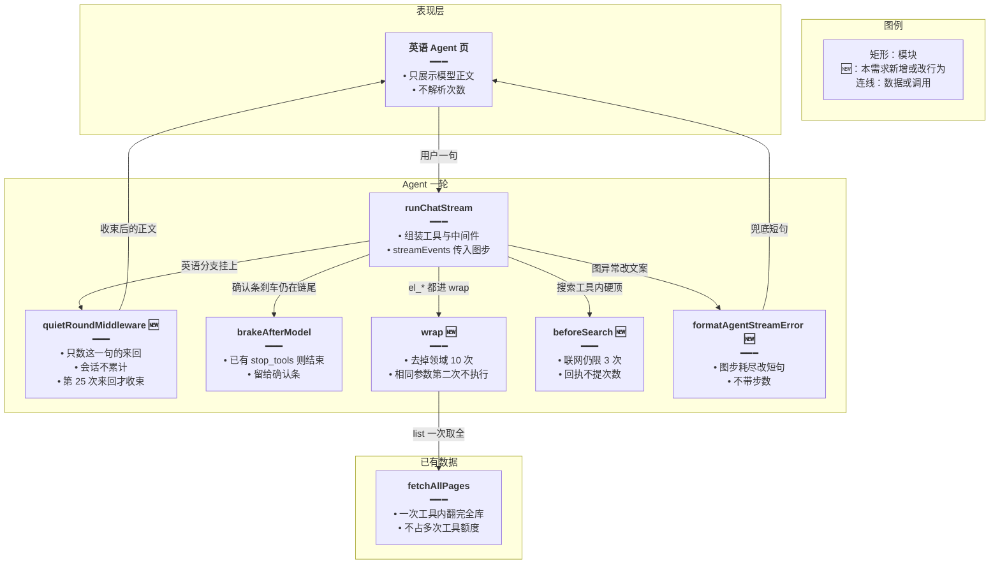
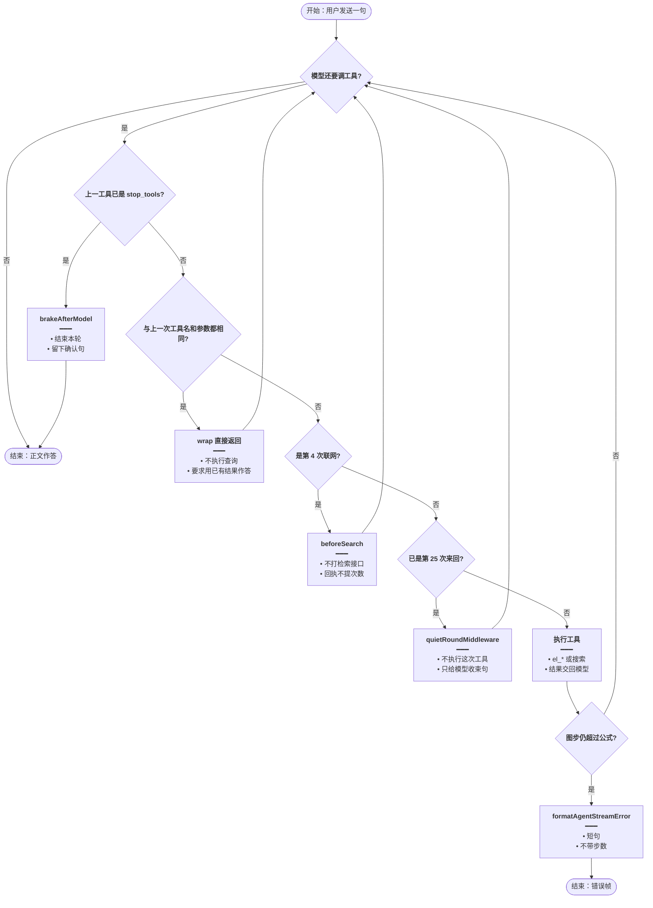
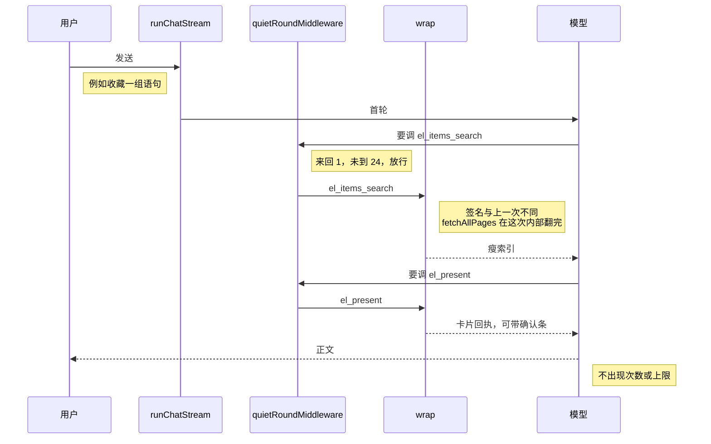
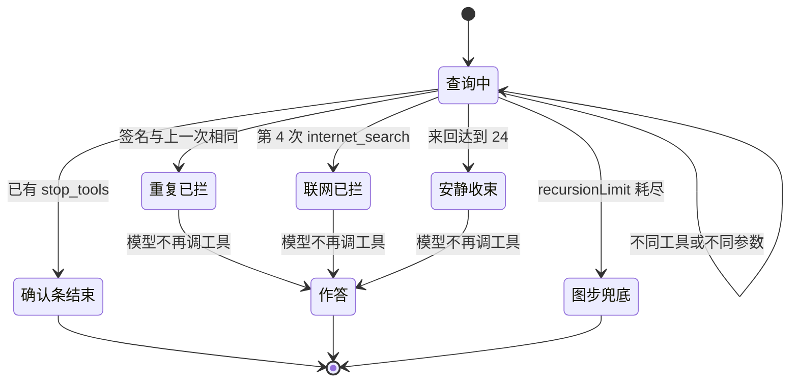

# 英语工具防空转 — 实现思路

> **状态**：核心已落地（工作区，未单独提交）  
> **日期**：2026-10-28  
> **需求摘要**：同一条英语学习会话里，正常工具调用不被「已经达到工具调用次数」截断；只有死循环才停，停完后用户的下一句仍能继续调工具。  
> **一句话方案（预告）**：会话不设工具次数配额。删掉领域 10 次和英语总工具 16 次；联网只留工具内 3 次且回执不提次数；相同参数连调第二次即停；同一句里换参数空转满 24 次来回才收束，收束不告诉用户次数，下一句从 0 再计。

## 延伸阅读

- [语句收藏确认](./语句收藏确认.md)：确认条会多几次领域工具调用，容易顶到现在的 10 次
- [收藏提案直确认](./收藏提案直确认.md)：`stop_tools` 与 `brakeAfterModel` 已用来躲开 `GRAPH_RECURSION_LIMIT`
- [清单按库取全](./清单按库取全.md)：全量清单在一次工具里由 `fetchAllPages` 翻完，模型不必自己翻页

---

## 0. 读本文你将得到什么

- 用户看到的「本轮工具调用次数已经达到上限」来自领域 10 次或总工具 16 次，不是图步
- 选定方案：会话不累计工具次数；只有死循环才停，而且不说「次数到了」
- 空转怎么判：见 §4.6。相同参数连调、同一句第 25 次来回、联网第 4 次
- 只改英语学习这条中间件和领域工具包装，普通 Agent 的 12 次 / 40 步不动
- 最大风险是同一句里换着参数空转，要到第 25 次来回才收束；下一句不受影响

---

## 1. 需求与边界

### 1.1 用户故事

| 角色 | 场景 | 行为 | 期望结果 |
|------|------|------|----------|
| 学习者 | 同一条会话里连续问收藏、出卡、生成 | 每一句都按需要调用 `el_*` | 不会因为前面几句用过工具，就被说「次数已经达到」而不能再调 |
| 学习者 | 一句里要连着查好几次侧栏 | 模型按需要调用不同的 `el_*` | 该查的都查完，回复里没有「次数到了」 |
| 学习者 | 模型用不同关键词反复联网 | 第 4 次搜索 | 不再打检索接口，模型用已有摘要作答，不提次数；用户下一句仍可再搜 |
| 学习者 | 模型用同一参数连着调同一个工具 | 第二次相同调用 | 不再执行，模型用已有结果作答 |
| 学习者 | 同一句里每次换一点参数空转 | 来回超过 24 次还要调工具 | 这一句停止再查并作答，不出现图步英文报错；下一句从 0 再计 |

### 1.2 范围

| 在范围内 | 不在范围内（非目标） |
|----------|----------------------|
| 英语学习 `assistMode=english_learning` 的工具次数、图步、空转收束 | 普通 Agent / Skill 生成的 `runLimit: 12` 与图步 40 |
| 同一 `sessionId` 里每一句都能再调工具，次数不跨句累加 | 给整个会话加 `threadLimit` 或把次数写入消息表 |
| 联网 3 次的回执文案，避免模型把上限转述给用户 | 放宽或取消联网 3 次 |
| 领域工具包装里的 10 次计数 | 收藏/错题写入上限 `ENGLISH_EL_WRITE_RUN_LIMIT = 5` |
| 图步耗尽时 SSE 错误帧的文案 | 把图步抬到几百来代替收束 |

### 1.3 约束与依赖

- 复用 `buildAgentLangchainMiddleware`、`wrap`、`beforeSearch`、`brakeAfterModel`、`fetchAllPages`、`formatAgentStreamError`
- 不新增依赖。重复调用的签名只放在本轮闭包里，不落库
- 确认条之后的 `stop_tools` 刹车保持原样，避免和收束抢结束权
- 全量清单已经在一次 `el_*` 调用内翻完，方案不得再要求模型用 `offset` 把一库拆成多次调用

---

## 2. 背景

- **谁、在什么场景、卡在哪**：学习者在英语 Agent 里收藏或查侧栏时，回复变成「本轮工具调用次数已经达到上限」。这句话不是界面固定文案，是模型在转述工具回执。
- **现状缺口**：领域工具每轮最多 10 次，英语学习所有工具合计最多 16 次（已提交代码是 8 次）。到顶后回执要求模型作答，模型却把「到上限」说了出来。图步 56 这一层平时根本不会先触发。
- **不解决会怎样**：一次正常的「搜清单 → 出卡 → 挂确认」就会把 10 次用完，用户以为功能坏了。若只删掉计数、只留图步，空转会变成 `Recursion limit of N reached...` 的错误帧，比现在更难看。
- **硬约束**：同一会话里，正常的不同工具调用必须能执行完，不能以「已经达到工具调用次数」结束，也不能让后面的用户句失去工具。死循环必须停，但只停当前这句的空转，下一句从 0 再计。联网仍有硬顶，否则换关键词会打穿检索接口。停的时候要作答，不能停成异常。普通对话的次数和图步不跟着改。禁止 `threadLimit`。

---

## 3. 现状与复用

| 能力 | 仓库中已有 | 本需求中的用法 |
|------|------------|----------------|
| 英语总工具次数 | `apps/backend/src/services/agent/agent-middleware.ts` 的 `toolCallLimitMiddleware`。已提交 `runLimit: 8`，工作区未提交改成 `16`。到顶给模型英文 `Tool call limit exceeded. Do not make additional tool calls.` | 英语这条删掉。普通 Agent 的 `12` 保留 |
| 领域工具 10 次 | `apps/backend/src/services/agent/tools/english/domain-tools.ts` 的 `ENGLISH_EL_TOOL_RUN_LIMIT`。`wrap` 在执行前返回 `本轮领域工具已达上限（10），请根据已有结果作答` | 删掉这道计数 |
| 联网 3 次（两道） | 同文件 `toolName: 'internet_search', runLimit: 3`；另有 `agent.service.ts` 传入 `maxInternetSearchCallsPerRun: 3`，`agent-tools.ts` 的 `beforeSearch` 直接返回「本轮联网已达上限（3 次）」且不打接口 | 只留 `beforeSearch`，改掉「上限」字样 |
| 图步 | `agentStreamRecursionLimit`。已提交英语 45、其它 40。工作区未提交英语改成 56。`agent.service.ts` 把它传给 `streamEvents` 的 `recursionLimit`。LangGraph 默认 25，一步是一次图节点执行 | 改成由安静来回数推导，不再手写 56 |
| 确认条刹车 | `brakeAfterModel`：上一工具回执含 `stop_tools` 时，模型再要调工具就 `jumpTo: end` | 直接复用 |
| 全量一次取完 | `fetch-all-pages.ts` 的 `fetchAllPages`。`pageIndex` 仍接受模型传来的 `artifactId+offset` | 说明领域 10 次不是翻页所必需。不改取全逻辑 |
| 错误帧 | `formatAgentStreamError` 把异常 `message` 原样放进 SSE `error` | 图步耗尽时改成短句，不带步数 |
| 写入 5 次 | `ENGLISH_EL_WRITE_RUN_LIMIT` | 不改。那是落库次数，不是查询次数 |

**56 从哪来**：2026-09-17 提交 `92a58f26`（「英语学习联网搜索次数限制」）把图步从 LangGraph 默认 25 抬到普通 40、英语 45，同时把英语总工具次数从 12 降到 8。注释只写「默认 25，工具往返易触顶」，没有「测得需要 45 步」。工作区未提交又把英语总次数改成 16、图步改成 56，注释是「略抬高」，同样没有推导。`createAgent` 一轮工具大约是「模型节点 + 工具节点」两步，16 次工具约 33 步，56 只是余量，不是英语题的步数需求。开发服务跑的是工作区这份 16 和 56；已提交仓库仍是 8 和 45。

**调研结论**：用户看见的中文来自 10 次或 16 次的回执，不是 56。这两道都按「上一条用户消息之后」计，不会把整段会话的次数加在一起；用户仍会在一句里被截断，模型再说成「次数已经达到」，后面的查询就做不完。全量清单已经一次取完，领域总次数没有对应的产品需求。联网 3 次和 `brakeAfterModel` 留下。要补上的是：相同参数连调要停、换参数空转只停这一句、图步耗尽不能把英文原文给用户、下一句用户消息必须还能调工具。

---

## 4. 方案比对与最终方案

### 4.1 候选方案

#### 方案 A：维持三道计数（复用现状）

- **做法**：保留 `ENGLISH_EL_TOOL_RUN_LIMIT = 10`、英语 `toolCallLimitMiddleware` 的 `runLimit`（工作区 16 / 已提交 8）、联网两道 3 次，图步维持工作区 56。`wrap` 和中间件都继续把「已达上限 / Tool call limit exceeded」交回模型。
- **能工作的原因**：空转和正常多步查询都会在十几次内停下，图步 56 够这些次数走完并留一次作答，不容易抛 `GraphRecursionError`。
- **主要代价**：搜清单、出卡、挂确认各算一次，正常收藏就会顶到 10 次。模型把回执译成「次数已经达到上限」。

#### 方案 B：只留联网 3 次和图步 56

- **做法**：删除领域 10 次和英语总工具 `runLimit`。联网保持 `beforeSearch` 的 3 次。图步仍写死 56。`streamEvents` 抛出图步异常时，`formatAgentStreamError` 把原文推给前端。
- **能工作的原因**：联网换关键词仍停在第 4 次。领域工具不再有产品计数。图步仍能打断死循环，最多大约二十多次工具往返。
- **主要代价**：换参数空转会一直打到第 56 步，然后 SSE 错误帧是 `Recursion limit of 56 reached...`。前面若只有工具调用、没有正文，用户只看到报错。

#### 方案 C：联网计数，其余只防空转

- **做法**：删除领域 10 次和英语总工具 `runLimit`，也不设 `threadLimit`。联网只留 `beforeSearch`，回执改成「不要再搜，用已有结果作答，不要向用户提及次数」。`wrap` 记下上一次 `工具名 + 原始参数`，连续相同则第二次不执行。新增 `quietRoundMiddleware`：只数这一句用户消息之后的工具来回，满 24 次仍要调工具时不执行，塞回只给模型的收束句。用户再发一句就重新从 0 计。`agentStreamRecursionLimit` 改为 `24 * 2 + 16`。`brakeAfterModel` 保留。图步真的耗尽时，错误帧改成「这次没有查完，请把问题再说得具体一些」。
- **能工作的原因**：同一会话里每一句的正常查询都不受 10 次或 16 次限制，也不会因为上一句用过工具而失去工具。相同参数的死循环第二次就停。换参数空转只停这一句，下一句还能调。图步晚于收束触发，只防图自身死循环。
- **主要代价**：同一句里的空转仍会打满 24 次模型调用才收束。这一句里超过 24 次真实不同查询的极端题，会被收束截断，但会话本身没有被用完。

### 4.2 比对

| 维度 | 方案 A | 方案 B | 方案 C |
|------|--------|--------|--------|
| 正确性（失败路径、边界、数据是否会错） | 计数先停，图步很少触发。正常多步查询被 10 次截断，结果不全 | 联网能停。换参数空转停在图异常，没有最终正文时用户只看到错误帧 | 联网、重复调用、换参数空转都停在「让模型作答」。图异常只作最后一层，且不展示步数 |
| 复用 / 与现状契合 | 全部沿用 `wrap` 与 `toolCallLimitMiddleware` | 删两道计数，沿用图步和 `beforeSearch` | 沿用 `wrap`、`beforeSearch`、`brakeAfterModel`、`formatAgentStreamError`。英语总次数中间件换成安静收束 |
| 改动面（要动哪些路径） | 无 | `domain-tools.ts`、`agent-middleware.ts` | 同上，再加 `agent-tools.ts` 文案、`agent.prompt.ts` 一句、`agent.service.ts` 的错误帧 |
| 复杂度（新概念、新状态、新依赖） | 无新概念 | 无新状态 | 本轮闭包多一个 `lastSig`；中间件多一个来回计数。无新依赖、不落库 |
| 体验（延迟、步骤数、失败时用户看到什么） | 一句里就会看到「次数到了」，后面的工具不再执行 | 正常路径不再提次数。空转时看到英文图步报错，且已经空等了约 56 步 | 会话里正常调用不被次数截断。空转只停这一句，模型作答且不提次数。下一句仍能调工具 |
| 风险（迁移、互斥、并发、回滚） | 无行为变化 | 空转的费用和图异常一起出现。与 `stop_tools` 无冲突 | 收束与 `brakeAfterModel` 都可能结束本轮：确认条刹车优先。回滚就是加回两道计数 |
| 可维护性（以后改一处还是改多处） | 10、16、3、56 四套数各管一层，注释对不上提交记录 | 数字只剩联网 3 和图步 56，56 仍无推导 | 来回数一处常量推出图步。联网文案只在 `beforeSearch` |

### 4.3 综合考量

权重在体验和正确性：同一条会话里，正常工具调用要能做完，不能被「已经达到工具调用次数」截断；死循环要停，但不能停成错误帧，也不能把整段会话锁死。方案 C 在这两项上同时成立。方案 A 改动最少，但 10 次会继续在一句里截断收藏和出卡，这正是要去掉的现象。方案 B 去掉了领域计数，这项优点要放弃：它把防空转全部交给写死的 56，而 56 触发的是异常，不是作答。24 次来回只防这一句里的空转，不是会话配额；联网 3 次仍是唯一按工具名计算的配额，而且下一句重新计数。

### 4.4 最终方案

#### 背景

最终要的是：同一条英语学习会话里，该调用的工具能调用；不能因为「已经达到工具调用次数」而停在半路。死循环仍然不能出现。现状在一句里就叠了领域工具 10 次、总工具 16 次（已提交是 8 次）、联网 3 次、图步 56（已提交是 45）。10 次和 16 次的回执会被模型说成「次数已经达到上限」，这一句后面的工具就不再执行。它们按上一条用户消息计，没有把整段会话加总，但一句被截断，会话里的这件事就已经做不完。56 没有测量依据。全量清单已由 `fetchAllPages` 在一次调用内取完。联网空转和工具死循环要停在这一句的作答上，用户的下一句从 0 再计。

#### 具体思路

1. 模块只动后端 Agent。前端确认条和工具条不改。普通 Agent 的 `runLimit: 12` 与图步 40 留在原分支。
2. 数据只活在这一句：`wrap` 闭包记上一次调用签名；`quietRoundMiddleware` 从上一条用户消息之后数带工具调用的模型来回。不写入消息表，也不设 `threadLimit`。
3. 状态放在请求闭包和这一次 `streamEvents` 的消息里。放数据库或按 `sessionId` 累加，会让下一句继承上一句的次数，会话越聊越不能调工具。
4. 边界：正常的不同查询照常执行。空转只按 §4.6 的三道判断停。已有 `stop_tools` 时 `brakeAfterModel` 直接结束，那是等人点确认，不算空转。收束句不出现「次数」「上限」。用户再发一句，签名、来回和联网次数都从 0 开始。图步仍耗尽时错误帧不带步数。

#### 实现方案

**一句话**：会话不设工具次数配额。删掉领域 10 次和英语总工具 16 次；联网只留工具内 3 次且回执不提次数；相同参数连调第二次即停；同一句里换参数空转满 24 次来回才收束，收束不告诉用户次数，下一句从 0 再计。

| 步骤 | 谁 | 做什么 | 输入 → 输出 |
|------|----|--------|-------------|
| 1 | `domain-tools.ts` 的 `wrap` | 删除 `elCalls` 判断。相同 `name + 原始参数` 连着出现第二次时直接返回收束信封 | 工具入参字符串 → 信封 JSON |
| 2 | `agent-tools.ts` 的 `beforeSearch` | 第 4 次搜索不打接口。文案只要求作答，不出现「上限」「3 次」 | 已用次数 → `string` 或 `null` |
| 3 | `agent-middleware.ts` | 英语分支去掉两道 `toolCallLimitMiddleware`（总次数和 `internet_search`）。加上 `quietRoundMiddleware`。`brakeAfterModel` 仍排在后面 | 本轮消息 → 放行，或一组只给模型的 `ToolMessage` |
| 4 | `agentStreamRecursionLimit` | 英语返回 `ENGLISH_QUIET_ROUNDS * 2 + 16`，常量 24，结果 64。其它 profile 仍返回 40 | profile → 图步整数 |
| 5 | `formatAgentStreamError` | `message` 含 `Recursion limit` 时改成短句 | 异常 → 给用户的一句 |
| 6 | `agent.prompt.ts` | 加一句：工具回执里的停止原因不要告诉用户 | 系统提示文本 |

#### 选定原因

1. **体验**：同一会话里的正常查询不再经过「已达上限」回执，模型没有句子可以转述，下一句也不会因为上一句用过工具而失去工具。牺牲：同一句里超过 24 次不同查询会被收束。
2. **正确性**：重复调用和换参数空转都停在模型的下一次正文，图步异常不再把英文原文给用户。牺牲：空转仍会消耗最多 24 次模型调用。
3. **复用**：收束接在现有 `wrap` 和中间件链上，`fetchAllPages` 与 `brakeAfterModel` 不动。牺牲：英语总次数不再和普通 Agent 共用同一个 `toolCallLimitMiddleware` 配置对象。
4. **可维护性**：图步由来回常量推出，以后只改 `ENGLISH_QUIET_ROUNDS`。牺牲：要同时改中间件和 `agentStreamRecursionLimit`，不能只改其中一个。

#### 优势

- 相对方案 A：同一会话里的收藏、出卡、确认不再被 10 次截断，回复里也不会出现「次数到了」，后面的用户句还能继续调工具。
- 相对方案 B：换参数空转停在作答，而不是 `Recursion limit of 56 reached` 错误帧。

#### 怎么实现

1. `wrap` 在解析参数之前比较签名，命中则 `stringifyEnvelope` 返回，不给 `handler`。
2. `beforeSearch` 在 `searchCalls >= maxSearch` 时返回新文案。
3. `buildAgentLangchainMiddleware` 在英语分支用 `quietRoundMiddleware` 替换总次数中间件，并去掉按工具名限制 `internet_search` 的那一道。
4. `agentStreamRecursionLimit` 改用公式。`streamEvents` 的调用点不变。
5. `formatAgentStreamError` 识别图步异常。
6. 系统提示补一句。主链路代码见 §9。

### 4.5 其他关键决策

#### 决策：联网保险丝留在哪

##### 候选

**留 `beforeSearch`（选定）**

- **做法**：删除英语专用的 `toolCallLimitMiddleware({ toolName: 'internet_search', runLimit: 3 })`。第 4 次仍进入工具函数，由 `beforeSearch` 返回文案，`createLangChainWebSearchTools` 不打检索 API。
- **能工作的原因**：这道判断在工具内部，文案由我们写，图仍能把结果交回模型作答。
- **主要代价**：第 4 次仍算一次图上的工具节点，比中间件直接拦住多一步。

**只留按工具名的中间件**

- **做法**：去掉 `maxInternetSearchCallsPerRun`，只留 `runLimit: 3` 的 `toolCallLimitMiddleware`。
- **能工作的原因**：第 4 次搜索不会执行工具函数。
- **主要代价**：中间件写死的英文是 `Tool call limit exceeded. Do not call 'internet_search' again.`，模型会把它译成「次数到了」。这道文案不在我们仓库里，不能改成「不要告诉用户」。

##### 比对

| 维度 | 留 `beforeSearch` | 只留中间件 |
|------|-------------------|------------|
| 正确性 | 不打检索 API，模型收到中文收束句 | 不执行工具，模型收到英文 limit 句 |
| 复用 / 与现状契合 | `beforeSearch` 已在 `agent-tools.ts` | 中间件已在 `agent-middleware.ts` |
| 改动面 | 改一处文案，删中间件一项 | 删 `maxInternetSearchCallsPerRun` 传入 |
| 复杂度 | 此项相同 | 此项相同 |
| 体验 | 模型没有「上限」可转述 | 英文 limit 句会被转述 |
| 风险 | 第 4 次仍占用一步图 | 文案无法本地化，行为依赖库 |
| 可维护性 | 文案在仓库内 | 文案在 `langchain` 包内 |

##### 综合考量

体验权重大：这道保险丝的失败样子就是用户现在看到的那句。中间件少一步图，这项优点放弃，因为那一步换来的是一句我们改不了的英文。

##### 最终方案

**背景**：联网 3 次现在有两道，中间件那道的英文会被模型转述。  
**具体思路**：工具内硬顶负责「不打 API + 我们自己的收束句」，中间件的按名限制删掉。  
**实现方案**：`beforeSearch` 返回「已有检索结果。不要再搜索。直接作答。不要向用户提及次数或上限。」英语分支不再挂 `toolName: 'internet_search'` 的中间件。  
**选定原因**：体验上不把 limit 英文交回模型。牺牲一步图。  
**优势**：相对只留中间件，收束句在仓库内，可以要求模型不要告诉用户。  
**怎么实现**：见 §9.3。

除此之外，没有会改变架构、数据流或状态归属的决策。

### 4.6 怎么判断空转

空转不是「调用次数多」。同一句用户消息里，只有下面三道会停。下一句用户消息三条都从 0 再计，会话没有总配额。确认条挂上之后还要调工具，由 `brakeAfterModel` 结束，那是等人点确认，不算空转。

| 判断 | 在哪 | 怎样算空转 | 怎样仍算正常调用 | 停的时候做什么 |
|------|------|------------|------------------|----------------|
| 紧挨着的两次完全一样 | `domain-tools.ts` 的 `wrap`，`lastSig` | 工具名和原始参数字符串都与**上一次**相同。中间夹了别的调用后再重复上一次，仍算 | 参数多一个空格、换了 `op` 或换了工具名 | 不进 handler，回执要求用已有结果作答，不提次数 |
| 同一句里来回太久 | `agent-middleware.ts` 的 `quietRoundMiddleware` | 从上一条用户消息之后，数「还要调工具」的模型消息。这次也算进去。满 24 次仍执行，**第 25 次**才停 | 不同工具、不同参数的前 24 次来回。一次输出里并行多个工具只算 1 次来回 | 这次工具不执行，只给模型收束句，让它写正文 |
| 联网换关键词 | `agent-tools.ts` 的 `beforeSearch` | 这一句里搜索已执行 3 次，第 4 次还要搜 | 前 3 次搜索；领域工具 `el_*` 不受这 3 次影响 | 不打检索接口，要求用已有摘要作答，不提次数 |

签名是 `` `${name}\n${raw.trim()}` ``。`raw` 是模型传来的原始 JSON 字符串，不先解析。所以同一查询在键顺序或空格上有差别，会当成另一次查询放行。

来回计数只看带 `tool_calls` 的模型消息，纯正文不算。收束之后模型如果改口写正文，不再加 1。

---

## 5. 架构图



**图内方法说明**：

| 方法 | 功能 |
|------|------|
| `runChatStream` | 一轮英语对话的入口：拼工具、中间件和图步，把 SSE 推给页面 |
| `quietRoundMiddleware` | 只统计上一条用户消息之后的工具来回；第 25 次还要调工具时不执行，把收束句写进 `ToolMessage`。下一句用户消息重新从 0 计，会话没有总配额 |
| `brakeAfterModel` | 上一工具已是 `stop_tools` 时结束本轮，避免确认条之后继续调工具 |
| `wrap` | 每个 `el_*` 的统一入口；比较上一次签名，相同则不再进入具体 handler |
| `beforeSearch` | 联网执行前的硬顶；达到 3 次后不打检索 API |
| `formatAgentStreamError` | 把流式异常收成一句给用户的话；图步耗尽不再转发英文原文 |
| `fetchAllPages` | 在一次工具调用里按页读到没有下一行；因此领域工具不需要按调用次数封顶来完成翻页 |

**读图要点**：

- 页面不新增状态。次数只活在这一句的闭包里，不按 `sessionId` 累加，所以会话本身不会被用完。
- 安静收束在确认条刹车之前，所以已有提案时仍由 `brakeAfterModel` 结束。
- `fetchAllPages` 保持原样，用来说明删除 10 次计数之后，整库查询仍然是一次工具调用。

---

## 6. 主流程图



**图内方法说明**：

| 方法 | 功能 |
|------|------|
| `brakeAfterModel` | 确认条已经挂上之后，拒绝继续调工具并结束本轮 |
| `wrap` | 连续两次相同调用时返回收束信封，handler 不跑 |
| `beforeSearch` | 联网次数用尽时返回收束文案，搜索 API 不发出 |
| `quietRoundMiddleware` | 这一句的第 25 次「还要调工具」时不执行，让模型用已有结果写正文 |
| `formatAgentStreamError` | 图步保险丝真的断开时，把异常换成不带步数的短句 |

**读图要点**：

- 先看确认条，再看重复调用，再看联网，最后才是第 25 次来回。正常的不同查询走「执行工具」回到模型。判断细则见 §4.6。
- 用户能看到的结束只有两条：模型正文，或图步兜底短句。收束句本身不进页面。
- 图步判断放在执行之后，是最后一层；安静收束提前拦住，正常空转到不了这里。

---

## 7. 核心时序图



**图内方法说明**：

| 方法 | 功能 |
|------|------|
| `runChatStream` | 收下用户句，驱动模型和工具直到正文结束 |
| `quietRoundMiddleware` | 每次模型发出工具调用时先数来回，未到 24 则放行 |
| `wrap` | 执行具体 `el_*`；签名不同才进入 handler |
| `fetchAllPages` | 由 `el_items_search` 的 list 在同一次 `wrap` 里调用，不单独占用来回 |

**读图要点**：

- 这是收藏主路径：两次不同的领域工具都放行，中间没有 10 次计数。用户再发一句时，来回从 0 计，不沿用这一句的次数。
- 确认条若在 `el_present` 的回执里挂上，下一轮再要调工具会走 §6 的 `brakeAfterModel`，本图不再展开。
- 联网 3 次不在这条主路径上，它留在 `beforeSearch`。

---

## 8. 状态机



**图内方法说明**：

| 方法 | 功能 |
|------|------|
| `wrap` | 触发「重复已拦」 |
| `beforeSearch` | 触发「联网已拦」 |
| `quietRoundMiddleware` | 触发「安静收束」 |
| `brakeAfterModel` | 触发「确认条结束」 |
| `formatAgentStreamError` | 触发「图步兜底」的用户可见文案 |

**读图要点**：

- 「查询中」可以来回多次，这是正常路径，没有次数配额。
- 四个拦住状态都通向作答或确认条，只有图步兜底不经模型正文。
- 确认条结束优先于继续查询，避免收束句把已经挂上的确认条盖掉。

---

## 9. 具体实现（主链路代码）

### 9.1 模块一览

| 模块 | 职责 | 新增/改动 | 预估路径 |
|------|------|-----------|----------|
| 领域工具包装 | 去掉 10 次；拦连续相同调用 | 改 | `apps/backend/src/services/agent/tools/english/domain-tools.ts` |
| 联网硬顶 | 回执不提次数 | 改 | `apps/backend/src/services/agent/tools/agent-tools.ts` |
| 中间件 | 英语去掉总次数；加安静收束；图步改公式 | 改 | `apps/backend/src/services/agent/agent-middleware.ts` |
| 错误帧 | 图步异常改短句 | 改 | `apps/backend/src/services/agent/agent.service.ts` |
| 系统提示 | 禁止把停止原因告诉用户 | 改 | `apps/backend/src/services/agent/agent.prompt.ts` |

### 9.2 主链路实现

```typescript
// 对应 §4.4 步骤 1。签名放在本轮闭包，下一句用户消息会新建 wrap，计数自然清零
const budgets: Budgets = {
	// 写入仍单独计数，和查询次数无关，避免一次对话连写多批
	elWrites: 0,
	// 确认条 id 仍留在本轮，供 stop_tools 判断，不因删掉查询次数而丢掉
	openProposalId: null,
	// 只比较紧挨着的上一次。中间夹了别的调用再重复，仍由下一次相邻比较拦住
	lastSig: '',
};

// 对应 §4.4 步骤 1。工具名加原始参数相同就视为空转，第二次不进 handler
const sig = `${name}\n${raw.trim()}`;
// 与上一次完全一致才拦。参数多一个空格也算另一次查询，避免误伤模型的修正
if (sig === budgets.lastSig) {
	// 用信封返回，模型和现有 el_limit 分支都能读。文案禁止它向用户转述
	return stringifyEnvelope(
		// 沿用 el_limit，不新增 code，避免改动信封联合类型
		elFail('el_limit', '同样的查询已经做过。用已有结果直接作答。不要向用户提及次数或上限。'),
	);
}
// 放行前记下签名，下一次连调才能比对
budgets.lastSig = sig;
```

```typescript
// 对应 §4.4 步骤 2 与 §4.5。达到 3 次后不打检索 API
if (searchCalls >= maxSearch) {
	// 不写「上限」和「3 次」，模型没有可以照念给用户的计数句子
	return '已有检索结果。不要再搜索。直接作答。不要向用户提及次数或上限。';
}
```

```typescript
// 对应 §4.4 步骤 3。24 是防空转的来回数，不是侧栏查询配额。正常收藏远小于此
const ENGLISH_QUIET_ROUNDS = 24;

// 对应 §4.4 步骤 3。只替换英语分支的总次数中间件，普通 Agent 仍用 runLimit 12
function quietRoundMiddleware(): AgentMiddleware {
	// afterModel 在工具执行前看这一轮模型输出，来得及把工具调用换成收束句
	return createMiddleware({
		// 名字只用于调试日志，和领域工具的 el_limit 区分开
		name: 'ElQuietRounds',
		// 挂在模型输出之后、工具节点之前，这样第 25 次调用不会真的执行
		afterModel: {
			// 读当前消息列表，不写库。本轮结束消息仍在，但下一句用户消息会把扫描起点往后推
			hook: (state) => {
				// 缺消息时当作还没有来回，放行，避免空状态把第一句也收束掉
				const messages = state.messages ?? [];
				// 默认从开头数。找到上一条用户消息后改从它后面数，上一句的工具不算进这一轮
				let start = 0;
				// 从尾部找，命中的是这一轮的用户句，而不是更早的历史
				for (let i = messages.length - 1; i >= 0; i -= 1) {
					// 用户消息才是这一轮的起点。工具消息和模型消息都跳过
					if (HumanMessage.isInstance(messages[i])) {
						// 记下下标，后面的来回只数这个下标之后的消息
						start = i;
						// 找到这一轮的用户句后不再往前看，避免把更早的用户句当成起点
						break;
					}
				}
				// 来回只数带工具调用的模型消息。纯正文不算，否则收束后的回答会把自己再计一次
				let rounds = 0;
				for (let i = start + 1; i < messages.length; i += 1) {
					// 取出这一条，下面只在它是「带工具调用的模型消息」时计数
					const row = messages[i];
					// 一次模型输出里的多个并行工具算一个来回，不按工具个数把正常查询提前收束
					if (AIMessage.isInstance(row) && row.tool_calls?.length) rounds += 1;
				}
				// 只处理刚产生的这条模型消息。更早的工具调用已经执行过，不能再补 ToolMessage
				const last = messages[messages.length - 1];
				// 没有新的工具调用就放行。这包括收束之后模型给出的纯正文
				if (!AIMessage.isInstance(last) || !last.tool_calls?.length) return;
				// 这次调用已经算进 rounds。满 24 次仍放行，第 25 次才收束
				if (rounds <= ENGLISH_QUIET_ROUNDS) return;
				// 每条工具调用都要有对应 ToolMessage，否则接口会要求模型把缺的调用再发一次
				const closed = last.tool_calls.map(
					// 每个调用各写一条结果，并行的几个工具都要有回执
					(call) =>
						// ToolMessage 才能把这次调用标成已结束，模型下一轮不会补发同一个调用
						new ToolMessage({
							// 收束句只给模型看。要求它作答，并禁止把原因告诉用户
							content: '停止调用工具。用已有结果直接作答。不要向用户提及次数、轮次或上限。',
							// 对上这条调用的 id，图才认为这一个工具调用已经有结果
							tool_call_id: call.id ?? '',
							// 保留原工具名，日志里能看出是哪次调用被收束
							name: call.name,
							// 标成 error，模型会把它当成「不要重试」而不是正常数据
							status: 'error',
						}),
				);
				// 只追加这些 ToolMessage，不 jumpTo end，这样模型还能再生成一段用户可见的正文
				return { messages: closed };
			},
		},
	});
}
```

```typescript
// 对应 §4.4 步骤 4。英语图步由来回数推出，避免再手写一个没有测量依据的 56
export function agentStreamRecursionLimit(profile?: 'default' | 'english_learning'): number {
	// 普通 Agent 保持已提交的 40，这次不跟着英语的来回数改
	if (profile !== 'english_learning') return 40;
	// 一轮工具按模型节点 + 工具节点两步计。多出的 16 步留给收束后的正文和摘要中间件
	return ENGLISH_QUIET_ROUNDS * 2 + 16;
}
```

```typescript
// 对应 §4.4 步骤 5。图步耗尽时不再把英文 Recursion limit 原文放进 SSE
export function formatAgentStreamError(err: unknown): string {
	// 先收成字符串，后面只对图步这一种措辞改写，其它错误保持原句
	const raw = err instanceof Error ? err.message : typeof err === 'string' ? err : '';
	// 只改写图步耗尽。其它异常仍把原 message 给用户，避免把限流等提示吞掉
	if (raw.includes('Recursion limit')) {
		// 不带步数，也不写「上限」，用户只知道这次没查完
		return '这次没有查完，请把问题再说得具体一些。';
	}
	// 空消息仍给一句通用失败，避免错误帧是空白
	return raw || '处理失败';
}
```

### 9.3 数据模型

| 字段/实体 | 来源 | 存储 | 说明 |
|-----------|------|------|------|
| `lastSig` | `wrap` 闭包 | 这一句的内存 | `工具名 + 换行 + 原始参数字符串`。不落库，下一句用户消息重新开始 |
| `rounds` | `quietRoundMiddleware` 每次从消息扫描 | 不持久 | 上一条 `HumanMessage` 之后、带 `tool_calls` 的 `AIMessage` 条数。不按 `sessionId` 累加 |
| `ENGLISH_QUIET_ROUNDS` | 常量 24 | 源码 | 同时决定收束时机和图步 `24 * 2 + 16 = 64` |
| `searchCalls` | `beforeSearch` 闭包 | 本轮内存 | 已有。达到 `maxInternetSearchCallsPerRun`（3）后不再打接口 |

---

## 10. 分阶段实现步骤

| 阶段 | 目标 | 交付物 | 依赖 |
|------|------|--------|------|
| M1 | 用户不再因为领域次数或总次数看到「到上限」 | 删除两道计数，联网文案改掉 | 无 |
| M2 | 相同参数与换参数空转都停在作答 | `lastSig` 与 `quietRoundMiddleware`，图步改公式 | M1 |
| M3 | 图步真耗尽时也没有英文步数 | `formatAgentStreamError` 与系统提示一句 | M2 |

### M1

- [ ] 删除 `ENGLISH_EL_TOOL_RUN_LIMIT` 以及 `wrap` 里对 `budgets.elCalls` 的判断和自增
- [ ] 英语分支删除 `runLimit: 16`（及已提交的 8）那道 `toolCallLimitMiddleware`
- [ ] 删除 `toolName: 'internet_search'` 那道中间件
- [ ] `beforeSearch` 的返回文案去掉「上限」和次数

### M2

- [ ] `Budgets` 增加 `lastSig`，`wrap` 在调用 handler 前按 §9.2 比较并返回
- [ ] 实现 `quietRoundMiddleware`，插在 `brakeAfterModel` 之前
- [ ] `agentStreamRecursionLimit` 改为 `ENGLISH_QUIET_ROUNDS * 2 + 16`
- [ ] 用一句会触发两次相同 `el_favorites` list 的对话，确认第二次不打列表接口

### M3

- [ ] `formatAgentStreamError` 识别 `Recursion limit`
- [ ] `ENGLISH_LEARNING_SYSTEM_APPEND` 增加：回执要求不要提及次数时，禁止向用户复述停止原因
- [ ] 确认普通 Agent 仍是 `runLimit: 12`、图步 40

---

## 11. 风险、边界与待确认

| 项 | 等级 | 说明 | 缓解 |
|----|------|------|------|
| 换参数空转仍花钱 | 中 | 24 次来回都会打模型 | 这是相对方案 B 的 56 步更早的停点；签名相同的循环第二次就停 |
| 极端长查询被收束 | 中 | 超过 24 次不同工具调用会停 | 全量列表已在一次调用内完成；24 覆盖收藏、出卡、笔记、生成确认 |
| 收束与确认条同时发生 | 低 | 两边都想结束本轮 | `brakeAfterModel` 放在链尾，已有 `stop_tools` 时它先 `jumpTo: end` |
| 次数被存进会话 | 高 | 下一句会继承上一句，会话越聊越不能调工具 | `lastSig` 和来回只放这一次请求的闭包，禁止 `threadLimit` 和落库 |
| 图步公式和真实节点数不一致 | 中 | 若中间件另占图节点，64 可能早于收束触发 | 见待确认。触发了也由 M3 的短句接住 |
| `el_limit` 这个 code 被日志当成旧的 10 次 | 低 | 重复调用仍用这个 code，只是文案变了 | 日志按 message 区分，不新增 code，避免改信封类型 |

**待确认**：

- [ ] `createAgent` 一轮工具是否严格是两个图节点。验证方式：对一次只调一个 `el_*` 的请求打开 LangGraph 事件，数 `on_chain_start` 里模型与工具节点的次数。若一轮是 3 个节点，把公式里的 `2` 改成 `3`，保证收束先于图步异常。

---

## 12. 验收清单

| # | 用例 | 步骤 | 期望 |
|---|------|------|------|
| AC1 | 正常收藏不再提次数 | 让 Agent 查出一组语句并挂确认条 | 回复和工具回执里都没有「上限」「次数已经达到」，工具都执行完 |
| AC2 | 联网第 4 次不打接口 | 连续要求换关键词再搜 | 第 4 次工具结果是收束句，检索请求不再发出，用户正文不提次数 |
| AC3 | 相同参数连调 | 模型对同一个 list 参数连调两次 | 第二次不进入 handler，模型改用已有结果作答 |
| AC4 | 换参数空转 | 构造超过 24 次、参数每次不同的工具调用 | 第 25 次不执行，随后是正文，不是 `Recursion limit` |
| AC5 | 确认条优先 | 已挂确认条后模型继续调工具 | 仍由 `brakeAfterModel` 结束，确认条还在 |
| AC6 | 普通 Agent 不变 | 非英语对话看中间件配置 | `runLimit` 仍为 12，图步仍为 40 |
| AC7 | 图步兜底文案 | 人为把图步调到小于收束所需步数 | SSE 错误是「这次没有查完，请把问题再说得具体一些。」 |
| AC8 | 会话不被次数用完 | 同一 `sessionId` 先发一句会调用多个 `el_*` 的话，再发一句仍要查侧栏 | 第二句的工具照常执行，回复不说上一句已经把次数用完 |

---

## 13. 预估改动面（实现阶段参考）

| 类型 | 路径（预估） |
|------|--------------|
| 前端 | 无 |
| 后端 | `apps/backend/src/services/agent/agent-middleware.ts`、`agent.service.ts`、`agent.prompt.ts`、`tools/agent-tools.ts`、`tools/english/domain-tools.ts` |
| 文档（实现后） | `/Users/dnhyxc/Documents/code/micro-apps/remote-docs/wiki/english/` 下的实现归档，不在本规划里写 |

---

（本文档为规划态实现思路；落地后以源码与 remote-docs wiki 专题为准）
