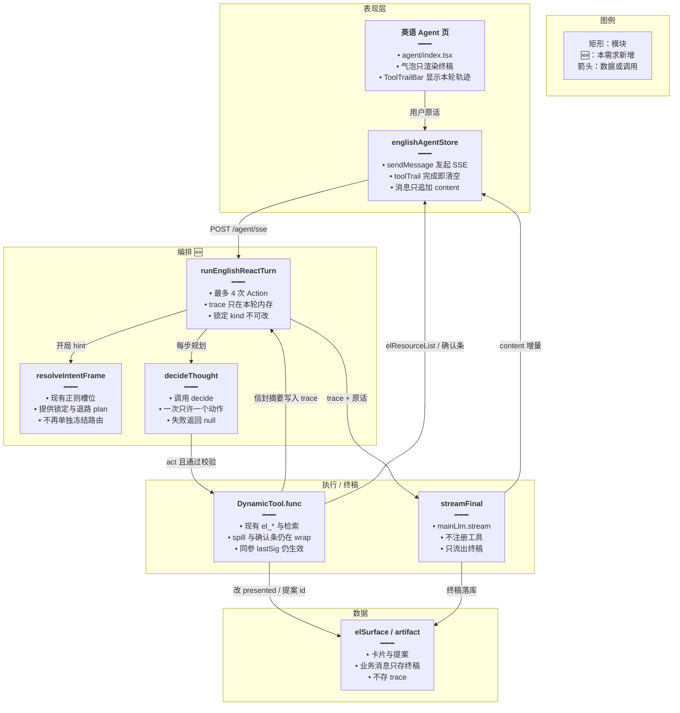
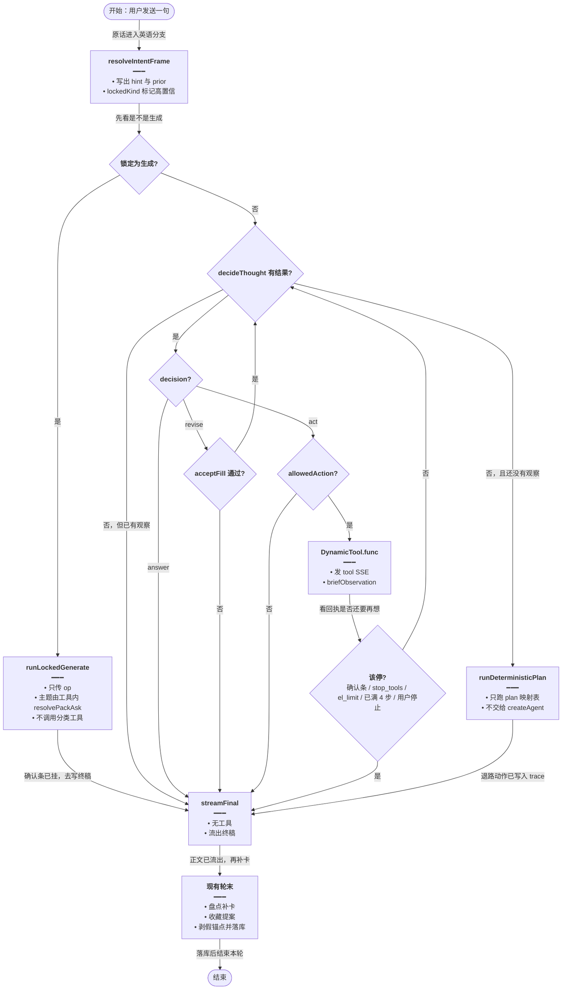
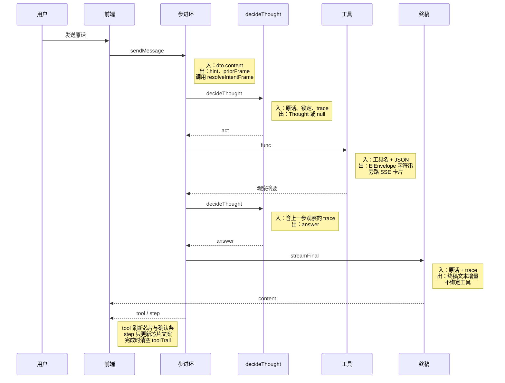
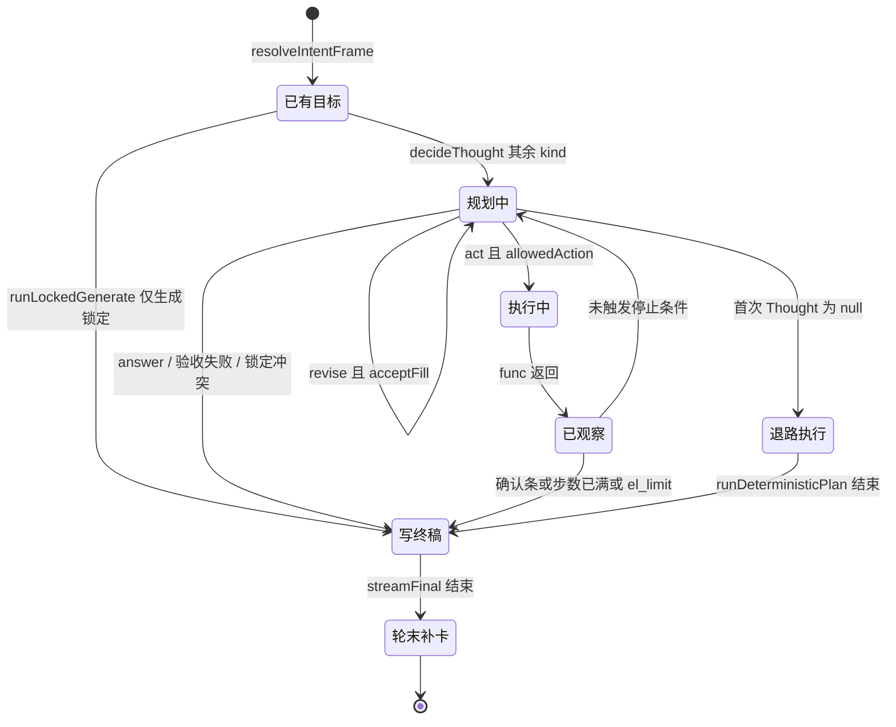

# 英语推理闭环 — 实现思路

> **状态**：规划（未实现；IntentFrame、`el_*` 工具、`decide()`、SSE 工具条可复用）  
> **日期**：2026-11-06  
> **需求摘要**：英语学习 Agent 的使用者用自然语言提一个目标，系统按「目标 → Thought 规划 → Action 调工具 → Observation 看回执 → 必要时修正 → 只把终稿写进气泡」走完一轮，说法稍微换一种也不会被开局正则钉死。  
> **一句话方案（预告）**：仅 `assistMode=english_learning` 在 `runChatStream` 内走自有步进环；`resolveIntentFrame` 只提供高置信锁定与退路计划；每步 Thought 用现成 `decide()` 产出一条动作；Action 仍调用现有 `el_*` 的 `DynamicTool.func`；终稿才用主模型 `stream`，且不绑定工具。

## 延伸阅读

- [复合意图槽位化](./复合意图槽位化.md)（IntentFrame + 有序 plan 已进入代码；本文把它从「冻结路由」降为先验，不推翻槽位、短语分桶、假锚点剥离）
- [语境意图总路由](./语境意图总路由.md)（`resolveEnglishIntent` 固定优先级；高置信 kind 的锁定沿用这张表）
- [Agent词句认意图](./Agent词句认意图.md)、[通用决策封装](../通用决策封装.md)、[决策改用千问](./决策改用千问.md)（`decide()` + 原话子串验收；本文的 Thought 走同一条，不新开模型档）
- [英语工具防空转](./英语工具防空转.md)（`ElQuietRounds` / 同参 `lastSig`；步进环用更小的步数上限，同参拦截仍留在 `wrap`）
- [生成不跑库筛选](./生成不跑库筛选.md)、[收藏意图总控](./收藏意图总控.md)（生成与取消的硬边界继续由服务端守，不交回主模型自由选工具）

---

## 0. 读本文你将得到什么

- 要解决：开局正则把意图钉死，主模型的工具循环改不了它；计划句子和终稿挤在同一条 `content` 流里，靠 `contentReplace` 事后盖住
- 选定方案：英语学习单独走 Goal → Thought → Action → Observation → 修正 → 终稿；Thought 用 `decide()`，工具仍是现有 `el_*`
- 改动层：后端 `agent.service.ts` 的英语分支、`agent.controller.ts` 的 SSE 映射；前端 M2 才扩展 `toolTrail`
- 三阶段：M1 闭环正确性（前端可不动）→ M2 工具条看见每步 Thought → M3 用已踩过的原话收紧锁定表
- 最大风险：`decide()` 连续超时后退路计划覆盖不全，用户只拿到讲解、没有卡片

---

## 1. 需求与边界

### 1.1 用户故事

| 角色 | 场景 | 行为 | 期望结果 |
|------|------|------|----------|
| 学习者 | 翻译 / 语法，不碰侧栏 | 「把 apple 翻译成中文」 | 不调 `el_*`。气泡只有译文，没有「我先查一下词库」 |
| 学习者 | 说法不在短语表里 | 「三年级那本里，家庭类的词列出来」 | Thought 选定 `el_vocab_classify` 或先定位库再分类；卡片条数与正文一致 |
| 学习者 | 工具回执对不上目标 | 分类结果是空、`ambiguous` 或 `not_found` | 下一步改工具或改槽位，或直接说明没找到；禁止同参再调 |
| 学习者 | 生成语句 | 「生成关于努力的语句」 | 不跑库分类。只挂现有生成确认条，点确认前不落库 |
| 学习者 | 短决策失败 | `decide()` 超时或非 JSON | 按 IntentFrame 里已有的非 `noop` 步骤做退路动作，然后仍有终稿；本轮不再进入 `createAgent` |
| 维护者 | 其它助手 | 知识库 / Skill 试跑 | 仍走现有 `createAgent` + `streamEvents` |

### 1.2 范围

| 在范围内 | 不在范围内（非目标） |
|----------|----------------------|
| `assistMode=english_learning` 一轮对话的规划、调工具、看回执、改下一步、终稿 | 通用 Chat、知识库助手、Skill 试跑的 ReAct |
| 复用 12 个 `el_*`、联网检索、知识库检索；写操作仍走提案确认 | 新写一套领域工具；本环内 `commit` |
| Thought 用 `decide()`；终稿用当前主模型流式 | 打开供应商思考链（现网 `GLM_THINKING_DISABLED_KWARGS` 保持关闭） |
| 轨迹在本轮工具条展示，结束清空 | 轨迹落库、刷新后回放推理过程 |
| 高置信 kind 锁定、写操作必须在原话里看见动词 | 用多标签大 JSON 替换 `IntentFrame`；把「有哪些」收成万能盘点 |

### 1.3 约束与依赖

- 登录后走现有 `POST /agent/sse`（`JwtGuard`）。Web 与 Tauri 共用这条 SSE，不分支
- 卡片、确认条、全量行仍以服务端 artifact / `turnElResources` 为准。模型散文里的词表不能当收藏名单
- 生成问法禁止继承上一本库做关于类筛选（已落地的 `生成不跑库筛选`）
- `catalog` 挂卡不得把 `presented` 标成 true，否则挡住后续分类
- 假 `[[el:]]` 收尾只保留本轮真实资源 id（现有 `resolvedAssistantText`）
- Ponytail：不引入 LangGraph，不新依赖。步进就是 `runChatStream` 里的循环
- 体验底线：纯讲解最多 1 次短决策 + 1 次终稿流；带工具的一轮最多 4 次 Action

---

## 2. 背景

- **谁、在什么场景、卡在哪**：学习者在英语学习页右侧 Agent（`apps/frontend/src/views/englishLearning/agent/index.tsx`）用自然语言提目标。期望系统先想清楚再查侧栏、看结果不对就改，最后只给出能用的回答。现在经常是短语没对上就当聊天，或对上了就整轮按那个 kind 走完，模型中途改口也不算数。
- **现状缺口**：意图在 `bindEnglishIntentSurface` 里一次算完，写进 `elSurface.intent` / `frame`。后面的工具 `wrap` 用 `planHas(frame)` 决定挂不挂卡。`createAgent` 虽然会多轮调用工具，但改不了这份 frame。主模型构造时关闭了供应商思考链，所谓「计划」只是和正文混在 `on_chat_model_stream` 里的自由文本，筛选轮还会被 `contentReplace` 整段换掉。
- **不解决会怎样**：短语表继续加行，也盖不住换一种说法；主模型在超长工具地图（`ENGLISH_LEARNING_SYSTEM_APPEND` 第 7 节）里自由点工具，空转要靠 `ElQuietRounds`（同一句 24 次来回）和 `ElStopToolsBrake` 硬停。用户看到的是不稳定的出卡和被盖掉的正文。
- **硬约束**：侧栏写入必须先确认；条数以卡片为准；生成与分类互斥；`decide()` 已经是短 JSON、关思考、不跟对话模型的路径，Thought 不得再开一条模型配置；非英语模式不能被这次改动换掉。

---

## 3. 现状与复用

| 能力 | 仓库中已有 | 本需求中的用法 |
|------|------------|----------------|
| 英语对话入口 | `apps/frontend/src/store/englishAgent.ts` `sendMessage` → `streamAgentSse` | 直接复用。M1 仍靠现有 `tool` 事件刷新工具条 |
| SSE 协议 | `AgentSseChunk`；`AgentController.chatSse` 按 type 显式映射 | 扩展。M2 增加 `step`，控制器不映射就丢字段 |
| 主循环 | `AgentService.runChatStream` + `createAgent` + `streamEvents` | 英语分支改为调用新的 `runEnglishReactTurn`。其它 `assistMode` 留在 `createAgent` |
| 意图与计划 | `resolveIntentFrame` / `planEnglishTurn` / `primaryKindFrom`（`tools/english/intent-frame.ts`） | 扩展用法：高置信 kind 锁定 + `decide` 失败时的退路步骤。不再当作工具路由的唯一开关 |
| 短语与优先级 | `intent-phrases.ts`、`english-intent.ts` 的 `resolveEnglishIntent` | 直接复用为锁定依据。不把漏掉的说法继续加成正则 |
| 跨轮槽位 | `buildPriorFrameSummary`、`fillLibraryCue` | 直接复用。续问「那本库再筛家庭」仍靠 prior，不靠模型回忆库名 |
| 领域工具 | `buildEnglishLearningDomainTools` 返回 12 个 `DynamicTool`（`el_vocab_classify`、`el_classic_classify`、`el_libraries`、`el_items_search`、`el_present`、`el_daily_reading`、`el_favorites`、`el_review`、`el_mistakes`、`el_daily_memo`、`el_packs`、`el_notes`） | 直接复用。步进环按名字调用已包好的 `func`，挂卡、spill、同参 `lastSig` 都还在 `wrap` 里 |
| 通用检索 | `buildAgentLangChainTools`（联网、知识库、日期） | 直接复用。联网仍按轮计数，本环上限 2 次成功检索 |
| 短决策 | `apps/backend/src/utils/glm-decide.ts` `decide()`；模型 `DECIDE_MODEL_NAME`（`Qwen/Qwen3.6-35B-A3B`） | 扩展为每步 Thought。`accept` 继续要求槽位字符串是原话子串 |
| 终稿模型 | `buildModels` 的 `mainLlm: ChatOpenAI`，`extractChunkText` | 直接复用 `mainLlm.stream`。终稿不注册工具，避免边写边调 |
| 轮末收藏 / 盘点补卡 | `runChatStream` 内 `ensureFavoriteFilterCards`、`pushInventoryCard`、`missingNoteCard`、`lockCategoryReply` | 直接复用，放在步进环结束之后。名单仍不信模型散文 |
| 空转刹车 | `agent-middleware.ts` 的 `quietRoundMiddleware`、`brakeAfterModel` | 英语步进环不再挂这两份中间件。同参拦截留在工具 `wrap`。非英语模式照旧 |
| 工具条 | `AgentToolChip` + `ToolTrailBar`；`onComplete` 清空 `toolTrail` | 扩展。M2 用 `step.note` 当芯片文案。仍不落库 |
| 业务消息 | `english_agent_sessions` / `englishTableMemory` | 直接复用。只存终稿正文、`elResources`、检索胶囊 |

**调研结论**：ReAct 的工具往返已经在 `createAgent` 里，缺的是「目标可修正」和「计划与终稿分流」。`IntentFrame`、`el_*`、`decide()`、确认条、旁路卡片都够用，不应重写。不稳定来自两套控制器互相覆盖：正则 frame 冻结路由，主模型又按超长工具地图自由点工具。`复合意图槽位化` 文首仍写 IntentFrame 未实现，以当前 `intent-frame.ts` 为准。

---

## 4. 方案比对与最终方案

### 4.1 候选方案

#### 方案 A：收紧现有 `createAgent`（复用现状）

- **做法**：英语模式仍 `createAgent` + `streamEvents`。`bindEnglishIntentSurface` 继续在开局写死 `elSurface.frame`。系统提示追加「先写一句计划，再调一个工具」。`on_chat_model_stream` 在本段模型输出带 `tool_calls` 时把文本缓存在内部，不 `subscriber.next(content)`；只有不含工具调用的那一段才写入气泡。短语表按漏网原话补行。轮末 `contentReplace`、收藏补卡、盘点补卡保持不动。
- **能工作的原因**：工具执行、挂卡、确认条、空转上限都已在线上。拆开流式文本就能去掉「计划漏进气泡再被替换」这一条。已覆盖的短语行为不变。
- **主要代价**：观察结果改不了 frame。`wrap` 里的 `planHas` 仍按开局计划挂卡。说法不在正则里时，主模型仍然在第 7 节工具地图里猜，猜错要等到安静收束（最多 24 次来回）才停。

#### 方案 B：开局一次 `decide()` 替换正则，然后仍走 `createAgent`

- **做法**：`runChatStream` 开头用 `decide()` 产出一份 `IntentFrame` JSON，`accept` 要求新增字符串是 `dto.content` 的子串。校验通过就覆盖 `resolveIntentFrame` 的结果；失败则保留正则 frame。其后照旧 `createAgent`，工具内部继续读这份一次性 frame。
- **能工作的原因**：`decide()`、子串验收、frame 形状都已存在（词句抽槽、自选认配置是同一模式）。漏网说法有一次补识别的机会，挂卡副作用不用改。
- **主要代价**：意图仍是开局一次。工具回执若是空列表或 `ambiguous`，图里的下一步不能改槽位，只能再点工具或直接写正文。主模型仍看整份工具地图，空转路径还在。多一次短调用，却没有「看完再改」的那一跳。

#### 方案 C：英语学习自有步进环，工具函数不换

- **做法**：`assistMode=english_learning` 时不调用 `createAgent`。`runEnglishReactTurn` 在 `runChatStream` 内循环，最多 4 次 Action。每步 `decide()` 只返回 `act | revise | answer` 之一，以及至多一个白名单工具名。Action 调用本轮已经 `buildEnglishLearningDomainTools` / `buildAgentLangChainTools` 得到的 `DynamicTool.func`。Observation 只保留信封的 `ok/code/message` 和是否已挂卡。`revise` 只能填空槽，且过同一套子串验收。高置信 kind（取消收藏、查询收藏、词句生成、阅读生成）锁定，Thought 不能改掉。`decide()` 第一次就失败时，按 `planEnglishTurn` 里非 `noop` 的步骤映射到已知工具各执行一次，然后进入终稿。终稿用 `mainLlm.stream`，消息里附上观察摘要，不注册工具。轮末收藏、盘点、笔记补卡仍走现有函数。其它 `assistMode` 继续方案 A 的现状（不含本次流式拆分，除非以后单开需求）。
- **能工作的原因**：挂卡、同参拦截、确认条都在 `func` 里，步进环只决定「调哪一个、调完看什么、要不要再调」。目标修正有显式的 `revise` 和「回执不合格就换下一步」。计划文本走 `step` / 工具条，终稿才是 `content`。
- **主要代价**：英语模式不再经过 `summarizationMiddleware`。长对话的终稿要自己带最近消息和 `priorFrame`，不能靠图中间件压缩。短决策最多 4 次，纯讲解也至少 1 次。

### 4.2 比对

| 维度 | 方案 A | 方案 B | 方案 C |
|------|--------|--------|--------|
| 正确性（失败路径、边界、数据是否会错） | 已覆盖短语与现在一致。漏网说法仍可能选错工具。观察不能改正开局 kind。生成误分类要继续靠正则互斥 | 漏网说法多一次补识别。补错且子串碰巧在原话里，会把整轮 frame 带偏。观察仍不能改 frame。`decide` 失败能退回正则 | 锁定 kind 盖住生成/取消/查询收藏的已知互斥。空回执可以 `revise` 或停止。`decide` 失败走退路步骤，不再把工具选择权交回主模型。写操作没有动词子串则拒绝 |
| 复用 / 与现状契合 | 全复用 `createAgent`、中间件、SSE、`wrap` | 复用 `decide` + 现有图。frame 仍是工具的唯一开关，和 `复合意图槽位化` 的「服务端执行计划」同向 | 复用 `wrap` 的 `func`、`decide`、`fillLibraryCue`、轮末补卡。英语分支离开 `createAgent`。非英语不动 |
| 改动面（要动哪些路径） | `agent.service.ts` 流式分支、提示词、若干短语 | `runChatStream` 开头一次 `decide`，加上 frame 覆盖 | `runChatStream` 英语分支、新步进函数、`AgentSseChunk`、`chatSse` 映射；M2 再动 `agentSse.ts` 与 `englishAgent.ts` |
| 复杂度（新概念、新状态、新依赖） | 无新状态。计划仍是正则 `PlanStep[]` | 多一个开局 JSON。状态仍是一次性 frame | 本轮内存里的 `trace[]` 与步数。无新依赖、无新表。概念就是用户要的六段 |
| 体验（延迟、步骤数、失败时用户看到什么） | 计划不再漏进气泡。猜错工具时仍可能连续调用，直到 24 次来回收束 | 多一次短调用，之后的等待和现在一样。失败时用户仍看到主模型自由发挥后的正文 | 纯讲解：1 次短决策 + 终稿流。查侧栏：通常 1 次工具。最坏 4 次 Action 后强制终稿。失败时有退路卡片或一句说明，而不是空转 |
| 风险（迁移、互斥、并发、回滚） | 最低。行为几乎不变，所以不稳定还在 | 一次 JSON 覆盖正则，和「禁止 LLM 主闸」的旧结论对着干，且没有观察修正来补救 | 英语长对话暂时不走摘要中间件。退路映射若漏了某个 `PlanStep`，该说法会只有终稿、没有卡。非英语无迁移 |
| 可维护性（以后改一处还是改多处） | 新说法继续改短语表，并改提示词第 7 节 | 短语表、开局 JSON schema、提示词第 7 节三处都要懂 | 工具地图只留在 `decide` 的 task。终稿提示不再带第 7 节。新工具要登记白名单和退路表各一行 |

### 4.3 综合考量

权重放在正确性和与现状的契合。用户点名的是「看结果再改」和「意图别被开局钉死」，不是再把 `createAgent` 的提示词写长。方案 A 在改动面和风险上最好，放弃它是因为它在高权重的正确性上赢不了：frame 仍然冻结。方案 B 复用 `decide()` 的方式最省，放弃它是因为它把一次短决策当成整轮意图，观察回来之后没有合法的修正入口，这正是现在不稳定的同一形状。方案 C 放弃了方案 A「英语模式继续挂摘要中间件」和方案 B「只加一次调用」这两项优点。换来的是：高置信互斥仍由现有正则锁定，漏网说法和空回执由步进环处理，工具副作用仍在 `wrap` 里。在本仓库已经有 `decide()`、`IntentFrame` 和 12 个领域工具的前提下，这个组合用最少的新机制盖住用户要的六段。

### 4.4 最终方案

#### 背景

英语学习一轮现在有两个planner。`resolveIntentFrame` 在用户消息进入模型前写出 `IntentFrame`，工具用它决定挂卡。`createAgent` 再让主模型按 `ENGLISH_LEARNING_SYSTEM_APPEND` 自由点 `el_*`。主模型的思考链是关掉的（`GLM_THINKING_DISABLED_KWARGS`），计划文本和终稿共用 `content`。筛选轮用 `contentReplace` 把已流出的字盖成「库名：共 n 条。」观察结果因此既改不了意图，也常常到不了用户眼前。硬约束是：确认前不落库、生成不跑分类、条数以卡片为准、`decide()` 不新开模型档、非英语模式保持 `createAgent`。

#### 具体思路

1. **模块**：UI 仍是英语 Agent 页和 `englishAgentStore.sendMessage`。编排新增在 `AgentService.runChatStream` 的英语分支，函数名 `runEnglishReactTurn`。意图模块复用 `intent-frame.ts`。Thought 复用 `decide()`。Action 复用本轮 `DynamicTool.func`。终稿复用 `mainLlm.stream` 和 `extractChunkText`。不新增 Store、不新增表。
2. **数据流**：用户原话 → `bindEnglishIntentSurface` 得到 hint frame 与 `priorFrame` → 步进环产生 `trace`（每步一句 note + 一条观察摘要）→ 工具 `func` 照旧把卡片推进 `turnElResources` 并 SSE `elResourceList` → 终稿模型只看见原话、最近消息、`priorFrame`、`trace` → `content` 只在终稿阶段流出 → 现有轮末收藏 / 盘点 / 剥假锚点再跑一遍。
3. **状态放哪**：`hint`、`trace`、步数放在 `runChatStream` 的局部变量。刷新后不需要回放推理，所以不进 `english_agent_messages`。`elSurface` 仍由工具 `wrap` 修改（`presented`、`catalog`、`openProposalId`），轮末补卡继续读它。前端 `toolTrail` 仍是会话运行态，完成即清空。
4. **边界**：`signal.aborted` 或 epoch 变化立刻结束循环，终稿也不再写。同一工具同一参数由现有 `lastSig` 返回 `el_limit`，步进环看到后停止，不再换一个同义参数硬闯。`stop_tools` 或回执含确认条则进入终稿。写操作（`propose_add`、`propose_remove`、`generate`、`generate_manual`）的动词必须是原话子串，否则这条 Action 记入 trace 为拒绝并进入终稿。锁定 kind 与工具冲突时同样拒绝，不调用 `func`。

#### 实现方案

**一句话**：仅英语学习在 `runChatStream` 内走步进环；正则 frame 负责锁定和退路；`decide()` 每步只准一个动作；现有工具 `func` 执行；主模型只流式写终稿。

| 步骤 | 谁 | 做什么 | 输入 → 输出 |
|------|----|--------|-------------|
| 1 | `runChatStream` | 仅英语模式走新分支；照旧建会话、写用户消息、`bindEnglishIntentSurface` | `dto.content` → `elSurface.frame`、`priorFrame` |
| 2 | `lockedKind` | 取消 / 查询收藏 / 词句生成 / 阅读生成记为锁定；其余 kind 只是 hint | `IntentFrame` → `EnglishIntentKind \| null` |
| 2b | `runLockedGenerate` | 锁定为词句生成或阅读生成时不请模型选工具。只传 `op=generate` 或 `op=generate_manual`。主题、条数、档位仍由工具内部读原话和已保存配置 | 锁定 kind → 一张确认条 + 一行 trace |
| 3 | `decideThought` | 一次 `decide()`。task 里是压短的工具目录 + 锁定说明 + 已有 trace。生成锁定不到这一步 | 原话 + hint + trace → `Thought \| null` |
| 4 | `runEnglishReactTurn` | `answer` 或 null（且已有观察）则离开循环。`revise` 经 `acceptFill` 后写回 hint 的空槽。`act` 经 `allowedAction` 后调用工具 | `Thought` → 下一次 trace 或结束 |
| 5 | `DynamicTool.func` | 与今天相同：解析 JSON、同参拦截、spill、SSE 卡片 | 工具名 + args → `ElEnvelope` 字符串 |
| 6 | `briefObservation` | 从信封抽出给下一步看的短句，不塞全量行 | 工具字符串 → 一行观察 |
| 7 | `runDeterministicPlan` | 仅当**第一次** Thought 就是 null：按 plan 映射表各执行一次，然后去终稿 | `PlanStep[]` → trace |
| 8 | `streamFinal` | `mainLlm.stream`，无 tools。系统提示保留回答体例，去掉工具地图第 7 节 | 原话 + trace → `content` SSE |
| 9 | 现有轮末 | `pushInventoryCard`、收藏筛选与提案、`missingNoteCard`、`resolvedAssistantText` | `elSurface` + `turnElResources` → 落库终稿 |

退路映射（步骤 7，只执行 hint 里实际出现的步骤）：

| `PlanStep.type` | 退路动作 |
|-----------------|----------|
| `hangCatalog` | `el_libraries` `{"op":"list","kind": vocab\|classic}`，kind 取 `slots.domain` / `priorFrame.contentKind`，缺了就不调用 |
| `resolveLibrary` | 只调 `fillLibraryCue`，不占 Action 次数 |
| `hangInventory` | 错题 → `el_mistakes` list；收藏 → `el_favorites` list；其余不猜 |
| `classify` | 语句库 → `el_classic_classify` `{}`；否则 `el_vocab_classify` `{}` |
| `ensureFilterThenPropose` / `proposeFavorite` | 不在退路里写库。交给步骤 9 的现有轮末 |
| `noop` | 直接步骤 8 |
| （锁定，不在 plan 里）`pack_generate` | 步骤 2b：`el_packs` `{"op":"generate"}`。主题由工具内 `resolvePackAsk` 读原话 |
| （锁定，不在 plan 里）`reading_generate` | 步骤 2b：`el_daily_reading` `{"op":"generate_manual"}`，不传 themes / profile |

#### 选定原因

1. **正确性**：观察可以变成下一步的输入，空回执不必再猜一次工具。牺牲：英语模式离开 `createAgent` 后，摘要中间件不再自动压缩这条线程。
2. **复用**：Action 仍是现有 `func`，确认条和 spill 不用重写。牺牲：要维护一张 plan→工具的退路表，而不是零映射。
3. **改动面**：非英语一行不进新分支。牺牲：英语的 `runChatStream` 会分叉，阅读时要先看 `assistMode`。
4. **复杂度**：新状态只有本轮 `trace` 和步数，无新依赖。牺牲：读者要同时理解 hint 锁定和 Thought，不能只读正则。
5. **体验**：步数从「最多 24 次来回」收成「最多 4 次 Action」，计划不进气泡。牺牲：纯讲解多一次短决策的等待。
6. **风险**：`decide` 失败不退回主模型自由选工具，避免把不稳定规划又放进来。牺牲：退路表没覆盖的 `PlanStep` 会只有终稿。
7. **可维护性**：工具说明只写在 `decide` 的 task。牺牲：白名单和退路表要随新 `el_*` 各加一行，不能只改提示词。

#### 优势

- 相对方案 A：空列表、`ambiguous`、`not_found` 会进入下一次 Thought，而不是在冻结的 frame 上继续点工具直到安静收束。
- 相对方案 B：识别不是开局一次定终身。第一次 JSON 失败还有与 `planEnglishTurn` 对齐的退路，而不是把一份可能错的 frame 交给 `createAgent`。

#### 怎么实现

1. `runChatStream` 在建好 `tools` 之后，若 `dto.assistMode === 'english_learning'`，调用 `runEnglishReactTurn`，跳过 `createAgent` / `streamEvents`。
2. `lockedKind` 只锁定 `favorite_remove`、`favorite_query`、`pack_generate`、`reading_generate`。后两类立刻 `runLockedGenerate`，不再进入 Thought。
3. 其余 kind 循环调用 `decideThought`。`answer` 结束；`revise` 只填空槽；`act` 先过 `allowedAction`。
4. 通过后 `tools.get(name).func(JSON.stringify(args))`，用现有 `on_tool` 同形事件通知前端，再用 `briefObservation` 追加 trace。
5. 出现 `stop_tools`、确认条、`el_limit`、步数到 4、或用户停止，则离开循环。
6. 若循环一次 Thought 都没成功且 trace 为空，走 `runDeterministicPlan`。
7. `streamFinal` 把 trace 放进最后一条用户侧说明，流式追加 `accumulated`。
8. 步骤 9 调用现有轮末函数，再 `finalizeTurn`。

主要代码见 §9。

### 4.5 其他关键决策

下面两处会改变「谁产出计划」和「轨迹写到哪」。总体环选定方案 C 之后，它们仍各有一条能工作的替代。

#### 4.5.1 Thought 由哪一次模型调用产出

##### 候选

**D1-A：每步用主模型 `mainLlm.invoke`，要求它只吐 JSON**

- **做法**：步进环不调用 `decide()`。每步把原话、hint、trace 和压短工具目录发给 `mainLlm`（`streaming: false` 的同配置调用），解析 JSON 得到 `Thought`。终稿再 `stream` 一次。
- **能工作的原因**：主模型已经接在 `buildModels` 里，少一条模型配置。会员档对话模型和 Thought 用同一个凭证。
- **主要代价**：Thought 的稳定性绑在对话模型上。这正是现在选错工具的那个模型。JSON 一失败没有 `decide()` 现成的「超时即 null、不重试」。

**D1-B：每步 `decide()`，终稿才用主模型**

- **做法**：`decideThought` 调用 `decide()`，task 固定、关思考、温度沿用 `decideLlmOptions`。`accept` 做动词子串和锁定检查。终稿单独 `mainLlm.stream`，不再让它选工具。
- **能工作的原因**：词句主题、自选档位已经用这条路径把「模型补出来的词」挡在原话之外。对话模型不再同时承担规划和写作。
- **主要代价**：每步多一次短请求，凭证是硅基 `DECIDE_MODEL_NAME`，和用户设置页里的对话模型可以不是同一个。

##### 比对

| 维度 | D1-A 主模型吐 JSON | D1-B `decide()` |
|------|-------------------|-----------------|
| 正确性 | 规划模型与今天选错工具的是同一个。JSON 失败路径要新写 | `accept` 失败即 null，退路计划接得住。子串规则已在线上用过 |
| 复用 | 复用 `mainLlm` | 复用 `decide` / `decideLlmOptions`，不新开模型档 |
| 改动面 | 要给主模型加一段「只许 JSON」的调用 | 新增一个 `DecideInput` 任务字符串 |
| 复杂度 | 同一模型两种输出（JSON 与终稿散文），解析失败要自己定 | 两种调用本来就分开：短决策 vs 流式聊天 |
| 体验 | 每步是一次对话模型往返，通常比 `decide` 更慢、更贵 | 短输出、不带会话。纯讲解只多这一跳 |
| 风险 | 用户把对话模型换成更弱的档时，规划一起变弱 | 决策档故障时整环走退路，终稿仍用用户的对话模型 |
| 可维护性 | 规划提示和终稿提示都挂在主模型上，改一处容易带偏另一处 | 工具目录只活在 `decide` 的 task |

##### 综合考量

规划稳不稳定的权重大于「少一个模型名」。D1-A 的优点是凭证和对话模型一致、少一次配置面。这个优点抵不过短板：它把 Thought 放回已经在工具地图里选不稳的那个模型。D1-B 放弃凭证统一，换来现成的失败即 null 和子串验收。

##### 最终方案（D1-B）

**背景**：主模型在 `buildModels` 里关了思考链，并且系统提示含整份 `el_*` 地图。继续让它产出 Thought，等于把现在的选工具方式换成「先吐 JSON 再调」。`decide()` 已固定 `Qwen/Qwen3.6-35B-A3B`、无会话、失败返回 null。

**具体思路**：Thought 的输入只有原话、hint 摘要、锁定 kind、trace、十二个工具各一句「何时用」。不传入历史长文。终稿才带最近消息。`accept` 在 `decide` 内部完成，环外拿到的要么是合法 `Thought`，要么是 null。

**实现方案**：`decideThought` 是 `runEnglishReactTurn` 里唯一的规划调用。终稿函数不接收工具列表。

**选定原因**：

1. **正确性**：非法 JSON 和未过子串的槽位不会进入 Action。牺牲：决策模型和对话模型可能能力不一致，trace 里的 note 文风与终稿不同。
2. **复用**：不新写超时和解析。牺牲：任务字符串要按 `DecideInput` 的形状写，不能复用 `ENGLISH_LEARNING_SYSTEM_APPEND` 原文。
3. **风险**：决策档挂了走退路，终稿仍在。牺牲：退路覆盖不到的说法没有第二次「换一个模型再想」的机会。

**优势**：相对 D1-A，规划失败不会让主模型在同一次回复里既当规划又当工具调用者。

**怎么实现**：§9.2 的 `decideThought` 即步骤 3。终稿见 §9.4。

#### 4.5.2 轨迹放哪

##### 候选

**D2-A：只发现有 `tool` 的 start/end，Thought 不离开服务端**

- **做法**：Action 时照旧 `subscriber.next({ type:'tool', ... })`。`note` 只留在 `trace`，供终稿模型阅读。前端零改动。
- **能工作的原因**：`chatSse` 已把 `tool` 放进 `raw`，`englishAgentStore` 已把它收成芯片。M1 可以独立上线。
- **主要代价**：用户仍然看不见「为什么调这个工具、回执之后改了什么」。出了错只能看服务端日志里的 trace。

**D2-B：本轮工具条多一行 Thought，不进气泡，不落库**

- **做法**：新增 SSE `step`：`{ phase: 'thought' \| 'revise', note }`。`AgentController.chatSse` 把 `note` 原样送出。`streamAgentSse` 增加 `onStep`。`rememberToolChip` 用 note 作 label（没有 note 时仍用现有 `EL_TOOL_LABELS`）。`onComplete` 继续 `toolTrail = []`。消息表不增字段。
- **能工作的原因**：芯片栏已经在输入框上方，完成即清，和「轨迹只解释这一轮」一致。气泡仍只有终稿，避免再做一次 `contentReplace`。
- **主要代价**：要改控制器映射和前端回调。M1 可以先只在后端发 `step`，旧前端会忽略未知字段，但旧控制器若丢 `note`，新前端也看不到。所以控制器映射属于 M2，必须和前端一起发。

##### 比对

| 维度 | D2-A 只留在服务端 | D2-B 工具条一行 |
|------|-------------------|-----------------|
| 正确性 | 终稿质量相同。用户无法核对「调了什么」 | 终稿质量相同。用户能看见被拒绝的动作和修正句 |
| 复用 | 完全复用 `tool` 事件 | 复用 `ToolTrailBar`，加一种芯片文案 |
| 改动面 | 后端 trace 局部变量 | 后端 `AgentSseChunk` + `chatSse`；前端 `agentSse.ts`、`englishAgent.ts` |
| 复杂度 | 无新协议 | 一个新 SSE type。无新组件 |
| 体验 | 和今天一样，只有「正在检索 / 完成」 | 流式过程中能看到一句话计划和工具名。刷新后消失 |
| 风险 | 最低 | 旧客户端忽略 `step` 即可，不能把 note 拼进 `content` |
| 可维护性 | 排查靠日志 | 排查时界面和 trace 是同一句 note |

##### 综合考量

用户要的是一套能感知的闭环，不只是终稿碰巧变对。D2-A 的优点是 M1 前端零改动，这项留给 M1 的上线顺序：M1 先保证终稿和卡片，工具条仍显示工具名。D2-B 是要交付的轨迹形态，因为它用现成芯片栏把 Thought 和修正显出来，又不把计划写进会落库的气泡。放弃 D2-A 作为最终形态，是因为服务端 trace 对用户不可见，意图再稳也看不出系统改过下一步。

##### 最终方案（D2-B，M2 交付；M1 允许暂时只有工具名）

**背景**：`toolTrail` 在 `onComplete` 被清空，消息表只存助手正文和 `elResources`。计划若写进 `content`，会再次和 `contentReplace`、落库正文缠在一起。

**具体思路**：note 走独立 SSE。气泡的 `onDelta` 只接收终稿。芯片不持久化，所以刷新后的历史与今天一致：正文 + 卡片。

**实现方案**：M2 的 `step` 事件与 `tool` 事件并存。Action 仍发 `tool`，这样确认条解析 `parseElConfirmProposal` 不用改。`step` 只负责把 note 放上芯片。

**选定原因**：

1. **体验**：用户看得到「先定位库 / 回执是空，改为说明没有」。牺牲：刷新后这行字没了。
2. **正确性**：note 不进入 `accumulated`，落库正文不会混进计划。牺牲：要多一个 SSE 分支，漏映射时界面静默缺一行。
3. **改动面**：不新做折叠面板。牺牲：芯片一行放不下长推理，note 必须限制在一句（实现里截断 80 字）。

**优势**：相对 D2-A，意图修正在当轮可见，且不改消息表结构。

**怎么实现**：§9.5。M1 的验收不依赖这行字。

---

## 5. 架构图



**图内方法说明**：

| 方法 | 功能 |
|------|------|
| `sendMessage` | 英语 Agent 把本轮用户句交给 `streamAgentSse`，并把 `content` / `tool` / 卡片写回当前会话运行态 |
| `runEnglishReactTurn` | 英语模式的步进环：读 hint、循环 Thought、执行至多 4 个工具、收集 trace，然后交给终稿 |
| `resolveIntentFrame` | 用现有短语和 prior 生成 `IntentFrame`。本需求里它提供锁定 kind 和退路 `plan`，不单独决定模型能点哪些工具 |
| `decideThought` | 调 `decide()` 得到 `act` / `revise` / `answer`。超时、非 JSON、验收失败都是 null |
| `DynamicTool.func` | 执行已经包好的领域工具或检索工具。挂卡、同参拦截、确认条与今天相同 |
| `streamFinal` | 用主模型流式写终稿。输入含 trace，输出只走 `content`，不再附带工具 |

**读图要点**：

- 表现层不新增页面。轨迹停在现有工具条，气泡只接终稿。
- 新增的只有编排层。工具和卡片数据沿用 `wrap` 与 artifact。
- 非英语请求不到达 `runEnglishReactTurn`，仍从 `runChatStream` 进入 `createAgent`。

---

## 6. 主流程图



**图内方法说明**：

| 方法 | 功能 |
|------|------|
| `resolveIntentFrame` | 开局把原话收成 hint。锁定 kind 在这一步决定，后面的 Thought 不能翻案 |
| `lockedKind` | 从 hint 取出不可修改的 kind。生成两类不进入 Thought |
| `runLockedGenerate` | 锁定为生成时直接调 `el_packs` 或 `el_daily_reading`，只传 `op`。主题和条数仍由工具内部的 `resolvePackAsk` 读原话 |
| `resolvePackAsk` | 工具内部先用正则、不可信再用 `decide()` 抽词句主题和条数。步进环不把抽槽结果再传一遍 |
| `briefObservation` | 把工具信封收成一行，供下一步 Thought 阅读。不包含全量词条 |
| `decideThought` | 产出下一步。null 且还没有观察时走退路；null 但已经看过工具则直接终稿，避免无限再想 |
| `runDeterministicPlan` | 把 hint.plan 里能映射的步骤各执行一次。映射表没有的步骤跳过 |
| `acceptFill` | `revise` 带来的类别词、库名片段必须是原话连续子串，且不能填进已锁定的 kind |
| `allowedAction` | 生成锁定时拒绝分类工具；取消锁定时拒绝 `propose_add`；写操作还要看见原话里的动词 |
| `DynamicTool.func` | 真正查库或检索。回执摘要写入 trace，卡片走原有 SSE |
| `streamFinal` | 根据原话和 trace 写用户可见正文 |

**读图要点**：

- 入口仍是用户发送。生成两类在 Thought 之前就调工具，避免确认条被一次选错的 Action 跳过。
- 修正只发生在 `revise` 且子串验收通过时，失败则停止再调，进入终稿，而不是再猜一个工具。
- 终止条件是终稿函数。退路计划和正常 Action 共用这一条出口，避免两套正文。

---

## 7. 核心时序图



**图内方法说明**：

| 方法 | 功能 |
|------|------|
| `sendMessage` | 前端发起本轮 SSE，并在本地插入一条流式中的助手消息 |
| `resolveIntentFrame` | 由步进环在第一次 `decideThought` 之前调用，得到 hint |
| `decideThought` | 第一次决定调哪个工具；看到观察后再决定回答或修正 |
| `func` | 执行被点名的那个 `DynamicTool`。同参重复会得到 `el_limit`，环据此停止 |
| `streamFinal` | 观察齐了之后流式写终稿。增量经现有 `content` 到达气泡 |

**读图要点**：

- 用户只通过现有发送入口进来。规划往返在服务端，不让前端驱动下一步。
- 卡片在工具执行时就推到前端，终稿晚于卡片，所以正文可以引用已经出现的条数。
- `step` 与 `content` 分通道。图里的第二次 `decideThought` 代表「看完观察再决定」，步数仍受 4 次 Action 限制。

---

## 8. 状态机



**图内方法说明**：

| 方法 | 功能 |
|------|------|
| `resolveIntentFrame` | 进入「已有目标」。此后锁定 kind 不再变化 |
| `runLockedGenerate` | 锁定为生成时从「已有目标」直接去写终稿，中间仍会调用一次生成工具挂确认条 |
| `decideThought` | 「规划中」的出口判断。返回值决定去执行、再规划、退路或终稿 |
| `allowedAction` | 从「规划中」到「执行中」的守卫。失败则改去写终稿 |
| `acceptFill` | `revise` 留在「规划中」的守卫。失败则改去写终稿 |
| `func` | 「执行中」到「已观察」。副作用是卡片和 `elSurface` |
| `runDeterministicPlan` | 只从「首次 Thought 为 null」进入，结束后一律写终稿 |
| `streamFinal` | 「写终稿」。用户停止信号在进入前再查一次 |

**读图要点**：

- 没有「执行中直接再执行」的边。每次工具之后必须经过观察再规划，这是和现在 `createAgent` 自由连点的差别。
- 退路是规划失败的旁路，不是第二条终稿。补卡仍在终稿之后，和今天轮末顺序一致。

---

## 9. 具体实现（主链路代码）

### 9.1 模块一览

| 模块 | 职责 | 新增/改动 | 预估路径 |
|------|------|-----------|----------|
| 步进环 | Goal / Thought / Action / 观察 / 退路 | 新增 | `apps/backend/src/services/agent/english-react-turn.ts` |
| 主循环分支 | 英语模式调用步进环，跳过 `createAgent` | 扩展 | `apps/backend/src/services/agent/agent.service.ts` |
| SSE 类型 | `step` 事件 | 扩展 | `agent.service.ts` 的 `AgentSseChunk`，`agent.controller.ts` `chatSse` |
| 终稿提示 | 回答体例，不含工具地图 | 新增一小段常量 | `agent.prompt.ts` |
| 工具条 | M2：芯片展示 note | 扩展 | `apps/frontend/src/utils/agentSse.ts`，`store/englishAgent.ts` |
| 意图 / 工具 / decide | 锁定、执行、短决策 | 直接复用 | `intent-frame.ts`，`domain-tools.ts`，`utils/glm-decide.ts` |

### 9.2 主链路实现

```typescript
// 对应 §4.4 步骤 2。四类高置信 kind 与现有 primaryKindFrom 同一优先级，Thought 不能再改写
const LOCKED = ['favorite_remove', 'favorite_query', 'pack_generate', 'reading_generate'] as const;

// 最多四次 Action，低于现有安静收束的 24 次来回，避免空转
const MAX_ACT = 4;

// 三态出口，和状态机上的 act / revise / answer 对齐
type ReactDecision = 'act' | 'revise' | 'answer';

// 一步规划的数据契约。note 不进气泡，args 仍交给现有工具再验一遍
type Thought = {
	// 决定去执行、改槽还是写终稿
	decision: ReactDecision;
	// 工具条上的一句话，调用处截到 80 字
	note: string;
	// act 时的白名单工具名，空则拒绝执行
	tool?: string;
	// 原样序列化给 DynamicTool.func
	args?: Record<string, unknown>;
	// revise 时要填的类别词，必须是原话子串
	filterLabels?: string[];
};

// 对应 §4.4 步骤 2。生成两类随后走 runLockedGenerate，不进入 decideThought
function lockedKind(frame: IntentFrame): (typeof LOCKED)[number] | null {
	// 与 intentFromFrame 使用同一函数，避免锁定集合和挂卡 kind 各算各的
	const kind = primaryKindFrom(frame.slots);
	// 不在四类里就返回 null，后面的 Thought 仍可填空槽
	if (!LOCKED.includes(kind as (typeof LOCKED)[number])) return null;
	// 命中则提前走生成直调，或在后续守卫里禁止翻案
	return kind as (typeof LOCKED)[number];
}
```

```typescript
// 对应 §4.4 步骤 2b。确认条挂在工具内部，生成锁定必须亲自调一次，且不把模型填的 topic 传进去
async function runLockedGenerate(
	locked: 'pack_generate' | 'reading_generate',
	tools: Map<string, { func: (raw: string) => Promise<string> }>,
): Promise<string> {
	// 词句生成的主题和条数由 el_packs 内部的 resolvePackAsk 读原话，这里只给 op
	const name = locked === 'pack_generate' ? 'el_packs' : 'el_daily_reading';
	// 阅读生成同样只给 op，themes / profile 仍由工具读已保存配置
	const op = locked === 'pack_generate' ? 'generate' : 'generate_manual';
	const tool = tools.get(name);
	// 工具没注册就留下一句观察，终稿据实说明，不假装已经挂上确认条
	if (!tool) return `${name} 不可用`;
	// 原话已经在 elSurface.userText 上，工具自己读，这里不再传主题
	const output = await tool.func(JSON.stringify({ op }));
	// 一行观察进 trace，终稿据此说明确认条，不复述将要生成的词表
	return `${name} → ${briefObservation(output)}`;
}
```

```typescript
// 对应 §4.4 步骤 4 的守卫。写操作必须在原话里看见动词，避免名词碰巧出现就去收藏或生成
function allowedAction(userText: string, locked: string | null, thought: Thought): boolean {
	// 没有工具名就不是一次合法 Action
	const name = thought.tool ?? '';
	if (!name) return false;
	// op 缺省当读操作，写操作分支再单独认
	const op = String(thought.args?.op ?? '');
	// 本环不 commit，确认仍走现有 HTTP
	if (op === 'commit') return false;
	// 查询或取消不能再开出添加收藏
	const adding = name === 'el_favorites' && (op === 'propose_add' || op === 'add');
	if (adding && (locked === 'favorite_query' || locked === 'favorite_remove')) return false;
	// 取消必须看见取消类动词
	if (name === 'el_favorites' && op === 'propose_remove') return /取消|移除|删除/.test(userText);
	// 添加收藏必须看见「收藏」
	if (adding) return userText.includes('收藏');
	// 生成类写操作必须看见生成或「写一」
	const generating =
		(name === 'el_packs' && op === 'generate') ||
		(name === 'el_daily_reading' && op === 'generate_manual');
	if (generating) return /生成|写一/.test(userText);
	return true;
}

// 对应 §4.4 步骤 4 的 revise。类别词不是原话连续片段就整步拒绝，不写进 frame
function acceptFill(userText: string, frame: IntentFrame, labels: string[] | undefined): boolean {
	// 空修正没有信息，停在终稿
	if (!labels?.length) return false;
	// 已锁定的 kind 不允许被改成分类
	if (lockedKind(frame)) return false;
	// 每个词都要是原话子串，且长度封顶，避免整句被当成类别
	const ok = labels.every((label) => label.length > 0 && label.length <= 8 && userText.includes(label));
	if (!ok) return false;
	// 写入空槽后，下一步 Thought 能看见 categoryAsk
	frame.slots.filterLabels = labels;
	frame.slots.categoryAsk = true;
	return true;
}

// 对应 §4.4 步骤 6。下一步只看状态和一句人话，不看全量行
function briefObservation(output: string): string {
	try {
		// 工具返回的是 JSON 字符串；解析失败就截断原文
		const env = JSON.parse(output) as { ok?: boolean; code?: string; message?: string };
		// message 是 wrap 已经写给人看的那句，code 用来判断停不停
		const head = env.ok ? 'ok' : 'fail';
		return `${head} ${env.code ?? ''} ${env.message ?? ''}`.slice(0, 200);
	} catch {
		return output.slice(0, 200);
	}
}
```

```typescript
// 对应 §4.4 步骤 3–7。生成锁定提前返回；其余 kind 才进入 Thought 循环
async function runEnglishReactTurn(input: {
	userText: string;
	hint: IntentFrame;
	config: ConfigService;
	tools: Map<string, { func: (raw: string) => Promise<string> }>;
	signal: AbortSignal;
	emitTool: (phase: 'start' | 'end', name: string, output?: string) => void;
	emitStep: (note: string) => void;
}): Promise<string[]> {
	// 锁定结果同时决定要不要跳过规划
	const locked = lockedKind(input.hint);
	// trace 只活在这一轮，终稿读它，不落库
	const trace: string[] = [];
	// 生成确认条不依赖模型选工具
	if (locked === 'pack_generate' || locked === 'reading_generate') {
		const line = await runLockedGenerate(locked, input.tools);
		trace.push(line);
		return trace;
	}
	// 是否产生过合法 Thought，用来决定失败时要不要退路
	let thoughtOk = false;
	// 已执行的 Action 次数
	let acts = 0;
	while (!input.signal.aborted) {
		const thought = await decideThought(input.config, input.userText, locked, trace);
		// null：第一次则退路，之后则终稿
		if (!thought) break;
		thoughtOk = true;
		input.emitStep(thought.note.slice(0, 80));
		if (thought.decision === 'answer') break;
		if (thought.decision === 'revise') {
			// 子串不过就停止再想，避免换一批不在原话里的类别
			if (!acceptFill(input.userText, input.hint, thought.filterLabels)) break;
			trace.push(`修正：${thought.note}`);
			continue;
		}
		// 步数满了仍想 act，直接终稿
		if (acts >= MAX_ACT) break;
		// 守卫失败不调用 func，避免锁定冲突的工具真的执行
		if (!allowedAction(input.userText, locked, thought)) break;
		const tool = thought.tool ? input.tools.get(thought.tool) : undefined;
		if (!tool || !thought.tool) break;
		acts += 1;
		input.emitTool('start', thought.tool);
		const output = await tool.func(JSON.stringify(thought.args ?? {}));
		input.emitTool('end', thought.tool, output);
		const brief = briefObservation(output);
		trace.push(`${thought.tool} → ${brief}`);
		// 确认条、同参拦截、显式停工具都不再进入下一跳
		if (/stop_tools|el_limit|请用户确认/.test(brief)) break;
	}
	// 一次合法 Thought 都没有才退路，避免和已经看过的观察重复执行
	if (!thoughtOk && trace.length === 0 && !input.signal.aborted) {
		await runDeterministicPlan(input);
	}
	return trace;
}
```

`decideThought` 调用现成 `decide()`：`task` 只列工具名和一句何时用，不粘贴 `ENGLISH_LEARNING_SYSTEM_APPEND` 第 7 节；`parse` 把 JSON 收成 `Thought`；`accept` 对 `act` 再跑一次 `allowedAction`，不过就返回 null。超时、非 JSON、验收失败都是 null，由上面的循环决定退路或终稿。

### 9.3 数据模型

| 字段/实体 | 来源 | 存储 | 说明 |
|-----------|------|------|------|
| `IntentFrame` | `resolveIntentFrame` | 本轮内存 | hint。锁定 kind 不可被 `revise` 改写 |
| `trace[]` | 步进环 | 本轮内存 | 每步 note 或「工具 → 观察短句」。终稿可读，不落库 |
| `ElEnvelope` | `DynamicTool.func` | 不持久化全文 | `briefObservation` 只留 `ok/code/message` 与是否已挂卡 |
| `turnElResources` | 现有 spill | 助手消息 `elResources` | 与今天相同 |
| 终稿正文 | `streamFinal` | `english` 业务消息表 | 不含 Thought |
| `toolTrail` | SSE `tool` + M2 `step` | 前端会话运行态 | `onComplete` 清空 |

### 9.4 终稿调用

```typescript
// 对应 §4.4 步骤 8。终稿不绑定 tools，模型不能在写正文时再开一轮工具
async function streamFinal(input: {
	// 当前用户的对话模型，只负责写完这一轮
	mainLlm: ChatOpenAI;
	// 本轮原话，终稿围绕它而不是围绕工具地图
	userText: string;
	// 观察短句。没有查询时用「无」，避免模型编造查过侧栏
	trace: string[];
	// 用户停止时掐断流
	signal: AbortSignal;
	// 只把终稿增量推进现有 content SSE
	onDelta: (text: string) => void;
}): Promise<string> {
	// 回答体例去掉工具地图第 7 节，避免终稿再点名 el_*
	const system = `${ENGLISH_FINAL_STYLE}\n已发生的查询：\n${input.trace.join('\n') || '无'}\n条数以卡片为准，禁止逐条复述。`;
	// 落库用的完整终稿
	let text = '';
	// 不传 tools，这一次调用没有工具可选
	const stream = await input.mainLlm.stream(
		[new SystemMessage(system), new HumanMessage(input.userText)],
		{ signal: input.signal },
	);
	// 逐块抽出可见文本，和今天的 content 帧同一条路
	for await (const chunk of stream) {
		const piece = extractChunkText(chunk);
		// 空增量不推，避免气泡多出空白帧
		if (!piece) continue;
		text += piece;
		input.onDelta(piece);
	}
	// 返回值交给现有 accumulated / 落库
	return text;
}
```

### 9.5 轨迹 SSE（M2）

```typescript
// 对应 §4.5.2。note 单独成帧，控制器必须显式映射，否则落入无 content 的默认分支
type StepChunk = {
	// 与 content / tool 并列的新帧，前端不把它拼进气泡
	type: 'step';
	// phase 区分首次规划与观察后的修正，note 是芯片文案
	data: { phase: 'thought' | 'revise'; note: string };
};
```

`chatSse` 增加与 `tool` 同级的分支：`type: 'step'`，`note` 放在 data 里。`streamAgentSse` 在 `parsed.type === 'step'` 时调用 `onStep`，不要把它拼进 `onDelta`。`rememberToolChip` 用 `note` 覆盖该步 label。`onComplete` 里清空 `toolTrail` 的现有赋值保持不动。

---

## 10. 分阶段实现步骤

| 阶段 | 目标 | 交付物 | 依赖 |
|------|------|--------|------|
| M1 | 英语模式走完六段，终稿与卡片正确 | `english-react-turn.ts`，`runChatStream` 分支，终稿无工具 | 现有 `el_*`、`decide`、轮末补卡 |
| M2 | 本轮能看见 Thought / 修正句 | `step` SSE + 工具条文案 | M1 |
| M3 | 用已踩过的原话核对锁定和退路 | 一组可运行的断言或脚本，覆盖 §12 | M1 |

### M1

- [ ] `assistMode=english_learning` 不再调用 `createAgent`；其它模式保持 `streamEvents`
- [ ] `decideThought` 失败且没有观察时走退路映射，不回退到主模型选工具
- [ ] 写操作动词、生成禁止分类、本环不 `commit` 三道守卫接在 `allowedAction`
- [ ] 终稿使用 `mainLlm.stream`，`content` 只在这一阶段流出
- [ ] 轮末 `pushInventoryCard`、收藏提案、`resolvedAssistantText` 仍在终稿之后执行

### M2

- [ ] `AgentSseChunk` 与 `chatSse` 映射 `step`
- [ ] `streamAgentSse` 的 `onStep` 不写入消息正文
- [ ] 芯片展示截断后的 note；完成、失败、停止时清空 `toolTrail`

### M3

- [ ] 把 §12 的原话收成一个不依赖 Nest 启动的检查：`allowedAction` 与 `acceptFill` 对锁定、动词、子串的判断
- [ ] 退路映射对 `hangCatalog` / `classify` / `noop` 各有一条断言
- [ ] 确认长会话终稿只带最近消息和 `priorFrame`。若摘要中间件在英语模式实际经常触发，再把现有 `summaryLlm` 的摘要文本附进终稿，仍不恢复 `createAgent`

---

## 11. 风险、边界与待确认

| 项 | 等级 | 说明 | 缓解 |
|----|------|------|------|
| 退路漏步骤 | 高 | `PlanStep` 没有映射时，用户只有终稿、没有卡 | 映射表与 `planEnglishTurn` 的 type 对齐；`noop` 明确直接终稿。M3 用断言锁住每个 type |
| 短决策延迟 | 中 | 纯讲解多一次 `decide`；查库最多 4 次 | 第一步 `answer` 即停。Action 上限 4，低于现在的 24 次来回 |
| 终稿仍复述清单 | 中 | 主模型可能无视「禁止逐条复述」 | 保留 `lockCategoryReply` 与 `stripDumpedList` |
| 长对话变长 | 中 | 英语模式不再走 `summarizationMiddleware` | 终稿只附最近消息 + `priorFrame`。见下方待确认 |
| 决策档与对话模型不一致 | 低 | note 的用词和终稿不是一个模型 | note 限制一句，终稿不引用 note 的措辞当事实 |
| 旧前端 | 低 | 未识别 `step` 的客户端忽略该帧 | M1 的 `tool` 事件仍然发送，芯片至少有工具名 |

**待确认**：

- [ ] 英语长会话是否经常触发 `summarizationMiddleware`（trigger：6000 token 或 12 条消息）。验证：对一条超过 12 轮的英语会话看摘要模型日志；若经常触发，M3 把摘要文本附进 `streamFinal`，不要把全文塞进 `decideThought`。

---

## 12. 验收清单

| # | 用例 | 步骤 | 期望 |
|---|------|------|------|
| AC1 | 纯讲解不查侧栏 | 发送「把 apple 翻译成中文」 | `el_*` 调用次数为 0。气泡是译文，不含「词库」「我先」 |
| AC2 | 漏网说法仍能出卡 | 发送「三年级那本里，家庭类的词列出来」 | trace 里有定位或 `el_vocab_classify`。卡片条数与正文一致 |
| AC3 | 观察之后停止重复 | 让分类回执为空或 `not_found` | 下一步是说明没有，或改用别的合法工具。同参第二次得到 `el_limit` 后不再调用 |
| AC4 | 生成不跑分类 | 发送「生成关于努力的语句」 | 不调用 `el_vocab_classify` / `el_classic_classify`。只出现生成确认条，点确认前库不变 |
| AC5 | 规划失败走退路 | 让 `decide()` 超时，原话命中现有分类短语 | 仍执行对应分类工具并有终稿。该轮日志没有 `createAgent` |
| AC6 | 取消不可被改成添加 | 发送已能识别的取消收藏句 | `allowedAction` 拒绝 `propose_add`。确认条若出现，是取消而不是添加 |
| AC7 | 非英语不进环 | 知识库助手发送一条需要检索的消息 | 仍是 `streamEvents`。没有 `runEnglishReactTurn` 日志 |
| AC8 | 计划不进正文 | 完成一轮带工具的英语对话并刷新 | 历史消息没有 Thought 句子。工具条已清空。卡片还在 |

---

## 13. 预估改动面（实现阶段参考）

| 类型 | 路径（预估） |
|------|----------------|
| 后端 | `apps/backend/src/services/agent/english-react-turn.ts`（新）、`agent.service.ts`、`agent.controller.ts`、`agent.prompt.ts` |
| 前端 | M2：`apps/frontend/src/utils/agentSse.ts`、`apps/frontend/src/store/englishAgent.ts`。页面组件可不改，`ToolTrailBar` 已能渲染 label |
| 文档（实现后） | `wiki/english/` 下的实现归档，不把本文改写成已落地说明 |

---

（本文档为规划态实现思路；落地后以源码与 remote-docs wiki 专题为准）
