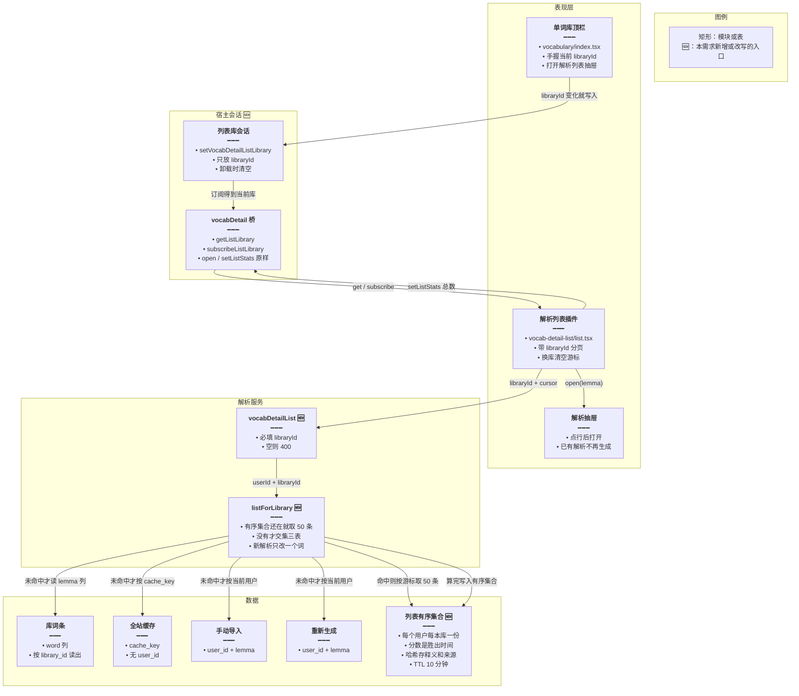
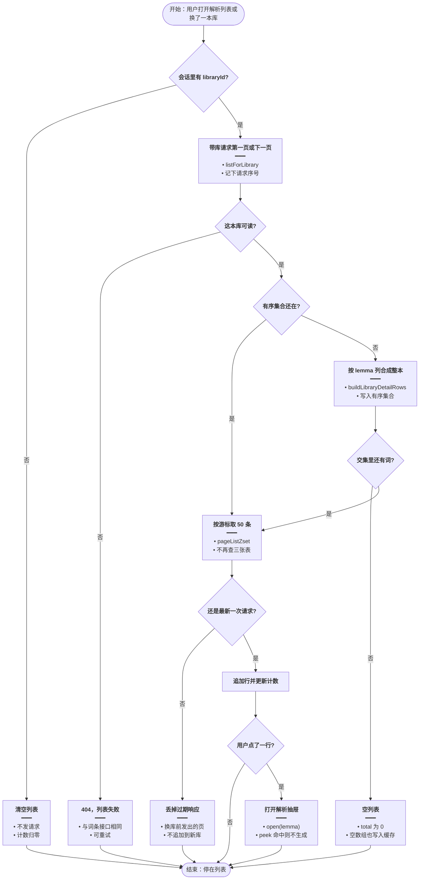
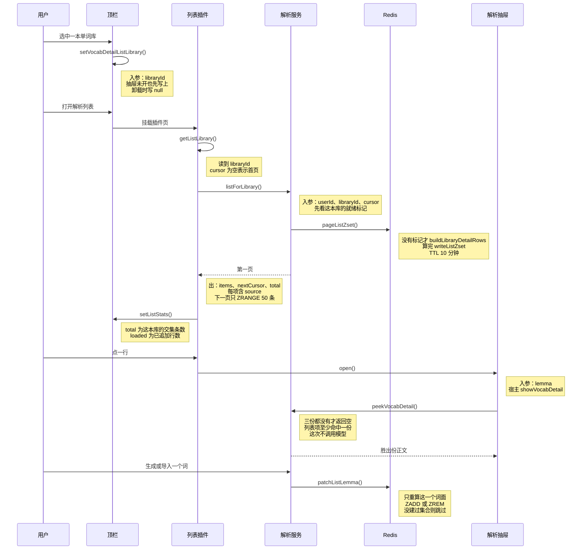
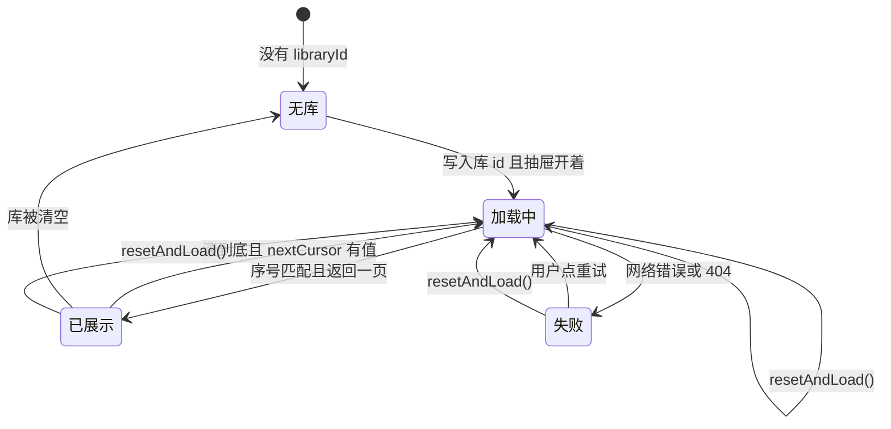

# 解析列表绑定词库 — 实现思路

> **状态**：规划（未实现）  
> **日期**：2026-11-11  
> **需求摘要**：用户在某一本单词库的单词列表里打开「单词解析列表」时，只看到这本库里已经有解析详情的词；全站缓存、该用户的重新生成、该用户的手动导入都要算进去。  
> **一句话方案（预告）**：列表请求必须带当前单词库 id；服务端用词条上的 `lemma` 与三份详情求交集，每个词只返回 `pickVocabOpen` 会打开的那一份。每个用户每本库一份 Redis 有序集合，翻页只取 50 条；新增解析只改这一个词。

## 延伸阅读

- 现网列表只扫全站缓存：[详解词列表](./详解词列表.md)、归档 [单词详解列表](../../english/单词详解列表.md)
- 三份详情的打开顺序：[重新生成单词详解](./重新生成单词详解.md)
- 手动导入按账号 + 词面落表、不写全站缓存：[手动导入单词详解](./手动导入单词详解.md)
- 全站缓存与抽屉：[单词详解插件](./单词详解插件.md)

---

## 0. 读本文你将得到什么

- 列表缺口：现在的 `GET vocab-detail/list` 只分页 `english_vocab_detail_cache`，不看当前单词库，也漏掉只存在于重新生成或手动导入的词。
- 选定方案：必带 `libraryId`，用词条上的 `lemma` 和三张现表求交集，一词一行，展示打开时会看到的那一份。有序集合按胜出时间排序，翻页只取 50 条；新增解析只改这一个词。
- 改动落在列表接口、`VocabDetailService`、词条 `lemma` 列、解析写入后的单行补丁、宿主当前库会话，以及插件仓 `vocab-detail-list`。不新增解析表。
- 分两阶段：先打通按库交集、有序集合和换库重拉；再在行上标出来源并改空态文案。
- 最大风险是 `lemma` 不用 `normalizeVocabLemma` 回填，导入过的词会从列表消失。某本库第一次打开仍要算一遍交集；之后的翻页和新解析都不再整本重算。

---

## 1. 需求与边界

### 1.1 用户故事

| 角色 | 场景 | 行为 | 期望结果 |
|------|------|------|----------|
| 已登录用户 | 打开某一本单词库的单词列表，启用了解析列表插件 | 点顶栏「单词解析」 | 抽屉只列出这本库里已有解析的词 |
| 已登录用户 | 这本库里某个词只有全站缓存 | 打开列表 | 该词出现，释义来自缓存 |
| 已登录用户 | 这本库里某个词只重新生成过，或只手动导入过，全站缓存没有 | 打开列表 | 该词仍然出现 |
| 已登录用户 | 同一个词三份都有 | 打开列表 | 只占一行；释义、时间和打开抽屉后的正文都是重新生成那一份 |
| 已登录用户 | 解析在别的词上，这本库没有这个词面 | 打开列表 | 不出现 |
| 已登录用户 | 这本库有这个词，但三份解析都没有 | 打开列表 | 不出现，这次请求也不打模型 |
| 已登录用户 | 列表已打开，左侧换到另一本库 | 继续看抽屉 | 列表清空并按新库重拉，不沿用上一本的游标 |
| 公开库读者 | 看别人设为公共的单词库 | 打开列表 | 能看到这本库里命中全站缓存的词，以及自己的重新生成和手动导入；看不到别人的后两份 |
| 已登录用户 | 点列表里的一行 | 打开解析抽屉 | 走现有 `peek` / `open`，已有解析不再生成 |

### 1.2 范围

| 在范围内 | 不在范围内（非目标） |
|----------|----------------------|
| 单词库单词列表顶栏现有解析列表抽屉 | 单词包、日推、收藏、错题、语句库上的另一份列表 |
| `GET /api/english-learning/vocab-detail/list` 改为按库只读 | 保留一条不带 `libraryId` 的全站扫描 |
| 全站缓存、当前用户的重新生成、当前用户的手动导入 | 按「谁触发生成」过滤全站缓存（缓存表没有 `user_id`） |
| 一词一行，字段与 `pickVocabOpen` 的胜出份一致 | 把同一词的三份拆成三行 |
| 换库后列表重新从第一页拉 | 搜索、删除、在列表里打模型、改三张表的写入路径 |
| 行上标出来源（全站 / 重新生成 / 手动导入） | 新的解析编辑器，或把解析行改成带 `library_id` 的从属数据 |

### 1.3 约束与依赖

- 必须登录，与现有 `GET vocab-detail` 一样走 JWT。
- 能看这本库的单词列表，就能看它的解析列表。判断与 `assertVocabularyLibraryReadable` 相同：所有者，或 `is_public`。导入接口仍然只允许所有者。
- 词面只认 `normalizeVocabLemma`（去首尾空白、合并空白、转小写）。超过 120 字的原文在打开解析时会被拒绝，列表也不可能命中。
- 打开顺序保持 `vocab-detail-run.ts` 的 `pickVocabOpen`：重新生成，手动导入，全站缓存。列表的释义和时间取这一份，避免列表和抽屉各看各的。
- 详情仍按词面存放，不按库复制。手动导入和重新生成的键是 `(user_id, lemma)`，全站缓存的键是 `cache_key`。同一词面出现在两本库时，两本库的列表都会带上该用户的那一行。
- 每页仍是 50，游标由服务端发，客户端不能把 `limit` 放大。
- 插件仓 `micro-apps/dnhyxc-ai-plugins` 的 `VocabDetailList` 是这条列表接口的唯一调用方。宿主、插件、接口要一起改，否则旧插件不带 `libraryId` 会得到 400。

---

## 2. 背景

- **谁、在什么场景、卡在哪**：用户站在某一本单词库的单词列表上，点「收藏」右侧的解析列表，想看的是「这本库里哪些词已经有解析」。抽屉现在把全站缓存整表按 `updated_at` 往下翻。
- **现状缺口**：`VocabDetailService.listCached` 不读 `libraryId`，也不读 `english_vocab_detail_manual` 和 `english_vocab_detail_regen`。只导入、只重新生成的词在单词卡上打得开，在列表里没有。别的库、甚至不在任何库里的缓存词会混进来。控制器虽然拿到了 `userId`，列表查询把它丢掉了。
- **不解决会怎样**：换一本库，列表还是同一份全站词表；用户会以为这本库已经有解析的词没生成，再点一次又进抽屉。
- **硬约束**：三张表已经是打开解析的数据源，列表不能再维护第四份「属于某库」的副本。词面函数不能在 SQL 里另写一套，否则和导入校验对不上。公开库的词条分页缓存在 `el:lib:vocab:items` 上，键里没有 `user_id`，不能把某人的手动释义塞进那份缓存。

---

## 3. 现状与复用

| 能力 | 仓库中已有 | 本需求中的用法 |
|------|------------|----------------|
| 全站缓存表 | `apps/backend/src/services/english-learning/entity/english-vocab-detail-cache.entity.ts`；唯一键 `cache_key` | 直接复用：按当前版本的 `cache_key` 取出库内词的缓存行 |
| 手动导入表 | `entity/english-vocab-detail-manual.entity.ts`；唯一键 `(user_id, lemma)` | 直接复用：只取当前用户、当前版本、且词面属于这本库的行 |
| 重新生成表 | `entity/english-vocab-detail-regen.entity.ts`；唯一键 `(user_id, lemma)` | 直接复用：条件与手动导入相同 |
| 打开顺序 | `vocab-detail-run.ts` 的 `pickVocabOpen` | 直接复用：列表合成一行时调用它，不另写优先级 |
| 词面归一 | `vocab-detail.parse.ts` 的 `normalizeVocabLemma` | 直接复用：库内 `word` 先归一再和三张表的 `lemma` 比较 |
| 现列表 | `VocabDetailService.listCached`；`GET vocab-detail/list` 只收 `cursor` | 扩展：改为 `listForLibrary(userId, libraryId, cursor)`，删掉不带库的全表扫描 |
| 库内词条 | `english_vocabulary_library_item.word`；索引 `idx_evli_library_sort (library_id, sort_order)`。词条只在 `persistVocabularyLibrary` 里 `itemRepo.create` | 扩展：增加 `lemma` 列和 `(lemma, library_id)` 索引。插入时用 `normalizeVocabLemma` 写入，迁移里分批回填 |
| 库可读 | `EnglishLearningService.assertVocabularyLibraryReadable`（私有）：所有者或 `is_public`，否则 404 | 扩展：在 `VocabDetailService` 用同一 `where` 写 `assertLibraryReadable`，不把整个学习服务注进来 |
| 列表抽屉 | 插件仓 `src/views/vocab-detail-list/list.tsx` 请求 `/english-learning/vocab-detail/list` | 扩展：带上 `libraryId`，换库清空游标 |
| 当前库从哪来 | `library/vocabulary/index.tsx` 的 `libraryId`；导入插件用 `vocabDetailImport/session.ts` 的 `getTarget` | 扩展：解析列表用同一类宿主会话，不给 `PluginHostPage` 加上下文参数 |
| 点词开抽屉 | `federation/runtime/index.ts` 的 `modules.vocabDetail.open` → `showVocabDetail` | 直接复用 |
| 顶栏计数 | `setListStats` / `readVocabDetailListStats` | 直接复用：`total` 改为这本库的交集条数 |
| 词条分页缓存 | `english-learning-library.cache.ts` 的 `elItemsPageKey`，键不含用户 | 不适用：解析列表不走这层缓存，避免一个人的手动释义被别人读到 |
| 库内容版本 | 同文件 `elItemsVerKey('vocab', libraryId)`，词条变更时已有 bump | 不适用：列表不把这个版本放进键。删库时按看过列表的用户清掉有序集合 |
| 解析服务上的 Redis | `VocabDetailService` 已注入 `CACHE_MANAGER`，`lockClient()` 是 node-redis，已有 `eval` | 扩展：用这个客户端做有序集合、哈希和看过列表的用户集合。不和词条分页共用键 |

**调研结论**：三份解析和词库词条都已经在库里，缺的是「当前库的词面 ∩ 三份解析」这一次只读查询，以及把 `libraryId` 送进插件的那一下。列表插件是唯一调用方，接口可以改成必带 `libraryId`。词条只有 `persistVocabularyLibrary` 这一处 `itemRepo.create`，`lemma` 加在这里，并用一次迁移回填旧行。

---

## 4. 方案比对与最终方案

### 4.1 候选方案

#### 方案 A：查询时把库内词面和三张现表求交集（扩展现列表）

- **做法**：`GET vocab-detail/list?libraryId&cursor`。`listForLibrary` 先确认库可读，再读这个用户这本库的 Redis 有序集合。没有集合时才按词条 `lemma` 分批查三张表，写成有序集合。之后每一页按胜出时间取 50 条。新增解析时用 `(lemma, library_id)` 找到含这个词的库，只重算这一个词并 `ZADD`。宿主把当前 `libraryId` 写入会话；插件换库时丢掉旧游标。
- **能工作的原因**：三张表的键就是打开解析时用的键。库成员关系只决定「哪些词面有资格」。有序集合是这份排序的缓存，丢掉之后下次打开会按三张表重做。
- **主要代价**：一本库的第一次打开仍要算完整交集。词库导入上限是 12000 词（`ENGLISH_VOCAB_GENERATION_MAX`）。词条要多一列 `lemma`，旧数据要回填。

#### 方案 B：另建「库 × 词面 × 来源」索引表，列表只扫索引

- **做法**：新表记下 `(library_id, lemma, kind, user_id)`。全站缓存写入、重新生成、手动导入、新建词库、按库删除手动解析时，都按归一后的词面去补或删这些行。列表按 `library_id + user` 做 keyset 分页，每页只读 50 行。展示时再按 `pickVocabOpen` 合并，或在索引上冗余胜出份的释义和时间。
- **能工作的原因**：资格在写入时就算好了，滚动不再扫整库词条。
- **主要代价**：一个词的全站缓存要扇出到所有含该词面的库；新建一本 12000 词的库要回填三张表；按库删除手动解析还要改掉其他库上的同一词面。漏一次写入，列表就和抽屉不一致。

#### 方案 C：给现有词条分页接口加「只返回有解析的词」

- **做法**：`GET vocabulary-libraries/:libraryId/items` 增加一种只读模式，在 `EnglishLearningService.listVocabularyLibraryItems` 里滤掉没有解析的词，并附上胜出份释义。插件改打这个接口。
- **能工作的原因**：库权限、词条都在这个服务里，滤完就是「这本库里有解析的词」。
- **主要代价**：词条分页结果缓存在不含 `user_id` 的 Redis 键上。胜出份可能是当前用户的手动导入或重新生成，放进这份缓存会串给下一个读者。绕开缓存之后，等于在已经很大的学习服务里再写一遍方案 A，而三张解析表的仓库在 `VocabDetailService`。

### 4.2 比对

| 维度 | 方案 A 查询时交集 | 方案 B 索引表 | 方案 C 挂到词条分页 |
|------|-------------------|---------------|---------------------|
| 正确性 | 词面用 `normalizeVocabLemma`，胜出份用 `pickVocabOpen`，和打开解析同一套。只导入或只重新生成的词能出现 | 分页快，但扇出或回填漏一次，列表会缺词或留着已删的词 | 若沿用现有 items 缓存，手动释义会串用户；绕开缓存则与 A 的判定相同 |
| 复用 / 与现状契合 | 复用三张表、两个现成函数、导入插件那类宿主会话 | 三张表仍要留着给抽屉，索引是第四份数据 | 复用词条接口的权限，但和按用户分的解析缓存键对不上 |
| 改动面 | 列表方法、控制器一个 query、宿主会话、插件请求 URL | 新迁移，加上缓存写入、重新生成、导入、删库词、建库五处写入 | 词条接口、其缓存键、插件 URL；解析仓库要注入学习服务或反过来 |
| 复杂度 | 未命中时多批 `IN`；命中后有序集合取 50 条。新增解析只补一个成员 | 新表和新的失效规则 | 在词条缓存和解析缓存之间加例外 |
| 体验 | 打开和换库各等一次交集；继续滚动只取 50 条。新解析写完，再打开列表就能看到这一个词的新位置 | 连第一次打开都只读 50 行 | 用户仍是一个抽屉；实现若误走共享缓存，会看到别人的释义 |
| 风险 | 补丁没写上时，这份列表最多旧到 TTL。Redis 不可用时退回每次都算 | 迁移可回滚，但写入路径变多，回滚时索引和抽屉更容易分叉 | 共享缓存串数据的面比 A 大 |
| 可维护性 | 列表是三张表的只读投影，删解析不用记得删索引 | 以后改打开顺序或词面规则，要同时改投影 | 词条服务和解析服务各有一半条件，改一处容易漏另一处 |

### 4.3 综合考量

这份需求的权重在正确性和复用。列表必须和抽屉看到同一份解析，词面必须和导入校验是同一个函数，而且不能把按用户存放的释义放进现有的词条分页缓存。

选 **方案 A**。它在这两项上直接用现表和 `pickVocabOpen`，没有第二份资格数据。方案 B 的优点是大库翻页不必重算整库，这个优点抵不过扇出写入：全站缓存没有 `library_id`，一条缓存要找遍所有库的词面，建库还要回填，漏一次用户就会看到和抽屉不同的列表。方案 C 的优点是少一个 URL，这个优点抵不过缓存键不含用户；一旦把胜出释义放进 `el:lib:vocab:items`，公开库的下一个读者会读到上一个人的手动导入。

因此不建解析索引表，也不改词条分页。大库的翻页和新增解析由 §4.5.4 用有序集合的单行补丁解决，而不是改去方案 B。

### 4.4 最终方案

#### 背景

解析已经有三份：全站 `english_vocab_detail_cache`（任何人打开单词、三份都没有时生成），当前用户的 `english_vocab_detail_regen`，当前用户的 `english_vocab_detail_manual`。打开时 `pickVocabOpen` 按重新生成、手动导入、全站缓存取一份。列表却只扫全站缓存，也不知道用户正站在哪本库。库词条的 `word` 和解析表的 `lemma` 要用 `normalizeVocabLemma` 才对得上。词条分页缓存按库共享，不能拿来装某个人的手动释义。

#### 具体思路

1. 查询放在 `VocabDetailService`。三张表的仓库已经在这里。`EnglishLearningService` 只保持词条分页，不接这份按用户变化的列表。
2. 数据从库词条已经写好的 `lemma` 出发，分别命中三张表，合成列表项再返回插件。这一列在插入和回填时由 `normalizeVocabLemma` 从 `word` 得到。解析 JSON 全文不下发，只要胜出份的第一条 `glossZh`。
3. 当前库 id 放在宿主内存会话，和导入插件的 `getTarget` 一样，不进 URL、不进 MobX。词条分页缓存继续按库共享。列表用带 `userId` 的有序集合，不放进 `el:lib:vocab:items`。
4. 无 `libraryId`、空词库、三份都没有、库不可读、换库后旧请求晚到，分别是 400、空列表、空列表、404、丢掉过期响应。列表本身不调用模型。有序集合已经建好时，翻页和新解析都不再把 12000 个词再查一遍。

#### 实现方案

**一句话**：列表请求必须带当前单词库 id；服务端用词条上的 `lemma` 与这三份详情求交集，每个词只返回 `pickVocabOpen` 会打开的那一份。每个用户每本库一份 Redis 有序集合，翻页只取 50 条；新增解析只改这一个词。

| 步骤 | 谁 | 做什么 | 输入 → 输出 |
|------|----|--------|-------------|
| 1 | `VocabularyLibrarySection` | `libraryId` 一变就写入列表会话；卸载时清掉 | `libraryId` → `{ libraryId }` 或 `null` |
| 2 | 插件 `VocabDetailList` | 订阅会话。有库才请求；换库时清空条目、游标和 `hold`，并递增请求序号 | 会话里的 `libraryId` + `cursor` → GET URL |
| 3 | `GET vocab-detail/list` | 登录且 `libraryId` 非空，交给 `listForLibrary` | query → `VocabDetailListPage` |
| 4 | `assertLibraryReadable` | 所有者或公开库，否则 404 | `userId + libraryId` → 库存在 |
| 5 | `pageListZset` | 有序集合还在，就按游标取 50 条，再用哈希取出释义和来源 | 游标 → 一页 |
| 6 | `buildLibraryDetailRows` | 只有没有集合时才读 `lemma` 列、按 1000 一批查三表、`pickVocabOpen` | 库 id → 整本已排序行 |
| 7 | `writeListZset` | 把整本写进有序集合和哈希，并记下这个用户看过这本库 | 整本行 → Redis |
| 8 | `patchListLemma` | 解析写入成功后只重算这一个词，`ZADD` 或 `ZREM` | 一个 lemma → 一个成员 |
| 9 | 插件 | 序号仍是最新才追加行，并 `setListStats`。点行仍 `open(lemma)` | 一页 → 抽屉列表 |

响应在现有字段上增加来源：

```ts
type VocabDetailListItem = {
	lemma: string;
	glossZh: string;
	updatedAt: string;
	source: 'regen' | 'manual' | 'generated';
};
```

`source` 与 `VocabOpenSource` 相同。`generated` 在界面上写成「全站缓存」。`total` 是这本库的交集条数，不是词库 `word_count`，也不是全站缓存行数。

#### 选定原因

1. **正确性**：交集用打开解析的同一套词面和优先级，只导入或只重新生成的词会进列表。牺牲：滚动中若有新解析写入，游标仍可能重复或漏看一条。
2. **复用**：三张解析表继续用原来的键。牺牲：词条多一列 `lemma`，旧库要回填；不拿到方案 B 那种连第一次打开也只读 50 行的索引扫描。
3. **改动面**：替换 `listCached`，加上宿主会话、插件 URL 和词条列。牺牲：旧插件不带 `libraryId` 不再能列出全站缓存，必须和插件一起发。
4. **复杂度**：合成仍是纯函数。牺牲：解析写入成功后要补有序集合里的一个成员。
5. **体验**：抽屉、每页 50、点词开原抽屉都不变。继续滚动只取 50 条。牺牲：某本库第一次打开仍要等那一次交集。
6. **风险**：有序集合带 `userId`，不进共享的词条分页缓存。牺牲：Redis 不可用时退回每次请求都算；补丁失败时列表最多旧 10 分钟。
7. **可维护性**：资格只由三张表和库词条决定，删行后下次列表自然消失。牺牲：可读判断与 `assertVocabularyLibraryReadable` 各写一处，改公开规则时要两处一起改。

#### 优势

- 相对方案 B：不新解析索引表。词条只多一列用来按词面找库。三张解析表的列不动。补丁漏了，列表最多旧到 TTL，打开单词仍读三张表。
- 相对方案 C：列表不进入 `el:lib:vocab:items`。公开库读者看不到别人的手动导入和重新生成，词条分页缓存也不用为这个抽屉改键。

#### 怎么实现

下面的序号与上面的步骤表一致。

1. 宿主在 `libraryId` 变化时写入列表会话，卸载时清空。
2. 插件订阅会话。有库才请求；换库时清空游标，并用请求序号丢掉旧响应。
3. 控制器要求 `libraryId`，空则 400。
4. `assertLibraryReadable` 使用与词条接口相同的条件，失败 404。
5. 有序集合还在就 `pageListZset`，按游标取 50 条。
6. 没有集合才 `buildLibraryDetailRows`：读 `lemma` 列、按 1000 一批查三表、`mergeLibraryDetailHits`。
7. `writeListZset` 写入有序集合和哈希，TTL 10 分钟，并记下这个用户。
8. 这一页由 `pageListZset` 从刚写好的集合里取，`total` 是集合成员数。解析写入成功后的 `patchListLemma` 不在这条读路径上，见 §4.5.4。
9. 序号仍匹配才追加行并 `setListStats`。点行仍 `open(lemma)`。来源短标签和空态文案同在插件里，放在 M2。

主要实现代码见 §9。

### 4.5 其他关键决策

#### 4.5.1 一词一行，还是一个来源一行

##### 候选

**候选 A — 一词一行，展示胜出份**

每个 `lemma` 最多一行。`glossZh`、`updatedAt`、`source` 都取 `pickVocabOpen` 选中的那份。排序用这份的 `updated_at` 倒序，同一时间再用 `lemma` 倒序断开。点进去就是抽屉里默认看到的正文。

**候选 B — 一个来源一行**

同一个词最多三行，分别标全站缓存、手动导入、重新生成。没有的来源不占行。点行时调用方要额外带 `source`，抽屉再切到那一版。

##### 比对

| 维度 | A 一词一行 | B 按来源拆行 |
|------|------------|--------------|
| 正确性 | 行上的释义就是打开后的默认正文 | 三份都看得见，但列表顺序和抽屉默认版可能不是同一行 |
| 复用 | `open(lemma)` 不用改 | 点词要加来源参数，抽屉还要认列表传来的来源 |
| 改动面 | 响应多一个 `source` 字段 | 桥、抽屉、列表键都要带上来源 |
| 复杂度 | 合成一次 | 游标要在「词 + 来源」上唯一 |
| 体验 | 一个词一个入口，和单词卡一致 | 同一词连续三四行，滚动变长 |
| 风险 | 低 | 用户点到非默认来源时，若抽屉仍按旧顺序打开，会点开另一份 |
| 可维护性 | 优先级只维护 `pickVocabOpen` | 列表和抽屉各有一套「点哪一行看哪一版」 |

##### 综合考量

用户要的是「这本库里哪些词已经有解析」，不是把三份档案摊开。权重在和抽屉一致。选 **A**。放弃 B「不打开抽屉也能把三份释义同时看完」这一点；三份对照仍然留在现有抽屉的版本切换里。

##### 最终方案

**背景**：三份可以同时存在，抽屉已经能切换。列表若再拆行，同一个词会占多个入口。  
**具体思路**：合成时先按来源放进三个槽，再调用 `pickVocabOpen`。排序时间用胜出槽的 `updated_at`，不用三份里最新的那一个，否则别人刷新了全站缓存，会把用户正在看的旧手动导入顶到前面，正文却还是手动导入。  
**实现方案**：`mergeLibraryDetailHits` 输出一词一行。响应带 `source` 只为了行上的短标签。  
**选定原因**：正确性上列表正文等于默认打开的正文。牺牲三份同时可见。复用上点词仍是 `open(lemma)`。牺牲按来源深链。  
**优势**：相对 B，不用改 `showVocabDetail` 的参数，列表键保持 `lemma`。  
**怎么实现**：见 §9.2 的 `mergeLibraryDetailHits`。同一词的缓存时间更晚、手动导入时间更早时，行上仍是手动导入。

#### 4.5.2 谁可以读这本库的解析列表

##### 候选

**候选 A — 与单词列表相同，所有者或公开库**

`assertLibraryReadable` 的 `where` 与 `assertVocabularyLibraryReadable` 相同，失败抛 `NotFoundException`。公开库读者看到：库内词面上的全站缓存，加上自己的重新生成和手动导入。

**候选 B — 只有所有者能列**

复用现成的 `assertOwner`，非所有者 403。公开库上的解析列表按钮要么隐藏，要么打开后失败。

##### 比对

| 维度 | A 可读即可 | B 仅所有者 |
|------|------------|------------|
| 正确性 | 能打开这本库单词列表的人，列表范围和库一致 | 公开库读者看得到词，却看不了哪些词已有全站解析 |
| 复用 | 条件复制已有的可读判断 | 直接调用已有 `assertOwner` |
| 改动面 | 新增一个私有方法 | 顶栏按钮还要按 `libraryMeta` 是否自己的库隐藏 |
| 复杂度 | 多一段 `where` | 少一段，但按钮和接口权限要一起算 |
| 体验 | 公开库上按钮行为与自有库相同 | 公开库上这个按钮是坏的，或干脆没有 |
| 风险 | 不暴露非公开库：没有库时 404，和词条接口一样 | 403 会让「库是否存在」和「是不是我的」分成两种响应 |
| 可维护性 | 两处可读条件要同时改 | 所有者规则只有一处，公开库规则要在按钮上再写一次 |

##### 综合考量

按钮画在单词列表顶栏上，单词列表对公开库读者是开着的。权重在「站在这本库上就能用这个抽屉」。选 **A**。放弃 B「直接调用 `assertOwner`、少写一个方法」的优点，因为那会让公开库的顶栏按钮和词条接口权限不一致。别人的手动导入和重新生成仍然读不到，因为查询带当前 `userId`。

##### 最终方案

**背景**：词条接口对「不是你的、也不是公开的库」返回 404。导入接口才用 403，因为那是写。  
**具体思路**：列表是读。公开库读者本来就能看到词面，全站缓存也本来就跨用户。把他自己的两份私人解析算进交集，不会把这两份算给别人。  
**实现方案**：`listForLibrary` 第一步 `assertLibraryReadable`。不要调用 `assertOwner`。  
**选定原因**：正确性上列表受众等于单词列表受众。牺牲一个可以复用的私有方法，改成平行的 8 行查询。风险上保持 404，不新增 403 旁路。  
**优势**：相对 B，公开库不用再隐藏按钮，也不会打开一个必定失败的抽屉。  
**怎么实现**：见 §9.2 的 `assertLibraryReadable`。

#### 4.5.3 当前库 id 放在哪，换库时谁清空列表

##### 候选

**候选 A — 宿主会话 + 插件订阅**

`vocabDetail/session.ts` 增加列表目标。`VocabularyLibrarySection` 在 `libraryId` 变化时写入。桥暴露 `getListLibrary` 和 `subscribeListLibrary`。插件在订阅回调里清空并重拉。抽屉开着时组件不卸载（`PluginHostSurface` 只在 `openPluginId` 有值时挂载 `PluginHostPage`），所以必须订阅，不能只在挂载时读一次。

**候选 B — 用 `libraryId` 当 key，强迫远程页面重挂载**

给 `PluginHostSurface` 或 `PluginHostPage` 加上 `key={libraryId}`。换库时插件从头挂载，在 `useEffect` 里读一次会话即可，不必订阅。

##### 比对

| 维度 | A 订阅 | B key 重挂载 |
|------|--------|----------------|
| 正确性 | 换库清空游标，旧响应靠序号丢弃 | 重挂载也会清空，只要挂载时读到的是新库 |
| 复用 | 与 `vocabDetailImport/session.ts` 的 `getTarget` / `subscribe` 相同 | 联邦页面没有这个 key 约定 |
| 改动面 | 会话、桥、插件各加一组读写 | 宿主一个 key，插件仍要一个 get |
| 复杂度 | 多一个监听 | 少一个监听，多一次远程页面装载 |
| 体验 | 抽屉保持打开，列表区自己换成新库 | 换库时整份远程页面重新 loading，抽屉闪一下 |
| 风险 | 忘记订阅时，开着抽屉换库会停在旧库 | key 打在整棵抽屉上时，打开状态若在子树里会一起被重置 |
| 可维护性 | 和导入插件同一条「宿主握着目标、插件来订」 | 以后第三个插件还得再发明一种传参 |

##### 综合考量

`openPluginId` 在 `VocabularyLibrarySection` 里，抽屉开着时换库不会卸掉插件页。权重在换库不串数据，同时不重载联邦页面。选 **A**。放弃 B「插件少写一个 subscribe」的优点，因为那一次重载会把正在看的抽屉闪成 loading，而导入插件已经有会话可抄。

##### 最终方案

**背景**：联邦 `PluginHostPage` 没有业务上下文参数。导入插件已经用宿主内存会话把 `libraryId` 送进去。  
**具体思路**：解析列表抄同一形状，但目标是「当前正在看的库」，不是「点了导入的那一下」。所以由单词列表区在 `libraryId` 变化时写，而不是在点击按钮时写。插件用请求序号丢掉换库前发出的响应。  
**实现方案**：会话字段 `{ libraryId: string } | null`。桥上的方法名 `getListLibrary`、`subscribeListLibrary`。插件不读路由。  
**选定原因**：复用上和导入会话一致。体验上抽屉不重装。牺牲一个订阅回调。  
**优势**：相对 B，换库只重拉列表数据，不重新加载远程入口。  
**怎么实现**：见 §9.2 宿主 `useEffect` 和插件里的序号。

#### 4.5.4 大库翻页，以及新增解析之后要不要整本重算

##### 候选

**候选 A — 每一页都重算**

`listForLibrary` 每次都读出这本库全部词面，按 1000 一批查三张表，在 Node 里排序后再切 50 条。不增加 Redis 键。新增一份解析之后，下一页自然能看见，因为下一页会把三张表再查一遍。

**候选 B — 整本薄行按版本放进 Redis，翻页只切数组**

键是 `用户 + 库 + 词条版本 + 该用户解析版本 + 全站缓存版本`。值是已经排好的整包 `{ lemma, glossZh, updatedAt, source }`。未命中才跑候选 A 的那一次计算。新增解析时只把对应版本 `INCR`，下一页换键，再把这本库整本算一遍。翻页要把整包取回再切 50 条。

**候选 C — 索引表上做 keyset，每页只读 50 行**

也就是总体方案 B 的读法。`ORDER BY shown_at, lemma` 走索引。新增解析时按词面扇出，改所有含这个词的库的索引行。

**候选 D — 有序集合里只改这一个词**

词条增加 `lemma` 列，索引 `(lemma, library_id)`，值由 `normalizeVocabLemma` 在 `persistVocabularyLibrary` 写入，迁移分批回填。每个用户每本库一个 Redis 有序集合：成员是词面，分数是胜出时间。释义和来源放在同键范围的哈希里。翻页按分数加词面取 50 条。

没有集合时才整本计算一次。已经有集合时，新增解析用 `lemma` 找到库，再只对看过这本库的用户重算这一个词：`ZADD` 更新位置，没有胜出份就 `ZREM`。清掉旧 schema 时把纪元加一，下次打开整本重建。一条 `JOIN` 再 `LIMIT 51` 不算候选。胜出时间是三张表的 `CASE`，上面没有索引，数据库仍要先做出整本交集再排序。

##### 比对

| 维度 | A 每页重算 | B 整包按版本缓存 | C 索引表 keyset | D 有序集合单行补丁 |
|------|------------|------------------|-----------------|-------------------|
| 正确性 | 每次都读三张表，和抽屉一致 | 版本加在写入成功之后，下一页读到新键。抽屉仍直接读表 | 漏一次扇出就会和抽屉不一致，而且不会自己修好 | 补丁读的是刚写完的那一行。漏补丁时列表最多旧到 TTL，抽屉仍直接读表 |
| 复用 | 只用现表 | 复用 `CACHE_MANAGER`。整包键靠版本失效 | 三张表之外再维护一张解析索引 | 复用 `lockClient()` 的有序集合。词条多一列，解析表不加列 |
| 改动面 | 只改列表查询 | 列表查询加缓存；生成、重新生成、导入、删除各加一次 `INCR` | 新表，加上所有写入和建库回填 | 词条列和回填；列表查询；生成、重新生成、导入、删除各补一个成员 |
| 复杂度 | 查询重复，没有失效规则 | 三个整数版本。任意一次全站缓存都会让所有库整本重算。翻页要取回整包 | 扇出和回填 | 四个键：有序集合、哈希、就绪标记、看过的用户。冷启动仍是整本 |
| 体验 | 12000 词的库每翻一页都重做 12 批 × 3 次索引查询 | 第一次打开等那一次计算；继续滚动取回整包再切 50 条。每新增一个词，这本库下次又等一次整本计算 | 每一页都只读 50 行，包括第一次。新增解析要等扇出写完 | 第一次打开等那一次计算；继续滚动只取 50 条。新增一个词只改这一个成员 |
| 风险 | 列表接口会把数据库打满 | Redis 挂了就退回 A。`INCR` 失败时整包最多旧 10 分钟 | 索引和抽屉分叉后，用户看到的词打不开，或打开的不是列表上那句释义 | Redis 挂了就退回 A。补丁失败时最多旧 10 分钟。`lemma` 回填必须用同一个函数 |
| 可维护性 | 没有第二份数据 | 缓存是排序结果的副本，删掉也不影响打开解析 | 打开顺序一改，索引和 `pickVocabOpen` 要一起改 | 缓存删掉就重建。打开顺序只留在 `pickVocabOpen` |

##### 综合考量

词库上限是 12000（`ENGLISH_VOCAB_GENERATION_MAX`）。打开一个还没有解析的词就会写全站缓存，这个写入很常见。权重是：翻页不能再做整本交集，新增一个词也不能让所有库重新算 12000 行，同时不能另存一套会和抽屉分叉的资格。

选 **D**。它把整本计算留在某本库第一次打开，以及清掉旧 schema 之后的下一次打开。滚动只取 50 条。新增解析只移动这一个成员。放弃 A「写入路径完全不动」，因为那会让每一页都把同一批 `cache_key` 再查一遍。放弃 B「只要递增版本、不用词条列」，因为一次全站缓存会让所有用户的所有库整本重算，翻页还要把整包取回来。放弃 C「连第一次打开也只读 50 行」，因为那份索引漏一次就不会自己回到三张表的结果。

##### 最终方案

**背景**：交集本身是对的。慢有两处：每一页都重做整本；每新增一份解析，版本一变，下一页又把整本做一遍。胜出时间不是索引列，`LIMIT 51` 省不掉整本排序。  
**具体思路**：有序集合是「这个用户看这本库」的排序缓存。成员是词面，分数是胜出时间，哈希里放释义、来源和 ISO 时间。看过这本库的用户记在一个集合里，全站缓存写入时只补这些人。词条 `lemma` 用来找出「哪些库含有这个词」，不保存释义。  
**实现方案**：`listForLibrary` 看到就绪标记就 `pageListZset`。没有就 `buildLibraryDetailRows`，再 `writeListZset`。`generateAndStore` 成功后 `patchLemmaForViewers`。`regenerateVocabDetail` 和 `importManualDetails` 成功后 `patchLemmaForUser`。`deleteManualDetails` 成功后对每个被删词面走 `patchLemmaForUser`，其他含这个词的库也会去掉或退回全站缓存。`purgeStale` 成功后把纪元加一。TTL 用 `EL_LIB_LIST_TTL_MS`（10 分钟）。  
**选定原因**：体验上，翻页和新解析都不再随词数变慢。正确性上，源表仍是三张解析表，缓存可以整包丢掉。牺牲第一次打开的那一次计算，以及 C 那种稳定的 50 行索引读，也牺牲 B 那种「写入只做一次计数」的简单。  
**优势**：相对 A，滚到第 20 页不会把 12000 个词面再查 20 次。相对 B，生成一个词不会让其他库整本重算，翻页也不取回整包。相对 C，落库语句的列不用改，漏一次补丁会在 TTL 后按三张表重建。  
**怎么实现**：见 §9.2 的 `listForLibrary` 和 `patchListLemma`。`persistVocabularyLibrary` 在 `itemRepo.create` 时写入 `lemma`。

---


## 5. 架构图



**图内方法说明**：

| 方法 | 功能 |
|------|------|
| `setVocabDetailListLibrary(target)` | 宿主把当前单词库 id 写入内存会话；`libraryId` 为空或组件卸载时写入 `null`，避免插件继续请求上一本库 |
| `getListLibrary()` | 插件读取当前 `{ libraryId }`。没有库时返回 `null`，插件不发列表请求 |
| `subscribeListLibrary(listener)` | 库 id 变化时通知插件清空游标并重拉。抽屉开着时插件不会重挂载，所以不能只在首次渲染读一次 |
| `listForLibrary(userId, libraryId, cursor)` | 确认库可读。有序集合还在就取一页；没有才求交集并写入 Redis。不调用模型 |
| `pageListZset(userId, libraryId, cursor)` | 按胜出时间从有序集合取 50 条，再用哈希补上释义和来源。`total` 是集合成员数 |
| `buildLibraryDetailRows(userId, libraryId)` | 只在没有集合时读 `lemma` 列并查三张表，合成整本已排序的行 |
| `writeListZset(userId, libraryId, rows)` | 把整本写进有序集合和哈希，TTL 10 分钟，并记下这个用户看过这本库 |
| `patchListLemma(userId, libraryId, lemma)` | 解析写入成功后只重算这一个词。有胜出份就 `ZADD`，没有就 `ZREM` |
| `setListStats({ total, loaded })` | 插件把交集总数和已加载条数交给宿主，顶栏副标题仍用现有文案 |
| `open(lemma)` | 列表点行时打开解析抽屉。插件仓现有调用，不带来源 |

**读图要点**：

- 库 id 从顶栏进会话，再进插件请求。解析表不保存 `library_id`。
- 三张表只在这本库还没有有序集合时读取。翻页和新解析都不把整本再查一遍。
- 点行离开列表服务，回到已经存在的解析抽屉。

---

## 6. 主流程图



**图内方法说明**：

| 方法 | 功能 |
|------|------|
| `listForLibrary(userId, libraryId, cursor)` | 读库权限和有序集合。没有集合才构建整本，再取一页。失败时由控制器变成 400 或 404 |
| `pageListZset(userId, libraryId, cursor)` | 从有序集合按游标取 50 条。翻页不调用 `buildLibraryDetailRows` |
| `buildLibraryDetailRows(userId, libraryId)` | 没有集合时读 `lemma` 列并查三张表。翻页和新解析的补丁都不调用它 |
| `normalizeVocabLemma(word)` | 把库词条的 `word` 收成与解析表 `lemma` 相同的词面。不用 SQL 的 `LOWER(TRIM)`，避免和导入校验差在空白上 |
| `pickVocabOpen(versions)` | 在一个词的三份命中里选出列表要展示的那份。重新生成优先，然后手动导入，然后全站缓存 |
| `open(lemma)` | 插件通知宿主打开解析抽屉 |
| `peekVocabDetail(word, userId)` | 抽屉读取已有解析。列表里的词至少有一份，这条读取不应落到生成 |

**读图要点**：

- 没有当前库就不请求。有序集合还在时不再读三张解析表。
- 空交集也写入就绪标记，避免下一页又把空库查一遍。它和 404、加载失败分开。
- 换库后只有序号仍匹配的响应才能画上行。点词不在列表接口里生成。

---

## 7. 核心时序图



**图内方法说明**：

| 方法 | 功能 |
|------|------|
| `setVocabDetailListLibrary()` | 顶栏在库切换时更新插件即将读取的库 id |
| `getListLibrary()` | 插件挂载或收到订阅时读取库 id，用来拼列表 URL |
| `listForLibrary()` | 返回当前库的一页解析词。服务端固定 50 条。有序集合还在就直接取页 |
| `pageListZset()` | 按胜出时间从有序集合取 50 条，再用哈希补释义和来源 |
| `buildLibraryDetailRows()` | 没有集合时读 `lemma` 列并查三张表，得到整本已排序的行 |
| `writeListZset()` | 把整本写入有序集合和哈希，TTL 10 分钟。下一页直接命中 |
| `patchListLemma()` | 新增、重新生成、导入或删除解析之后，只改这一个词在集合里的位置 |
| `setListStats()` | 用这一页里的 `total` 更新顶栏「共 N 条 / 已加载 M 条」 |
| `open()` | 插件把词面交给宿主，打开已有解析抽屉 |
| `showVocabDetail()` | 宿主会话把抽屉打到这个词，同一词再点也不关闭 |
| `peekVocabDetail()` | 抽屉只读三份解析。列表已经证明有命中，正常路径不生成 |

**读图要点**：

- 库 id 在打开抽屉之前就写好，插件挂载即可请求首页。
- 第一页可能建有序集合；之后的翻页只取 50 条。新增解析只改这一个成员。列表不返回 `detail` 全文。
- 点词之后的生成逻辑不变：只有三份都没有才写入全站缓存。从列表点进去不应走到那一步。

---

## 8. 状态机

列表抽屉相对「当前库」的状态。换库是从已展示或失败回到清空，再进入加载。



**图内方法说明**：

| 方法 | 功能 |
|------|------|
| `resetAndLoad()` | 插件在 `subscribeListLibrary` 里调用。清掉条目、游标、失败锁和已加载计数，递增请求序号，再按新库请求首页。换库前已发出的响应因序号不符被丢弃 |

**读图要点**：

- 「失败」会被换库直接拉回加载，不需要用户先点重试。否则上一本库的失败锁会挡住新库。
- 滚到底只在「已展示」且还有 `nextCursor` 时进入下一次加载，游标仍属于当前库。
- 无库是稳定空态，不发请求。

---

## 9. 具体实现（主链路代码）

### 9.1 模块一览

| 模块 | 职责 | 新增/改动 | 预估路径 |
|------|------|-----------|----------|
| 合成与切页 | 一词一行、胜出份、游标 | 扩展 | `apps/backend/src/services/english-learning/vocab-detail-run.ts` |
| 按库列表 | 可读校验、有序集合翻页、未命中才查三表、单行补丁；`VocabDetailListItem` 增加 `source` | 扩展，删除 `listCached` | `apps/backend/src/services/english-learning/vocab-detail.service.ts` |
| 词条词面 | `persistVocabularyLibrary` 写入 `lemma`；迁移回填旧行 | 扩展 | `apps/backend/src/services/english-learning/english-learning.service.ts` 与一条新迁移 |
| 列表路由 | 必填 `libraryId` | 扩展 | `apps/backend/src/services/english-learning/english-learning.controller.ts` |
| 列表库会话 | 当前库 id | 扩展 | `apps/frontend/src/federation/modules/vocabDetail/session.ts` |
| 插件桥 | 读和订阅当前库 | 扩展 | `apps/frontend/src/federation/runtime/index.ts` |
| 顶栏 | 跟随 `libraryId` 写会话 | 扩展 | `apps/frontend/src/views/englishLearning/library/vocabulary/index.tsx` |
| 列表插件 | 带库请求、换库清空、来源标签 | 扩展 | 插件仓 `micro-apps/dnhyxc-ai-plugins/src/views/vocab-detail-list/list.tsx` |

### 9.2 主链路实现

```typescript
// 对应 §4.4 步骤 7。三份摘要放在 pickVocabOpen 旁边，列表不再自定优先级
type ListSlot = {
	// 这一份的第一条中文释义。空字符串表示行上不画释义
	glossZh: string;
	// 这一份自己的更新时间。排序用它，不用另外两份里更晚的时间
	updatedAt: Date;
};

// 一个词面的三个槽。空槽表示这张表没有当前版本的行
type ListVersions = {
	// 重新生成槽。打开顺序里它最先被选中
	regen: ListSlot | null;
	// 手动导入槽。没有重新生成时才显示
	manual: ListSlot | null;
	// 全站缓存槽。前两份都没有才显示
	generated: ListSlot | null;
};

// 查询层扁平行。同一词同一来源若因分批重复出现，留下更新更晚的那条
type ListHit = {
	// 已经过 normalizeVocabLemma 的词面，和三张表的 lemma 列相同
	lemma: string;
	// 这一行来自哪张表，装进对应的槽
	source: VocabOpenSource;
	// 该行 detail 的第一条释义，不是整份 JSON
	glossZh: string;
	// 该行 updated_at，还没经过胜出选择
	updatedAt: Date;
};

// 交给切页的一行。source 让插件标出打开后会看到哪一份
type MergedRow = {
	// 列表键，也是点开抽屉时传入的 word
	lemma: string;
	// 胜出份的第一条释义
	glossZh: string;
	// 胜出份的更新时间，游标用它而不是三份中的最大值
	updatedAt: Date;
	// 胜出份的来源，与 pickVocabOpen 的 source 相同
	source: VocabOpenSource;
};

// 先按词面装槽，再交给已有的打开顺序，保证列表和抽屉是同一份
function mergeLibraryDetailHits(hits: ListHit[]): MergedRow[] {
	// 词面到三槽。Map 保证同一个词最后只有一行
	const byLemma = new Map<string, ListVersions>();
	// 扁平行可能含同一词的多份来源，这里只负责装槽
	for (const hit of hits) {
		// 空词面不能当游标键，也和「单词为空」的打开校验对不上
		if (!hit.lemma) continue;
		// 第一次见到这个词面时三个槽都空，避免后面的来源写进别人的词
		const slot = byLemma.get(hit.lemma) ?? { regen: null, manual: null, generated: null };
		// 同一来源若已经有一条，用来和这条比时间
		const prev = slot[hit.source];
		// 同一来源留下较新的一条，避免分批查询把旧释义盖住新的
		if (!prev || hit.updatedAt.getTime() >= prev.updatedAt.getTime()) {
			// 槽里只留这一来源的释义和它自己的时间，点开抽屉时再读全文
			slot[hit.source] = { glossZh: hit.glossZh, updatedAt: hit.updatedAt };
		}
		// 写回 Map。第一次和覆盖都走这里，后面的来源才能进同一个词
		byLemma.set(hit.lemma, slot);
	}
	// 合成结果。顺序在 sort 里定，这里先不保证顺序
	const merged: MergedRow[] = [];
	// 每个词面独立选择，词与词之间不共享胜出份
	for (const [lemma, versions] of byLemma) {
		// 与打开解析共用优先级。三份都空时返回 null，这一词不进列表
		const picked = pickVocabOpen(versions);
		// 三个槽都空不会进 Map，这里再挡一层，避免发出没有正文的行
		if (!picked) continue;
		// 词面用 Map 的键；释义、时间和来源都取胜出槽，更新的缓存不会盖住手动导入
		merged.push({ lemma, glossZh: picked.detail.glossZh, updatedAt: picked.detail.updatedAt, source: picked.source });
	}
	// 时间倒序；同一毫秒用词面倒序，游标的「小于」才和这一排序一致
	merged.sort((a, b) => {
		// 胜出时间差。正数表示 a 更旧，应该排到后面
		const delta = b.updatedAt.getTime() - a.updatedAt.getTime();
		// 时间不同就按时间定序，不再看词面
		if (delta !== 0) return delta;
		// 同一词面不会进两次，相等时保持稳定
		if (a.lemma === b.lemma) return 0;
		// 词面倒序，和切页时 lemma < cursor 的方向一致
		return a.lemma < b.lemma ? 1 : -1;
	});
	// 已排序的全量交集。切页函数再按游标截 50 条
	return merged;
}
```

```typescript
// 对应 §4.4 步骤 8。每页固定 50，客户端不能把 limit 放大
const LIST_PAGE_SIZE = 50;
// 游标分隔符。ISO 时间里没有这个字符，后半段整段都是词面，词面里的 | 不会被截断
const CURSOR_SEP = '|';

// 替换原来按缓存表 id 切开的解析。listCached 删除后，第二段是词面而不是行 id
function parseListCursor(cursor: string): { updatedAt: number; lemma: string } {
	// 只认第一个分隔符，词面里若有 | 仍留在后半段
	const sep = cursor.indexOf(CURSOR_SEP);
	// 没有分隔符或时间空着，都是坏游标，不能当成第一页
	if (sep <= 0) throw new BadRequestException('cursor');
	// 前半段必须是胜出份的 ISO 时间，解析失败就拒绝，避免滤掉整页
	const updatedAt = new Date(cursor.slice(0, sep)).getTime();
	// 后半段是上一页最后一行的词面
	const lemma = cursor.slice(sep + 1);
	// 非法时间或空词面都不能用来比较，否则会漏掉或重复一整页
	if (Number.isNaN(updatedAt) || !lemma) throw new BadRequestException('cursor');
	// 时间和词面分开，切页时不用再解析字符串
	return { updatedAt, lemma };
}

// 这一行是否比游标更旧。比较方向必须和 merge 的倒序一致
function isOlderThanCursor(row: MergedRow, cursor: { updatedAt: number; lemma: string }): boolean {
	// 和游标用同一种毫秒，避免 ISO 字符串比较受格式影响
	const time = row.updatedAt.getTime();
	// 更早的胜出份属于后面的页
	if (time < cursor.updatedAt) return true;
	// 更新的行已经在前面的页展示过
	if (time > cursor.updatedAt) return false;
	// 同一时间按词面倒序排过，下一页只剩字典序更小的词面
	return row.lemma < cursor.lemma;
}

// 在已经排序的交集上切一页。total 是切之前的长度，给顶栏用
function pageMergedDetails(rows: MergedRow[], cursor: { updatedAt: number; lemma: string } | null) {
	// 顶栏要的是整本库有解析的词数，所以在过滤游标之前取
	const total = rows.length;
	// 没有游标就是首页；有游标则只留比它更旧的行
	const rest = cursor ? rows.filter((row) => isOlderThanCursor(row, cursor)) : rows;
	// 多看一条才知道有没有下一页，避免最后一页再发一次空请求
	const hasMore = rest.length > LIST_PAGE_SIZE;
	// 有下一页时只留 50 条；没有则整段都是最后一页
	const page = hasMore ? rest.slice(0, LIST_PAGE_SIZE) : rest;
	// 下一页游标取本页最后一行。空页没有游标
	const last = page.at(-1);
	// 没有更旧的行就不发游标，插件停止滚动
	let nextCursor: string | null = null;
	// 多出来的那一行说明后面还有，用本页最后一词的胜出时间加词面
	if (hasMore && last) nextCursor = `${last.updatedAt.toISOString()}${CURSOR_SEP}${last.lemma}`;
	// 每行只留词面、胜出释义、ISO 时间和来源。total 仍是切页前的交集条数
	const items = page.map((row) => ({ lemma: row.lemma, glossZh: row.glossZh, updatedAt: row.updatedAt.toISOString(), source: row.source }));
	// nextCursor 为 null 时插件停掉哨兵
	return { items, nextCursor, total };
}
```

```typescript
// 对应 §4.4 步骤 7 的自检。和 checkVocabDetailRuns 放在一起，本地调用，不挂到请求上
function checkLibraryDetailPage(): void {
	// 三行命中：apple 的缓存比手动导入新，用来证明列表仍展示手动导入
	const rows = mergeLibraryDetailHits([
		// apple 的全站缓存故意比手动导入晚两天，合成后仍必须显示导入释义
		{ lemma: 'apple', source: 'generated', glossZh: '缓存释义', updatedAt: new Date('2026-01-03T00:00:00.000Z') },
		// 同一词面的手动导入更早，打开顺序里它压过缓存
		{ lemma: 'apple', source: 'manual', glossZh: '导入释义', updatedAt: new Date('2026-01-01T00:00:00.000Z') },
		// zebra 只有重新生成，胜出时间 1 月 2 日，应排在 apple 的手动导入前面
		{ lemma: 'zebra', source: 'regen', glossZh: '重新生成', updatedAt: new Date('2026-01-02T00:00:00.000Z') },
	]);
	// apple 排在 zebra 后面，且必须是手动导入那一份
	if (rows[1]?.source !== 'manual' || rows[1].glossZh !== '导入释义') throw new Error('manual must beat a newer cache');
	// zebra 的胜出时间更晚，必须排在 apple 前面
	if (rows[0]?.lemma !== 'zebra') throw new Error('winning updatedAt orders the page');
	// 无游标时首页应包含这两行，total 也是 2 而不是 3
	const page = pageMergedDetails(rows, null);
	// 三份命中收成两行，说明同一词没有按来源拆开
	if (page.total !== 2 || page.items.length !== 2) throw new Error('one row per lemma');
}
```

```typescript
// 对应 §4.5.4。每个用户每本库一份，不把版本写进键，新增解析直接改成员
function listZsetKey(userId: number, libraryId: string): string {
	// 带 userId，公开库读者的手动导入不会写进别人的集合
	return `el:vocabDetailList:z:u:${userId}:lib:${libraryId}`;
}

// 释义和来源不放进有序集合。分数只负责排序
function listHashKey(userId: number, libraryId: string): string {
	// 和有序集合同一对用户与库，缺一就当成缓存坏了
	return `el:vocabDetailList:h:u:${userId}:lib:${libraryId}`;
}

// 有这个标记才表示集合是建完的。空库也要写它，避免下一页把空库再查一遍
function listReadyKey(userId: number, libraryId: string): string {
	// 值是当时的纪元。清掉旧 schema 之后纪元变了，下次打开会整本重建
	return `el:vocabDetailList:ready:u:${userId}:lib:${libraryId}`;
}

// 全站缓存写入时只补看过这本库的人，不必扫描所有用户
function listViewersKey(libraryId: string): string {
	// 成员是 userId 字符串。没打开过列表的人不在里面，也就没有集合可改
	return `el:vocabDetailList:viewers:${libraryId}`;
}

// 只有 purgeStale 会加一。日常新增解析不碰它
const LIST_EPOCH_KEY = 'el:vocabDetail:epoch';

// 哈希里的一条。时间用 ISO，游标和响应都直接用它
type CachedListRow = { glossZh: string; source: VocabOpenSource; updatedAt: string };

// 同一进程里同一用户同一库只构建一次。ponytail: 多实例仍可能各算一遍，结果相同；重复构建成为负担时再加 Redis 锁
private listBuilds = new Map<string, Promise<MergedRow[]>>();

// 对应 §4.4 步骤 5～8。cursor 缺省为首页。集合还在时不再查三张解析表
async listForLibrary(userId: number, libraryId: string, cursor?: string): Promise<VocabDetailListPage> {
	// 与词条接口相同的可读范围。不调用 assertOwner，公开库读者也要能列
	await this.assertLibraryReadable(userId, libraryId);
	// 坏游标在读 Redis 之前就 400，避免先建一份集合再拒绝
	const parsed = cursor ? parseListCursor(cursor) : null;
	// 与详解锁同一条连接。没有客户端就每次现算
	const client = await this.lockClient();
	// Redis 不可用时结果仍然正确，只是每一页都算整本
	if (!client) return pageMergedDetails(await this.buildLibraryDetailRows(userId, libraryId), parsed);
	// 没有纪元键时当作 0，和第一次写入的就绪标记对齐
	const epoch = String((await client.get(LIST_EPOCH_KEY)) ?? '0');
	// 标记不存在或纪元变了，都要重建
	const ready = await client.get(listReadyKey(userId, libraryId));
	// 标记对得上才翻页。哈希缺行会抛错，下面删掉标记再重建一次
	if (ready === epoch) {
		// 读失败不当成空库
		try {
			// 续上 TTL，并把这个用户留在 viewers 里，之后的全站缓存才能补到他
			await this.touchListKeys(client, userId, libraryId);
			// 只取 50 条。total 是集合成员数
			return await this.pageListZset(client, userId, libraryId, parsed);
			// 哈希缺字段或 Redis 中途断开，删掉标记后走下面的整本重建
		} catch (e) {
			// 记下原因。这次请求继续，不把故障显示成空列表
			this.logger.warn(`vocab detail list page failed: ${e instanceof Error ? e.message.slice(0, 200) : String(e)}`);
			// 只删标记。残留的集合成员会在 writeListZset 里先清掉
			await client.del(listReadyKey(userId, libraryId));
		}
	}
	// 没有标记，或刚才那一页读坏了。同一进程的并发打开共用这一次
	const rows = await this.buildListOnce(userId, libraryId);
	// 先写完再取页，首页和下一页都走同一套 Redis 顺序
	await this.writeListZset(client, userId, libraryId, rows, epoch);
	// 游标按有序集合切，不在内存数组上切，避免两套字典序
	return this.pageListZset(client, userId, libraryId, parsed);
}

// 对应 §4.4 步骤 6，只在没有就绪标记时调用。读的是已经写好的 lemma 列
private async buildLibraryDetailRows(userId: number, libraryId: string): Promise<MergedRow[]> {
	// 只取 lemma。索引能按库扫到；空字符串是回填前的旧行，不进 IN
	const rows = await this.libraryItems.find({ where: { libraryId }, select: { id: true, lemma: true } });
	// 同一词面在库里出现两行时，列表只占一行
	const lemmas = [...new Set(rows.map((row) => row.lemma).filter((lemma) => lemma.length > 0))];
	// 空库返回 []，上层仍会写就绪标记
	if (lemmas.length === 0) return [];
	// 三张表的命中先摊平，合成函数再按词面收拢
	const hits: ListHit[] = [];
	// ponytail: 仅冷启动时跑，1000 个词面一批以免 IN 顶满 max_allowed_packet。天花板是 12000 词的第一次打开
	for (let i = 0; i < lemmas.length; i += 1000) {
		// 这一刀的词面。上面已保证 lemmas 非空，这里不会发出空 IN
		const group = lemmas.slice(i, i + 1000);
		// 三表查完再拼进总命中。顺序不影响合成，合成按 source 装槽
		hits.push(...(await this.loadListHits(userId, group)));
	}
	// 一词一行，并按胜出时间排好。写入有序集合时不再依赖这个数组的顺序
	return mergeLibraryDetailHits(hits);
}

// 并发的第一次打开共用同一个 Promise，避免两个人同时把 12000 词查两遍
private async buildListOnce(userId: number, libraryId: string): Promise<MergedRow[]> {
	// 键只在本进程里用，不进 Redis
	const key = `${userId}:${libraryId}`;
	// 已经在算就等那一次
	const pending = this.listBuilds.get(key);
	// 后到的请求不再发第二轮 IN
	if (pending) return pending;
	// 查询从这里开始。登记 Map 在下面、且在第一次让出事件循环之前
	const job = this.buildLibraryDetailRows(userId, libraryId).finally(() => {
		// 成败都摘掉，失败的键才能重试
		this.listBuilds.delete(key);
	});
	// 同步放进 Map，await 之前另一个请求就能命中 pending
	this.listBuilds.set(key, job);
	// 等这一次算完。查询失败会抛给控制器
	return job;
}

// 对应 §4.4 步骤 7。就绪标记最后写，写到一半崩溃时下次还会重建
private async writeListZset(client: RedisLockClient, userId: number, libraryId: string, rows: MergedRow[], epoch: string): Promise<void> {
	// 先删旧成员，重建后已经没有解析的词不会留在集合里
	await client.del([listZsetKey(userId, libraryId), listHashKey(userId, libraryId)]);
	// 空库只写标记，不发空的 ZADD
	if (rows.length > 0) {
		// 分数是胜出时间的毫秒。相同分数时 Redis 按词面倒序排，和 merge 的排序一致
		await client.zAdd(listZsetKey(userId, libraryId), rows.map((row) => ({ score: row.updatedAt.getTime(), value: row.lemma })));
		// 哈希留下释义、来源和 ISO 时间，翻页不用再查表
		const payload: Record<string, string> = {};
		// 每个词面一条。detail 全文不进 Redis
		for (const row of rows) payload[row.lemma] = JSON.stringify({ glossZh: row.glossZh, source: row.source, updatedAt: row.updatedAt.toISOString() });
		// 一次写入。空对象不会走到这里
		await client.hSet(listHashKey(userId, libraryId), payload);
	}
	// 标记放在成员写完之后。值等于这次看到的纪元
	await client.set(listReadyKey(userId, libraryId), epoch);
	// 这个用户之后会收到这本库的单行补丁
	await client.sAdd(listViewersKey(libraryId), String(userId));
	// 四个键一起续 10 分钟，避免 viewers 先过期而集合还在
	await this.touchListKeys(client, userId, libraryId);
}

// 续 TTL，并把当前用户放进看过的人。补丁靠这个集合找到要改的有序集合
private async touchListKeys(client: RedisLockClient, userId: number, libraryId: string): Promise<void> {
	// 四个键同一寿命。pExpire 用毫秒，和 EL_LIB_LIST_TTL_MS 一致
	for (const key of [listZsetKey(userId, libraryId), listHashKey(userId, libraryId), listReadyKey(userId, libraryId), listViewersKey(libraryId)]) {
		// 键还不存在时这条是空操作，writeListZset 会在写完后再续一次
		await client.pExpire(key, EL_LIB_LIST_TTL_MS);
	}
	// 打开列表的人要留在集合里，全站缓存才能补到他
	await client.sAdd(listViewersKey(libraryId), String(userId));
	// SADD 不续 TTL，再续一次 viewers
	await client.pExpire(listViewersKey(libraryId), EL_LIB_LIST_TTL_MS);
}

// 按胜出时间倒序取一页。相同毫秒按词面倒序，这是 Redis REV 对相同分数的字典序
private async pageMembers(client: RedisLockClient, zkey: string, cursor: { updatedAt: number; lemma: string } | null): Promise<string[]> {
	// 多看一条才知道有没有下一页
	const limit = LIST_PAGE_SIZE + 1;
	// 没有游标就是分数最高的一页
	if (!cursor) return client.zRange(zkey, '+inf', '-inf', { BY: 'SCORE', REV: true, LIMIT: { offset: 0, count: limit } });
	// 同一毫秒里，REV 已经按词面倒序排好，只要比游标词面更小的
	const same = await client.zRange(zkey, cursor.updatedAt, cursor.updatedAt, { BY: 'SCORE', REV: true });
	// 词面更小的才是下一页。相等的那条已经展示过
	const restSame = same.filter((lemma) => lemma < cursor.lemma);
	// 更早的胜出时间整段都在后面。开区间排除游标这一毫秒
	const lower = await client.zRange(zkey, `(${cursor.updatedAt}`, '-inf', { BY: 'SCORE', REV: true, LIMIT: { offset: 0, count: limit } });
	// 同一毫秒的剩余词面排在更早时间之前，和首页的 REV 顺序一致
	return [...restSame, ...lower].slice(0, limit);
}

// 对应 §4.4 步骤 5 和 8。total 用 ZCARD，不是这一页的长度
private async pageListZset(client: RedisLockClient, userId: number, libraryId: string, cursor: { updatedAt: number; lemma: string } | null): Promise<VocabDetailListPage> {
	// 成员顺序已经是胜出时间倒序
	const members = await this.pageMembers(client, listZsetKey(userId, libraryId), cursor);
	// 多出来的那一个只用来判断还有没有下一页
	const hasMore = members.length > LIST_PAGE_SIZE;
	// 响应里只留 50 条
	const page = hasMore ? members.slice(0, LIST_PAGE_SIZE) : members;
	// 没有成员就不要发空的 HMGET
	const raw = page.length ? await client.hmGet(listHashKey(userId, libraryId), page) : [];
	// 哈希缺行说明集合和哈希不一致，抛给 listForLibrary 删掉标记再重建
	const items = page.map((lemma, index) => {
		// 缺字段不能当成空释义，否则列表会少一句还继续翻
		const cell = raw[index];
		// 抛错后的重建只会走一次，因为重建会把哈希补齐
		if (!cell) throw new Error('list cache thin row missing');
		// 哈希里没有 detail 全文
		const parsed = JSON.parse(cell) as CachedListRow;
		// 时间沿用写入时的 ISO，游标才能和分数对上
		return { lemma, glossZh: parsed.glossZh, updatedAt: parsed.updatedAt, source: parsed.source };
	});
	// 顶栏要的是整本交集条数
	const total = await client.zCard(listZsetKey(userId, libraryId));
	// 下一页游标取本页最后一词
	const last = items.at(-1);
	// 没有更多就停掉插件的哨兵
	const nextCursor = hasMore && last ? `${last.updatedAt}${CURSOR_SEP}${last.lemma}` : null;
	// nextCursor 为 null 时插件不再请求
	return { items, nextCursor, total };
}
```

```typescript
// 对应 §4.5.4。集合还没建好就什么都不做，留给下次打开整本重建
private async patchListLemma(userId: number, libraryId: string, lemma: string): Promise<void> {
	// 补丁失败不能让已经入库的解析接口报错
	try {
		// 没有 Redis 就等 TTL 之外的下次现算。这里没有集合可改
		const client = await this.lockClient();
		// 跳过时列表最多旧 10 分钟，打开单词仍直接读三张表
		if (!client) return;
		// 纪元变了就不要往旧集合上补，下次打开会按新纪元重建
		const epoch = String((await client.get(LIST_EPOCH_KEY)) ?? '0');
		// 没有标记表示这本库对这个用户还没建过列表
		const ready = await client.get(listReadyKey(userId, libraryId));
		// 标记不一致时跳过。冷缓存里还没有这个词，整本重建时会算进去
		if (ready !== epoch) return;
		// 只查这一个词面的三份。loadListHits 走 cache_key 或 (user_id, lemma)
		const merged = mergeLibraryDetailHits(await this.loadListHits(userId, [lemma]));
		// 合成后最多一行。没有胜出份就要从列表拿掉
		const row = merged[0];
		// 没有解析了：手动删除后若缓存也没有，这一行消失
		if (!row) {
			// 从排序里拿掉，下一页不会再看见它
			await client.zRem(listZsetKey(userId, libraryId), lemma);
			// 释义一起删，避免下次补丁读到旧哈希
			await client.hDel(listHashKey(userId, libraryId), lemma);
			// 还有胜出份：分数一变，它在倒序里的位置就变了
		} else {
			// ZADD 会移动已有成员，不用先 ZREM
			await client.zAdd(listZsetKey(userId, libraryId), { score: row.updatedAt.getTime(), value: lemma });
			// 哈希换成这一份的释义和来源
			await client.hSet(listHashKey(userId, libraryId), lemma, JSON.stringify({ glossZh: row.glossZh, source: row.source, updatedAt: row.updatedAt.toISOString() }));
		}
		// 补丁也续 TTL，避免集合在用户还翻着的时候过期
		await this.touchListKeys(client, userId, libraryId);
		// 失败只记日志
	} catch (e) {
		// 列表最多再旧 10 分钟
		this.logger.warn(`vocab detail list patch failed: ${e instanceof Error ? e.message.slice(0, 200) : String(e)}`);
	}
}

// 用 lemma 列找到含这个词的库。索引是 (lemma, library_id)
private async libraryIdsForLemma(lemma: string): Promise<string[]> {
	// 只取库 id。同一库两行词条只算一次
	const rows = await this.libraryItems.find({ where: { lemma }, select: { libraryId: true } });
	// 去重后补丁不会对同一本库打两次
	return [...new Set(rows.map((row) => row.libraryId))];
}

// generateAndStore 成功后调用。全站缓存对每个看过这些库的用户都可能变成胜出份
private async patchLemmaForViewers(lemma: string): Promise<void> {
	// 没有 Redis 时列表下次打开会现算，这里直接返回
	const client = await this.lockClient();
	// 跳过不影响已经写入的缓存行
	if (!client) return;
	// 不含这个词面的库不用动
	const libraryIds = await this.libraryIdsForLemma(lemma);
	// 一本库一套 viewers
	for (const libraryId of libraryIds) {
		// 没人打开过这本库的列表，集合是空的
		const viewers = await client.sMembers(listViewersKey(libraryId));
		// 每个人的胜出份不同，必须按用户重算
		for (const viewer of viewers) await this.patchListLemma(Number(viewer), libraryId, lemma);
	}
}

// regenerateVocabDetail、importManualDetails、deleteManualDetails 成功后调用。只影响这个用户
private async patchLemmaForUser(userId: number, lemma: string): Promise<void> {
	// 这个词面出现在几本库，这几本库的列表都要改。删除手动解析也会让其他库退回缓存或消失
	const libraryIds = await this.libraryIdsForLemma(lemma);
	// 没建过集合的库在 patchListLemma 里会被跳过
	for (const libraryId of libraryIds) await this.patchListLemma(userId, libraryId, lemma);
}

// purgeStale 成功后调用。纪元一变，所有就绪标记都对不上，下次打开整本重建
private async bumpListEpoch(): Promise<void> {
	// 失败不能让清缓存的流程报错
	try {
		// 没有客户端就保持旧纪元，列表最多旧到 TTL
		const client = await this.lockClient();
		// 跳过时打开单词仍直接读三张表
		if (!client) return;
		// 原子加一。日常的单行补丁不走这里
		await client.incr(LIST_EPOCH_KEY);
		// 失败只记日志
	} catch (e) {
		// 旧集合继续用到过期
		this.logger.warn(`vocab detail list epoch failed: ${e instanceof Error ? e.message.slice(0, 200) : String(e)}`);
	}
}

// 删库成功后调用。看过的人各自删掉集合，避免公开库删掉后还翻到旧页
private async dropLibraryListCache(libraryId: string): Promise<void> {
	// 删库本身已经成功，这里失败只留到 TTL
	try {
		// 没有客户端就等键自己过期
		const client = await this.lockClient();
		// 跳过不影响词条表的删除
		if (!client) return;
		// viewers 里是打开过这本库列表的用户
		const viewers = await client.sMembers(listViewersKey(libraryId));
		// 每个用户三把键：集合、哈希、就绪标记
		for (const viewer of viewers) {
			// userId 在集合里是字符串
			const userId = Number(viewer);
			// 一次删掉这个人的三把键
			await client.del([listZsetKey(userId, libraryId), listHashKey(userId, libraryId), listReadyKey(userId, libraryId)]);
		}
		// 最后删掉名单本身
		await client.del(listViewersKey(libraryId));
		// 失败只记日志
	} catch (e) {
		// 残留键 10 分钟后自己过期
		this.logger.warn(`vocab detail list drop failed: ${e instanceof Error ? e.message.slice(0, 200) : String(e)}`);
	}
}

// generateAndStore 成功后：含这个词的库，只补看过列表的用户
await this.patchLemmaForViewers(lemma);
// regenerateVocabDetail、importManualDetails 每个词面，以及 deleteManualDetails 每个被删词面
await this.patchLemmaForUser(userId, lemma);
// purgeStale 成功后
await this.bumpListEpoch();
// 词库删除成功后
await this.dropLibraryListCache(libraryId);
```

```typescript
// 对应 §4.5.4。persistVocabularyLibrary 的 itemRepo.create 多写一列，和解析表的 lemma 用同一个函数
lemma: normalizeVocabLemma(item.word),
```

```typescript
// 对应 §4.4 步骤 6 的一批。只取词面、时间和第一条释义，不把 detail JSON 全文读进 Node
private async loadListHits(userId: number, lemmas: string[]): Promise<ListHit[]> {
	// 与 findCachedDetail 同一个键，才能用上 cache_key 唯一索引
	const keys = lemmas.map((lemma) => vocabDetailCacheKey(lemma));
	// 三张表并行。任一失败则整页失败，不返回缺了一份的列表
	const [generated, manual, regen] = await Promise.all([
		// 全站缓存。第四个参数 null 表示按 cache_key 查
		this.slotRows(this.repo, 'c', keys, null),
		// 当前用户的手动导入，keys 是词面
		this.slotRows(this.manualRepo, 'm', lemmas, userId),
		// 当前用户的重新生成，同样只查这个人
		this.slotRows(this.regenRepo, 'r', lemmas, userId),
	]);
	// 标上来源并丢掉缺词面或坏时间的行。三张表的先后不影响装槽
	return [...generated.map((row) => this.toHit(row, 'generated')), ...manual.map((row) => this.toHit(row, 'manual')), ...regen.map((row) => this.toHit(row, 'regen'))].filter((row): row is ListHit => row !== null);
}

// userId 为空查全站缓存；有值查这个人的私人解析。alias 用来拼释义表达式，keys 是 cache_key 或 lemma
private slotRows(repo: Repository<{ lemma: string }>, alias: string, keys: string[], userId: number | null) {
	// 第一条释义的取法跟驱动走。迁移是 MySQL，配置仍允许 postgres
	const type = this.repo.manager.connection.options.type;
	// postgres 用 json 运算符，MySQL 用 JSON_EXTRACT。两边都只取 senses[0]，不读出整份 detail
	const gloss = type === 'postgres' ? `${alias}.detail->'senses'->0->>'glossZh'` : `JSON_UNQUOTE(JSON_EXTRACT(${alias}.detail, '$.senses[0].glossZh'))`;
	// 只投影三列。不要 select detail，一万行 JSON 没有必要进进程
	const qb = repo.createQueryBuilder(alias);
	// 词面用来装槽
	qb.select(`${alias}.lemma`, 'lemma');
	// 这一行自己的更新时间，胜出之后才参与排序
	qb.addSelect(`${alias}.updatedAt`, 'updatedAt');
	// 释义表达式的别名固定为 glossZh，后面 toHit 只认这个名字
	qb.addSelect(gloss, 'glossZh');
	// 当前 schema。旧版本在打开解析时也不命中，列表同样丢掉
	qb.where(`${alias}.schemaVersion = :v`, { v: VOCAB_DETAIL_CACHE_VERSION });
	// 私人解析同时限制用户和这一批词面，走 (user_id, lemma) 唯一索引
	if (userId != null) qb.andWhere(`${alias}.userId = :userId AND ${alias}.lemma IN (:...keys)`, { userId, keys });
	// 缓存没有 user_id，用算好的 cache_key 走唯一索引
	if (userId == null) qb.andWhere(`${alias}.cacheKey IN (:...keys)`, { keys });
	// 原始列名固定成 lemma / updatedAt / glossZh，toHit 只认这三个别名
	return qb.getRawMany();
}

// 原始行缺词面或时间时丢掉。source 由调用方按表传入，释义缺失当成空字符串
private toHit(row: { lemma?: unknown; updatedAt?: unknown; glossZh?: unknown }, source: VocabOpenSource): ListHit | null {
	// 没有词面就无法和库内词对应，不能进合成
	if (typeof row.lemma !== 'string' || !row.lemma) return null;
	// 驱动可能给 Date 或字符串，统一成 Date 再比较
	const updatedAt = new Date(row.updatedAt as string | Date);
	// 坏时间无法排序，也不能写进游标
	if (Number.isNaN(updatedAt.getTime())) return null;
	// 表里的 lemma 已是归一形式；释义不是字符串就当空，避免把 null 画到行上
	return { lemma: row.lemma, source, glossZh: typeof row.glossZh === 'string' ? row.glossZh : '', updatedAt };
}
```

```typescript
// 对应 §4.5.2。条件与 assertVocabularyLibraryReadable 相同，失败用 404 而不是导入接口的 403
private async assertLibraryReadable(userId: number, libraryId: string): Promise<void> {
	// 所有者，或已经公开的库。两条都不是则与词条接口一样当作不存在
	const lib = await this.libraries.findOne({
		// 第一条：自己的库，含未公开
		where: [{ id: libraryId, userId }, { id: libraryId, isPublic: true }],
	});
	// 不区分「没有这本库」和「这本库未公开」，避免用 403 探出库是否存在
	if (!lib) throw new NotFoundException('单词库不存在或无权访问');
}
```

```typescript
// 对应 §4.4 步骤 3。不带 libraryId 直接 400，listCached 删除后没有全站回退
@Get('vocab-detail/list')
// 登录用户才能列。libraryId 必填，cursor 只在翻页时出现
async vocabDetailList(@Req() req: AuthedRequest, @Query('libraryId') libraryId?: string, @Query('cursor') cursor?: string) {
	// 与其它英语学习接口一样从 JWT 取用户，用来读他的私人解析
	const userId = req.user?.userId;
	// 没有用户就不是列表的空页，而是未登录
	if (userId == null) throw new UnauthorizedException('未授权');
	// 缺库不能再扫全表。旧插件会进失败态，直到和这次改动一起发布
	if (typeof libraryId !== 'string' || !libraryId.trim()) throw new BadRequestException('libraryId');
	// 空白游标当首页。有游标则原样交给解析函数，坏游标在那里变 400
	return this.vocabDetailService.listForLibrary(userId, libraryId.trim(), cursor?.length ? cursor : undefined);
}
```

```tsx
// 对应 §4.4 步骤 1。单词列表区一直知道当前库，不在点击按钮时才写
useEffect(() => {
	// 有选中库就覆盖会话，插件订阅会按这本库重拉
	if (libraryId) setVocabDetailListLibrary({ libraryId });
	// 没有选中库时不能留着上一本，否则抽屉会列出别的库
	else setVocabDetailListLibrary(null);
	// 离开单词列表区后抽屉会卸载，清掉避免别的页面误读上一本库
	return () => setVocabDetailListLibrary(null);
	// 只跟当前库走。抽屉开关不写入会话
}, [libraryId]);
```

```tsx
// 对应 §4.4 步骤 2 与 9，也是状态机里的 resetAndLoad。换库和第一次打开都走这里
useEffect(() => {
	// 桥上的解析模块。没有它就无法知道当前库
	const vocab = api.modules?.vocabDetail;
	// 库 id 变化时清空旧页。订阅和首次挂载共用这一函数
	const apply = () => {
		// 会话里没有库时用空串，和「还没写过会话」区分开之后都当成无库
		const next = vocab?.getListLibrary?.()?.libraryId ?? '';
		// 仍是这一本库且已经开始加载过，则不要把首页再请求一遍
		if (next === libraryRef.current && cursorRef.current !== undefined) return;
		// 记下新库，后面的 loadPage 用它拼 URL
		libraryRef.current = next;
		// undefined 表示还没请求过；清空后 loadPage 才会发首页
		cursorRef.current = undefined;
		// 上一本库的失败锁不能挡住新库
		holdRef.current = false;
		// 已加载条数从 0 计，顶栏才不会沿用上一本的 loaded
		loadedRef.current = 0;
		// 先换序号，换库前的响应即使马上回来也不能再 setItems
		genRef.current += 1;
		// 先把旧行拿掉，避免两本库的词接在一起
		setItems([]);
		// 失败态也清掉，新库自己的错误再单独显示
		setFailed(false);
		// 顶栏先归零，首页返回后再写成交集总数
		vocab?.setListStats?.({ total: 0, loaded: 0 });
		// 没有库就不请求，并去掉加载圈，否则空态会一直转
		if (!next) return setLoading(false);
		// 有库才拉首页。翻页仍由原来的哨兵调用 loadPage
		void loadPage();
	};
	// 挂载时先按当前库拉一次，不等下一次会话变化
	apply();
	// 抽屉开着时组件不卸载，必须靠订阅知道换库
	return vocab?.subscribeListLibrary?.(apply);
	// loadPage 变了也要重绑，否则闭包里的请求序号是旧的
}, [api.modules, loadPage]);
```

`loadPage` 拼的地址是 `/english-learning/vocab-detail/list?libraryId=` 加当前库，有游标再加 `cursor`。请求发出时抄下 `genRef`，返回后不一致就直接 return。第一条释义的 SQL 在 `slotRows` 里按驱动分支，不把 `detail` 全文读进 Node。

### 9.3 数据模型

| 字段/实体 | 来源 | 存储 | 说明 |
|-----------|------|------|------|
| `libraryId` | 单词列表区当前选中库 | 宿主内存会话 | 不写入解析表 |
| 库内词面 | `english_vocabulary_library_item.lemma` | 新列，`(lemma, library_id)` 索引 | `normalizeVocabLemma(word)`。插入时写入，迁移分批回填 |
| 列表有序集合 | `listZsetKey` | Redis，TTL 10 分钟 | 成员是词面，分数是胜出时间的毫秒。无 detail 全文 |
| 列表哈希 | `listHashKey` | Redis，TTL 10 分钟 | `glossZh`、`source`、ISO 时间 |
| 看过的用户 | `listViewersKey` | Redis，TTL 10 分钟 | 全站缓存写入时只补这些人 |
| 全站缓存 | `english_vocab_detail_cache` | 已有表，只读 | `cache_key = sha256(版本 + 词面)`，无用户 |
| 手动导入 | `english_vocab_detail_manual` | 已有表，只读 | 当前 `user_id` + `lemma` + 当前 `schema_version` |
| 重新生成 | `english_vocab_detail_regen` | 已有表，只读 | 与手动导入同一形状 |
| `source` | `pickVocabOpen` 的返回值 | 只在响应里 | `regen` / `manual` / `generated` |
| `glossZh` | 胜出份 `detail.senses[0].glossZh` | 只在响应里 | 没有则为 `''` |
| `updatedAt` | 胜出份的 `updated_at` | 只在响应里 | ISO 字符串，也是游标的前半段 |
| `nextCursor` | 本页最后一行 | 只在响应里 | `ISO时间\|lemma`。ISO 里没有 `\|`，词面里的 `\|` 留在后半段 |
| `total` | 有序集合成员数 | 只在响应里 | 这本库的交集条数 |

不新增解析表。词条增加 `lemma` 列。三张解析表的列不改。

---

## 10. 分阶段实现步骤

| 阶段 | 目标 | 交付物 | 依赖 |
|------|------|--------|------|
| M1 | 打开当前库能看到三份解析的交集，换库会重拉 | 接口、服务、宿主会话、插件请求 | 无 |
| M2 | 行上能分清来源，空态不再说成「还没生成过」 | 插件短标签和文案 | M1 |

### M1

- [ ] `vocab-detail-run.ts` 增加 `mergeLibraryDetailHits`、`pageMergedDetails` 和 `checkLibraryDetailPage`，本地跑通「手动导入压过更新的缓存」。
- [ ] 迁移给 `english_vocabulary_library_item` 加 `lemma` 和 `(lemma, library_id)` 索引，并用 `normalizeVocabLemma` 分批回填。`persistVocabularyLibrary` 的 `itemRepo.create` 写入这一列。
- [ ] `listForLibrary`：就绪标记还在就 `pageListZset`，否则 `buildLibraryDetailRows` 再 `writeListZset`。删除 `listCached`。
- [ ] `generateAndStore` 成功后 `patchLemmaForViewers`。重新生成、导入、按库删除成功后 `patchLemmaForUser`。`purgeStale` 成功后 `bumpListEpoch`。删库成功后 `dropLibraryListCache`。
- [ ] `GET vocab-detail/list` 要求 `libraryId`，缺省 400，不可读 404。
- [ ] 宿主会话、桥的 get/subscribe、单词列表区的 `useEffect` 接上。
- [ ] 插件带 `libraryId` 请求；换库清空；旧序号的响应不追加。点行仍 `open(lemma)`。

### M2

- [ ] 列表行根据 `source` 显示「重新生成 / 手动导入 / 全站缓存」。
- [ ] 插件空态改为这本库还没有解析，中英文一起改（`vocabDetailList.empty`）。
- [ ] 按 §12 的 AC1～AC11 走一遍当前库、换库、公开库、翻页和重新生成。

第一次打开一本大库仍然要算整本交集。之后的翻页只取 50 条，新增解析只改这一个词。不把这条路径改成解析索引表。

---

## 11. 风险、边界与待确认

| 项 | 等级 | 说明 | 缓解 |
|----|------|------|------|
| 第一次打开大库 | 中 | 12000 词且大多已有解析时，没有有序集合的那一次仍要读 `lemma` 并分批 `IN` | 只发生在这本库第一次打开，或清掉旧 schema 之后。翻页只取 50 条。查找走 `cache_key` 或 `(user_id, lemma)` |
| 补丁没写上 | 低 | Redis 报错时这个词的列表位置要等 TTL | 到期后下一次打开按库重算。打开单词仍直接读三张表 |
| Redis 不可用 | 低 | 退回每一页都算整本交集 | 结果仍然正确，只是变慢。`lockClient` 为空时走这条 |
| `lemma` 回填 | 高 | 用 SQL `LOWER(TRIM(word))` 回填不会合并中间空白，导入能进、列表会漏 | 回填脚本调用 `normalizeVocabLemma`，按主键分批更新 |
| 词面两套算法 | 高 | SQL `LOWER(TRIM(word))` 不会合并中间空白，导入能进、列表会漏 | 只使用 `normalizeVocabLemma` |
| 换库串页 | 高 | 抽屉开着时插件不卸载，旧游标打到新库会滤掉更早的词 | 订阅里清空游标，并用请求序号丢掉旧响应 |
| 游标漂移 | 低 | 翻页走同一份有序集合。滚动中途这个词被重新生成后，下一页仍按游标取更旧的成员，可能和上一页错位一条 | 重新打开从第一页看新顺序 |
| 私人解析跨库可见 | 中 | 手动导入按用户 + 词面保存。词面同时在两本库时，两本库的列表都有这一行。按库删除手动解析会把另一本库的这一行也删掉 | 这是现有 `deleteManualDetails` 的行为，本需求不改写入。验收时写明 |
| 可读判断两处 | 低 | `assertLibraryReadable` 与 `assertVocabularyLibraryReadable` 条件重复 | 注释点名对方。改公开库规则时两处一起改 |
| 旧插件 | 中 | 不带 `libraryId` 的列表请求变为 400 | 宿主和插件仓一起发 |

**待确认**：

- [ ] 运行库是否为 MySQL（验证：看后端 `DB_TYPE`。迁移 DDL 是 InnoDB；配置也允许 postgres，释义表达式要按驱动分支）
- [ ] 列表接口是否只有插件仓 `list.tsx` 这一处调用（验证：在 `dnhyxc-ai` 与 `dnhyxc-ai-plugins` 再搜 `vocab-detail/list`）

---

## 12. 验收清单

| # | 用例 | 步骤 | 期望 |
|---|------|------|------|
| AC1 | 只含全站缓存的词 | 库内一词曾被打开并写入缓存，没有手动导入和重新生成。打开列表 | 该词出现，`source` 为 `generated`，释义是缓存的第一条 |
| AC2 | 只有手动导入或只有重新生成 | 该词不在全站缓存里。打开列表 | 两词都出现。只有导入的那词不会因为缓存表没有就被丢掉 |
| AC3 | 三份都有 | 同一词先有缓存，再导入，再重新生成。看列表再点开 | 列表只有一行，释义和时间来自重新生成。抽屉默认也是这一份，这次打开不打模型 |
| AC4 | 不在这本库 | 缓存里有一个词，当前库词条没有这个词面 | 列表没有它。换到含有它的另一本库后出现 |
| AC5 | 换库 | 列表已打开并滚到第二页，左侧换成另一本库 | 条目清空后按新库从第一页重拉。上一本的行不会接在新库后面 |
| AC6 | 公开库 | 用另一个账号打开别人的公开库 | 看得到库内的全站缓存词；看得到自己的手动导入；看不到库主的手动导入和重新生成 |
| AC7 | 空与越权 | 库内没有任何解析；再请求一本既不是自己的也未公开的库 | 前者 200 且 `total = 0`。后者 404。两种都不调用模型 |
| AC8 | 缺库 | 不带 `libraryId` 调列表接口 | 400，不返回全站缓存 |
| AC9 | 继续翻页 | 打开一本已有很多解析的库，滚到第二页；中间不生成、不导入 | 第二页仍是这本库的后续词。这一页不再查询三张解析表 |
| AC10 | 新增解析 | 列表已经打开并建好集合，再对其中一词重新生成，关掉再打开 | 该词的时间和释义变成重新生成那一份，并按新的胜出时间排。这次只查了这一个词面，没有把整本再算一遍 |
| AC11 | 没打开过的库 | 生成一个词的全站缓存，而这个词所在的库还没有人打开过解析列表 | 不建立有序集合。之后第一次打开该库时，这个词在整本结果里 |

---

## 13. 预估改动面（实现阶段参考）

| 类型 | 路径（预估） |
|------|----------------|
| 后端 | `apps/backend/src/services/english-learning/vocab-detail-run.ts`、`vocab-detail.service.ts`、`english-learning.controller.ts`、`english-learning.service.ts` 的 `persistVocabularyLibrary` |
| 迁移 | `apps/backend/src/migrations/` 为词条表增加 `lemma` 与 `(lemma, library_id)` 索引，并用 `normalizeVocabLemma` 分批回填。不新增解析表 |
| 前端宿主 | `apps/frontend/src/federation/modules/vocabDetail/session.ts`、`apps/frontend/src/federation/runtime/index.ts`、`apps/frontend/src/views/englishLearning/library/vocabulary/index.tsx` |
| 插件仓 | `micro-apps/dnhyxc-ai-plugins/src/views/vocab-detail-list/list.tsx`，以及 `src/i18n/locales/zh-CN.ts`、`en-US.ts` 的空态和来源文案 |
| 文档（实现后） | `micro-apps/remote-docs/wiki/english/` 下的解析列表专题。本文保持规划，不代替落地文 |
| 不改 | 不新增解析索引表。三张解析表的列不改。版本计数不再用来整本换键 |

---

（本文档为规划态实现思路；落地后以源码与 remote-docs wiki 专题为准）
