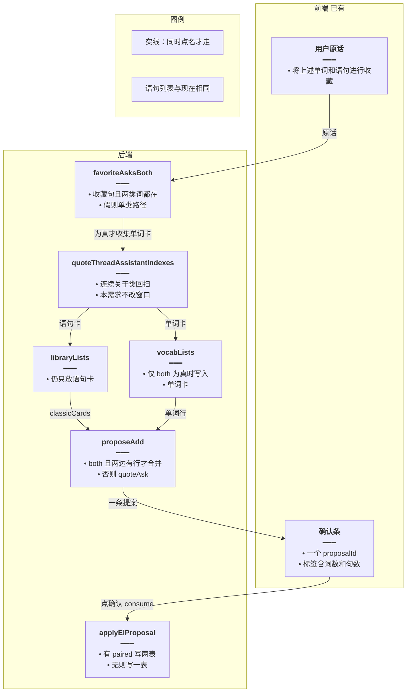
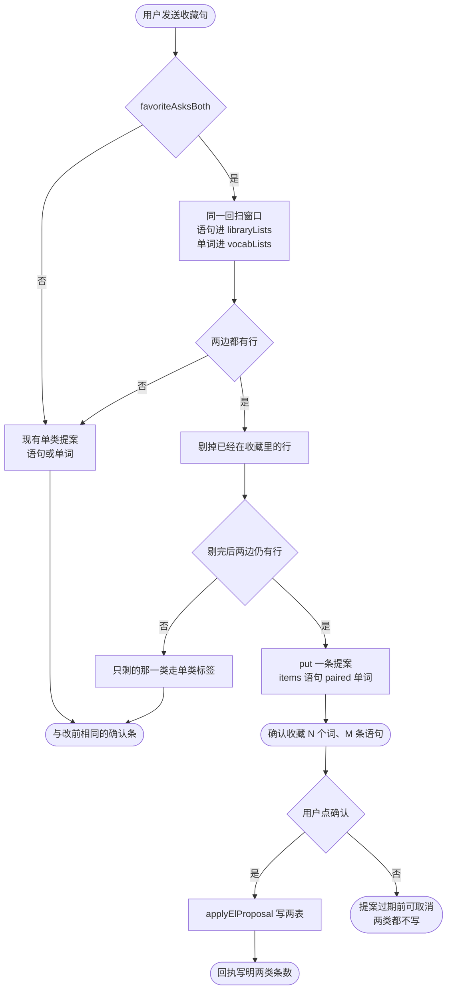
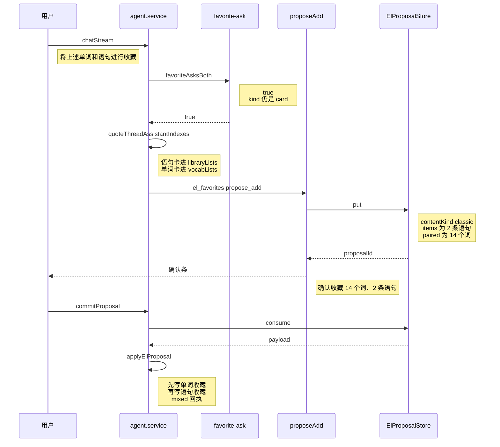
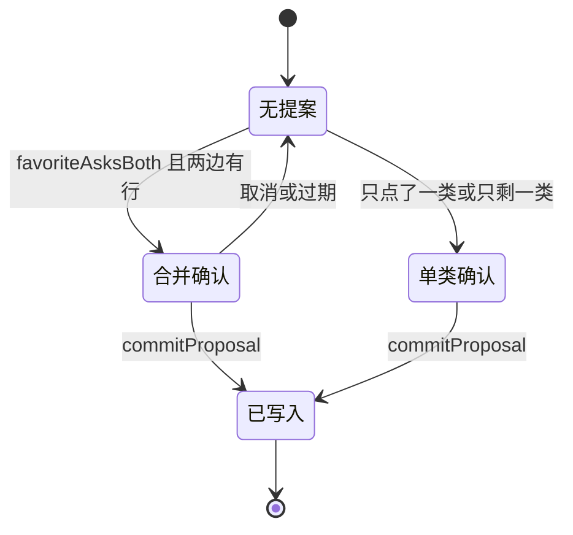

# 词句一起收藏 — 实现思路

> **状态**：规划（工作区已按本文落地，触发仍失败）  
> **日期**：2026-10-29  
> **需求摘要**：用户原话同时点名单词和语句时，一条确认条里同时收藏这两类卡片上的行。  
> **一句话方案（预告）**：只有原话同时写出单词和语句时，沿用现在的回扫窗口另收单词卡，放进同一条提案的附加字段；没同时点名时仍只收一类。
>
> **取代**：确认条仍会停在「确认收藏 N 条语句」。后续实现以 [词句分表收藏](./词句分表收藏.md) 为准。本文的 `paired` 落库保留。

## 延伸阅读

- [语句整类一次收藏](./语句整类一次收藏.md)：「将这些进行收藏」合并连续语句卡。本篇不改这条
- [语句收藏确认](./语句收藏确认.md)：收藏先挂确认条，点确认才落库
- [收藏提案直确认](./收藏提案直确认.md)：一条 `proposalId`，前端只留一条确认条

---

## 0. 读本文你将得到什么

- 「将上述单词和语句进行收藏」为什么确认条只有 2 条语句，模型正文却写了 14 个词
- 选定方案：同时点名两类才合并进一条提案；「将这些进行收藏」仍只收语句
- 改动在收藏判定、回扫进内存的卡片、提案写入和确认后的回执；确认条组件不改
- 一个阶段落地
- 最大风险是回扫窗口里还有更早的单词卡，会和语句一起进入同一条确认

---

## 1. 需求与边界

### 1.1 用户故事

| 角色 | 场景 | 行为 | 期望结果 |
|------|------|------|----------|
| 英语学习用户 | 上方有家庭类单词卡 14 条，同窗口里有 2 条语句 | 说「将上述单词和语句进行收藏」 | 确认条同时包含这 14 个词和这 2 条语句 |
| 同一用户 | 连续几张语句分类卡 | 说「将这些进行收藏」或「讲这些进行收藏」 | 仍只合并语句，条数与现在相同 |
| 同一用户 | 只想收词 | 说「收藏这些单词」 | 仍只收单词，文案仍是「确认收藏 N 个词」 |

### 1.2 范围

| 在范围内 | 不在范围内（非目标） |
|----------|----------------------|
| 原话同时含单词类词和语句类词时，一条确认写入两类 | 把所有 `kind: 'card'` 都改成词句合并 |
| 单词行来自与语句相同的回扫窗口 | 改分类出卡、阅读生成、错题提案 |
| 确认条文案写出两类条数；点确认后两类都落库 | 前端改成两条确认条，或让用户点两次 |
| | 按「家庭」维护词表；改模型提示词让正文不要列表格 |

### 1.3 约束与依赖

- 复用 `favoriteAsk`、`quoteThreadAssistantIndexes`、`classicCards`、`dedupeWord`、`dedupeEnglish`、`proposeFavoriteRows` 的去重已收藏逻辑、现有一条 `pendingProposal`。
- `ElProposalPayload.contentKind` 仍是 `'vocab' | 'classic'`。两类同时存在时用附加字段，旧提案不带这个字段。
- 本轮仍只有一个 `openProposalId`。不在同一轮再挂第二条确认。
- 「将这些进行收藏」不出现「单词」或「语句」，必须继续只收语句。

---

## 2. 背景

- **谁、在什么场景、卡在哪**：用户已经看到「小学三年级上册英语单词」14 条，并说「将上述单词和语句进行收藏」。助手正文写了 14 个单词和 2 条语句，确认条是「确认收藏 2 条语句」。
- **现状缺口**：这句同时命中「单词」和「语句」，`favoriteAsk` 返回 `kind: 'card'`。收藏工具把 `card` 和「只要语句」走同一支，只读 `classicCards(libraryLists)`。回扫进 `libraryLists` 时遇到单词卡就 `continue`。14 个词不进提案。`occupy` 之后本轮不能再挂单词确认。收尾兜底即使拿到两类卡，也只留最后一张卡的 `contentKind`。
- **不解决会怎样**：模型可以按对话复述两类，确认条仍只写入语句。点确认后单词不会进收藏。
- **硬约束**：不能把「将这些进行收藏」收成词句一起收。不能改成两条确认条。单类收藏的文案和落库保持原样。

---

## 3. 现状与复用

| 能力 | 仓库中已有 | 本需求中的用法 |
|------|------------|----------------|
| 收藏原话 | `apps/backend/src/services/agent/tools/english/favorite-ask.ts` `favoriteAsk` | 扩展一个「两类都点了」的判断。`kind` 三态不改：只写语句、只写单词、都没写则仍是 `card` |
| 回扫哪些助手消息 | `domain-tools.ts` `quoteThreadAssistantIndexes` | 直接复用。窗口仍停在非关于类的用户句 |
| 语句卡进内存 | `agent.service.ts` 收藏回扫里 `contentKind !== 'classic'` 则跳过，推进 `libraryLists` | 语句侧不改。两类都点名时，同一循环另把单词卡放进新列表 |
| 语句提案 | `domain-tools.ts` `proposeAdd` 里 `quoteAsk`：`kind === 'card'` 或 `classic` 时只收 `classicCards` | `card` 且没同时点名两类时保持这支。同时点名时先走合并支 |
| 只留最后一类 | `agent.service.ts` 收尾：`cards.at(-1).contentKind` 再过滤 | 同时点名两类时不按最后一类裁。其他原话仍裁 |
| 一条提案 | `proposal.store.ts` `ElProposalPayload`，`contentKind` 只有词或句 | 扩展可选 `paired`。没有该字段的提案照旧 |
| 点确认落库 | `apply-proposal.ts` `applyElProposal` 按 `contentKind` 写一张表 | 有 `paired` 时两类各写一次。没有则原分支 |
| 确认条 | 前端 `ElPendingProposal.label`，组件只显示这个字符串 | 直接复用。合并时标签写成「确认收藏 14 个词、2 条语句」 |
| 确认后回执 | 前端 `proposalReceiptText` 用 `created` 套「已收藏 N 个」；服务端 `content` 在收藏时被忽略 | 仅合并提案让前端采用服务端 `content`。单类回执仍走现有文案 |

**调研结论**：确认条不是模型表格生成的。`quoteAsk` 在 `kind === 'card'` 时只提交语句，并且回扫根本不把单词卡放进 `libraryLists`。截图里的 2 条语句对得上这支；若走收尾「最后一张卡」，最新一张是单词卡，确认条会变成词而不是语句。所以这次出条的是语句支。`favoriteAsk` 在「单词」「语句」都没出现时也返回 `card`，「将这些进行收藏」依赖这一点只收语句，不能把 `card` 整体改成两类合并。

---

## 4. 方案比对与最终方案

### 4.1 候选方案

#### 方案 A：点完一类再挂另一类（复用现有单类提案）

- **做法**：原话同时点名两类时，先按现在的语句支挂「确认收藏 2 条语句」。用户点确认、`openProposalId` 清空后，下一轮开始前由服务端用同一窗口的单词卡再 `put` 一条单词提案，前端再显示「确认收藏 14 个词」。`ElProposalPayload` 不增加字段。`libraryLists` 仍只放语句；单词卡只在第二次组提案时从历史读。
- **能工作的原因**：每条提案仍然只有一个 `contentKind`，`applyElProposal` 和确认条组件都不用认识两类。`occupy` 的「本轮一条」规则保持。
- **主要代价**：用户要点两次。第一次点完之前单词不会出现在确认条上，和「一起收藏」不符。若用户取消第一条，第二条没有时机挂出。

#### 方案 B：同时点名才合并进一条提案（扩展提案，不改 `card` 的默认含义）

- **做法**：新增 `favoriteAsksBoth`：`favoriteAsk` 非空，且原话同时匹配单词类词和语句类词。为真时，回扫循环除了语句卡再收集单词卡到 `elSurface.vocabLists`。`proposeAdd` 在 `quoteAsk` 之前，若两边都有行，写入一条提案：`items` 仍是语句，`paired` 是单词。确认条一条，标签带两类条数。`applyElProposal` 看到 `paired` 就两类都写。`favoriteAsksBoth` 为假时，`quoteAsk`、`libraryLists`、收尾裁切与现在相同。
- **能工作的原因**：截图这句为真，14 个词和 2 条语句进同一条 `proposalId`。前端仍是一个 `pendingProposal`。没写「单词」或没写「语句」的收藏句不进这支。
- **主要代价**：提案多一个可选字段；确认后的回执要能说出两类，否则前端会把 16 条收成「已收藏 16 个」。回扫窗口里更早的单词卡会一并进入。

#### 方案 C：凡是 `kind: 'card'` 都合并词和句（扩展 `libraryLists`）

- **做法**：回扫时单词卡也推进 `libraryLists`。`quoteAsk` 对 `kind === 'card'` 同时读单词卡和语句卡，合成一条提案。`favoriteAsk` 不增加新判断。
- **能工作的原因**：截图这句的 `kind` 就是 `card`，两类都会进确认条。实现点比方案 B 少一个谓词。
- **主要代价**：「将这些进行收藏」「讲这些进行收藏」也是 `kind: 'card'`。同一窗口里若有单词卡，确认条数会变多，语句整类收藏的现有结果被改掉。`latestLibraryRows` 会开始扫到这些单词卡，只收藏单词的路径也可能拿到上一轮的词。

### 4.2 比对

| 维度 | 方案 A | 方案 B | 方案 C |
|------|--------|--------|--------|
| 正确性（失败路径、边界、数据是否会错） | 两类最终都能落库，但要两次点击。取消第一条则单词不再挂出 | 一次确认写入两边都有行的那一类。一边为空则退回现在的单类支。窗口外的卡不收 | 一次确认能写两类。没点名单词的「这些」也会收进窗口里的单词卡 |
| 复用 / 与现状契合 | 复用单类 `put` 和 `applyElProposal`，交互从一条确认变成两条 | 复用回扫下标、`classicCards`、去重已收藏、一条确认条。只在「同时点名」分叉 | 复用 `quoteAsk`，但改了 `card` 的含义和 `libraryLists` 的内容 |
| 改动面（要动哪些路径） | 确认成功回调里再组一条提案；前端仍是一条条，要接第二次 | `favorite-ask.ts`、回扫循环、`proposeAdd`、`applyElProposal`、回执一处条件 | 回扫循环、`quoteAsk`、`latestLibraryRows` 的输入变了 |
| 复杂度（新概念、新状态、新依赖） | 无新字段。多一个「第一类已确认、第二类待挂」的状态 | 提案多可选 `paired`。无第二套确认条状态 | 无新字段。`libraryLists` 从语句列表变成两类混放 |
| 体验（延迟、步骤数、失败时用户看到什么） | 多一次确认。第一次仍只看见 2 条语句 | 一条「确认收藏 14 个词、2 条语句」。点一次两类都写入 | 一条确认，但「将这些进行收藏」的条数会变 |
| 风险（迁移、互斥、并发、回滚） | 10 分钟提案 TTL 内要完成第一次点击，否则单词提案来不及。与「本轮已有提案就停」要错开轮次 | 旧提案没有 `paired`，`apply` 走原分支。Redis 里未过期的旧提案不受影响 | 语句整类收藏和单词 `latestLibraryRows` 一起变，回滚要同时撤回两处 |
| 可维护性（以后改一处还是改多处） | 单类路径不改，两次确认的衔接要单独记 | 合并只在 `favoriteAsksBoth` 为真时发生，单类路径不读 `paired` | `card` 一处改完，所有「这些」调用方一起变 |

### 4.3 综合考量

正确性和「不改已经在用的单类收藏」权重大。用户要的是这一句的确认条里同时有 14 个词和 2 条语句，并且点一次就写入。方案 A 不改存储，这是它的优点，但第一次确认仍只有语句，和截图要解决的现象同一类；第二次还依赖用户先点确认。这个「少改 payload」抵不过确认条仍然缺词。方案 C 少一个谓词，实现短，但 `kind: 'card'` 今天就是「将这些进行收藏」的入口，窗口里的单词卡会被收进去，语句条数不再稳定。方案 B 把合并限制在原话同时出现两类词，`quoteAsk` 和 `libraryLists` 的语句行为留在假分支里。附加字段只在这一条提案上出现，单类 `apply` 看不到它。

### 4.4 最终方案

#### 背景

「将上述单词和语句进行收藏」让 `favoriteAsk` 返回 `card`。`proposeAdd` 把 `card` 当成语句收藏，只读 `classicCards(libraryLists)`，标签是「确认收藏 N 条语句」，然后 `occupy`。回扫写入 `libraryLists` 时跳过 `contentKind !== 'classic'`，14 个词没有进入这份列表。收尾若再组提案，也只留最后一张卡的种类。模型正文可以自己写两类，确认条不看那段 Markdown。单类收藏和「将这些进行收藏」只收语句必须保持。

#### 具体思路

1. 判定放在 `favorite-ask.ts`，与 `favoriteAsk` 并列。不改 `kind` 的三个取值。
2. 单词行来自与语句相同的 `quoteThreadAssistantIndexes`。语句仍进 `libraryLists`。单词只在 `favoriteAsksBoth` 为真时进 `vocabLists`。
3. 状态仍是一条 `pendingProposal`。两类行放在同一条 `ElProposalPayload` 的 `items` 与 `paired`。不新增前端确认条字段。
4. 一边没有行就退回现在的单类支，避免挂出「0 个词」。已在收藏里的行仍按现有查询剔掉。超过现有卡片本身的行不另做截断。

#### 实现方案

**一句话**：只有原话同时写出单词和语句时，沿用现在的回扫窗口另收单词卡，放进同一条提案的附加字段；没同时点名时仍只收一类。

| 步骤 | 谁 | 做什么 | 输入 → 输出 |
|------|----|--------|-------------|
| 1 | `favoriteAsksBoth` | 两类词都在且是收藏句才为真 | 用户原话 → `boolean` |
| 2 | `agent.service.ts` 回扫 | 为真时把窗口内单词卡放进 `vocabLists`；语句卡仍只进 `libraryLists` | 历史 `elResources` → 两个列表 |
| 3 | `proposeAdd` | 两边都有行则一条提案：语句在 `items`，单词在 `paired`，然后 `occupy` | 两个列表 → 一个 `proposalId` 和合并标签 |
| 4 | 收尾兜底 | 工具已占提案则跳过。未占且 `favoriteAsksBoth` 时用同一合并，不按最后一类裁 | 本轮与历史卡 → 同一条提案或跳过 |
| 5 | `applyElProposal` | 有 `paired` 时单词、语句各写一次。没有则只写 `contentKind` | 提案 → 两类收藏表或一张表 |
| 6 | `proposalReceiptText` | 响应带 `mixed` 时用服务端 `content`。否则仍用现有「已收藏 N 个」 | 提交结果 → 回执句 |

#### 选定原因

1. **正确性**：截图这句两边都进同一条确认。牺牲：回扫窗口里更早的单词卡会一起进入，不另做「只要最近一张单词卡」。
2. **复用**：语句回扫、一条确认条、单类 `apply` 留在原处。牺牲：比方案 A 多一个可选字段。
3. **改动面**：只在「同时点名」分叉。牺牲：比方案 C 多一个谓词和一条列表。
4. **复杂度**：无第二套确认状态。牺牲：提案形状比现在多一个可选对象。
5. **体验**：点一次，标签写明 14 个词和 2 条语句。牺牲：方案 A 那种完全不改 payload 的存储不做。
6. **风险**：旧提案无 `paired`，落库分支不变。牺牲：合并回执要单独走服务端句子，不能把 16 条收成一个「个」。
7. **可维护性**：`card` 的默认含义不变。牺牲：新的收藏入口若只调用 `quoteAsk`，会漏掉合并，必须先看 `favoriteAsksBoth`。

#### 优势

- 相对方案 A：用户看到的第一条确认里就有单词和语句，取消时两类一起取消，没有「点完语句再等单词条」。
- 相对方案 C：「将这些进行收藏」仍只走 `classicCards`，窗口里的单词卡不会改变语句确认条数。

#### 怎么实现

1. `favoriteAsksBoth` 先调用 `favoriteAsk`。不为收藏句则假。再用与 `favoriteAsk` 相同的「语句|句子|经典句」和「单词|词汇|词书」看是否同时命中。
2. 回扫循环保持 `contentKind !== 'classic'` 时不进 `libraryLists`。在这句 `continue` 之前，若 `favoriteAsksBoth` 且这张是单词卡，补全 `artifactId` 后推进 `vocabLists`。
3. `proposeAdd` 在现有 `quoteAsk` 之前：两边行都非空则 `dedupeWord` / `dedupeEnglish`，剔掉已收藏，`put` 时 `contentKind: 'classic'`、`items` 为语句、`paired: { contentKind: 'vocab', items }`。标签 `确认收藏 ${词数} 个词、${句数} 条语句`。然后 `occupy` 并返回。任一边为空则不进这支。
4. 收尾在 `!elSurface.openProposalId` 里，`favoriteAsksBoth` 为真且两类卡都有时调用与步骤 3 相同的组提案。为假时仍是 `cards.at(-1)` 那一类。
5. `applyElProposal` 开头若有 `paired`，按单词批量接口和语句逐条接口各写一次，统计相加，回执写两类。没有 `paired` 时现有 `if (contentKind === 'vocab')` 不动。
6. 提交响应增加 `mixed: true` 和已经写好的 `content`。前端 `proposalReceiptText` 在 `mixed` 时直接返回 `content`。

### 4.5 其他关键决策

#### 决策：两类行放在哪

##### 4.5.1 候选

**两个 `proposalId`（复用单类 payload）**

- **做法**：单词、语句各 `put` 一次。前端 `pendingProposal` 改成数组，确认条两行，或一个按钮提交两个 id。
- **能工作的原因**：每条 payload 仍是现在的 `contentKind + items`，`applyElProposal` 可各调一次。
- **主要代价**：`openProposalId`、停止第二次工具、前端单槽确认都要改成多条。单类收藏的「本轮已有提案」也要重新定义。

**一条 payload 加可选 `paired`（选定）**

- **做法**：语句留在现有 `items`，单词放 `paired.items`。`contentKind` 仍写 `'classic'`，供不认识 `paired` 的旧读取方至少看到语句侧。`apply` 先看 `paired`。
- **能工作的原因**：前端仍提交一个 `proposalId`。单类提案不带 `paired`，落库代码走原来的分支。
- **主要代价**：`contentKind` 在合并提案上只表示 `items` 那一侧，读提案的人要同时看 `paired`。

##### 4.5.2 比对

| 维度 | 两个 proposalId | 可选 `paired` |
|------|-----------------|---------------|
| 正确性 | 两类都能写。一个 id 过期、另一个还在时，点确认只成功一半 | 一次 `consume` 两类要么一起写，要么一起过期 |
| 复用 / 与现状契合 | 单条 payload 形状不变，确认条从一槽变成多槽 | 单条 payload 增加可选字段，确认条仍是一槽 |
| 改动面 | 提案存储、工具占用、前端 store、确认按钮 | 类型、`put`、`apply`、回执 |
| 复杂度 | 多一条待确认状态 | 一个可选对象 |
| 体验 | 两条条或一次点两个 id，和现在的一条按钮不同 | 仍是一条按钮 |
| 风险 | 「本轮已有提案就停工具」要放行第二条，可能让别的工具再挂提案 | 旧缓存提案没有 `paired`，行为与现在相同 |
| 可维护性 | 单类和双类两套确认生命周期 | 双类只是单类提案上的附加块 |

##### 4.5.3 综合考量

一条确认条是现有收藏的交互，权重高于「payload 字段完全不增加」。两个 id 能少改 `apply` 的内部分支，但前端单槽、`occupy` 和过期会拆成两次成功。这个优点抵不过点确认只写下其中一类。`paired` 让一次消费覆盖两类，单类提案因为没有该字段而不会进新分支。

##### 4.5.4 最终方案

**背景**：确认条和 `consume` 都按一个 id。两类要同生同灭。

**具体思路**：不增加第二条前端状态。语句留在原 `items`，单词放可选 `paired`。`apply` 用有没有 `paired` 分叉。

**实现方案**：`ElProposalPayload` 增加可选 `paired?: { contentKind: 'vocab' | 'classic'; items: Record<string, unknown>[] }`。合并提案的 `contentKind` 为 `'classic'`，`paired.contentKind` 为 `'vocab'`。

**选定原因**：

1. **正确性**：一次消费写两类。牺牲：只读 `contentKind` 的代码在合并提案上只能看到语句侧，所以 `apply` 必须先看 `paired`。
2. **复用**：前端仍是一个 `proposalId`。牺牲：类型比两个纯单类 payload 多一个字段。
3. **体验**：一条按钮。牺牲：无。
4. **风险**：未过期的旧提案没有 `paired`。牺牲：不能靠「再 put 一条」避开 `apply` 的修改。
5. **改动面 / 复杂度 / 可维护性**：确认条生命周期不拆开。牺牲：方案「两个 id」完全不改 payload 字段的优点。

**优势**：相对两个 `proposalId`，取消和过期都是整条提案，不会只收藏了语句、单词 id 还留在缓存里。

**怎么实现**：见 §9.2 的提案类型和 `applyElProposal` 分叉。`proposeFavoriteRows` 的单类 `put` 不写 `paired`。

---

## 5. 架构图



**图内方法说明**：

| 方法 / 模块入口 | 功能 |
|-----------------|------|
| `favoriteAsksBoth` | 原话是收藏，且同时有单词类词和语句类词时为真。为假时不写 `vocabLists`，`proposeAdd` 走现在的单类支 |
| `quoteThreadAssistantIndexes` | 从收藏句往前找连续的关于类助手消息。返回下标，旧的在前。窗口规则不改 |
| `libraryLists` | 这些下标上的语句卡。`classicCards` 和「将这些进行收藏」继续只读它 |
| `vocabLists` | 同一批下标上的单词卡。只有 `favoriteAsksBoth` 为真才填充 |
| `proposeAdd` | 收藏工具组提案。两边都有行时 `put` 一条带 `paired` 的提案并 `occupy` |
| `classicCards` | 从 `libraryLists` 滤出有行的语句卡。合并支用它拿语句，单类支也用它 |
| `applyElProposal` | 点确认后落库。有 `paired` 时单词批量写入、语句逐条写入；没有则只按 `contentKind` |
| `consume` | 提案存储按 id 取出并删除。合并提案只消费一次 |

**读图要点**：

- 单词列表和语句列表分开，语句列表的写入条件与现在相同。
- 确认条仍是一个 id，合并发生在 `put` 之前。
- `favoriteAsksBoth` 为假时，图里的单词列表保持空，`proposeAdd` 不会读它。

---

## 6. 主流程图



**图内方法说明**：

| 方法 | 功能 |
|------|------|
| `favoriteAsksBoth` | 主分叉。否：后面的合并不执行 |
| `put` | 写入带 `paired` 的一条提案，返回 `proposalId` |
| `applyElProposal` | 确认后按单词和语句分别落库，统计相加 |
| `libraryLists` | 流程图节点中的语句去向，本身是内存列表 |
| `vocabLists` | 流程图节点中的单词去向，仅本分叉使用 |

**读图要点**：

- 任一边没有行，或剔掉已收藏后只剩一边，退回单类确认，标签仍是「个词」或「条语句」。
- 取消不写任何一类。
- 「否」分支不经过 `vocabLists`。

---

## 7. 核心时序图



**图内方法说明**：

| 方法 | 功能 |
|------|------|
| `chatStream` | 本轮入口。收藏句开始前回扫历史卡片 |
| `favoriteAsksBoth` | 判断这句要不要合并。截图这句为真 |
| `quoteThreadAssistantIndexes` | 决定哪些更早的助手消息算「上述」 |
| `el_favorites` | 模型或服务端调用的收藏工具，内部进入 `proposeAdd` |
| `proposeAdd` | 组行并 `put`。本路径在 `quoteAsk` 之前返回 |
| `put` | 把合并提案写入缓存，TTL 仍是 10 分钟 |
| `commitProposal` | 用户点确认。前端仍只传一个 `proposalId` |
| `consume` | 取出提案并删除，避免点两次写两次 |
| `applyElProposal` | 按 `paired` 和 `items` 写入两张收藏表 |

**读图要点**：

- 模型正文里的表格不参与 `put`。行来自卡片。
- `occupy` 发生在这一次 `put` 之后，收尾不会再挂一条只有语句的确认。
- 回执在 `applyElProposal` 之后返回，前端看到 `mixed` 才改用服务端句子。

---

## 8. 状态机



**图内方法说明**：

| 方法 | 功能 |
|------|------|
| `favoriteAsksBoth` | 从无提案进入合并确认的条件。为假则进入单类确认 |
| `commitProposal` | 两条确认态都用它落库。合并态内部写两表，单类态写一表 |

**读图要点**：

- 合并确认和单类确认都是同一个前端槽位，区别在提案里有没有 `paired`。
- 取消回到无提案，不留下半条单词提案。

---

## 9. 具体实现（主链路代码）

### 9.1 模块一览

| 模块 | 职责 | 新增/改动 | 预估路径 |
|------|------|-----------|----------|
| 两类点名 | 与 `favoriteAsk` 并列的布尔 | 新增 | `apps/backend/src/services/agent/tools/english/favorite-ask.ts` |
| 回扫 | 语句仍进 `libraryLists`，单词另进 `vocabLists` | 扩展 | `apps/backend/src/services/agent/agent.service.ts` |
| 组提案 | 两边都有行时一条带 `paired` 的提案 | 扩展 | `apps/backend/src/services/agent/tools/english/domain-tools.ts` `proposeAdd` |
| 收尾兜底 | 工具未占提案且两类都点名时同一合并 | 扩展 | `agent.service.ts` 收藏兜底 |
| 落库 | 有 `paired` 写两表 | 扩展 | `apps/backend/src/services/agent/tools/english/apply-proposal.ts` |
| 提案类型 | 可选 `paired` | 扩展 | `apps/backend/src/services/agent/tools/english/proposal.store.ts` |
| 回执 | `mixed` 时用服务端句子 | 扩展 | `apps/frontend/src/store/englishAgent.ts` `proposalReceiptText` |
| 确认条组件 | 只显示 `label` | 不改 | `apps/frontend/src/views/englishLearning/agent/index.tsx` |

### 9.2 主链路实现

```typescript
// 对应 §4.4 步骤 1。kind 仍由 favoriteAsk 决定，避免「这些」被收成两类
export function favoriteAsksBoth(userText: string): boolean {
	// 先认是不是收藏句，取消收藏和查询收藏在这里就是假
	const ask = favoriteAsk(userText);
	// 不是收藏句就不收集单词卡
	if (!ask) return false;
	// 与 favoriteAsk 里语句侧同一组词，避免两处口径不一致
	const classic = /语句|句子|经典句/.test(userText);
	// 与 favoriteAsk 里单词侧同一组词
	const vocab = /单词|词汇|词书/.test(userText);
	// 必须两类都写到，只写一类或只写「这些」都是假
	return classic && vocab;
}
```

```typescript
// 对应 §4.4 步骤 2。插在「不是语句卡就 continue」之前，语句补全和 libraryLists 不动
if (favoriteAsksBoth(dto.content) && card.contentKind === 'vocab') {
	// 先用消息上的快照，行被收进 artifact 时再补
	let full = card;
	// 只有缺行又有 artifactId 才读存储，避免空 id 查询
	if (!full.items?.length && full.artifactId) {
		// 与语句卡同一套按用户取出全量行
		const stored = await this.elArtifactStore.get(userId, full.artifactId);
		// 存储里有行才替换，没有就保持原快照
		if (stored?.items?.length) full = stored;
	}
	// 仍然没有行的单词卡不进入确认
	if (full.items?.length) elSurface.vocabLists.push(full);
}
```

```typescript
// 对应 §4.4 步骤 3 与 §4.5。语句留在 items，单词放 paired，一次 put
const words = dedupeWord(vocabRows);
// 语句去重与现在的 quoteAsk 相同
const quotes = dedupeEnglish(classicRows);
// 任一边为空则不合并，调用方退回单类支
if (words.length > 0 && quotes.length > 0) {
	// 语句侧沿用现有 contentKind，旧读取方至少能看到句子
	const proposalId = await deps.proposals.put(deps.userId, {
		// 收藏新增，不是错题
		kind: 'favorite_add',
		// items 是语句，所以种类写 classic
		contentKind: 'classic',
		// 批量写入时的首行，与现在的单类提案一样取第一句
		body: quotes[0] ?? {},
		// 语句行
		items: quotes,
		// 单词不进 items，避免 apply 把词当成句子
		paired: {
			// 附加块是单词
			contentKind: 'vocab',
			// 14 个词这一侧
			items: words,
		},
	});
	// 本轮占用，收尾和第二次工具不再挂一条只有语句的确认
	occupy(proposalId);
}
```

```typescript
// 对应 §4.4 步骤 5。没有 paired 的提案不进这个分支
if (payload.paired?.items?.length) {
	// 附加块按它自己的 contentKind 写，合并提案里是单词
	const extraKind = payload.paired.contentKind;
	// 单词走批量收藏，语句走逐条收藏，和现在两个单类分支一样
	if (extraKind === 'vocab') {
		// 先写词，失败计入 failed，不回滚已经数过的语句
		const vocabStats = await learning.batchAddVocabularyFavorites(
			userId,
			payload.paired.items as never,
		);
		// 语句仍用 payload.items，种类由外层 contentKind 表示
		stats.created += vocabStats.created;
		// 已存在的词计入 existed，回执需要这个数
		stats.existed += vocabStats.existed;
	}
}
```

```typescript
// 对应 §4.4 步骤 6。插在 proposalReceiptText 开头，返回 null 时后面的单类文案原样执行
function mixedReceipt(data: {
	// 服务端写好的两类句子
	content?: string;
	// 带 paired 的提案才为真
	mixed?: boolean;
}): string | null {
	// 合并提案用服务端句子，避免收成「已收藏 16 个」
	if (data.mixed && data.content) return data.content;
	// 单类、错题、取消收藏继续走现有 translateSync
	return null;
}
```

### 9.3 数据模型

| 字段/实体 | 来源 | 存储 | 说明 |
|-----------|------|------|------|
| `favoriteAsksBoth` | 用户原话 | 不落库 | 真才收集 `vocabLists` |
| `libraryLists` | 回扫到的语句卡 | 本轮内存 | 内容与现在相同 |
| `vocabLists` | 回扫到的单词卡 | 本轮内存 `elSurface` | 仅 both 为真时有元素 |
| `items` | 语句行 | 提案缓存 10 分钟 | 合并时是语句 |
| `paired` | 单词行 | 同一条提案 | 单类提案没有 |
| `mixed` | `apply` 有 `paired` | 提交响应 | 前端只在此时改用 `content` |

---

## 10. 分阶段实现步骤

| 阶段 | 目标 | 交付物 | 依赖 |
|------|------|--------|------|
| M1 | 同时点名单词和语句时，一条确认含两类，单类收藏不变 | `favoriteAsksBoth`、`vocabLists`、`paired`、回执 | 现有语句回扫和单类 `apply` |

- [ ] `favoriteAsksBoth`：「将上述单词和语句进行收藏」为真；「将这些进行收藏」「收藏这些单词」为假
- [ ] 回扫只在为真时填充 `vocabLists`，`libraryLists` 仍只有语句
- [ ] `proposeAdd` 两边有行则一条合并提案并 `occupy`；一边为空则原 `quoteAsk` 或单词支
- [ ] 收尾在已有 `openProposalId` 时不另挂；未占用且 both 为真时用同一合并，不按最后一类裁
- [ ] `applyElProposal` 无 `paired` 时行为不变；有则两表都写
- [ ] 确认条标签为「确认收藏 14 个词、2 条语句」；点确认后的回执写明两类

---

## 11. 风险、边界与待确认

| 项 | 等级 | 说明 | 缓解 |
|----|------|------|------|
| 窗口内更早的单词卡 | 中 | 上一句是关于类时，回扫会继续往前，那些单词卡也会进入同一条确认 | 与语句侧同一窗口，不单独加长。验收时看条数是否等于窗口内两类卡片的行数 |
| 已收藏剔完一边 | 低 | 14 个词都已在收藏里时，不应再写「14 个词」 | 剔完若只剩一边，退回单类标签 |
| 只读 `contentKind` 的代码 | 低 | 合并提案的 `contentKind` 是 classic，单词在 `paired` | `apply` 先看 `paired`。其他消费点若只展示种类，合并条仍显示语句侧 |
| 模型另写的表格 | 低 | 正文可以写 14 和 2，行仍以卡片为准 | 不解析 Markdown 表格 |
| `el_present` 在本轮先挂了单类确认 | 低 | 收藏句若先 `el_present` 一张不超过 40 行的卡，会 `occupy`，合并来不及 | 合并支放在 `proposeAdd`；若本轮已经 `occupy`，以先挂出的那条为准，不追加第二条。验收用「只发收藏句、不重新出卡」 |

**待确认**（若有）：

- [ ] 截图那一轮的 2 条语句是否都在「找出…有关家庭的所有单词」这句之前的连续关于类窗口里（验证方式：看该会话更早的助手消息是否只有这两条语句卡，且中间的用户句都含「关于 / 有关」）

---

## 12. 验收清单

| # | 用例 | 步骤 | 期望 |
|---|------|------|------|
| AC1 | 截图原话 | 窗口内有 14 词的单词卡和 2 条语句卡；发送「将上述单词和语句进行收藏」 | 确认条为「确认收藏 14 个词、2 条语句」；点确认后两类都在收藏里 |
| AC2 | 只收语句的「这些」 | 同一窗口里既有单词卡也有语句卡；发送「将这些进行收藏」 | 确认条只有语句，条数与改前相同 |
| AC3 | 只收单词 | 发送「收藏这些单词」 | 确认条为「确认收藏 N 个词」，不带语句 |
| AC4 | 一边为空 | 窗口里只有语句卡；发送「将上述单词和语句进行收藏」 | 退回「确认收藏 N 条语句」，不出现「0 个词」 |
| AC5 | 已占用不再第二条 | AC1 的工具已经挂出合并条 | 收尾不再追加一条只有语句或只有单词的确认 |
| AC6 | 旧提案 | 没有 `paired` 的收藏提案点确认 | 只写 `contentKind` 那一类，回执仍是原来的「已收藏 N 个」 |

---

## 13. 预估改动面（实现阶段参考）

| 类型 | 路径（预估） |
|------|--------------|
| 前端 | `apps/frontend/src/store/englishAgent.ts` 的 `proposalReceiptText` |
| 后端 | `apps/backend/src/services/agent/tools/english/favorite-ask.ts` |
| 后端 | `apps/backend/src/services/agent/tools/english/domain-tools.ts` |
| 后端 | `apps/backend/src/services/agent/tools/english/proposal.store.ts` |
| 后端 | `apps/backend/src/services/agent/tools/english/apply-proposal.ts` |
| 后端 | `apps/backend/src/services/agent/agent.service.ts` |
| 文档（实现后） | 落地后再归档；本篇留在 `wiki/ideas/english/` |

---

（本文档为规划态实现思路；落地后以源码与 remote-docs wiki 专题为准）
