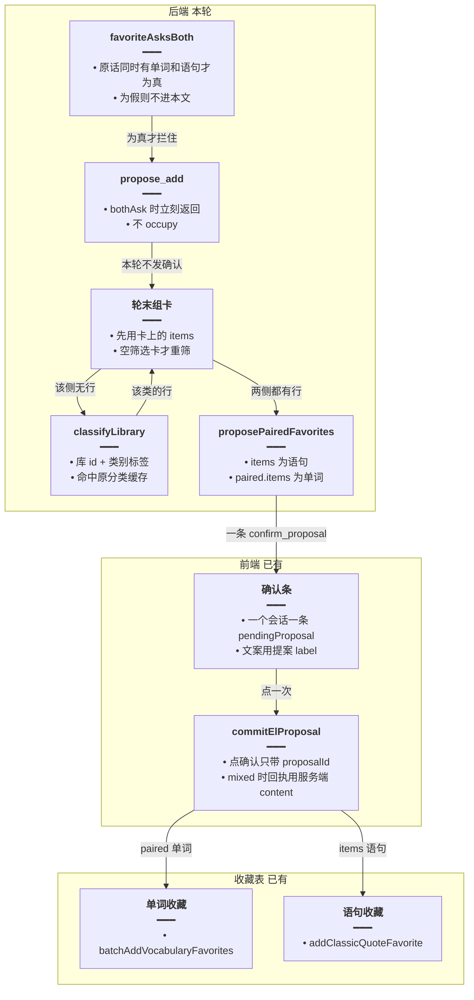
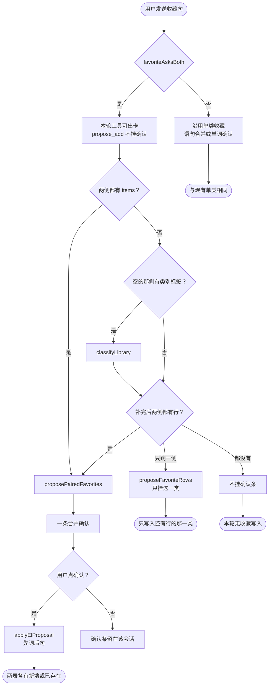
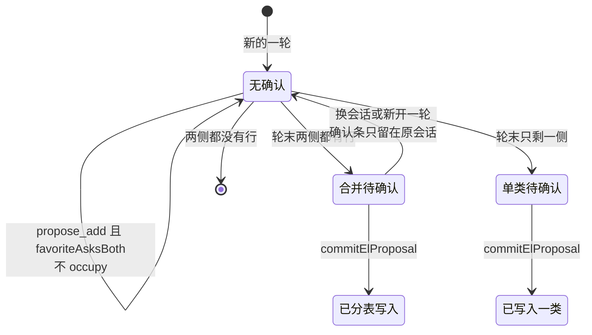

# 词句分表收藏 — 实现思路

> **状态**：规划（工作区已按本文落地）  
> **日期**：2026-10-29  
> **需求摘要**：用户说「将上述单词和语句进行收藏」时，只出现一条确认；点这一下后，单词写入单词收藏，语句写入语句收藏。  
> **一句话方案（预告）**：同时点名两类时，本轮工具不准挂单边确认；轮末用回扫窗口里的单词卡和语句卡（行没了就按卡上的库和类别重筛）合成一条带 `paired` 的提案，点确认后两边各写各的表。

## 延伸阅读

- [词句一起收藏](./词句一起收藏.md)：上一版已按「工具入参 + 历史单词卡」落地，确认条仍会停在「确认收藏 1 条语句」。本文取代它的触发方式，不改它已经写好的 `paired` 落库
- [语句整类一次收藏](./语句整类一次收藏.md)：「将这些进行收藏」仍只合并语句卡
- [语句收藏确认](./语句收藏确认.md)：收藏先挂确认条，点确认才落库
- [收藏提案直确认](./收藏提案直确认.md)：一条 `proposalId`，前端一个会话只留一条确认
- [语句分类稳定出卡](./语句分类稳定出卡.md)：重筛复用 `classifyLibrary`，不另写一套分类
- [取消沿用上次收藏](./取消沿用上次收藏.md)：没点名英文的「还是取消收藏吧」只撤上一次收藏圈定的行，不再沿分类窗口或本轮收藏列表扩范围
- [收藏确认跟卡片](./收藏确认跟卡片.md)：确认条和正文改由同一份 `favoriteSet` 出数。「还是取消吧」切断窗口、本轮短卡变成「确认收藏 1 条语句」由那篇解决。本文的分表写入不变

---

## 0. 读本文你将得到什么

- 为什么模型正文写了单词和语句，确认条却只有「确认收藏 1 条语句」，点下去单词进不了收藏
- 选定方案：同时点名两类才在轮末挂一条；点确认后单词、语句分表写入
- 改动在收藏工具的提前返回和轮末组卡；确认条组件、单类收藏、分类提示词不动
- 两个阶段：先堵住单边占位，再补过期卡片的重筛
- 最大风险是回扫窗口里还有更早的一类卡，条数会比用户眼前最后一张卡多

---

## 1. 需求与边界

### 1.1 用户故事

| 角色 | 场景 | 行为 | 期望结果 |
|------|------|------|----------|
| 登录用户 | 上一问已经列出一类单词和一类语句 | 说「将上述单词和语句进行收藏」 | 一条确认，文案同时有词数和语句数 |
| 登录用户 | 确认条已挂上 | 点这一下 | 单词进单词收藏，语句进语句收藏，回执写两边的条数 |
| 登录用户 | 卡片 artifact 已过期，模型重新搜了一小部分 | 仍说上述那句 | 条数来自原来的库和类别，不跟模型新写的短表 |
| 登录用户 | 只说「将这些进行收藏」或「收藏这些单词」 | 点确认 | 只写一类，和现在一样 |

### 1.2 范围

| 在范围内 | 不在范围内（非目标） |
|----------|----------------------|
| 英语 Agent 里，原话同时点名单词和语句的收藏 | 两条确认条、点两次 |
| 一条 `proposalId`，点一次分表写入 | 新收藏表、新接口 |
| 卡片过期时按卡上的 `libraryId` + `categoryLabels` 重筛 | 从模型正文表格里抽词 |
| 「将这些进行收藏」仍只收语句 | 把 `favoriteAsksBoth` 并进 `isCategoryAsk` |
| | 亲缘词写进分类提示词；新建分类测试文件 |

### 1.3 约束与依赖

- 须复用 `favoriteAsksBoth`、`proposePairedFavorites`、`applyElProposal` 的 `paired` 分支、`classifyLibrary` 缓存、`quoteThreadAssistantIndexes`
- 前端 `onTool` 只保留最后一条 `confirm_proposal`。本轮若先发出单边确认，后发的合并条会盖掉它，但用户会先看见错条。所以单边确认不能先发出
- `openProposalId` 一轮只有一个。句子分支先 `occupy` 之后，现有轮末合并直接被跳过
- 分类缓存键、温度 0、失败批不缓存、确认过的空结果缓存为 `[]`，都保持 [语句分类稳定出卡](./语句分类稳定出卡.md)
- Ponytail：不新增提案槽，不新增第二套收藏写入

---

## 2. 背景

- **谁、在什么场景、卡在哪**：用户已经看过单词卡和语句卡，接着说「将上述单词和语句进行收藏」。模型正文会列出词和句，并让用户去点「确认收藏 N 个词」和「确认收藏 M 条语句」。界面上只有一条「确认收藏 1 条语句」。
- **现状缺口**：`paired` 写入已经接上，但触发仍在 `el_favorites` 的 `propose_add` 里当场组行。任一边当时没有行，`proposePairedFavorites` 返回 `null`，随后 `quoteAsk` 只用语句卡 `occupy`。轮末合并写在 `if (!elSurface.openProposalId)` 里面，占位之后不再执行。单词卡若在这次占位之后才挂上，也进不了确认条。
- **不解决会怎样**：用户点下去只写入语句。单词收藏不变。模型口头说的两个按钮，界面给不出。
- **硬约束**：没同时点名两类的说法不能进这条路径。「将这些进行收藏」继续只收连续语句卡。确认条组件不改。不从正文抽词，避免模型缩表（例如 7 个词、1 条句）盖过用户说的「上述」。

---

## 3. 现状与复用

| 能力 | 仓库中已有 | 本需求中的用法 |
|------|------------|----------------|
| 同时点名判定 | `apps/backend/src/services/agent/tools/english/favorite-ask.ts` `favoriteAsksBoth` | 直接复用。单词正则和语句正则都命中才进入本文。`将这些进行收藏` 为 false |
| 一条提案两批行 | 同文件 `proposePairedFavorites`；`proposal.store.ts` 的 `paired` | 直接复用。`items` 放语句，`paired.items` 放单词，文案 `确认收藏 N 个词、M 条语句` |
| 点确认分表写 | `apply-proposal.ts`：`batchAddVocabularyFavorites`，再 `addClassicQuoteFavorite`；`pairedFavoriteReceipt` | 直接复用。`commit` 在 `mixed: true` 时用这条回执 |
| 确认条只留一条 | `apps/frontend/src/store/englishAgent.ts` `onTool` 把 `pendingProposal` 设成最后一条；`proposalReceiptText` 在 `data.mixed` 时用服务端 `content` | 直接复用。不改组件 |
| 语句单边占位 | `domain-tools.ts` 里 `quoteAsk`：`favorite.kind` 为 `card` 或 `classic` 时只收语句并 `occupy` | 同时点名两类时禁止走到这里 |
| 轮末合并被跳过 | `agent.service.ts` `finalizeTurn` 前的收藏兜底，包在 `!elSurface.openProposalId` 里 | 同时点名两类时挪出这个判断，轮末必定组一次 |
| 回扫哪些助手消息 | `domain-tools.ts` `quoteThreadAssistantIndexes`、`quoteCategoryText` | 复用。收藏句不拿来当类别；连续分类轮里的卡都算「上述」 |
| 过期后重筛 | `domain-tools.ts` `classifyLibrary` | 扩展调用点。只对「有 `libraryId` 和 `categoryLabels`、但 `items` 空」的卡调用 |
| 本轮单词卡暂存 | `spill.ts` `vocabLists`；`domain-tools.ts` `rememberVocabCard` | 复用。只在 `bothAsk` 时推进去。历史卡在 `agent.service.ts` 开轮灌入 |
| 展示用行 | `rowsFromQuoteCards`、`cardItemRows`、`classicCards` | 复用。有 `items` 的卡不再调分类 |

**调研结论**：落库形状不用再设计。失败点是「谁先占住 `openProposalId`」和「占住之后轮末不再看单词卡」。模型在 `propose_add` 里传的 `kind: classic` 和少量 `english`，会走进现有语句分支。单词若只出现在正文表格里，服务端没有这些行；「上述」应以消息上的卡片为准。卡片行还在就用行；行没了但库 id 和类别还在，就用 `classifyLibrary` 把同一类再取出。

---

## 4. 方案比对与最终方案

### 4.1 候选方案

#### 方案 A：继续在 `propose_add` 里组两边（复用现状）

- **做法**：保持现在的 `domain-tools.ts` 分支。`propose_add` 时把 `vocabLists`、语句卡和工具 `items` 交给 `proposePairedFavorites`。一边为空就返回 `null`，然后 `quoteAsk` 或 `collectProposeBodies` 挂单边确认并 `occupy`。轮末只在 `openProposalId` 仍为空时再试一次。
- **能工作的原因**：模型若在同一次 `propose_add` 里同时带上带 `word` 的行和带 `english` 的行，或两边卡片都已经在内存里，这条会挂出合并确认，点确认后 `applyElProposal` 分表写。
- **主要代价**：模型常先只传语句，或先挂语句卡再 `propose_add`。语句分支先占位，轮末合并不跑。用户看到的仍是「确认收藏 1 条语句」。这就是当前失败。

#### 方案 B：轮末才挂一条，行只来自卡片（扩展）

- **做法**：`favoriteAsksBoth` 为真时，`el_favorites` 的 `propose_add` 直接返回，不 `occupy`，也不进入 `quoteAsk`。`el_present` 继续用现有 `!bothAsk` 跳过自动提案。`finalizeTurn` 在写会话之前，不管 `openProposalId`，用回扫窗口里的单词卡和语句卡组行。有行用行；该侧只有空卡（`libraryId` + `categoryLabels`、无 `items`）才 `classifyLibrary`。两边都有行才 `proposePairedFavorites`，用现有 SSE `tool` `phase: end` 挂一条。点确认仍走现有 `paired` 写入。
- **能工作的原因**：占位只发生一次，发生在本轮工具都结束之后。后挂上的单词卡也能进同一条。过期卡片不靠模型重搜的短表。
- **主要代价**：确认条要等到本轮结束才出现。空卡重筛多一次分类调用（同一库同一类别命中现有缓存则不再打模型）。

#### 方案 C：两条确认，前端一次点两条（新增）

- **做法**：允许本轮发出两条 `confirm_proposal`。前端 `pendingProposal` 改成数组，按钮文案合成一句，点击时对两个 `proposalId` 各 `commit` 一次。单词提案走现有单词写入，语句提案走现有语句写入。
- **能工作的原因**：不改提案结构。每条仍是现在的单类 `favorite_add`。两次 `commit` 成功后两边都在收藏里。
- **主要代价**：要改确认条状态和点击。第一条 SSE 先画上语句条，第二条再补单词，中间状态是错的。一次点击两次请求，有一边失败时用户看不出哪边没写上。`openProposalId` 仍会挡住第二条工具调用，后端也要放开「一轮一条」。

### 4.2 比对

| 维度 | 方案 A | 方案 B | 方案 C |
|------|--------|--------|--------|
| 正确性（失败路径、边界、数据是否会错） | 工具先到语句时只写语句。模型短表会变成确认条内容 | 轮末用卡片。单边占位发不出去。正文表格不进收藏 | 两次 `commit` 可能只成功一边。中间会闪出语句条 |
| 复用 / 与现状契合 | 全是现有分支 | 复用 `paired`、`classifyLibrary`、回扫、SSE 确认帧。只改触发时机 | 复用单类写入。确认条状态和「一轮一条」都要破 |
| 改动面（要动哪些路径） | 不改，失败保持 | `domain-tools.ts` 的收藏分支提前返回；`agent.service.ts` 轮末组卡移出 `openProposalId` 判断 | 后端占位规则 + `englishAgent.ts` 确认条 + `commit` 调用 |
| 复杂度（新概念、新状态、新依赖） | 无新概念 | 无新表、无第二提案槽。多一个「空卡才重筛」 | 提案列表、两次提交、部分失败文案 |
| 体验（延迟、步骤数、失败时用户看到什么） | 确认条来得早，但是语句条 | 确认条晚到本轮结束，一次点完两边。重筛命中缓存时用户无感 | 可能先看到语句条再变成两数。一边失败要再点 |
| 风险（迁移、互斥、并发、回滚） | 无迁移。和「只收语句」的路径缠在同一个 `quoteAsk` 里，修一边容易伤另一边 | 提前返回包在 `bothAsk` 里，单类收藏不进。重筛走原缓存键 | 放开一轮一条会让别的双提案（生成 + 收藏）也漏出来 |
| 可维护性（以后改一处还是改多处） | 组行散在工具分支和轮末两处，两处条件还不一致 | 同时点名的确认只在轮末一处 | 条数文案、点击、回执要前后端一起改 |

### 4.3 综合考量

正确性和「不能伤到单类收藏」权重大。用户要的是点一下两边都进自己的表，不是更早看到一条不完整的确认。方案 A 改动最少，但触发条件依赖模型先把两边放进同一次工具调用，这正是已经失败的路径，不能再当实现。方案 C 的单类写入不用动，这个优点放弃：现有 `paired` 已经能在一次 `commit` 里分表写，再做两条提案只为绕开占位，却要拆掉「一轮一条」。方案 B 把占位挪到轮末，单类路径一行都不进，落库继续用已经接好的 `paired`。多等一轮工具结束，换确认条的内容和点击结果一致。

### 4.4 最终方案

#### 背景

`proposePairedFavorites` 和 `applyElProposal` 的 `paired` 已经能把单词、语句放进同一条提案并分表写。缺的是这条提案没有成为用户看见的那一条。`quoteAsk` 在任一侧还没有行时用语句 `occupy`，`agent.service.ts` 里轮末合并又要求 `openProposalId` 为空，所以后到的单词卡被丢掉。硬约束是：只有 `favoriteAsksBoth` 为真才走这条；「将这些进行收藏」仍走语句合并；不从模型正文取行；不新增确认条状态。

#### 具体思路

1. 判定沿用 `favoriteAsksBoth`。收藏工具和 `el_present` 在它为真时都不挂确认。单类收藏仍走原来的 `quoteAsk` / `proposeFavoriteRows`。
2. 行的来源按优先级：回扫窗口和本轮已经挂上的卡，谁有 `items` 用谁。同一类若已有行，不用本轮模型新搜的卡去替换。某一类完全没有行、但有带 `libraryId` 和 `categoryLabels` 的空卡时，才 `classifyLibrary`。
3. 提案状态仍是服务端一个 `proposalId` 加前端该会话一个 `pendingProposal`。不在工具中途写入。轮末用现有 `tool` `end` 帧交出去。
4. 两边剔除已收藏之后都还有行，才挂合并条。只剩一边，挂这一边的单类条（用户确实没有另一类可收）。两边都没有，不挂条，正文说明没有可收藏的行。点确认的写入不改。

#### 实现方案

**一句话**：同时点名两类时，本轮工具不准挂单边确认；轮末用回扫窗口里的单词卡和语句卡（行没了就按卡上的库和类别重筛）合成一条带 `paired` 的提案，点确认后两边各写各的表。

| 步骤 | 谁 | 做什么 | 输入 → 输出 |
|------|----|--------|-------------|
| 1 | `domain-tools.ts` 收藏工具 | `bothAsk` 时 `propose_add` 立即返回，不 `occupy` | 用户原话 → 无确认条的回执 |
| 2 | `agent.service.ts` 轮末 | 不受 `openProposalId` 限制，收集两类卡 | `vocabLists`、`libraryLists`、历史 `elResources` → 两侧行或空卡 |
| 3 | `classifyLibrary` | 仅空卡那一侧 | `libraryId` + `categoryLabels[0]` → 该类的行 |
| 4 | `proposePairedFavorites` | 两侧都有未收藏行则 `put` 一条 | 单词行 + 语句行 → `proposalId`、`paired`、合并文案 |
| 5 | SSE `tool` `end` | 交给现有 `onTool` | `ui.confirm_proposal` → 该会话一条确认 |
| 6 | 现有 `commit` → `applyElProposal` | 先单词批量，再语句逐条 | `proposalId` → 两张收藏表 + `mixed` 回执 |

#### 选定原因

1. **正确性**：占位改到轮末，语句分支不再先占。牺牲：确认条不会在第一次工具返回时就出现。
2. **复用**：落库、回执、确认条组件、分类缓存都不重写。牺牲：不接受方案 C「完全不动提案结构」这一点。
3. **改动面**：只动同时点名的提前返回和轮末条件。牺牲：轮末函数再长一小段，不拆新文件。
4. **复杂度**：不增加提案槽。牺牲：空卡要多一次分类调用。
5. **体验**：点一下写两表，文案和回执都是两边的数。牺牲：比重搜短表可能多收「上述」窗口里更早的一类卡。
6. **风险**：`bothAsk` 为假的路径不进提前返回。牺牲：同时点名时，模型中途的 `propose_add` 不再产生确认，模型若只靠工具回执说话，要等轮末。
7. **可维护性**：合并确认只有轮末一处。牺牲：工具分支和轮末不再各写一套组行，查「为什么没挂条」只看轮末。

#### 优势

- 相对方案 A：模型先传语句或先占位时，确认条仍是「N 个词、M 条语句」，点下去单词会进单词收藏。
- 相对方案 C：一次 `commit` 写完两边，不改 `pendingProposal`，也不放开其它工具的「一轮一条」。

#### 怎么实现

1. `propose_add` 在 `favoriteAsksBoth` 为真时返回，不进入 `quoteAsk`。
2. 轮末先按回扫窗口取有 `items` 的单词卡、语句卡。
3. 某一侧没有行时，用该侧空卡调用 `classifyLibrary`。
4. 两侧都有行则 `proposePairedFavorites`，发出一条 `tool` `end`。
5. 用户点确认，走现有 `applyElProposal`（本节不改这段）。

主要代码见 §9.2、§9.3，分别对应步骤 1 和步骤 2～4。步骤 5 无新代码。

### 4.5 其他关键决策

空卡的行从哪来，会改变轮末的数据流。单独比对。

#### 4.5.1 候选

**方案 B1：只认内存里已有的 `items`（复用）**

- **做法**：轮末只用 `vocabLists`、`libraryLists` 和历史消息上还带着的 `items`。没有行的那一侧就当没有。
- **能工作的原因**：消息保存时 `turnElResources` 带完整 `items`。卡片没过期、消息里还有行时，不必再分类。
- **主要代价**：artifact 过期且消息里行也没了时，这一侧为空。模型本轮新挂的短卡若被拿来填空，确认条又变回短表。

**方案 B2：有行用行，没行按卡上的库和类别重筛（扩展）**

- **做法**：某一侧已经有 `items` 就用这些行，不用本轮新搜去替换。该侧一个行都没有、但卡上有 `libraryId` 和 `categoryLabels` 时，调用现有 `classifyLibrary`。类别用卡上的标签，不用收藏这句的原文。
- **能工作的原因**：筛选卡本来就记下了库和类别。同一键的分类缓存还在时直接命中，行和当初那张卡一致。
- **主要代价**：缓存未命中时多一次分类。整库卡没有 `categoryLabels`，不重筛，避免把整本词库收进收藏。

#### 4.5.2 比对

| 维度 | 方案 B1 | 方案 B2 |
|------|---------|---------|
| 正确性 | 行还在时对。行没了就少一侧，或被模型短表填上 | 行还在时与 B1 相同。行没了时取回该类，不取正文短表 |
| 复用 | 只用已加载的卡 | 复用 `classifyLibrary`，不新写分类 |
| 改动面 | 轮末少一个分支 | 轮末多一次按空卡调用 |
| 复杂度 | 无分类调用 | 多一个空卡判断。无新缓存键 |
| 体验 | 过期后可能只挂语句，或条数突然变少 | 过期后条数仍是该类。缓存命中时无额外等待 |
| 风险 | 低，但盖不住这次「卡片已过期」 | 分类失败时该侧为空，退回单类或无条，不把失败批当成空类缓存 |
| 可维护性 | 行从哪来只有一处，但过期要另补 | 行的两级来源都在轮末，规则写在一处 |

#### 4.5.3 综合考量

这次失败里，模型自己说卡片过期并改成更短的表。只认内存行盖不住「行已经不在消息里」；用模型新卡填空又会把「上述」收窄。正确性权重大于少一次分类。选 B2。放弃 B1「轮末绝不调用分类」这一点：整库卡没有类别标签，仍然不调用，避免把这个优点扩大成误收整库。

#### 4.5.4 最终方案

**背景**：筛选卡持久化了 `libraryId`、`categoryLabels`、`contentKind`。`items` 可能还在消息里，也可能只剩 artifact，过期后为空。用户说的「上述」是这些卡，不是模型后来写的表。

**具体思路**：有 `items` 的卡优先，且不许本轮另一张同类卡替换。全空才重筛。没有类别标签的整库卡不重筛。重筛失败则该侧当空，不占位成另一类。

**实现方案**：在 §4.4 步骤 3，对空的那一侧调用 `classifyLibrary`。入参 `lib.id` 用卡的 `libraryId`，`label` 用 `categoryLabels[0]`，`kind` 用卡的 `contentKind`。返回的 `items` 作为该侧的行。

**选定原因**：

1. **正确性**：过期后仍是原来的类。牺牲：缓存未命中时轮末更慢。
2. **复用**：同一分类函数和缓存。牺牲：轮末依赖分类服务，不只是读内存。
3. **改动面**：只在空卡分支调用。牺牲：比 B1 多一个调用点。
4. **复杂度**：无新键。牺牲：要分清「有行」「空筛选卡」「整库卡」三种。
5. **体验**：条数不跟着模型短表变。牺牲：失败时该侧暂时收不到。
6. **风险**：失败批不写入「空结果」缓存，沿用现有分类规则。牺牲：失败时本轮可能只挂单类。
7. **可维护性**：两级来源写在轮末。牺牲：读代码要先看有没有 `items`。

**优势**：

- 相对 B1：卡片过期时确认条仍能同时带上单词和语句，而不是只剩模型新搜到的 1 条语句。

**怎么实现**：步骤 2 取出空卡；步骤 3 只对带 `categoryLabels` 的空卡调用 `classifyLibrary`。代码在 §9.3。

---

## 5. 架构图



**图内方法说明**：

| 方法 / 模块入口 | 功能 |
|-----------------|------|
| `favoriteAsksBoth` | 看用户原话是否同时写到单词和语句。为真才走轮末合并；为假时收藏工具保持现在的单类确认 |
| `propose_add` | `el_favorites` 里发起收藏的操作。本文里它在同时点名时只回一句「轮末再挂」，不写入提案 |
| `classifyLibrary` | 按库和类别取出单词或语句。这里只补没有 `items` 的筛选卡，入参来自卡上已有字段 |
| `proposePairedFavorites` | 两侧行都还没被收藏光时，存一条提案：语句在 `items`，单词在 `paired`，并给出合并文案 |
| `commitElProposal` | 前端点确认后把 `proposalId` 交给现有提交接口。不新增第二次提交 |
| `batchAddVocabularyFavorites` | 把 `paired.items` 写入单词收藏。已在 `applyElProposal` 里，本文不改 |
| `addClassicQuoteFavorite` | 把 `items` 里每条语句写入语句收藏。已在 `applyElProposal` 里，本文不改 |

**读图要点**：

- 确认条和两张收藏表都是现成的，中间只改「何时把提案交出去」。
- 分类只给空的筛选卡补行，有行的卡不进 `classifyLibrary`。
- 一次点击仍是一个 `proposalId`，写入时才拆成两张表。

---

## 6. 主流程图



**图内方法说明**：

| 方法 | 功能 |
|------|------|
| `favoriteAsksBoth` | 决定进不进本文。否的分支包括「将这些进行收藏」和只点名单词或只点名语句 |
| `classifyLibrary` | 给没有行的筛选卡补回该类别的行。失败则这一侧仍为空 |
| `proposePairedFavorites` | 两侧都有未收藏行时创建合并提案。剔完只剩一侧时，它内部会退回单类，调用方要接住这个结果 |
| `proposeFavoriteRows` | 只剩一类有行时挂该类确认。文案仍是「N 个词」或「M 条语句」 |
| `applyElProposal` | 用户点合并确认后先写单词收藏，再写语句收藏，并记下两边的新增与已存在 |

**读图要点**：

- 入口只看原话，不看模型后来调用了哪个工具。
- 重筛是补缺，不是替换已有行。
- 点确认只出现在合并条或诚实的单类条之后；没有行就没有条。

---

## 7. 核心时序图

```mermaid
sequenceDiagram
  actor User as 用户
  participant Tool as propose_add
  participant End as 轮末组卡
  participant Cat as classifyLibrary
  participant Put as proposePairedFavorites
  participant UI as 确认条
  participant Apply as applyElProposal
  User->>Tool: 将上述单词和语句进行收藏
  Note right of Tool: favoriteAsksBoth 为真<br/>返回 deferred<br/>不写 proposalId
  Tool->>End: 本轮工具结束
  Note right of End: 先读两侧 items<br/>单词侧为空且卡上有类别
  End->>Cat: classifyLibrary
  Note right of Cat: kind=vocab<br/>lib.id=卡上的 libraryId<br/>label=categoryLabels 第一项<br/>返回该侧 items
  Cat-->>End: 单词行
  End->>Put: proposePairedFavorites
  Note right of Put: items=语句<br/>paired.items=单词<br/>label=确认收藏 N 个词、M 条语句
  Put-->>UI: tool end / confirm_proposal
  User->>UI: 点确认
  UI->>Apply: commitElProposal
  Note right of Apply: batchAddVocabularyFavorites<br/>再 addClassicQuoteFavorite<br/>回执 mixed
  Apply-->>User: 已收藏 N 个词、M 条语句
```

**图内方法说明**：

| 方法 | 功能 |
|------|------|
| `propose_add` | 收住模型的收藏调用，避免它用语句参数占住确认条 |
| `classifyLibrary` | 在单词卡没有行时按原库、原类别取出单词。语句侧若已有行则不会调用 |
| `proposePairedFavorites` | 把两侧行存成一条提案并带上合并文案 |
| `commitElProposal` | 把用户点的那条 `proposalId` 交给后端，不带第二份行 |
| `applyElProposal` | 按提案里的 `paired` 和 `items` 分别写入单词收藏和语句收藏 |
| `batchAddVocabularyFavorites` | 批量写入单词收藏，返回新增和已存在 |
| `addClassicQuoteFavorite` | 逐条写入语句收藏，已收藏的计为已存在 |

**读图要点**：

- 用户发出的收藏句先到工具，工具不产生确认条。
- 重筛发生在轮末、挂条之前，所以确认上的数字已经是补全后的数。
- 点击之后没有第二次提案，两表写在同一次 `applyElProposal` 里。

---

## 8. 状态机



**图内方法说明**：

| 方法 | 功能 |
|------|------|
| `propose_add` | 同时点名时保持「无确认」，不能转到单类待确认 |
| `favoriteAsksBoth` | 这个转移的条件。为假时不进这张图，走现有单类 |
| `commitElProposal` | 从待确认转到已写入。合并条写两表，单类条只写一表 |

**读图要点**：

- 同时点名的一轮里，不存在「先单类、再合并」的中间态。
- 换会话不带走确认条，这是现有会话状态，本文不改。

---

## 9. 具体实现（主链路代码）

### 9.1 模块一览

| 模块 | 职责 | 新增/改动 | 预估路径 |
|------|------|-----------|----------|
| 收藏判定 | 同时点名才推迟 | 不改判定，只改调用处 | `apps/backend/src/services/agent/tools/english/favorite-ask.ts` |
| 收藏工具 | 中途不占位 | 扩展 | `apps/backend/src/services/agent/tools/english/domain-tools.ts` |
| 轮末组卡 | 取行、空卡重筛、挂一条 | 扩展 | `apps/backend/src/services/agent/agent.service.ts` |
| 分类 | 按库和类别取行 | 直接复用 | `domain-tools.ts` `classifyLibrary` |
| 提案与写入 | `paired` 分表 | 直接复用 | `favorite-ask.ts`、`apply-proposal.ts` |
| 确认条 | 显示 label、点一次提交 | 直接复用 | `apps/frontend/src/store/englishAgent.ts` |

### 9.2 步骤 1：同时点名时收藏工具不挂条

```typescript
// 对应 §4.4 步骤 1。同时点名时这一个返回必须挡住后面的 quoteAsk，否则语句会先 occupy
if (which === 'favorites' && favoriteAsksBoth(userText)) {
	// 不写 proposalId。轮末才 put，避免 openProposalId 把合并跳过。deferred 只给模型看，这句禁止它声称已经发起语句确认
	return elOk({ deferred: true }, { message: '单词和语句一起收藏。确认条在本轮结束时挂上。不要再 propose_add，也不要告诉用户已经发起收藏。' });
}
```

### 9.3 步骤 2～4：轮末用卡片组一条

```typescript
// 对应 §4.4 步骤 2～4 和 §4.5。放在写消息之前，不要包进 openProposalId 判断
async function hangBoth(surface: {
	// 本轮原话。只有同时点名才组卡，单类兜底仍看 openProposalId
	userText: string;
	// 回扫和本轮记下的单词卡。有行用行，没行留作空卡重筛
	vocabLists: ElResourceListPayload[];
	// 语句卡来源。classicCards 从这里挑出语句
	libraryLists: ElResourceListPayload[];
	// 返回 void：确认条用 SSE 帧交出去，不靠返回值
}): Promise<void> {
	// 没同时点名则整段不跑，避免「将这些进行收藏」被收成两表
	if (!favoriteAsksBoth(surface.userText)) return;
	// 已有行的单词卡。后挂上的卡也在这里，不受中途 propose 先后影响
	const wordCards = surface.vocabLists.filter((card) => (card.items?.length ?? 0) > 0);
	// 已有行的语句卡。回扫窗口在开轮时灌进 libraryLists。没有 items 的卡留给空卡分支
	const quoteCards = classicCards(surface.libraryLists).filter((card) => (card.items?.length ?? 0) > 0);
	// 有行就用行，不用模型本轮新搜的短表替换
	let vocabRows = cardItemRows(wordCards);
	// 语句行走现有取行，和「将这些进行收藏」用同一份句子
	let quoteRows = await rowsFromQuoteCards(
		// 学习服务：语句卡若还要按库补字段，走原函数
		learning,
		// 配置：原函数取句时要用
		config,
		// 只取这个用户的语句
		userId,
		// 已有行的语句卡。空卡不在这个数组里
		quoteCards,
		// 收藏这句不拿来再筛整库；原函数内部会跳过纯收藏句
		surface.userText,
		// 用户停止时，取行一起停
		signal,
	);
	// 单词侧一个行都没有，才找带类别的空卡。整库卡没有 categoryLabels，不会被选中
	// 三个条件同时满足才重筛：没行、有库、有类别。整库卡没有类别，不会被选中
	const wordStub = surface.vocabLists.find((card) => !card.items?.length && !!card.libraryId && (card.categoryLabels?.length ?? 0) > 0);
	// 库 id 和第一项类别都在，才调用分类，避免把空标签打进缓存键
	if (!vocabRows.length && wordStub?.libraryId && wordStub.categoryLabels?.[0]) {
		// 重筛用卡上的库和标签。缓存键与当初出卡相同，命中则不再打分类模型
		const filled = await classifyLibrary({
			// 学习服务：读该库全表再分类，与出卡时相同
			learning,
			// 分类模型配置。不另选模型
			config,
			// 只读这个用户的库
			userId,
			// 库 id 来自卡，不用模型本轮重新选的库
			lib: { id: wordStub.libraryId, title: wordStub.title },
			// 类别用卡上的标签，不用「进行收藏」这句
			label: wordStub.categoryLabels[0],
			// 失败日志沿用领域工具的 logger
			logger,
			// 这一侧是单词。语句空卡另一次调用，kind 为 classic
			kind: 'vocab',
			// 用户停止生成时，重筛一起停
			signal,
			// 分类结果仍进现有 artifact，不另存
			artifacts,
			// 同一轮同库同类只跑一次
			jobs,
			// 用缓存。失败批仍按现有规则不写入空结果
			skipCache: false,
		});
		// 分类没返回草稿则这一侧保持空，下面不会挂合并条
		vocabRows = cardItemRows(filled ? [{ ...wordStub, ...filled }] : []);
	}
	// 两侧从一开始都有行时，这里是合并信封。缺一侧时函数返回 null，要另挂单类
	let paired = await proposePairedFavorites(
		// 剔除已收藏时要查这个用户的收藏表
		learning,
		// 提案仓库。put 出的 id 就是确认条上的 proposalId
		proposals,
		// 提案按用户隔离
		userId,
		// 单词行，将放进 paired.items
		vocabRows,
		// 语句行，将放进 items
		quoteRows,
	);
	// 缺的是整侧，不是「剔完已收藏」。只有一侧有行时挂这一类，文案不写成两边
	if (!paired?.ui && (vocabRows.length > 0) !== (quoteRows.length > 0)) {
		// 单词行优先作为 kind。语句行走 classic，避免把句子塞进单词收藏
		const onlyKind = vocabRows.length ? 'vocab' : 'classic';
		// 单类提案复用现有函数，不带 paired，点确认只写这一张表
		const only = await proposeFavoriteRows(learning, proposals, userId, onlyKind, vocabRows.length ? vocabRows : quoteRows);
		// 有确认条才接着发帧。已全部在收藏里时 only.ui 为空，下面会停
		if (only.ui) paired = only;
	}
	// 两侧都空，或单类也没有可挂的确认，本轮不占位
	if (!paired?.ui) return;
	// data 上没有 proposalId 时得到空字符串，下面不发确认帧
	const rawId = paired.data && typeof paired.data === 'object' && 'proposalId' in paired.data ? (paired.data as { proposalId?: unknown }).proposalId : '';
	// 只接受字符串。数字 id 不能当确认条的 proposalId
	const proposalId = typeof rawId === 'string' ? rawId : '';
	// 空字符串说明 put 没有成功，不发 tool 帧
	if (!proposalId) return;
	// 与现有兜底相同的帧。onTool 只会留下这一条 pendingProposal
	subscriber.next({
		// 工具结束帧。确认条只认 phase 为 end 的输出
		type: 'tool',
		// 载荷与现有兜底相同，前端不用新字段
		data: {
			// end 才会被 parseElConfirmProposal 读到
			phase: 'end',
			// 名字用 el_favorites，确认条解析不依赖新工具名
			name: 'el_favorites',
			// output 里带 ui.confirm_proposal 和合并文案
			output: paired,
		},
	});
}
```

语句侧空卡的重筛与单词侧相同，把 `kind` 换成 `classic`，结果写入 `quoteRows`。上面这一块只写单词侧，避免两段相同循环。

步骤 5、6 不新写：`applyElProposal` 已在 `paired.contentKind === 'vocab'` 时调用 `batchAddVocabularyFavorites`，再对 `items` 调用 `addClassicQuoteFavorite`。

---

## 10. 分阶段实现步骤

### M1 堵住单边占位

- [ ] `bothAsk` 时 `propose_add` 按 §9.2 返回，确认后面的 `quoteAsk` 不会执行
- [ ] `el_present` 保持 `!bothAsk` 才自动提案
- [ ] 轮末组卡移出 `if (!elSurface.openProposalId)`，同时点名时总会跑
- [ ] 验收：模型先 `propose_add` 语句，确认条也不会是「确认收藏 1 条语句」

### M2 空卡重筛

- [ ] 有 `items` 的卡优先，不拿本轮新卡替换
- [ ] 仅 `libraryId` 且 `categoryLabels` 非空的卡调用 `classifyLibrary`
- [ ] 整库卡不重筛
- [ ] 两侧都有未收藏行才出现合并文案；点确认后回执为「已收藏 N 个词、M 条语句。」

---

## 11. 风险、边界与待确认

| 风险 | 处理 |
|------|------|
| 回扫窗口含更早的一类卡，条数多于眼前最后一张 | 沿用 `quoteThreadAssistantIndexes`，遇到非分类原话就停。不把整段会话都收进来 |
| 分类失败 | 该侧当空。失败批不缓存成空列表，沿用现有分类规则 |
| 模型正文短表和卡片不一致 | 以卡片为准。短表不进提案 |
| 两侧都已收藏 | `proposePairedFavorites` 现有回执「已在收藏中」，不挂确认 |
| 只剩一侧有行 | 挂单类确认，文案不写两边，避免点下去另一表没有新增却声称收藏了 |

**待确认**：历史消息里的筛选卡在 artifact 过期后，`elResources.items` 是否仍在。验证：对一条过期前的助手消息看库存的 `elResources`，有 `items` 则 M2 很少触发；字段为空但有 `libraryId` 和 `categoryLabels` 则 M2 是主路径。

---

## 12. 验收清单

- [ ] 「将上述单词和语句进行收藏」只出现一条，文案同时含词数和语句数
- [ ] 点这一下后，这些词在单词收藏里，这些语句在语句收藏里，回执写两边
- [ ] 模型中途只提交语句时，不会先闪出「确认收藏 1 条语句」
- [ ] 卡片过期后，条数来自原库原类别，不跟模型新写的短表
- [ ] 「将这些进行收藏」仍只收语句；「收藏这些单词」「收藏这些语句」仍只收一类
- [ ] 换会话不显示这条确认；切回来还在，直到点确认或该会话再开一轮

---

## 13. 预估改动路径

| 路径 | 动作 |
|------|------|
| `apps/backend/src/services/agent/tools/english/domain-tools.ts` | `propose_add` 提前返回 |
| `apps/backend/src/services/agent/agent.service.ts` | 轮末组卡不再受 `openProposalId` 挡住；空卡重筛 |
| `apps/backend/src/services/agent/tools/english/favorite-ask.ts` | 不改判定和 `paired` 形状 |
| `apps/backend/src/services/agent/tools/english/apply-proposal.ts` | 不改 |
| `apps/frontend/src/store/englishAgent.ts` | 不改 |
