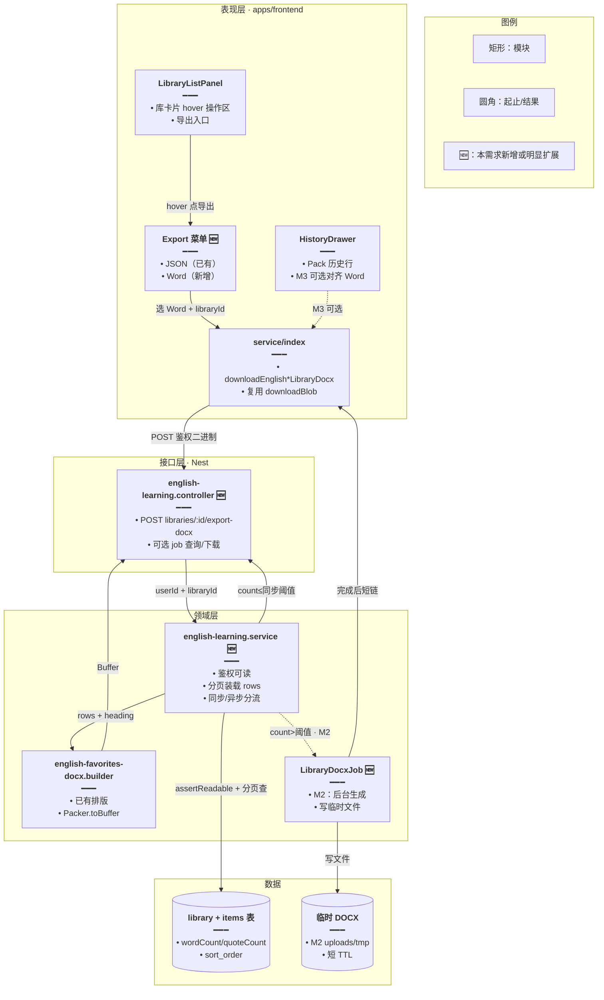
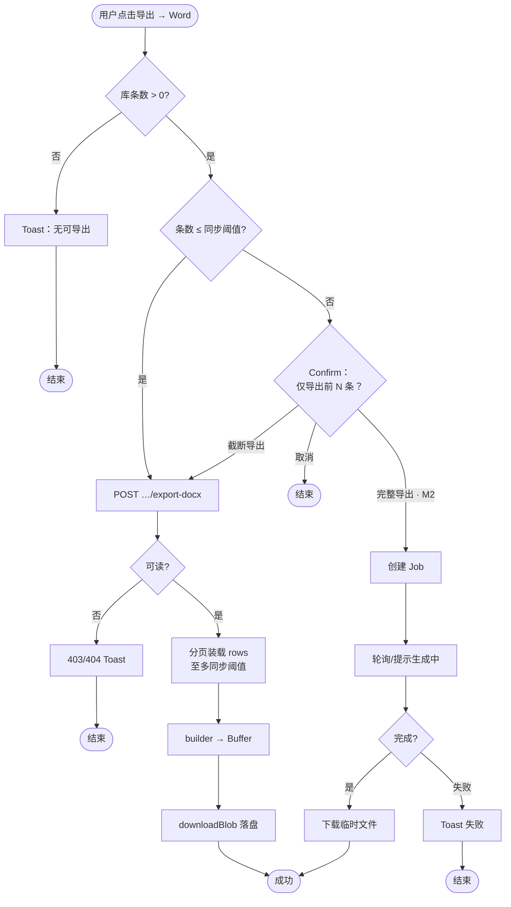
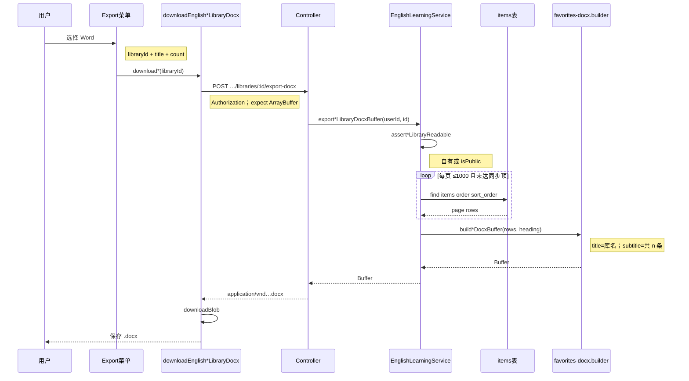
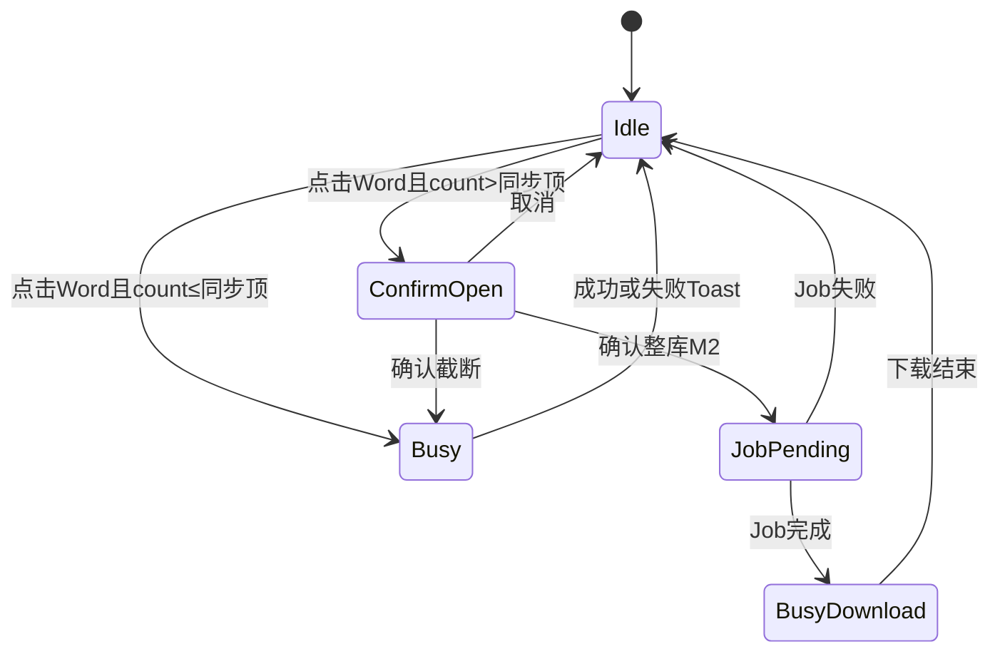

# 单词库 / 语句库导出 Word — 实现思路

> **状态**：规划（已实现）  
> **日期**：2026-10-12  
> **需求摘要**：已登录用户在单词库 / 语句库（及可选 Pack 历史）除现有 JSON 导出外，可导出 Word（DOCX）；版式对齐收藏导出；库体可达近万条，须避免内存与超时打爆。

## 延伸阅读

- 收藏 / 错题 / 今日复习 DOCX（已落地，本方案**直接复用 builder**）：[英语学习DOCX导出.md](./英语学习DOCX导出.md)
- 语句库 JSON 导出（前端分页拉全 + `saveFileWithPicker`）：[语句库导出JSON.md](./语句库导出JSON.md)
- 学习笔记大文档导出（异步/预算可对照）：[学习笔记列表导出.md](../notes/学习笔记列表导出.md)

---

## 0. 读本文你将得到什么

- **问题**：库列表已有 JSON 导出；用户还要像收藏一样带走 Word；但库可达 **1.2 万词 / 6 千句**，不能照搬收藏「一次 `find` + 整包 `Packer.toBuffer` ≤3000」而不改策略。
- **一句话方案**：服务端复用 `english-favorites-docx.builder`；**≤同步阈值走即时 DOCX**；**超过阈值 Confirm 截断或进异步 Job 落临时文件再下载**。
- **主要改动层**：库列表 / 历史抽屉导出 UI（JSON|Word 菜单）→ 前端鉴权下载 → 后端 `POST …/libraries/:id/export-docx`（+ 可选 Job）。
- **阶段**：M1 同步路径（含截断 Confirm）→ M2 大库异步 Job + 进度 → M3 Pack 历史对齐（可选）。
- **最大风险**：同步路径对 8k+ 条 `docx` 整文档占内存 / 网关超时；必须分层硬顶与超时预算。

---

## 1. 需求与边界

### 1.1 用户故事

| 角色 | 场景 | 行为 | 期望结果 |
|------|------|------|----------|
| 已登录用户 | 单词库列表 hover | 导出 → 选 Word | 下载与收藏版式一致的 `.docx`（词/音标/词性/音节/释义/例句） |
| 已登录用户 | 语句库列表 hover | 导出 → 选 Word | 下载原句四字段版式（英/译/出处/赏析） |
| 已登录用户 | 库约 100～3000 条 | 直接导出 Word | 数秒内开始下载，副标题含真实条数 |
| 已登录用户 | 库 > 同步阈值（如 3000） | 点 Word | Confirm：截断导出前 N 条，或「后台生成完整包」（M2） |
| 已登录用户 | 公共库（可读） | 导出 Word | 与读库权限一致，可导出；不要求是 owner |
| 已登录用户 | 空库 / 0 条 | 导出 Word | Toast 无可导出，不发请求 |

### 1.2 范围

| 在范围内 | 不在范围内（非目标） |
|----------|----------------------|
| 单词库 / 语句库 `libraryId` → DOCX | 客户端用 `docx` 拼装整库（默认否决，见 §10） |
| 版式复用收藏 builder | 导出含收藏 id / 练习进度 / 标注 JSON |
| JSON 导出入口保留，与 Word 并列 | 改收藏/错题既有 3000 上限语义 |
| 大库：同步截断 +（M2）异步整库 | M1 就上 Bull 全集群可观测平台 |
| Web + Tauri 统一 `downloadBlob` | PDF / Excel |

### 1.3 约束与依赖

- 登录；库须 `assert*LibraryReadable`（自有或 `isPublic`），与 items 列表一致。
- 生成上限参考：`ENGLISH_VOCAB_GENERATION_MAX = 12000`、`ENGLISH_CLASSIC_QUOTES_GENERATION_MAX = 6000`；收藏同步硬顶 `FAVORITES_DOCX_EXPORT_MAX = 3000`。
- 复用：`buildVocabularyFavoritesDocxBuffer` / `buildClassicQuoteFavoritesDocxBuffer`、`downloadEnglishAuthorizedDocx`、库侧 `Export`（JSON）与 `Annotate` 的 hover 菜单模式。
- 性能底线：同步路径 **P95 &lt; 30s**、响应体建议 **&lt; 50MB**；超时/OOM 时须有明确错误而非挂死。

---

## 2. 方案总览（一句话 + 要点）

**一句话方案**：库导出 Word 走服务端、共用收藏 builder；小库同步下载，大库先 Confirm 截断（M1），再可选异步整包（M2）。

| # | 设计要点 | 理由 |
|---|----------|------|
| 1 | **服务端生成** DOCX | 与收藏一致；字段权威来自 DB；鉴权一次 |
| 2 | **复用** `english-favorites-docx.builder` | 版式已验收；只换 heading（库标题 + 条数） |
| 3 | DB **分页游标** 组装 rows，禁止无 `take` 的全表 `find` | 万级行一次载入易打爆 Nest 进程 |
| 4 | **同步阈值 = 3000**（与收藏同常量或抽 `LIBRARY_DOCX_SYNC_MAX`） | 已知安全水位；超过必须用户确认或异步 |
| 5 | UI：现有 FileJson 旁扩展为 **导出菜单（JSON / Word）** | 少占位；对齐标注按钮二选菜单心智 |
| 6 | M2 大库：**Job 写临时文件 → 轮询/短链下载** | 避开网关超时与同步 `Packer` 峰值 |

---

## 3. 现状与复用

| 能力 | 仓库中已有 | 本需求中的用法 |
|------|------------|----------------|
| DOCX 排版 | `apps/backend/.../english-favorites-docx.builder.ts` | **直接复用**；heading 传入库名 |
| 收藏导出 API | `POST …/vocabulary-favorites/export-docx` 等 | **对照**；库侧新增对称路径 |
| 同步硬顶 | `FAVORITES_DOCX_EXPORT_MAX = 3000` | **扩展** 抽公共常量或库专用 `LIBRARY_DOCX_SYNC_MAX` |
| 库 items 分页 | `listVocabularyLibraryItems`（limit≤1000） | **扩展** Service 内循环分页读 DB（非前端拼） |
| 库 JSON 导出 | `exportVocabulary.ts` / `exportClassicQuotes.ts` + `components/*/Export.tsx` | **扩展** UI 为菜单；JSON 逻辑不动 |
| 鉴权下载 | `downloadEnglishAuthorizedDocx` + `downloadBlob` | **直接复用** |
| 可读校验 | `assertVocabularyLibraryReadable` / classic 同名 | **直接复用** |
| 标注二选菜单 | `components/classic/Annotate.tsx` | **对照** Dropdown 交互 |

**调研结论**：Word 合成与下载链路已在收藏侧跑通，**缺的是「按 libraryId 拉条目 + 大库策略」**。JSON 已在前端分页拉全，但万级 Word 不宜放浏览器；应把生成留在服务端，并对齐收藏的内存上限，另开大库异步通道。

---

## 4. 架构图



**图内方法说明**：

| 方法 / 模块入口 | 功能 |
|-----------------|------|
| `Export` 菜单（UI） | 在库卡片提供 JSON / Word 二选；Word 触发服务端下载 |
| `downloadEnglishVocabularyLibraryDocx(libraryId)` | 前端 `POST` 鉴权拉 DOCX，经 `downloadBlob` 落盘（Web/Tauri） |
| `downloadEnglishClassicQuotesLibraryDocx(libraryId)` | 语句库对称下载入口 |
| `exportVocabularyLibraryDocx`（Controller） | 校验登录；调 Service；设 `Content-Type` / `Content-Disposition`；`res.end(buf)` 或返回 jobId |
| `exportVocabularyLibraryDocxBuffer(userId, libraryId, opts)` | 可读校验 → 分页装 rows → 超限截断/抛需异步 → 调 builder |
| `buildVocabularyFavoritesDocxBuffer(rows, heading)` | 已有：词条排版为 Word Buffer |
| `buildClassicQuoteFavoritesDocxBuffer(rows, heading)` | 已有：语句排版为 Word Buffer |
| `loadLibraryItemsPaged(...)` 🆕 | Service 内按 `sort_order` 分页读 items，拼成 builder 所需 DTO，带硬顶 |
| `enqueueLibraryDocxJob(...)` 🆕（M2） | 大库后台生成，写临时文件并暴露下载 |

**读图要点**：

- Word **只在服务端**生成；前端只负责菜单与鉴权下载（与收藏一致）。
- 新增集中在 Controller/Service 库导出与 UI 菜单；builder **不重写**。
- 大库走 Job 子图（M2），避免同步路径被万级行拖死。

---

## 5. 主流程图



**图内方法说明**：

| 方法 | 功能 |
|------|------|
| `CheckEmpty`（UI） | 用列表上的 `wordCount`/`quoteCount` 或本地缓存判断，避免空打 API |
| `Confirm`（design/Confirm） | 大库时让用户选择截断同步或（M2）整库异步 |
| `export*LibraryDocxBuffer` | 同步路径核心：鉴权、分页装载、截断、builder |
| `enqueueLibraryDocxJob` | M2：登记任务并立即返回 jobId |
| `downloadBlob` | 把 ArrayBuffer/Blob 存到本机（Tauri/Web） |

**读图要点**：

- 空库短路；小库直出；大库 **默认 M1 只开截断分支**，完整导出挂在 M2。
- 失败路径均 Toast，不留下半截文件（对齐 JSON「不写半截」原则）。

---

## 6. 核心时序图



**图内方法说明**：

| 方法 | 功能 |
|------|------|
| `downloadEnglishVocabularyLibraryDocx` | 封装 POST + `downloadBlob`；失败抛错由 UI Toast |
| `exportVocabularyLibraryDocx`（Controller） | 设二进制响应头并 `res.end` |
| `assertVocabularyLibraryReadable` | 无权限则 NotFound/Forbidden，防扫库 |
| `loadLibraryItemsPaged` | 按页累计 rows，触及 `LIBRARY_DOCX_SYNC_MAX` 即停 |
| `buildVocabularyFavoritesDocxBuffer` | 将 rows 排版为 DOCX Buffer |

**读图要点**：

- Happy path 与收藏导出同构，只是数据源从 favorite 表换成 library items。
- 分页在 **Service 内**完成，不把万级 JSON 先甩到浏览器再回传。

---

## 7. 状态机（导出按钮）



**图内方法说明**：

| 方法 | 功能 |
|------|------|
| `setBusy(true/false)` | 导出按钮 Spinner / disabled，防连点 |
| `openConfirm` / `onConfirm` | 大库分流 UI |

---

## 8. 模块职责与接口草图

### 8.1 模块一览

| 模块 | 职责 | 新增/改动 | 预估路径 |
|------|------|-----------|----------|
| Export 菜单 | JSON / Word 入口 | 扩展 | `components/vocab/Export.tsx`、`components/classic/Export.tsx` |
| 前端 API | 库 DOCX 下载 | 新增 | `service/api.ts` + `service/index.ts` |
| Controller | 二进制导出路由 | 新增 | `english-learning.controller.ts` |
| Service | 鉴权、分页装载、分流 | 新增 | `english-learning.service.ts` |
| 常量 | 同步硬顶 | 扩展 | 与 `FAVORITES_DOCX_EXPORT_MAX` 对齐或并列 |
| Job（M2） | 大库异步 | 新增 | 待定：沿用现有 Bull/队列模式 |
| i18n | 菜单文案、Confirm、截断说明 | 扩展 | `i18n/locales/*/englishLearning.ts` |

### 8.2 关键接口草图

```typescript
// 库 Word 同步导出：超限时由 query/body 声明是否允许截断
type LibraryDocxExportQuery = {
	// true：超过同步顶只导出前 N 条；false/缺省：超限 413 让前端弹 Confirm
	allowTruncate?: boolean;
};

// Service：装载并生成；调用方已通过可读校验
async function exportVocabularyLibraryDocxBuffer(
	// 当前用户，用于公开库可读与 owner 区分
	userId: number,
	// 目标单词库 id
	libraryId: string,
	// 是否允许截断到同步顶
	opts?: { allowTruncate?: boolean },
): Promise<Buffer> {
	// … 分页装载 + builder；实现阶段填写
	return Buffer.alloc(0);
}

// 前端：与收藏 downloadEnglishAuthorizedDocx 同型
async function downloadEnglishVocabularyLibraryDocx(
	// 库 id
	libraryId: string,
	// 确认截断后带 true
	opts?: { allowTruncate?: boolean },
): Promise<void> {
	// POST → ArrayBuffer → downloadBlob
}
```

### 8.3 数据模型

| 字段/实体 | 来源 | 存储 | 说明 |
|-----------|------|------|------|
| `EnglishVocabularyLibrary` | DB | MySQL | `title`、`wordCount`、`isPublic`、`userId` |
| `EnglishVocabularyLibraryItem` | DB | MySQL | 导出字段同收藏词条；按 `sort_order` |
| Classic 库/句 | DB | MySQL | 对称 |
| 临时 DOCX（M2） | Job | 本地 `uploads/` 或对象存储 | TTL 清理；短链一次下载 |

### 8.4 大库策略（本文核心）

| 水位 | 策略 | 用户感知 |
|------|------|----------|
| `0` | 不请求 | Toast 空 |
| `1 … SYNC_MAX`（建议 **3000**） | 同步 POST → 立即下载 | 与收藏相同 |
| `> SYNC_MAX`（可达 12k / 6k） | **M1**：Confirm「仅导出前 N 条」；副标题注明截断 | 可马上拿走一部分 |
| 同上 | **M2**：Confirm「后台生成完整 Word」→ Job → 完成再下载 | 完整库，可等 |

**为何不同步硬扛 12k**：

- `docx` 的 `Packer.toBuffer` 需持有完整段落树；万级 × 每条多段 → 堆峰值高。
- 网关 / 反向代理常有 **30～60s** 超时；收藏侧已用 3000 作工程水位。
- 前端若仿 JSON 拉全再本地生成，双倍流量 + 浏览器内存，Tauri/Web 均更脆。

**分页装载伪策略**（同步路径）：

1. `pageSize = 500～1000`（对齐现 items API 上限）。
2. 累加 `rows`，`rows.length >= SYNC_MAX` 则 stop。
3. 若库 `wordCount > SYNC_MAX` 且未 `allowTruncate` → `PayloadTooLargeException`（或业务码），前端弹 Confirm。

---

## 9. 分阶段实现步骤

| 阶段 | 目标 | 交付物 | 依赖 |
|------|------|--------|------|
| M1 | 库同步 Word + 大库截断 Confirm | API + UI 菜单 + i18n | builder 已有 |
| M2 | 大库异步整包 | Job + 临时文件 + 下载 | M1 |
| M3 | Pack 历史行 Word（可选） | HistoryDrawer 菜单对齐 | M1 |

### M1

- [ ] 后端：`POST vocabulary-libraries/:libraryId/export-docx`、`POST classic-quotes-libraries/:libraryId/export-docx`
- [ ] Service：可读校验 + 分页装载 + `allowTruncate` + 复用 builder（heading = 库标题）
- [ ] 前端：`downloadEnglish*LibraryDocx`；Export 改为 JSON | Word 菜单
- [ ] 大库 Confirm + `allowTruncate=true` 重试
- [ ] i18n：菜单「导出 Word」、截断文案、成功/失败 Toast
- [ ] 验收：空库、小库、刚好 3000、3001 Confirm、公共库可读、无权限

### M2

- [ ] Job 表或复用现有队列；状态 `pending|running|done|failed`
- [ ] 完成后短 TTL 文件；前端轮询或「生成完成」Toast + 下载按钮
- [ ] 失败重试与过期清理
- [ ] 验收：8k 词库完整条数与文件可打开

### M3（可选）

- [ ] Pack `streamId` 导出 Word（权限=会话 owner）
- [ ] HistoryDrawer 菜单与库列表一致

---

## 10. 关键决策与备选方案

| 决策 | 选用 | 备选 | 为何不选备选 |
|------|------|------|--------------|
| 生成位置 | 服务端 | 浏览器 `docx` | 万级行浏览器更易 OOM；且与收藏链路分裂 |
| 小库路径 | 同步二进制 POST | 一律异步 Job | 小库异步过重；收藏已验证同步体验 |
| 大库 M1 | Confirm 截断到 3000 | 静默截断 | 静默会丢数据且用户不察 |
| 大库完整 | M2 异步文件 | 同步硬扛 12k | 超时/内存风险高 |
| 版式 | 复用 favorites builder | 新开库专用 builder | YAGNI；字段同构 |
| UI | 导出菜单（JSON/Word） | 并排两个图标 | 操作区已挤；菜单与标注一致 |

---

## 11. 风险、边界与待确认

| 项 | 等级 | 说明 | 缓解 |
|----|------|------|------|
| 同步内存 | 高 | 3000 条 × 多段仍可到数十 MB 堆 | 保持与收藏同顶；监控 p95 |
| 网关超时 | 高 | 接近顶时 Packer 变慢 | 超时调优；超顶强制 Confirm/Job |
| 公共大库扫库 | 中 | 恶意反复导出 | 限流（用户级）；可读校验 |
| 截断误解 | 中 | 用户以为是全文 | Confirm + 副标题「前 N 条 / 共 M 条」 |
| Job 磁盘 | 中 | 临时 DOCX 堆积 | TTL + 下载后删 |

**待确认**：

- [ ] 同步顶是否严格复用 `3000`，或库侧提高到 `5000`？（验证：打一库 4000 条测内存与耗时）
- [ ] M2 是否必须进首版，还是 M1 截断即可上线？（验证：产品是否接受「大库先导出前 3000」）
- [ ] Pack 历史是否要 Word，还是仅库列表？（验证：问产品；技术可 M3）

---

## 12. 验收清单

| # | 用例 | 步骤 | 期望 |
|---|------|------|------|
| AC1 | 单词库小库 Word | 约 100 词库 → 导出 Word | 下载成功；条数=库计数；版式同收藏 |
| AC2 | 语句库小库 Word | 约 50 句 → Word | 四字段齐全；标题为库名 |
| AC3 | JSON 仍可用 | 同一入口选 JSON | 行为与现网一致 |
| AC4 | 空库 | 0 条点 Word | Toast，无请求或快速 4xx |
| AC5 | 公共库 | 非 owner 打开公共库导出 | 成功；私有库 403/404 |
| AC6 | 大库截断 | count=3001 → Confirm → 截断 | Word 恰 3000；副标题标明截断 |
| AC7 | 取消 Confirm | 大库点取消 | 不发导出请求 |
| AC8 |（M2）整库 | 8k 词选完整导出 | Job 完成后打开 Word，条数=库计数 |
| AC9 | Tauri / Web | 两端各导一次 | 均能保存；错误有 Toast |

---

## 13. 预估改动面（实现阶段参考）

| 类型 | 路径（预估） |
|------|--------------|
| 前端 UI | `apps/frontend/src/views/englishLearning/components/vocab/Export.tsx`、`classic/Export.tsx`；可选 HistoryDrawer |
| 前端 API | `apps/frontend/src/service/api.ts`、`service/index.ts` |
| 前端 i18n | `apps/frontend/src/i18n/locales/*/englishLearning.ts` |
| 后端 | `english-learning.controller.ts`、`english-learning.service.ts`；常量；M2 Job 模块 |
| 复用不动 | `english-favorites-docx.builder.ts`（除非抽共享 heading 文案） |
| 文档（落地后） | `wiki/english/` 归档专题（`implementation-doc-from-diff`） |

---

（本文档为规划态实现思路；落地后以源码与 wiki/english 归档为准）
