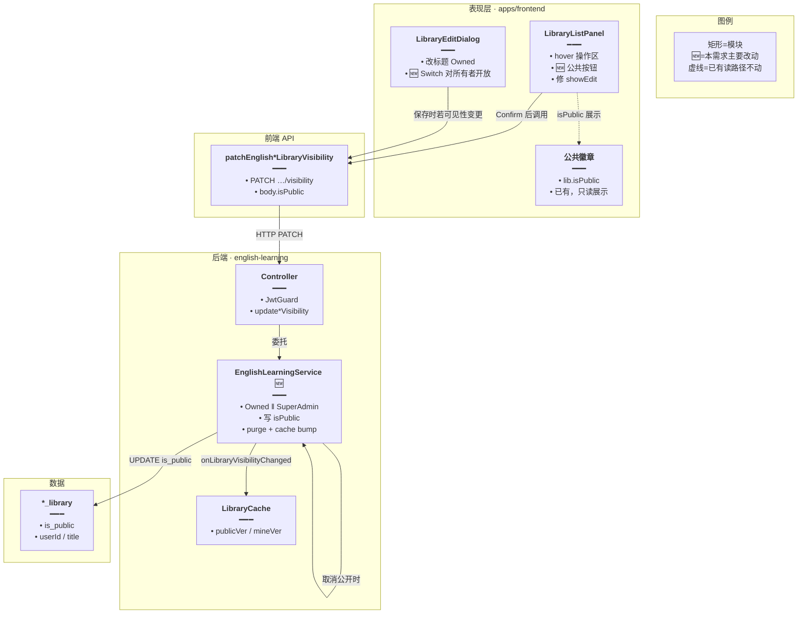
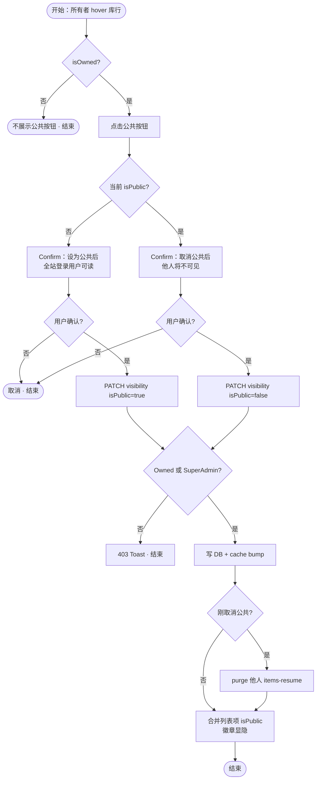
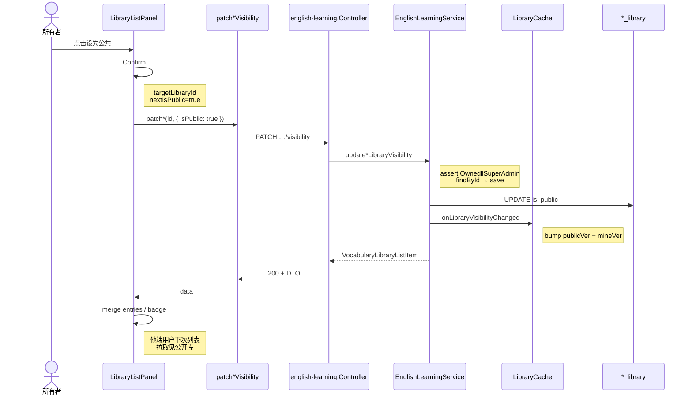
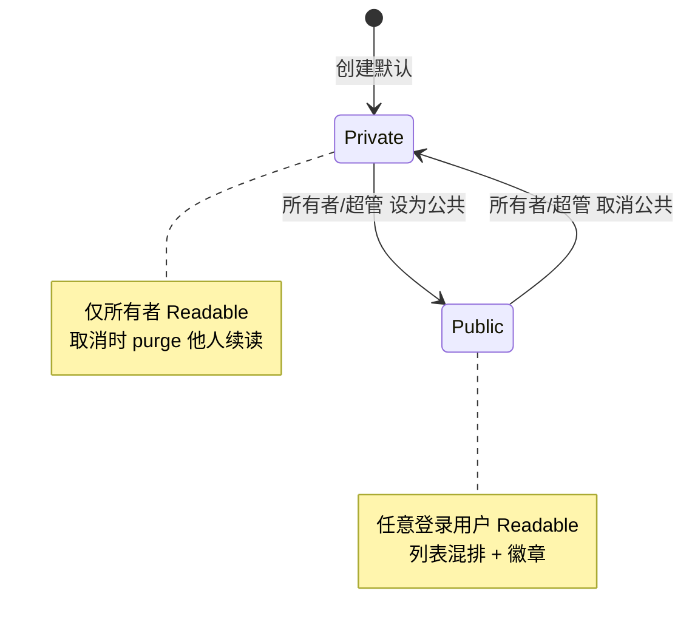

# 单词库 / 语句库设为公共 — 实现思路

> **状态**：规划（读侧与字段已上线；写侧仅超管，待放宽为所有者自助 + 列表公共按钮）  
> **日期**：2026-10-13  
> **需求摘要**：库所有者在单词库 / 语句库列表项上一点「公共」按钮，即可把该库设为全站登录用户可读；取消公共后仅所有者可见。

## 延伸阅读

- 知识库所有者自助公开：`apps/backend/src/services/knowledge/knowledge.service.ts` · `setVisibility` + `requireOwned`
- 学习笔记公开：`apps/backend/src/services/learning-notes/`（所有者开关，可对照 UI 心智）
- 库导出 Word（公开库可读即可导出）：[词库导出Word.md](./词库导出Word.md)

---

## 0. 读本文你将得到什么

- **问题**：`is_public`、列表「自有 OR 公开」、读 items/练习/导出已通；但 **改可见性仅超级管理员**，且公开库对普通所有者 **隐藏编辑入口**，无法自助开关。
- **一句话方案**：**不新建表**；后端 visibility 改为「所有者或超管」；前端列表项挂公共按钮（Confirm + PATCH），修 `showEdit`，复用现有徽章与缓存失效。
- **主要改动层**：`english-learning.service` 权限一行级调整 → `LibraryListPanel` 公共按钮 → `LibraryEditDialog` Switch 对所有者可见。
- **阶段**：M1 权限 + 列表按钮 + 编辑入口 → M2 Confirm/文案/i18n 打磨 → M3（可选）他人库超管策展 UX 说明。
- **最大风险**：公开后任意登录用户可练习/导出/标注整库（版权与滥用）；取消公开须清他人续读（已有 purge）。

---

## 1. 需求与边界

### 1.1 用户故事

| 角色 | 场景 | 行为 | 期望结果 |
|------|------|------|----------|
| 库所有者 | 私有库列表 hover | 点「设为公共」→ Confirm | 库 `isPublic=true`；他人登录后列表可见；标题旁「公共」徽章 |
| 库所有者 | 已公共库 hover | 点「取消公共」→ Confirm | 库变私有；他人列表/items 不可见；他人续读被 purge |
| 其他登录用户 | 打开词库/语句库页 | 浏览列表 | 看到自己的库 + 所有 `isPublic` 库；可打开 items、练习、导出（与现 Readable 一致） |
| 非所有者 | 他人公共库 | 尝试改可见性 / 删库 | 403；无公共按钮 / 无删除 |
| 超级管理员 | 任意库 | 仍可改可见性（策展） | 与现网策展能力兼容，不要求 Owned |
| 未登录 | — | — | 仍不可见（全模块 `JwtGuard`，本需求不开放匿名） |

### 1.2 范围

| 在范围内 | 不在范围内（非目标） |
|----------|----------------------|
| 单词库 + 语句库库级 `isPublic` 所有者自助开关 | 词条级公开、分享短链、未登录开放 |
| 列表项公共按钮（vocab/classic 共用交互） | 独立「公共库」Tab / 广场（可选后续） |
| 修公开库所有者 `showEdit` | 库 fork / 副本到私人书架 |
| 超管旁路保留 | 会员门槛、审核流、举报下架平台 |
| i18n Confirm / Toast | 改练习/导出/标注读权限模型（已具备） |

### 1.3 约束与依赖

- 登录；读侧已是 `userId OR isPublic`。
- 复用：`UpdateLibraryVisibilityDto`、`PATCH …/visibility`、`EnglishLearningLibraryCache.onLibraryVisibilityChanged`、`purgeLibraryItemsResumeExceptOwner`、列表公共徽章。
- 对齐知识库：`KnowledgeService.setVisibility` = `requireOwned` 后写字段。
- Ponytail：不新 endpoint、不新表字段；最小权限与 UI  diff。

---

## 2. 方案总览（一句话 + 要点）

**一句话方案**：在已有 `is_public` 读模型上，把写可见性从「仅超管」改为「所有者或超管」，并在 `LibraryListPanel` 行内提供与 Export 同级的公共开关按钮。

| # | 设计要点 | 理由 |
|---|----------|------|
| 1 | **零 schema** | 字段/索引/列表缓存已齐，缺口只在写权限与入口 |
| 2 | **Owned \|\| SuperAdmin** | 对齐知识库「自愿分享」；保留超管策展他人库 |
| 3 | **行内公共按钮 + Confirm** | 需求点名「item 上公共按钮」；比埋在编辑弹窗更可发现 |
| 4 | **`showEdit = isOwned \|\| isSuperAdmin`** | 公开后所有者仍能改标题 / 弹窗内 Switch |
| 5 | **取消公开走既有 purge** | 他人 `items-resume` 不得残留指向私有库 |

---

## 3. 现状与复用

| 能力 | 仓库中已有 | 本需求中的用法 |
|------|------------|----------------|
| `is_public` + 索引 | `english-vocabulary-library.entity.ts` / `english-classic-quotes-library.entity.ts` | **直接复用** |
| 列表自有 OR 公开 | `english-learning.service.ts` · `load*LibrariesPageCached` | **不动** |
| Readable / Owned | `assert*LibraryReadable` / `assert*LibraryOwned` | 写可见性改用 Owned（超管旁路） |
| PATCH visibility | Controller + `update*LibraryVisibility`；FE `patchEnglish*LibraryVisibility` | **扩展**权限；路径不变 |
| 超管闸 | `UserService.userHasSuperAdminRole`；FE `useIsSuperAdmin` | 旁路保留；UI 不再「仅超管可见 Switch」 |
| 缓存失效 | `EnglishLearningLibraryCache.onLibraryVisibilityChanged` | **必须**继续调用 |
| 取消公开清续读 | `purgeLibraryItemsResumeExceptOwner` | **必须**继续调用 |
| 编辑弹窗 Switch | `LibraryEditDialog.tsx`（现仅 `isSuperAdmin`） | **扩展**对所有者展示 |
| 列表徽章 / hover 操作区 | `LibraryListPanel.tsx` | **新增**公共按钮；修 `showEdit` |
| 知识库公开 | `knowledge.service.ts` · `setVisibility` | **权限模式对照** |

**调研结论**：公开体系骨架已落地；产品与代码的真实差距是「谁可以点设为公共」。按本需求，应对齐知识库所有者自助，并补列表按钮与公开库编辑入口，无需从零建公开体系。

---

## 4. 架构图



**图内方法说明**：

| 方法 | 功能 |
|------|------|
| `LibraryListPanel` 内公共按钮 handler | 所有者点击后 Confirm，再调 `patchEnglish*LibraryVisibility`；成功后合并列表项 `isPublic` |
| `LibraryEditDialog` 保存 | 标题走 title PATCH；可见性变更时调同一 visibility PATCH（现仅超管，扩展为所有者） |
| `patchEnglishVocabularyLibraryVisibility` / `patchEnglishClassicQuotesLibraryVisibility` | 前端鉴权 PATCH；body `{ isPublic }` |
| `updateVocabularyLibraryVisibility` / classic 对称 | 后端写可见性；本需求改为 Owned‖SuperAdmin，保留 purge 与 cache |
| `onLibraryVisibilityChanged` | bump `publicVer` 与相关 `mineVer`，使各用户列表缓存失效 |
| `purgeLibraryItemsResumeExceptOwner` | 公共→私有时清除非所有者续读偏移 |

**读图要点**：

- 读路径（列表 OR 公开、items Readable）已存在，图中不展开。
- 🆕 集中在「谁能写 `isPublic`」与「列表入口可发现性」。
- Dialog 与行内按钮共用同一 PATCH，避免第二套 API。

---

## 5. 主流程图



**图内方法说明**：

| 方法 | 功能 |
|------|------|
| `patchEnglish*LibraryVisibility` | 发起可见性变更；失败由 http 层 Toast |
| `update*LibraryVisibility` | 校验权限、持久化、条件 purge、cache、返回带 `isOwned` 的列表 DTO |
| `handleVisibilitySaved`（面板已有） | 用返回 DTO 更新 `entries` / 当前选中库，关闭弹窗；行内按钮成功后复用同一合并逻辑 |

**读图要点**：

- 入口是行内按钮；Dialog Switch 为并行入口，流程相同。
- 失败只在鉴权与网络；空库也可设公共（条数为 0 仍可读空列表）。
- 取消公共必须走 purge，避免他人续读幽灵指针。

---

## 6. 核心时序图



**图内方法说明**：

| 方法 | 功能 |
|------|------|
| `Confirm`（design） | 二次确认，防止误公开 / 误取消 |
| `patchEnglish*LibraryVisibility` | 封装路径与 body；silent 策略与现编辑弹窗一致 |
| `update*LibraryVisibility` | 写权限 + 持久化 + 副作用（purge/cache） |
| `onLibraryVisibilityChanged` | 使「自有列表」与「含公开库的列表」缓存版本同时前进 |
| `map*LibraryListItem` | 返回含 `isPublic` / `isOwned`，供前端合并 UI |

**读图要点**：

- Happy path 无新 Job、无 SSE；同步 PATCH 即可。
- 其他用户不靠推送；依赖列表缓存 TTL / ver 失效后的下次拉取。
- 取消公共时在 `save` 后多一步 `purgeLibraryItemsResumeExceptOwner`（时序与上对称，省略重复）。

---

## 7. 状态机（库可见性）



**图内方法说明**：

| 方法 | 功能 |
|------|------|
| `update*LibraryVisibility(isPublic)` | 唯一合法状态迁移写入口；禁止前端只改本地徽章 |

---

## 8. 模块职责与接口草图

### 8.1 模块一览

| 模块 | 职责 | 新增/改动 | 预估路径 |
|------|------|-----------|----------|
| Service 可见性权限 | Owned‖SuperAdmin | 改动 | `apps/backend/.../english-learning.service.ts` |
| Controller | 路由不变 | 注释修正 | `english-learning.controller.ts` |
| LibraryListPanel | 公共按钮 + showEdit | 改动 | `.../library/components/LibraryListPanel.tsx` |
| LibraryEditDialog | Switch 对所有者 | 改动 | `.../library/components/LibraryEditDialog.tsx` |
| i18n | Confirm / 按钮 aria | 改动 | `apps/frontend/src/i18n/locales/*/englishLearning.ts` |
| 可选公共组件 | 若两处复用按钮 UI | 新增（YAGNI 则内联） | `.../library/components/LibraryPublicToggle.tsx` |

### 8.2 关键接口（草图）

```typescript
// 后端：写可见性；对齐知识库 requireOwned，超管可策展任意库
async function updateVocabularyLibraryVisibility(
	// 当前操作者
	userId: number,
	// 目标库
	libraryId: string,
	// 目标可见性
	dto: { isPublic: boolean },
): Promise<VocabularyLibraryListItem> {
	// 先取库；不存在则 404，避免泄露前先鉴权绕弯
	const lib = await findLibraryOrThrow(libraryId);
	// 所有者或超管才可改；禁止任意登录用户改他人库
	const ok =
		lib.userId === userId ||
		(await userService.userHasSuperAdminRole(userId));
	// 统一 403 文案，不区分「非所有者」细节给攻击者
	if (!ok) throw new ForbiddenException('无权修改该库可见性');
	// 记录旧值：仅公共→私有时需要 purge
	const wasPublic = lib.isPublic;
	// 持久化目标状态
	lib.isPublic = dto.isPublic;
	const saved = await vocabLibraryRepo.save(lib);
	// 取消公开后清他人续读，避免指向不可读库
	if (wasPublic && !saved.isPublic) {
		await purgeLibraryItemsResumeExceptOwner('vocab', libraryId, saved.userId);
	}
	// 列表缓存必须失效，否则他人仍看不到/仍看到旧状态
	await libraryCache.onLibraryVisibilityChanged('vocab', saved.userId);
	// 返回带 isOwned 的列表项，供前端就地合并
	return mapVocabularyLibraryListItem(saved, userId, resumeOffset);
}
```

```typescript
// 前端列表：是否展示公共按钮（仅所有者；超管策展可走编辑弹窗）
function canTogglePublic(lib: { isOwned?: boolean }): boolean {
	// isOwned===false 为他人公共库；缺省按自有（兼容旧数据）
	return lib.isOwned !== false;
}
```

### 8.3 数据模型

| 字段/实体 | 来源 | 存储 | 说明 |
|-----------|------|------|------|
| `is_public` | 已有 | DB | 库级可见性；条目无独立字段 |
| `isOwned` | 列表 DTO 计算 | 响应 | `lib.userId === currentUserId` |
| `items-resume` | 已有 | DB | 取消公开时非所有者行 purge |

---

## 9. 分阶段实现步骤

| 阶段 | 目标 | 交付物 | 依赖 |
|------|------|--------|------|
| M1 | 所有者可开关 + 列表按钮 | 权限放宽、按钮、showEdit、Dialog Switch | — |
| M2 | 文案与防误触 | Confirm、成功 Toast、i18n en/zh | M1 |
| M3 | 可选打磨 | 超管改他人库时提示「策展」、注释与列表混排说明 | M2 |

### M1

- [ ] `updateVocabularyLibraryVisibility` / classic：去掉「仅超管」，改为 Owned‖SuperAdmin
- [ ] `LibraryListPanel`：`showEdit = isOwned \|\| isSuperAdmin`；所有者行挂公共按钮
- [ ] 按钮成功后复用 `handleVisibilitySaved` 合并 `entries`
- [ ] `LibraryEditDialog`：所有者可见 Switch（`canEditVisibility = isOwned \|\| isSuperAdmin`）

### M2

- [ ] Confirm 文案区分设为 / 取消；含「他人可练习与导出」提示
- [ ] Toast 成功；失败走现有 http 错误
- [ ] en-US / zh-CN 键补齐

### M3（可选）

- [ ] 超管在非自有库上的可见性操作二次文案
- [ ] Controller 注释「当前用户的库」改为「自有 + 公开」

---

## 10. 关键决策与备选方案

| 决策 | 选用 | 备选 | 为何不选备选 |
|------|------|------|--------------|
| 写权限 | Owned‖SuperAdmin | 仅超管（现状） | 不满足「所有用户可把自己的库公开」 |
| 入口 | 行内按钮 + Dialog Switch | 仅 Dialog | 可发现性差，不符「item 上按钮」 |
| API | 复用 PATCH visibility | 新 POST publish | YAGNI |
| 他人库超管 | 保留旁路 | 强制只能改自有 | 现网策展能力丢失 |
| 未登录可见 | 不做 | 匿名读公共库 | 全模块 Jwt；另开需求 |

---

## 11. 风险、边界与待确认

| 项 | 等级 | 说明 | 缓解 |
|----|------|------|------|
| 版权 / 整库导出 | 中 | 公开即可导出 DOCX、练习、标注 | Confirm 明示；后续可加审核（非本需求） |
| 公开后丢编辑 | 高（现状 bug） | `showEdit` 对公开库仅超管 | M1 必改 |
| 列表混排噪音 | 低 | 公共库与自有库同列表 | 徽章区分；广场 Tab 另议 |
| 缓存抖动 | 低 | `publicVer` 全局 bump | 已有机制；公开频繁时再优化 |
| 练习中途变私有 | 中 | 他人进行中 → NotFound | 前端 Toast；可接受 |

**待确认**：

- [ ] 超管是否仍允许把 **他人** 私有库直接公开？（验证：产品一句；默认 **是**，与现网一致）
- [ ] 空库（0 条）是否允许公开？（验证：产品；默认 **是**）
- [ ] 公共按钮是否对超管在他人库上也显示，或仅编辑弹窗？（验证：交互；默认 **行内仅所有者**，超管用 Dialog）

---

## 12. 验收清单

| # | 用例 | 步骤 | 期望 |
|---|------|------|------|
| AC1 | 所有者公开 | A 私有库 → 点公共 → Confirm | 徽章出现；B 登录后列表可见并可打开 items |
| AC2 | 所有者取消 | A 取消公共 | B 列表消失；B 直链 items → 404/不可读；A 仍可读 |
| AC3 | 非所有者 | B 看 A 的公共库 | 无公共按钮、无删除；可读可练可导出 |
| AC4 | 公开后改标题 | A 在公开库点编辑 | 可改标题；Switch 可关公共 |
| AC5 | 超管策展 | 超管改他人库可见性 | 成功；缓存后其他用户列表更新 |
| AC6 | 未登录 | 清 token 访问 API | 401，不可枚举公共库 |

---

## 13. 预估改动面（实现阶段参考）

| 类型 | 路径（预估） |
|------|--------------|
| 后端 | `apps/backend/src/services/english-learning/english-learning.service.ts`（两处 visibility）；可选 controller 注释 |
| 前端 | `LibraryListPanel.tsx`、`LibraryEditDialog.tsx`；可选抽 `LibraryPublicToggle.tsx` |
| i18n | `apps/frontend/src/i18n/locales/zh-CN/englishLearning.ts`、`en-US/englishLearning.ts` |
| 文档（落地后） | `implementation-doc-from-diff` → `wiki/english/` 归档；本文保持规划脉络 |

---

（本文档为规划态实现思路；落地后以源码与 wiki 正式专题为准）
