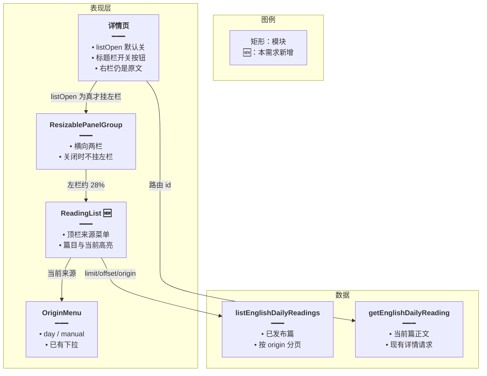
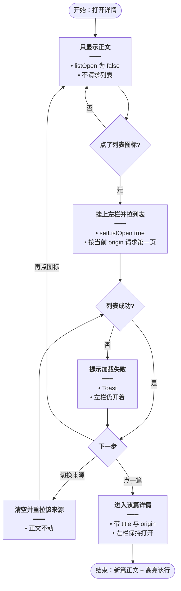
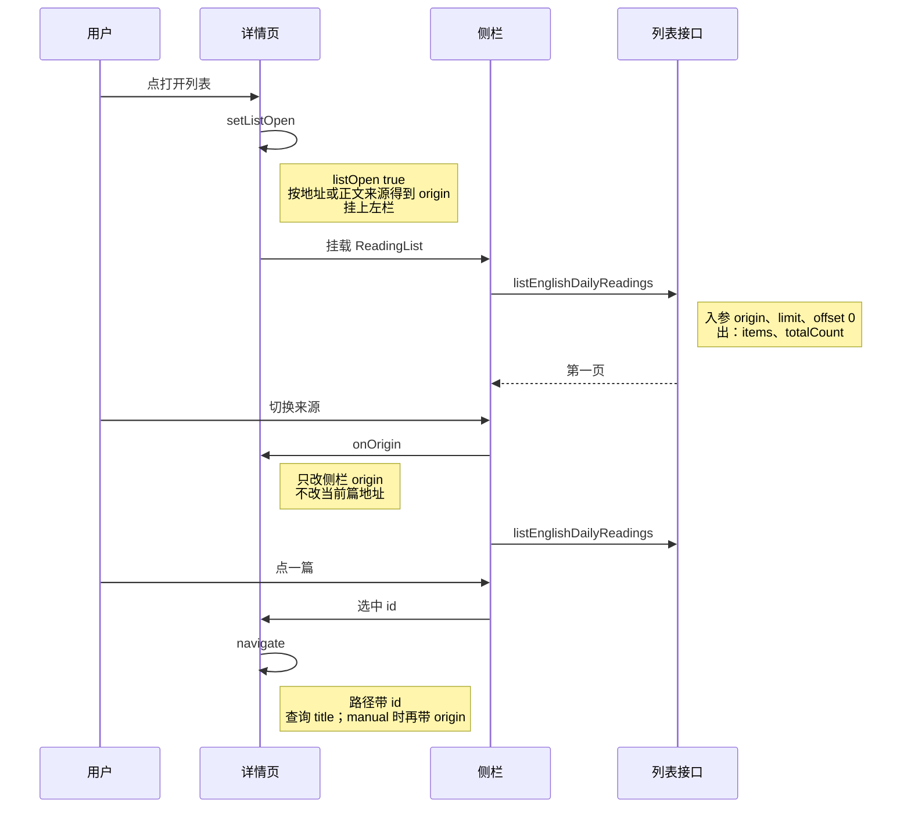
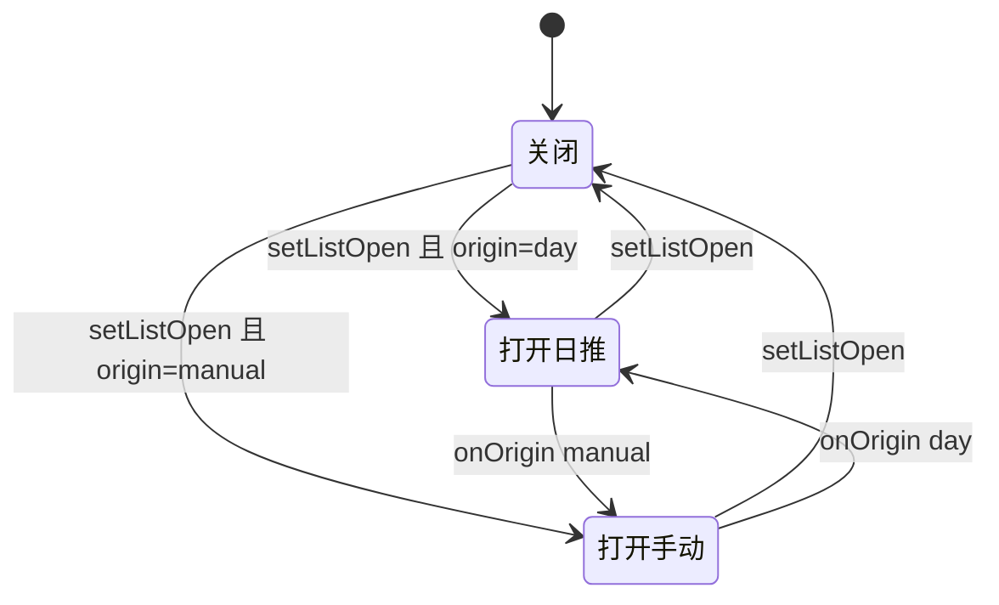

# 详情侧栏阅读列表 — 实现思路

> **状态**：已按本文落地（分栏、来源菜单、列表接口均复用现成能力）  
> **日期**：2026-10-20  
> **需求摘要**：在每日阅读详情页左侧加一篇目列表，默认关闭；标题栏「继续生成」旁的图标打开或关闭；列表顶栏用现有来源菜单在系统日推与手动生成之间切换。

## 延伸阅读

- [每日阅读来源切换.md](./每日阅读来源切换.md)：列表页 `?origin=` 与 `OriginMenu`
- [每日阅读.md](./每日阅读.md)：详情页与 `listEnglishDailyReadings`

---

## 0. 读本文你将得到什么

- 读详情时不用退回列表，就能换一篇，并在系统日推 / 手动生成之间切换。
- 一句话方案：详情页用 `ResizablePanelGroup` 包住可选左栏；`listOpen` 默认 `false`，标题栏图标翻转它；左栏复用 `OriginMenu` + `listEnglishDailyReadings`。
- 只改前端详情页、一个新侧栏组件和两条文案；不改接口、不改列表页、不改生成流。
- 两段落地：M1 开关与分栏，M2 列表数据与换篇。
- 最大风险：开关分栏时重建面板，正文滚动会回到顶部。

---

## 1. 需求与边界

### 1.1 用户故事

| 角色 | 场景 | 行为 | 期望结果 |
|------|------|------|----------|
| 读者 | 正在看一篇短文 | 点标题右侧、继续生成后面的列表图标 | 左侧出现阅读列表，正文仍在右侧 |
| 读者 | 列表已打开 | 再点同一图标 | 左栏消失，正文铺满 |
| 读者 | 列表已打开 | 用来源菜单切到系统日推或手动生成 | 只刷新左栏篇目，当前正文不换 |
| 读者 | 列表已打开 | 点某一篇 | 进入该篇详情，左栏保持打开，当前行高亮 |

### 1.2 范围

| 在范围内 | 不在范围内 |
|----------|------------|
| 详情页左侧可拖拽分栏 | 改列表页卡片布局 |
| 默认关闭，图标开关 | 把开关记到 localStorage 或 URL |
| 复用 `OriginMenu` 切换 `day` / `manual` | 新的来源枚举或新接口 |
| 分页加载已发布篇目，点进详情 | 侧栏里做重试、轮询「今天正在生成」、删除 |
| 中英文按钮文案 | 后端、SSE、生成历史 |

### 1.3 约束与依赖

- 已登录才能拉列表；失败用现有 `loadFailed` 提示。
- 分栏组件用 `@/components/ui/resizable` 的 `ResizablePanelGroup` / `ResizablePanel` / `ResizableHandle`，与资源库页同一套。
- 开关方式对齐 Skills 页：`listOpen` 为 false 时不挂左栏，并用 `key` 让分栏按新的默认宽度重建。
- 打开按钮的尺寸、颜色对齐详情标题上的播放按钮和继续生成按钮（青绿、`h-8 w-8`、`tabIndex={-1}`、点击后 blur）。
- 来源菜单继续用 `PanelTopOpen` / `PanelTopClose`，不另做一套切换图标。

---

## 2. 方案总览

**一句话方案**：详情页用横向可拖拽分栏；左栏默认不挂载，标题栏图标把它打开；左栏自己拉 `origin` 对应的已发布列表，点一篇才换详情。

| # | 设计要点 | 理由 |
|---|----------|------|
| 1 | `listOpen` 放在详情页 `useState(false)` | 每次进入详情都从关上开始，符合「默认关闭」；换篇时组件不卸载，所以开着会保持 |
| 2 | 关着时不请求列表 | 多数阅读不需要侧栏，避免白打一页接口 |
| 3 | 侧栏 `origin` 是本页筛选，不改当前篇的地址，直到点中另一篇 | 避免切来源时面包屑和正文来源打架；点篇时再带上 `origin`，与列表页进详情一致 |
| 4 | 初始来源：地址有 `origin` 用地址；否则等正文返回，手动篇种子成 `manual`，且只种子一次 | 从手动列表或生成历史进来时，侧栏直接是手动栏 |
| 5 | 左栏约 28%、正文约 72%，中间可拖 | 标题列表不需要资源库那么宽，正文仍是主区域 |

---

## 3. 现状与复用

| 能力 | 仓库中已有 | 本需求中的用法 |
|------|------------|----------------|
| 横向分栏 | `apps/frontend/src/components/ui/resizable.tsx`；资源库 `library/index.tsx` | 详情页直接套同一组件 |
| 默认隐藏再打开的分栏 | `apps/frontend/src/views/skills/index.tsx` 的 `listOpen` + `key` | 照抄开关与重建，不照抄三栏比例 |
| 系统 / 手动菜单 | `dailyReading/components/OriginMenu.tsx` | 放在侧栏顶栏右侧 |
| 来源解析 | `dailyReading/utils/origin.ts` 的 `parseOrigin` | 初始化侧栏来源 |
| 已发布列表 | `listEnglishDailyReadings({ limit, offset, origin })` | 侧栏分页；不新写接口 |
| 列表进详情 | `dailyReading/List.tsx` 的 `navigate(...?title=&origin=)` | 侧栏点篇用同一查询 |
| 面包屑回列表 | `components/design/Header/index.tsx` 看 `origin===manual` | 不改；点篇后的地址继续驱动它 |
| 空列表 / 失败文案 | `dailyReading.empty`、`loadFailed`、`listHeadingDay`、`listHeadingManual` | 直接复用 |

**调研结论**：列表页已经能按来源分页，详情页只缺一块可开关的左栏。生成中的轮询、失败重试、顶栏「生成资源」留在列表页，侧栏不复制。

---

## 4. 架构图



**图内方法说明**：

| 方法 | 功能 |
|------|------|
| `ReadingList` | 侧栏：展示来源菜单和篇目；`open` 后按 `origin` 拉列表，点一篇交给详情页跳转 |
| `OriginMenu` | 已有下拉：在系统日推和手动生成之间选一项，回调新的 `ReadingOrigin` |
| `listEnglishDailyReadings` | 按 `origin`、`limit`、`offset` 取已发布短文；侧栏只在打开且来源变化或滚到底时调用 |
| `getEnglishDailyReading` | 详情页按路由 id 取当前篇；与侧栏列表无关，换 id 时照旧请求 |

**读图要点**：

- 开关和当前篇都在详情页；侧栏只负责「看哪一类、点哪一篇」。
- 分栏是现成 UI，不新写拖拽。
- 列表接口与详情接口分开，切来源不会重载正文。

---

## 5. 主流程图



**图内方法说明**：

| 方法 | 功能 |
|------|------|
| `setListOpen` | 翻转侧栏是否挂载；关的时候不发列表请求 |
| `parseOrigin` | 把地址里的 `origin` 收成 `day` 或 `manual`，缺省为 `day` |
| `onOrigin` | 用户改来源：更新侧栏筛选并重新拉第一页，不 `navigate` |
| `listEnglishDailyReadings` | 拉当前来源的一页；滚近底部再用 `offset` 追加 |
| `navigate` | 点篇后跳到 `/english-learning/daily-reading/:id`，查询与列表页相同 |

**读图要点**：

- 入口是详情，不是列表页。
- 来源切换和点篇是两条路：前者只刷新左栏，后者才换正文。
- 失败停在左栏，不把整页详情换成错误页。

---

## 6. 核心时序图



**图内方法说明**：

| 方法 | 功能 |
|------|------|
| `setListOpen` | 用户点标题栏图标后把侧栏挂上或卸下 |
| `ReadingList` | 挂载后立刻拉第一页；来源变化时换一批 |
| `listEnglishDailyReadings` | 返回该来源已发布篇目；侧栏用标题、日期、中文标题展示 |
| `onOrigin` | 把新来源交回详情页保存，并触发侧栏重拉 |
| `navigate` | 换成目标篇路由；详情页已有的 `getEnglishDailyReading` 随 id 变化再跑 |

**读图要点**：

- 用户只和详情页、侧栏打交道，接口仍是现成的列表接口。
- 切来源没有第三次参与者去改正文。
- 点篇之后的正文加载沿用详情页现有效应，不在侧栏里再请求 `get`。

---

## 7. 状态机



**图内方法说明**：

| 方法 | 功能 |
|------|------|
| `setListOpen` | 在「关闭」和当前来源的打开态之间切换；不改变 `origin` |
| `onOrigin` | 只在打开态之间切换来源；关闭时记下来源，下次打开用上次的值 |

**读图要点**：关闭不丢来源。打开后的日推 / 手动是同一块左栏的两种数据，不是两个页面。

---

## 8. 模块职责与接口草图

### 8.1 模块一览

| 模块 | 职责 | 新增/改动 | 预估路径 |
|------|------|-----------|----------|
| 详情页 | `listOpen`、`origin`、分栏、标题栏按钮、点篇跳转 | 改 | `apps/frontend/src/views/englishLearning/dailyReading/Detail.tsx` |
| ReadingList | 顶栏、列表、分页、高亮 | 新增 | `apps/frontend/src/views/englishLearning/dailyReading/components/ReadingList.tsx` |
| OriginMenu / parseOrigin / 列表接口 | 原样复用 | 不改 | 见 §3 |
| 文案 | 打开 / 关闭列表 | 扩展 | `apps/frontend/src/i18n/locales/zh-CN/englishLearning.ts`、`en-US/englishLearning.ts` |

### 8.2 关键接口（草图）

```typescript
// 侧栏只接收当前篇和来源；列表请求放在组件内，详情页不订阅篇目数组
type ReadingListProps = {
	// 高亮正在读的篇；路由 id 变化时由详情页传入
	currentId: string;
	// 系统日推或手动；决定请求的 origin
	origin: ReadingOrigin;
	// 用户改来源时回写详情页，避免侧栏和按钮各记一份
	onOrigin: (next: ReadingOrigin) => void;
	// 点篇由详情页 navigate，查询规则与列表页保持一处
	onOpen: (item: EnglishDailyReadingItem) => void;
};
```

### 8.3 数据模型

| 字段 | 来源 | 存储 | 说明 |
|------|------|------|------|
| `listOpen` | 用户点图标 | 详情页内存 | 默认 `false`；离开详情页即丢 |
| `origin` | 地址、正文 `row.origin`，之后用户菜单 | 详情页内存 | 不写入新的存储 |
| 篇目 | `listEnglishDailyReadings` | 侧栏内存 | 关栏卸载即丢；再开重新拉 |
| 当前篇 | 路由 `:id` | 现有详情 state | 不从侧栏列表里取正文 |

---

## 9. 分阶段实现步骤

| 阶段 | 目标 | 交付物 | 依赖 |
|------|------|--------|------|
| M1 | 默认全宽，图标能开出可拖拽左栏 | 详情分栏 + 空侧栏壳 | 现有 resizable |
| M2 | 侧栏能切换来源、翻页、换篇 | `ReadingList` + 文案 | M1 |

M1

- [ ] 详情内容放进 `ResizablePanelGroup`，`listOpen === false` 时只有右栏。
- [ ] `listOpen === true` 时左栏 `defaultSize` 28%，右栏 72%，中间 `ResizableHandle`。
- [ ] `key` 随 `listOpen` 变化，避免关上再打开时宽度粘住。
- [ ] 继续生成按钮后面加同等样式的图标，`aria-pressed` 表示开着，文案用新的 i18n。

M2

- [ ] 打开后请求第一页；来源变化清空再请求；接近底部追加。
- [ ] 顶栏标题用已有 `listHeadingDay` / `listHeadingManual`，右侧 `OriginMenu`。
- [ ] 当前 id 高亮；点其它篇 `navigate`，查询与 `List.tsx` 相同。
- [ ] 地址没有 `origin` 且正文是手动篇时，把侧栏来源种子成 `manual` 一次。
- [ ] 换篇时正文滚动回顶部。

---

## 10. 关键决策与备选方案

| 决策 | 选用 | 备选 | 为何不选备选 |
|------|------|------|--------------|
| 默认关闭怎么做 | 不挂左栏 + `key` 重建 | `Panel` 的 `collapsedSize={0}` 一直挂着 | 关着仍占拖拽条，也容易在打开前就请求列表 |
| 来源切换放哪 | 侧栏顶栏的现有 `OriginMenu` | 再在标题栏放一套图标 | 标题栏已经有播放和继续生成，来源是列表的筛选 |
| 切来源是否改 URL | 不改，点篇才带 `origin` | 一切来源就 `setSearchParams` | 会改面包屑回哪一栏，而正文还是原来那篇 |
| 列表实现 | 新的窄列表组件 | 把整页 `List.tsx` 嵌进侧栏 | 列表页有生成状态、重试和「生成资源」，侧栏用不上 |

---

## 11. 风险、边界与待确认

| 项 | 等级 | 说明 | 缓解 |
|----|------|------|------|
| 开关时正文回到顶部 | 低 | `key` 会重挂右栏 | 可接受；换篇本来也要回顶 |
| 窄宽度下列表换行 | 低 | 28% 在小窗很窄 | 标题 `truncate`；用户可拖宽，左栏 `minSize` 18%、`maxSize` 42% |
| 今天的日推还在生成 | 低 | 侧栏不轮询 | 空态用现有 `empty`；要看进度回列表页 |
| 未发布篇 | 低 | 列表接口只给已发布 | 与列表页一致，侧栏不会出现点进去 404 的行 |

**待确认**：无。默认关闭、开关位置、来源菜单、分栏组件均按需求写死。

---

## 12. 验收清单

| # | 用例 | 步骤 | 期望 |
|---|------|------|------|
| AC1 | 默认关闭 | 从列表打开任意一篇 | 没有左栏，也没有列表请求 |
| AC2 | 打开 | 点继续生成右侧的列表图标 | 左侧出现列表，可拖拽分隔线 |
| AC3 | 关闭 | 再点该图标 | 左栏消失，正文全宽 |
| AC4 | 切换来源 | 打开后在菜单里改系统日推 / 手动生成 | 列表换成该类篇目，正文不变 |
| AC5 | 换篇 | 点另一篇 | 进入该详情，该行高亮，左栏仍开 |
| AC6 | 手动入口 | 从 `?origin=manual` 进入再打开列表 | 侧栏一开始就是手动生成 |
| AC7 | 失败 | 列表接口失败 | Toast，正文仍在 |

---

## 13. 预估改动面

| 类型 | 路径 |
|------|------|
| 前端 | `apps/frontend/src/views/englishLearning/dailyReading/Detail.tsx` |
| 前端 | `apps/frontend/src/views/englishLearning/dailyReading/components/ReadingList.tsx` |
| 文案 | `apps/frontend/src/i18n/locales/zh-CN/englishLearning.ts`、`en-US/englishLearning.ts` |
| 后端 | 无 |

（本文档为规划态实现思路；落地后以源码为准）
