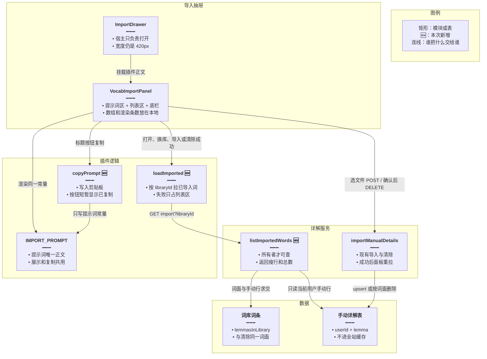
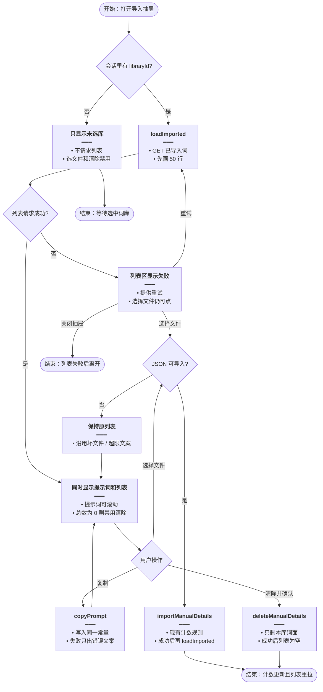
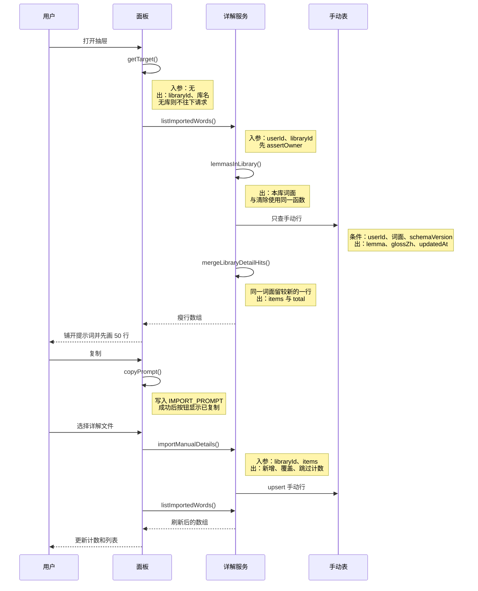
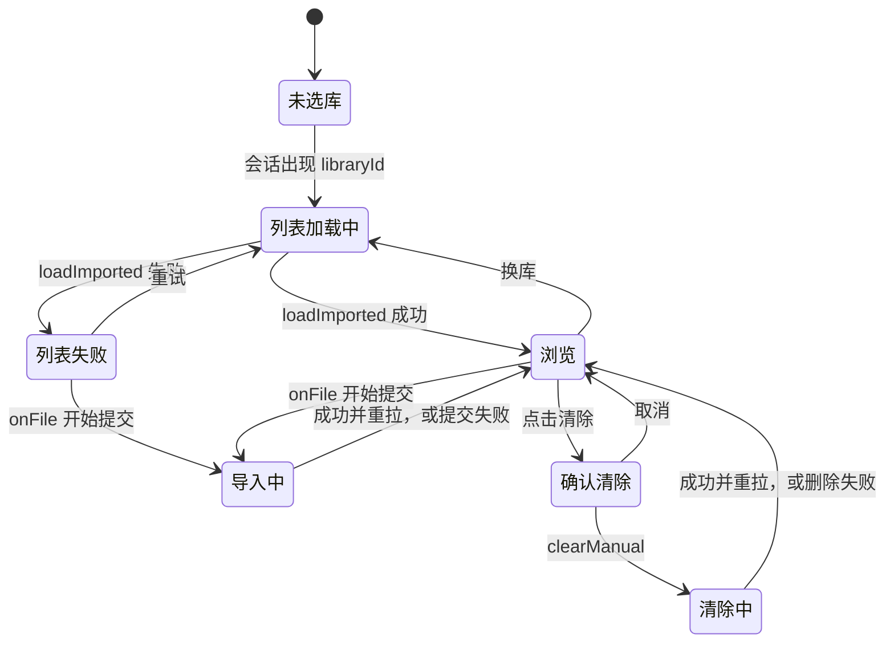

# 详解导入面板 — 实现思路

> **状态**：规划（未实现）  
> **日期**：2026-11-12  
> **需求摘要**：词库所有者打开「导入单词详解」抽屉时，能直接看见整库提示词和这本库已经导入的词，并把复制、选文件、清除的主次拉开。  
> **一句话方案（预告）**：提示词就地渲染 `IMPORT_PROMPT`；已导入词用新的只读接口按本库词面交当前用户的手动表一次取回，面板先画 50 行；复制放在提示词标题上，底栏只留选择文件和清除。

## 延伸阅读

- 库继续涨时已导入列表改为游标分页，不再整包返回：[已导入词游标分页.md](./已导入词游标分页.md)
- 导入怎么落表、打开详解时谁优先：[手动导入单词详解.md](./手动导入单词详解.md)
- 详解列表列的是「当前会打开的那一份」，不是「手动导入过的词」：[解析列表绑定词库.md](./解析列表绑定词库.md)
- 点词看详解的抽屉：[单词详解插件.md](./单词详解插件.md)

---

## 0. 读本文你将得到什么

- 要补的缺口：抽屉里只有说明和三颗按钮，提示词正文和已经落库的手动详解都要关掉抽屉才想得起来。
- 选定方案：插件面板铺开现有提示词常量；已导入词走新的 `GET /english-learning/vocab-detail/import`，不复用详解列表的合并结果。
- 改动在导入插件面板、两份文案，以及详解服务上的一个只读方法。宿主抽屉壳和详解列表缓存不动。
- 分两阶段：先改面板布局并展示提示词，再接已导入列表，导入或清除成功后重拉。
- 最大风险是误用详解列表：重新生成过的词会从「已导入」里消失，但清除时仍会被删掉。

---

## 1. 需求与边界

### 1.1 用户故事

| 角色 | 场景 | 行为 | 期望结果 |
|------|------|------|----------|
| 词库所有者 | 单词库列表点导入图标 | 打开抽屉 | 看见当前库名、给外部 agent 的整库提示词、这本库已导入的词，以及选文件、清除 |
| 词库所有者 | 要把提示词发给外部 agent | 看提示词并点复制 | 画面上的文字和剪贴板是同一段 `IMPORT_PROMPT`，不含词库导出 JSON |
| 词库所有者 | 这本库已经导过一部分词 | 打开抽屉或导入成功之后 | 列表出现这些词的词面和首条中文释义，并给出总数 |
| 词库所有者 | 某个词既有手动详解、后来又重新生成过 | 看已导入列表 | 这个词仍在列表里。打开详解时的优先级不变，仍是重新生成优先 |
| 词库所有者 | 只想再导入一份文件 | 点选择详解文件 | 仍走现有解析和 `POST`。成功后列表刷新；文件不合法时列表保持原样 |
| 词库所有者 | 要清掉这本库的手动详解 | 点清除并确认 | 仍走现有 `DELETE`。成功后列表变空，清除按钮不可点 |
| 非所有者 | 直接调列表接口 | 请求已导入词 | 403，和导入、清除相同 |

### 1.2 范围

| 在范围内 | 不在范围内（非目标） |
|----------|----------------------|
| 导入插件抽屉里展示提示词、已导入词，并重排按钮 | 改宿主 `ImportDrawer` 的开关、宽度、标题来源 |
| 提示词只读展示，复制同一常量 | 在抽屉里编辑提示词，或把词库 JSON 拼进提示词 |
| 已导入 = 当前用户手动表 ∩ 这本库词面 | 把全站缓存、重新生成也列进这个抽屉 |
| 列表展示词面、首条释义、更新时间、总数 | 在这一行上打开详解抽屉，或做搜索框 |
| 导入、清除的写入规则保持现状 | 改覆盖语义、改 2000 条上限、改 `parseVocabDetail` |
| 中英两份插件文案 | 改外部 agent 的调用方式。本系统仍不代发 |

### 1.3 约束与依赖

- 抽屉宽度已是 `vocabDrawerWidth`（`w-full sm:max-w-[420px]`）。三个中文长按钮在这一宽度里会换行，新布局必须在这一宽度里排成可扫的一列。
- 提示词的唯一正文是插件常量 `IMPORT_PROMPT`。画面和复制都不能再写一份。
- 手动详解的钥匙仍是 `(userId, lemma)`。列表词面必须和 `lemmasInLibrary` / `deleteManualDetails` 是同一套，否则「看见的」和「清除会删的」会分叉。
- 详解列表的 Redis 有序集合存的是 `pickVocabOpen` 胜出的那一份（重新生成 > 手动导入 > 全站缓存）。这份面板不能改那套缓存的形状。
- 组件沿用插件里已有的 `Button`、`ScrollArea`、`Confirm`。不新增依赖，不在宿主上重做一套抽屉。
- 必须登录。列表接口与导入、清除一样只允许词库所有者。

---

## 2. 背景

- **谁、在什么场景、卡在哪**：词库所有者从单词库卡片打开导入抽屉，要做三件事：把提示词复制给外部 agent、选回 agent 产出的详解文件、必要时清掉这本库的手动详解。现在抽屉只显示库名、一段操作说明和三颗按钮。提示词在 `IMPORT_PROMPT` 里，要点复制才进剪贴板，抽屉里读不到。已经导入的词写在 `english_vocab_detail_manual`，关掉抽屉后面板上的导入计数也没了，下次打开不知道这本库已经有哪些词。
- **现状缺口**：`VocabImportPanel` 没有提示词区域，也没有列表请求。`GET /english-learning/vocab-detail/list` 能按库分页，但一行只保留胜出的来源。一个词只要有重新生成，列表上的 `source` 就不再是 `manual`，手动行其实还在。按钮是 `flex flex-wrap`：复制和清除为 `outline`，选择文件为 `default`。在 420px 抽屉里，「清除这本库的手动详解」会掉到下一行，三颗按钮权重接近。
- **不解决会怎样**：用户只能盲复制提示词；想核对已导入词，只能到单词卡上逐个点开，或凭记忆再导一次。清除前也看不到将要删掉的范围。
- **硬约束**：不能把个人手动行混进详解列表缓存；不能为了展示去打模型；不能改导入覆盖规则；宿主抽屉继续只负责挂插件。

---

## 3. 现状与复用

| 能力 | 仓库中已有 | 本需求中的用法 |
|------|------------|----------------|
| 导入抽屉壳 | `apps/frontend/src/views/englishLearning/components/vocab/ImportDrawer.tsx` | 直接复用。仍按 `vocabDetailImport` 挂 `PluginHostPage`，宽度继续用 `vocabDrawerWidth` |
| 当前库会话 | `apps/frontend/src/federation/modules/vocabDetailImport/session.ts` 的 `getTarget` / `subscribe` | 直接复用。列表和提交都用这里的 `libraryId` |
| 导入面板 | `micro-apps/dnhyxc-ai-plugins/src/views/vocab-detail-import/panel.tsx` | 扩展。提示词区、已导入列表、底栏改在这一文件 |
| 提示词正文 | 同目录 `prompt.ts` 的 `IMPORT_PROMPT` | 直接复用。展示和复制都读它，不改句子 |
| 选文件、导入、清除 | 同文件 `onFile`、`clearManual`，以及 `POST` / `DELETE /english-learning/vocab-detail/import` | 直接复用。成功后多一次重拉列表 |
| 确认清除 | 插件 `@design/Confirm` | 直接复用 |
| 按钮、滚动区 | 插件 `@ui/button`、`@ui/index` 的 `ScrollArea` | 直接复用。不新写按钮皮肤 |
| 详解列表的滚动加载 | `micro-apps/dnhyxc-ai-plugins/src/views/vocab-detail-list/list.tsx` | 不适用其接口。只借鉴「先画一截、滚到底再多画」的做法，数据放在本面板内存 |
| 合并列表接口 | `GET /english-learning/vocab-detail/list`，`VocabDetailService.listForLibrary` | 不适用。那份结果是打开详解时的胜出源 |
| 词面集合 | `VocabDetailService.lemmasInLibrary` | 直接复用。与导入白名单、按库清除同一套词面 |
| 首条释义 | `slotRows` 抽取 `detail.senses[0].glossZh`，并过滤 `schemaVersion` | 直接复用。列表不回传整份 `detail` |
| 排序 | `mergeLibraryDetailHits`：时间新的在前，时间相同则词面降序 | 直接复用。保证同一词面只留一行 |
| 手动表 | `english_vocab_detail_manual`，唯一键 `(user_id, lemma)` | 直接复用。不改表 |
| 插件 HTTP | 宿主 `api.http.get/post/delete` | 直接复用。面板类型补上已有的 `get` |
| 详解列表 Redis | `writeListZset` / `patchListLemma` | 不适用。本列表不读不写这套键。导入成功后原有补丁逻辑保持原样 |

**调研结论**：提示词已经在插件常量里，缺的是一块可读区域。已导入词已经在手动表里，缺的是按「本库词面 ∩ 当前用户」读出来的接口。详解列表接口看起来能滤 `source === 'manual'`，但胜出规则会把重新生成过的词藏掉，和清除范围对不上。抽屉壳不用动。

---

## 4. 方案比对与最终方案

### 4.1 候选方案

#### 方案 A：插件内改面板，已导入词单独只读接口（扩展现有面板，新增一个 GET）

- **做法**：`VocabImportPanel` 增加提示词滚动区和已导入列表。`GET /english-learning/vocab-detail/import?libraryId=` 调用新的 `listImportedWords`：`assertOwner` 之后用 `lemmasInLibrary` 取词面，`slotRows(manualRepo)` 只查手动表，`mergeLibraryDetailHits` 去重并排序，一次返回全部瘦行（`lemma`、`glossZh`、`updatedAt`）。面板把数组放进 state，先渲染 50 行，滚到底再多渲染 50 行。复制、选文件、清除的摆放见 §4.5。
- **能工作的原因**：手动行本来就按用户和词面存在。词面函数与清除共用，所以列表里的词就是清除会删的词，重新生成不会把它们滤掉。一次返回瘦字段，抽屉打开才请求，不打模型，也不碰详解列表缓存。
- **主要代价**：多一个只读接口。单库手动词很多时，这一次响应会带上全部词面和首条释义。面板要自己分批画，避免一次挂上万个节点。

#### 方案 B：插件内改面板，已导入词直接滤详解列表（只扩展面板）

- **做法**：提示词和按钮布局与方案 A 相同。已导入列表调用现成的 `GET /english-learning/vocab-detail/list`，前端只留下 `source === 'manual'` 的行，沿用它的游标每页 50 条。
- **能工作的原因**：接口、缓存、游标都是现成的。只导入、没有重新生成、也没有把胜出源让给别的来源时，这些行就是手动详解。
- **主要代价**：`pickVocabOpen` 让重新生成盖过手动导入。这类词的手动行还在，清除仍会删掉，列表里却没有。游标和 `total` 也是合并后的全集，滤完当前页不能当成「已导入总数」。只存在全站缓存里的词还会先占着分页，手动词被挤到后面。

#### 方案 C：为手动词再做一套 Redis 有序集合（扩展列表缓存）

- **做法**：在现有 `listZsetKey` 之外为手动来源再写一套有序集合和哈希，导入、清除、`patchLemmaForUser` 同步维护。抽屉按游标每次取 50 条。提示词仍在插件里展示。
- **能工作的原因**：翻页只碰 Redis，请求体保持 50 条。词面集合仍然来自本库，可以做到和清除一致，也不会被重新生成盖掉。
- **主要代价**：导入、清除、重新生成补丁、列表 epoch、Redis 不可用时的降级，都要再写一条平行路径。这套键和详解列表的胜出缓存容易分叉，总数对不上时要两处对账。

### 4.2 比对

| 维度 | 方案 A | 方案 B | 方案 C |
|------|--------|--------|--------|
| 正确性（失败路径、边界、数据是否会错） | 列表 = 手动表 ∩ `lemmasInLibrary`。重新生成过的词仍在。版本号过滤与 `slotRows` 一致，旧版本不当成已导入 | 重新生成过的词从列表消失，清除范围却仍包括它。当前页过滤不能代表总数 | 集合可以做对，但两套缓存只要一处漏补丁就会和手动表不一致 |
| 复用 / 与现状契合 | 复用 `assertOwner`、`lemmasInLibrary`、`slotRows`、`mergeLibraryDetailHits`、`IMPORT_PROMPT`、现有 POST/DELETE | 复用整份详解列表。该接口的产品含义是「打开时看到哪一份」，不是「导入过什么」 | 复用 Redis 翻页写法。手动列表和胜出列表是两份数据，硬塞进同一套键 |
| 改动面（要动哪些路径） | 插件 `panel.tsx`、中英文案、`vocab-detail.service.ts`、控制器加一个 GET | 只有插件面板和文案 | 服务里所有会改手动行或列表缓存的路径，外加面板 |
| 复杂度（新概念、新状态、新依赖） | 一个只读方法和面板里的数组。无新表、无新缓存、无新依赖 | 无新接口。前端要额外解释「为什么有的已导入词不在列表里」 | 第二套 zset / hash / ready 键，以及 Redis 缺失时的另一条内存分页 |
| 体验（延迟、步骤数、失败时用户看到什么） | 打开抽屉一次 GET。万级词面时这一次稍大，之后滚动不再请求。列表失败时选文件仍可用 | 首屏快，但用户会以为重新生成过的词没有导过 | 翻页最快。导入后若补丁失败，列表会短暂和数据库不一致 |
| 风险（迁移、互斥、并发、回滚） | 无迁移。GET 与 POST/DELETE 同路径不同方法。不写缓存，回滚只是删掉这个方法和面板区域 | 无迁移。错误集合会让用户在清除前漏看词 | 要给已有补丁路径加双写。回滚时旧键会残留到 TTL |
| 可维护性（以后改一处还是改多处） | 词面规则仍只在 `lemmasInLibrary`。提示词仍只在 `IMPORT_PROMPT` | 胜出规则一变，这个抽屉的过滤就跟着错 | 改手动行的每一处都要记得改第二套键 |

### 4.3 综合考量

这次更在乎两件事：列表必须是「清除会删掉的那些手动详解」，以及 420px 抽屉里不要为了一个只读列表再养一套缓存。方案 A 在这两项上直接用现有的词面函数和手动表，打开抽屉才查一次。

方案 B 的真实优点是后端一行都不用加。放弃它，是因为重新生成和手动导入可以同时存在，过滤胜出源会把已导入词藏起来，用户对着一份不完整的列表点清除。

方案 C 的真实优点是翻页不把全量瘦行带回浏览器。放弃它，是因为导入抽屉不是详解列表那种常驻翻页，为了压一次响应去双写 Redis，漏补丁的代价比一次多传几万个短字段更大。全量响应的上限写在实现里：单库手动词过万且这次 GET 变慢时，再改成 keyset 查询，仍然不要加第二套缓存。

### 4.4 最终方案

#### 背景

导入抽屉今天能复制提示词、提交详解文件、按库删除手动行，但提示词正文和已导入词都不在画面上。详解列表不能拿来填这块，因为它一行只留重新生成、手动导入、全站缓存里胜出的那一份。已导入列表必须和 `deleteManualDetails` 使用同一批词面，并且不能改详解列表缓存。

#### 具体思路

1. 模块：展示和交互留在导入插件 `panel.tsx`。宿主 `ImportDrawer` 继续只负责打开和挂载。新读法放在 `VocabDetailService.listImportedWords`，控制器加同路径的 GET。
2. 数据：提示词从 `IMPORT_PROMPT` 读到画面，复制也写这一个字符串。已导入词从手动表来，词面用 `lemmasInLibrary`，释义只用首条 `glossZh`。不读取、不写入详解列表的 Redis。
3. 状态：当前库仍用联邦会话。已导入数组、总数、渲染条数、错误和导入结果放在面板 `useState`。不进 URL，不进英语学习 store。库 id 变化、导入成功、清除成功时清掉数组再请求。滚动只增加本地渲染条数，不再次请求。
4. 边界：无库 id 不请求。列表失败只占列表区，选择文件仍可点。文件解析失败不刷新列表。空库或没有手动行时总数为 0，清除按钮禁用。同一词面多条词库行在列表里只出现一次。`schemaVersion` 对不上的手动行不出现，和打开详解时不当作命中一致。

#### 实现方案

**一句话**：提示词就地渲染 `IMPORT_PROMPT`；已导入词用新的只读接口按本库词面交当前用户的手动表一次取回，面板先画 50 行；复制放在提示词标题上，底栏只留选择文件和清除。

| 步骤 | 谁 | 做什么 | 输入 → 输出 |
|------|----|--------|-------------|
| 1 | `VocabImportPanel` | 订阅会话。有 `libraryId` 就请求已导入词 | `libraryId` → 瘦行数组、`total` |
| 2 | `listImportedWords` | 校验所有者，取本库词面，只查手动表，合并排序后整批返回 | `userId + libraryId` → `{ items, total }` |
| 3 | 提示词区 | 用 `pre` 铺开 `IMPORT_PROMPT`，标题上的按钮复制同一常量 | 常量 → 画面与剪贴板 |
| 4 | `onFile` / `clearManual` | 沿用现有提交。成功后从第一步重拉；文件不合法则不动列表 | 文件或确认 → 原有计数 / 删除数，然后新的列表 |
| 5 | 列表面板 | `items.slice(0, shown)`，滚到哨兵时 `shown += 50` | 内存数组 → 当前可见行 |

#### 选定原因

1. **正确性**：列表和清除共用 `lemmasInLibrary`，重新生成盖不住手动行。牺牲：详解列表那份现成分页不能直接拿来用。
2. **复用**：提示词、所有权、词面、释义抽取、排序、POST、DELETE、抽屉壳都沿用。牺牲：面板类型要补上宿主本来就有的 `http.get`，并新写一个只读方法。
3. **改动面**：不动宿主抽屉、不动 Redis 补丁、不改表。牺牲：比方案 B 多一个控制器方法。
4. **复杂度**：一次数组，滚动只改渲染条数。牺牲：单库手动词很多时，第一次响应比 50 条游标大。
5. **体验**：打开就能读提示词，也能看到将要被覆盖或清除的词。牺牲：万级词面时第一次 GET 比只取 50 条慢。
6. **风险**：无迁移、不双写缓存。牺牲：以后若要改成 keyset，客户端的「一次拿全」要跟着改。
7. **可维护性**：词面规则和提示词正文仍然各只有一处。牺牲：渲染分批写在导入面板里，不和详解列表抽成公共 hook。

#### 优势

- 相对方案 B：重新生成过的词仍出现在「已导入」里，总数就是手动行数，清除前看得到将要删的范围。
- 相对方案 C：导入、清除、列表补丁不用第二套 Redis 键，Redis 不可用时这条只读查询照样能返回。

#### 怎么实现

1. 抽屉打开或 `libraryId` 变化时，`loadImported` 请求 `GET /english-learning/vocab-detail/import?libraryId=`。
2. `listImportedWords` 依次做所有权、词面、手动表瘦行、合并排序，返回 `{ items, total }`。
3. 提示词区渲染 `IMPORT_PROMPT`。复制按钮把同一个常量写入剪贴板，成功后按钮文案短暂变为「已复制」。
4. `onFile` 在现有 `setResult` 成功之后调用与步骤 1 相同的重拉；`clearManual` 在删除成功后同样重拉。JSON 解析失败、超过 2000 条、接口失败都不清列表。
5. 列表区用 `shown` 从 50 起切片。哨兵进入滚动区就把 `shown` 加 50，直到等于 `items.length`。

按钮怎么排不改变上述数据流，单独放在 §4.5。主链路代码在 §9.2，面板结构在 §9.4。

### 4.5 其他关键决策

操作按钮的归属会改变面板里哪一块拥有「复制」状态，也会改变 420px 宽度下用户先点到什么。这是布局决策，不改变 §4.4 的接口。

#### 4.5.1 候选方案

##### 方案 A：复制属于提示词标题，底栏只留选择文件和清除（扩展现有按钮，调整位置）

- **做法**：提示词区块标题右侧放 `outline` 的「复制」。底栏 `shrink-0` 一行：`default` 的「选择详解文件」使用 `flex-1`，右侧「清除手动详解」使用 `outline` 且不拉伸。清除文案从「清除这本库的手动详解」收成「清除手动详解」，确认框继续说明只删当前用户、当前库词面。提示词区和列表区都是 `min-h-0` 且内部滚动，高度比约为 2:3。说明文字留在库名下面。
- **能工作的原因**：复制的对象就在按钮旁边。主操作在底栏始终可见，不跟列表一起滚走。两颗底栏按钮在 420px 里可以排进同一行。
- **主要代价**：复制不再是一颗和选文件并排的大按钮。提示词区占掉一部分高度，列表不是整抽屉。

##### 方案 B：三颗按钮保持现在的位置，下面追加提示词和列表（最小改动）

- **做法**：保留 `flex flex-wrap` 的复制、选择文件、清除。在它们下面加提示词 `pre` 和已导入列表。复制仍调用 `IMPORT_PROMPT`。
- **能工作的原因**：三个点击处理函数不用搬家。提示词和列表只要堆在按钮下面就能看见。
- **主要代价**：复制和提示词各出现一次，职责重复。清除的长文案继续把按钮挤换行，和选择文件看起来同一重量。说明、按钮、提示词、列表四段竖排，420px 高度里列表更矮。

##### 方案 C：顶栏用分段控件在「提示词 / 已导入」之间切换（使用现有 Segmented）

- **做法**：插件已有 `@design` 的 `Segmented`。顶栏固定三颗操作，中间区域一次只显示提示词或列表。
- **能工作的原因**：每一块都能占满剩余高度，提示词不用和列表分高度。操作始终在顶上。
- **主要代价**：核对已导入词时看不到提示词。用户要切一次才知道该复制哪一段，和「打开就能同时看见」相反。

#### 4.5.2 比对

| 维度 | 方案 A | 方案 B | 方案 C |
|------|--------|--------|--------|
| 正确性 | 复制源和画面是同一常量。此项与 B、C 相同 | 此项相同 | 此项相同 |
| 复用 / 与现状契合 | 仍用 `Button` 的 `default` / `outline` 和现有 `Confirm` | 连 class 都少改。最贴现状 | 复用 `Segmented`。导入面板今天没有分段 |
| 改动面 | `panel.tsx` 的结构区和两条文案 | 在现有按钮区后面插入两块 | 按钮区加分段状态，两块内容改成条件渲染 |
| 复杂度 | 多一个 `copied` 布尔，1.5 秒后复位 | 无新状态 | 多一个页签 state |
| 体验 | 打开同时看见提示词和已导入词。主按钮在底栏，清除降为次按钮 | 三颗按钮继续抢第一眼。提示词要滚过按钮才到 | 单块更高。看列表时提示词不在画面上 |
| 风险 | 低。确认框文案不变，避免短按钮看不懂清除范围 | 低。只是继续现在的拥挤 | 低。切换不会误提交 |
| 可维护性 | 复制按钮只放在提示词标题一处 | 以后改提示词展示时要记得大按钮和正文是同一动作 | 两页各写一块空态，操作和内容被拆开 |

#### 4.5.3 综合考量

420px 宽度里，按钮的权重比再增加一颗按钮更重要。用户打开抽屉要先读提示词，真正会改数据的是选择文件和清除。方案 A 把复制交还给提示词区块，底栏留下一主一次。

方案 B 的真实优点是三颗按钮的处理函数原地不动。放弃它，是因为长清除文案会继续换行，复制和正文重复，列表被挤到折叠线以下。

方案 C 的真实优点是提示词可以独占剩余高度。放弃它，是因为这次要同时看见提示词和已导入词，切页让两块不能对照。

#### 4.5.4 最终方案

##### 背景

现有三颗按钮在 `sm:max-w-[420px]` 里换行，复制、选择文件、清除的视觉重量接近。提示词一旦铺开，复制再占一颗同级大按钮就会和正文重复。清除是破坏性操作，不应该和选择文件一样抢第一眼，但必须留在不随列表滚动的位置。

##### 具体思路

1. 纵向四段：库名和说明（`shrink-0`）、提示词（`flex-[2] min-h-0`）、已导入列表（`flex-[3] min-h-0`）、底栏（`shrink-0`）。
2. 复制状态只放在提示词标题的按钮上：成功则文案改为「已复制」，1.5 秒后恢复。失败仍用现在的 `vocabImport.copyFailed`。
3. 底栏一行两颗：选择文件 `variant="default"` 且 `flex-1`；清除 `variant="outline"`，文案改为「清除手动详解」。`total === 0` 或请求中时禁用清除。确认框继续用现有 `clearTitle` / `clearDesc`。
4. 说明文字保留在库名下，用更小的字号。它讲的是人的规则（不要选词库导出文件、缺词不删除、手动行会被替换、全站缓存不动），提示词讲的是给 agent 的输出格式，两段都留。

##### 实现方案

**一句话**：复制贴在提示词标题上，底栏一行是拉伸的「选择详解文件」和不拉伸的「清除手动详解」，提示词和列表按 2:3 分剩余高度并各自滚动。

| 步骤 | 谁 | 做什么 | 输入 → 输出 |
|------|----|--------|-------------|
| 1 | 提示词标题 | `outline`「复制」调用 §4.4 的 `copyPrompt` | 点击 → 剪贴板 + 短暂「已复制」 |
| 2 | 底栏 | 左主右次，不随列表滚动 | 点击 → 现有选文件 / 打开确认框 |
| 3 | 两个滚动区 | 提示词 `flex-[2]`，列表 `flex-[3]`，都 `min-h-0` | 剩余高度 → 两块内部滚动 |

##### 选定原因

1. **体验**：打开同时看见提示词和已导入词，主操作固定在底栏。牺牲：提示词不是整页高度，长提示词要在自己的区域里滚。
2. **复用**：仍是现有 `Button` 变体和 `Confirm`，不引入分段控件。牺牲：要改两处按钮的 class 和一条清除文案。
3. **复杂度**：只多一个 1.5 秒复位的 `copied`。牺牲：比方案 B 多一次结构调整。
4. **正确性**：此项与三个方案相同，复制源都是 `IMPORT_PROMPT`。牺牲：无。
5. **风险**：确认框原文保留，短按钮不会少说明。牺牲：无。
6. **可维护性**：复制只出现在提示词标题。牺牲：无。
7. **改动面**：只动 `panel.tsx` 和「清除」文案。牺牲：无。

##### 优势

- 相对方案 B：420px 里底栏不再换行成三颗同权按钮，复制和提示词正文挨在一起。
- 相对方案 C：不用切换就能对照提示词和已导入词。

##### 怎么实现

1. 提示词标题用一行 flex：左侧「提示词」，右侧复制按钮。
2. 底栏在列表下方，`flex shrink-0 items-center gap-2`。选择文件 `className="flex-1"`，清除不设 `flex-1`。
3. 提示词 `ScrollArea` 的父级 `flex-[2]`，列表 `ScrollArea` 的父级 `flex-[3]`。结构代码见 §9.4。

---

## 5. 架构图



**图内方法说明**：

| 方法 | 功能 |
|------|------|
| `VocabImportPanel` | 导入插件正文：订阅当前库，拼提示词区、已导入列表和底栏 |
| `copyPrompt()` | 把 `IMPORT_PROMPT` 写入剪贴板；成功后按钮显示「已复制」，失败沿用现有错误文案 |
| `loadImported()` | 用会话里的 `libraryId` 请求已导入列表，写入面板数组；无库或请求失败时不挡住选文件 |
| `listImportedWords(userId, libraryId)` | 校验所有者后返回本库已导入词的词面、首条释义、更新时间和总数。不打模型，不写 Redis |
| `importManualDetails(...)` | 现有导入。写入规则不变，成功后由面板再调用 `loadImported` |
| `deleteManualDetails(...)` | 现有按库清除，画在同一写入节点的清除侧。成功后同样重拉 |
| `lemmasInLibrary(libraryId)` | 取出这本库允许导入的词面。列表和清除都用它，避免两边词集合不同 |

**读图要点**：

- 宿主抽屉不到提示词和列表。新读法停在服务的一个方法上，手动表仍是唯一数据源。
- 详解列表的 Redis 不在这条链上。重新生成缓存也不会进 `listImportedWords`。
- 复制不经过服务。提示词常量只活在插件里。

---

## 6. 主流程图



**图内方法说明**：

| 方法 | 功能 |
|------|------|
| `loadImported()` | 按当前库拉取已导入词。换库、导入成功、清除成功、点重试都走它 |
| `copyPrompt()` | 复制画面上的提示词。不修改列表，也不把词库 JSON 拼进去 |
| `importManualDetails(...)` | 提交详解文件。解析失败不会调用它，因此不会刷新列表 |
| `deleteManualDetails(...)` | 确认后删除这本库词面上的当前用户手动详解 |

**读图要点**：

- 列表失败和文件不合法都停在抽屉里，不把已有列表清掉。
- 只有导入或清除真正成功才重拉，避免一次失败把刚看到的词抹掉。
- 复制是旁路，不进入写接口。

---

## 7. 核心时序图



**图内方法说明**：

| 方法 | 功能 |
|------|------|
| `getTarget()` | 读取联邦会话里的当前词库。面板用它决定请求哪本库 |
| `listImportedWords()` | 返回这本库已导入词的瘦行和总数。时序里打开时和导入成功后各调用一次 |
| `lemmasInLibrary()` | 把库内词条收成词面数组，供手动表做交集 |
| `mergeLibraryDetailHits()` | 按词面合并，时间新的排在前面。这里每条命中的来源都是 manual |
| `copyPrompt()` | 把提示词常量写入剪贴板，不访问服务 |
| `importManualDetails()` | 按现有规则写入手动表。返回后面板再次拉列表 |

**读图要点**：

- 打开抽屉的读和选文件的写是先后两条路，写成功才有第二次读。
- 手动表不返回整份 `detail`。面板只靠首条释义辨认这个词。
- 清除的时序与导入成功相同，只是把 `importManualDetails` 换成 `deleteManualDetails`，第二次读应得到空数组。图中不重复画这一条。

---

## 8. 状态机



**图内方法说明**：

| 方法 | 功能 |
|------|------|
| `loadImported()` | 进入列表加载中。成功到浏览，失败到列表失败 |
| `onFile()` | 文件通过本地校验后进入导入中。接口失败回到浏览并保留原列表 |
| `clearManual()` | 确认后进入清除中。成功重拉，失败回到浏览并保留原列表 |

**读图要点**：

- 导入中和清除中互斥，底栏两颗按钮都禁用，避免叠两次写入。
- 列表失败不是整页失败。从失败态仍可以选文件，选文件走导入中。
- 换库会丢掉上一本库的数组，避免把 A 库的词留在 B 库的抽屉里。

---

## 9. 具体实现（主链路代码）

### 9.1 模块一览

| 模块 | 职责 | 新增/改动 | 预估路径 |
|------|------|-----------|----------|
| 导入面板 | 提示词、列表、底栏、重拉 | 扩展 | `micro-apps/dnhyxc-ai-plugins/src/views/vocab-detail-import/panel.tsx` |
| 提示词常量 | 展示和复制的正文 | 直接复用 | 同目录 `prompt.ts` |
| 插件文案 | 提示词标题、已复制、已导入总数、空态、列表失败、较短的清除 | 扩展 | `src/i18n/locales/zh-CN.ts`、`en-US.ts` |
| 已导入查询 | 所有者校验、词面交集、瘦行 | 新增 | `apps/backend/src/services/english-learning/vocab-detail.service.ts` |
| 控制器 | `GET vocab-detail/import` | 扩展 | `apps/backend/src/services/english-learning/english-learning.controller.ts` |
| 宿主抽屉 | 打开插件 | 直接复用 | `apps/frontend/src/views/englishLearning/components/vocab/ImportDrawer.tsx` |

### 9.2 主链路实现

```typescript
// 对应 §4.4 步骤 2。一次返回本库全部已导入瘦行，滚动分页放在面板内存里做
type ImportedWord = {
	// 规范化词面。和手动表、清除用的 lemma 相同，画面上就显示这一串
	lemma: string;
	// 首条释义。空字符串表示这份详解没有 gloss，列表仍要留下词面
	glossZh: string;
	// ISO 时间。排序已经在服务端完成，面板只拿它做副文案
	updatedAt: string;
};

// 对应 §4.4 步骤 2。无游标：抽屉打开次数少，避免为这份只读列表再做一套翻页缓存
type ImportedWordPage = {
	// 已按时间倒序排好。面板只切片渲染，不再向服务要下一页
	items: ImportedWord[];
	// 手动行数。为 0 时清除按钮禁用，空态用这个数而不是猜数组
	total: number;
};

// 对应 §4.4 步骤 2。词面来源与 deleteManualDetails 相同，重新生成不会把行滤掉
async function listImportedWords(
	// 当前登录用户。不能改成词库所有者 id，否则会列出别人的手动详解
	userId: number,
	// 抽屉会话里的库。服务端再验所有权，不信任插件传来的标题
	libraryId: string,
// 返回值不含 detail 全文，避免抽屉为了列词把整份详解拉下来
): Promise<ImportedWordPage> {
	// 与 POST、DELETE 同一把锁：非所有者 403
	await this.assertOwner(userId, libraryId);
	// 去重后与手动表唯一键对齐，同一词面在库里有多行时列表只计一次
	const lemmas = [...new Set(await this.lemmasInLibrary(libraryId))];
	// 空库没有可导入词面，直接空页，避免后面拼出一条 IN ()
	if (lemmas.length === 0) {
		// items 与 total 同时为 0，面板不会把「没请求」和「确实没有」混成同一种加载中
		return { items: [], total: 0 };
	}
	// 只收集手动命中。不把全站缓存和重新生成塞进来
	const hits: ListHit[] = [];
	// 分批查询，单批词面数量和现有列表装载一致
	for (let i = 0; i < lemmas.length; i += 1000) {
		// 每批 1000，避免一条 SQL 的 IN 塞进整库
		const chunk = lemmas.slice(i, i + 1000);
		// 只查手动表。slotRows 会带上 schemaVersion，旧版本不会出现在「已导入」里
		const rows = await this.slotRows(this.manualRepo, 'm', chunk, userId);
		// 原始行可能缺词面或时间，toHit 会丢掉这些行
		for (const row of rows) {
			// source 固定 manual，后面的合并不会再去挑别的来源
			const hit = this.toHit(row, 'manual');
			// 无效行不进列表，避免一个空词面占掉一行
			if (hit) hits.push(hit);
		}
	}
	// 同一词面留较新的一行，并按时间倒序。这里没有 regen / generated，胜出源一定是 manual
	const merged = mergeLibraryDetailHits(hits);
	// 瘦行给面板。ponytail: 过万行整包返回变慢时改 keyset，不要加第二套 Redis
	return {
		// 只要词面、首条释义、时间，面板不需要形态和例句
		items: merged.map((row) => ({
			// 词面原样返回，面板不再做一次 normalize
			lemma: row.lemma,
			// 首条释义。没有时是空字符串，行上只显示词面
			glossZh: row.glossZh,
			// 用 ISO 字符串，面板不用再认识 Date
			updatedAt: row.updatedAt.toISOString(),
		})),
		// 总数等于去重后的手动行数，不是词库词条数
		total: merged.length,
	};
}
```

`ponytail:` 单库手动词过万时，这一次会把全部瘦行读进内存并返回。变慢后再改成按 `updatedAt + lemma` 的 keyset，仍用 `lemmasInLibrary` 的词面，不要加第二套 Redis。

```typescript
// 对应 §4.4 步骤 1 和步骤 4。换库、导入成功、清除成功都从空数组重拉，避免上一本库的词留下来
async function loadImported(
	// 会话里的库 id。编码进查询串，避免标题里的字符把 URL 截断
	libraryId: string,
): Promise<void> {
	// 递增代数。慢请求回来时库已经换了，就丢掉那一次结果
	const gen = ++genRef.current;
	// 清掉上一本库的错误，避免新库还没返回就挂着旧失败
	setListError(null);
	// 列表区单独转圈，底栏的选文件不跟着禁用
	setListLoading(true);
	// 请求和渲染绑在同一次代数上，换库后的旧响应不能写进 state
	try {
		// 解开宿主 http 可能多包的一层 data，面板只认 items 和 total
		const page = unwrapImported(
			// GET 与 POST、DELETE 同路径，用方法区分读和写
			await http.get(
				// libraryId 来自会话，不从输入框读，防止查到没打开的库
				`/english-learning/vocab-detail/import?libraryId=${encodeURIComponent(libraryId)}`,
			),
		);
		// 代数变了说明用户已经换库或又触发了一次重拉
		if (gen !== genRef.current) return;
		// 整批替换。不在旧数组上追加，否则换库会串词
		setItems(page.items);
		// 每次重拉都从 50 行重新画，避免沿用上一本库的滚动窗口
		setShown(50);
	} catch (cause) {
		// 过期请求的失败也不写进当前库
		if (gen !== genRef.current) return;
		// 只占列表区。不调用 setError，避免和选文件的错误共用一条
		setListError(errorText(cause, t('vocabImport.listFailed')));
	} finally {
		// 只有这一代还有效时才关掉转圈，否则会把新请求的 loading 提前关掉
		if (gen === genRef.current) setListLoading(false);
	}
}
```

```typescript
// 对应 §4.4 步骤 3。画面和剪贴板共用 IMPORT_PROMPT，不把词库 JSON 拼进去
async function copyPrompt(): Promise<void> {
	// 剪贴板失败时走下面的 catch，不把提示词改成别的字符串
	try {
		// 写常量本身。pre 里渲染的也是它，两处不会各维护一份
		await navigator.clipboard.writeText(IMPORT_PROMPT);
		// 按钮改成「已复制」，让用户知道这次点到了
		setCopied(true);
		// 清掉上一次复制失败留下的红字
		setError(null);
		// 1.5 秒后恢复「复制」，避免按钮一直停在已复制
		window.setTimeout(() => setCopied(false), 1500);
	} catch {
		// 浏览器拒绝剪贴板时沿用现有文案，不把按钮改成已复制
		setError(t('vocabImport.copyFailed'));
	}
}
```

### 9.3 数据模型

| 字段/实体 | 来源 | 存储 | 说明 |
|-----------|------|------|------|
| `IMPORT_PROMPT` | 插件常量 | 插件包内 | 不入库。展示与复制的唯一正文 |
| `ImportedWord.lemma` | `lemmasInLibrary` ∩ 手动表 | 响应 JSON | 不返回整份 `detail` |
| `ImportedWord.glossZh` | `slotRows` 的首条释义 | 响应 JSON | 没有释义时为空字符串 |
| `ImportedWord.updatedAt` | 手动行 `updated_at` | 响应 JSON | 只用于排序和副文案 |
| `total` | `items.length` | 响应 JSON | 清除按钮在 0 时禁用 |
| `shown` | 面板本地 | 内存 | 初始 50，滚到底加 50 |
| 手动行 | 现有表 | `english_vocab_detail_manual` | 本需求不改列 |

### 9.4 面板布局

```tsx
// 对应 §4.5 步骤 1–3。复制在提示词标题，底栏不随列表滚动
function ImportBody(props: {
	// 为 true 时按钮文案用「已复制」，计时结束后由 copyPrompt 的定时器拉回 false
	copied: boolean;
	// 导入或清除进行中。两颗底栏按钮一起禁用，避免两次写入叠在一起
	busy: boolean;
	// 已导入总数。0 时清除没有对象，按钮禁用
	total: number;
	// 复制提示词。和 pre 里的常量是同一次调用
	onCopy: () => void;
	// 打开隐藏的文件输入。解析仍走现有 onFile
	onPick: () => void;
	// 只打开确认框。真正删除在确认之后
	onClear: () => void;
// 参数只描述三块区域要用的状态，具体行渲染留在面板里
}) {
	// 四段纵向：说明、提示词、列表、底栏。后两段吃掉剩余高度
	return (
		// 占满抽屉正文。min-h-0 让内部 ScrollArea 能滚动，而不是把抽屉撑高
		<div className="flex h-full min-h-0 flex-col gap-3 p-4 text-sm">
			{/* 说明讲给人：不要选导出文件、缺词不删、手动行会被替换、全站缓存不动 */}
			<p className="text-textcolor/55 shrink-0 text-xs leading-snug">{t('vocabImport.hint')}</p>
			{/* 提示词约占剩余高度的 2 份，自己滚动，不把列表顶出抽屉 */}
			<section className="flex min-h-0 flex-[2] flex-col gap-2">
				{/* 标题和复制同一行。复制不再和选文件抢底栏 */}
				<div className="flex shrink-0 items-center justify-between">
					{/* 区块名。正文在下面的 pre，不把常量再摘要一遍 */}
					<span>{t('vocabImport.promptTitle')}</span>
					{/* outline 小按钮。成功时文案换成已复制，失败仍走 copyPrompt 的错误文案 */}
					<Button type="button" variant="outline" size="sm" onClick={props.onCopy}>{props.copied ? t('vocabImport.copied') : t('vocabImport.copyPrompt')}</Button>
				</div>
				{/* 提示词过长时只滚这块，底栏仍钉在抽屉底部 */}
				<ScrollArea className="min-h-0 flex-1">
					{/* 等宽换行。渲染的就是复制的那个常量 */}
					<pre className="text-textcolor/80 text-xs whitespace-pre-wrap">{IMPORT_PROMPT}</pre>
				</ScrollArea>
			</section>
			{/* 列表约占 3 份，比提示词稍高，方便扫已导入词 */}
			<section className="flex min-h-0 flex-[3] flex-col gap-2">
				{/* 总数来自接口。空库显示 0，下面再放空态文案 */}
				<span className="shrink-0">{t('vocabImport.importedTitle', { total: String(props.total) })}</span>
				{/* 行用 div 只展示。哨兵把 shown 加 50，不在这里打开详解抽屉 */}
				<ScrollArea className="min-h-0 flex-1" />
			</section>
			{/* 底栏不参与 flex 伸缩，列表再长也能点到选文件 */}
			<div className="flex shrink-0 items-center gap-2">
				{/* 主操作吃掉剩余宽度，420px 里不用再换行 */}
				<Button type="button" size="sm" className="flex-1" disabled={props.busy} onClick={props.onPick}>{t('vocabImport.chooseFile')}</Button>
				{/* 次操作不拉伸。没有已导入词时禁用，确认框文案仍用原来的长说明 */}
				<Button type="button" variant="outline" size="sm" disabled={props.busy || props.total === 0} onClick={props.onClear}>{t('vocabImport.clear')}</Button>
			</div>
		</div>
	);
}
```

列表行用 `div` 展示词面和释义，不做成按钮。这个抽屉和详解抽屉同时挂在英语学习布局上，点一行再打开详解会叠两个抽屉，本次不做。

文案改动：

| key | 中文 |
|-----|------|
| `vocabImport.promptTitle` | 提示词 |
| `vocabImport.copied` | 已复制 |
| `vocabImport.importedTitle` | 已导入 {total} |
| `vocabImport.importedEmpty` | 这本库还没有导入的词 |
| `vocabImport.listFailed` | 已导入词加载失败 |
| `vocabImport.clear` | 清除手动详解 |

`vocabImport.copyPrompt` 改为「复制」。`clearTitle` 和 `clearDesc` 保持原文。英文案按同样含义改 `en-US.ts`。

---

## 10. 分阶段实现步骤

| 阶段 | 目标 | 交付物 | 依赖 |
|------|------|--------|------|
| M1 | 打开就能读提示词，按钮主次分明 | 面板新布局、复制反馈、中英文案 | 无 |
| M2 | 看见已导入词，写入成功后列表跟上 | GET、列表区、导入/清除后重拉 | M1 |

### M1

- [ ] 提示词区渲染 `IMPORT_PROMPT`，复制按钮在标题右侧，写入的字符串与画面一致。
- [ ] 复制成功后按钮变为「已复制」，约 1.5 秒后恢复；失败仍显示 `vocabImport.copyFailed`。
- [ ] 底栏一行：选择文件拉伸，清除为「清除手动详解」且不拉伸。确认框文案不变。
- [ ] 说明文字留在库名下。未选库时选文件和清除仍禁用。

### M2

- [ ] `GET /english-learning/vocab-detail/import?libraryId=` 返回 `{ items, total }`，非所有者 403，不打模型。
- [ ] 打开抽屉和更换 `libraryId` 时重拉。先渲染 50 行，滚到底再增加 50，直到数组末尾。
- [ ] 导入成功和清除成功后重拉。文件不合法或接口失败时保留当前列表。
- [ ] 总数为 0 时显示空态并禁用清除。列表失败时显示重试，选择文件仍可点。
- [ ] 同时有手动详解和重新生成的词仍出现在这份列表里。

---

## 11. 风险、边界与待确认

| 项 | 等级 | 说明 | 缓解 |
|----|------|------|------|
| 误用详解列表过滤 | 高 | `source === 'manual'` 会漏掉后来重新生成的词，清除范围却包括它们 | 使用独立 GET，只查手动表 |
| 一次返回过万行 | 中 | 大库且几乎每词都导入过时，第一次 GET 变大，DOM 若全量渲染会卡 | 面板只画 `shown` 行。过万再改 keyset，不加 Redis |
| 词面规则分叉 | 中 | 若列表改用 SQL 直接 join `lemma` 列，空 lemma 的旧行会和清除不一致 | 继续调用 `lemmasInLibrary` |
| 旧 schema 的手动行 | 低 | `slotRows` 按当前版本过滤，旧行不会出现在列表，打开详解时同样不当命中 | 与现有读取一致，不在本需求迁移旧行 |
| 复制权限 | 低 | 浏览器拒绝剪贴板时用户以为没点到 | 沿用失败文案，不假装已复制 |
| 两个抽屉叠开 | 低 | 若列表行再去打开详解，导入抽屉还在 | 行不可点。要看正文时走原来的单词详解入口 |

**待确认**：无。行不可点击、不搜索、不把词库 JSON 拼进提示词，都按本次范围排除。

---

## 12. 验收清单

| # | 用例 | 步骤 | 期望 |
|---|------|------|------|
| AC1 | 提示词可见且与复制一致 | 打开有库的导入抽屉，阅读提示词后点复制 | 画面文本等于 `IMPORT_PROMPT`，剪贴板同一段，不含词库 JSON。按钮短暂显示「已复制」 |
| AC2 | 已导入列表 | 本库已有手动详解，打开抽屉 | 看到词面、首条释义和总数。只有全站缓存、没有手动行的词不出现 |
| AC3 | 重新生成盖不住手动行 | 某词先导入再重新生成，打开导入抽屉 | 该词仍在已导入列表。单词详解入口打开时仍优先显示重新生成 |
| AC4 | 导入后刷新 | 再导入一份含新词和已有词的合法文件 | 原有计数仍在。列表出现新词，已有词的释义变为新文件的首条释义 |
| AC5 | 坏文件不冲掉列表 | 先让列表加载成功，再选一份没有 `items` 的 JSON | 显示坏文件文案，列表行还在 |
| AC6 | 清除 | 总数大于 0 时点清除并确认 | 手动详解删除后列表为空，清除按钮禁用。全站缓存还在 |
| AC7 | 列表失败不挡导入 | 列表接口失败 | 列表区可重试。选择文件仍能提交 |
| AC8 | 非所有者 | 用非所有者身份调 GET | 403 |
| AC9 | 底栏布局 | 在 420px 宽抽屉查看 | 复制在提示词标题上。底栏同一行是拉伸的选择文件和较短的清除，不再三颗换行 |

---

## 13. 预估改动面（实现阶段参考）

| 类型 | 路径（预估） |
|------|----------------|
| 插件 | `micro-apps/dnhyxc-ai-plugins/src/views/vocab-detail-import/panel.tsx` |
| 插件文案 | `micro-apps/dnhyxc-ai-plugins/src/i18n/locales/zh-CN.ts`、`en-US.ts` |
| 后端 | `apps/backend/src/services/english-learning/vocab-detail.service.ts`、`english-learning.controller.ts` |
| 不动 | 宿主 `ImportDrawer.tsx`、`vocabDetailImport/session.ts`、详解列表 Redis、`prompt.ts` 正文、手动表结构 |
| 文档（实现后） | `remote-docs/wiki/english/` 下的导入专题。本文保持在 ideas，落地后不要把同一篇再复制进正式专题 |

---

（本文档为规划态实现思路；落地后以源码与 remote-docs wiki 专题为准）
