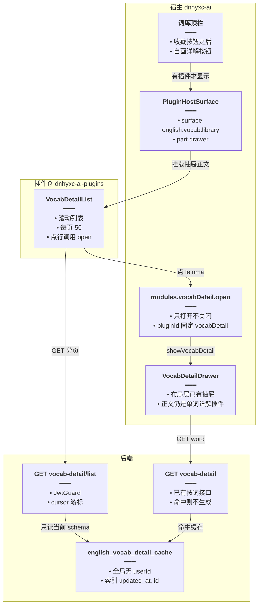
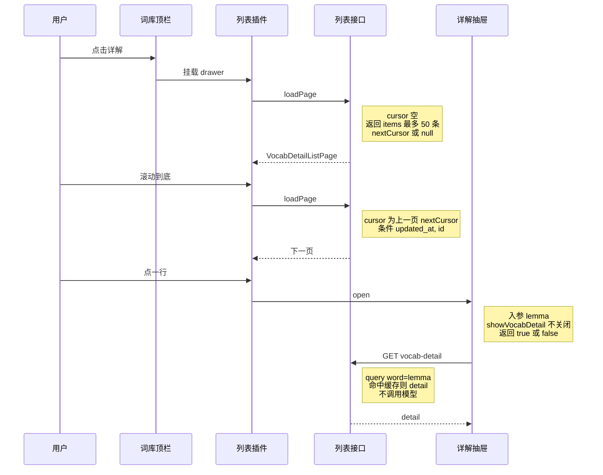
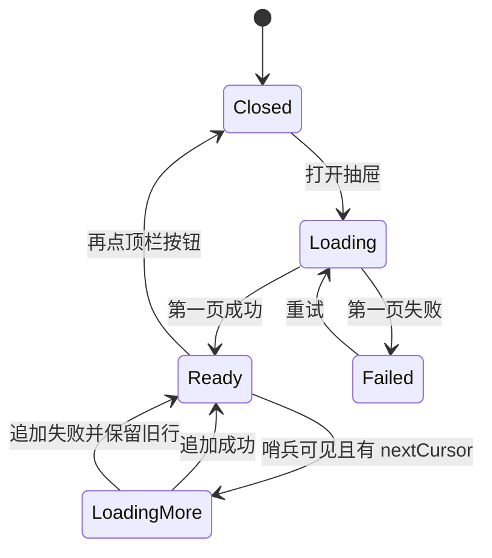

# 详解词列表 — 实现思路

> **状态**：已落地（2026-11-11）。实现细节与逐行代码见 [单词详解列表.md](../../english/单词详解列表.md)。 **需求摘要**：在词汇库单词列表顶栏「收藏」右侧加一个插件，滚动列出已经生成过详解的词，每页 50 条，点一项打开该词详解。
> **一句话方案（预告）**：宿主在「收藏」后画文字按钮，打开插件抽屉；抽屉按 `updated_at` 游标分页读 `english_vocab_detail_cache`；点词调用 `modules.vocabDetail.open`，复用已有详解抽屉。

**延伸阅读**：[单词详解插件](./单词详解插件.md)（详解 JSON、全局缓存表、布局层抽屉）。本文只补「已生成词的列表」，不改生成与锁。按当前单词库把全站缓存、重新生成和手动导入收成一份列表，见 [解析列表绑定词库](./解析列表绑定词库.md)。

## 0. 读本文你将得到什么

- 列表数据直接分页现有全局缓存表，不新建「谁看过」表。
- 入口只加在词汇库单词列表顶栏，「收藏」按钮右侧；词包、日推、错题、收藏页不加。
- 点列表项复用单词详解抽屉，命中缓存，不再打模型。
- 滚动到底再取下一页，每页 50 条，用 `(updated_at, id)` 游标，不用 offset。

## 1. 背景

单词详解插件会把生成结果写入 `english_vocab_detail_cache`（全局、无 `user_id`）。用户只能在单词卡上逐个点开，看不到「已经生成过哪些词」。

截图中的顶栏是词汇库单词列表：标题、`共 N 个单词 / 已加载 M 个`，右侧是「听写 / 拼写」和「收藏」。新插件要放在「收藏」后面。

## 2. 问题与约束

- **缺口**：没有列出缓存行的接口；插件桥 `modules.vocabDetail` 只有快照、订阅、`setPending`、朗读，没有「按词打开详解抽屉」。
- **数据**：缓存表只有 `id`、`cache_key`、`schema_version`、`lemma`、`detail`、`created_at`、`updated_at`。`lemma` 是小写词面。列表展示用 `lemma` 加第一条释义，不把整份 JSON 下发。
- **范围**：插件仓 `dnhyxc-ai-plugins` 新增 expose；宿主只改词汇库单词列表顶栏和详解模块桥。后端只加只读分页。
- **非目标**：不按用户过滤；不搜索；不删除缓存；不在其它单词列表页重复入口；不改详解生成、Redis 锁、25 秒中止已去掉的行为。
- **约束**：须登录（与现有 `GET vocab-detail` 一样走 `JwtGuard`）。每页 50。插件未启用时顶栏不出现按钮。点词必须打开详解，且已有缓存时不得再调用模型。

## 3. 现状与复用

| 能力 | 已有位置 | 本需求用法 |
| --- | --- | --- |
| 详解缓存表 | `apps/backend/src/services/english-learning/entity/english-vocab-detail-cache.entity.ts` | **扩展**：按 `updated_at`、`id` 倒序分页；补联合索引 |
| 按词取详解 | `VocabDetailService.getOrCreateVocabDetail`；`GET english-learning/vocab-detail` | **已有**：点开后仍走这条，命中行直接返回 |
| 详解抽屉 | `apps/frontend/src/views/englishLearning/components/vocab/DetailDrawer.tsx`；`openVocabDetail` | **扩展**：列表点词也走 `openVocabDetail('vocabDetail', { word })`，且不切换关闭 |
| 插件桥 | `apps/frontend/src/federation/runtime/index.ts` 的 `modules.vocabDetail` | **扩展**：增加 `open(word)` |
| 顶栏插件槽 | `PluginHostSurface` 的 `toolbar` / `drawer` | **已有**：列表正文用 `drawer`；触发按钮由宿主按「收藏」同款文字按钮自画 |
| 单词详解插件 | 插件仓 `src/views/vocab-detail`；`vite.config.ts` expose `./VocabDetail` | **已有**：抽屉正文不变。新插件另 expose `./VocabDetailList` |
| 词汇库顶栏 | `apps/frontend/src/views/englishLearning/library/vocabulary/index.tsx` 约 268–305 行，「收藏」在「听写 / 拼写」之后 | **扩展**：紧挨「收藏」按钮之后挂触发器 |
| 单词卡图标槽 | surface `english.vocab.card` / slot `card-action` | **不改**。新 surface 为 `english.vocab.library` |

`PluginHostSurface` 的 `drawer-triggers` 是图标按钮，和顶栏「收藏」的文字按钮不一致，所以触发器不走那一槽。`toolbar` 槽会把整个远程页面嵌进顶栏，弹出层容易被宿主裁切，所以列表正文用已有 `drawer`（传送到抽屉，可滚动）。

## 4. 方案比对与选定

### 4.1 候选方案（总体：入口与点词）

**候选 A — 复用详解抽屉，宿主自画「收藏」同款按钮**

- 宿主 `useHostSurfacePlugins('english.vocab.library')`，只认 `slot === 'drawer'` 的插件。有则在「收藏」后渲染文字按钮，点击切换 `openPluginId`。
- `PluginHostSurface part="drawer"` 渲染新插件。插件挂载后请求第一页，滚动到底再请求。
- 点一项调用 `api.modules.vocabDetail.open(lemma)`。宿主桥内部 `openVocabDetail('vocabDetail', { word: lemma })`，**不**因为同一词已开着就关掉。
- 详解插件未启用时，`open` 返回 `false`，列表插件 `toast`「请先启用单词详解」。

**候选 B — 插件自己画顶栏按钮，并在自己的面板里渲染详解**

- 顶栏只放 `PluginHostSurface part="toolbar"`。插件自己画按钮和弹出列表面板，点词后插件内再 `GET vocab-detail` 并把释义画在同一面板。
- 不改 `modules.vocabDetail`，不依赖详解插件是否启用。

**候选 C — 独立路由页**

- 顶栏「收藏」后是一个 `navigate` 到 `/english-learning/vocab-details` 的按钮。页面用宿主列表组件分页，点词再 `openVocabDetail`。
- 插件仓只提供页面 expose，或甚至不走插件、直接写进宿主路由。

### 4.2 维度对比

| 维度 | A 宿主按钮 + 复用详解抽屉 | B 插件自绘按钮并自绘详解 | C 独立路由页 |
| --- | --- | --- | --- |
| 正确性 | 点词进入已有抽屉，缓存命中不生成。详解插件关闭时明确失败 | 点词也能看到 JSON，不依赖另一个插件 | 点词同样能开抽屉；离开单词列表，顶栏上下文没了 |
| 与现状契合 / 复用 | 复用抽屉、`openVocabDetail`、`drawer` 槽；按钮样式跟「收藏」 | 复用 `toolbar` 槽；详解 UI 要在插件里再写一份 | 复用抽屉；顶栏插件槽用不上，和「再增加一个插件」弱相关 |
| 改动面 | 宿主顶栏一段按钮、桥加 `open`、插件一个列表、后端一个 GET | 宿主顶栏嵌 toolbar、插件列表加详解视图；桥可不改 | 新路由、新页面、顶栏一个链接；插件可有可无 |
| 复杂度 | 两个抽屉叠放（列表在下、详解在上） | 弹出层要自己处理裁切和滚动 | 路由和返回栈，比抽屉多一条导航 |
| 体验 | 停在单词列表上浏览；关掉详解仍是列表 | 详解和列表挤在顶栏弹出层里，50 行加详解会很高 | 整页跳转，和截图里「顶栏一个操作」不一致 |
| 风险 | 详解插件未启用时点词没有正文（已用返回值 + toast 接住） | 远程页面溢出被顶栏裁切，滚动加载失败 | 低，但入口不再是插件槽 |
| 可维护性 | 详解 UI 只维护单词详解插件 | 同一份详解两套 UI | 列表若以后要给别的顶栏用，路由绑死单词列表 |

### 4.3 综合考量

权重：复用现有详解抽屉、入口贴在「收藏」右侧、列表可滚动且不被裁切。

选 **A**。B 少改宿主桥，但详解视图会复制一份，且 `toolbar` 内的弹出层有裁切风险。C 实现直接，但用户要的是插件，并且会离开当前单词列表。放弃 B「不依赖详解插件也能看正文」和 C「不处理双抽屉」这两项。

### 4.4 选定方案

#### 背景

见 §1、§2。列表只是缓存表的只读窗口；详解正文已经在布局层抽屉里。

#### 具体思路

- 插件 id `vocabDetailList`，expose `./VocabDetailList`，`host.surface = english.vocab.library`，`host.slot = drawer`，`injectRoute: false`。权限：`http:plugin-api`、`modules:vocabDetail`、`ui:toast`。
- 宿主顶栏在「收藏」按钮后，若该 surface 有 drawer 插件，画同款文字按钮（文案取插件 `title`，默认「详解」）。按钮只负责开关 `openPluginId`。
- 列表状态（页数据、游标、加载中）放在插件内部，不进宿主 store。抽屉开关放在宿主，与现有 `PluginHostSurface` 一致。
- 点词只传 `lemma`。详解抽屉标题用这个词面；音标、词性可为空，因为缓存行没有这些字段。

#### 实现方案

| 模块 | 入口 | 数据 | 调用 |
| --- | --- | --- | --- |
| 后端 | `GET /api/english-learning/vocab-detail/list` | Query `cursor?`；固定 `limit=50` | `VocabDetailService.listCached` → 只读缓存表 |
| 宿主顶栏 | `library/vocabulary/index.tsx`「收藏」之后 | `openPluginId` | `useHostSurfacePlugins` + `PluginHostSurface part="drawer"` |
| 宿主桥 | `federation/runtime` `modules.vocabDetail.open` | `word: string` | `openVocabDetail('vocabDetail', { word })`，已开着同一词则保持打开 |
| 插件 | `dnhyxc-ai-plugins/src/views/vocab-detail-list` | `items`、`nextCursor` | `http.get` 列表；点行 `modules.vocabDetail.open` |

响应形状：

```ts
// 列表一行。不下发 detail 全文，点开后再按词取
type VocabDetailListItem = {
	// 规范化词面，也是点开详解时的 word
	lemma: string;
	// 第一条中文释义，没有则为空字符串
	glossZh: string;
	// 该行 updated_at 的 ISO 时间，只给展示
	updatedAt: string;
};

// 一页。nextCursor 为 null 表示没有更旧的行
type VocabDetailListPage = {
	// 最多 50 条
	items: VocabDetailListItem[];
	// 下一页游标；没有更多时为 null
	nextCursor: string | null;
};
```

`glossZh` 取 `detail.senses[0].glossZh`，没有则为 `''`。不下发 `detail` 全文。

调用顺序：启用插件 → 顶栏出现按钮 → 打开抽屉 → `GET .../list` → 滚到底带 `cursor` 再取 → 点行 `open` → 布局层详解抽屉 `GET vocab-detail?word=` → 缓存命中返回。

#### 选定原因

| 比对维度 | 为什么是 A | 牺牲 |
| --- | --- | --- |
| 正确性 | 点词进现有抽屉，生成路径不变 | 详解插件关闭时不能在列表里看正文，只能 toast |
| 复用 | 抽屉、缓存、`drawer` 槽都是现成的 | 宿主要自画按钮，不能只用 `drawer-triggers` |
| 改动面 | 顶栏、桥、一个 GET、一个插件目录 | 比「只加路由」多一个插件注册 |
| 复杂度 | 列表与详解分属两个抽屉，状态不搅在一起 | 两个右侧抽屉叠放，详解盖住列表 |
| 体验 | 人留在单词列表，关掉详解还在列表里 | 没有 B 那种「一个面板看完」 |
| 风险 | 裁切问题交给宿主 Drawer | 依赖详解插件 id 固定为 `vocabDetail` |
| 可维护性 | 详解 UI 仍只有一份 | 列表插件必须声明 `modules:vocabDetail` |

#### 优势

- 相对 B：详解正文不重写；滚动发生在 Drawer 里，不被顶栏裁切。
- 相对 C：入口是插件槽，停用插件后顶栏恢复成现在的「收藏」结尾；不增加单词列表之外的路由。

#### 怎么实现

1. 后端 `listCached(cursor)`：只查当前 `schema_version`，按 `updated_at DESC, id DESC` 取 51 行，多出的一行决定 `nextCursor`。
2. 控制器 `GET vocab-detail/list`，`limit` 忽略客户端传入，服务端固定 50。需登录。
3. 宿主桥增加 `open(word)`，内部打开详解插件抽屉且不 toggle。
4. 顶栏「收藏」后渲染按钮和 `PluginHostSurface`。
5. 插件列表首屏 `cursor` 为空；哨兵进入视口且 `nextCursor` 非空时再请求。点行调用 `open`，失败则 toast。

主要实现代码见 §9。

### 4.5 分项决策

#### 4.5.1 列表数据从哪来

**候选 A — 分页 `english_vocab_detail_cache`**

只读现表。过滤 `schema_version = 当前版本`（`vocab-detail.parse.ts` 的 `VOCAB_DETAIL_CACHE_VERSION`）。所有登录用户看到同一份「已经生成过的词」。

**候选 B — 新建按用户的打开记录表**

详解成功返回时写入 `(user_id, lemma, opened_at)`。列表只查当前用户。

| 维度 | A 全局缓存 | B 按用户记录 |
| --- | --- | --- |
| 正确性 | 符合「获取过单词详情的数据」：行存在即生成过。含其他用户生成的词 | 只含该用户打开过的词，漏掉别人生成但自己没点开的 |
| 复用 | 零新表，行在生成成功时已经在 | 要在 `getOrCreate` 成功路径插写，并加迁移 |
| 改动面 | 一个只读查询 + 索引 | 新表、写路径、列表查询 |
| 复杂度 | 低 | 多一次写入和用户维度 |
| 体验 | 打开列表就能看到全部已生成词 | 列表更「个人」，但空列表更常见 |
| 风险 | 词面是全局的，没有用户隐私字段（详解里本来也没有） | 低 |
| 可维护性 | 列表与缓存同一来源，不会和生成结果漂移 | 记录表和缓存可能不一致（生成了但没记上） |

**综合考量**：用户要的是「获取过详情的数据」，现表就是这份数据。权重在复用和正确性。选 **A**。放弃 B 的「只看自己点开过的词」。

**背景**：缓存无 `user_id`，生成即落行。  
**具体思路**：列表是缓存的投影，不在打开抽屉时再记一笔。  
**实现方案**：`listCached` 只 `SELECT lemma, detail, updated_at, id`，映射出 `glossZh`。  
**选定原因**：正确性上覆盖全部已生成词；复用上不迁移；改动面更小。牺牲按用户隔离。  
**优势**：相对 B，没有第二条写入路径，缓存删了列表自然没有。  
**怎么实现**：查询见 §9.1。

#### 4.5.2 滚动分页

**候选 A — 游标 `(updated_at, id)`**

响应带 `nextCursor = updatedAt 的 ISO 字符串 + '|' + id`。下一页条件：`updated_at < t OR (updated_at = t AND id < id)`。表上加索引 `(updated_at, id)`。

**候选 B — `OFFSET` + `limit 50`**

客户端记 `page`，请求 `?page=2`。

| 维度 | A 游标 | B offset |
| --- | --- | --- |
| 正确性 | 生成新行（更新 `updated_at`）插到列表头，已加载页不重复、不跳行 | 向下滚动时若有新行插入，后续页会重复或漏行 |
| 复用 | TypeORM `take` + `where` 即可 | 同样 |
| 改动面 | 多一个游标解析 | 少一个游标字符串 |
| 复杂度 | 游标要校验日期和 uuid | 页码更直观 |
| 体验 | 滚动稳定 | 边生成边滚动时会跳 |
| 风险 | 非法 cursor 当第一页或 400；选定 400 | 低 |
| 可维护性 | 索引与排序一致 | 数据变大后 offset 变慢 |

**综合考量**：列表会在别人正在生成详解时变长，offset 会错位。权重在正确性。选 **A**。放弃 B「页码更好读」。

**背景**：滚动加载时表仍在被 `upsert`。  
**具体思路**：排序与游标用同一对字段，多取 1 行判断有没有下一页。  
**实现方案**：`limit` 固定 50，非法 cursor 返回 400，不静默当第一页。  
**选定原因**：正确性避免重复行；可维护性靠联合索引。牺牲页码跳转（本需求没有）。  
**优势**：相对 B，新生成的词只出现在列表顶部，不影响已加载的下一页。  
**怎么实现**：§9.1。

#### 4.5.3 点词后谁画详解

已在 §4 选 A：复用详解抽屉。此处固定桥的行为，避免和单词卡的 toggle 缠在一起。

**候选 A — `open(word)` 只打开**

已是同一词且抽屉开着：保持打开，不调用 `closeVocabDetail`。单词卡图标仍走现有 `openVocabDetail`（再点同一词关闭）。

**候选 B — 列表也走 toggle**

点已打开的词会把详解抽屉关掉。

| 维度 | A 只打开 | B toggle |
| --- | --- | --- |
| 正确性 | 点列表就是打开详解 | 第二次点同一行会关掉，不符合「都能打开」 |
| 复用 | 仍调用 `openVocabDetail` 的赋值路径，或抽出内部 `show` | 直接调用现有函数 |
| 改动面 | 桥多一个不 toggle 的入口 | 零改 session |
| 复杂度 | 两个入口语义不同，要写清 | 低 |
| 体验 | 在列表里换词、重复点都看得到详解 | 重复点行会关抽屉 |
| 风险 | 低 | 低 |
| 可维护性 | 卡片 toggle 与列表 open 分开 | 一种语义，但列表体验错 |

**综合考量**：用户明确点列表是为了打开。选 **A**。放弃 B「少一个入口」。

**背景**：`openVocabDetail` 对同一插件同一词是关闭。  
**具体思路**：列表用新函数 `showVocabDetail`，只赋值 `session.open = true`。  
**实现方案**：`modules.vocabDetail.open` → `showVocabDetail('vocabDetail', { word })`。详解插件不在已启用列表里则返回 `false`。  
**选定原因**：正确性满足「点一项就打开」。牺牲与卡片图标共用一个函数。  
**优势**：相对 B，重复点同一行不会把刚打开的详解关掉。  
**怎么实现**：§9.2。

## 5. 架构



**图内方法说明**

| 方法 | 功能 |
| --- | --- |
| `PluginHostSurface` | 按 surface 和 part 挂载已启用插件。这里只挂 `english.vocab.library` 的 drawer，列表在抽屉里滚动。 |
| `modules.vocabDetail.open` | 插件桥入口。入参词面，打开详解抽屉；详解插件未启用时返回 `false`。 |
| `VocabDetailDrawer` | 布局层已有抽屉。读 session 后加载单词详解插件正文。 |
| `GET vocab-detail/list` | 新增只读接口。入参 cursor，返回最多 50 条 `{ lemma, glossZh, updatedAt }` 和 `nextCursor`。 |
| `GET vocab-detail` | 已有接口。点词后按词取详解；行已在表里则直接返回，不调用模型。 |
| `showVocabDetail` | 新增 session 写入。把抽屉设为打开并记下词面，同一词再次调用仍保持打开。 |
| `VocabDetailList` | 新插件的抽屉正文。挂载后 `loadPage`，滚动到底再取一页，点行调用 `open`。 |

**读图要点**：列表插件和详解插件是两个 expose。列表只负责翻页和点词，正文仍走布局层那一个抽屉。两条 HTTP 都读同一张缓存表，列表不触发 `getOrCreate` 的生成分支。

## 6. 主流程

```mermaid
flowchart TD
  start["<b>用户打开词汇库单词列表</b><br/>━━━<br/>• 顶栏已有听写和收藏"]
  enabled{"<b>详解列表插件已启用?</b><br/>━━━<br/>• surface english.vocab.library"}
  btn["<b>收藏右侧出现按钮</b><br/>━━━<br/>• 文案用插件 title"]
  openDrawer["<b>打开列表抽屉</b><br/>━━━<br/>• setOpenPluginId"]
  fetch["<b>loadPage</b><br/>━━━<br/>• cursor 空为第一页"]
  ok{"<b>请求成功?</b>"}
  paint["<b>追加 50 条</b><br/>━━━<br/>• 记下 nextCursor"]
  fail["<b>列表区显示失败</b><br/>━━━<br/>• 可重试同一 cursor"]
  more{"<b>滚到底且还有 cursor?</b>"}
  click["<b>点某一行</b><br/>━━━<br/>• 传入 lemma"]
  opened{"<b>open 返回 true?</b>"}
  toast["<b>toast 请先启用单词详解</b>"]
  detail["<b>详解抽屉打开</b><br/>━━━<br/>• GET vocab-detail<br/>• 缓存命中"]
  start --> enabled
  enabled -->|否| start
  enabled -->|是| btn
  btn -->|"点击"| openDrawer
  openDrawer --> fetch
  fetch --> ok
  ok -->|是| paint
  ok -->|否| fail
  paint --> more
  more -->|是| fetch
  more -->|否| click
  fail -->|"重试"| fetch
  paint --> click
  click --> opened
  opened -->|是| detail
  opened -->|否| toast
```

**图内方法说明**

| 方法 | 功能 |
| --- | --- |
| `loadPage` | 插件内请求一页。无 cursor 取最新 50 条；有 cursor 取更旧的 50 条。成功则追加，失败保留已加载行。 |
| `setOpenPluginId` | 宿主记下当前打开的抽屉插件 id。再点同一按钮则关闭列表抽屉。 |
| `open` | 按 lemma 打开详解抽屉。详解插件未启用时返回 `false`，插件 toast，列表不关。 |
| `GET vocab-detail` | 点词之后按词取已缓存的详解。命中则返回 JSON，不调用模型。 |

**读图要点**：插件没启用时顶栏和现在一样。滚动只在还有 `nextCursor` 时继续。点词失败不清空列表。详解抽屉盖住列表抽屉，关掉详解后列表还在。

## 7. 时序



**图内方法说明**

| 方法 | 功能 |
| --- | --- |
| `loadPage` | 向列表接口要一页。打开抽屉时 cursor 为空；滚到底时带上一页的 `nextCursor`。 |
| `open` | 点行时调用，入参该行 `lemma`。返回 `false` 则不继续请求详解。 |
| `GET vocab-detail` | 详解抽屉里的单词详解插件发起。query 为 `word=lemma`，命中缓存则返回 `detail`。 |
| `showVocabDetail` | `open` 内部写入 session。同一词再次调用仍保持抽屉打开，不走卡片的关闭切换。 |

**读图要点**：分页和点词是两条请求。第二条按词的 GET 只有点行之后才发生，并且因为行来自缓存表，正常路径不会进入模型生成。`open` 返回 `false` 时没有这一下 GET。

## 8. 状态



列表插件用本地 state：`items`、`nextCursor`、`status`。宿主只保存抽屉开闭。点词不改变列表状态。

**图内方法说明**

本图节点是状态名，没有额外函数。`loadPage` 的职责见 §6。

**读图要点**：第一页失败是 Failed，可重试。后续页失败回到 Ready，已加载的行还在，避免一次网络错误把列表清掉。

## 9. 主链路代码

### 9.1 后端分页（对应 §4.5.2 步骤）

```typescript
// 对应 §4.5.2。ISO 时间与 uuid 都不含竖线，游标只切一刀
const CURSOR_SEP = '|';
// 页大小写死，客户端改 query 也不能一次拉全表
const PAGE_SIZE = 50;

// 对应 §4.5.2。非法游标直接 400，避免当成第一页把滚动位置打回顶部
function parseCursor(cursor: string): { updatedAt: Date; id: string } {
	// 只认第一处竖线，后面整段都是 id
	const sep = cursor.indexOf(CURSOR_SEP);
	// 没有分隔符就不是服务端签发的游标
	if (sep <= 0) throw new BadRequestException('cursor');
	// 前半还原上一页最后一条的更新时间，供「更旧」比较
	const updatedAt = new Date(cursor.slice(0, sep));
	// 后半是 uuid，同一时间戳下靠它保持稳定次序
	const id = cursor.slice(sep + 1);
	// Invalid Date 或空 id 都拒绝，不把坏游标送进 SQL
	if (Number.isNaN(updatedAt.getTime()) || !id) throw new BadRequestException('cursor');
	// 交给 where 的两个字段，调用方不再自己拆字符串
	return { updatedAt, id };
}

// 对应 §4.5.1。只读缓存表，不进 getOrCreate，翻页不会打模型
async function listCached(cursor?: string): Promise<VocabDetailListPage> {
	// 无游标表示第一页；有则先校验，失败抛 400
	const parsed = cursor ? parseCursor(cursor) : null;
	// 从缓存表起查，列表与生成服务分开
	const qb = this.cache.createQueryBuilder('c');
	// 旧 schema 行点开会重新生成，不能出现在列表里
	qb.where('c.schema_version = :v', {
		// 与写入详解时的版本常量相同，过滤条件才和缓存键一致
		v: VOCAB_DETAIL_CACHE_VERSION,
	});
	// 第二页起只取比上一页末尾更旧的行，避免 offset 在插入时错位
	if (parsed) {
		// 时间更小，或时间相同且 id 更小；与下面的 DESC 排序同向
		qb.andWhere('(c.updated_at < :t OR (c.updated_at = :t AND c.id < :id))', {
			// 上一页最后一条的更新时间
			t: parsed.updatedAt,
			// 同一时刻的次序
			id: parsed.id,
		});
	}
	// 新生成的排在上面，和「最近获取」一致
	qb.orderBy('c.updated_at', 'DESC');
	// 同一时间戳用 id 打破平局，游标才能不重复不遗漏
	qb.addOrderBy('c.id', 'DESC');
	// 多取 1 行只为判断还有没有下一页，响应里会丢掉
	qb.take(PAGE_SIZE + 1);
	// 执行只读查询
	const rows = await qb.getMany();
	// 第 51 行存在就说明后面还有
	const hasMore = rows.length > PAGE_SIZE;
	// 响应最多 50 条
	const page = hasMore ? rows.slice(0, PAGE_SIZE) : rows;
	// 用本页最后一条签发下一页游标
	const last = page.at(-1);
	// 没有更多时为 null。字符串由本页最后一条的时间戳和 id 拼成，插件原样回传
	const nextCursor = hasMore && last ? `${last.updatedAt.toISOString()}${CURSOR_SEP}${last.id}` : null;
	// 列表只带词面和第一条释义，整份 detail 留在点开后的按词接口
	return {
		// 本页行，第 51 行已经丢掉
		items: page.map((row) => ({
			// 标题用规范化词面，缓存里没有原始大小写
			lemma: row.lemma,
			// 只给第一条中文释义，列表不传整份 JSON
			glossZh: row.detail.senses[0]?.glossZh ?? '',
			// 给列表展示时间；下一页游标由 nextCursor 携带，客户端不自己拼
			updatedAt: row.updatedAt.toISOString(),
		})),
		// null 表示到底，字符串表示下一页入口
		nextCursor,
	};
}
```

实体增加：

```typescript
// 游标排序的过滤列。没有这组索引时，页数变多会扫全表
@Index('IDX_evdc_updated_id', ['updatedAt', 'id'])
```

### 9.2 宿主打开详解（对应 §4.5.3）

```typescript
// 对应 §4.5.3。列表点词专用。卡片图标仍用 openVocabDetail，再点同一词会关闭
export function showVocabDetail(pluginId: string, card: VocabCardSnapshot): void {
	// 空词面无法请求详解，直接返回避免打开空白抽屉
	if (!card.word.trim()) return;
	// 覆盖 session。不先读「是不是同一个词」，所以重复点不会关掉
	session = {
		// 列表点词永远是打开
		open: true,
		// 调用方传入单词详解插件 id，抽屉正文才找得到 VocabDetail
		pluginId,
		// 只保留词面。缓存行没有音标和词性
		card: { ...card },
	};
	// 通知抽屉订阅者重绘，否则 session 改了界面不动
	emit();
}
```

```typescript
// 对应 §4.5.3。桥上给列表插件的唯一打开入口
open(word: string): boolean {
	// 详解插件没启用时 DetailDrawer 会立刻 close，这里提前告诉列表
	const enabled = getEnabledPlugins().some((p) => p.id === 'vocabDetail');
	// 未启用返回 false，插件去 toast，不改 session
	if (!enabled) return false;
	// pluginId 写死单词详解，避免列表插件把自己的 id 送进详解抽屉
	showVocabDetail('vocabDetail', { word });
	// true 表示抽屉会打开，列表不用再提示
	return true;
}
```

`getEnabledPlugins` 若运行时没有这个名字，实现时改用宿主已有的「已启用插件」读取（与 `useHostSurfacePlugins` 同一数据源）。**待确认**：在 `federation/runtime/index.ts` 里核对函数名后再写调用。

### 9.3 顶栏按钮（对应 §4.4 步骤 4）

放在 `library/vocabulary/index.tsx`「收藏」按钮之后：

```tsx
// 对应 §4.4 步骤 4。只认列表抽屉，避免单词卡 surface 的图标出现在顶栏
const listPlugin = useHostSurfacePlugins('english.vocab.library').find(
	// drawer 槽才是这份列表；toolbar 槽不在这个顶栏使用
	(p) => p.host?.slot === 'drawer',
);
```

```tsx
// 对应 §4.4 步骤 4。插件未启用时不占位，顶栏仍在「收藏」结束
function renderListTrigger(): React.ReactNode {
	// 没有 drawer 插件就不画按钮
	if (!listPlugin) return null;
	// 文字按钮放在收藏后面，样式与收藏相同，不用图标槽
	return <button
		// 不用 submit，避免落在表单里误提交
		type="button"
		// 与「收藏」同一套 class，字号和颜色对齐截图
		className={cn(actionButtonClass, 'ml-1.5')}
		// 再点同一插件 id 关闭抽屉，否则打开
		onClick={() => setOpenPluginId((id) => (id === listPlugin.id ? null : listPlugin.id))}
	>
		{/* 文案用插件 title，缺省才写「详解」，和注册表一致 */}
		{pickPluginLocaleText(listPlugin.title, locale) || '详解'}
	</button>;
}
```

```tsx
{/* 抽屉正文由插件画。开关留在宿主，和电子书顶栏抽屉同一套 */}
<PluginHostSurface
	// 只挂词汇库单词列表这一个 surface
	surface="english.vocab.library"
	// 列表在抽屉里滚动，不嵌进顶栏，避免裁切
	part="drawer"
	// 当前打开的插件；null 表示抽屉关闭
	openPluginId={openPluginId}
	// 抽屉自己请求关闭时同步宿主状态
	onOpenPluginIdChange={setOpenPluginId}
/>
```

`actionButtonClass` 与「收藏」按钮同一个 class，保证字号和颜色一致。若该页按钮没有抽常量，实现时复制「收藏」按钮的 class，不新造一套。

### 9.4 插件滚动与点词（对应 §4.4 步骤 5）

```tsx
// undefined 表示还没请求；null 表示服务端没有下一页。两者分开，空列表才不会被哨兵反复请求
const [nextCursor, setNextCursor] = useState<string | null | undefined>(undefined);

// 对应 §4.4 步骤 5。追加失败只结束 loading，不清空已加载行
async function loadPage() {
	// 请求中不重入。cursor 已是 null 表示到底，包括空列表
	if (loading || nextCursor === null) return;
	// 挡住哨兵在 await 期间再次进入
	setLoading(true);
	try {
		// 第一页不带 cursor。有游标则原样回传，插件不自己拼时间戳
		const query = nextCursor ? { cursor: nextCursor } : {};
		// 只读分页。失败抛到外层，finally 里解除 loading，已加载行保留
		const page = await api.http.get<VocabDetailListPage>('/english-learning/vocab-detail/list', {
			// 空对象表示第一页，避免把 undefined 编成字符串
			query,
		});
		// 追加而不是替换，滚动位置才不会跳回顶部
		setItems((prev) => [...prev, ...page.items]);
		// 记下下一页；null 时哨兵再进入也不会请求
		setNextCursor(page.nextCursor);
	} finally {
		// 成功失败都解除 loading，失败分支不改 items
		setLoading(false);
	}
}

// 对应 §4.4 步骤 5。点行只打开详解，列表抽屉保持打开
function onPick(lemma: string) {
	// 桥返回 false 表示详解插件未启用，抽屉不会出现
	const opened = api.modules.vocabDetail.open(lemma);
	// 留在列表里提示，不关闭、不清空
	if (!opened) api.ui.toast('请先启用单词详解');
}
```

哨兵用 `IntersectionObserver` 观察列表底部元素，`isIntersecting` 时调用 `loadPage`。抽屉挂载时再调用一次 `loadPage`：此时 `nextCursor` 仍是 `undefined`，会请求第一页；返回后若 `nextCursor` 变成 `null`（不足 50 条或空列表），哨兵再次进入也不再请求。

插件注册（`builtin-plugins` 或现有清单同一处）：

| 字段 | 值 |
| --- | --- |
| id | `vocabDetailList` |
| expose | `./VocabDetailList` |
| host.surface | `english.vocab.library` |
| host.slot | `drawer` |
| permissions | `http:plugin-api`、`modules:vocabDetail`、`ui:toast` |
| injectRoute | `false` |

`vite.config.ts` 的 `exposes` 增加 `'./VocabDetailList': './src/views/vocab-detail-list/index.ts'`。

## 10. 分阶段

### M1 后端只读分页

- [ ] `listCached` + `GET vocab-detail/list`
- [ ] 非法 cursor 返回 400
- [ ] 实体索引 `(updatedAt, id)` 与迁移
- [ ] 只返回当前 `schema_version`

### M2 宿主入口与桥

- [ ] `showVocabDetail`，列表路径不 toggle
- [ ] `modules.vocabDetail.open` 在详解插件未启用时返回 `false`
- [ ] 单词列表顶栏「收藏」后按钮 + drawer surface

### M3 插件列表

- [ ] expose、注册、权限
- [ ] 首屏 50 条，滚动追加，失败保留已加载行
- [ ] 点行 `open`，失败 toast
- [ ] 空列表文案：还没有生成过详解

## 11. 风险

| 风险 | 处理 |
| --- | --- |
| 两个右侧抽屉叠在一起 | 详解后挂载，盖住列表；关掉详解后列表仍开着。不在点词时自动关列表 |
| 详解插件未启用 | `open` 返回 `false`，toast，列表留下 |
| 缓存词面是小写 | 列表和抽屉标题都用 `lemma`。大小写只影响展示，不影响缓存键 |
| 旧 schema 行 | 列表过滤当前版本，避免点开后重新生成 |
| 顶栏 class 与「收藏」不一致 | 实现时复制「收藏」按钮 class，对照截图看一眼 |
| `getEnabledPlugins` 名字 | §9.2 待确认，以 runtime 里现有读取为准 |

## 12. 验收

1. 启用列表插件后，词汇库单词列表顶栏「收藏」右侧出现按钮；停用后按钮消失，听写和收藏位置不变。
2. 打开抽屉，首屏最多 50 条，顺序为最近更新在上；不足 50 条时不再请求。
3. 滚到底再加载 50 条，已出现的词不重复；期间新生成的词出现在列表顶部，不插进已加载页中间。
4. 点一行打开单词详解抽屉，网络上只有 `GET vocab-detail`，没有模型生成请求（该词已在缓存中）。再点同一行，详解抽屉保持打开。
5. 关闭单词详解插件后点行，出现 toast，列表不关、不空。
6. 未登录请求列表返回 401。非法 `cursor` 返回 400。
7. 词包、日推、错题、收藏这些列表的顶栏没有这个按钮。

## 13. 预估改动路径

| 仓 | 路径 | 动作 |
| --- | --- | --- |
| dnhyxc-ai | `apps/backend/src/services/english-learning/vocab-detail.service.ts` | 增加 `listCached` |
| dnhyxc-ai | `apps/backend/src/services/english-learning/english-learning.controller.ts` | `GET vocab-detail/list` |
| dnhyxc-ai | `entity/english-vocab-detail-cache.entity.ts` + 一条迁移 | 索引 |
| dnhyxc-ai | `apps/frontend/src/federation/modules/vocabDetail/session.ts` | `showVocabDetail` |
| dnhyxc-ai | `apps/frontend/src/federation/runtime/index.ts` | `modules.vocabDetail.open` |
| dnhyxc-ai | `apps/frontend/src/views/englishLearning/library/vocabulary/index.tsx` | 「收藏」后按钮与 drawer |
| dnhyxc-ai-plugins | `vite.config.ts` exposes | `./VocabDetailList` |
| dnhyxc-ai-plugins | `src/views/vocab-detail-list/` | 新插件 |
| dnhyxc-ai | 插件清单（与 `vocabDetail` 同一注册处） | 注册 `vocabDetailList` |

注册处的具体文件名在实现时从现有 `vocabDetail` 注册往上找，本文不新造清单格式。
