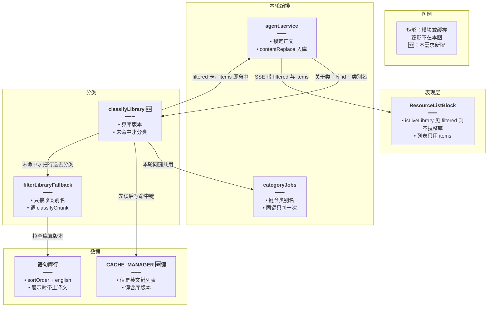
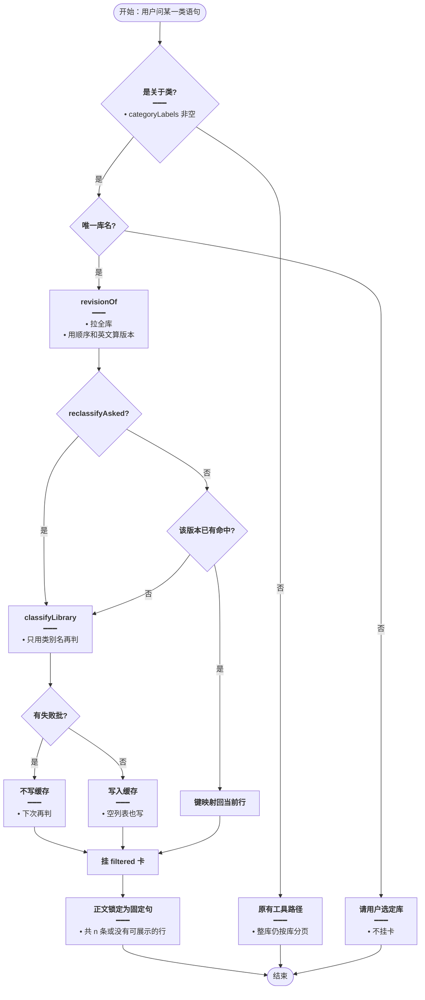
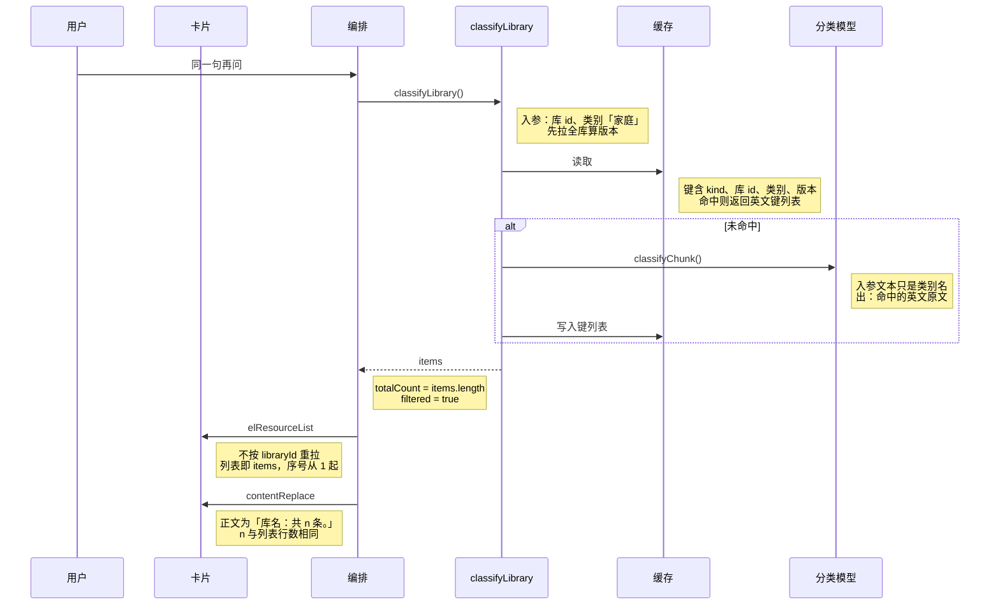
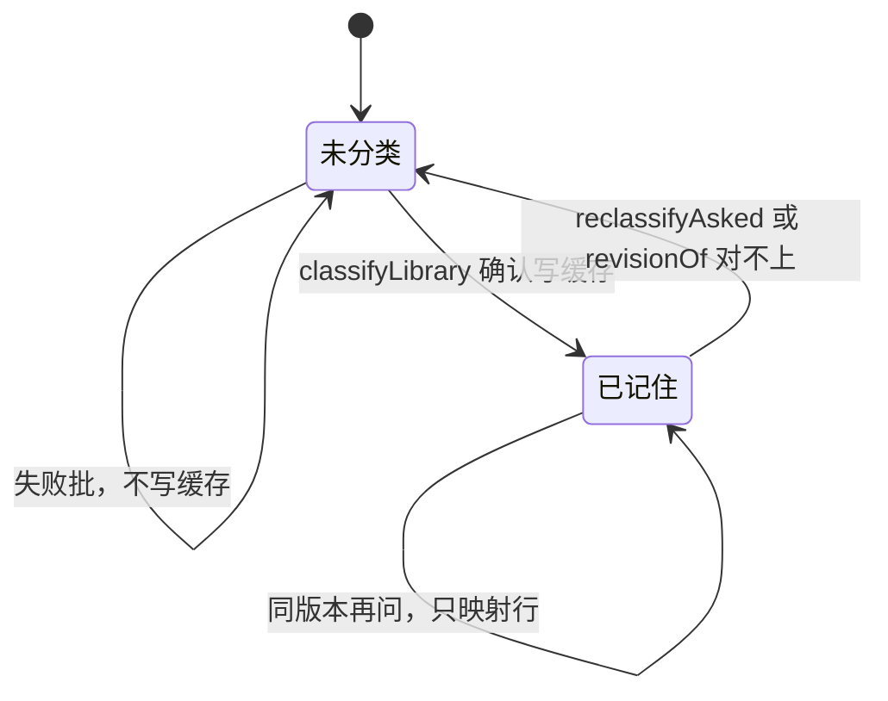

# 语句分类稳定出卡 — 实现思路

> **状态**：规划（未实现）  
> **日期**：2026-10-29  
> **需求摘要**：同一句「找出小学三年级语句库中有关家庭的所有语句，分好类给出来」，每次都给出同一批句子、同一句说明；卡片里的行必须就是这批句子，不能是整库的第 46–51 句。  
> **一句话方案（预告）**：分类命中按「库 + 类别 + 库内容版本」记住；卡片只画这批命中；助手正文改成服务端固定的一句「库名：共 n 条。」

## 延伸阅读

- [分类命中前后一致](./分类命中前后一致.md)（同一会话里按类别复用卡片，并让确认条抄这份命中。本文不改收藏合并，只补它没挡住的两件事：卡片被整库重拉、新会话又重判）
- [语句库分类列出](./语句库分类列出.md)（`el_classic_classify` 已存在，本文不另造工具）
- [关于类一次出卡](./关于类一次出卡.md)（带库 id 的取词已经改成整库分类。本文让这条命中跨会话不变，并禁止卡片改画整库）
- [整库稳定出卡](./整库稳定出卡.md)（整库问法仍按 `libraryId` 分页。本文只在 `filtered` 时关掉这条重拉）

---

## 0. 读本文你将得到什么

- 截图里「3 条 / 4 条」对不上第 46–51 句，是因为筛选卡仍带 `libraryId`，前端把它当成整库又拉了一遍。
- 同一句时而 3 条、时而长篇自述，是因为分类每次重判，正文又留给主模型写。
- 选定做法：命中按库版本记住，卡片只画命中，正文用固定一句。
- 改动在分类入口、SSE 字段和清单卡片；不新增表。
- 最大风险是第一次判错会被记住，要说「重新分类」才再判。

---

## 1. 需求与边界

### 1.1 用户故事

| 角色 | 场景 | 行为 | 期望结果 |
|------|------|------|----------|
| 学习者 | 语句库「小学三年级上册」约五十条 | 两次都问「找出……有关家庭的所有语句，分好类给出来」 | 两次都是同一批句子、同一句「共 n 条」；卡片行号从 1 起，句子就是这 n 条 |
| 学习者 | 第一次看到的是购物、生日、小狗 | 对照卡片和正文 | 卡片不再出现库里第 46–51 句这类与「家庭」无关的句子 |
| 学习者 | 改过库里某一句英文，或明确说「重新分类」 | 再问同一句 | 版本变了或点了重判，才允许再叫分类模型；否则仍用已记下的命中 |

### 1.2 范围

| 在范围内 | 不在范围内（非目标） |
|----------|----------------------|
| 语句库、单词库「关于某一类」的列出 | 改收藏确认的 HTTP 提交 |
| 卡片行与条数、正文条数三者一致 | 用投票打三次模型来压随机性 |
| 同一库版本下重复提问不再重判 | 给分类工具加 `libraryId` 参数 |
| 整库问法仍按库分页滚完全表 | 把「家庭」收成关键词表 |

### 1.3 约束与依赖

- 分类模型仍是硅基 `Qwen/Qwen3.6-35B-A3B`，`decideLlmOptions` 里 `temperature` 已经是 0。温度 0 不能保证两次 JSON 相同。
- 选库仍走现有 `pickLibraries`：当前句点名优先。
- 整库卡（没有 `filtered`）继续按 `libraryId` 分页，不能为了修筛选把整库卡改成只显示前 n 条。
- 小学三年级上册约五十条，低于 `CATEGORY_MAX_ROWS`（600），分批游标不是这次条数跳动的原因。
- 命中缓存复用现有 `CACHE_MANAGER`，不新建业务表。键里带库内容版本，库一改就自然失效。

---

## 2. 背景

同一句问了两次，界面给出两份答案。

第一次正文是「小学三年级上册：共 3 条，完整内容在清单卡片中。」卡片标题旁也写着 3 条，但列表滚到的是第 46–51 行：`Let's go to the shop`、`That's ten yuan`、`Here you are`、`It's seven o'clock`、`Happy birthday`、`Oh, one more cut for the dog`。这些句子与家庭无关。

第二次正文变成一段自述：「分类结果为空……语句库已列出，但条数较少（4 条），让我用关键词搜索……」。卡片标题旁改成 4 条，看得见的仍是同一段第 46–51 行。

不处理的话，用户按卡片理解范围，看到的却是整库的尾部；再问一次，条数和说法又变。

硬约束：不能关掉整库分页；不能为了稳定改去扫所有库；不能用一份手写的「家庭」词表替换现有分类器。

---

## 3. 现状与复用

| 能力 | 仓库中已有 | 本需求中的用法 |
|------|------------|----------------|
| 从原话切类别名 | `categoryLabels`，`apps/backend/src/services/agent/tools/english/spill.ts` | 直接复用。这句切出的类别是「家庭」 |
| 语句分类入口 | `el_classic_classify`，`domain-tools.ts` | 扩展。有类别名时走统一的 `classifyLibrary` |
| 把整库交给分类模型 | `filterLibraryFallback` / `classifyChunk`，`domain-tools.ts`、`category-propose.ts` | 直接复用。只在缓存未命中时调用，送进模型的文本只用类别名 |
| 本轮进行中的分类 | `elSurface.categoryJobs` | 扩展。键统一成 `kind:libraryId:类别`，避免同一轮用整句和类别名各判一次 |
| 会话内已记下的分类卡 | `labeledCards`，`agent.service.ts` 回合开始时从历史消息读入 | 直接复用，只作为本轮热缓存。跨会话的稳定不靠它 |
| 用户要求重判 | `reclassifyAsked`，认「重新分类」 | 直接复用。为真时不读持久命中 |
| 清单 SSE | `forSse`，`spill.ts`；前端解析在 `apps/frontend/src/utils/agentSse.ts` | 扩展。帧上带上 `filtered`。解析现在把这个字段丢掉了 |
| 清单卡片 | `ResourceListBlock`，`isLiveLibrary` | 扩展。`filtered` 为真时用 `items`，不按 `libraryId` 重拉 |
| 空正文时的固定句 | `resolvedAssistantText`，`agent.service.ts` | 扩展。筛选卡不论模型写了什么，都收成「库名：共 n 条。」 |
| 整段替换正文 | SSE `contentReplace`，同文件 `finalizeTurn` | 直接复用 |
| 进程内缓存 | `ElArtifactStore` 用的 `CACHE_MANAGER` | 扩展。另写一条按版本查找的命中，不占用 30 分钟的 artifact |
| 词条分页 | `listClassicQuotesLibraryItems` / 前端 `listEnglishClassicQuotesLibraryItems` | 不适用做筛选卡的数据源。整库卡仍用 |

**调研结论**：分类器和选库都已在。缺的是三处接线。筛选卡带了 `libraryId`，前端 `isLiveLibrary` 不看 `filtered`，SSE 也不传 `filtered`，于是卡片按整库重拉，角标却用分类条数。`el_classic_classify` 用类别名做键，`el_items_search` 和收尾续查用整句做键，两次提问会打出 3 和 4。正文只在模型没写字时才换成固定句，所以第二次能留下「分类结果为空」那段自述。

`filterLibraryFallback` 的注释已经写明「不带 libraryId：前端见到库 id 会按整库重拉」，实现却仍写入 `libraryId`。这个字段要留给收藏和按库查找，不能删；要改的是前端对它的解释。

---

## 4. 方案比对与最终方案

### 4.1 候选方案

#### 方案 A：只改卡片数据源（扩展现有渲染）

- **做法**：`isLiveLibrary` 在 `filtered === true` 时返回假。SSE 与 `ElResourceBlock` 增加 `filtered`。卡片用本帧或 `getElArtifact` 的 `items`。分类仍每次调用 `classifyChunk`，正文仍由主模型写，`resolvedAssistantText` 只在正文为空时填「共 n 条」。
- **能工作的原因**：截图里的第 46–51 行来自整库第一页（`PAGE = 1000`，五十条一页就拉完）。关掉重拉后，卡片行等于当次命中，角标和行数会对上。
- **主要代价**：新会话、以及 `classic:${id}` 与 `classic:${id}:家庭` 两条键，仍会各判一次。3 条和 4 条还会出现。模型仍可写出「分类结果为空」那段话。

#### 方案 B：版本化命中 + 卡片只画命中 + 固定一句（扩展现有分类与收尾）

- **做法**：新增 `classifyLibrary`。先拉全库并算版本（按 `sortOrder` 与英文原文），用 `kind:libraryId:类别:版本` 查 `CACHE_MANAGER`。命中则把记下的英文键映射回当前行。未命中才调用现有 `filterLibraryFallback`，而且送进去的文本只是类别名。`el_classic_classify`、`el_items_search` 的关于类拦截、收尾续查都走这一个函数，本轮 `categoryJobs` 用同一个键。卡片按方案 A 只画 `items`。筛选卡一挂上，就锁定助手正文为「库名：共 n 条。」，之后的模型增量不再拼进去；`finalizeTurn` 再用已有的 `contentReplace` 落库。
- **能工作的原因**：同一库版本、同一类别只产生一份命中。卡片、角标、正文都读这份 `items`。库内容一变，版本变，键对不上，才会再判。
- **主要代价**：第一次判错会留到用户说「重新分类」或库英文变了。多一次全库读取用来算版本（分类本来就要拉全库）。用户看不到模型解释「为什么是这些句」。

#### 方案 C：不用分类模型，按词表筛选（新增规则）

- **做法**：对「家庭」维护中英关键词（家庭、家人、爸爸、妈妈、爷爷、奶奶、弟弟、妹妹等），在全库行上做包含匹配，卡片与正文都用这份确定的行。
- **能工作的原因**：没有模型抽样，同一库版本每次行集相同，卡片也不会去拉整库。
- **主要代价**：没写到这些词、但语义属于家庭的句子会漏。每新增一个类别都要加词表。现有 `classifyChunk` 就是为了避开这种漏法，截图里的第二次回答已经在做关键词搜索，结果仍不是稳定的家庭句。

### 4.2 比对

| 维度 | 方案 A | 方案 B | 方案 C |
|------|--------|--------|--------|
| 正确性（失败路径、边界、数据是否会错） | 当次卡片与当次条数一致。两次提问的集合仍可能不同。超时导致的空结果不会被记住 | 卡片、角标、正文来自同一份 `items`。`failedChunks > 0` 不写入缓存，下次再判。确认过的空结果会记住，避免「这次空、下次 4 条」 | 行集确定，但语义漏句。词表外的家庭句永远不会出现 |
| 复用 / 与现状契合 | 只改 `isLiveLibrary`、SSE 解析、`ElResourceBlock` | 复用 `filterLibraryFallback`、`categoryLabels`、`reclassifyAsked`、`contentReplace`、`CACHE_MANAGER`。新增一个查找函数 | 搁置已有分类器，另写一套匹配 |
| 改动面（要动哪些路径） | 前端卡片与 SSE 解析 | 上述前端，加上 `domain-tools.ts` 三个调用点、`agent.service.ts` 收尾、缓存读写 | 分类入口换成规则，前端仍要改，否则卡片照样整库重拉 |
| 复杂度（新概念、新状态、新依赖） | 无新状态 | 一个缓存键：库版本 + 类别。无新表、无新依赖 | 每个类别一份词表，要有人维护 |
| 体验（延迟、步骤数、失败时用户看到什么） | 每次仍等分类模型。模型自述可能在流里先出现 | 第二次起不再等分类模型，只拉库并对照键。流式阶段模型自述会被丢掉，用户看到固定一句 | 没有分类等待。漏掉的句子用户无法从卡片里发现 |
| 风险（迁移、互斥、并发、回滚） | 整库卡不带 `filtered`，分页不受影响 | 第一次判错会持续到「重新分类」。并发时本轮 `categoryJobs` 仍先写入再等待，同一键不会打两次 | 词表和分类器两套标准并存时，收藏与卡片会对不上 |
| 可维护性（以后改一处还是改多处） | 渲染一处。稳定性仍散在两条分类键和提示词里 | 命中只从 `classifyLibrary` 出去。提示词不再负责这句的措辞 | 词表、分类器、卡片三处都要懂「家庭」 |

### 4.3 综合考量

这句需求里权重最高的是两件事：卡片必须是分类结果本身，以及同一库版本下重复提问必须是同一批句子。方案 A 只完成第一件，3 条和 4 条、以及那段自述还会留下。方案 C 两件都能稳定，但稳定的是一份会漏句的词表，和已经在用的分类器对着干。

选定方案 B。它在正确性上让卡片、角标、正文读同一份 `items`，在复用上仍叫 `classifyChunk`，只是不再每次都叫。

明确放弃方案 A 的优点：改动只在前端，回滚面小。这个优点抵不过「再问一次又是另一批」——那正是用户要停掉的现象。

明确放弃方案 C 的优点：完全不依赖模型抽样，也没有「第一次判错被记住」。这个优点抵不过漏掉没有写到关键词的家庭句，而且前端整库重拉不修的话，词表结果同样不会出现在卡片上。

### 4.4 最终方案

#### 背景

筛选卡同时带了 `source: 'library'`、`libraryId` 和分类后的 `items`。前端见到库 id 就整库分页，角标仍显示 `totalCount`（3 或 4）。SSE 解析没有把 `filtered` 交给卡片。分类有两条键，一条只送类别名，一条送整句原话，所以同一句能得到 3 条和 4 条。正文只在模型没写字时才换成固定句。这些都要收成一条路径，同时整库分页和现有分类器保持不动。

#### 具体思路

1. 模块：后端 `classifyLibrary` 负责「读库、对版本、必要时分类」。前端 `ResourceListBlock` 只负责画已经定下来的行。`agent.service` 负责把助手正文收成一句。不新增页面，不新增表。
2. 数据：全库行从现有 `listClassicQuotesLibraryItems` / `listVocabularyLibraryItems` 来。命中是这些行的子集，键是英文原文（单词则是词面）。缓存里只存键的有序列表，展示时再映射回当前行，这样译文改了不必重判。
3. 状态：持久命中放在 `CACHE_MANAGER`，键含库内容版本，所以库一改就失效，不必另做删除。本轮进行中的分类仍放 `categoryJobs`，避免同一次请求打两次模型。不放进主模型的消息，因为主模型会改写条数。
4. 边界：`failedChunks > 0` 不写入缓存。用户原话含「重新分类」时不读缓存。没有命中且没有失败批时，记下空列表，下次仍是空，正文用「没有可展示的行。」没有唯一库名时仍返回现有的 `ambiguous`，不挂卡。

#### 实现方案

**一句话**：分类命中按「库 + 类别 + 库内容版本」记住；卡片只画这批命中；助手正文改成服务端固定的一句「库名：共 n 条。」

| 步骤 | 谁 | 做什么 | 输入 → 输出 |
|------|----|--------|-------------|
| 1 | `classifyLibrary`（`domain-tools.ts`） | 拉全库、算版本、查缓存；未命中才分类并写入 | 库 id、类别名、是否重判 → 行数组或空 |
| 2 | `el_classic_classify` / `el_items_search` / `finalizeTurn` | 关于类只调用步骤 1，挂出 `filtered: true` 的卡 | 用户原话 → 一张卡，`items` 与 `totalCount` 相同 |
| 3 | `forSse` + `agentSse.ts` + `ResourceListBlock` | 把 `filtered` 传到卡片；为真时不按库重拉 | 卡载荷 → 列表只含 `items` |
| 4 | `agent.service.ts` 流式循环与 `finalizeTurn` | 筛选卡挂出后锁定正文，收尾 `contentReplace` | 卡的 `title` 与 `items.length` → 「库名：共 n 条。」 |

#### 选定原因

1. **正确性**：卡片不再整库重拉，条数取 `items.length`，所以角标、行、正文不会再分成 3 条和 6 行。牺牲：确认过的空结果会保持为空，直到重判或库英文改变。
2. **复用**：仍用 `classifyChunk` 和 `contentReplace`，不引入词表。牺牲：第一次仍然要等分类模型。
3. **改动面**：调用点收成一个函数，提示词不再负责这句措辞。牺牲：方案 A 那种「只改前端」做不到。
4. **体验**：同一版本的第二次提问不再打模型。牺牲：用户看不到「我先查库、再搜索」这类过程说明。
5. **复杂度**：只多一个缓存键和一个锁定布尔，不新表。牺牲：版本哈希要和拉库字段一起改，不能单独演进。
6. **风险**：整库卡没有 `filtered`，分页逻辑不动。牺牲：要在 SSE 上多传一个布尔，旧前端若忽略它会继续整库重拉，所以前端必须一起改。
7. **可维护性**：以后改稳定性只改 `classifyLibrary` 和正文锁定。牺牲：缓存键的版本算法要和拉库字段保持一致，改了 `sortOrder` 或英文字段就要一起改哈希。

#### 优势

- 相对方案 A：同一句在库没改时得到同一批句子，正文也不会再出现「分类结果为空」那段自述。
- 相对方案 C：仍然用分类器认「奶奶、弟弟」这类没写到「家庭」二字的句子，不维护一份会漏句的词表。

#### 怎么实现

1. `classifyLibrary` 拉全库，用 `sortOrder` 与英文（单词用词面）算版本。缓存命中就把键映射回当前行。未命中调用 `filterLibraryFallback`，第三个文本参数只传类别名。失败批不写缓存；确认的空列表要写。
2. `presentByLabels`、`el_items_search` 里关于类的拦截、`finalizeTurn` 的续查，都改为调用它。`categoryJobs` 的键改为 `kind:libraryId:类别`。挂出的载荷保持 `filtered: true`、`categoryLabels`、`libraryId`、`items`。
3. `forSse` 原样带上 `filtered`（它本来就会，只要字段在载荷上）。`agentSse.ts` 把 `filtered` 抄进 `ElResourceBlock`。`isLiveLibrary` 见到 `filtered` 返回假，走已有的 `items` / `getElArtifact` 分支。
4. 筛选卡通过 `onPresented` 或 `onResourceList` 挂出时，把本轮正文设为固定句并置 `categoryReplyLocked`。之后的 `content` 增量在锁定后丢弃。`finalizeTurn` 若锁定，用 `contentReplace` 写回同一句再入库。多张卡则一行一个库。没有行时写「没有可展示的行。」

主要实现代码见 §9。

### 4.5 其他关键决策

总体方案已经选定「记住命中 + 只画命中 + 固定一句」。下面两处还会改变状态放在哪、正文从哪来，需要单独定。

#### 4.5.1 命中记在会话里，还是记在带版本的缓存里

##### 候选

**会话卡片（复用 `labeledCards`）**

- **做法**：沿用 [分类命中前后一致](./分类命中前后一致.md)。命中写在消息的 `elResources` 上，下一句从本会话历史读回来。
- **能工作的原因**：同一会话里第二次提问可以不再打模型。
- **主要代价**：新会话、以及历史消息没带上 `categoryLabels` 时，会再判一次。截图的两次更像两次独立回答，会话缓存挡不住。

**带版本的缓存（扩展 `CACHE_MANAGER`）**

- **做法**：键为 `el_cat:${kind}:${libraryId}:${label}:${revision}`，值是有序英文键。版本由当前库行算出。
- **能工作的原因**：换会话、换设备只要库版本没变，读到的是同一批键。
- **主要代价**：多一次缓存读写。进程重启后若缓存被清空，会再判一次，判完又稳定。

##### 比对

| 维度 | 会话卡片 | 带版本的缓存 |
|------|----------|----------------|
| 正确性 | 只保证同一会话。新会话仍会 3 条变 4 条 | 同一库版本跨会话一致。缓存清空后的下一次会再判，然后又稳住 |
| 复用 | 已有 `labeledCards` 读历史 | 已有 `CACHE_MANAGER`，不新表 |
| 改动面 | 主要在回合开始的历史扫描 | `classifyLibrary` 内读写，历史扫描可留作本轮热缓存 |
| 复杂度 | 无新键 | 一个版本哈希 |
| 体验 | 新对话每次都等模型 | 第二次起不等模型 |
| 风险 | 历史没存 `filtered` 时等于没有缓存 | 哈希漏了字段会在不该失效时失效，或该失效时不失效 |
| 可维护性 | 稳定性和消息快照绑在一起 | 稳定性只看键。消息仍只是展示快照 |

##### 综合考量

用户要的是「每次问同一句」，不是「这一聊里的下一句」。会话卡片挡不住新开的一次提问，权重最高的正确性它做不到。选定带版本的缓存。

放弃会话卡片的优点：不增加缓存键，重启也不会丢（消息在库里）。这个优点抵不过新会话又重判。消息上的 `labeledCards` 仍然保留，只负责本轮别的类别合并，不负责跨会话稳定。

##### 最终方案

**背景**：`labeledCards` 只在本会话历史里找带 `categoryLabels` 的卡。新的一次提问对不上，就会再叫分类模型。

**具体思路**：持久状态放缓存，键含版本，库改了不必主动删。本轮 `categoryJobs` 仍然只防同一次请求的并发。不把命中写进主模型上下文。

**实现方案**

**一句话**：命中存在 `CACHE_MANAGER`，键含库内容版本。

| 步骤 | 谁 | 做什么 | 输入 → 输出 |
|------|----|--------|-------------|
| 1 | `revisionOf` | 按行的顺序与英文拼出版本 | 全库行 → 字符串 |
| 2 | `classifyLibrary` | 先读缓存，没有再分类并写入 | 版本 + 类别 → 行或空 |

**选定原因**

1. **正确性**：新会话不再重判。牺牲：缓存清空后的第一次仍会判一次。
2. **复用**：用现成缓存，不建表。牺牲：不能像消息那样在数据库里直接查看这份命中。
3. **体验**：重复提问不再等模型。牺牲：多一次全库读取（分类路径本来就要读）。

**优势**

- 相对会话卡片：换一次对话仍是同一批句子。

**怎么实现**：见 §9.2。`labeledCards` 的历史读取不删，但它不作为跨会话的来源。

#### 4.5.2 助手正文继续交给主模型，还是收成固定一句

##### 候选

**只加强提示词（复用 `agent.prompt.ts`）**

- **做法**：在现有「回执写卡片已列出时只说库名和条数」上再写一遍，禁止自述搜索过程。
- **能工作的原因**：模型遵守时，正文会短，和第一次截图一样。
- **主要代价**：第二次截图说明它并不总是遵守。`resolvedAssistantText` 只在正文为空时才替换，有字就原样留下。

**收尾替换（扩展已有 `contentReplace`）**

- **做法**：筛选卡挂出后立刻把正文设为「库名：共 n 条。」，并丢掉后续模型增量。收尾再 `contentReplace` 一次，入库的也是这句。
- **能工作的原因**：条数来自 `items.length`，不来自模型复述。用户最终看到的句子与卡片相同。
- **主要代价**：过程说明不会保留。流式过程中若模型已经吐出几个字，会被这一句盖掉。

##### 比对

| 维度 | 只加强提示词 | 收尾替换 |
|------|----------------|----------|
| 正确性 | 模型仍可能写出与卡片不符的「4 条」或「分类结果为空」 | 最终正文的 n 等于卡片行数。流式中途可能闪过模型的句子 |
| 复用 | 只改提示词 | 复用 `contentReplace` |
| 改动面 | `agent.prompt.ts` | `agent.service.ts` 的增量循环和 `finalizeTurn` |
| 复杂度 | 无新状态 | 一个 `categoryReplyLocked` 布尔 |
| 体验 | 有时很短，有时是长篇自述 | 每次都是同一句式 |
| 风险 | 无行为锁定，回滚只是删提示 | 锁定误开到整库问法时，整库说明也会被收成一句。必须只在 `filtered` 卡上开 |
| 可维护性 | 措辞散落在提示词和模型之间 | 措辞只在一个函数 |

##### 综合考量

提示词已经要求「只说库名和条数」，第二次截图仍是长篇自述。再写一遍提示词不能锁定输出。选定收尾替换。

放弃提示词方案的优点：模型有时会解释它为什么这样筛，对用户更亲切。这个优点抵不过同一句两次说法不同。解释若以后要加，应来自缓存的命中，而不是主模型临场写。

##### 最终方案

**背景**：`resolvedAssistantText` 仅在 `accumulated` 为空时填固定句。模型写了字，这段字就会入库。

**具体思路**：正文的状态放在本轮的 `categoryReplyLocked`，不放进模型。只有 `filtered` 卡能打开它。整库卡、讲解、收藏确认都不走这条替换。

**实现方案**

**一句话**：筛选卡挂出后，助手正文固定为「库名：共 n 条。」

| 步骤 | 谁 | 做什么 | 输入 → 输出 |
|------|----|--------|-------------|
| 1 | 挂卡回调 | 用卡片行数生成句子并锁定 | 卡 → 一句正文 |
| 2 | 流式循环 | 锁定后不再把 `content` 增量拼进正文 | 增量 → 丢弃 |
| 3 | `finalizeTurn` | `contentReplace` 后入库 | 同一句 → 消息表 |

**选定原因**

1. **正确性**：n 来自行数，不是模型复述。牺牲：流式开头可能闪一下模型的话。
2. **体验**：每次句式相同。牺牲：没有过程说明。
3. **风险**：只锁 `filtered`。牺牲：要在挂卡处和收尾各写一次同一句，避免只锁了流、入库仍是旧正文。

**优势**

- 相对只加强提示词：第二次不会再留下「分类结果为空……4 条」那段自述。

**怎么实现**：见 §9.2 的 `categoryReply`。挂卡时用它的返回值锁定正文，收尾再 `contentReplace` 一次。

---

## 5. 架构图



**图内方法说明**：

| 方法 | 功能 |
|------|------|
| `classifyLibrary` | 拉全库、算版本、查缓存；未命中时用类别名调用 `filterLibraryFallback` 并写入缓存。三个关于类入口都调它 |
| `filterLibraryFallback` | 已有函数。这里只在缓存未命中时使用，入参文本是类别名，返回带 `filtered` 的清单 |
| `classifyChunk` | 已有。由 `filterLibraryFallback` 调用，向分类模型提交一批「英文 \| 译文」 |
| `contentReplace` | 已有 SSE。收尾时用固定句盖掉模型写过的正文再入库 |
| `isLiveLibrary` | 前端判断要不要按库分页。`filtered` 为真时必须返回假 |

**读图要点**：

- 命中的唯一出口是 `classifyLibrary`，卡片和正文都不再各自决定有哪些句子。
- 缓存只存英文键；整库分页仍直接读语句库，不经过这个键。
- `categoryJobs` 只防同一次请求并发，跨会话稳定靠缓存键里的版本。

---

## 6. 主流程图



**图内方法说明**：

| 方法 | 功能 |
|------|------|
| `categoryLabels` | 从「有关 / 关于 / 相关」后切出类别名。这句得到「家庭」 |
| `reclassifyAsked` | 原话含「重新分类」时跳过缓存，强制再判 |
| `revisionOf` | 用每行 `sortOrder` 与英文拼出版本，库英文一变键就变 |
| `classifyLibrary` | 串起查缓存、分类、写缓存、映射回当前行 |

**读图要点**：

- 只有关于类进入这条路径。整库问法从「否」离开，继续按库分页。
- 失败批不写缓存，避免把超时当成「这一类是空的」记住。
- 确认过的空结果会记住，这样不会这次说空、下次又变成 4 条。

---

## 7. 核心时序图



**图内方法说明**：

| 方法 | 功能 |
|------|------|
| `classifyLibrary` | 编排查缓存与分类。未命中才调用模型 |
| `classifyChunk` | 对当前全库行做一次类别筛选，只在缓存没有时发生 |
| `elResourceList` | 已有 SSE。这里的载荷带 `filtered` 和 `items`，前端据此画列表 |
| `contentReplace` | 用固定句替换本轮已经流出来的助手正文 |

**读图要点**：

- 第二次提问在缓存命中时不会出现「分类模型」那一条。
- 前端收到的列表在服务端已经定稿，序号是这批命中的 1 到 n，不是整库的 46 到 51。
- 正文替换发生在挂卡之后，所以入库的句子与卡片行数相同。

---

## 8. 状态机



**图内方法说明**：

| 方法 | 功能 |
|------|------|
| `classifyLibrary` | 未记住或被要求重判时调用分类；成功则进入已记住 |
| `reclassifyAsked` | 用户说「重新分类」时从已记住回到未分类 |
| `revisionOf` | 版本与缓存键不一致时视为未分类，不读旧键 |

**读图要点**：

- 「已记住」不是按会话，而是按库版本。换一句新对话仍停在已记住。
- 失败批留在未分类，下一次提问会再试，而不是把空结果锁死。

---

## 9. 具体实现（主链路代码）

### 9.1 模块一览

| 模块 | 职责 | 新增/改动 | 预估路径 |
|------|------|-----------|----------|
| `classifyLibrary` | 版本、缓存、调用分类 | 新增 | `apps/backend/src/services/agent/tools/english/domain-tools.ts` |
| 三个关于类入口 | 改为调用 `classifyLibrary` | 改动 | 同文件 `presentByLabels`、`el_items_search`；`agent.service.ts` 的 `finalizeTurn` |
| SSE 解析 | 传递 `filtered` | 改动 | `apps/frontend/src/utils/agentSse.ts`、`apps/frontend/src/types/chat.ts` |
| 清单卡片 | 筛选卡不整库重拉 | 改动 | `apps/frontend/src/components/design/Assistant/ResourceListBlock.tsx` |
| 正文锁定 | 固定句并丢弃后续增量 | 改动 | `apps/backend/src/services/agent/agent.service.ts` |

### 9.2 主链路实现

```typescript
// 对应 §4.4 步骤 1，以及 §4.5.1。版本只描述顺序和英文，译文改动不触发重判
import { createHash } from 'node:crypto';

// 一行里用来做版本和缓存键的原文。语句取 english，单词取 word
function lineKey(row: Record<string, unknown>): string {
	// 语句库的稳定身份是英文原句，改中文译文不应换成另一批家庭句
	const english = typeof row.english === 'string' ? row.english.trim() : '';
	// 有英文就用英文。单词行没有 english，改用词面
	if (english) return english;
	// 词面同样只取原文，音标和释义不进版本
	return typeof row.word === 'string' ? row.word.trim() : '';
}

// 库内容版本。英文或顺序变了，旧的「家庭」命中就不能再读
function revisionOf(rows: Array<Record<string, unknown>>): string {
	// 按当前库顺序拼，避免两次拉取的行序不同却算出同一个版本
	const lines: string[] = [];
	// 逐行收集。空原文跳过，免得无字的行把版本打乱
	for (const row of rows) {
		// sortOrder 变了，卡片里的先后也会变，所以必须进版本
		const order = typeof row.sortOrder === 'number' ? row.sortOrder : 0;
		// 与缓存值用同一个 lineKey，映射时才对得上
		const en = lineKey(row);
		// 空行不参与版本，也不该成为命中键
		if (!en) continue;
		// 顺序和原文绑在一起，只改其中一个也会失效
		lines.push(`${order}\t${en}`);
	}
	// 短哈希足够区分这一库的版本。库 id 在缓存键里，碰撞最多让这一库多判一次
	return createHash('sha256').update(lines.join('\n')).digest('hex').slice(0, 16);
}

// 对应 §4.4 步骤 1。三个入口都调它，避免一条送类别名、一条送整句
async function classifyLibrary(input: {
	// vocab 与 classic 分键，避免同名库的单词命中被语句读到
	kind: 'vocab' | 'classic';
	// 只需要 id 和标题。标题留给卡片，id 进缓存键
	lib: { id: string; title: string };
	// 已经从原话切出的一个类别，例如「家庭」
	label: string;
	// 用户说了「重新分类」时为真，这次不读旧命中
	skipCache: boolean;
}): Promise<Record<string, unknown>[]> {
	// 全库行同时用来算版本和把键映射回当前译文。分类本来就要拉全
	const all = await loadLibraryRows(input.kind, input.lib.id);
	// 版本只描述这一库现在的英文和顺序
	const revision = revisionOf(all);
	// 类别名进键，「家庭」不会读到「问候」
	const key = `el_cat:${input.kind}:${input.lib.id}:${input.label}:${revision}`;
	// 重判时故意不读。版本仍然要算，判完写的是这一版
	const saved = input.skipCache ? null : await cache.get<string[]>(key);
	// 命中则用当前行的译文，不把缓存里可能过期的中文展示出去
	if (saved) return mapKeysToRows(all, saved);
	// 第三个文本参数只传类别名。整句里的「找出、所有、分好类」会让两次抽样不一致
	const draft = await filterLibraryFallback(
		// 学习服务。分页读取这一库的全部行，分类和算版本都用它
		learning,
		// 分类模型的配置。未命中时才用得上
		config,
		// 属主。只能读这个用户自己的库
		userId,
		// 库 id 与标题。id 定位行，标题写在卡片上
		input.lib,
		// 类别名，不传整句原话
		input.label,
		// 失败时打日志，不把空结果说成用户库是空的
		logger,
		// 单词和语句的行字段不同，拉库时要分开
		input.kind,
		// 用户停止生成时，分类请求跟着中止
		signal,
	);
	// 没有命中时记下空列表。有命中时只记英文键，不记译文
	const keys = draft ? englishKeys(draft.items ?? []) : [];
	// truncated 表示有失败批。失败不写，下次还要再判，不能把超时当成「这一类是空的」
	if (!draft?.truncated) await cache.set(key, keys);
	// 调用方用这份行挂卡。空数组表示确认没有可展示的行
	return draft?.items ?? [];
}
```

```typescript
// 对应 §4.4 步骤 3。整库卡没有 filtered，仍按 libraryId 分页滚完全表
function isLiveLibrary(block: ElResourceBlock): boolean {
	// 筛选卡的行已经在 items 里。再按库 id 拉，会把第 46 句之后的整库尾部画出来
	if (block.filtered) return false;
	// 只有词库和语句库的整库卡才分页。收藏、笔记没有 libraryId 这条重拉
	const libraryKind = block.contentKind === 'vocab' || block.contentKind === 'classic';
	// 三个条件一起才是整库卡。缺 libraryId 的旧筛选卡不会误走分页
	return block.source === 'library' && Boolean(block.libraryId) && libraryKind;
}
```

```typescript
// 对应 §4.4 步骤 4，以及 §4.5.2。n 取行数，不取模型复述的数字
function categoryReply(cards: ElResourceListPayload[]): string | null {
	// 只锁带类别名的筛选卡。整库卡没有 categoryLabels，不能拿来改正文
	const filtered = cards.filter((card) => {
		// filtered 表示行已经是这一类。没有类别名的卡不参与这句固定文案
		return Boolean(card.filtered) && (card.categoryLabels?.length ?? 0) > 0;
	});
	// 这轮没有筛选卡，调用方不替换正文
	if (!filtered.length) return null;
	// 一行一个库，多本库时不会挤成一句让条数对不上某一张卡
	const lines: string[] = [];
	// 每张卡单独数行。不用 totalCount，避免它和 items 曾经不一致
	for (const card of filtered) {
		// 行数以即将画出来的 items 为准
		const n = card.items?.length ?? 0;
		// 有行才写「共 n 条」。空结果沿用现有说法，不写成 0 条
		const line = n > 0 ? `${card.title}：共 ${n} 条。` : `${card.title}：没有可展示的行。`;
		// 按卡片顺序往下排，多本库时一行一个库
		lines.push(line);
	}
	// 入库和 contentReplace 用同一段文本
	return lines.join('\n');
}
```

### 9.3 数据模型

| 字段/实体 | 来源 | 存储 | 说明 |
|-----------|------|------|------|
| 缓存键 `el_cat:${kind}:${libraryId}:${label}:${revision}` | `revisionOf` + 类别名 | `CACHE_MANAGER` | 无单独 TTL 要求；版本变了旧键不再被读。进程清空则下次再判一次 |
| 缓存值 | 命中行的英文或词面，按库内顺序 | 同上 | 不存译文。展示时 `mapKeysToRows` 取当前行 |
| `filtered` | 分类卡载荷 | SSE 与消息 `elResources` | 前端据此关闭整库重拉。旧消息没有这个字段时仍按整库画，再问一次即正常 |
| `items` / `totalCount` | 同一份命中 | 消息快照与 artifact | `totalCount` 必须等于 `items.length`，角标才不会和列表分叉 |
| `categoryReplyLocked` | 本轮挂出筛选卡 | 只在这次请求的内存里 | 不入库。入库的是替换后的正文 |

---

## 10. 分阶段实现步骤

| 阶段 | 目标 | 交付物 | 依赖 |
|------|------|--------|------|
| M1 | 卡片不再画整库尾部，正文与行数一致 | `filtered` 传到前端；`isLiveLibrary` 避开筛选卡；固定句锁定 | 无 |
| M2 | 同一库版本重复提问不再重判 | `classifyLibrary` 与三个入口收成一条；失败批不写缓存 | M1 |
| M3 | 单词库同一路径；重判与改库生效 | 单词走同一函数；「重新分类」与版本变化能再判 | M2 |

### M1

- [ ] `ElResourceBlock` 与 `agentSse.ts` 增加 `filtered`，解析时不要丢掉
- [ ] `isLiveLibrary` 在 `filtered` 时返回假，列表用 `items`，没有 `items` 时走现有 `getElArtifact`
- [ ] 筛选卡挂出后把正文设为「库名：共 n 条。」，后续 `content` 增量丢弃
- [ ] `finalizeTurn` 对这句做 `contentReplace` 再入库
- [ ] 用「小学三年级上册 / 家庭」看卡片序号从 1 开始，且不含第 46 句那一批

### M2

- [ ] 实现 `revisionOf`、`classifyLibrary`，缓存值只存英文键
- [ ] `presentByLabels`、`el_items_search` 的关于类拦截、`finalizeTurn` 续查改为调用它，送进模型的文本只用类别名
- [ ] `categoryJobs` 键带上类别名
- [ ] `failedChunks > 0`（载荷上的 `truncated` 且标题含「有批未能判断」）不写缓存
- [ ] 连续两次新会话问同一句，第二次不出现分类模型请求，行集与第一次相同

### M3

- [ ] 单词库关于类走同一 `classifyLibrary`
- [ ] 原话含「重新分类」时不读缓存，判完覆盖该版本的键
- [ ] 改一条英文后再问，版本变化，允许再判一次；只改译文则成员不变、译文是新的

---

## 11. 风险、边界与待确认

| 项 | 等级 | 说明 | 缓解 |
|----|------|------|------|
| 第一次判错被记住 | 高 | 温度 0 仍可能把不该进的句子放进来，或漏掉一句 | 只记 `failedChunks === 0` 的结果；用户说「重新分类」再判。不采用三次投票 |
| 流式闪过模型自述 | 中 | 锁定前模型可能已经吐出几个字 | 挂卡当下就替换；收尾再替换一次，入库以固定句为准 |
| 旧消息没有 `filtered` | 中 | 历史里的筛选卡仍会被整库重拉 | 不迁移旧消息。再问一次即按新载荷展示 |
| 哈希漏字段 | 中 | 若改英文却没改到进哈希的字段，会继续用旧成员 | 哈希只认 `sortOrder` 与英文/词面，和 `mapKeysToRows` 用同一字段 |
| 整库卡被误锁 | 低 | 固定句若看错 `filtered`，整库说明也会被收成一句 | 只有 `filtered && categoryLabels.length` 才锁定 |
| 缓存被清空 | 低 | 重启后的第一次会再判，可能与上次不同 | 判完写回。之后又稳定。不为此建表 |

**待确认**：

- [ ] 语句行上没有 `updatedAt`。版本用 `sortOrder + english` 是否够用，要看改译文、改备注会不会被产品当成「库变了必须重判」（验证方式：只改一条中文译文再问，成员应不变）
- [ ] 多库同时命中时，固定句是一行一个库。若产品希望合成一句，再改 `categoryReply` 的拼接（验证方式：一句里点两本库，看两行是否可接受）

---

## 12. 验收清单

| # | 用例 | 步骤 | 期望 |
|---|------|------|------|
| AC1 | 卡片就是命中 | 问「找出小学三年级语句库中有关家庭的所有语句，分好类给出来」 | 卡片行数等于标题旁的条数，序号从 1 起；不出现整库第 46–51 句里那些购物、生日、小狗句子，除非它们真在命中里 |
| AC2 | 同一句稳定 | 新开两次会话，问同一句，且中间不改库 | 两次的句子集合、顺序、正文「共 n 条」相同；第二次没有分类模型请求 |
| AC3 | 正文不被模型改写 | 让主模型按第二次截图那样写「分类结果为空……4 条」 | 最终气泡是「小学三年级上册：共 n 条。」，n 等于卡片行数 |
| AC4 | 失败不锁死 | 分类超时或 `failedChunks > 0` | 不写缓存；下次仍会再判 |
| AC5 | 重判与改库 | 说「重新分类」，或只改一条英文后再问 | 会再判一次。只改译文时成员不变，卡片上的中文是新的 |
| AC6 | 整库不受影响 | 问「列出小学三年级上册的全部语句」 | 仍按库分页，能滚完约五十条，正文不被收成筛选那一句 |

---

## 13. 预估改动面（实现阶段参考）

| 类型 | 路径（预估） |
|------|----------------|
| 后端 | `apps/backend/src/services/agent/tools/english/domain-tools.ts` |
| 后端 | `apps/backend/src/services/agent/agent.service.ts` |
| 前端 | `apps/frontend/src/utils/agentSse.ts` |
| 前端 | `apps/frontend/src/types/chat.ts` |
| 前端 | `apps/frontend/src/components/design/Assistant/ResourceListBlock.tsx` |
| 文档（实现后） | `wiki/english/` 下的实现归档，不写在本篇 |

---

（本文档为规划态实现思路；落地后以源码与 remote-docs wiki 专题为准）
