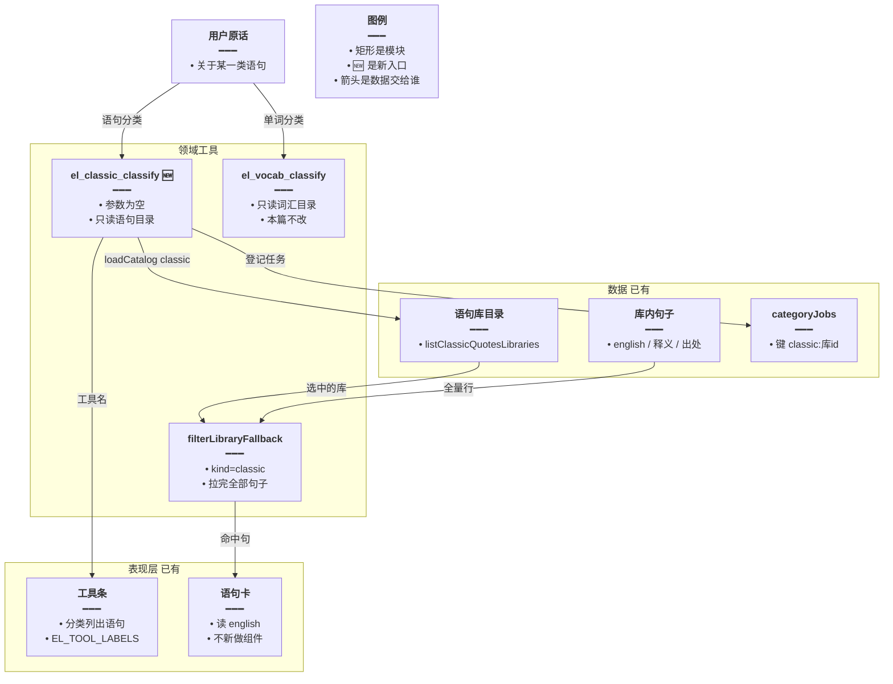
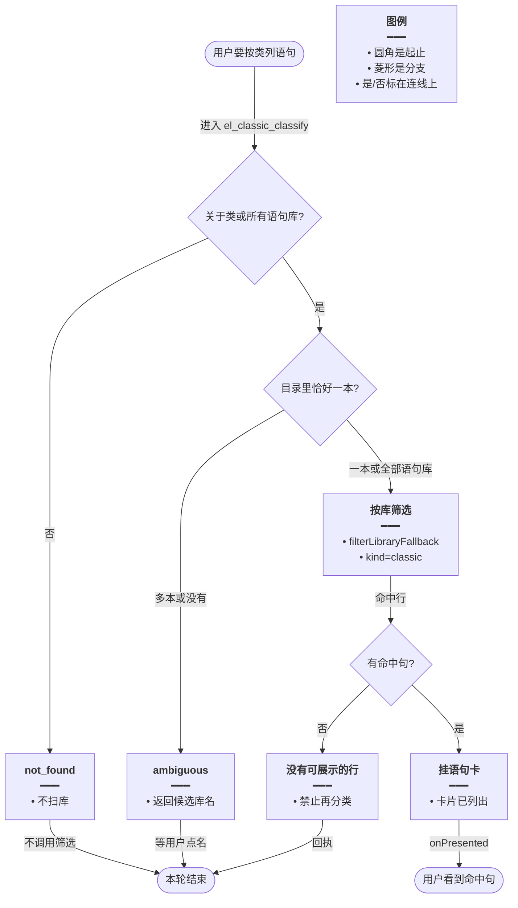
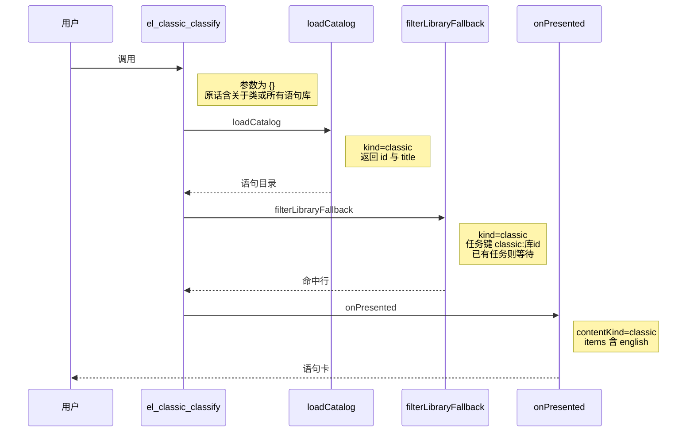

# 语句库分类列出 — 实现思路

> **状态**：规划（未实现）  
> **日期**：2026-10-28  
> **需求摘要**：用户让英语 Agent 从语句库里按某一类列出句子时，要有和词汇分类同级、但是单独的一个工具；点一次工具就挂出命中卡，不再靠检索词条去猜库。  
> **一句话方案（预告）**：新增 `el_classic_classify`，只加载语句库目录，命中后调用已有的 `filterLibraryFallback(..., 'classic')`；`el_vocab_classify` 继续只处理词汇库。

## 延伸阅读

- 词汇分类入口：[english/主模型后再分类.md](./主模型后再分类.md)。本篇不改那个工具的目录和参数
- 语句「关于类」若走检索会把图步打满：[english/关于类一次出卡.md](./关于类一次出卡.md)。那篇把分类挂在 `el_items_search` 第一次带上库 id 时；本篇让模型直接调语句工具，不必先搜
- 同库只扫一次：[english/同库分类只扫一次.md](./同库分类只扫一次.md)。任务键已是 `classic:<库 id>`，本篇沿用

---

## 0. 读本文你将得到什么

- 语句库分类今天没有自己的工具，模型要么去调只认词汇库的 `el_vocab_classify`，要么用 `el_items_search` 连着搜。
- 选定方案：单独增加 `el_classic_classify`，目录、点名和全库判断都只看语句库，筛选和出卡复用现成函数。
- 改动在领域工具、两段语句向的点名/全库判断、系统提示和工具条中文名。分类模型和卡片组件不换。
- 分两阶段：M1 单库分类出卡，M2 全库说法和提示词。
- 最大风险是一句里同时像词汇又像语句时，模型两个工具都调，各扫一遍。

---

## 1. 需求与边界

### 1.1 用户故事

| 角色 | 场景 | 行为 | 期望结果 |
|------|------|------|----------|
| 登录用户 | 说「把励志相关的语句从名言库里列出来」 | 模型调用语句分类工具 | 只在语句库里筛选，一张卡列出命中句 |
| 登录用户 | 说「所有语句库里关于天气的句子」 | 同上 | 每本语句库各筛一次，有命中的各挂一张卡 |
| 登录用户 | 说「关于动物的单词」 | 仍走词汇分类 | 不读语句库 |

### 1.2 范围

| 在范围内 | 不在范围内（非目标） |
|----------|----------------------|
| 新工具 `el_classic_classify`，参数为 `{}` | 把 `kind` 加进 `el_vocab_classify`，两个库共用一个入口 |
| 语句库目录、点名消歧、全库说法 | 收藏、错题、日推、笔记的分类 |
| 复用 `filterLibraryFallback`、`buildCategoryProposal`、现有语句卡 | 新表、新前端卡片、提高图递归上限 |
| 工具条中文名、系统提示里单独一行 | 改分类模型、改 8192 输出上限、改释义截断 |

### 1.3 约束与依赖

- 必须复用：`loadCatalog('classic')`、`listClassicQuotesLibraries`、`filterLibraryFallback` 的 `kind: 'classic'`、`categoryJobs`、`onPresented`、`isCategoryAsk`。
- 词汇工具的目录正则、`resolveAllVocabAsk`、提示词里「某一类单词」保持不动。
- 同一轮同一本语句库只分类一次，键是 `classic:<库 id>`。
- 卡片已经能按 `english` 画语句。`bodiesFromHits` 在没有 `word` 时会抄 `english`、`translationZh`、`source`、`noteZh`。

---

## 2. 背景

- **谁、在什么场景、卡在哪**：用户要按类别列出语句库里的句子。词汇侧已经有 `el_vocab_classify`：模型传空参数，服务端自己对目录、拉全库、分批判定、挂卡。
- **现状缺口**：这个工具写死 `loadCatalog('vocab')`，筛选也写死 `'vocab'`。语句库名对不上词汇目录，就回「没有唯一词汇库」。`el_items_search` 只有在模型已经带上 `libraryId` 且原话像「关于类」时才会整库分类，语句要先列库再检索，容易把一轮工具调用打满。
- **不解决会怎样**：语句分类继续依赖模型猜对库 id，或者误走进词汇工具，筛出来的是单词。
- **硬约束**：入口必须分开。分类仍在工具被调用之后才跑，不在进主模型之前扫库。不把语句目录写进词汇工具。

---

## 3. 现状与复用

| 能力 | 仓库中已有 | 本需求中的用法 |
|------|------------|----------------|
| 词汇分类工具 | `domain-tools.ts` 的 `el_vocab_classify`：空参数、只读词汇目录、`filterLibraryFallback(..., 'vocab')` | 不改行为。语句工具按同样形状另写一个 `wrap` |
| 语句目录 | `loadCatalog('classic')` 调 `listClassicQuotesLibraries` | 直接复用。语句工具只传 `'classic'` |
| 整库筛选 | `filterLibraryFallback` 在 `kind === 'classic'` 时拉 `listClassicQuotesLibraryItems`，行字段是 `english` / `translationZh` / `source` / `noteZh`，再进 `buildCategoryProposal` | 直接复用，不新写拉取和判定 |
| 语句行进卡片 | `category-propose.ts` 的 `bodiesFromHits`：没有 `word` 就输出 `english` | 直接复用 |
| 关于类判断 | `spill.ts` 的 `isCategoryAsk`：含「关于 / 相关 / 有关 / 属于」，整库「列出全部」不算 | 直接复用。语句和词汇用同一句判断 |
| 点名词汇库 | `resolveMentionedLibrary` 只认「词汇库 / 单词库 / 词库」 | 扩展成可传入后缀。语句传「语句库 / 语料库 / 经典语句」 |
| 全库词汇说法 | `isAllVocabCategory`、`resolveAllVocabAsk`。决定任务里「只要语句」会得到 `classic`，但验收只收 `all_vocab` | 不适用。另写语句版快路径和一次 `decide()`，避免改词汇验收 |
| 同库去重 | `elSurface.categoryJobs`，键 `classic:<id>` 已在 `el_items_search` 用过 | 直接复用 |
| 收尾补卡 | `agent.service.ts` 的 `shouldFilterContinue`。目录种类看 `catalogKind` | 语句工具调用 `loadCatalog('classic')` 后，收尾补的也是语句库 |
| 工具条 | `englishAgent.ts` 的 `EL_TOOL_LABELS` | 扩展一行：`el_classic_classify` → 「分类列出语句」 |
| 系统提示 | `agent.prompt.ts` 里 `el_vocab_classify` 单独一条 | 扩展一条语句工具说明，并写明语句不要调词汇分类 |

**调研结论**：拉取、判定、出卡、同库去重都已经能处理语句。缺的是一个只看语句目录的工具，以及语句向的点名和「所有语句库」判断。不需要新接口或新卡片。

---

## 4. 方案比对与最终方案

### 4.1 候选方案

#### 方案 A：继续用检索带库 id（复用）

- **做法**：不新增工具。提示词要求模型先 `el_libraries` `kind=classic`，再对唯一库 id 调 `el_items_search` `op=list`。`domain-tools.ts` 里已有分支：原话通过 `isCategoryAsk`、还没出卡、且带了 `libraryId` 时，调用 `filterLibraryFallback(..., 'classic')`。
- **能工作的原因**：语句行、分类器和卡片都走得通。库 id 正确时能挂出一张分类卡。
- **主要代价**：模型要先列库再检索，两步才能开始分类。库名没对上时会按关键词连着搜，[关于类一次出卡](./关于类一次出卡.md) 已记录这种打满图步的路径。全库说法没有「扫每本语句库」的入口。

#### 方案 B：词汇工具增加 `kind`（扩展）

- **做法**：`el_vocab_classify` 增加可选 `kind: "vocab" | "classic"`，默认 `vocab`。`kind=classic` 时 `loadCatalog('classic')`，任务键和 `filterLibraryFallback` 用 `classic`。点名正则扩成词库后缀和语句后缀两套。
- **能工作的原因**：一个工具里就能分开目录。分类、出卡、去重都还是现成函数。模型少记一个工具名。
- **主要代价**：入口仍是词汇工具。现有提示写的是「某一类单词」「不要传 libraryId」。模型漏传 `kind` 时语句请求会去扫词汇库。用户要求的是单独入口，这个方案把两种库的说明挤在同一段工具描述里。

#### 方案 C：单独的语句分类工具（新增入口，内部复用）

- **做法**：在 `buildEnglishLearningDomainTools` 的返回数组里、`el_vocab_classify` 旁边增加 `el_classic_classify`。描述写明只处理语句、参数为 `{}`。处理函数复制词汇工具的分支顺序，但目录只来自 `loadCatalog('classic')`，筛选固定 `'classic'`，任务键为 `` `classic:${id}` ``。点名走扩展后的 `resolveMentionedLibrary(text, libs, /语句库|语料库|经典语句/)`。全库走新的 `isAllClassicCategory` 和 `resolveAllClassicAsk`，线索必须是原话里的连续子串。系统提示增加一行，并写明语句分类不要调用 `el_vocab_classify`。工具条增加「分类列出语句」。
- **能工作的原因**：模型看到的是和词汇分类并列的空参数工具，不必先拿到库 id。真正拉行和判定仍是 `filterLibraryFallback` 与 `buildCategoryProposal`。
- **主要代价**：工具多一个名字。一句里又像单词又像语句时，模型可能两个都调，两套目录各扫一次。

### 4.2 比对

| 维度 | 方案 A 检索带库 id | 方案 B 词汇工具加 kind | 方案 C 单独语句工具 |
|------|-------------------|------------------------|---------------------|
| 正确性 | 库 id 对才筛语句。全库说法没有对应分支 | `kind` 漏传会把语句送进词汇目录 | 语句工具不会打开词汇目录。词汇工具代码路径不变 |
| 复用 / 与现状契合 | 复用 `el_items_search` 里已有的分类分支 | 复用一个 `wrap`，改其内部判断 | 复用 `loadCatalog`、`filterLibraryFallback`、`categoryJobs`、卡片。新增的是入口和语句向点名 |
| 改动面 | 只改提示词 | `el_vocab_classify`、点名正则、提示词、工具条可以不改 | `domain-tools.ts`、`spill.ts`、`agent.prompt.ts`、`englishAgent.ts` 各加一段 |
| 复杂度 | 无新工具。模型要记「先 list 再 search」 | 一个工具两种目录 | 多一个工具名。处理函数和词汇分类同构，不新写判定 |
| 体验 | 多一轮工具才开始分类，失败时用户看到检索而不是分类卡 | 一次调用能出卡，但叫法和「单词」绑在一起 | 一次调用出语句卡。工具条显示「分类列出语句」 |
| 风险 | 连着 search 会耗尽图步 | 改词汇工具的默认路径，现有单词分类回归面大 | 两个工具都被调用时各扫各的库。语句全库扫描和词汇全库一样耗分类请求 |
| 可维护性 | 语句分类藏在检索分支里 | 词库后缀和语句后缀堆在同一个函数 | 词汇工具不读语句规则。语句规则集中在新工具和 `spill.ts` 的语句函数 |

### 4.3 综合考量

权重在正确性和入口是否分开。用户明确要单独的语句工具，方案 B 少一个名字，但默认路径仍是词汇库，漏传 `kind` 就会筛错库，这是现有 `el_vocab_classify` 已经表现出来的缺口。方案 A 能出卡，却把「先找到库 id」留给模型，语句关于类因此才会连着检索。

选定方案 C。放弃 A 的零新工具，也放弃 B 少记一个名字。分类请求次数仍由库的大小决定，本篇不把多本语句库并成一次模型调用。

### 4.4 最终方案

#### 背景

词汇分类是空参数工具，服务端自己对词汇目录并整库筛选。语句库的行和判定函数已经能走同一条 `filterLibraryFallback`，但没有任何工具会主动加载语句目录。检索分支要等模型带上 `libraryId`。硬约束是入口分开，并且不改词汇工具对单词请求的行为。

#### 具体思路

1. 入口新开 `el_classic_classify`。拉取和判定不新做，只把 `kind` 固定为 `classic`。
2. 数据从 `listClassicQuotesLibraries` 到选中的库，再到 `listClassicQuotesLibraryItems` 的全量行，最后进现有分类器和语句卡。
3. 进行中的任务仍放在本轮 `categoryJobs`。语句键带 `classic:` 前缀，和词汇键不会互相覆盖。
4. 原话不像关于类、也不是「所有语句库」时，直接 `not_found`，不去扫库。点名多本或对不上时返回 `ambiguous` 和候选库名，不猜一本。

#### 实现方案

**一句话**：新增 `el_classic_classify`，只加载语句库目录，命中后调用已有的 `filterLibraryFallback(..., 'classic')`；`el_vocab_classify` 继续只处理词汇库。

| 步骤 | 谁 | 做什么 | 输入 → 输出 |
|------|----|--------|-------------|
| 1 | `agent.prompt.ts` | 告诉模型：语句分类只调 `el_classic_classify`，参数 `{}` | 用户原话 → 一次工具调用 |
| 2 | `spill.ts` `isAllClassicCategory` | 「关于类」且含「所有 / 全部 / 各个」和「语句库 / 语料库」 | 原话 → 是否扫全部语句库 |
| 3 | `resolveMentionedLibrary` | 后缀改为语句标记，在语句目录里消歧 | 原话 + 语句目录 → 一本、多本或没有 |
| 4 | `resolveAllClassicAsk` | 快路径未中时一次 `decide()`，线索必须是原话子串 | 原话 → 是否 `all_classic` |
| 5 | `el_classic_classify` | 按与词汇工具相同的顺序选库，然后 `filterLibraryFallback(..., 'classic')` | 选中的库 → 命中行 |
| 6 | `onPresented` 与 `EL_TOOL_LABELS` | 挂语句卡；工具条写「分类列出语句」 | 命中行 → 一张卡 |

语句标记用 `/语句库|语料库|经典语句/`。全库快路径同时要求关于类、`/所有|全部|各个/`、`/语句库|语料库/`。

#### 选定原因

1. **正确性**：语句工具的目录来自 `listClassicQuotesLibraries`。牺牲：模型若仍去调词汇工具，词汇库还是会被扫，要靠提示词拦住，代码不替它改道。
2. **复用**：拉行、判定、去重、卡片都不新写。牺牲：处理函数和词汇工具同构，有两段相似的分支。
3. **改动面**：词汇工具的默认路径不动。牺牲：提示词和工具条要各加一行，不能只改一个文件。
4. **复杂度**：不增加 `kind` 参数。牺牲：比方案 B 多一个工具名。
5. **体验**：一次空参数调用就开始分类。牺牲：全库语句仍是一本接一本筛，等待和词汇全库一样。
6. **风险**：任务键分开，同一本语句库不会并行筛两次。牺牲：一句兼问单词和语句时会有两次分类。
7. **可维护性**：语句后缀不写进词汇点名。牺牲：`resolveMentionedLibrary` 要多一个后缀参数，调用方必须传对。

#### 优势

- 相对方案 A：模型不必先 `el_libraries` 再 `el_items_search`。全库语句有明确分支，不会落成关键词连搜。
- 相对方案 B：单词请求继续只见词汇目录。工具描述和工具条都写「语句」，不会把语句分类说成单词工具的一个参数。

#### 怎么实现

1. `resolveMentionedLibrary` 增加后缀参数，默认仍是 `/词汇库|单词库|词库/`，语句工具传入语句标记。
2. 在 `spill.ts` 增加 `isAllClassicCategory` 与 `resolveAllClassicAsk`。决定任务只返回 `{"scope":"all_classic|one|none","cue":""}`，`cue` 不是原话子串则拒绝。
3. `el_classic_classify` 的选库顺序与 `el_vocab_classify` 相同：关于类且库名整段命中恰好一本 → 那一本；点名后缀命中一本 → 那一本；否则抽槽；抽到的线索再对目录；仍没有则看是不是全库；都不是则 `ambiguous` 或 `not_found`。
4. 对每个选中库 `filterLibraryFallback(..., 'classic', signal)`。已有同一 `classic:` 任务则等待，不再开第二次。
5. 有命中行就 `onPresented`。回执「卡片已列出。禁止逐条复述。」没有行则「没有可展示的行。禁止再分类。」
6. 提示词在 `el_vocab_classify` 下增加语句一条。`EL_TOOL_LABELS` 增加中文名。

### 4.5 其他关键决策

无其他会改变架构、数据流或状态归属的决策。全库扫描沿用词汇侧的「正则快路径，未中再一次 `decide()`」，不另做队列，也不把语句目录存进新的字段。`catalogKind` 仍是本轮最后一次 `loadCatalog` 的种类，收尾补卡已经按这个字段选 `classic` 或 `vocab`。

---

## 5. 架构图



**图内方法说明**：

| 方法 / 模块入口 | 功能 |
|-----------------|------|
| `el_classic_classify` | 语句分类入口。根据原话从语句目录选出库，再交给整库筛选，有命中就挂卡 |
| `el_vocab_classify` | 词汇分类入口。本篇不改，继续只打开词汇目录 |
| `filterLibraryFallback` | 按库拉全语句或单词，调用分类器，返回可挂卡的命中行 |
| `loadCatalog` | 按 `classic` 或 `vocab` 拉库名目录，写入本轮 `catalog` |
| `listClassicQuotesLibraries` | 分页列出当前用户的语句库 id 和标题 |

**读图要点**：

- 两个分类入口并列，语句入口不会去读词汇目录。
- 新的只有工具入口和工具条文案。拉句、判定、卡片都是现成的。
- 进行中的语句任务记在 `classic:` 键上，和词汇任务分开。

---

## 6. 主流程图



**图内方法说明**：

| 方法 | 功能 |
|------|------|
| `el_classic_classify` | 流程图入口。先判断这句话是不是语句分类，再决定选哪本库 |
| `isCategoryAsk` | 原话含关于类且不是「列出全部」时为真。全库说法另外走 `isAllClassicCategory` |
| `filterLibraryFallback` | 对选中的每一本语句库拉全句并分类，返回命中行或空 |
| `onPresented` | 把命中行作为语句卡推到当前回复 |

**读图要点**：

- 不像分类请求时不会拉任何语句库。
- 库名对上多本时停在候选列表，不挑第一本。
- 有命中才挂卡。没有命中的回执要求模型不要再分类一次。

---

## 7. 核心时序图



**图内方法说明**：

| 方法 | 功能 |
|------|------|
| `el_classic_classify` | 接收模型的空参数调用，用本轮用户原话选库 |
| `loadCatalog` | 拉取语句库目录。本轮已经是语句目录时直接返回缓存 |
| `filterLibraryFallback` | 拉该库全部句子并分类，得到要展示的行 |
| `onPresented` | 把这些行交给前端画在回复里 |

**读图要点**：

- 模型不传库 id。库是服务端从语句目录里选的。
- 分类发生在这次工具调用里面，主模型要等这张卡挂上才继续写导语。
- 词汇分类不出现在这条时序里。

---

## 9. 具体实现（主链路代码）

### 9.1 模块一览

| 模块 | 职责 | 新增/改动 | 预估路径 |
|------|------|-----------|----------|
| 语句分类入口 | 选库并调用筛选 | 新增 | `apps/backend/src/services/agent/tools/english/domain-tools.ts` |
| 点名与全库判断 | 语句后缀、全库快路径、一次 decide | 扩展 | `apps/backend/src/services/agent/tools/english/spill.ts` |
| 系统提示 | 单独一条工具说明 | 扩展 | `apps/backend/src/services/agent/agent.prompt.ts` |
| 工具条 | 中文名 | 扩展 | `apps/frontend/src/store/englishAgent.ts` |
| 筛选与卡片 | 拉句、判定、画语句 | 直接复用 | `filterLibraryFallback`、`category-propose.ts`、`ResourceListBlock.tsx` |

### 9.2 主链路实现

```typescript
// 只拉语句库目录，这句话才不会被送进词汇库
const libs = await loadCatalog('classic');
// 标题整段出现在原话里的库。恰好一本时不再抽槽
const exact = matchLibraries(userText, libs);
// 语句后缀只在语句目录里消歧，词汇工具仍用默认的词库后缀
const mentioned = resolveMentionedLibrary(userText, libs, /语句库|语料库|经典语句/);
// 关于类且整段只命中一本时用那一本，否则用点名得到的唯一一本
const named = isCategoryAsk(userText) && exact.length === 1 ? exact[0] : null;
// 点名结果只有 kind 为 one 才采用，多本或没有都不猜
const picked = mentioned.kind === 'one' ? mentioned.lib : null;
// 整段优先于点名，两处都没有则还没选定库
const one = named ?? picked;
// 快路径认出「所有语句库」就不再问模型
const allByRule = isAllClassicCategory(userText);
// 快路径未中才做一次 decide，线索不是原话子串会被拒绝
const allByDecide = allByRule ? false : await resolveAllClassicAsk(config, userText);
// 有唯一一本就只筛它；否则只有认定全库才扫目录里的每一本
const targets = one ? [one] : allByRule || allByDecide ? libs : [];
// 每本语句库单独一个任务，和词汇任务的 vocab: 键不会撞车
for (const lib of targets) {
  // 键带 classic:，同一轮同一本库只能有一个进行中的筛选
  const jobKey = `classic:${lib.id}`;
  // 已经在筛就复用那次 Promise，避免并行再拉一遍
  const pending = categoryJobs.get(jobKey);
  // 没有进行中的任务才整库拉句并分类，kind 固定为语句
  const job = pending ?? filterLibraryFallback(learning, config, userId, lib, userText, logger, 'classic', signal);
  // 登记后，同轮下一次进入会等到这一次结束
  categoryJobs.set(jobKey, job);
}
```

### 9.3 数据模型

| 字段/实体 | 来源 | 存储 | 说明 |
|-----------|------|------|------|
| 语句目录 | `listClassicQuotesLibraries` | 本轮 `catalog`，`catalogKind='classic'` | 不新增表 |
| 句子行 | `listClassicQuotesLibraryItems` | 分类输入 | `english`、`translationZh`、`source`、`noteZh` |
| 命中行 | `bodiesFromHits` | artifact，约 30 分钟 | 无 `word` 时保留 `english` |
| `categoryJobs` | 本轮内存 | `classic:<库 id>` → 进行中的 Promise | 与 `vocab:<库 id>` 并列 |

---

## 10. 分阶段实现步骤

| 阶段 | 目标 | 交付物 | 依赖 |
|------|------|--------|------|
| M1 | 点名一本语句库能出一张分类卡 | `el_classic_classify`、语句后缀、工具条、提示词 | 无 |
| M2 | 「所有语句库」扫每本有命中的库 | `isAllClassicCategory`、`resolveAllClassicAsk` | M1 |

### M1

- [ ] `resolveMentionedLibrary` 增加后缀参数，现有词汇调用不传则行为不变。
- [ ] 新增 `el_classic_classify`，选库后调用 `filterLibraryFallback(..., 'classic')`。
- [ ] 提示词写明语句分类用这个工具，不要调用 `el_vocab_classify`。
- [ ] `EL_TOOL_LABELS` 增加「分类列出语句」。

### M2

- [ ] `isAllClassicCategory`：关于类，且同时有「所有 / 全部 / 各个」和「语句库 / 语料库」。
- [ ] `resolveAllClassicAsk`：未命中快路径时一次 `decide()`，`cue` 必须是原话子串。
- [ ] 没有唯一库且也不是全库时返回 `ambiguous`，候选最多 10 本。

---

## 11. 风险、边界与待确认

| 项 | 等级 | 说明 | 缓解 |
|----|------|------|------|
| 两个工具都调 | 中 | 一句兼问单词和语句时，两套目录都会筛 | 提示词分开写。任务键不同，不会把语句结果写进词汇任务 |
| 全库耗时 | 高 | 每本语句库都要整库分类，请求数随库大小增加 | 与词汇全库相同，一本接一本，且同库只一次。本篇不合并成一次模型调用 |
| 目录被覆盖 | 低 | `loadCatalog` 会换掉本轮 `catalogKind` | 语句工具只在自己被调用时加载语句目录。收尾补卡按最后一次种类，已出卡则 `shouldFilterContinue` 不再补 |
| 后缀误伤 | 低 | 「语料库」若也是某本词汇库标题的一部分，只在语句目录里匹配 | 匹配范围限于 `listClassicQuotesLibraries` 的标题 |

**待确认**：

- [ ] 语句库标题是否稳定带「语句库 / 语料库 / 经典语句」其中之一（验证方式：看 `listClassicQuotesLibraries` 的 `title`。若大量标题只有主题词、没有这些后缀，点名要再依赖 `matchLibraries` 的整段包含，M1 已保留这条）。

---

## 12. 验收清单

| # | 用例 | 步骤 | 期望 |
|---|------|------|------|
| AC1 | 点名一本语句库 | 「把名言库里关于励志的句子列出来」，该标题在语句目录中恰好一本 | 只调用 `el_classic_classify`，一张卡，行是句子不是单词 |
| AC2 | 不误开词汇库 | 同上 | 不调用 `listVocabularyLibraries`，工具条是「分类列出语句」 |
| AC3 | 单词请求不变 | 「关于动物的单词」 | 仍是 `el_vocab_classify`，不加载语句目录 |
| AC4 | 库名不确定 | 原话对上两本语句库 | `ambiguous`，回执带候选，不筛其中一本 |
| AC5 | 全库 | 「所有语句库里关于天气的句子」 | 每本语句库最多筛一次，有命中的各挂一张卡 |
| AC6 | 同轮重复 | 同一本库的筛选尚未结束时再次进入 | 等待已有 `classic:<id>` 任务，分类请求不加倍 |
| AC7 | 没有命中 | 库里没有这一类 | 回执「没有可展示的行。禁止再分类。」不挂空卡 |

---

## 13. 预估改动面（实现阶段参考）

| 类型 | 路径（预估） |
|------|----------------|
| 前端 | `apps/frontend/src/store/englishAgent.ts` 增加一行中文名 |
| 后端 | `domain-tools.ts`、`spill.ts`、`agent.prompt.ts` |
| 文档（实现后） | 实现完成后再归档。本篇不改业务代码 |
