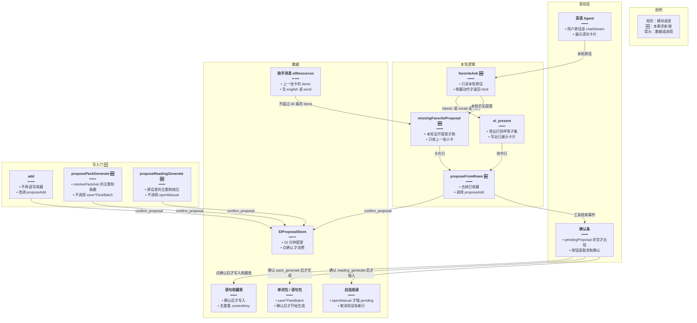
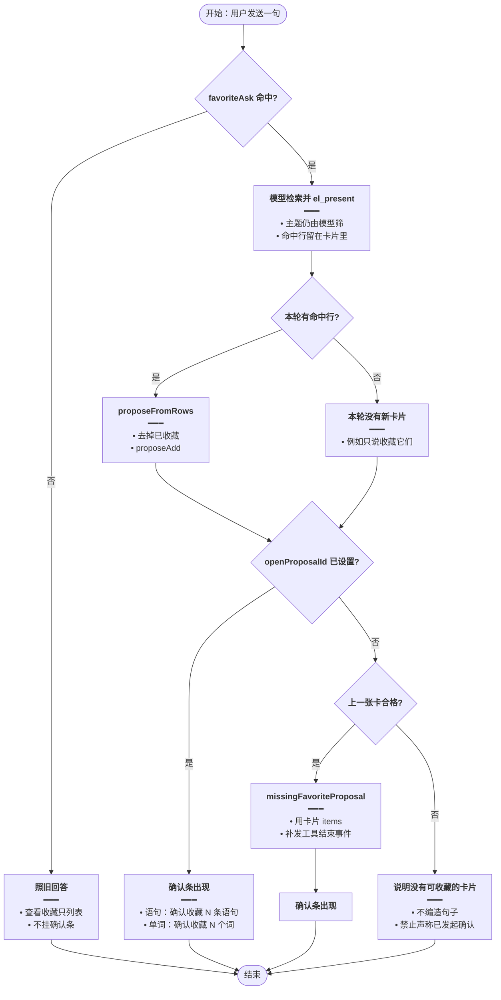
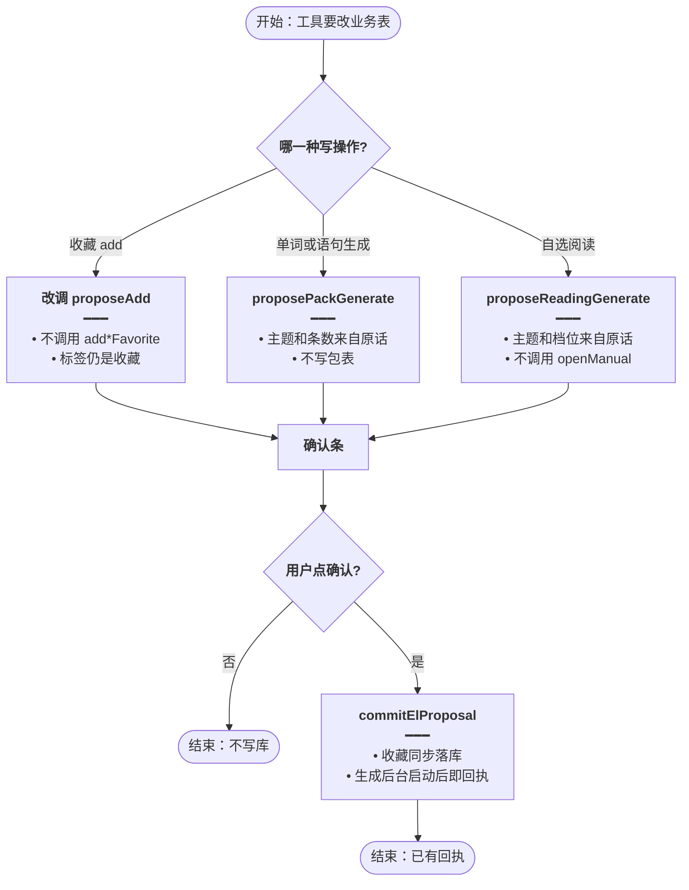
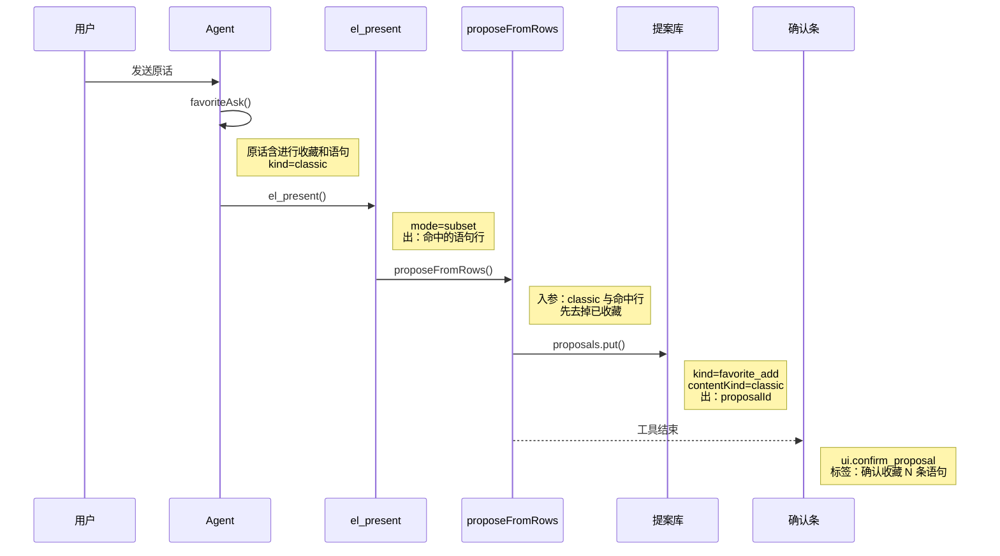
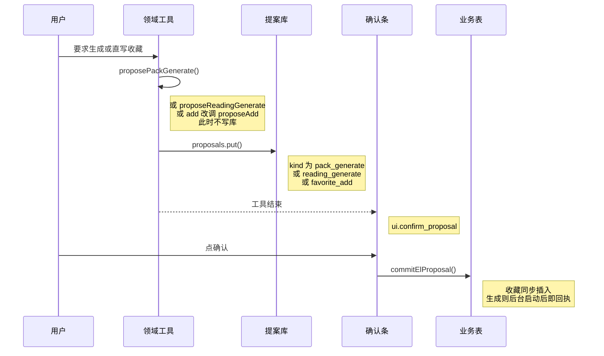
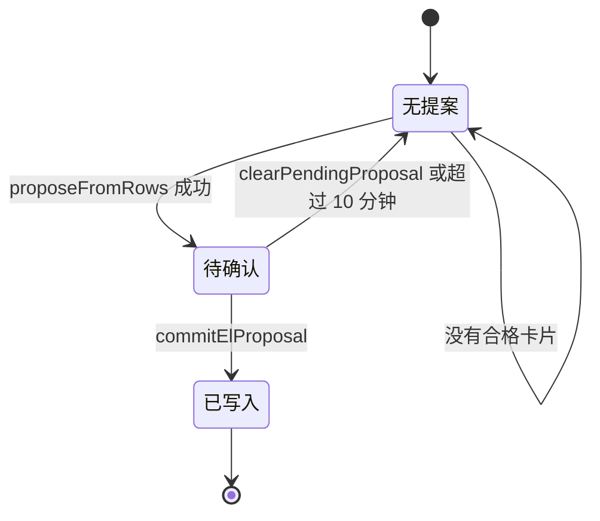

# 语句收藏确认 — 实现思路

> **状态**：规划（确认条、提案库、语句收藏写入都已有；缺的是「原话里的收藏」一定能把确认条挂上。另有三类写库不经确认条）
> **日期**：2026-10-28
> **需求摘要**：用户用一句话要求收藏一批经典语句时，本轮就要出现和单词收藏相同的确认条；凡是 Agent 会改业务表的操作，都先弹出同一条确认条，人点确认后才落库。
> **一句话方案（预告）**：原话里的「进行收藏 / 加入收藏」由服务端认定；筛出的语句或上一张已展示卡片直接走现有 `propose_add`。收藏直写、单词/语句生成、自选阅读生成也改成先挂 `confirm_proposal`，点确认后才写库。

## 延伸阅读

- [english/收藏提案直确认.md](./收藏提案直确认.md)：一批词一次 `propose_add.items`、点确认走 HTTP `commit`。那篇解决的是逐词提案把图步打满；本篇解决的是语句收藏根本没挂上确认条。
- [english/英语Agent关联侧栏.md](./英语Agent关联侧栏.md)：写操作必须提案，不能由模型同轮自称已确认。
- [english/意图决定出卡.md](./意图决定出卡.md)：筛选题走 `el_present`。本篇不改出卡规则，只要求收藏意图在出卡之后继续提案。

---

## 0. 读本文你将得到什么

- 这次语句收藏没弹出确认条的具体原因：确认条只认工具回执，语句提案要么没调用，要么被当成单词解析后静默失败，模型再用正文冒充确认。
- 比对后的做法：服务端从用户原话认出收藏，用卡片里的原句挂上现有确认条，单词收藏继续走同一条条。
- 写入门：Agent 里每种改业务表的操作都先走这条确认条。收藏直写改为提案；生成单词、语句、自选阅读也先提案，点确认才开始写库。
- 改动在英语 Agent 的领域工具、提案种类和本轮收尾。确认按钮仍是原来那一个。
- 分四阶段：先认原话，再在筛出后立刻提案，再用上一张卡兜住「收藏它们」，最后封住三条直写。
- 最大风险是把「看看我的收藏」误认成写入，把整本语句集一次提案，或确认后的生成任务在 HTTP 返回前被当成失败。

---

## 1. 需求与边界

### 1.1 用户故事

| 角色 | 场景 | 行为 | 期望结果 |
|------|------|------|----------|
| 已登录用户 | 英语 Agent | 「帮我讲小学三年级语句中关于打招呼的语句进行收藏」 | 可以先查出打招呼语句并出卡，但本轮必须出现确认条，标签是「确认收藏 N 条语句」 |
| 已登录用户 | 上一轮已经列出这批语句 | 「我需要将他们进行收藏」 | 确认条出现；已在收藏里的句子不重复进入提案 |
| 已登录用户 | 同样句式收藏单词 | 「把这些单词收藏」 | 仍弹出「确认收藏 N 个词」，不改现有成功路径 |
| 已登录用户 | 只是查看 | 「我的语句收藏里有哪些」 | 只列表，不挂确认条 |
| 已登录用户 | 让 Agent 生成单词、语句或一篇自选阅读 | 说「生成小学三年级打招呼的语句」或「生成一篇关于动物的短文」 | 先出现确认条；点确认后才插入单词包、语句包或阅读行 |
| 已登录用户 | 模型试图用白名单直接收藏 | 本轮工具结果里已经出现过的词或句 | 仍只出现确认条，收藏表在点确认前不变 |

### 1.2 范围

| 在范围内 | 不在范围内（非目标） |
|----------|----------------------|
| 原话含收藏动作时，语句和单词都要挂上现有确认条 | 不在服务端做「打招呼」语义分类，筛选仍由模型 `el_present` |
| 语句用 `english` 写入经典句收藏，单词仍用 `word` | 不新增卡片上的「收藏这张卡」按钮 |
| 已收藏的句子从提案里去掉 | 不把会话消息、会话标题的保存做成确认条 |
| 模型没调用或调用失败时，用上一张已展示卡片兜底 | 不给生成过程中的每一批、每一次联网再弹一条确认 |
| `add`、`generate`、`generate_manual` 在落库前先挂确认条 | 页面上用户自己点的收藏、删除、生成保持原样 |
| 点确认后才调用现有的打包写入和 `openManual` | 学习笔记、词库、语句库、复习评分、今日记词不新开 Agent 写入口 |

### 1.3 约束与依赖

- 须登录。确认条在英语 Agent 输入框上方，Web 与 Tauri 同一套 `pendingProposal`。
- 复用 `ElProposalStore`（10 分钟）、`proposeAdd`、`parseElConfirmProposal`、`addClassicQuoteFavorite`、`saveVocabularyPackBatch`、`saveClassicQuotesPackBatch`、`openManual`。
- 一次收藏提案仍最多 40 条（`PROPOSE_ITEM_CAP`）。整库、整包不自动收藏。生成类提案记的是主题和条数，不是把尚未生成的行塞进这 40 条。
- 领域工具每轮仍最多 10 次。兜底发生在模型循环结束之后，不再占一次模型工具调用。

---

## 2. 背景

这次对话里，收藏动作已经写在原话里，确认条却没有出现。单词用同样的「帮我收藏」可以弹出。

用户第一句是：「帮我讲小学三年级语句中关于打招呼的语句进行收藏」。助手只查了经典语句资料，用 `[[el:…]]` 列出 22 条打招呼语句，并改口说可以逐句讲解。没有确认条。

用户第二句是：「我需要将他们进行收藏」。助手说收藏里已有 2 条、待收藏 20 条，并写「请在侧栏点击确认收藏 20 个」。输入框上方仍然没有确认条。

**现状缺口**：

- 确认条的唯一来源是领域工具回执里的 `ui.type = confirm_proposal`。正文里的「已发起收藏确认」不会创建提案。
- 原话里的「进行收藏」没有对应的判定函数。生成主题有 `resolvePackAsk`，笔记有 `noteReadAsk`，收藏没有。
- 语句行的字段是 `english`。`kind` 不是精确的 `classic` 时，这些行被当成单词丢掉，回执没有 `ui`。
- 轮次结束只会补笔记卡（`missingNoteCard`），不会补收藏提案。

**不解决会怎样**：用户看到一份语句清单和一段「请去点击确认」的说明，收藏表不变。同一句式的单词收藏却能点确认，语句看起来像坏了。

**硬约束**：

- 写入仍须用户点「确认」。不能因为原话里有「收藏」就直接 `addClassicQuoteFavorite`。
- 不能破坏单词收藏已经能弹出确认条的路径。
- 不能把 1445 条语句集整包提案。只有本轮筛出的行，或上一张已经展示给用户的小卡片。
- Agent 对业务表的增删改都要先出现确认条。今天绕过确认条的只有三条：收藏 `add`、单词/语句 `generate`、自选阅读 `generate_manual`。
- 对话记录本身继续直接落库。否则每一句回复都要先点确认，对话无法进行。

### 2.1 具体原因

确认条不出现，是下面几处叠在一起，不是前端把语句确认条藏了。

| # | 现象 | 原因 | 位置 |
|---|------|------|------|
| 1 | 第一句只出了 22 条卡片 | 「进行收藏」没有被任何函数读到。系统提示把语句问题写得很细：先 `el_packs` / `el_items_search`，筛选后再 `el_present`。收藏只在工具说明里写成「可以 propose」。模型做完检索和出卡就停了 | `agent.prompt.ts` 第 18–21、25 行；`domain-tools.ts` 的 `el_present` 成功后只返回「卡片已列出」，不提案 |
| 2 | 第二句知道 37 条收藏、其中 2 条重复 | 这是 `el_favorites` `list` 的真实结果。`list` 的 `ui` 是「打开语句收藏」导航，不是确认条 | `domain-tools.ts` `list` 分支，`href` 为 `/english-learning/favorites?kind=classic` |
| 3 | 助手写出「确认收藏 20 个」但条没出来 | 服务端标签只有两种：单词是「确认收藏 N 个词」，语句是「确认收藏 N 条语句」。按钮是「取消」和「确认」。模型写的「确认收藏 20 个」对不上任一标签，说明本轮工具回执里没有 `confirm_proposal`，`pendingProposal` 没有被赋值 | `proposeAdd` 的 `label`；`englishAgent.ts` 的 `parseElConfirmProposal`；`agent/index.tsx` 确认条 |
| 4 | 同样的收藏请求，单词能弹出 | `kindOf` 除了 `kind === 'classic'` 一律当单词。单词行字段是 `word`，和默认分支、提示里的「多个词一次 propose_add」一致，`proposeAdd` 成功并带上 `ui`。语句行字段是 `english`；模型若漏写 `kind: "classic"`，或把句子放进 `sentence` / `text`，`buildFavoriteBody` 逐行跳过，最后返回「items 里没有有效词条」，没有 `ui` | `domain-tools.ts` `kindOf`；`propose-bodies.ts` `buildFavoriteBody`、`collectProposeBodies` |
| 5 | 模型敢说「已发起收藏确认」 | 提示写的是「写入须等用户点确认」，没有写「回执里没有请用户确认后再写入，就禁止说已发起」。`stop_tools` 刹车只在已经有提案之后生效。失败提案不会打开刹车 | `agent.prompt.ts` 第 21 行；`agent-middleware.ts` `brakeAfterModel` |
| 6 | 「它们」对不上上一张卡 | 白名单 `elWhitelist` 每轮新建，上一轮卡片里的句子不算本轮已出现。没有「按 artifactId 提案」。模型要自己把 20 句再打进 `items`。单词短，容易打对；句子一旦字段名不对就整批作废。笔记漏调用时有 `missingNoteCard` 兜底，收藏没有 | `agent.service.ts` 里每轮 `new Set()`；`artifact.store.ts` 只负责按 id 取清单 |

第一句里的「讲」不是根因。原话里已经有「进行收藏」。缺的是把这个动作收成必做的提案，而不是把「讲」改成「将」。

单词路径能工作的调用是：`el_favorites` `propose_add`，`kind` 为 `vocab` 或省略，`items[].word` 有值 → `proposeAdd` 写入 `ElProposalStore` → 回执 `ui: [{ type: 'confirm_proposal', label: '确认收藏 N 个词' }]` → SSE `tool` `phase: 'end'` → `parseElConfirmProposal` 设置 `pendingProposal`。语句这次停在了第 4 步之前。

---

## 3. 现状与复用

| 能力 | 仓库中已有 | 本需求中的用法 |
|------|------------|----------------|
| 确认条 | `apps/frontend/src/store/englishAgent.ts` `parseElConfirmProposal`；`apps/frontend/src/views/englishLearning/agent/index.tsx` | 直接复用。兜底也发同样的 `tool` 结束事件 |
| 提案与落库 | `apps/backend/src/services/agent/tools/english/domain-tools.ts` `proposeAdd`；`proposal.store.ts`；`apply-proposal.ts` | 直接复用。语句仍 `contentKind: 'classic'`，点确认仍走现有 `commit` |
| 批量入参 | `propose-bodies.ts` `collectProposeBodies` | 扩展。只有 `english`、没有 `word` 时视为语句，避免静默丢行 |
| 原话判定 | `spill.ts` `listIntent`；`domain-tools.ts` `noteReadAsk`；`pack-ask.ts` `resolvePackAsk` | 扩展。新增只看收藏动作的 `favoriteAsk`，不把「打招呼」交给 flash |
| 漏调用兜底 | `agent.service.ts` 在模型循环后调用 `missingNoteCard` | 扩展。同一位置补收藏提案 |
| 上一张卡的原句 | 助手消息 `elResources`（`english-agent-message.entity.ts`）；`ElArtifactStore` 30 分钟 | 直接复用。指代「它们」时读上一张已展示卡片的 `items` |
| 去掉已收藏 | `listClassicQuoteFavoriteRefsForEnglishes`、`classicQuoteFavoriteContentKey` | 直接复用。提案前按原句去重 |
| 语句收藏写入 | `addClassicQuoteFavorite` | 直接复用。只在用户点确认后由 `applyElProposal` 调用 |
| 收藏直写 | `domain-tools.ts` `el_favorites` 的 `op=add` | 扩展。去掉落库，改调 `proposeAdd` |
| 单词/语句生成落库 | `saveVocabularyPackBatch`、`saveClassicQuotesPackBatch`、`appendPackWebSearchRound` | 直接复用。只在 `pack_generate` 提案被确认后调用 |
| 自选阅读落库 | `english-daily-reading.service.ts` `openManual` → `claimRow` 插入 pending 行 | 直接复用。只在 `reading_generate` 提案被确认后调用 |
| 确认后的回执 | `commitElProposal`；前端 `proposalReceiptText` | 扩展。生成类回执用服务端文案，不用「已收藏 N 个」 |
| 卡片上的收藏按钮 | 无 | 不适用。本需求走对话，不新增按钮 |

**调研结论**：确认条、提案库、语句收藏表都不用新做。缺的是从原话到 `proposeAdd` 的必经一步，以及语句字段被单词解析丢掉之后的兜底。另外三条写库不经过 `confirm_proposal`：收藏 `add`、单词/语句生成、自选阅读生成。写入门接在同一个 `ElProposalStore` 和确认条上。

---

## 4. 方案比对与最终方案

### 4.1 候选方案

#### 方案 A：只改系统提示（复用）

- **做法**：在 `ENGLISH_LEARNING_SYSTEM_APPEND` 写明：原话含「进行收藏」时，本轮必须 `el_favorites` `propose_add`；语句必须 `kind: "classic"` 且每项带 `english`；回执没有「请用户确认后再写入」就禁止写「已发起收藏确认」。
- **能工作的原因**：单词今天能弹出，就是模型按提示里的 `items[].word` 调用了已有工具。把语句的字段写进同一段提示，模型有机会一次调用成功，前端不用改。
- **主要代价**：第二句已经明确说了「进行收藏」，模型仍然只复述确认、没有带上 `confirm_proposal`。提示约束的是「可以说什么」，约束不住「没调用」。字段名再写错一次，`collectProposeBodies` 仍会丢光语句。

#### 方案 B：原话认定收藏，用已筛出的行挂现有提案（扩展）

- **做法**：新增 `favoriteAsk(userText)`。命中收藏动作时，`el_present` 筛出的行立刻交给 `proposeAdd`（语句用卡片上的 `english`，单词用 `word`），并先去掉已收藏项。本轮如果始终没有 `openProposalId`，在 `missingNoteCard` 旁边用上一张已展示卡片再提案一次，并用现有 SSE `tool` 结束事件把 `confirm_proposal` 交给前端。模型若把语句按单词形状提案，这次失败不算「已开提案」，好让兜底继续。
- **能工作的原因**：确认条的开关本来就是回执里的 `ui`。服务端拿的是 artifact 里的原句，不再依赖模型重打 20 个 `english`。单词仍进同一个 `proposeAdd`，标签仍是「确认收藏 N 个词」。
- **主要代价**：要在领域工具和 `runChatStream` 收尾各加一处。误认「看看收藏」会多出一条确认条，所以判定必须是「进行收藏 / 加入收藏」这类动作，不能是出现「收藏」两个字。

#### 方案 C：资源卡增加「收藏这张卡」（新增）

- **做法**：`ResourceListBlock` 在经典语句卡上加按钮，把该卡 `items` 交给新的 HTTP 接口创建提案，前端本地 `pendingProposal = …`。对话模型不再负责打开确认条。
- **能工作的原因**：22 条已经在卡片数据里，按钮不经过 `kindOf`，确认条一定出现。
- **主要代价**：用户必须看见卡片再点按钮。第一句的期望是话说完就有确认条，和单词对话收藏不是同一条路。模型仍可以在正文里假装已经发起确认。

### 4.2 比对

| 维度 | 方案 A 只改提示 | 方案 B 原话认定后提案 | 方案 C 卡片按钮 |
|------|-----------------|------------------------|-----------------|
| 正确性 | 模型漏调用或 `kind` 漏写时仍然没有 `ui`，正文仍可假装已确认 | 筛出的行或上一张卡进 `proposeAdd`；没有提案就不允许把失败调用记成已打开 | 按钮路径正确；对话路径仍可假装已确认 |
| 复用 / 与现状契合 | 只改 `agent.prompt.ts`，工具和确认条不动 | 复用 `proposeAdd`、`ElProposalStore`、`parseElConfirmProposal`、消息上的 `elResources` | 确认条状态要由新接口另写一份，和工具回执两套来源 |
| 改动面 | 一个提示字符串 | `favoriteAsk`、`el_present` 之后、`runChatStream` 收尾、`collectProposeBodies` 的 kind | 资源卡、新 HTTP、store 赋值 |
| 复杂度 | 无新状态 | 一个本轮标记 `openProposalId` 已有；新增的是原话判定和收尾兜底 | 新的写入入口，和「点确认走 commit」并列 |
| 体验 | 和这次失败同一类：有说明、没有条 | 第一句在出卡后出现「确认收藏 N 条语句」；第二句用上一张卡出现同一条 | 要多点一次卡片；口头「收藏它们」仍没有条 |
| 风险 | 低，但也修不住这次事故 | 误判查看请求会多一条确认条；用整包兜底会一次提案上千条。两者都用判定和 40 条上限挡住 | 按钮误点会提案，范围只限当前卡，风险面小 |
| 可维护性 | 提示和 `kindOf` 两处规则继续分叉，语句以后还要再补一句 | 语句和单词共用 `proposeAdd`，字段以卡片为准 | 对话和按钮各维护一套「怎么开始提案」 |

### 4.3 综合考量

这次要保住的是「话说完就有确认条」，以及「没有 `confirm_proposal` 就不能自称已确认」。正确性和体验的权重大于少改一个文件。方案 A 改动最小，但第二句已经证明：收藏两个字写进用户句，模型仍会用正文完成「等用户确认」这句话。这个优点抵不过它修不住事故。

方案 C 的按钮最不容易受模型影响，但用户对单词已经习惯「说收藏 → 弹出确认条」。语句再改成点卡片，两条收藏会变成两种操作。按钮可以以后另做，本篇不选它。

方案 B 放弃的是 A 的「只改提示」和 C 的「完全不依赖对话」。换来的是语句和单词仍共用一条确认条，筛选仍由模型做，写入仍等用户点确认。

### 4.4 最终方案

#### 背景

确认条只在 `el_favorites` / `el_mistakes` 的成功提案回执里出现。语句收藏的行是 `english`，默认解析却是单词的 `word`。原话里的「进行收藏」没有判定函数，轮次结束也不补提案。所以模型可以列出 22 条、报出 37 条收藏、写出「确认收藏 20 个」，而 `pendingProposal` 一直是空的。单词能弹出，是因为默认 kind 和 `word` 字段与提示一致。硬约束是：仍要用户点确认，不能整包收藏，不能改坏单词路径。

#### 具体思路

1. 判定放在服务端，和 `listIntent`、`noteReadAsk` 一样只读本轮用户原话。命中收藏动作才进入提案。查看收藏不进入。
2. 「打招呼」这种主题仍由模型检索并 `el_present`。服务端不另叫 flash 去挑句子。
3. `el_present` 一旦命中，并且原话是收藏，立刻用命中行调用已有 `proposeAdd`。kind 用来自卡片的 `contentKind`，不用模型这次工具参数里的 `kind`。
4. 提案前用已有的收藏引用查询去掉已存在的句子或单词。全部已存在则不挂空条，回执写明未挂确认条。
5. 本轮循环结束仍没有 `openProposalId`，而且原话是指代（「它们 / 他们 / 这些」）或没写出语句/单词时，读取上一张助手消息里已展示的 `elResources`。只接受条数不超过 40、带 `items`、`contentKind` 为 `vocab` 或 `classic` 的那张卡。没有合格卡片就不编造句子。
6. 兜底成功时，在 `finalizeTurn` 之前发一条与工具结束相同的 SSE：`type: 'tool'`，`phase: 'end'`，`name: 'el_favorites'`，`output` 为带 `confirm_proposal` 的信封。前端现有解析就能弹出确认条。
7. 状态仍放在现有 `ElProposalStore` 和前端 `pendingProposal`。不把「待确认」写进收藏表。
8. 模型若对语句收藏调用了单词形状的 `propose_add`，返回错误且不设置 `openProposalId`，避免写进单词收藏，也避免挡住兜底。

#### 实现方案

**一句话**：原话里的收藏动作由 `favoriteAsk` 认定；筛出的行或上一张已展示卡片进入现有 `proposeAdd`，确认条仍只由 `confirm_proposal` 打开。

| 步骤 | 谁 | 做什么 | 输入 → 输出 |
|------|----|--------|-------------|
| 1 | `favoriteAsk` | 判断本轮是不是收藏动作，以及对象是语句、单词还是指代上一张卡 | 用户原话 → `{ action: 'add', kind: 'classic' \| 'vocab' \| 'card' }` 或 `null` |
| 2 | `el_present` 成功之后 | 原话是收藏且本轮有命中行时，去掉已收藏项并 `proposeAdd` | 命中行 + `contentKind` → 带 `confirm_proposal` 的信封，`openProposalId` 被设置 |
| 3 | `collectProposeBodies` | 模型自己调用时，只有 `english` 的 items 视为语句 | 工具 JSON → 语句 body 数组，或明确的 `bad_args` |
| 4 | `missingFavoriteProposal` | 本轮没开提案时，用上一张合格卡片提案，并补发工具结束事件 | 上一条助手消息的 `elResources` → 同一形状的 `confirm_proposal`，或「没有可收藏的卡片」 |

#### 选定原因

1. **正确性**：提案行来自已展示的 `english` / `word`，不再靠模型重打字段。牺牲：查看类句子若写进动作正则，会多一次确认，所以正则只收「进行收藏、加入收藏、帮我收藏、把…收藏」。
2. **复用**：确认条、提案库、点确认落库都不换。牺牲：收尾要读上一张消息的 `elResources`，不能只改提示。
3. **体验**：第一句出卡后就有「确认收藏 N 条语句」；第二句不必用户再点卡片。牺牲：主题筛选仍要一次检索，确认条出现在命中之后，不是用户回车的同一毫秒。
4. **风险**：不合格的整包卡片不会兜底；错误的单词形状提案不算已打开。牺牲：模型仍可能先写一段说明，确认条和说明会同时在。说明不是收藏成功。
5. **可维护性**：语句和单词共用 `proposeAdd`。牺牲：原话判定和提示各有一句，判定以函数为准，提示只禁止冒充。

#### 优势

- 相对方案 A：模型漏调 `propose_add` 或把 `english` 交给单词解析时，本轮仍会挂上 `confirm_proposal`。这次第二句缺的就是这个回执。
- 相对方案 C：用户仍用同一句话收藏语句和单词，确认条仍来自工具回执，点「确认」仍走现有 `commit`。

#### 怎么实现

1. `favoriteAsk` 只读本轮 `dto.content`。第一句含「进行收藏」和「语句」，结果是 `classic`。第二句只有「进行收藏」和「他们」，结果是 `card`。
2. 构建领域工具时把这个结果放进 `surface`。`el_present` 写完卡片后，若 `kind` 不是 `card` 且与卡片 `contentKind` 一致，调用 `proposeFromRows`。
3. `proposeFromRows` 用 `listClassicQuoteFavoriteRefsForEnglishes` 或单词侧的对应查询去掉已收藏项，再调用现有 `proposeAdd('favorites', kind, { items })`。
4. 模型循环结束后，若原话命中收藏且 `surface.openProposalId` 仍为空，`missingFavoriteProposal` 取上一张合格卡片走第 3 步，并 `subscriber.next` 工具结束事件。
5. 提示增加一句：回执没有「请用户确认后再写入」时，禁止写「已发起收藏确认」或自拟按钮文案。判定不靠这句提示。

### 4.5 指代「它们」时，行从哪来

上一张卡和「再让模型打 20 句」会改变数据从哪流进提案。这是单独的决定。

#### 4.5.1 候选方案

##### 方案 A：仍让模型把句子放进 `items`（复用）

- **做法**：第二句只靠提示要求 `propose_add`，句子从对话正文抄进 `items`。
- **能工作的原因**：正文里已经有那 20 句，模型抄得对、字段也对时，现有 `proposeAdd` 会挂确认条。
- **主要代价**：这次抄完后确认条没出现。抄写一旦字段名不对，整批变成 `bad_args`。

##### 方案 B：读上一张已展示卡片的 `items`（扩展）

- **做法**：`kind === 'card'` 或本轮没有新的 `el_present` 时，取上一条助手消息里最后一张 `totalCount ≤ 40` 且带 `items` 的 `elResources`。过期则用卡片上的 `artifactId` 向 `ElArtifactStore.get` 要同一份。然后 `proposeFromRows`。
- **能工作的原因**：第一句的 22 条是 `onPresented` 放进 `turnElResources` 再落进消息的，字段是完整 `english`，不是模型摘要。30 分钟内缓存也有同一份。
- **主要代价**：上一张若是整包索引，必须拒绝。消息若没有 `items` 且缓存已过期，本轮只能说明没有可收藏的卡片。

#### 4.5.2 比对

| 维度 | 方案 A 模型重打 items | 方案 B 上一张卡片 |
|------|------------------------|-------------------|
| 正确性 | 字段错则 0 条，且可能把句子写进 `word` | 行与用户看见的卡片一致；无合格卡片则不开提案 |
| 复用 | 只用现有 `propose_add` | 复用消息快照和 `ElArtifactStore.get` |
| 改动面 | 提示 | 收尾读上一张消息 |
| 复杂度 | 无新数据 | 多一个「哪张卡合格」的条件 |
| 体验 | 和这次一样可能只有说明 | 「收藏它们」直接出现确认条 |
| 风险 | 低改动、高复发 | 选错整包会一次提案过多；用 `totalCount ≤ 40` 挡住 |
| 可维护性 | 字段规则继续靠提示 | 卡片是唯一行来源，提示不再负责抄句 |

#### 4.5.3 综合考量

第二句的对象是「他们」，用户没有重说 20 句。正确性的权重最高：提案必须等于上一张卡，而不是模型再写的一张表。方案 A 少一次读库，但这次事故就是模型自己写了表、没有提案。这个优点抵不过行对不上。选定方案 B。

#### 4.5.4 最终方案

##### 背景

指代句里没有原句。本轮白名单是空的。上一张卡的 22 条已经在助手消息的 `elResources` 里。再让模型抄，就会重复第 2.1 节的失败。

##### 具体思路

1. 只在 `favoriteAsk.kind === 'card'`，或本轮收藏意图成立但 `openProposalId` 仍为空时读卡片。
2. 取该会话上一条助手消息的 `elResources`，从后往前找第一张 `items.length > 0` 且 `totalCount ≤ 40` 的卡。
3. `contentKind` 用卡片自己的，不用用户原话猜测。没有 `contentKind` 的笔记卡、日推卡跳过。
4. 缓存仍在则用 `artifactId` 核对；消息快照优先，因为它不随 30 分钟 TTL 消失。

##### 实现方案

**一句话**：指代收藏只消费上一张不超过 40 条的已展示卡片。

| 步骤 | 谁 | 做什么 | 输入 → 输出 |
|------|----|--------|-------------|
| 1 | 消息读取 | 取上一条助手的 `elResources` | `sessionId` → 卡片数组 |
| 2 | 合格判定 | 丢掉无 `items`、超过 40、没有 `vocab`/`classic` 的卡 | 卡片数组 → 一张卡或空 |
| 3 | `proposeFromRows` | 去重后提案 | 卡片 `items` → `confirm_proposal` 或「已在收藏里」 |

##### 选定原因

1. **正确性**：行就是用户看见的那 22 条。牺牲：卡片过期且快照没有 `items` 时，本轮不能收藏，必须说明。
2. **风险**：`totalCount ≤ 40` 拒绝整包。牺牲：刚好 41 条的筛选要分两次，和现有提案上限一致。

##### 优势

- 相对方案 A：第二句不再依赖模型把 20 个 `english` 打进 JSON，确认条对得上卡片。

##### 怎么实现

与 §4.4 步骤 4 相同。代码在 §9.3。

### 4.6 模型用单词形状提案时算不算已经打开

这会改变「失败调用是否占用本轮唯一提案」。

#### 4.6.1 候选方案

##### 方案 A：维持 `kindOf` 默认单词（复用）

- **做法**：不改 `kindOf`。模型漏写 `kind` 时，只有 `english` 的行继续被丢掉。
- **能工作的原因**：单词路径不变。语句路径靠 §4.4 的兜底仍能打开正确提案，只要这次失败没有设置 `openProposalId`。
- **主要代价**：若模型把句子放进 `word` 且 kind 落成单词，`proposeAdd` 会成功，确认条变成「确认收藏 N 个词」，兜底不再纠正，句子会进单词收藏。

##### 方案 B：原话已定为语句时，单词形状的提案直接失败且不占坑（扩展）

- **做法**：`favoriteAsk.kind === 'classic'` 时，`propose_add` 的行必须有 `english`。只有 `word`、或 kind 被算成单词，返回 `bad_args`，文案写「语句收藏需要 english，确认条未挂上」，不设置 `openProposalId`。反过来，items 里只有 `english` 时 `inferContentKind` 定为 `classic`，让一次写对字段的调用仍能成功。
- **能工作的原因**：错误成功是唯一会挡住兜底、又写错表的情况。失败留空，收尾仍用卡片提案。
- **主要代价**：模型可能对着错误回执再调一次，多占 1 次领域工具额度。额度用完后兜底仍在循环外执行。

#### 4.6.2 比对

| 维度 | 方案 A 默认单词 | 方案 B 语句原话拒绝单词形状 |
|------|-----------------|------------------------------|
| 正确性 | 句子可能写入单词收藏 | 语句原话只会出语句确认条，或不出条 |
| 复用 | `kindOf` 不动 | 仍进 `proposeAdd`，只加一道门 |
| 改动面 | 无 | `proposeAdd` 入口和 `inferContentKind` |
| 复杂度 | 无 | 一个分支 |
| 体验 | 可能弹出单词确认条，用户点下去就存错 | 弹出的条一定是语句 |
| 风险 | 存错表 | 多一次失败工具调用 |
| 可维护性 | 默认值继续把语句吞掉 | 原话 kind 与行字段必须一致，规则在一处 |

#### 4.6.3 综合考量

单词默认值是语句这次失败的解析原因，也是单词路径能工作的原因，不能整段删掉。要改的只是「原话已经明确是语句」的那一次调用。方案 A 少一个分支，但挡不住存错表。选定方案 B。放弃的是「少一次失败回执」：失败回执换来兜底仍能挂上语句确认条。

#### 4.6.4 最终方案

##### 背景

`kindOf` 把缺省当成单词，`buildFavoriteBody` 看到没有 `word` 就丢行。语句原话下，这次成功会打开单词确认条并占住 `openProposalId`，兜底不能再改。

##### 具体思路

1. 缺省 kind 仍是单词，保护「收藏这些单词」不写 `kind` 的现有调用。
2. 仅当 `favoriteAsk.kind === 'classic'` 时加门：没有 `english` 的提案失败，且不写 `openProposalId`。
3. items 全部只有 `english` 时，把 kind 推断为 `classic`，使模型漏写 `kind` 但字段正确的调用能直接成功。

##### 实现方案

**一句话**：语句原话下，不像语句的 `propose_add` 失败且不占提案；像语句的调用即使没写 `kind` 也按语句提案。

| 步骤 | 谁 | 做什么 | 输入 → 输出 |
|------|----|--------|-------------|
| 1 | `inferContentKind` | 只有 `english` 则 `classic`，否则沿用显式 kind 或单词 | 工具参数 → `vocab` 或 `classic` |
| 2 | `proposeAdd` 入口 | 原话是语句但行不是语句：`bad_args`，不设置 `openProposalId` | 参数 + `favoriteAsk` → 错误信封或继续原提案 |

##### 选定原因

1. **正确性**：语句不会进单词收藏。牺牲：明确的语句请求若模型坚持用 `word`，要等收尾兜底，多一次失败回执。
2. **复用**：单词缺省 kind 保持不变。牺牲：语句和单词的缺省不再是同一句代码，门只在原话为语句时关上。

##### 优势

- 相对方案 A：错误的成功提案不会占坑，收尾仍能用卡片挂上「确认收藏 N 条语句」。

##### 怎么实现

与 §9.4 的 `inferContentKind` 和 `proposeAdd` 入口一致。

### 4.7 所有会改业务表的 Agent 操作都先确认

这会改变三条今天直接写库的数据流：收藏 `add`、单词/语句生成、自选阅读生成。

#### 4.7.1 候选方案

##### 方案 A：只在提示里禁止直写（复用）

- **做法**：提示写明禁止调用 `add`，并写明用户点确认前禁止 `generate` 和 `generate_manual`。三条写库函数保持原样。
- **能工作的原因**：模型如果只走已有的 `propose_add`，确认条会照旧出现。
- **主要代价**：语句收藏那次已经证明，模型会把「请点确认」写进正文而不发 `confirm_proposal`。`add` 和 `generate` 一旦被调用，函数体就会写库。

##### 方案 B：三条直写都改成现有确认条，点确认才调用原来的写库函数（扩展）

- **做法**：`el_favorites` 的 `add` 不再调用 `addVocabularyFavorite` / `addClassicQuoteFavorite`，改为调用已有 `proposeAdd`。`el_packs` 的 `generate` 只把 `resolvePackAsk` 的结果放进提案 `pack_generate`，回执带 `confirm_proposal`，不调用 `saveVocabularyPackBatch`。`generate_manual` 只把 `resolveAgentManualAsk` 的主题和档位放进 `reading_generate`，不调用 `openManual`。点确认仍走 `POST /agent/el-proposal/commit`：收藏和错题仍 `applyElProposal`；`pack_generate` 再启动现有生成；`reading_generate` 再 `openManual`。一次确认覆盖该次生成的全部分批和联网记录。
- **能工作的原因**：确认条只认 `ui.confirm_proposal`。点确认前不调用写库函数，取消或过期就不会有新行。
- **主要代价**：`ElProposalKind` 增加两种。前端 `proposalReceiptText` 按收藏统计拼句子，生成类若走它会显示「已收藏 0 个」。确认接口必须先返回「已开始生成」，生成本身在后台继续。

##### 方案 C：生成类各做一块新的确认界面（新增）

- **做法**：收藏仍用现在的条。单词/语句生成、自选阅读各自加一块「开始生成」面板和新接口。
- **能工作的原因**：主题、条数、档位可以摊开，不挤在一行标签里。
- **主要代价**：确认来源变成两套。`pendingProposal` 只管收藏。以后每加一种写库都要选一套界面。

#### 4.7.2 比对

| 维度 | 方案 A 只改提示 | 方案 B 同一条确认条 | 方案 C 生成单独做界面 |
|------|-----------------|---------------------|------------------------|
| 正确性 | 函数仍会在调用时写库 | 点确认前不调用写库函数。取消或过期不插入 | 都能拦住，但两套状态可能一个开着另一个已确认 |
| 复用 | 不改写库代码 | 复用确认条、`ElProposalStore`、`commitElProposal`、现有生成函数和 `openManual` | 确认条只复用收藏那半 |
| 改动面 | `agent.prompt.ts` | 三个工具入口、提案种类、`commitElProposal`、前端回执分支 | 新面板、新接口、store |
| 复杂度 | 无新状态 | 两种新 `kind`。提案存主题和条数，不存尚未生成的行 | 第二套确认状态 |
| 体验 | 正文可以说请确认，库可能已经写了 | 收藏、取消收藏、错题、两种生成都是同一条，按钮仍是取消和确认 | 生成要看另一块界面 |
| 风险 | 低改动、高复发 | 确认接口若等生成跑完才返回，按钮会一直转 | 两套确认更容易漏接刷新 |
| 可维护性 | 提示和函数各说各的 | 写库收成「提案 → 确认 → 原函数」 | 每种写库都要决定用哪套界面 |

#### 4.7.3 综合考量

要保住的是「没点确认就没有新的业务行」。正确性的权重高于少改一个提示。方案 A 改动最小，但挡不住函数被调用。语句收藏已经出现过嘴上确认、条没出来。这个少改文件的优点抵不过写库拦不住。

方案 C 多出来的是主题和档位可以摊开。这些可以写进确认条标签，例如「确认生成语句「打招呼」100 条」，不必为了多几个字段新做界面。选定方案 B。放弃的是 C 的分栏展示，也放弃 A 的零代码。

#### 4.7.4 最终方案

##### 背景

确认条今天只覆盖收藏的 `propose_add` / `propose_remove` 和错题的 `propose_add`。另外三条会改表：`add` 在本轮白名单命中时直接插入收藏；`generate` 直接写单词包或语句包；`generate_manual` 经 `openManual` 插入一篇 pending 阅读。会话消息不是这扇门的对象。笔记、词库、复习、记词没有 Agent 写入口。

##### 具体思路

1. 写库函数不删。变的是谁在点确认之后调用它们。
2. `add` 与 `propose_add` 合成一条。白名单不再授予直写权。
3. 生成类提案只放从原话算出的主题、条数或阅读档位。不采用模型自填的 topic、count、themes。
4. 收藏和错题的确认仍同步 `applyElProposal`。生成类在 `commitElProposal` 里启动现有任务后立即返回，不把整段模型生成堵在这个 HTTP 里。
5. 一次确认覆盖该次生成的全部批次和联网记录。取消则这些函数不会被调用，阅读表也不会先有 pending 行。
6. 同轮仍不能由模型自己 `commit`。用户下一句说「确认」时，现有工具 `commit` 对新 kind 同样生效。

##### 实现方案

**一句话**：Agent 改业务表之前先写入 `ElProposalStore` 并挂上现有确认条；点确认之后才调用原来的收藏写入、打包写入或 `openManual`。

| 步骤 | 谁 | 做什么 | 输入 → 输出 |
|------|----|--------|-------------|
| 1 | `el_favorites` `add` | 不再落库，改调 `proposeAdd` | 词或句 → `confirm_proposal`，标签仍是收藏那两句 |
| 2 | `proposePackGenerate` | 用 `resolvePackAsk` 建 `pack_generate`，不写包表 | 原话 → 「确认生成…」 |
| 3 | `proposeReadingGenerate` | 用 `resolveAgentManualAsk` 建 `reading_generate`，不调用 `openManual` | 原话 → 「确认生成一篇自选阅读」 |
| 4 | `commitElProposal` | 按 kind 分发。生成类启动后台任务并立刻回执 | `proposalId` → 助手回执 |

##### 选定原因

1. **正确性**：点确认前三个写库函数都不会被调用。牺牲：生成比现在直接开写多一次点击。
2. **复用**：确认条、提案 TTL、同轮禁止 `commit` 都不换。牺牲：`commitElProposal` 要按 kind 分发，不再只同步写收藏和错题。
3. **体验**：写操作共用一条和一对按钮。牺牲：档位只出现在一行标签和回执里，不另做表单。
4. **风险**：生成不堵在确认 HTTP 里。牺牲：后台启动失败要靠回执和已有生成状态说明，不能复用「已收藏 N 个」。

##### 优势

- 相对方案 A：模型即使调用了 `add` 或 `generate`，库里也不会先出现新行，人看到的是确认条。
- 相对方案 C：不用第二套确认状态。前端继续只解析 `confirm_proposal`。

##### 怎么实现

与 §9.7 一致。`add` 的落库分支删除。`generate` 和 `generate_manual` 的原调用挪到确认之后。

---

## 5. 架构图



**图内方法说明**：

| 方法 | 功能 |
|------|------|
| `favoriteAsk(userText)` | 判断原话是不是收藏动作。命中则给出 `classic`、`vocab` 或 `card`；查看收藏返回空。由构建领域工具时调用一次 |
| `el_present` | 按模型给出的词面或原句从本轮清单里取出要展示的行，并写成卡片。收藏意图下，成功后把这些行交给 `proposeFromRows` |
| `proposeFromRows(kind, rows)` | 用收藏引用去掉已存在项，再调用现有 `proposeAdd`。没有新行时不挂确认条 |
| `missingFavoriteProposal()` | 模型循环结束后，本轮还没有 `openProposalId` 时，用上一张合格卡片再走 `proposeFromRows`，并补发工具结束事件 |
| `parseElConfirmProposal(output)` | 从工具结束事件的 `ui` 里取出 `proposalId` 和标签，写入 `pendingProposal`。没有 `confirm_proposal` 则确认条不出现 |
| `proposeAdd(which, kind, args)` | 已有提案入口：写入 `ElProposalStore`，回执带 `confirm_proposal` 和「确认收藏 N 条语句」或「确认收藏 N 个词」。`add` 也走这里，不再直接插收藏表 |
| `proposePackGenerate()` | 把原话里的单词/语句主题和条数做成 `pack_generate` 提案。点确认前不写包表 |
| `proposeReadingGenerate()` | 把原话里的阅读主题和档位做成 `reading_generate` 提案。点确认前不调用 `openManual` |
| `commitElProposal(proposalId)` | 消费提案。收藏和错题同步落库；生成类启动后台任务后立即回执 |

**读图要点**：

- 表现层不新增按钮。确认条仍由工具结束事件驱动。生成类和收藏类共用这一条。
- 新增的是原话判定、用行提案、循环外的收藏兜底，以及三条直写改成提案。提案库和收藏表沿用。写库函数留在确认之后。
- 语句收藏表、单词包、语句包、自选阅读行都只在用户点确认之后写入。兜底和生成提案打开的仍是提案，不是业务行。

---

## 6. 主流程图



**图内方法说明**：

| 方法 | 功能 |
|------|------|
| `favoriteAsk(userText)` | 分流查看和收藏。未命中则本轮不提案 |
| `el_present` | 产出本轮命中行。收藏意图下这些行是提案来源 |
| `proposeFromRows(kind, rows)` | 去重后写入提案并带上 `confirm_proposal` |
| `missingFavoriteProposal()` | 本轮没开提案时，用上一张不超过 40 条的卡片再提案一次 |

**读图要点**：

- 入口是用户原话，不是模型后来写的「已发起」。
- 有命中行就在出卡后提案；没有就只接受上一张小卡。两条都失败时明确不挂条。
- 结束状态要么是确认条，要么是「没有可收藏的卡片」。口头确认不算结束成功。

下面是写入门：模型调用了会改表的工具时，先挂确认条，点确认才写库。



**图内方法说明**：

| 方法 | 功能 |
|------|------|
| `proposeAdd` | 收藏 `add` 的新去向。只建提案，不插入收藏表 |
| `proposePackGenerate()` | 为单词或语句生成建提案。点确认前不调用 `saveVocabularyPackBatch` / `saveClassicQuotesPackBatch` |
| `proposeReadingGenerate()` | 为自选阅读建提案。点确认前不插入 pending 行 |
| `commitElProposal(proposalId)` | 用户点确认后消费提案并调用原来的写库函数 |

**读图要点**：

- 入口是工具即将写库，不是用户已经看见确认文案。
- 三条直写在点确认之前汇合到同一条确认条。
- 取消、过期、同轮模型自己 `commit` 都停在不写库。

---

## 7. 核心时序图

下面是第一句的主路径：原话里已经有「进行收藏」，检索可以发生，命中后必须提案。



**图内方法说明**：

| 方法 | 功能 |
|------|------|
| `favoriteAsk()` | 从本轮原话得到 `classic`，后续提案不再采用模型参数里的 kind |
| `el_present()` | 把模型筛出的打招呼语句写成卡片，并把这些行交给提案 |
| `proposeFromRows()` | 去掉已在语句收藏里的原句，再调用 `proposeAdd` |
| `proposals.put()` | 把待写入的语句放进 10 分钟提案，返回 `proposalId` |
| 工具结束事件 | 把带 `confirm_proposal` 的信封交给前端。`parseElConfirmProposal` 据此显示确认条 |

**读图要点**：

- 用户只发一句话。检索和提案在同一轮完成，提案在模型长文结束之前就可以被前端看见。
- 第二句「收藏它们」不经过新的 `el_present`，由 §6 里 `missingFavoriteProposal` 读上一张卡，事件形状与这里的工具结束相同。
- 点「确认」仍是之后的 HTTP `commit`，不在这张图里。

生成类是同一条确认条的另一条时序：工具只提案，点确认才启动原来的写库。



**图内方法说明**：

| 方法 | 功能 |
|------|------|
| `proposePackGenerate()` | 把原话中的生成主题和条数放进提案，不调用打包写入 |
| `proposeReadingGenerate()` | 把原话中的阅读主题和档位放进提案，不插入阅读行 |
| `proposals.put()` | 保存 10 分钟提案。取消或过期则业务表不变 |
| `commitElProposal()` | 点确认后消费提案。收藏立即写入；生成启动现有任务并马上返回回执 |

**读图要点**：

- 用户要求生成时，第一条写库调用发生在点确认之后，不发生在工具返回当时。
- 收藏直写 `add` 与生成共用这条时序，差别只在提案 kind。
- 后台生成的分批和联网记录挂在这一次确认上，不再各弹一条。

---

## 8. 状态机



**图内方法说明**：

| 方法 | 功能 |
|------|------|
| `proposeFromRows` | 成功后进入待确认，并让前端出现确认条 |
| `commitElProposal` | 用户点确认后消费提案。收藏和错题写入对应表；生成类进入已开始，不在这一步等模型跑完 |
| `clearPendingProposal` | 用户点取消，只清前端条。提案留到 TTL，不写业务表 |

**读图要点**：

- 「已发起收藏确认」的正文不改变状态。只有 `proposals.put` 成功才进入待确认。
- 取消和过期都不写业务表。收藏行、单词包、语句包、阅读 pending 行都只在点确认之后出现。

---

## 9. 具体实现（主链路代码）

### 9.1 模块一览

| 模块 | 职责 | 新增/改动 | 预估路径 |
|------|------|-----------|----------|
| `favoriteAsk` | 从原话认出收藏动作和对象 | 新增 | `apps/backend/src/services/agent/tools/english/favorite-ask.ts` |
| `proposeFromRows` | 去重后调用现有 `proposeAdd` | 新增于领域工具工厂内 | `apps/backend/src/services/agent/tools/english/domain-tools.ts` |
| `inferContentKind` | 只有 `english` 时定为语句 | 扩展 | `apps/backend/src/services/agent/tools/english/propose-bodies.ts` |
| `missingFavoriteProposal` | 本轮没提案时用上一张卡补发确认条 | 新增调用点 | `apps/backend/src/services/agent/agent.service.ts` |
| 系统提示 | 禁止在没有回执时自称已发起确认 | 扩展一句 | `apps/backend/src/services/agent/agent.prompt.ts` |
| 确认条 | 解析 `confirm_proposal` | 直接复用 | `apps/frontend/src/store/englishAgent.ts` |
| `add` | 收藏直写改为提案 | 扩展 | `apps/backend/src/services/agent/tools/english/domain-tools.ts` |
| `proposePackGenerate` / `proposeReadingGenerate` | 生成类只建提案 | 新增于领域工具内 | 同上 |
| `commitElProposal` | 按 kind 分发，生成类后台启动 | 扩展 | `apps/backend/src/services/agent/agent.service.ts` |
| 回执 | 生成类不用「已收藏 N 个」 | 扩展 | `apps/frontend/src/store/englishAgent.ts` `proposalReceiptText` |

### 9.2 主链路实现

```typescript
// 对应 §4.4 步骤 1。只认收藏动作，避免「我的收藏」这种查看句也弹出确认条
const SAVE_RE = /进行收藏|加入收藏|收藏这些|收藏它们|收藏他们|帮我收藏|把.{0,24}收藏/;

// 对应 §4.4 步骤 1。取消句不能开提案，否则「不要收藏」也会弹出确认条
const CANCEL_RE = /取消收藏|移除收藏|不要收藏|别收藏/;

// 对应 §4.4 步骤 1。card 表示原话没写明语句或单词，行要到上一张卡去拿
export type FavoriteAsk = {
	// 目前只有加入。取消走上面的正则直接返回空，不混进同一种结果
	action: 'add';
	// card 留给「收藏它们」；classic / vocab 与收藏表的 contentKind 对齐
	kind: 'vocab' | 'classic' | 'card';
};

// 对应 §4.4 步骤 1。每轮只调用一次，放进 surface，工具参数里的 kind 不能覆盖原话
export function favoriteAsk(userText: string): FavoriteAsk | null {
	// 去掉首尾空白，避免换行让动作正则对不上
	const text = userText.trim();
	// 不是动作句，或是取消句，都不打开提案
	if (!SAVE_RE.test(text) || CANCEL_RE.test(text)) return null;
	// 语句标记用来和单词标记互斥，两边都有则不做猜测
	const classic = /语句|句子|经典句/.test(text);
	// 单词标记单独命中时，走今天已经能弹出的单词确认条
	const vocab = /单词|词汇|词书/.test(text);
	// 只写了语句，提案必须进经典句收藏
	if (classic && !vocab) return { action: 'add', kind: 'classic' };
	// 只写了单词，标签保持「确认收藏 N 个词」
	if (vocab && !classic) return { action: 'add', kind: 'vocab' };
	// 没写明或两边都写了，行从卡片自己的 contentKind 取
	return { action: 'add', kind: 'card' };
}
```

```typescript
// 对应 §4.4 步骤 2。行来自卡片，kind 来自 contentKind，不再用模型重打的字段
async function proposeFromRows(kind: 'vocab' | 'classic', rows: Record<string, unknown>[]): Promise<ElEnvelope> {
	// 收集词面或原句，空串留到后面丢掉，避免查出无意义的收藏键
	const faces: string[] = [];
	// 逐行取字段：单词用 word，语句用 english，和两张收藏表的写入字段一致
	for (const row of rows) {
		// 缺字段当成空串，后面的键长为 0 时不会进提案
		const face = String(kind === 'vocab' ? (row.word ?? '') : (row.english ?? ''));
		// 先收齐再查询，避免在循环里逐条打收藏接口
		faces.push(face);
	}
	// 已收藏键。单词是 wordKey，语句是 contentKey，两边不会同时有值
	const owned = new Set<string>();
	// 单词只打词收藏查询，避免把句子送进单词表
	if (kind === 'vocab') {
		// 一次查出这批词里已有的引用，不再逐词调用工具
		const refs = await deps.learning.listVocabularyFavoriteRefsForWords(deps.userId, faces);
		// wordKey 与单词收藏表一致，后面用它判断这词还要不要提案
		for (const ref of refs) owned.add(ref.wordKey);
		// 语句分支不查单词表，避免 contentKey 和 wordKey 混进同一个集合
	} else {
		// 语句用原句哈希查询，和 addClassicQuoteFavorite 的去重键相同
		const refs = await deps.learning.listClassicQuoteFavoriteRefsForEnglishes(deps.userId, faces);
		// contentKey 是整句的哈希，短句和长句都按同一规则排除
		for (const ref of refs) owned.add(ref.contentKey);
	}
	// 还没收藏的行才进入提案，张数才会是去掉重复后的条数
	const fresh: Record<string, unknown>[] = [];
	// 再走一遍原行，只把不在 owned 里的留下
	for (const row of rows) {
		// 与上面同一套字段，保证查到的键和留下的行是同一句
		const face = String(kind === 'vocab' ? (row.word ?? '') : (row.english ?? ''));
		// 键函数与落库去重相同，大小写和空格不会被当成新句子
		const key =
			// 单词用现有 wordKey，不另写一套小写规则
			kind === 'vocab'
				// 归一成 wordKey 再和已收藏集合比较
				? deps.learning.normalizeVocabularyFavoriteWordKey(face)
				// 语句用现有原句哈希，和收藏表 contentKey 相同
				: deps.learning.classicQuoteFavoriteContentKey(face);
		// 空键和已收藏都不进入确认条
		if (key.length > 0 && !owned.has(key)) fresh.push(row);
	}
	// 全部已在收藏里就不要挂「确认收藏 0 条」
	if (!fresh.length) {
		// 回执写明没挂条，模型就不能把这句话说成已发起确认
		return elOk(
			// 告诉模型这批有多少条已经在收藏里
			{ alreadyFavorited: rows.length },
			// 明确禁止冒充确认条。前端看不到 confirm_proposal，条不会出现
			{ message: '这些内容已在收藏里，未挂确认条。禁止说已发起收藏确认。' },
		);
	}
	// 标签、40 条上限和 openProposalId 都留在现有 proposeAdd
	return proposeAdd('favorites', kind, {
		// 固定这个 op，避免被收成别的收藏操作
		op: 'propose_add',
		// kind 用卡片的 contentKind，不用模型这次参数
		kind,
		// 只提交去掉已收藏之后的行
		items: fresh,
	});
}
```

```typescript
// 对应 §4.5。只要用户看见的那张小卡，整包索引和笔记卡都不能拿来收藏
function cardOk(row: ElResourceListPayload): boolean {
	// 没有行就无法提案。只给前端的省略帧也不能拿来兜底
	const n = row.items?.length ?? 0;
	// 空卡和超过 40 条的整包都不是「它们」所指的那一张
	if (n <= 0 || n > 40) return false;
	// 日推和笔记没有 vocab / classic，不能塞进收藏提案
	return row.contentKind === 'vocab' || row.contentKind === 'classic';
}

// 对应 §4.4 步骤 4。循环已经结束，这里不再调用模型
async function missingFavoriteProposal(): Promise<void> {
	// 本轮已经提案时不能再开第二条，否则确认条会被后一条覆盖
	if (!ask || surface.openProposalId) return;
	// 从后往前，最后一张才是用户刚看见的子集
	const card = [...previousElResources].reverse().find(cardOk);
	// 没有合格卡片就不编句子。整包语句集也会停在这里
	if (!card?.items || (card.contentKind !== 'vocab' && card.contentKind !== 'classic')) return;
	// 去重和提案与本轮 el_present 之后是同一条路径
	const env = await proposeFromRows(card.contentKind, card.items as Record<string, unknown>[]);
	// 前端只认工具结束事件里的 confirm_proposal，在正文里补一句不会弹出确认条
	subscriber.next({
		// 与真实 el_favorites 结束事件相同，parseElConfirmProposal 不用加分支
		type: 'tool',
		// data 的形状与 agent.service 转发给前端的工具结束帧一致
		data: {
			// end 才会被解析。start 只用来画工具芯片
			phase: 'end',
			// 名字用 el_favorites，确认条仍算收藏提案
			name: 'el_favorites',
			// env 里带 ui.confirm_proposal 时，输入框上方才会出现确认条
			output: env,
		},
	});
}
```

### 9.3 指代卡片

上一张卡的选取就是 §9.2 第三个函数里的 `find`。消息快照没有 `items` 时，再用该卡的 `artifactId` 调用 `ElArtifactStore.get`；缓存过期则保持「没有可收藏的卡片」，不另做检索。

### 9.4 语句原话下的 kind

```typescript
// 对应 §4.6 步骤 1。缺省仍是单词，只有整批都是 english 才升为语句
export function inferContentKind(args: Record<string, unknown>): 'vocab' | 'classic' {
	// 模型写对了 kind 就尊重，避免一句英语例句把单词提案改成语句
	if (args.kind === 'classic' || args.kind === 'vocab') return args.kind;
	// 没写 items 时把顶层当一条，兼容只传一个 english 的旧调用
	const items = Array.isArray(args.items) ? args.items : [args];
	// 只有原句、没有词面的行数。混有 word 的仍走单词，保护现有路径
	let englishOnly = 0;
	// 逐行看字段，不用模型的 kind 猜测整批是不是语句
	for (const row of items) {
		// 非对象行不可能是语句，留给后面的 bad_args
		if (!row || typeof row !== 'object') continue;
		// 收成记录后才能读 english / word，数组元素本身不是字段
		const o = row as Record<string, unknown>;
		// 有原文才可能是经典句
		const english = typeof o.english === 'string' && o.english.trim().length > 0;
		// 带 word 的行保持今天的单词收藏
		const word = typeof o.word === 'string' && o.word.trim().length > 0;
		// 同时有 word 和 english 的不算纯语句，避免例句把单词提案改类
		if (english && !word) englishOnly += 1;
	}
	// 整批都是原句才定为语句。有一条像单词就不猜
	if (englishOnly > 0 && englishOnly === items.length) return 'classic';
	// 其余保持今天的默认，单词收藏不用写 kind 也能弹出
	return 'vocab';
}

// 对应 §4.6 步骤 2。语句原话下，单词形状的成功会占住 openProposalId，兜底就不能改回语句
if (ask?.kind === 'classic' && inferContentKind(args) !== 'classic') {
	// 不调用 proposals.put。失败回执没有 confirm_proposal，确认条不会因这次调用出现
	return elFail('bad_args', '语句收藏需要 english，确认条未挂上');
}
```

### 9.5 数据模型

| 字段/实体 | 来源 | 存储 | 说明 |
|-----------|------|------|------|
| `FavoriteAsk` | 本轮用户原话 | 只活在这一轮的 `surface` | 不入库 |
| `openProposalId` | `proposeAdd` | 本轮内存 | 已有。兜底用它判断还要不要补 |
| 提案 `items[].english` | 卡片行 | `ElProposalStore`，10 分钟 | `contentKind: classic` |
| 已收藏 `contentKey` | `classicQuoteFavoriteContentKey` | 语句收藏表 | 只用于提案前过滤，确认时仍由 `addClassicQuoteFavorite` 再去重 |
| 上一张卡 | 助手消息 `elResources` | 业务消息表 | 指代句的行来源 |
| `pack_generate` | `resolvePackAsk` | `ElProposalStore`，10 分钟 | 只有主题和条数。确认前不写包表 |
| `reading_generate` | `resolveAgentManualAsk` | `ElProposalStore`，10 分钟 | 只有主题和档位。确认前不插阅读行 |

### 9.6 自检

`favorite-ask.ts` 末尾留一个可直接跑的检查：第一句原话得到 `classic`；第二句得到 `card`；「我的语句收藏里有哪些」得到 `null`；「不要收藏这些语句」得到 `null`。`inferContentKind({ items: [{ english: 'Hello!' }] })` 为 `classic`，`{ items: [{ word: 'hello' }] }` 为 `vocab`。跑法与现有 `propose-bodies.ts` 的 `npx tsx` 自检相同。

### 9.7 写入门

```typescript
// 对应 §4.7 步骤 1。add 与 propose_add 合成一条，白名单不再允许先写进收藏表
if (op === 'add') {
	// 词或句不齐时仍由 proposeAdd 返回 bad_args，确认条不会出现
	return proposeAdd('favorites', kind, args);
}

// 对应 §4.7 步骤 2。主题和条数只认原话，和今天 generate 里 resolvePackAsk 的规则相同
async function proposePackGenerate(): Promise<ElEnvelope> {
	// 本轮已有确认条时不再开第二条，避免后一条把前一条盖掉
	if (budgets.openProposalId) {
		// 带上已有提案 id，模型应停工具，而不是改走直写
		return elFail('stop_tools', '本轮已有待确认提案，停止工具调用', {
			// 已有 id 让模型停在这一条上，不要再发起另一次写库
			proposalId: budgets.openProposalId,
		});
	}
	// 没有主题就不建提案，避免空生成被确认后写出默认 100 条
	const ask = await resolvePackAsk(deps.config, deps.surface.userText);
	// 两侧都空说明原话没给主题，此时不能挂「确认生成」
	if (!ask.vocab && !ask.classic) {
		// 回执没有 confirm_proposal，确认条不出现，包表也不写
		return elOk({ needTopic: true }, { message: '没有主题，未生成。请用户补充主题。' });
	}
	// 提案只存主题和条数。单词包和语句包要等点确认才写
	const proposalId = await deps.proposals.put(deps.userId, {
		// 确认接口靠这个 kind 启动打包生成，而不是插入收藏
		kind: 'pack_generate',
		// 只有语句时标 classic。两侧都有时真正内容仍在 body，不在这个字段
		contentKind: ask.classic && !ask.vocab ? 'classic' : 'vocab',
		// body 原样交给确认后的生成函数，避免再让模型填 topic 或 count
		body: ask as unknown as Record<string, unknown>,
	});
	// 占住本轮唯一提案，模型不能紧接着自己 commit
	budgets.openProposalId = proposalId;
	// 单词一侧的标签。没有这一侧就是空串，后面拼标签时丢掉
	const vocabLabel = ask.vocab ? `单词「${ask.vocab.topic}」${ask.vocab.count} 条` : '';
	// 语句一侧的标签，和单词标签用同一规则
	const classicLabel = ask.classic ? `语句「${ask.classic.topic}」${ask.classic.count} 条` : '';
	// 人在确认条上看到将生成什么，而不是只看到「确认」
	const label = [vocabLabel, classicLabel].filter(Boolean).join('，');
	return elOk(
		// 前端只保存 proposalId，用来点确认
		{ proposalId },
		{
			// 告诉模型条已经挂上，禁止再写「已开始生成」
			message: '请用户确认后再生成',
			// 与收藏确认同一形状，前端不用新解析
			ui: [{ type: 'confirm_proposal', proposalId, label: `确认生成 ${label}` }],
		},
	);
}

// 对应 §4.7 步骤 4。生成不堵在这个 HTTP 里，否则确认按钮会一直处于提交中
async function commitElProposal(userId: number, dto: CommitElProposalDto) {
	// 消费是一次性的。过期或重复点确认都不会再写库
	const payload = await elProposalStore.consume(userId, dto.proposalId);
	// 没有提案就停。不能因为 kind 缺失而落到下面的阅读生成
	if (!payload) return { ok: false as const, code: 'expired' as const };
	// 收藏和错题仍同步落库，回执沿用现有句式
	if (payload.kind === 'favorite_add' || payload.kind === 'favorite_remove' || payload.kind === 'mistake_add') {
		// applyElProposal 内部才调用收藏和错题的插入、删除
		const stats = await applyElProposal(englishLearningService, userId, payload);
		// domain 仍是 favorites 或 mistakes，侧栏刷新不用改事件名
		return { ok: true as const, kind: payload.kind, domain: stats.domain, stats };
	}
	// 单词和语句生成启动现有函数后立即回执。分批写入发生在后台
	if (payload.kind === 'pack_generate') {
		// 不 await。确认 HTTP 只负责把任务交出去
		void startPackGeneration(userId, payload.body);
		// content 给前端原样展示，避免拼成「已收藏 0 个」
		return { ok: true as const, kind: payload.kind, domain: 'pack' as const, content: '已开始生成。' };
	}
	// 自选阅读到这一步才 openManual。取消的提案不会插入 pending 行
	void startReadingGeneration(userId, payload.body);
	// 阅读生成同样立即回执，正文随后走已有的生成进度
	return { ok: true as const, kind: payload.kind, domain: 'daily_reading' as const, content: '已开始自选生成。' };
}
```

前端 `proposalReceiptText`：`kind` 为 `pack_generate` 或 `reading_generate` 时采用上面返回的 `content`，不要拼「已收藏 N 个」。

---

## 10. 分阶段实现步骤

| 阶段 | 目标 | 交付物 | 依赖 |
|------|------|--------|------|
| M1 | 原话能认出收藏，语句字段不再被单词解析吞掉 | `favoriteAsk`、`inferContentKind`、语句原话的失败不占坑 | 无 |
| M2 | 本轮筛出的行立刻出现确认条 | `el_present` 之后调用 `proposeFromRows` | M1 |
| M3 | 「收藏它们」用上一张卡兜底 | `missingFavoriteProposal` 与工具结束事件 | M2 |
| M4 | 三条直写改为先确认 | `add` 改提案；`pack_generate` 与 `reading_generate`；确认后才生成 | M1 |

### M1

- [ ] 实现 `favoriteAsk`，并跑 §9.6 的四句原话
- [ ] `inferContentKind` 让只有 `english` 的 items 走语句
- [ ] `favoriteAsk.kind === 'classic'` 时，单词形状的 `propose_add` 返回 `bad_args` 且不设置 `openProposalId`
- [ ] 提示增加：没有「请用户确认后再写入」就禁止写已发起收藏确认

### M2

- [ ] `el_present` 命中且原话 kind 与卡片 `contentKind` 一致时调用 `proposeFromRows`
- [ ] 已收藏的原句不进入 `items`
- [ ] 全部已收藏时回执写明未挂确认条
- [ ] 用一句「进行收藏」加筛选，确认条标签为「确认收藏 N 条语句」

### M3

- [ ] 本轮无提案时读取上一张 `totalCount ≤ 40` 的卡片
- [ ] 补发 `tool` `phase: 'end'`，前端确认条出现
- [ ] 整包或没有 `items` 时不提案，正文不能自称已发起
- [ ] 单词句「把这些单词收藏」仍弹出「确认收藏 N 个词」

### M4

- [ ] `el_favorites` 的 `add` 不再调用 `addVocabularyFavorite` / `addClassicQuoteFavorite`，只挂收藏确认条
- [ ] `el_packs` 的 `generate` 在点确认前不调用 `saveVocabularyPackBatch` / `saveClassicQuotesPackBatch`
- [ ] `generate_manual` 在点确认前不调用 `openManual`，阅读表没有新的 pending 行
- [ ] 点确认后生成在后台开始，回执是「已开始生成。」或「已开始自选生成。」，不是「已收藏 0 个」
- [ ] 点取消后单词包、语句包、阅读表都没有这次操作的新行

---

## 11. 风险、边界与待确认

| 项 | 等级 | 说明 | 缓解 |
|----|------|------|------|
| 查看被认成收藏 | 中 | 正则过宽会多一条确认条 | 只匹配动作句；「我的收藏里有哪些」必须在自检里得到 `null` |
| 整包被收藏 | 高 | 1445 条语句集不能进提案 | 兜底要求 `items.length ≤ 40`；`proposeAdd` 本身还有 40 条截断 |
| 卡片没有 items | 中 | SSE 给前端的帧可能省略 items，但落库的 `turnElResources` 是全量。若历史消息被裁过，缓存 30 分钟后无法恢复 | 明确告诉用户没有可收藏的卡片，不编句子 |
| 模型先写假确认 | 低 | 兜底之后正文里可能仍有「确认收藏 20 个」 | 以确认条标签为准；提示禁止这句。不另写正文删改器 |
| 句子写进单词表 | 中 | 单词形状的成功提案会占坑 | §4.6：语句原话下这种调用失败且不占坑 |
| 确认按钮一直转 | 中 | 生成若放在 `commitElProposal` 里 await，HTTP 要等模型跑完 | 生成用 `void` 启动，接口立即返回「已开始生成。」 |
| 直写残留 | 高 | `add` 的旧分支若留着，白名单命中仍会插收藏 | M4 删除该分支，只保留 `proposeAdd` |

**待确认**：

- [ ] 上一条助手消息的 `elResources` 是否保存了 `el_present` 的全量 `items`（验证方式：用这次会话的助手行看 `elResources[].items[].english` 是否为完整原句，而不是 120 字切片）

---

## 12. 验收清单

| # | 用例 | 步骤 | 期望 |
|---|------|------|------|
| AC1 | 第一句就要确认条 | 发送「帮我讲小学三年级语句中关于打招呼的语句进行收藏」 | 可以出语句卡；本轮出现「确认收藏 N 条语句」；未点确认时收藏表不变 |
| AC2 | 指代上一张卡 | 在 AC1 的卡片已经出现、且确认条被取消之后，发送「我需要将他们进行收藏」 | 确认条出现；已在收藏里的句子不在提案张数里 |
| AC3 | 单词回归 | 发送「把这些单词收藏」并给出词面 | 仍出现「确认收藏 N 个词」，写入单词收藏 |
| AC4 | 只查看 | 发送「我的语句收藏里有哪些」 | 无确认条 |
| AC5 | 没有卡片的指代 | 新会话直接发送「我需要将他们进行收藏」 | 无确认条，回复说明没有可收藏的卡片，且不写「已发起收藏确认」 |
| AC6 | 点确认 | 在 AC1 的确认条上点确认 | 语句进入经典句收藏；回执仍是现有「已收藏 X 个，已存在 Y 个。」 |
| AC7 | 收藏直写被拦住 | 本轮已经查出一个词之后，模型走 `el_favorites` `add` | 出现收藏确认条；未点确认时收藏表不变 |
| AC8 | 生成语句先确认 | 发送「生成小学三年级打招呼的语句」 | 出现「确认生成语句…」；未点确认时语句包没有新行；点确认后才开始生成，回执不是「已收藏 0 个」 |
| AC9 | 自选阅读先确认 | 发送「生成一篇关于动物的短文」 | 出现阅读确认条；未点确认时阅读表没有新的 pending 行；点确认后才 `openManual` |
| AC10 | 取消生成 | 在 AC8 或 AC9 的确认条上点取消 | 单词包、语句包、阅读表都没有这次的新行 |

---

## 13. 预估改动面（实现阶段参考）

| 类型 | 路径（预估） |
|------|----------------|
| 后端 | `apps/backend/src/services/agent/tools/english/favorite-ask.ts` |
| 后端 | `apps/backend/src/services/agent/tools/english/domain-tools.ts` |
| 后端 | `apps/backend/src/services/agent/tools/english/propose-bodies.ts` |
| 后端 | `apps/backend/src/services/agent/agent.service.ts` |
| 后端 | `apps/backend/src/services/agent/tools/english/proposal.store.ts` |
| 后端 | `apps/backend/src/services/agent/agent.prompt.ts` |
| 前端 | `apps/frontend/src/store/englishAgent.ts` 的 `proposalReceiptText`；确认条本身仍用 `parseElConfirmProposal` |
| 文档（实现后） | `wiki/english/` 下的语句收藏确认归档 |

---

（本文档为规划态实现思路；落地后以源码与 remote-docs wiki 专题为准）
