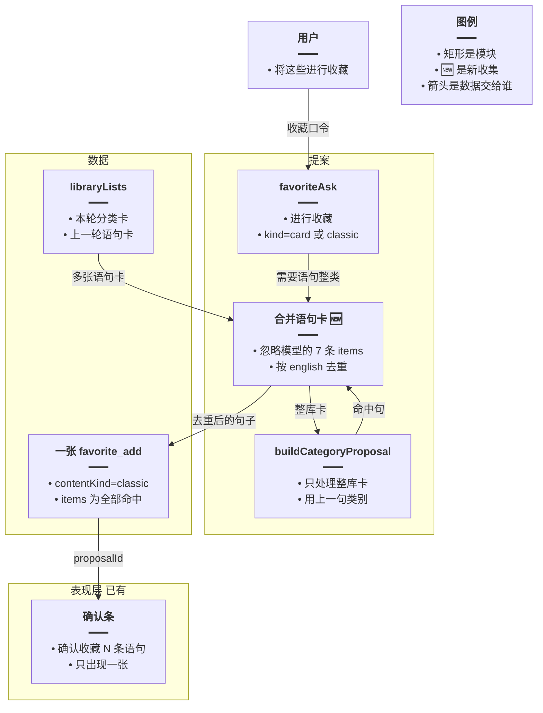
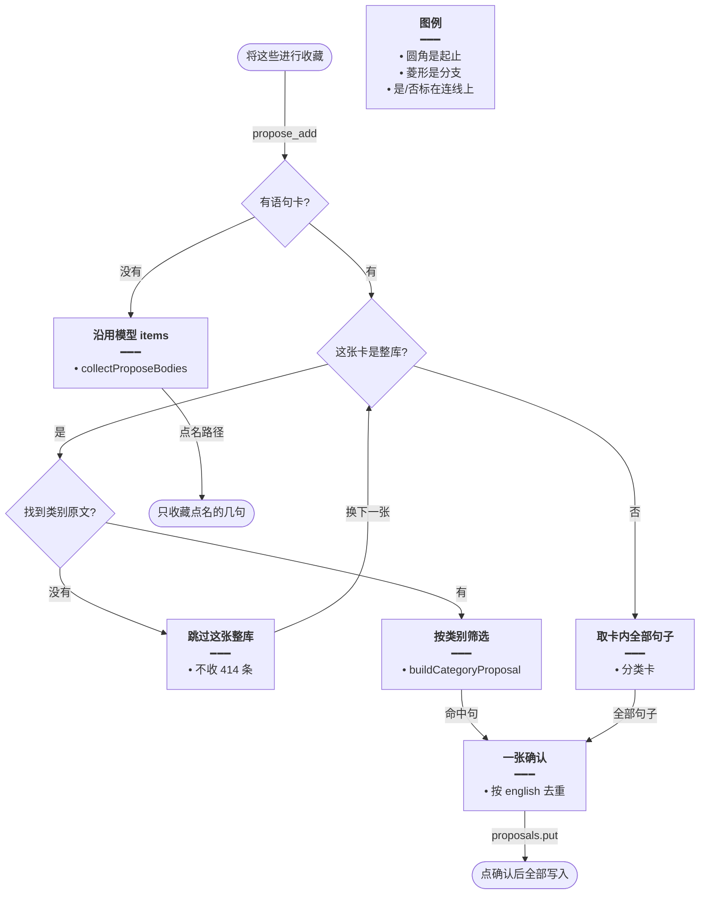
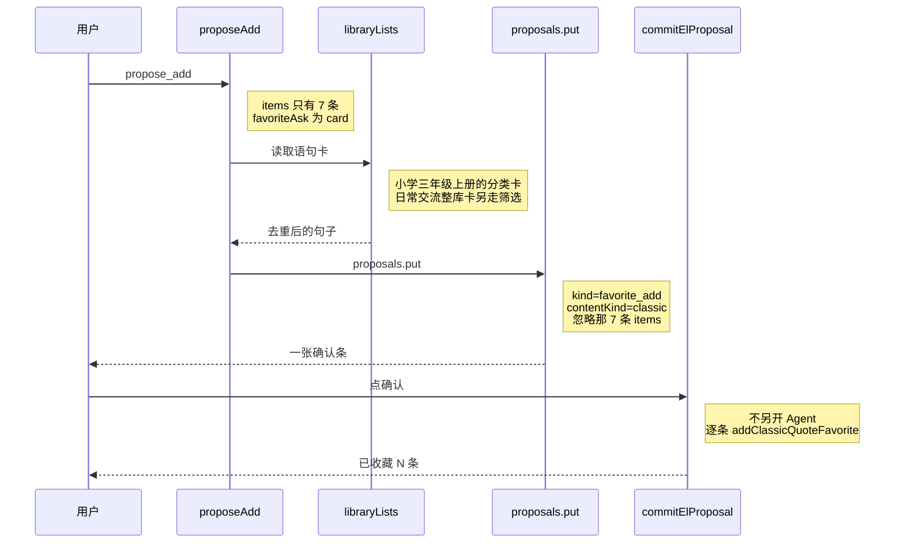

# 语句整类一次收藏 — 实现思路

> **状态**：规划（未实现）  
> **日期**：2026-10-28  
> **需求摘要**：用户说「将这些进行收藏」时，问候语句分布在「小学三年级上册」和「日常交流」两本语句库；现在只弹出 7 条的确认，点确认后写成「已收藏 7 个」，日常交流里其余句子的确认条不再出现。  
> **一句话方案（预告）**：语句整类收藏忽略模型附带的少量 `items`，把本轮和上一轮已经展示的语句卡合并成一张确认；点确认仍走现有 HTTP `commit`，不再开一轮对话去补后面的库。

## 延伸阅读

- 单词整类一次提案：[english/整类词一次收藏.md](./整类词一次收藏.md)、[english/大批收藏稳落库.md](./english/大批收藏稳落库.md)。那两篇只处理词汇库。本篇把「忽略模型 items、一张确认收齐」接到语句卡上，不改单词路径
- 语句收藏必须先出确认条：[english/语句收藏确认.md](./english/语句收藏确认.md)。确认条已经能挂上；本篇解决挂上之后只有模型手写的那几条
- 点确认不另开对话：[english/收藏提案直确认.md](./收藏提案直确认.md)。同轮第二次提案返回 `stop_tools`。本篇不放开这道刹车
- 语句分类入口：[english/语句库分类列出.md](./语句库分类列出.md)。分类卡是本篇提案的行来源之一

---

## 0. 读本文你将得到什么

- 确认后没有第二张条，是因为写入走 HTTP `commit`，不会再跑 Agent。模型在正文里写的「确认后再收藏日常交流」没有执行者。
- 选定方案：第一次确认就包含两本语句库里这一类的全部句子。模型这次只交了 7 条时，服务端改用已经展示的语句卡。
- 改动在语句收藏提案、本轮清单登记和提示词。确认按钮、`commit` 接口、单词整类路径不换。
- 分两阶段：M1 多张语句卡合成一张提案，M2 整库卡先按上一句类别筛选再并入。
- 最大风险是把整本 414 条的「日常交流」未经筛选收进收藏。整库卡必须先分类，分类标准不能用「将这些进行收藏」这句。

---

## 1. 需求与边界

### 1.1 用户故事

| 角色 | 场景 | 行为 | 期望结果 |
|------|------|------|----------|
| 已登录用户 | 问候语句在两本语句库里 | 「帮我将这些进行收藏」 | 一张确认条覆盖两库里这一类的全部句子，不先给 7 条再许诺下一张 |
| 已登录用户 | 点了这张确认 | 侧栏确认 | 回执条数等于提案条数。不再弹出第二张收藏确认 |
| 已登录用户 | 只点名几句 | 「收藏 Hello! I'm Mike Black.」 | 仍只收这几句，不把上一张整库卡收进去 |
| 已登录用户 | 同样句式收藏单词 | 「把这些单词收藏」 | 仍走单词整类，不读语句库 |

### 1.2 范围

| 在范围内 | 不在范围内（非目标） |
|----------|----------------------|
| 语句整类收藏合成一张 `favorite_add` | 确认成功后再启动一轮 Agent |
| 本轮与上一轮助手消息里的语句卡 | 放开同轮第二次 `propose_add` |
| 整库卡用已有 `buildCategoryProposal` 筛后再收 | 新的收藏表、新的确认组件 |
| 提示词禁止「确认后再继续收藏」 | 把语句写入改成和单词一样的批量插入 |

### 1.3 约束与依赖

- 必须复用：`favoriteAsk`、`proposeAdd`、`buildCategoryProposal`、`proposals.put`、`POST /agent/el-proposal/commit`、`addClassicQuoteFavorite`。
- 同轮已有提案时继续返回 `stop_tools`。
- 单词分支 `kind === 'vocab'` 的 artifact 判定保持原样。`latestLibraryRows` 继续跳过语句卡。
- 语句确认写入仍是现有的逐条 `addClassicQuoteFavorite`。一张提案里的句子在一次 `commit` 里写完。

---

## 2. 背景

- **谁、在什么场景、卡在哪**：用户要把已经讨论过的日常问候语句收藏起来。这些句子在「小学三年级上册」和「日常交流」（库内 414 条）里。回复只发起了 7 条收藏请求，并写明确认后会继续把日常交流库里的 `How are you doing?`、`Long time no see!` 等加入收藏。用户点确认后，回执是「已收藏 7 个，已存在 0 个。」，第二张确认没有出现。
- **现状缺口**：`proposeAdd` 只有 `kind === 'vocab'` 才按清单整类判定。语句走到 `collectProposeBodies`，提案行等于模型这次传入的 `items`。代码没有 7 这条上限，7 是模型自己放进参数的条数。同轮再 `propose_add` 会因为 `openProposalId` 得到 `stop_tools`。`AgentController.commitElProposal` 的注释写明确认条直提交、不另开一轮对话。正文里的「确认后再继续」没有后续工具调用。
- **不解决会怎样**：跨库的一类语句每次只能收藏模型塞进参数的那几条。用户按模型的说明去点确认，日常交流库的其余句子不会进入收藏。
- **硬约束**：仍然一次确认、一次写入。不把「再跑一轮 Agent」当作补齐手段。不要把 414 条未筛选的整库收进收藏。

---

## 3. 现状与复用

| 能力 | 仓库中已有 | 本需求中的用法 |
|------|------------|----------------|
| 收藏原话 | `favorite-ask.ts` 的 `favoriteAsk`。「进行收藏」命中；本句没有「语句」或「单词」时 `kind` 为 `card` | 直接复用。`card` 和 `classic` 都进入语句合并 |
| 语句提案 | `proposeAdd` 在非词汇时调用 `collectProposeBodies` | 扩展。存在语句卡时忽略 `items` |
| 单词整类 | 同函数里 `artifactId && kind === 'vocab'`，或 `latestLibraryRows` | 直接复用，不改 |
| 本轮清单 | `ElListSurface.libraryLists`。整库 list 会 `push`。`el_classic_classify` 只走 `onPresented`，不进 `libraryLists` | 扩展。语句分类卡和语句整库卡都登记进去 |
| 上一轮卡片 | `agent.service.ts` 在没有提案时回溯助手消息的 `elResources`，`pickFavoriteCard` 只取最后一张，且 `FAVORITE_CARD_CAP` 为 40 | 扩展。语句整类在提案前取全部语句卡，不受 40 限制 |
| 分类器 | `buildCategoryProposal`。语句行没有 `word` 时保留 `english` | 直接复用。只用于整库卡 |
| 同轮刹车 | `openProposalId` 时 `stop_tools` | 直接复用 |
| 确认写入 | `commitElProposal` 不另开对话。语句收藏在 `apply-proposal.ts` 里逐条 `addClassicQuoteFavorite` | 直接复用。提案里有多少句就写多少句 |
| 回执 | `proposalReceipt` 收藏成功写「已收藏 N 个」 | 扩展一句：语句提案用「条」 |

**调研结论**：缺的不是第二张确认条的前端，而是语句提案的行来源。单词整类已经会忽略模型附带的 `items`。语句还在用模型这次传入的 7 条，而且确认接口不会再把模型喊回来。

---

## 4. 方案比对与最终方案

### 4.1 候选方案

#### 方案 A：确认后再开一轮 Agent（复用对话）

- **做法**：`commitElProposal` 成功后，用一条系统插入的用户句再请求 `/agent/sse`，例如「继续收藏尚未写入的日常交流问候语句」。模型再调 `el_favorites` `propose_add`。
- **能工作的原因**：新一轮没有 `openProposalId`，可以再挂一张确认条。模型正文里点过的句子有机会被写进 `items`。
- **主要代价**：剩余句子没有结构化保存，只能靠模型回忆。它可能再交 7 条并再次许诺下一轮。确认从一次变成多次，和现有「不另开一轮对话」相反。

#### 方案 B：语句套用单词的单个 artifactId（扩展）

- **做法**：`proposeAdd` 在 `kind === 'classic'` 且带了 `artifactId` 时，对这一份清单调用 `buildCategoryProposal`，命中句放进一张提案。提示词要求模型传 artifactId、不要传 items。
- **能工作的原因**：一本语句库的分类结果可以一次收齐，和单词整类相同。点名的几句仍走 `items`。
- **主要代价**：截图里是两本库。第二次 `propose_add` 会被 `stop_tools` 丢掉，日常交流库仍然进不了第一张确认。模型这次根本没传 `artifactId`，只传了 7 条 `items`，这条分支不会触发。

#### 方案 C：本轮和上一轮的语句卡合并成一张提案（新增合并，内部复用分类器）

- **做法**：用户原话被 `favoriteAsk` 认成收藏，且 `kind` 是 `classic` 或 `card` 时，在 `proposeAdd` 写入提案之前收集语句卡。来源有两处：本轮 `libraryLists` 里 `contentKind === 'classic'` 的每一份；上一轮助手消息里重新读出的语句卡。分类卡（`el_classic_classify` 或带库 id 的关于类筛选，行已经是命中句）全部进入提案。整库卡（list 出的全量，例如日常交流 414 条）不直接进入，先用类别原文做 `buildCategoryProposal`，只收命中句。多张卡按 `english` 去重。只要合并结果非空，就忽略模型这次的 `items`。没有可用语句卡时，仍用 `collectProposeBodies`。一张 `proposals.put`，确认文案写「确认收藏 N 条语句」。提示词写明不要把同一类拆成确认后再继续。
- **能工作的原因**：两本库的命中在第一次 `propose_add` 里就合成一张。点确认时 `commit` 把这张提案全部写入，不需要再开对话。
- **主要代价**：要在分类出卡时把语句卡登记进 `libraryLists`，并在回合开始时带上上一轮语句卡。整库卡多一次分类等待。

### 4.2 比对

| 维度 | 方案 A 确认后再开一轮 | 方案 B 单个 artifactId | 方案 C 多卡合并成一张 |
|------|----------------------|------------------------|----------------------|
| 正确性 | 剩余句靠模型回忆，可能再次截断 | 只覆盖模型传对的那一个 artifact | 两张语句卡的命中都在第一张提案里。整库卡先筛选 |
| 复用 / 与现状契合 | 复用 SSE 对话 | 复用单词的 artifact 分支 | 复用 `buildCategoryProposal`、`proposals.put`、`commit`。新增的是收集多张卡 |
| 改动面 | `commitElProposal` 和前端确认后的请求 | `proposeAdd` 与提示词 | `proposeAdd`、语句卡登记、回合开始时的上一轮卡片、提示词、回执用词 |
| 复杂度 | 多一轮工具调用和又一次确认 | 一个 id 一条已有分支 | 要区分分类卡和整库卡 |
| 体验 | 点完确认还要再点一次，而且下一张仍可能只有几条 | 一本库可以一次收齐。第二本库要等下一句用户消息 | 点一次确认就写入两库里这一类的全部句子 |
| 风险 | 重复收藏或漏句，取决于模型 | 模型不传 id 时仍是现在的 7 条 | 整库卡若跳过筛选，会收进 414 条 |
| 可维护性 | 确认接口开始承担「继续对话」 | 语句和单词各认一个 id，两库仍然要两次提案 | 单词路径不动。语句卡的收集集中在 `proposeAdd` 前面 |

### 4.3 综合考量

权重在「一次确认就收齐」和「不能误收整库」。方案 A 能再弹出一张条，但剩余句子没有落在提案里，第二轮仍可能只交几条，而且改掉了确认不另开对话这条已经落地的约定。方案 B 和单词整类最像，却只吃一个 `artifactId`；截图的失败正是两本库加一批手写 `items`，这条分支覆盖不到。

选定方案 C。放弃 A 的「确认后再继续」，也放弃 B 少改一个分支的做法。语句写入仍逐条调用现有收藏函数，不在本篇改成批量插入。

### 4.4 最终方案

#### 背景

语句收藏的确认条已经能出现，但行来自模型本次 `items`。截图里模型只放入 7 条，并把日常交流库的其余句子写成确认后的下一步。`stop_tools` 挡住同轮第二张条，`commitElProposal` 不另开对话，所以那一步不会发生。单词整类已经改为读清单并忽略 `items`，语句没有这条分支。`latestLibraryRows` 还主动跳过 `contentKind === 'classic'`。

#### 具体思路

1. 入口仍是 `el_favorites` 的 `propose_add`。不新增工具，也不在确认接口后面接对话。
2. 行从本轮 `libraryLists` 和上一轮助手消息的语句卡来。分类卡直接取 `items`。整库卡先分类，命中再并入。状态仍放在这一张提案的 `items` 里。
3. 类别原文不使用「将这些进行收藏」。从本会话用户消息由近到远，取第一条含「关于 / 相关 / 有关 / 属于 / 问候 / 打招呼」的句子。没有这样的句子时，整库卡不参与，避免收进 414 条。
4. 合并结果非空就忽略模型 `items`。没有任何语句卡时，点名的几句仍走 `collectProposeBodies`。

#### 实现方案

**一句话**：语句整类收藏忽略模型附带的少量 `items`，把本轮和上一轮已经展示的语句卡合并成一张确认；点确认仍走现有 HTTP `commit`，不再开一轮对话去补后面的库。

| 步骤 | 谁 | 做什么 | 输入 → 输出 |
|------|----|--------|-------------|
| 1 | `el_classic_classify` 与关于类筛选 | 挂卡时把语句清单 `push` 到 `libraryLists` | 命中行 → 本轮可收藏的卡 |
| 2 | 回合开始 | 把上一轮助手消息里的语句卡放进同一列表。快照没有 `items` 时用 `artifactId` 再读 | 上一轮卡 → 可合并的行 |
| 3 | `proposeAdd` | `favoriteAsk` 为 `card` 或 `classic` 时收集这些卡 | 多张卡 → 去重后的句子 |
| 4 | `buildCategoryProposal` | 只对整库卡调用。原文用上一句类别，不用当前这句收藏口令 | 414 行 → 问候命中 |
| 5 | `proposals.put` | 一张 `favorite_add`，`contentKind: 'classic'` | 句子 → `proposalId` |
| 6 | `commitElProposal` | 点确认后逐条写入。不请求新的 Agent | 提案 → 「已收藏 N 条」 |

整库卡的判断：`source === 'library'` 且这张卡来自整库 list，而不是分类命中。分类命中在 `filterLibraryFallback` 的返回上增加 `filtered: true`（`ElResourceListPayload` 现无此字段，实现时补上）。没有这个标记、且 `items.length` 等于库内 `quoteCount` 的，也按整库处理。

#### 选定原因

1. **正确性**：两本库的命中在点确认前就在同一张提案里。牺牲：上一轮没出卡、本轮也没筛过库时，仍然只能收模型传入的几句。
2. **复用**：分类、提案、确认接口都不新做。牺牲：语句卡要多登记一次，单词的 `latestLibraryRows` 仍不读这些卡。
3. **改动面**：`commit` 的「不另开对话」保持不变。牺牲：要比方案 B 多读上一轮消息。
4. **复杂度**：不增加第二轮对话状态。牺牲：要区分分类卡和整库卡。
5. **体验**：用户点一次确认就写完这一类。牺牲：整库卡会在确认条出现前多等一次分类。
6. **风险**：没有类别原文的整库卡不进入提案。牺牲：若上一句只有「列出来」而没有问候、关于这类词，日常交流整库不会被自动收进，模型传入的 `items` 仍生效。
7. **可维护性**：单词整类代码路径不改。牺牲：语句和单词的「读哪张卡」规则不再对称，语句要读多张。

#### 优势

- 相对方案 A：日常交流的句子在第一张确认里，不依赖确认后再回忆。确认接口仍然只负责写入。
- 相对方案 B：小学三年级上册和日常交流可以同时进入一张提案。模型漏传 `artifactId`、只传 7 条时，只要卡已经挂出，这 7 条不会把提案缩小。

#### 怎么实现

1. `filterLibraryFallback` 的返回增加 `filtered: true`。`el_classic_classify` 和 `el_items_search` 的关于类分支在 `onPresented` / `onResourceList` 之外，把这份清单 `push` 到 `libraryLists`。
2. 英语回合开始时，读取上一条助手消息的 `elResources`。语句卡缺 `items` 时按 `artifactId` 读 artifact，再放进 `libraryLists`。
3. `proposeAdd` 在词汇整类分支之后、`collectProposeBodies` 之前：若 `favoriteAsk` 是 `card` 或 `classic`，调用新的收集函数。分类卡取全部 `items`。整库卡只用类别原文做 `buildCategoryProposal`。按 `english` 去重。
4. 合并结果非空：`proposals.put` 一次，`occupy`，回执「请用户确认后再写入」，按钮「确认收藏 N 条语句」。不要再执行 `collectProposeBodies`。
5. 合并结果为空：保持现在的 `items` 路径。
6. `proposalReceipt` 在 `contentKind === 'classic'` 且是收藏成功时写「已收藏 N 条，已存在 M 条。」
7. `agent.prompt.ts` 的 `el_favorites` 增加：语句整类不要传少量 items 再许诺确认后继续；有语句卡时一次提案即可。

### 4.5 其他关键决策

类别原文从哪来，会改变整库卡的筛选结果。

| 候选 | 做法 | 取舍 |
|------|------|------|
| 只用当前用户句 | 把「将这些进行收藏」交给 `buildCategoryProposal` | 这句没有类别，筛选结果不可用 |
| 向前找类别句 | 跳过纯收藏句，取最近一条含「关于 / 相关 / 有关 / 属于 / 问候 / 打招呼」的用户句 | 和截图里的「日常问候」对得上。当前句仍不作为整库筛选标准 |

选定向前找类别句。当前句继续只负责触发 `favoriteAsk`。找不到类别句时整库卡跳过，这是为了不把 414 条收进收藏，不是再开一轮去问用户。

---

## 5. 架构图



**图内方法说明**：

| 方法 / 模块入口 | 功能 |
|-----------------|------|
| `favoriteAsk` | 判断当前句是不是收藏。本句没有「单词」「语句」时种类为 `card` |
| `buildCategoryProposal` | 按类别原文从整库句子里挑出命中句 |
| `libraryLists` | 本轮和上一轮可供收藏的语句清单 |

**读图要点**：

- 确认条只有一张，后面没有第二轮对话。
- 模型传入的 7 条不决定提案内容。提案来自已经展示的语句卡。
- 分类器只吃整库卡。已经筛过的分类卡直接并入。

---

## 6. 主流程图



**图内方法说明**：

| 方法 | 功能 |
|------|------|
| `propose_add` | 收藏工具入口。语句整类在这里决定用卡还是用 `items` |
| `collectProposeBodies` | 没有语句卡时，把模型传入的句子收成提案 |
| `buildCategoryProposal` | 把整库卡筛成这一类的句子 |

**读图要点**：

- 有分类卡时不走模型的 7 条。
- 整库卡没有类别原文就跳过，避免把日常交流整库收藏。
- 多张卡在出确认条之前合并，确认之后不再收集。

---

## 7. 核心时序图



**图内方法说明**：

| 方法 | 功能 |
|------|------|
| `proposeAdd` | 发现收藏口令后，用语句卡替换模型传入的少量句子 |
| `libraryLists` | 提供本轮和上一轮的语句清单 |
| `proposals.put` | 保存这一张语句收藏提案 |
| `commitElProposal` | 用户点确认后把提案写入收藏，并追加回执 |
| `addClassicQuoteFavorite` | 写入一条语句收藏。提案里的句子在同一次确认里逐条调用 |

**读图要点**：

- 7 条 `items` 在 `proposeAdd` 里被丢弃，不会单独成为确认条。
- 用户只点一次确认。`commitElProposal` 之后没有新的工具调用。
- 回执条数来自这张提案，不再是模型正文里的 7。

---

## 9. 具体实现（主链路代码）

### 9.1 模块一览

| 模块 | 职责 | 新增/改动 | 预估路径 |
|------|------|-----------|----------|
| 语句卡登记 | 分类结果进入 `libraryLists` | 扩展 | `apps/backend/src/services/agent/tools/english/domain-tools.ts` |
| 上一轮语句卡 | 回合开始时读上一条助手消息 | 扩展 | `apps/backend/src/services/agent/agent.service.ts` |
| 合并提案 | 忽略少量 `items`，合成一张确认 | 新增收集，接在现有 `proposeAdd` | `domain-tools.ts` |
| 回执用词 | 语句写「条」 | 扩展 | `apps/backend/src/services/agent/tools/english/apply-proposal.ts` |
| 提示词 | 禁止确认后再继续 | 扩展 | `apps/backend/src/services/agent/agent.prompt.ts` |
| 确认与写入 | HTTP `commit`、逐条收藏 | 直接复用 | `agent.controller.ts`、`apply-proposal.ts` |

### 9.2 主链路实现

```typescript
// 收藏口令才合并。点名几句且没有语句卡时仍走后面的 items
const ask = favoriteAsk(userText);
// card 覆盖「将这些进行收藏」；classic 覆盖原话里写了「语句」的收藏
const quoteAsk = ask?.kind === 'card' || ask?.kind === 'classic';
// 本轮分类卡和回合开始时放入的上一轮语句卡都在这个列表里
const cards = quoteAsk ? classicCards(surface.libraryLists) : [];
// 分类卡直接取句子。整库卡用类别原文筛选，没有类别原文则不返回行
const rows = quoteAsk ? await rowsFromQuoteCards(cards, categoryText) : [];
// 有合并结果就不用模型这次的 7 条，避免提案被缩小
const useCards = rows.length > 0;
// 去重键用英文原句，两本库里的同一句只确认一次
const items = useCards ? dedupeEnglish(rows) : collectProposeBodies('classic', args).items;
// 仍是一张提案。确认接口不需要知道句子来自几本库
const proposalId = await proposals.put(userId, { kind: 'favorite_add', contentKind: 'classic', body: items[0] ?? {}, items });
```

`classicCards`、`rowsFromQuoteCards`、`dedupeEnglish`、`categoryText` 是这段收集要落地的名字。`categoryText` 来自 §4.5，不是当前这句「将这些进行收藏」。

### 9.3 数据模型

| 字段/实体 | 来源 | 存储 | 说明 |
|-----------|------|------|------|
| 语句卡 | 分类出卡、整库 list、上一轮 `elResources` | 本轮 `libraryLists` | 不新增表 |
| `filtered` | `filterLibraryFallback` | 卡的载荷 | 新增。为真表示 `items` 已是命中句 |
| 提案 `items` | 合并后的句子 | 现有提案存储 | `english`、`translationZh`、`source`、`noteZh` |
| 收藏行 | `addClassicQuoteFavorite` | 已有语句收藏表 | 一次确认写完提案 |

---

## 10. 分阶段实现步骤

| 阶段 | 目标 | 交付物 | 依赖 |
|------|------|--------|------|
| M1 | 两张分类卡合成一张确认 | 登记 `libraryLists`、忽略 `items`、上一轮卡片 | 无 |
| M2 | 日常交流这种整库不被整本收藏 | 类别原文、`filtered`、回执用「条」 | M1 |

### M1

- [ ] 语句分类卡写入 `libraryLists`。
- [ ] 回合开始时载入上一轮助手消息中的语句卡。
- [ ] `proposeAdd` 在有这些卡时忽略模型 `items`，按 `english` 去重后一张提案。
- [ ] 提示词写明不要把语句整类拆成确认后再继续。

### M2

- [ ] `filterLibraryFallback` 标记 `filtered: true`。
- [ ] 无标记且行数等于库内总数的卡，用上一句类别做 `buildCategoryProposal`。
- [ ] 没有类别句的整库卡不进入提案。
- [ ] 语句收藏回执改为「已收藏 N 条，已存在 M 条。」

---

## 11. 风险、边界与待确认

| 项 | 等级 | 说明 | 缓解 |
|----|------|------|------|
| 收进整库 | 高 | 日常交流有 414 条 | 整库卡必须先分类。没有类别原文就跳过 |
| 上一轮卡片过期 | 中 | artifact 约 30 分钟 | 读不到 `items` 时这张卡不参与，点名 `items` 仍可用 |
| 类别句太宽 | 中 | 「问候」可能命中不是打招呼的句子 | 沿用现有分类器，不另写规则。确认条上能看到将要收藏的句子 |
| 与单词路径不一致 | 低 | 单词仍只读最后一张词库卡 | 故意只改语句。`latestLibraryRows` 继续跳过语句 |

**待确认**：

- [ ] 截图上一句用户原话是否含「关于 / 问候 / 打招呼」（验证方式：看该会话上一条用户消息。若只有「列出来」而没有这些词，M2 的整库卡不会自动并入，需要本轮先有分类卡）。

---

## 12. 验收清单

| # | 用例 | 步骤 | 期望 |
|---|------|------|------|
| AC1 | 两库问候一起收藏 | 两张语句分类卡已经列出，再说「将这些进行收藏」 | 一张确认，条数是两卡去重后的全部句子，不是 7 |
| AC2 | 模型仍传 7 条 | 同 AC1，工具参数里只有 7 个 `english` | 提案不采用这 7 条 |
| AC3 | 点确认 | 点击确认 | 回执「已收藏 N 条」。不再出现第二张确认，也不再请求 Agent |
| AC4 | 日常交流整库 | 本轮只有 414 条的整库卡，上一句是关于问候的 | 提案只有问候命中，不是 414 条 |
| AC5 | 没有类别句的整库 | 上一句只是「列出这个库」 | 整库不进入提案 |
| AC6 | 点名一句 | 「收藏 Hello! I'm Mike Black.」，没有语句卡 | 只收藏这一句 |
| AC7 | 单词收藏 | 「把这些单词收藏」 | 不读取语句卡 |

---

## 13. 预估改动面（实现阶段参考）

| 类型 | 路径（预估） |
|------|----------------|
| 后端 | `domain-tools.ts`、`agent.service.ts`、`apply-proposal.ts`、`agent.prompt.ts`、`artifact.store.ts` 的载荷类型 |
| 前端 | 无。确认条和 `commit` 请求保持原样 |
| 文档（实现后） | 实现完成后再归档。本篇不改业务代码 |
