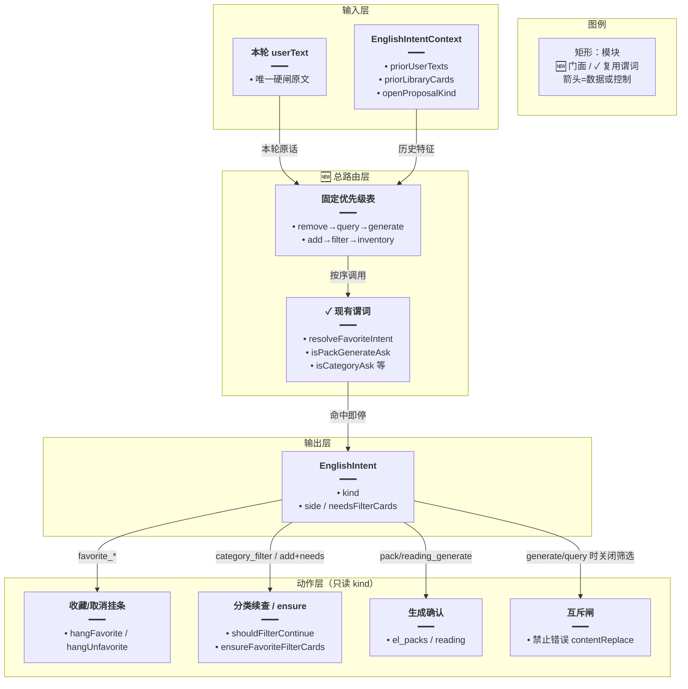
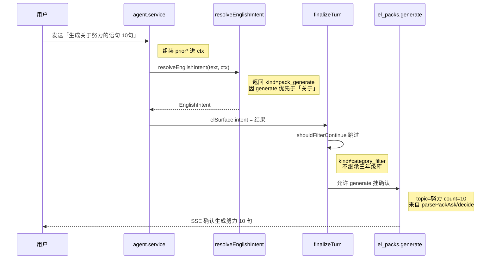
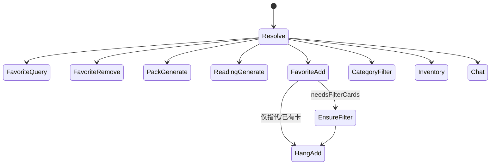

# 语境意图总路由 — 实现思路

> **状态**：规划（M1–M2 已落地）  
> **日期**：2026-10-31  
> **需求摘要**：英语学习 Agent 在长对话、省略指代、复合说法下仍能稳定选对路径（分类 / 生成 / 收藏 / 查询 / 取消），正文与确认条不被错误收尾盖住。  
> **一句话方案（预告）**：用单一入口 `resolveEnglishIntent(text, ctx)` 按固定优先级合并现有正则闸与上下文特征；收尾与挂条只听该结果；模糊槽位才短调用 `decide()`，且仍校验必须出自原话——不另上「整句意图大模型」作主闸。

## 延伸阅读

- **落地归档（主）**：[../../english/语境意图总路由.md](../../english/语境意图总路由.md)、[../../english/收藏意图总闸.md](../../english/收藏意图总闸.md)
- **后续通用化（规划）**：[复合意图槽位化](./复合意图槽位化.md)（IntentFrame + plan；承接单 kind 无法表达的一句多事）
- [收藏意图总控](./收藏意图总控.md)、[查询收藏不挂确认](./查询收藏不挂确认.md)、[收藏先出筛选卡](./收藏先出筛选卡.md)、[再收藏不断窗](./再收藏不断窗.md)、[生成不跑库筛选](./生成不跑库筛选.md)：分域补丁；本文把它们收成总路由
- [Agent词句认意图](./Agent词句认意图.md)：生成主题/条数抽槽；本文管「走不走生成」与互斥
- [意图决定出卡](./意图决定出卡.md)：出卡权限；本文管「哪条业务意图」
- [../通用决策封装.md](../通用决策封装.md)：`decide()` 只做槽位，不做主意图

---

## 0. 读本文你将得到什么

- 现状：意图散落在十多个互斥正则与收尾分支，长对话靠「继承上一本库」易串台
- 选定方案：**确定性总路由 + 上下文特征包**；`decide` 仅补歧义槽；服务端动作绑定意图枚举
- 改动面：新增 `english-intent.ts` 门面，逐步把 agent/domain 收尾改成读枚举；不推倒各域实现
- 阶段：M1 统一枚举与优先级矩阵；M2 接上 ctx；M3 歧义槽 decide+校验
- 最大风险：一次换成 LLM 意图分类器——放弃（不稳、贵、难测）

---

## 1. 需求与边界

### 1.1 用户故事

| 角色 | 场景 | 行为 | 期望结果 |
|------|------|------|----------|
| 学习者 | 长会话刚筛过三年级家庭词 | 「帮我生成关于努力的语句 10 句」 | 仅生成确认；不继承三年级空筛 |
| 学习者 | 同上 | 「我当前收藏了哪些单词和语句」 | 查询；不挂添加确认 |
| 学习者 | 同上 | 「我需要收藏三年级…关于家庭的词句」 | 先筛后藏；有卡再确认 |
| 学习者 | 省略 | 「那帮我取消」 | 取消进闸；不断下一句回扫窗 |
| 学习者 | 指代 | 「将上述都收藏」 | 用窗口筛选卡，不整库 |

### 1.2 范围

| 在范围内 | 不在范围内 |
|----------|------------|
| 英语 `assistMode` 意图总路由与收尾互斥 | 通用 Agent / Skill 生成意图 |
| 上下文特征（prior 用户句、库卡、openProposal） | 向量记忆、长期用户画像 |
| 与现有 favorite/category/pack/reading 闸对齐 | 重写全部 el_* 工具 |

### 1.3 约束与依赖

- 名单与确认数字仍服务端卡片为准（既有硬约束）
- Ponytail：先门面统一优先级，再逐步替换散落 `if`
- 可测：每条用户说法对应稳定 `EnglishIntent.kind` 矩阵

---

## 2. 背景

### 2.1 现状能力盘点（已实现碎片）

| 闸 / 能力 | 位置 | 看什么 | 作用 |
|-----------|------|--------|------|
| `resolveFavoriteIntent` | `favorite-ask.ts` | 本轮原话 | add / remove / null（查询） |
| `favoriteNeedsFilterCards` | 同上 | add ∩ 关于类 | 先分类再挂藏 |
| `isCategoryAsk` | `spill.ts` | 关于/有关… | 库内筛选 |
| `isPackGenerateAsk` | 同上 | 生成+语句/单词 | 挡筛选续查 |
| `isReadingGenerateAsk` | 同上 | 阅读短文生成 | 挡筛选续查 |
| `listIntent` | 同上 | inventory/filter/other | 整库 vs 筛选 |
| `parsePackAsk` / `decide` | `pack-ask.ts` | 本轮原话 | 生成主题条数 |
| `quoteCategoryText` / `inheritedKind` | domain / spill | 历史用户句+卡 | 继承类别/侧 |
| `quoteThreadAssistantIndexes` | domain-tools | 历史+bridge | 收藏选卡窗 |
| `shouldFilterContinue` | spill | 本轮+prior | 收尾补分类 |
| 系统提示工具地图 | `agent.prompt.ts` | 模型可读 | 软引导，非硬闸 |

**上下文已有但不统一**：`priorUserTexts`、`priorLibraryCards`、`labeledCards`、`openProposalId`、收藏回扫窗。多数闸**只读本轮原话**；筛选收尾却用 prior **继承库**——串台主来源。

### 2.2 现状缺口

1. **无总优先级表**：各闸在不同文件各自 `if`，新增一种说法要改多处（近期补丁链已证明）。  
2. **复合句靠补丁叠互斥**：收藏+关于、生成+关于、查询+单词语句，易漏一种组合。  
3. **语境不对称**：继承库很积极，意图路由却几乎不看「上一句是生成确认 / 刚列出收藏」。  
4. **模型提示 ≠ 硬闸**：工具地图很长，仍可能 list 错库；稳定性只能来自服务端枚举。  
5. **decide 无历史**：库名/主题抽槽只见本句，省略「还是那个库」偏弱（可 M3 有限加强）。

### 2.3 不解决会怎样

每出一种口语说法就再打一针正则补丁；长对话下生成/收藏/筛选继续互相盖正文与确认条，用户感到「不智能、不稳定」。

### 2.4 硬约束

- 主闸必须**可单测、可枚举、可复现**（温度 0 的确定性优先）。  
- 卡片行与确认数字不交给对话模型散文。  
- 不引入「每轮先调大模型判意图」作为默认路径。

---

## 3. 现状与复用

| 能力 | 仓库中已有 | 本需求用法 |
|------|------------|------------|
| 分域闸函数 | favorite-ask / spill / pack-ask / reading-ask | **收入**总路由优先级，不删实现 |
| 上下文表面 | `ElListSurface` prior* / labeledCards | 组成 `EnglishIntentContext` |
| 收尾动作 | ensureFavoriteFilterCards、shouldFilterContinue、hang* | **改条件**为读 `intent.kind` |
| 短决策 | `decide()` | 仅 ambiguous 槽位 + 原话校验 |
| 单测资产 | favorite-ask.scope / spill.pack-generate | 扩成意图矩阵 |

**调研结论**：能力够，缺「一张优先级表 + 一个入口 + ctx」。候选必须接到现有闸，禁止平行再造一套。

---

## 4. 方案比对与最终方案

### 4.1 候选

#### 方案 A：继续按 bug 打补丁（现状延长线）

- **做法**：每出串台再加 `isXxxAsk` 与一处 `&& !`。  
- **能工作原因**：短期有效。  
- **代价**：组合爆炸；新人无法知道「谁先谁后」。

#### 方案 B：确定性总路由 + 上下文特征（推荐）

- **做法**：  
  1. `EnglishIntent` 枚举：`out_of_scope | chat | favorite_query | favorite_remove | favorite_add | pack_generate | reading_generate | category_filter | inventory | review | mistakes | notes | memo | clarify`。  
  2. `resolveEnglishIntent(text, ctx)` **固定优先级**（见下）调用现有谓词，返回一种主意图 + 侧写（vocab/classic/both、needsFilterCards、libraryHints）。  
  3. `ctx`：`priorUserTexts`、`priorLibraryCards`、`openProposalKind`、`lastAssistantCardSources`。  
  4. agent / domain **收尾与挂条只 switch(intent.kind)**。  
  5. 仅当 `kind===category_filter && libraryAmbiguous` 或 pack 主题不可信时，才 `decide` 补槽并校验子串。
- **能工作原因**：把已验证补丁收成一张表；语境进 ctx 可关「继承库」当意图是 generate/query。  
- **代价**：一次门面重构；迁移期双读旧闸。

#### 方案 C：每轮 LLM 意图分类器为主闸

- **做法**：flash/主模型输出 intent JSON。  
- **能工作原因**：覆盖长尾口语。  
- **代价**：不稳、费时、难测；与「确认条数字服务端」原则冲突；decide 封装也被滥用。

### 4.2 比对

| 维度 | 方案 A | 方案 B | 方案 C |
|------|--------|--------|--------|
| 正确性 | 逐 bug 追 | 互斥表可证 | 偶发飘 |
| 复用 | 最高（不动） | 包一层现闸 | 低 |
| 改动面 | 每次小、长期大 | 中等一次 | 大 |
| 复杂度 | 隐式高 | 显式中 | 表面低 |
| 体验 | 继续串台 | 长对话稳定 | 延迟+偶错 |
| 风险 | 组合漏判 | 迁移漏接 | 回归难测 |
| 可维护性 | 差 | 矩阵+单测 | 差 |

### 4.3 综合考量

权重：**稳定性 / 可测性 / 复用已有补丁**。选定 **B**。放弃 A 的「少改一次」。明确放弃 C 的「覆盖长尾口语」优点——长尾用矩阵扩谓词 + 偶发 decide 槽位即可。

### 4.4 最终方案

#### 背景

英语 Agent 意图识别已能处理多种单点场景，但散落互斥导致长对话与复合说法串台（生成盖筛选卡、查询挂收藏、收藏无卡就报「上面没有」等）。需要总路由，而不是再叠补丁或改上 LLM 主闸。

#### 具体思路

1. **模块**：新增 `english-intent.ts`（门面）；旧文件保留谓词。  
2. **数据**：`EnglishIntent` + `EnglishIntentContext`；不新表。  
3. **优先级（高→低，命中即停）**：  
   1. `favorite_remove`（含省略取消）  
   2. `favorite_query`  
   3. `pack_generate` / `reading_generate`（互斥筛选）  
   4. `favorite_add`（可带 `needsFilterCards`）  
   5. `category_filter`（关于类且非生成）  
   6. `inventory`  
   7. `review` / `mistakes` / `notes` / `memo`（可用轻量正则，后续）  
   8. `chat` / 默认  
4. **语境规则**：当 kind ∈ {pack_generate, reading_generate, favorite_query} 时，**禁止** `shouldFilterContinue` 继承 prior 库；当 kind=favorite_add && needsFilterCards 时走 ensure 分类；当 kind=favorite_add && 仅指代时走窗口卡。  
5. **状态**：`elSurface.intent = resolveEnglishIntent(...)` 一轮一次。

#### 实现方案

**一句话**：单一 `resolveEnglishIntent` 定主意图；收尾/挂条只认枚举；模糊槽位才 decide。

| 步骤 | 谁 | 做什么 |
|------|----|--------|
| 1 | `resolveEnglishIntent` | 优先级调用现有谓词 + ctx |
| 2 | agent 建 surface | 写入 `intent` |
| 3 | finalize / domain | switch(kind) 替代散落 if |
| 4 | 意图矩阵单测 | 覆盖近一月串台用例 |

#### 选定原因

1. **正确性**：互斥表显式，生成/查询不再误进筛选。牺牲：迁移工作量。  
2. **复用**：不重写 favorite/classify/pack。牺牲：短期双轨。  
3. **可维护性**：新说法只改谓词+矩阵一行。牺牲：放弃 C 的「自动覆盖」。  
4. **体验**：长对话稳定。牺牲：极冷门说法仍要加规则。

#### 优势

- 相对 A：组合可穷举测试。  
- 相对 C：可复现、便宜、与服务端名单原则一致。

#### 怎么实现

见 §9。

### 4.5 决策：要不要每轮 decide 意图

##### 候选

**A**：主闸 decide 意图。  
**B**：主闸确定性；decide 只抽主题/库名（本文）。

##### 比对

| 维度 | A | B |
|------|---|---|
| 正确性 | 偶发 | 稳定 |
| 延迟 | +1 次 LLM | 默认 0 |
| 测试 | 难 | 矩阵 |

选定 B。

---

## 5. 架构图



**图内方法说明**：

| 方法 | 功能 |
|------|------|
| `resolveEnglishIntent` | 总路由；输入 text+ctx，输出一种主意图 |
| `resolveFavoriteIntent` 等 | 已有谓词，被总路由按序调用 |
| `shouldFilterContinue` / hang* / ensure* | 动作层；只在对应 kind 执行 |
| `decide` | 仅 ambiguous 槽位（可选 M3） |

**读图要点**：意图一次判定；动作不得各自再猜「关于」。

---

## 6. 主流程图

```mermaid
flowchart TD
  Start(["用户发送本轮消息"]) -->|"dto.content"| BuildCtx["<b>组装 ctx</b><br/>━━━<br/>• priorUserTexts<br/>• priorLibraryCards"]
  BuildCtx -->|"text + ctx"| R["<b>resolveEnglishIntent</b><br/>━━━<br/>• 固定优先级<br/>• 返回唯一 kind"]
  R -->|"写入 elSurface.intent"| Sw{"按 kind 分支"}
  Sw -->|"favorite_query"| Q["<b>查询收藏</b><br/>━━━<br/>• list 收藏表<br/>• 禁止 add 挂条"]
  Sw -->|"favorite_remove"| Rm["<b>取消收藏</b><br/>━━━<br/>• hangUnfavorite<br/>• 不断回扫窗"]
  Sw -->|"pack_generate"| Pg["<b>词句生成</b><br/>━━━<br/>• 挂生成确认<br/>• 禁止筛选续查"]
  Sw -->|"favorite_add"| Ad{"needsFilterCards?"}
  Ad -->|"是：句内含关于类"| En["<b>ensure 分类</b><br/>━━━<br/>• 先出筛选卡<br/>• 再 hang 添加"]
  Ad -->|"否：指代/已有卡"| H["<b>favoriteSet</b><br/>━━━<br/>• 窗口 richest 库卡"]
  Sw -->|"category_filter"| Cf["<b>库内筛选</b><br/>━━━<br/>• classify / 续查"]
  Sw -->|"chat / inventory…"| Chat["<b>模型 + el_*</b><br/>━━━<br/>• 工具地图软引导"]
```



**图内方法说明**：

| 方法 | 功能 |
|------|------|
| 组装 ctx | 从会话历史填 `priorUserTexts` / `priorLibraryCards` |
| `resolveEnglishIntent` | 输出唯一 `kind` 与 `needsFilterCards` 等 flags |
| 查询收藏分支 | list 收藏；禁止 `hangFavorite` |
| `hangUnfavorite` | 挂取消确认；省略取消不断窗 |
| `el_packs` / reading 生成 | 挂生成确认；关闭筛选续查 |
| `ensureFavoriteFilterCards` | add+needs 时先分类出卡再挂添加 |
| `favoriteSet` | 窗口 richest 库卡组确认名单 |
| classify / 续查 | 仅 `category_filter` 路径 |

**读图要点**：generate 与 category_filter 不会同时进续查；收藏复合句走 ensure 子分支。

---

## 7. 核心时序图



**图内方法说明**：

| 方法 | 功能 |
|------|------|
| `agent.service`（建 surface） | 组装 `EnglishIntentContext`，调用总路由并把结果写入 `elSurface.intent` |
| `resolveEnglishIntent` | 按优先级判定；本例因 `isPackGenerateAsk` 先于 `isCategoryAsk` 得到 `pack_generate` |
| `finalizeTurn` | 收尾时读 `intent.kind`；非 `category_filter` 时跳过筛选续查与错误 `contentReplace` |
| `shouldFilterContinue` | 旧筛选续查闸；在选定方案下仅当 kind 允许时才调用 |
| `el_packs.generate` | 挂词句生成确认条；主题/条数仍走原 `parsePackAsk`/`decide` |

**读图要点**：同一句里的「关于」在 `pack_generate` 下不再触发库内筛选；总路由一次写入，收尾不再各自猜意图。

---

## 8. 状态机（意图）



**图内方法说明**：Resolve 内按优先级互斥；FavoriteAdd 内再建子状态。

**读图要点**：一张图看清「不会同时 generate 又 filter」。

---

## 9. 具体实现（主链路代码）

### 9.1 模块一览

| 模块 | 职责 | 类型 | 路径 |
|------|------|------|------|
| `english-intent.ts` | 枚举 + resolve + ctx | 新增 | `tools/english/` |
| agent surface | 挂 intent | 扩展 | `agent.service.ts` |
| 收尾/工具条件 | 读 intent.kind | 扩展 | agent / domain-tools |
| 矩阵单测 | 串台用例 | 新增 | `english-intent.spec.ts` |

### 9.2 类型与路由

```typescript
// 对应 §4.4 步骤 1：枚举主意图，一轮只允许一种，避免多闸并行打架
export type EnglishIntentKind =
	// 查询已收藏清单；禁止挂添加确认
	| 'favorite_query'
	// 取消收藏（含「那帮我取消」省略）
	| 'favorite_remove'
	// 添加收藏；可带 needsFilterCards
	| 'favorite_add'
	// 词句包生成；互斥库内筛选续查
	| 'pack_generate'
	// 自选阅读生成；同样禁止继承旧库筛选
	| 'reading_generate'
	// 库内「关于/有关」分类取词
	| 'category_filter'
	// 整库列出 / 目录 inventory
	| 'inventory'
	// 默认交给对话模型与其它 el_*
	| 'chat';

// 总路由输出：主 kind + 可选侧写与复合标志
export type EnglishIntent = {
	// 本轮唯一主意图
	kind: EnglishIntentKind;
	// 单词 / 语句 / 两侧 / 仅卡片指代
	side?: 'vocab' | 'classic' | 'both' | 'card';
	// 添加收藏且句内含关于类：先出筛选卡
	needsFilterCards?: boolean;
};

// 语境特征包：复用 ElListSurface 已有字段，不新持久化
export type EnglishIntentContext = {
	// 本轮之前的用户句，供省略指代与继承闸参考
	priorUserTexts: string[];
	// 历史库筛选卡摘要，供「上述」选卡，不直接当意图
	priorLibraryCards: { title: string; contentKind?: string }[];
	// 未关闭提案类型，避免与新意图打架
	openProposalKind?: string | null;
};

// 门面入口：固定优先级调用现有谓词；ctx 预留给 M2 继承策略
export function resolveEnglishIntent(
	// 本轮用户原话
	userText: string,
	// 历史表面；M1 可不读，签名先对齐
	_ctx: EnglishIntentContext = {
		// 默认空历史，便于单测只传原话
		priorUserTexts: [],
		// 默认无历史库卡
		priorLibraryCards: [],
	},
): EnglishIntent {
	// 去掉首尾空白，后续正则一律打 trim 后文本
	const text = userText.trim();
	// 空句不当业务意图，交给普通聊天
	if (!text) return { kind: 'chat' };
	// 1 取消优先：省略取消必须进闸，否则会断收藏回扫窗
	const cancel = unfavoriteFromCards(text);
	// 命中取消则直接返回，不再看「关于/生成」
	if (cancel) return { kind: 'favorite_remove', side: cancel };
	// 2 查询收藏：必须先于 soft-add，否则「当前收藏了哪些」会挂确认
	if (isFavoriteQuery(text)) return { kind: 'favorite_query' };
	// 3 词句生成：必须先于 isCategoryAsk，否则「生成关于…」进筛选续查
	if (isPackGenerateAsk(text)) return { kind: 'pack_generate' };
	// 3b 阅读生成：与 pack 同级互斥筛选
	if (isReadingGenerateAsk(text)) return { kind: 'reading_generate' };
	// 4 添加收藏：复用已落地的 resolveFavoriteIntent
	const fav = resolveFavoriteIntent(text);
	// 仅 action=add 才进 favorite_add；query/remove 已在上方处理
	if (fav.action === 'add') {
		// 复合「收藏…关于…」要先筛再挂
		return {
			kind: 'favorite_add',
			side: fav.side,
			needsFilterCards: favoriteNeedsFilterCards(text),
		};
	}
	// 5 纯库内关于类（非生成、非收藏复合）
	if (isCategoryAsk(text)) return { kind: 'category_filter' };
	// 6 整库列出说法
	if (listIntent(text) === 'inventory') return { kind: 'inventory' };
	// 其余留给模型与其它工具
	return { kind: 'chat' };
}
```

### 9.3 收尾绑定（要点）

```typescript
// 对应 §4.4 步骤 3：收尾只认 surface.intent，禁止各处再猜「关于」
const intent =
	// 优先用建 surface 时算好的结果，避免收尾再算漂移
	elSurface.intent ??
	// 兜底：旧路径未写 intent 时当场解析
	resolveEnglishIntent(elSurface.userText, ctx);
// 仅 category_filter 且尚未出卡/目录时才续查分类
if (
	// 主意图必须是库内筛选
	intent.kind === 'category_filter' &&
	// 本轮还没挂过资源卡
	!elSurface.presented &&
	// 还没有可给模型的目录结果
	!elSurface.catalog.length
) {
	// 调用现有 shouldFilterContinue + classify（实现保持不动）
	await runFilterContinue(elSurface);
}
// pack_generate / favorite_query / favorite_remove 不得进入上块
```

### 9.4 矩阵验收（节选）

| 原话 | 期望 kind |
|------|-----------|
| 帮我生成一份关于努力的语句，数量为 10句 | pack_generate |
| 我当前收藏了哪些单词和语句 | favorite_query |
| 我需要收藏三年级…关于家庭的单词和语句 | favorite_add + needsFilterCards |
| 那帮我取消 | favorite_remove |
| 找出三年级语句库中关于家庭的语句 | category_filter |
| 将上述单词和语句都收藏 | favorite_add，needsFilterCards=false |

---

## 10. 分阶段实现步骤

| 阶段 | 目标 | 交付 |
|------|------|------|
| M1 | 门面 + 矩阵单测；agent 写入 intent；筛选/生成互斥改读 kind | `english-intent.ts` + spec |
| M2 | 收藏挂条/ensure/query 全改读 intent；删重复 if | agent / domain |
| M3 | ambiguous 库名/主题：decide + 原话校验 + 可选 prior 一句 | pack / library cue |

M1

- [ ] 上表 6 句 kind 全绿
- [ ] `shouldFilterContinue` 对 pack_generate 句返回 null（已有谓词，改由总路由保证调用方）

---

## 11. 风险、边界与待确认

| 项 | 等级 | 说明 | 缓解 |
|----|------|------|------|
| 迁移漏接旧 if | 中 | 双轨期 | 矩阵+搜索残留 isCategoryAsk&& |
| 新口语未覆盖 | 中 | 仍要加谓词 | 只改一处优先级表 |
| ctx 过重 | 低 | prior 全量 | 先用现成 surface 字段 |

**待确认**：

- [ ] review/mistakes/notes 是否 M1 就进枚举（验证：是否已有稳定正则可搬）

---

## 12. 验收清单

| # | 用例 | 期望 |
|---|------|------|
| AC1 | 长会话生成关于努力的语句 | 仅生成确认；无三年级空卡 replace |
| AC2 | 查询当前收藏 | 无添加确认条 |
| AC3 | 需要收藏…关于家庭 | 先卡后确认或明确筛失败；无「上面没有单词卡」误伤生成/查询 |
| AC4 | 找出库内关于家庭 | 仍分类出卡 |
| AC5 | 意图矩阵单测 | CI 必过 |

---

## 13. 预估改动面

| 类型 | 路径 |
|------|------|
| 新增 | `apps/backend/src/services/agent/tools/english/english-intent.ts` |
| 扩展 | `agent.service.ts`、`domain-tools.ts`、`spill.ts`（导出/调用） |
| 测试 | `english-intent.spec.ts` |
| 文档 | README；与分域意图文互链 |

---

（规划态；落地后以源码为准）
