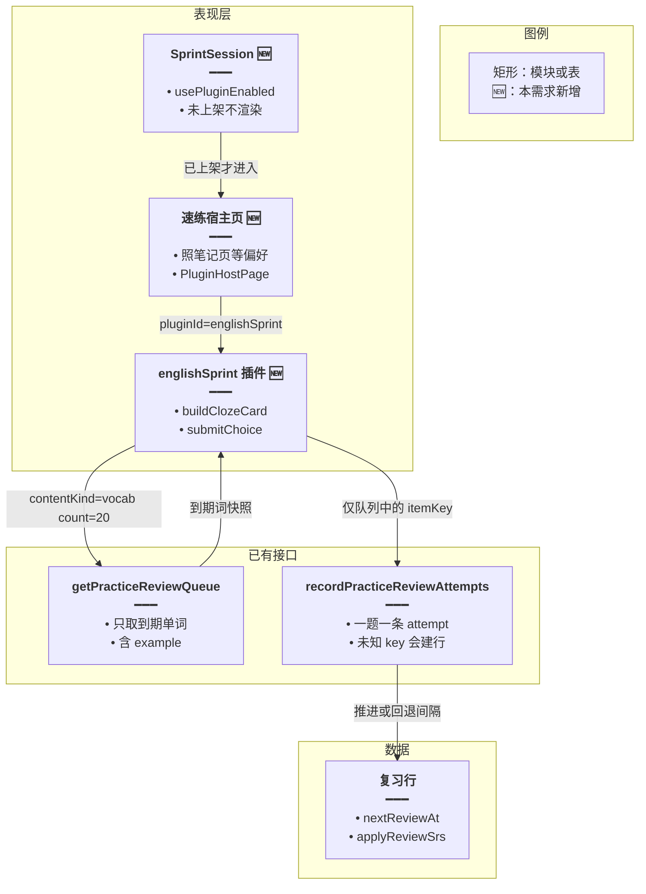
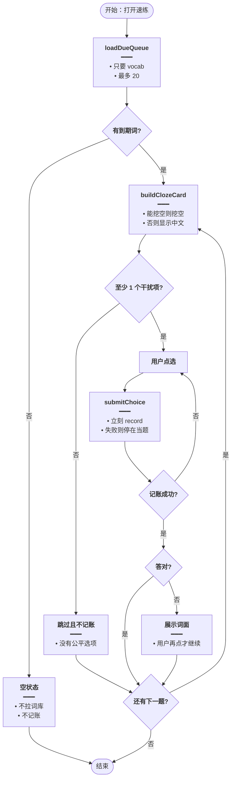
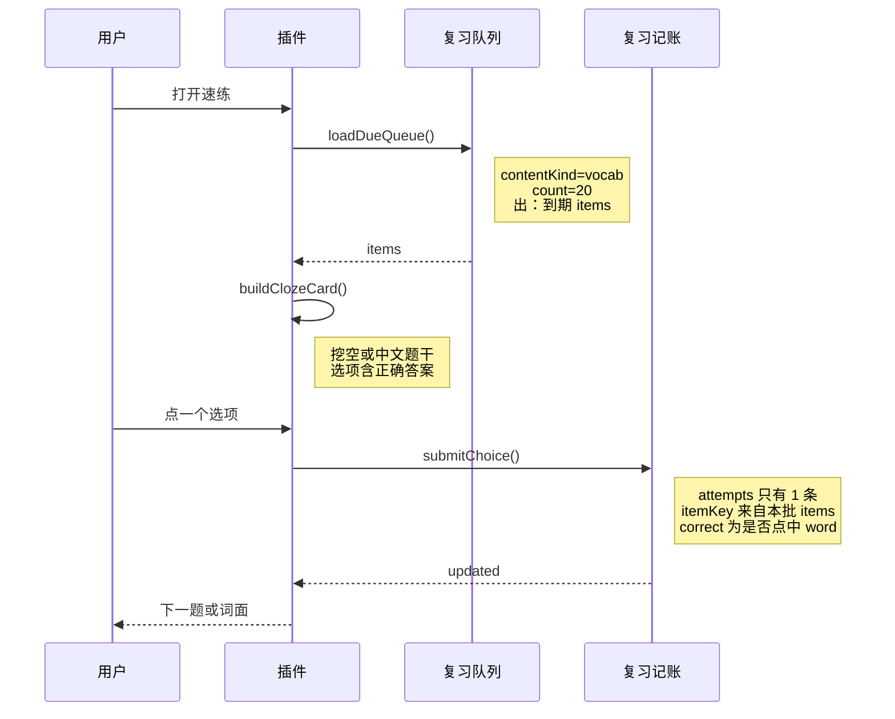
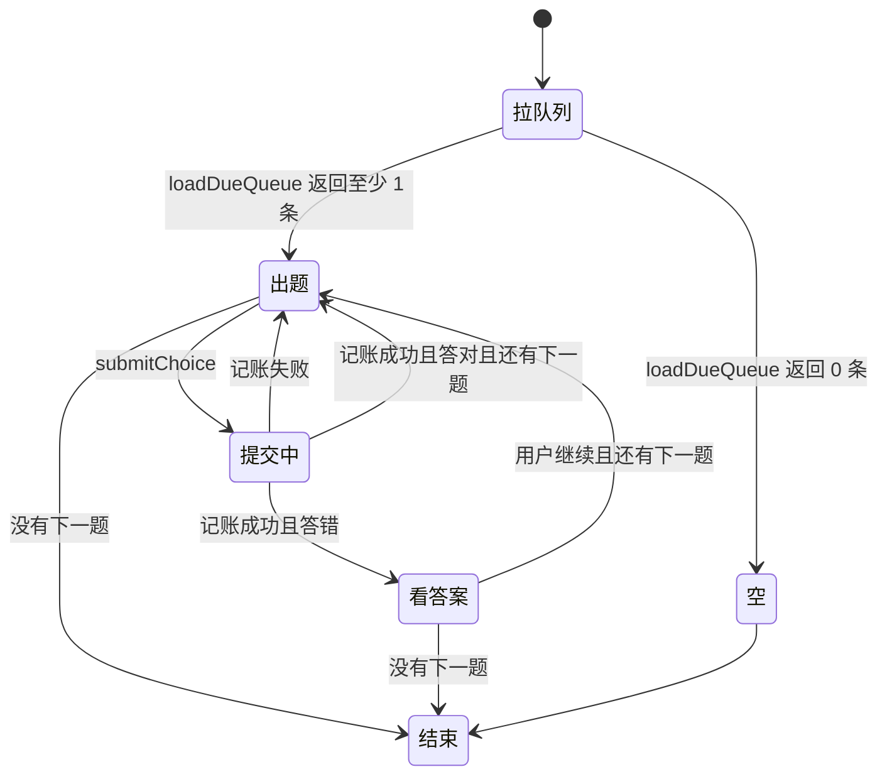

# 语境选择速练 — 实现思路

> **状态**：规划（未实现；到期队列、SM-2 记账、插件壳可复用）  
> **日期**：2026-11-09  
> **需求摘要**：学习者用几分钟刷完今天到期的词，在原句里认出词，答对答错立刻写进现有复习调度。  
> **一句话方案（预告）**：新增远程插件 `englishSprint`，只读 `GET practice/review/queue`，四选一填空，每答一题立刻 `POST practice/review/record`；不调用模型，不把新词写进复习表。

## 延伸阅读

- [短文批改插件](./短文批改插件.md)（上一版选型。能改一篇作文，但不能在几分钟里清掉到期队列，本篇取代它）
- [学习笔记远程](../../english/学习笔记远程.md)（`PluginHostPage` 挂载）
- [今日记词与今日复习](./今日记词与今日复习.md)（词怎样进入复习队列）

---

## 0. 读本文你将得到什么

- 要加快的是「今天到期的词几分钟认完」，不是再写一篇作文，也不是再把词拼一遍。
- 比对后选定 **语境四选一速练插件**。短文批改、跟读、在听写页加第三种模式都落选。
- 插件只做题面。队列和 SM-2 仍是现有 `practice/review/queue` 与 `practice/review/record`。
- 两阶段：先刷单词到期队列；例句对不上该词时改成看中文选词，仍然不调模型。
- 最大风险是记账接口会给**没有复习行**的 `itemKey` 新建一行。速练只能提交队列里发下来的 key。

---

## 1. 需求与边界

### 1.1 用户故事

| 角色 | 场景 | 行为 | 期望结果 |
|------|------|------|----------|
| 已登录学习者 | 只有几分钟，想把今天该复习的词过一遍 | 打开速练，连续点选项 | 一题数秒；答对进入下一题；答错先看见原词再继续 |
| 同一人 | 中途离开 | 关掉页面 | 已经答过的题已写入 SM-2，不会整场作废 |
| 同一人 | 今天没有到期词 | 打开速练 | 看到空状态，不去词库抽新词充数 |
| 未上架插件的用户 | 看英语学习侧栏 | 浏览 | 没有速练入口 |

### 1.2 范围

| 在范围内 | 不在范围内（非目标） |
|----------|----------------------|
| 远程插件 `englishSprint`，路由 `/english-learning/sprint` | 改 `PracticeMode`（仍只有听写 / 拼写） |
| 单词到期队列，默认 20 题，不超过现有场次上限 | 从整本词库抽新词来练 |
| 例句能对上词面时挖空；对不上时看中文选词 | 模型出干扰项、模型改作文、音素跟读 |
| 每题立刻把对错写入现有复习记账 | 速练再写错题本或练习报告 |
| 答错时停一下，让用户看到词面 | 用速练代替「把词写出来」 |

### 1.3 约束与依赖

- 登录沿用 `EnglishLearningController` 的 `JwtGuard`。
- 调度沿用 `applyReviewSrs`：答错则次数归零、明天再出现；答对按 1 天 / 3 天 / 间隔×熟练度推下一次。
- `recordPracticeReviewAttempts` 找不到复习行时会**新建**一行。插件不得提交队列以外的 key。
- 插件挂载照学习笔记：`usePluginEnabled`、`PluginHostPage`、registry。
- 热路径不调用 `createLlm`。速度来自少打字、少等模型。
- 听写页继续负责「写得出」。速练只负责「认得出」。

### 1.4 哪类成熟产品真的学得快

| 产品 | 用来提速的动作 | 和本仓库 |
|------|----------------|----------|
| Clozemaster | 原句挖空，四选一，一天可以过很多句 | 复习快照里已有 `example`。缺的是挖空题面 |
| Lingvist | 看释义快速选词，按遗忘点出题 | 遗忘点已是 `nextReviewAt <= now`。缺的是一题数秒的认词 |
| 墨墨背单词 / Anki | 间隔重复，单卡时间短 | SM-2 已在 `english-practice-review.srs.ts`。现有练习却要整词拼写或听写 |
| Duolingo | 短场次、点选为主 | 场次可以仿。题必须来自用户自己的到期词，不另做课程树 |
| 不背单词 | 在例句里拼写 | 与现有听写 / 拼写同类，一题几十秒 |
| Grammarly / 批改网 / Write & Improve | 写完一篇再改 | 一轮只有一篇，清不掉到期队列 |
| ELSA / 流利说 | 跟读打分 | 一题含录音，比拼写更慢；本仓库没有音素分 |

单位时间里对**已知词**的提取次数，才是这里的速度。拼写、听写、跟读、作文都把单次拉长了。

---

## 2. 背景

- **谁、在什么场景、卡在哪**：词已经在复习表里，今天到期。用户想几分钟认完。打开练习却是听写或拼写，每题要播完音频或把字母打完。
- **现状缺口**：`GET /english-learning/practice/review/queue` 能给出词面、释义、例句。`POST /english-learning/practice/review/record` 能按对错推进 SM-2。中间没有「看句选词」。调度有了，吞吐仍停在慢练习上。
- **不解决会怎样**：复习积压。作文批改和跟读都是更慢的新动作，不减少今天的到期行。
- **硬约束**：不能把词库里没到期的词写进复习表；不能每题等模型；听写 / 拼写保持原样。

---

## 3. 现状与复用

| 能力 | 仓库中已有 | 本需求中的用法 |
|------|------------|----------------|
| 到期队列 | `getPracticeReviewQueue`，`contentKind=vocab` 时含 `key` / `word` / `example` / `translationZh` | 直接复用：唯一出题来源 |
| SM-2 | `applyReviewSrs`，由 `recordPracticeReviewAttempts` 调用 | 直接复用：每题一个 attempt |
| 记账副作用 | 找不到复习行时会 `create` | 约束：只回传队列中的 `key` |
| 听写 / 拼写 | `PracticeMode = 'dictation' \| 'spelling'` | 不适用：不增加模式 |
| 今日记词 | 练完才把新词写入复习 | 不适用：速练不负责第一次记新词 |
| 插件壳 | `views/englishLearning/notes/index.tsx` | 直接复用挂载方式 |
| 上架开关 | `NotesSession` 的 `usePluginEnabled` | 直接复用 |
| HTTP 信封 | `utils/fetch.ts` 成功时返回 `{ success, data }` | 直接复用：看 `data.updated` |
| 模型 | `createLlm` | 不适用：干扰项来自同批词面 |
| 错题 batch | `vocabulary-mistakes/batch` | 不适用：答错只推 SM-2 |
| 短文批改 | [短文批改插件](./短文批改插件.md) | 不适用：单篇太慢 |

**调研结论**：缺的不是题库，也不是调度公式，而是一层四选一题面。队列和记账已经上线。模型、错题表、听写状态机不进这条热路径。

---

## 4. 方案比对与最终方案

### 4.1 候选方案

#### 方案 A：语境四选一插件（新增插件，复用队列和记账）

- **做法**：registry 增加 `englishSprint`，`routePath` 为 `/english-learning/sprint`，`injectRoute: false`。宿主页照 `notes/index.tsx` 挂 `PluginHostPage`。侧栏在 `usePluginEnabled('englishSprint')` 为真时才显示。插件请求 `GET /english-learning/practice/review/queue?contentKind=vocab&count=20`。每题用同批其他 `word` 做最多 3 个干扰项。例句能按词边界匹配到目标词就挖成 `____`，否则题干用 `translationZh`。点选项后立刻 `POST /english-learning/practice/review/record`，body 为一条 `attempts`。答对自动下一题；答错展示词面，再点一次继续。队列为空则空状态，不请求词库。
- **能工作的原因**：出题字段和记账契约都是现成的。同批词面可以互为选项。
- **主要代价**：认词比拼写容易，记得没有听写牢。例句对不上时退化为看中文选词。

#### 方案 B：短文批改插件（上一版结论）

- **做法**：远程插件交一篇英文，非流式要 JSON，单词级问题再进错题本。细节在 [短文批改插件](./短文批改插件.md)。
- **能工作的原因**：模型凭证、笔记保存、错题 batch 都在，能改一篇真实短文。
- **主要代价**：一轮通常只有一篇。几分钟换来一次改正，到期队列一行都不会少。

#### 方案 C：在现有练习里加选词模式（不做成插件）

- **做法**：把 `PracticeMode` 扩成听写、拼写、选词三种，在 `practice/Session.tsx` 分支题面。结算仍走练习报告，复习记账仍走现有 `record`。
- **能工作的原因**：少一个远程包。场次上限和路由已经在练习页。
- **主要代价**：练习页的键盘流、听写预取、报告草稿都要为点选再分叉。这个入口不能随插件下架。也更容易把「库内新词」和「到期词」混进同一次记账。

### 4.2 比对

| 维度 | 方案 A 四选一插件 | 方案 B 短文批改 | 方案 C 练习页加模式 |
|------|-------------------|-----------------|---------------------|
| 正确性 | 只提交队列给出的 `itemKey`，不会凭空建立复习行。标准答案就是该词面 | 批改对错依赖模型。到期词是否被复习：不覆盖 | 若复用练习拉词，会练到未到期的库内词，并可能写入复习行 |
| 复用 | 队列、`applyReviewSrs`、笔记式插件壳 | 模型、错题、笔记。复习队列用不上 | 练习会话和报告。插件上架用不上 |
| 改动面 | 插件、一条宿主路由、侧栏、registry | 插件、批改接口、草稿表 | `PracticeMode`、Session、结算、快捷键 |
| 复杂度 | 题面函数和一题一次 POST。无新表、无模型 | 草稿表、JSON 重试、三类问题 | 在已经很长的练习状态机上再加一条分支 |
| 体验 | 点一下即下一题。记账失败停在当题 | 等一次模型。一篇结束才有反馈 | 进入前还要选模式、题量、来源 |
| 风险 | 误传陌生 key 会新建复习行。空队列若去词库捞词会放大这个风险 | 不碰复习表，但积压不变 | 听写预取和点选互相打扰 |
| 可维护性 | 间隔公式仍只在 `recordPracticeReviewAttempts` | 批改提示词单独一处，和复习无关 | 每改练习快捷键都要记得还有点选 |

### 4.3 综合考量

权重最高的是单位时间里的提取次数，以及不能把复习表写脏。方案 A 用现成到期队列出题，用现成记账推进下一次出现时间，热路径没有模型。

不选方案 B。它的优点是能改用户自己写的句子，仓库里确实没有这一段。这个优点不减少今天的到期积压，和「快速学习」对不上。那篇文档保留，不作为这个插件来做。

不选方案 C。它的优点是少一个远程包。这个优点抵不过练习页已经是慢路径：再塞点选之后，下架和独立发版都没了，也更容易把新词写进复习表。

### 4.4 最终方案

#### 背景

到期队列和 SM-2 已经在。慢的是题面：听写和拼写每题几十秒，短文批改一轮只有一篇。记账函数会给未知 `itemKey` 建复习行，所以新题面只能消费队列发下来的 key。热路径不能等模型。

#### 具体思路

1. **模块**：插件负责挖空、选项和正误。宿主只提供路由壳和上架判断。后端不新增接口。
2. **数据**：队列的 `items` 放在插件内存。选项是同批 `word` 打乱后的列表，其中有本题 `word`。选择结果不落新表。
3. **状态**：当前下标和「正在提交」放插件组件状态。下一次复习时间只存在复习行里，插件不复制间隔。
4. **边界**：队列为空就结束，不拉词库。记账失败停在当题。例句匹配不到词就显示中文释义，标准答案仍是该词。同批凑不出至少 1 个其它词面时，这题跳过并且**不记账**。

#### 实现方案

**一句话**：新增远程插件 `englishSprint`，只读到期队列，四选一填空，每答一题立刻记账；不调用模型，不把新词写进复习表。

| 步骤 | 谁 | 做什么 | 输入 → 输出 |
|------|----|--------|-------------|
| 1 | `SprintSession` | 已上架才进入 | 点击 → `/english-learning/sprint` |
| 2 | 宿主页 | `PluginHostPage pluginId="englishSprint"` | 插件挂上 |
| 3 | `loadDueQueue` | 拉单词到期队列 | `count=20` → `items` |
| 4 | `buildClozeCard` | 挖空或改用中文题干，并选出干扰项 | 一条 item + 同批词面 → 题面 |
| 5 | `submitChoice` | 比对选项和 `word`，立刻记账 | 选项 → `correct` |
| 6 | `recordPracticeReviewAttempts` | `applyReviewSrs` 写回该 key | 一行复习状态 |
| 7 | 插件 | 答对下一题；答错展示词面后再下一题；队列耗尽则结束 | 下标 +1 或结束页 |

#### 选定原因

1. **正确性**：只回传队列 key，避免记账函数招生词。牺牲：今天没有到期项时速练是空的。
2. **复用**：队列和 SM-2 零改动。牺牲：要维护一个远程插件清单。
3. **改动面**：练习枚举、听写预取、Agent 都不动。牺牲：宿主仍加路由、侧栏和 registry 一行。
4. **复杂度**：无新表、无模型。牺牲：干扰项只是同批别的词，不是精心设计的近义词。
5. **体验**：点选比拼写短一个数量级。牺牲：记忆强度弱于把词写出来；那条路仍留给听写。
6. **风险**：空队列不做兜底拉词，堵死误建复习行。牺牲：还没记过词的用户打开是空的。
7. **可维护性**：间隔公式仍只有 `applyReviewSrs`。牺牲：插件和宿主要用现有 `hostApiRange` 一起发。

#### 优势

- 相对方案 B：同样几分钟里是十几次认词，并真正减少到期积压；作文批改一次只覆盖一篇。
- 相对方案 C：听写页的键盘、预取和报告不用分叉；插件可以随上架开关关掉。

#### 怎么实现

1. 侧栏卡片在插件未上架时不渲染。
2. 宿主页复制笔记页的偏好就绪判断后挂载插件。
3. `loadDueQueue` 只请求 `contentKind=vocab`。
4. `buildClozeCard` 先挖空，失败则题干用 `translationZh`；干扰项从同批其它词面取最多 3 个。
5. `submitChoice` 在请求返回前忽略再次点击；`data.updated` 小于 1 则停在当题。
6. 请求体里的 `itemKey` 永远是队列里的 `item.key`。
7. 最后一题记账成功后进入结束页，只展示本场答对题数，不写练习报告。

代码在 §9。

### 4.5 其他关键决策：点选还是把词打出来

总体方案已经定了插件和到期队列。还会改变单题耗时的是：点选项，还是像听写一样把词打出来。

#### 4.5.1 候选

##### 方案 A：四选一（选定）

- **做法**：题面最多 4 个按钮，文案是词面。点中与 `item.word` 相同（忽略大小写）即 `correct: true`。
- **能工作的原因**：同批队列自带词面，不需要输入法，也不需要判拼写近似。
- **主要代价**：用户可能凭选项认词，而不是自己回忆拼写。

##### 方案 B：速练里改为输入单词

- **做法**：挖空后显示输入框，提交字符串与 `word` 全等才算对。记账字段不变。
- **能工作的原因**：提取更强，记账接口不用改。
- **主要代价**：一题回到「打完才下一题」，和现有拼写重复。中文输入法回车跳题是练习页已经处理过的问题，会再进插件。

#### 4.5.2 比对

| 维度 | 方案 A 点选 | 方案 B 输入 |
|------|-------------|-------------|
| 正确性 | 对错是选项是否等于词面 | 全等更严；输入法未上屏时容易误判 |
| 复用 | 不碰练习页的输入法防护 | 要重做或抄那套防护 |
| 改动面 | 插件内按钮 | 插件内输入框和键盘 |
| 复杂度 | 打乱数组 | 输入、组词、回车三条线 |
| 体验 | 一题数秒，适合把到期队列刷完 | 接近现有拼写，积压掉得慢 |
| 风险 | 认选项而不记拼写 | 和听写抢「写得出」，两处规则会漂 |
| 可维护性 | 拼写规则仍只在练习页 | 插件和练习页各有一套「怎样算写对」 |

#### 4.5.3 综合考量

这里的权重是单题时间。输入更记得住，但那是听写已经提供的。速练再做一遍就快不起来，还要维护两套输入法判断。点选把「认得出」和「写得出」分开。

#### 4.5.4 最终做法

##### 背景

听写和拼写已经要求把词打出来。速练要解决的是到期词来不及过。

##### 具体思路

插件只有按钮，没有文本框。对错等于被点的词面是否等于本题 `word`。

##### 实现方案

**一句话**：速练只做四选一；把词打出来仍走现有听写和拼写。

| 步骤 | 谁 | 做什么 | 输入 → 输出 |
|------|----|--------|-------------|
| 1 | `pickDistractors` | 凑干扰项 | 同批词面 → 最多 3 个其它词 |
| 2 | `submitChoice` | 比较字符串并记账 | 被点词面 → `correct` |

##### 选定原因

1. **体验**：一题不需要输入法。牺牲：不训练拼写。
2. **可维护性**：输入法逻辑留在练习页。牺牲：速练不能当成拼写考试。
3. **风险**：不和听写的预取、快捷键缠在一起。牺牲：只认识选项、写不出词的人，要另开听写。

##### 优势

- 相对方案 B：20 题可以在几分钟内记完账。输入模式会把速练做成长得和拼写一样的第二套练习。

##### 怎么实现

选项打乱和点击比较见 §9.2、§9.3。不增加 `PracticeMode`。

---

## 5. 架构图



**图内方法说明**：

| 方法 | 功能 |
|------|------|
| `usePluginEnabled('englishSprint')` | 读上架偏好；为假时侧栏和宿主页都不挂插件 |
| `PluginHostPage` | 按插件 id 加载远程模块，加载和错误壳与笔记页相同 |
| `buildClozeCard(item, pool)` | 把一条到期词变成挖空句或中文题干，并附上含正确答案的选项 |
| `submitChoice(itemKey, answer, choice)` | 判断对错并调用记账；返回前不再接受下一次点击 |
| `getPracticeReviewQueue` | 已有接口：按 `nextReviewAt <= now` 返回单词快照 |
| `recordPracticeReviewAttempts` | 已有接口：对每个 attempt 调用 `applyReviewSrs` 并保存；没有行时会新建 |
| `applyReviewSrs` | 已有函数：答错则明天复习且次数归零；答对则按 1 / 3 / 间隔×熟练度推下一次 |

**读图要点**：

- 插件不写新表。复习时间只活在现有复习行里。
- 队列到插件是只读快照。唯一回写是记账，而且 key 必须来自这份快照。
- 没有指向模型或错题表的线。那两条会拖慢，或把不是词的内容写进错题本。

---

## 6. 主流程图



**图内方法说明**：

| 方法 | 功能 |
|------|------|
| `loadDueQueue()` | 请求单词到期队列；失败时停在错误提示，不编造本地题 |
| `buildClozeCard(item, pool)` | 生成这一题的题干和选项；选项包含本题词面。凑不出干扰项时返回空 |
| `submitChoice(itemKey, answer, choice)` | 比较选项与词面后 POST 一条 attempt；失败不改变下标 |

**读图要点**：

- 空队列直接结束，没有「去词库抽 20 个」的分支。
- 凑不出干扰项就跳过，并且不调用记账，避免没有选项却把间隔往后推。
- 记账失败回到同一题。前面已经成功的题不会重放。

---

## 7. 核心时序图



**图内方法说明**：

| 方法 | 功能 |
|------|------|
| `loadDueQueue()` | 插件经宿主 HTTP 拉取到期单词。宿主 `http.post` / `get` 的成功体是 `{ success, data }`，词表在 `data.items` |
| `buildClozeCard()` | 只在本地组题干和选项，不请求第二套题库 |
| `submitChoice()` | 一题一次记账。`data.updated` 小于 1 时当失败，停在当题 |

**读图要点**：

- 用户每点一次，服务端就推进这一词的下一次复习时间，不等到结束页。
- 队列接口不判断对错。对错只在插件比较词面之后交给记账。
- 干扰项来自同一次 `items` 里的其它词，图上没有模型。

---

## 8. 状态机



**图内方法说明**：

| 方法 | 功能 |
|------|------|
| `loadDueQueue` | 决定进入空状态还是第一题；这个方法不记账 |
| `submitChoice` | 进入提交中后忽略连点；失败留在当题，成功才按对错分支 |

**读图要点**：

- 「看答案」只在答错后出现，答对不必多点一次。
- 结束页只展示本场计数，不写练习报告。

---

## 9. 具体实现（主链路代码）

### 9.1 模块一览

| 模块 | 职责 | 新增/改动 | 预估路径 |
|------|------|-----------|----------|
| 速练插件 | 拉队列、组题、点选、记账 | 新增 | `apps/remote-plugins` 暴露 `./EnglishSprint` |
| 宿主页 | 上架判断 + `PluginHostPage` | 新增 | `apps/frontend/src/views/englishLearning/sprint/index.tsx` |
| 侧栏卡 | 未上架不显示 | 新增 | `apps/frontend/src/views/englishLearning/sidebar/components/SprintSession.tsx` |
| 注册表 | 描述符 | 扩展 | `apps/backend/uploads/remotes/plugins-registry.json` |
| 到期队列 | 出题 | 直接复用 | `GET /english-learning/practice/review/queue` |
| 记账 | 推进 SM-2 | 直接复用 | `POST /english-learning/practice/review/record` |

### 9.2 组题

```typescript
// 对应 §4.4 步骤 4。词面里的正则特殊字符要转义，避免点号把挖空范围扩大
function escapeRegExp(word: string): string {
	// 逐字转义，挖空只替换这个词
	return word.replace(/[.*+?^${}()|[\]\\]/g, '\\$&');
}

// 对应 §4.4 步骤 4。例句能对上词面才挖空；对不上返回 null，调用方改用中文释义
function blankWord(example: string, word: string): string | null {
	// 空白例句无法挖空
	const sentence = example.trim();
	// 空白词面没有可替换的目标
	const target = word.trim();
	// 两者缺一就交给调用方改用中文题干
	if (!sentence || !target) return null;
	// 词边界避免把目标词当成更长单词的一段挖掉
	const pattern = new RegExp(`\\b${escapeRegExp(target)}\\b`, 'i');
	// 先测再换，换不到就不造假英文
	if (!pattern.test(sentence)) return null;
	// 只换第一处，句中再次出现的同一个词仍留着，题干不至于只剩空格
	return sentence.replace(pattern, '____');
}

// 对应 §4.4 步骤 4 和 §4.5。干扰项只来自同批到期词面，不请求模型
function pickDistractors(answer: string, pool: string[]): string[] {
	// 去重并去掉本题答案，防止四个按钮是同一个词
	const others = [...new Set(pool.map((item) => item.trim()).filter(Boolean))].filter(
		// 大小写不同仍视为同一个词，避免答案混进干扰项
		(item) => item.toLowerCase() !== answer.trim().toLowerCase(),
	);
	// 打乱后再截断，避免干扰项永远按字母序排在一起
	for (let i = others.length - 1; i > 0; i -= 1) {
		// 当前下标与一个随机下标交换
		const j = Math.floor(Math.random() * (i + 1));
		// 先留下当前项，避免交换时被覆盖
		const swap = others[i];
		// 把当前项放到随机位置
		others[i] = others[j];
		// 把被挤出的项放回当前下标，打乱才完整
		others[j] = swap;
	}
	// 最多三个干扰项，加上答案一共四个按钮
	return others.slice(0, 3);
}

// 对应 §4.4 步骤 4。返回 null 表示这题没有公平选项或没有题干，调用方跳过且不记账
function buildClozeCard(
	// 队列快照的一条；key 原样用于记账，word 是标准答案
	item: { key: string; word: string; example: string; translationZh: string },
	// 同批全部词面，用来挑干扰项
	pool: string[],
// 没有公平选项或没有题干时返回 null
): { key: string; prompt: string; choices: string[] } | null {
	// 没有其它词面就无法点选
	const distractors = pickDistractors(item.word, pool);
	if (distractors.length < 1) return null;
	// 挖空失败时用中文释义，标准答案仍是 word
	const prompt = blankWord(item.example, item.word) ?? item.translationZh.trim();
	// 中文也空则无法出题
	if (!prompt) return null;
	// 答案放进选项；干扰项里已经去掉了答案
	const choices = [...distractors, item.word.trim()];
	// 再打乱，避免正确答案总在最后
	for (let i = choices.length - 1; i > 0; i -= 1) {
		// 在尚未定稿的前缀里抽一个位置
		const j = Math.floor(Math.random() * (i + 1));
		// 留下当前选项，下面两行完成交换
		const swap = choices[i];
		// 正确答案不固定在最后一个
		choices[i] = choices[j];
		// 完成这一对交换
		choices[j] = swap;
	}
	// key 用队列给出的 itemKey，后面记账原样回传
	return { key: item.key, prompt, choices };
}
```

### 9.3 记账

```typescript
// 对应 §4.4 步骤 5 和 6。一题一次记账，中途离开也不会把已经答过的题丢掉
async function submitChoice(itemKey: string, answer: string, choice: string): Promise<boolean> {
	// 忽略大小写，选项按钮上的词面和快照词面可能只差大小写
	const correct = choice.trim().toLowerCase() === answer.trim().toLowerCase();
	// 宿主 http 成功体是 { success, data }，data 才是控制器返回的 { updated }
	const res = await api.http.post<{ updated: number }>('/english-learning/practice/review/record', {
		// 数组长度 1：这一题单独落账，不攒到结束页
		attempts: [
			{
				// 速练 M1 只刷单词到期队列
				contentKind: 'vocab',
				// 必须是 loadDueQueue 发下来的 key，陌生 key 会被服务端建成新复习行
				itemKey,
				// 点中词面为 true，点到干扰项为 false，由 applyReviewSrs 决定下次时间
				correct,
			},
		],
	});
	// updated 为 0 说明这题没写上，停在当题让用户再点
	if (!res.success || (res.data?.updated ?? 0) < 1) {
		// 抛出让界面停在当题，避免没写上复习行却进入下一题
		throw new Error('REVIEW_NOT_RECORDED');
	}
	// 返回对错，插件据此决定自动下一题还是先展示词面
	return correct;
}
```

### 9.4 数据模型

| 字段 | 来源 | 存储 | 说明 |
|------|------|------|------|
| `items[].key` | 复习队列 | 插件内存，本场 | 记账时原样作为 `itemKey` |
| `items[].word` / `example` / `translationZh` | 复习快照 | 插件内存 | 只用于题干和选项 |
| `nextReviewAt` 等 | `applyReviewSrs` | 已有复习行 | 插件不复制 |
| 本场答对数 | 插件计数 | 内存 | 结束页展示，不写练习报告 |

没有新表。`ponytail:` 干扰项是同批词面的随机三个，不是近义词。天花板是选项偶尔太好认。升级路径是在仍不调用模型的前提下，用词长相近的词优先做干扰项。

---

## 10. 分阶段实现步骤

| 阶段 | 目标 | 交付物 | 依赖 |
|------|------|--------|------|
| M1 | 能把今天到期的单词点选刷完 | 插件、宿主页、侧栏、registry | 现有队列和记账 |
| M2 | 空队列和失败说人话 | 空状态、记账失败停在当题 | M1 |

### M1

- [ ] registry 增加 `englishSprint`，`routePath` 为 `/english-learning/sprint`，`injectRoute: false`，`trust: first-party`。
- [ ] 宿主页与侧栏照笔记页接上 `usePluginEnabled`。
- [ ] 只请求 `contentKind=vocab` 的到期队列，默认 20。
- [ ] 例句可挖空则挖空，否则题干为中文释义。
- [ ] 每题成功记账后才进入下一题。答错先显示词面。

### M2

- [ ] 队列为空时不请求词库，页面说明今天没有到期词。
- [ ] 记账失败保持当前题，按钮可再点。
- [ ] 凑不出干扰项的题跳过，且不调用 `record`。
- [ ] 下架后侧栏无入口，直接打开路由看到已下架文案。

---

## 11. 风险、边界与待确认

| 项 | 等级 | 说明 | 缓解 |
|----|------|------|------|
| 陌生 key 新建复习行 | 高 | `recordPracticeReviewAttempts` 在没有行时会 `create` | 只提交本批 `items[].key`；空队列不拉词库 |
| 点选记得不牢 | 中 | 认选项弱于自己写出单词 | 听写 / 拼写保持不动，不把速练当成拼写考试 |
| 干扰项太容易 | 中 | 同批词面可能词长差很多 | M1 接受；近义词排序留到上面的 ponytail 升级 |
| 例句对不上词 | 低 | 挖空失败 | 改显示 `translationZh`，答案仍是该词 |
| 连点 | 低 | 同一题记两次账 | 提交中忽略再次点击 |
| 与听写互斥 | 不适用 | 不占音频、不改练习枚举 | 不处理 |

**待确认**：

- [ ] 插件里的 `api.http` 是否原样返回 `utils/fetch.ts` 的 `{ success, data }`。验证方式：在学习笔记插件里看一次现有 `http.post` 的返回；若桥接层已经剥掉信封，§9.3 改为直接读 `updated`。

---

## 12. 验收清单

| # | 用例 | 步骤 | 期望 |
|---|------|------|------|
| AC1 | 刷完到期词 | 准备至少 2 个今天到期的单词，打开速练并点对 | 每题记账成功；复习行的 `nextReviewAt` 被推后；结束页有答对计数 |
| AC2 | 答错 | 点一个干扰项 | 先看到正确词面；该词下次复习落在明天；次数归零 |
| AC3 | 中途离开 | 答完 1 题后关掉页面再打开 | 已答的那题不再出现在本批到期队列里；未答的还在 |
| AC4 | 没有到期词 | 队列为空时打开 | 空状态；网络里没有词库列表请求，也没有 `record` |
| AC5 | 例句不含该词 | 快照的 `example` 对不上 `word`，但有中文释义 | 题干是中文；点对词面仍算对 |
| AC6 | 记账失败 | `record` 返回错误 | 停在当题，下标不变 |
| AC7 | 下架 | 关掉 `englishSprint` | 侧栏无卡片；打开路由不请求队列 |

---

## 13. 预估改动面（实现阶段参考）

| 类型 | 路径（预估） |
|------|--------------|
| 前端宿主 | `apps/frontend/src/views/englishLearning/sprint/index.tsx`、`sidebar/components/SprintSession.tsx`、`sidebar/EnglishSidebar.tsx`、`router/routes.ts`、`i18n/locales/*/englishLearning.ts` |
| 远程插件 | `apps/remote-plugins` 中新的速练暴露模块 |
| 后端 | 只改 `apps/backend/uploads/remotes/plugins-registry.json`。不改复习服务 |
| 文档（实现后） | `micro-apps/remote-docs/wiki/english/` 下的实现归档 |

---

（本文档为规划态实现思路；落地后以源码与 remote-docs wiki 专题为准）
