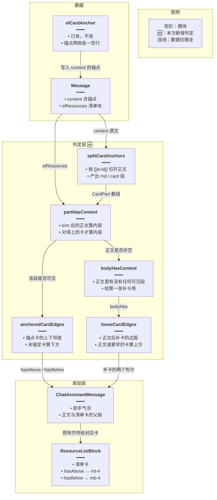
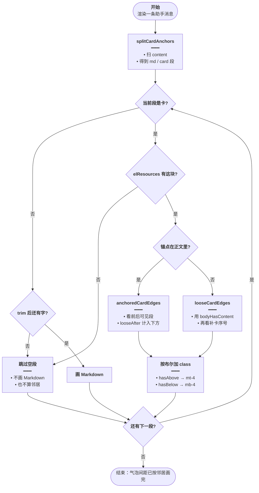
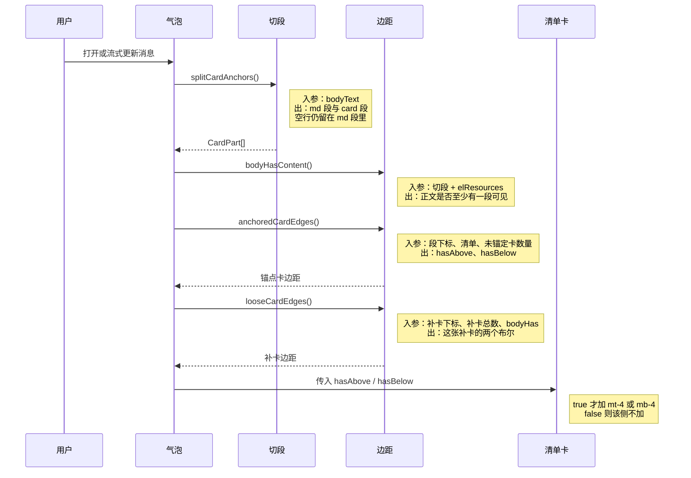

# 资源卡上下间距 — 实现思路

> **状态**：规划（间距判定已在工作区落地；正式专题尚未归档）  
> **日期**：2026-10-26  
> **需求摘要**：英语 Agent 气泡里的资源清单卡，只有上方还有正文或另一张卡时才加 `mt-4`，只有下方还有内容时才加 `mb-4`；单独一张卡或锚点旁边只剩空行时不留这段间距。

## 延伸阅读

- [Agent大结果旁路展示.md](./Agent大结果旁路展示.md) — 清单从正文外溢成卡片的总方案
- [问答清单按需出卡.md](./问答清单按需出卡.md) — 什么时候该出卡
- [整库全量出卡.md](./整库全量出卡.md) — 整库卡按 `libraryId` 分页，与本文间距无关

---

## 0. 读本文你将得到什么

- **问题**：清单卡以前固定 `mt-4 mb-4`，气泡里只有一张卡、或卡贴在正文末尾时，上下会空出一段没有内容的间距。
- **一句话方案**：先把助手正文按 `[[el:artifactId]]` 切成「正文段 / 卡片」；再看这张卡前后有没有会画出来的内容，有才加上对应外边距。
- **改哪些层**：只改前端气泡。后端继续写锚点，不参与间距。
- **阶段**：M1 纯函数判定 → M2 接到消息气泡 → M3 卡片按布尔量加 class。
- **最大风险**：思考过程、技能条、生成中提示不算「内容」，卡贴着这些块时不会额外加 `mt-4` / `mb-4`。

---

## 1. 需求与边界

### 1.1 用户故事

| 角色 | 场景 | 行为 | 期望结果 |
|------|------|------|----------|
| 英语学习者 | 回复只有一张清单卡 | 打开这条助手消息 | 卡顶、卡底都不留 `mt-4` / `mb-4` |
| 英语学习者 | 导语在卡上面，卡是最后一块 | 阅读导语 + 清单 | 卡上有 `mt-4`，卡下不加 `mb-4` |
| 英语学习者 | 卡在两段说明中间 | 阅读上下正文 | 上下都留 `mt-4` / `mb-4` |
| 英语学习者 | 锚点写了，但 `elResources` 里没有对应块 | 看气泡 | 这张卡不渲染，也不算邻居的「有内容」 |

### 1.2 范围

| 在范围内 | 不在范围内（非目标） |
|----------|----------------------|
| 助手气泡内 `ResourceListBlock` 的上外边距、下外边距 | 卡片内部标题栏、列表行、导出按钮的间距 |
| 正文锚点卡，以及落在正文后面的未锚定卡 | 思考过程、已应用 Skill、联网条、生成中、免责声明、继续生成 / 网页按钮 |
| 空行、纯空白段不算内容 | 用 DOM 量兄弟节点高度 |
| 主聊与英语 Agent 共用的 `ChatAssistantMessage` | 改锚点语法、改 spill、改 SSE |

### 1.3 约束与依赖

- 须登录后才能在 `/english-learning` 看到英语 Agent；间距本身不新增接口，Web 与 Tauri 同一套气泡。
- 复用已有锚点 `[[el:artifactId]]`（后端 `elCardAnchor` 写成前后各一个空行）和已有 `elResources`。
- 流式追加正文时，边距随邻居重算；不要把边距写进消息存档。
- 相邻两张卡会叠成「上一张的 `mb-4` + 下一张的 `mt-4`」（2rem）。这与从前两张卡都写死双边距时的卡间距相同。

---

## 2. 方案总览（一句话 + 要点）

**一句话方案**：气泡渲染前用正文切段结果算出 `hasAbove` / `hasBelow`，清单卡只在对应一侧为真时加上 `mt-4` 或 `mb-4`。

| # | 设计要点 | 理由 |
|---|----------|------|
| 1 | 内容 = `trim` 后非空的 Markdown，或 `elResources` 里能对上 `artifactId` 的另一张卡 | 锚点自带的 `\n\n` 不是读者能看见的内容 |
| 2 | 判定放在纯函数，气泡只负责传入切段结果 | 空行、缺块、未锚定卡可以单独自检，不挂 React |
| 3 | 未锚定卡画在正文容器后面，并计入锚点卡的「下方」 | 否则正文末尾那张锚点卡会贴住后面补出来的卡 |
| 4 | 气泡装饰（思考、Skill、生成中、操作按钮）不计入 | 它们自己已有 `mb-*` / `mt-*`，再加 16px 会把卡和装饰拉开 |

---

## 3. 现状与复用

| 能力 | 仓库中已有 | 本需求中的用法 |
|------|------------|----------------|
| 助手气泡与 Markdown 正文 | `apps/frontend/src/components/design/ChatAssistantMessage/index.tsx` | 扩展：切段后给每张卡传边距 |
| 清单卡 UI | `apps/frontend/src/components/design/Assistant/ResourceListBlock.tsx` | 扩展：`hasAbove` / `hasBelow` 决定 class |
| 锚点字符串 | `apps/backend/src/services/agent/el-spill.ts` 的 `elCardAnchor` | 直接复用：`\n\n[[el:id]]\n\n`，间距层把两侧空行判成无内容 |
| 消息上的清单数组 | `apps/frontend/src/types/chat.ts` 的 `Message.elResources` / `ElResourceBlock` | 直接复用：用 `artifactId` 判断锚点卡是否真的会画出来 |
| class 合并 | `apps/frontend/src/lib/utils.ts` 的 `cn` | 直接复用 |
| 边距纯函数与自检 | `apps/frontend/src/components/design/ChatAssistantMessage/cardEdges.ts`、同目录 `cardEdges.check.ts` | 新建：判定与 `npx tsx …/cardEdges.check.ts` |

**调研结论**：清单卡已经嵌在助手气泡里，不需要新路由、新接口或新表。缺的只是「这张卡上下有没有可见邻居」。思考区、联网条、生成中提示都画在正文容器外面，按产品边界不参与这次边距。主聊若带上 `elResources`，会走同一条气泡，不另写一套。

---

## 4. 架构图



**图内方法说明**：

| 方法 / 模块入口 | 功能 |
|-----------------|------|
| `splitCardAnchors(text)` | 用 `[[el:artifactId]]` 把助手正文切成 Markdown 段和卡片段；锚点前后的空行保留成 md 段，留给后面 `trim` |
| `partHasContent(part, resources)` | 判断一段会不会画出来：md 看 `trim` 后是否还有字；card 看 `elResources` 里有没有同一个 `artifactId` |
| `anchoredCardEdges(parts, index, resources, looseAfter)` | 算正文锚点上这张卡的上下：前面任一可见段 → `hasAbove`；后面任一可见段，或后面还有未锚定卡 → `hasBelow` |
| `looseCardEdges(index, count, bodyHasContent)` | 算画在正文容器之后的补卡：前面有正文或更早的补卡 → `hasAbove`；后面还有补卡 → `hasBelow` |
| `bodyHasContent(parts, resources)` | 正文切段里是否至少有一段可见；第一张补卡用它决定要不要 `mt-4` |
| `ResourceListBlock` | 清单卡组件：`hasAbove` 加 `mt-4`，`hasBelow` 加 `mb-4`，缺省都是 false |
| `elCardAnchor(artifactId)` | 后端已有：把锚点写成前后各一个空行。间距层不改它，只把这些空行判成无内容 |

**读图要点**：

- 间距只发生在表现层和判定层之间；清单数据仍来自消息上的 `elResources`。
- 新增的是 `cardEdges.ts` 里的判定，卡片组件只消费两个布尔。
- `elCardAnchor` 留在后端，避免为了间距去改 spill 或 SSE。

---

## 5. 主流程图



**图内方法说明**：

| 方法 | 功能 |
|------|------|
| `splitCardAnchors(text)` | 渲染入口：把含锚点的 `content` 切成有序段，供后面逐段分支 |
| `anchoredCardEdges(...)` | 段类型是正文内的卡，且清单块存在时，算出这张卡要不要上下外边距 |
| `looseCardEdges(...)` | 清单块的 `artifactId` 没有出现在正文锚点里时，按补卡队列算出边距 |
| `bodyHasContent(...)` | 在补卡分支里回答「正文容器里有没有已经可见的东西」 |

**读图要点**：

- 入口是气泡渲染，不是用户点击。流式每来一段正文，整条链路重算。
- 两条失败岔路都落到「跳过」：空 Markdown 不画；锚点没有清单块也不画，并且不能给邻居制造间距。
- 结束条件是段和补卡都处理完；边距不写入消息。

---

## 6. 核心时序图



**图内方法说明**：

| 方法 | 功能 |
|------|------|
| `splitCardAnchors()` | 气泡在 `useMemo` 里调用，把当前正文切成段；流式 `content` 变化会重新切 |
| `bodyHasContent()` | 告诉补卡：正文容器里有没有可见段，避免第一张补卡在空正文上仍加 `mt-4` |
| `anchoredCardEdges()` | 对每个画得出来的锚点卡返回上下布尔；未锚定卡数量大于 0 时，正文里最后一张锚点卡的 `hasBelow` 为真 |
| `looseCardEdges()` | 对正文后的补卡逐张返回布尔；只有后面还有补卡时 `hasBelow` 才为真 |
| `ResourceListBlock` | 清单卡入口：读取 `hasAbove` / `hasBelow`，为真才在根节点加 `mt-4` 或 `mb-4` |

**读图要点**：

- 用户只触发渲染；判定在气泡内部完成，清单卡不再自己扫 DOM。
- 三次边距调用都是同步纯函数，没有 SSE、轮询或额外请求。
- 清单卡拿到的是结果布尔，不知道锚点文本长什么样。

---

## 7. 模块职责与接口草图

### 7.1 模块一览

| 模块 | 职责 | 新增/改动 | 预估路径 |
|------|------|-----------|----------|
| 边距判定 | 切段、可见性、锚点卡 / 补卡布尔 | 新增 | `apps/frontend/src/components/design/ChatAssistantMessage/cardEdges.ts` |
| 自检 | 空卡、单侧正文、缺块、补卡 | 新增 | 同目录 `cardEdges.check.ts` |
| 助手气泡 | 切段、找出未锚定卡、把布尔传下去 | 扩展 | `apps/frontend/src/components/design/ChatAssistantMessage/index.tsx` |
| 清单卡 | 按布尔拼接 `mt-4` / `mb-4` | 扩展 | `apps/frontend/src/components/design/Assistant/ResourceListBlock.tsx` |
| 锚点写入 | 产生 `[[el:id]]` | 直接复用 | `apps/backend/src/services/agent/el-spill.ts` |

### 7.2 关键接口（伪代码或 TypeScript 草图）

```typescript
// 切段元素；id 与清单块 artifactId 对齐，用来判断这张卡会不会画出来
type CardPart = { type: 'md'; text: string } | { type: 'card'; id: string };

// 锚点卡边距：前后可见段决定上下；补卡数量并进下方，避免贴住正文后的卡
function anchoredCardEdges(
	// 切段结果；下标指向当前卡，不把自己算成邻居
	parts: CardPart[],
	// 当前卡在切段数组中的位置
	index: number,
	// 消息上的清单；没有同 id 的锚点段不算内容
	resources: { artifactId: string }[] | null | undefined,
	// 正文后还会画几张补卡；大于 0 则 hasBelow 为真
	looseAfter: number,
	// 只返回布尔，class 名留在卡片组件，判定层不依赖样式
): { hasAbove: boolean; hasBelow: boolean };

// 正文后的补卡；正文已有可见段时，第一张补卡也要上边距
function looseCardEdges(
	// 这张补卡在补卡队列中的序号
	index: number,
	// 补卡总数；最后一张没有下边距
	count: number,
	// 正文容器里是否已有可见段
	bodyHas: boolean,
	// 序号大于 0 或正文非空 → hasAbove；后面还有卡 → hasBelow
): { hasAbove: boolean; hasBelow: boolean };
```

```tsx
// 清单卡只消费布尔；缺省 false，调用方忘传时不要留出空距
function ResourceListBlock(props: {
	// 清单数据；间距不读条目，只决定外壳 class
	block: ElResourceBlock;
	// 上方有正文或另一张卡时为 true，组件才加 mt-4
	hasAbove?: boolean;
	// 下方有正文或另一张卡时为 true，组件才加 mb-4
	hasBelow?: boolean;
	// 返回卡片根节点；边距加在根 div 上，不进列表内部
}): JSX.Element;
```

### 7.3 数据模型

| 字段/实体 | 来源 | 存储 | 说明 |
|-----------|------|------|------|
| `Message.content` | 模型正文 + `elCardAnchor` | 消息表已有字段 | 含 `[[el:artifactId]]`；间距不另存 |
| `Message.elResources[]` | SSE / 历史快照 | 消息上的 JSON | `artifactId` 用来对锚点、决定卡是否渲染 |
| `hasAbove` / `hasBelow` | `anchoredCardEdges` 或 `looseCardEdges` | 仅本次渲染 | 不进 Store、不进接口 |
| 未锚定卡 | `elResources` 中 `artifactId` 不在切段结果里的项 | 内存过滤 | 画在正文容器之后 |

可见性规则（判定层内部）：

| 段 | 算有内容 | 不算 |
|----|----------|------|
| `{ type: 'md' }` | `text.trim()` 后还有字符 | 空串、只有换行或空格 |
| `{ type: 'card' }` | `elResources` 中存在相同 `artifactId` | 锚点写了但清单块缺失 |
| 补卡队列 | 另一张会画出来的补卡，或正文里已有可见段 | 思考区、Skill 条、生成中、底栏按钮 |

---

## 8. 分阶段实现步骤

| 阶段 | 目标 | 交付物 | 依赖 |
|------|------|--------|------|
| M1 | 邻居判定可单测 | `cardEdges.ts` + `cardEdges.check.ts` | 无 |
| M2 | 气泡把布尔送到每张卡 | `ChatAssistantMessage` 两处渲染 | M1 |
| M3 | 卡片 class 随布尔变化 | `ResourceListBlock` 的 `cn(...)` | M2 |

M1

- [x] `splitCardAnchors` 保留锚点两侧空行，不在切段时丢掉
- [x] 空白 md、缺失清单块不算可见
- [x] `npx tsx apps/frontend/src/components/design/ChatAssistantMessage/cardEdges.check.ts` 通过

M2

- [x] 正文内的卡走 `anchoredCardEdges`，未锚定数量传入 `looseAfter`
- [x] 正文后的卡走 `looseCardEdges`，并用 `bodyHasContent`
- [x] 对不上清单块的锚点 `return null`，不占位

M3

- [x] `hasAbove` 才加 `mt-4`，`hasBelow` 才加 `mb-4`
- [ ] 登录后在英语 Agent 里看四条验收（只有卡、只有上、只有下、上下都有）

---

## 9. 关键决策与备选方案

| 决策 | 选用 | 备选 | 为何不选备选 |
|------|------|------|--------------|
| 谁判断上下有内容 | 切段结果上的纯函数 | 卡片 `useLayoutEffect` 扫 `previousElementSibling` | 生成中正文在变，DOM 扫描还要躲开关闭的抽屉和空容器；切段结果和渲染用的是同一份数据 |
| 什么算内容 | 会画出来的正文段和清单卡 | 把思考过程、Skill、生成中、操作按钮也算上 | 这些块自己有外边距，再加 16px 会把卡和装饰拉开；生成中结束时边距还会跳一下 |
| 卡与卡之间 | 上一张 `mb-4` 加下一张 `mt-4` | 只给其中一侧留白 | 与改之前两张卡都写死双边距时的间隔一致，中间不会突然变紧 |
| 未锚定卡 | 算锚点卡的下方，自己再按队列算 | 忽略、一律不加边距 | 补卡画在正文下面，不加的话会贴住上面的正文或锚点卡 |

---

## 10. 风险、边界与待确认

| 项 | 等级 | 说明 | 缓解 |
|----|------|------|------|
| 思考过程贴在卡上方 | 中 | `thinkContent` 不计入 `hasAbove`，卡是正文第一段时没有 `mt-4` | 思考条自己有 `mb-2`；若观感仍贴，再把思考区纳入 `hasAbove` |
| 相邻卡间距 2rem | 低 | 两侧各 1rem，叠在一起 | 与旧的固定双边距相同；若要变紧，只改一侧函数 |
| 流式时边距后出现 | 低 | 卡先在文末，随后下面冒出正文，`mb-4` 才加上 | 符合「有内容才加」；不把生成中 spinner 当成内容，避免生成结束时边距又消失 |
| Markdown 段自身下边距 | 低 | 上一段落的 margin 与卡的 `mt-4` 可能折叠成较大的那一个 | 验收时看计算后的空隙，不以 class 名代替肉眼 |

**待确认**：

- [ ] 思考区展开时，第一张卡是否仍应不加 `mt-4`（验证：一条带 `thinkContent`、正文以锚点开头的消息）
- [ ] 主聊气泡若出现 `elResources`，间距是否与英语 Agent 一致（验证：同一 `ChatAssistantMessage` 路径，无需第二套 class）

---

## 11. 验收清单

| # | 用例 | 步骤 | 期望 |
|---|------|------|------|
| AC1 | 只有卡 | 正文为 `\n\n[[el:a]]\n\n`，且 `elResources` 含 `a` | 卡上没有 `mt-4`，也没有 `mb-4` |
| AC2 | 只有上方正文 | 正文为 `介绍\n\n[[el:a]]\n\n` | 有 `mt-4`，没有 `mb-4` |
| AC3 | 只有下方正文 | 正文为 `[[el:a]]\n说明` | 没有 `mt-4`，有 `mb-4` |
| AC4 | 上下都有 | 正文为 `上\n[[el:a]]\n下` | `mt-4` 与 `mb-4` 都在 |
| AC5 | 缺清单块 | 锚点是 `gone`，`elResources` 只有 `a`，且 `a` 在其后 | `gone` 不渲染；`a` 的 `hasAbove` 为 false |
| AC6 | 正文后补卡 | 正文只有锚点卡 `a`，另有一张未锚定卡 | `a` 有 `mb-4`；补卡有 `mt-4`、没有 `mb-4` |
| AC7 | 单独补卡 | 正文空白，只有一张未锚定卡 | 补卡两侧都不加 |

AC1–AC7 的判定部分已由 `cardEdges.check.ts` 覆盖。登录后的肉眼间距仍待看一次真实气泡。

---

## 12. 预估改动面（实现阶段参考）

| 类型 | 路径（预估） |
|------|--------------|
| 前端 | `apps/frontend/src/components/design/ChatAssistantMessage/cardEdges.ts` |
| 前端 | `apps/frontend/src/components/design/ChatAssistantMessage/cardEdges.check.ts` |
| 前端 | `apps/frontend/src/components/design/ChatAssistantMessage/index.tsx` |
| 前端 | `apps/frontend/src/components/design/Assistant/ResourceListBlock.tsx` |
| 后端 | 无 |
| 文档（实现后） | 若要归档实现对照，用 `implementation-doc-from-diff` 写入 `wiki/english/`，不要把源码全文贴进本篇 |

---

（本文说明资源卡上下间距的判定原理。工作区已按此落地；与源码不一致时以 `cardEdges.ts` 为准。）
