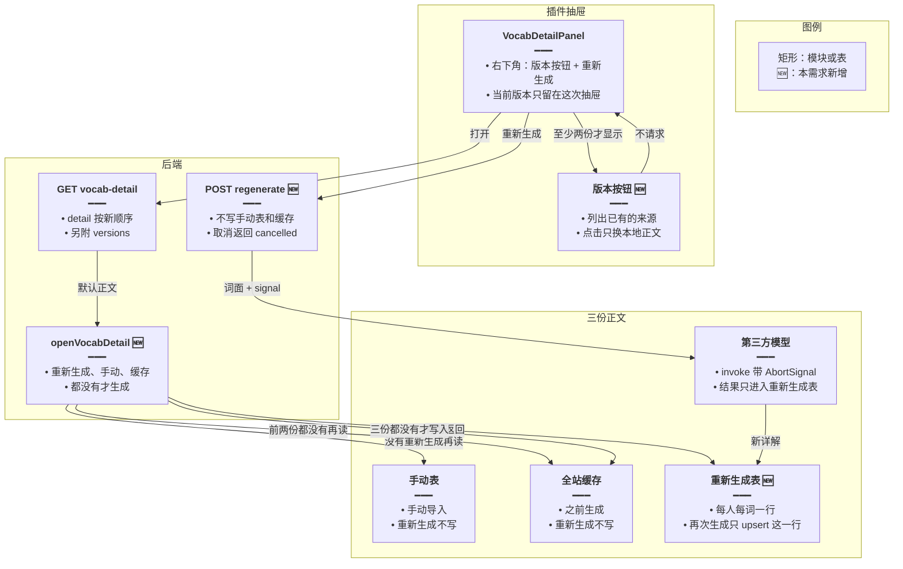
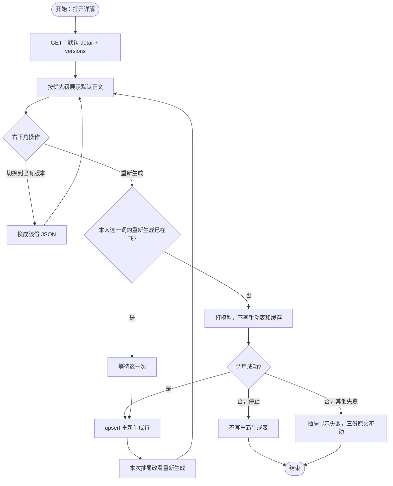
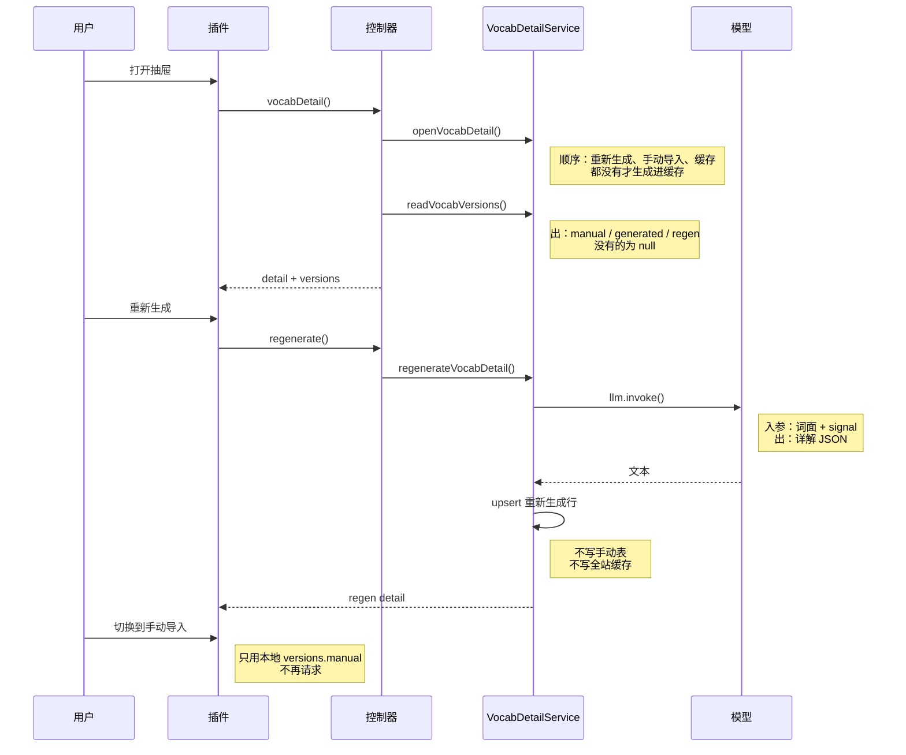
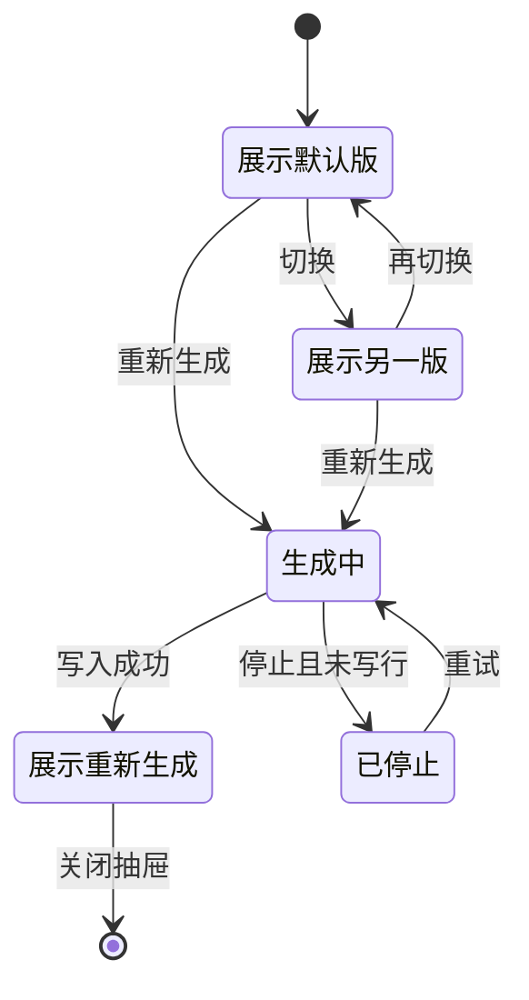

# 重新生成单词详解 — 实现思路

> **状态**：已落地（2026-11-13）。实现细节与逐行代码见 [单词详解缓存与抽屉.md](../../english/单词详解缓存与抽屉.md) §4.7。
> **日期**：2026-11-11
> **需求摘要**：详解抽屉右下角可以再打一次模型，并在「手动导入 / 之前生成 / 重新生成」之间切换；原有详解保持不动，再次重新生成只替换上一份重新生成的内容。
> **一句话方案（预告）**：新增每人每词一行的重新生成表；这次模型结果只 upsert 该行。打开按「重新生成 → 手动导入 → 全站缓存」返回，三份都没有才打模型并写入缓存。抽屉用同一份响应里的三个可选正文做切换。

## 延伸阅读

- [单词详解插件](./单词详解插件.md)：打开详解、全站缓存、抽屉与插件边界
- [手动导入单词详解](./手动导入单词详解.md)：手动行优先于全站缓存，导入不改全站缓存

---

## 0. 读本文你将得到什么

- 重新生成不能盖掉手动导入，也不能盖掉这个词已经生成过的全站详解。
- 选定做法：每人每词只留一行「重新生成」。打开先返回这一行，没有才返回手动导入，再没有才返回缓存；三份都没有才生成。右下角可切换到另外两份。
- 改动在插件抽屉、详解接口、一张新表。手动表和全站缓存表的写入路径不变。
- 分三阶段：新表与强制生成、右下角切换和重新生成、再次生成与停止的验收。
- 最大风险是重新生成误走现有的 `generateAndStore`，从而 upsert 全站缓存，把「之前生成」冲掉。

---

## 1. 需求与边界

### 1.1 用户故事

| 角色 | 场景 | 行为 | 期望结果 |
|------|------|------|----------|
| 已登录用户 | 抽屉里已有详解 | 点右下角「重新生成」 | 再打一次模型；这一次抽屉显示新内容 |
| 已登录用户 | 同时存在手动导入、全站已生成、重新生成 | 点右下角版本按钮 | 只换正文，不再打模型 |
| 已登录用户 | 已经有一份重新生成 | 再点「重新生成」 | 只替换上一份重新生成；手动导入和之前生成的正文不变 |
| 已登录用户 | 关掉抽屉再打开 | 不点切换 | 有重新生成就看重新生成；没有则看手动导入；再没有则看全站缓存 |
| 其他用户 | 别人对同一个词重新生成 | 自己打开 | 看不到别人的重新生成；自己的手动行和全站缓存不变 |
| 已登录用户 | 重新生成进行中 | 点「停止生成」 | 上游调用中断，不新增、不修改重新生成行 |

### 1.2 范围

| 在范围内 | 不在范围内（非目标） |
|----------|----------------------|
| 右下角「重新生成」和版本切换 | 保留每一次重新生成，做成历史列表 |
| 三个来源：手动导入、之前生成（全站缓存）、最新一次重新生成 | 记住上次在抽屉里点的那一版。下次打开只按固定优先级，不按上次点击 |
| 再次重新生成只覆盖本人的重新生成行 | 把重新生成同步给其他用户 |
| 中英文案；生成中沿用现有停止 | 词库级全部重新生成；撤销旧导入 |

### 1.3 约束与依赖

- 须登录。模型仍用 `createLlm` 的 `englishLearning` 预设。
- 打开顺序改为：该用户的重新生成，其次该用户的手动导入，再次全站缓存。三份都没有才走现有的 `generateAndStore`，结果写入全站缓存，不写入重新生成表。
- 重新生成必须能被现有停止断开上游 HTTP。停止只作用于这一次重新生成，不把全站正在进行的首次生成一起取消。
- 某个来源没有正文时，切换里不出现它。只有一个来源时不显示切换按钮。

---

## 2. 背景

- 用户要在详解抽屉右下角再生成一次，并在手动导入、之前生成、重新生成之间换着看。
- 现在一个词只有两个落点。`english_vocab_detail_manual` 按 `(userId, lemma)` 存该用户的导入。`english_vocab_detail_cache` 按 `cacheKey` 存全站一份。`generateAndStore` 成功后会 upsert 全站缓存。`importManualDetails` 会 upsert 该用户的手动行。
- 今天的打开只要手动行存在就直接返回，不会读缓存，也没有第三份可返回。有重新生成时，用户仍会先看到导入或缓存。
- 再次点击重新生成时，要换掉的是上一份重新生成，不是导入，也不是全站那份已经生成的详解。
- 硬约束：默认正文按「重新生成、手动导入、全站缓存」取值；三者都没有才打模型，并且这次只写入全站缓存。其他用户的手动行和重新生成行不能被这次生成改掉。没有的来源不要造一份空详情占位。

---

## 3. 现状与复用

| 能力 | 仓库中已有 | 本需求中的用法 |
|------|------------|----------------|
| 详解抽屉 | 插件仓 `micro-apps/dnhyxc-ai-plugins/src/views/vocab-detail/panel.tsx` | 扩展：右下角重新生成，以及有两份以上正文时的版本按钮 |
| 打开详解 | `GET /api/english-learning/vocab-detail`，`getOrCreateVocabDetail` 先手动行、再缓存、最后才生成 | 扩展：默认 `detail` 改为先重新生成，再手动行，再缓存；三份都没有才生成。响应另附三个可选正文 |
| 手动行 | `EnglishVocabDetailManual`，`readManual`，唯一键 `userId + lemma` | 直接复用为「手动导入」。重新生成不写这张表 |
| 全站缓存 | `EnglishVocabDetailCache`，`generateAndStore` 按 `cacheKey` upsert | 直接复用为「之前生成」。重新生成不调用这次 upsert |
| 停止上游调用 | `POST .../vocab-detail/cancel`，`vocabRuns` + `llm.invoke(..., { signal })` | 扩展：重新生成使用带用户 id 的 run key，停止只 abort 这一把 |
| 导入覆盖 | `importManualDetails` 对同一用户同一词 upsert | 直接复用：以后再导入仍只覆盖手动行 |
| 按钮与文案 | 插件 `@ui/button`，`src/i18n/locales/zh-CN.ts`、`en-US.ts` | 直接复用按钮，新增版本和重新生成的文案键 |
| 宿主 HTTP | 插件 `api.ts` 的 `http.get` / `http.post` | 直接复用 |

**调研结论**：手动行和全站缓存都是「一份词一份正文」，打开先返回手动行。重新生成需要第三份，而且这份是每人自己的，再生成一次只替换它。默认正文要先读这一份，没有才落到今天的手动行和缓存。全站缓存的 `findOne` 可以读出「之前生成」；只有三份都不存在时才走 `generateAndStore`。切换所需的另外两份要在同一次响应里带上，避免再打模型。

---

## 4. 方案比对与最终方案

### 4.1 候选方案

#### 方案 A：新增每人每词一行的重新生成表（新表，手动表和缓存表只读）

- **做法**：新实体 `EnglishVocabDetailRegen`，表 `english_vocab_detail_regen`，唯一键 `(userId, lemma)`，`detail` 为 JSON。`POST vocab-detail/regenerate` 打模型后只 upsert 这张表。`GET vocab-detail` 先读重新生成行，没有再读手动行，再没有再 `findOne` 缓存；三份都没有才 `generateAndStore` 写入缓存。响应同时带上三份已有正文。插件用右下角按钮在已有来源之间切换。
- **能工作的原因**：三份正文分属三张表。再次重新生成的冲突键只有重新生成表。下次打开先命中这一行，所以默认就是重新生成；没有这一行时才回到手动导入和缓存。
- **主要代价**：多一张表和一次打开后的读取。抽屉要能放下两到三份 JSON。

#### 方案 B：在手动表加一列存放重新生成（改现有表，不新增表）

- **做法**：`english_vocab_detail_manual` 增加可空列 `regenDetail`。有手动行时只更新这一列。没有手动行时插入一行，`detail` 为空、`regenDetail` 为新内容。`readManual` 改成忽略 `detail` 为空的行，否则打开会把重新生成当成导入。
- **能工作的原因**：再次 upsert 同一行的 `regenDetail` 会换掉上一份重新生成，`detail` 列仍是导入。全站缓存不写。
- **主要代价**：没导入过的用户也会在「手动表」里出现一行。导入、按库清除、打开三条路径都要分辨「这行是导入还是仅仅为了放重新生成」。

#### 方案 C：按次追加历史，切换列出每一次生成（新表，一行一次）

- **做法**：重新生成表不设唯一词约束，每次插入新行。切换菜单列出手动导入、全站缓存，以及该用户每一次重新生成。
- **能工作的原因**：旧的重新生成都还在，可以逐次查看。
- **主要代价**：和「再次点击只覆盖上次重新生成」相反。菜单会随点击变长，还要另做「只留最新一行」的删除，才符合这次需求。

### 4.2 比对

| 维度 | 方案 A | 方案 B | 方案 C |
|------|--------|--------|--------|
| 正确性（失败路径、边界、数据是否会错） | 三份正文不会写错表。停止则不插入重新生成行。没导入的用户不会得到一条假手动行 | 列分得对时原文还在。`readManual` 只要漏掉空 `detail`，打开就会把重新生成显示成导入 | 旧的重新生成都保留，超出「只留最新一份」。不额外删除的话，切换结果和需求不一致 |
| 复用 / 与现状契合 | `readManual`、缓存 `findOne`、导入 upsert 都保留。打开在这三读前面加一次重新生成表。新表的列与手动表相同 | 复用手动表的唯一键。打开、导入、清除都要改条件 | 打开可以先读最新一行。列表和清理是新的一套 |
| 改动面（要动哪些路径） | 新实体、迁移、一个 POST、GET 多三读、插件按钮 | 改手动实体和所有按该表读写的路径 | 新表无唯一词约束，再加列表查询和覆盖时的删除 |
| 复杂度（新概念、新状态、新依赖） | 一个新槽位：每人每词最新一次重新生成 | 同一行两种含义，靠空 `detail` 区分 | 历史列表。还要定义「覆盖」是删旧行还是再插一行 |
| 体验（延迟、步骤数、失败时用户看到什么） | 打开多三次按键查询。切换不再请求。再次生成只打一次模型 | 打开查询次数相近。表含义变了之后，清除手动详解会连重新生成一起消失 | 切换项越来越多。用户要自己找「最新一次」 |
| 风险（迁移、互斥、并发、回滚） | 一张新表，回滚时卸掉读取即可，旧两表无数据迁移 | 迁移在已有手动表上加列。回滚要确认没有业务把空 `detail` 当成导入 | 行数随点击增长。覆盖语义要额外删行，删错会丢掉用户还想看的一版 |
| 可维护性（以后改一处还是改多处） | 打开优先级只在一处：重新生成、手动、缓存、生成。覆盖只在新表的 upsert | 以后每改手动表都要记得 `regenDetail` 和空行 | 展示、覆盖、清除三处都要按「只留最新」过滤 |

### 4.3 综合考量

高权重是三份正文互不覆盖，再次生成只动「重新生成」这一份，并且打开先返回这一份。方案 A 用一张和手动表同形的新表把这个槽位分开，导入判断不用改，打开只是在原顺序前多读这张表。方案 B 少一张表，但手动表会混进「没有导入、只有重新生成」的行，打开和清除都会被牵动；这是它少迁移的优点，不抵「表的含义被改掉」的成本。方案 C 能翻看每一次生成，需求明确不要这份历史。放弃方案 B 少一张表，也放弃方案 C 能回看更早一次重新生成。

### 4.4 最终方案

#### 背景

一个词的已保存详解只有手动行和全站缓存。再打一次模型时，这两处都还要留着给切换用。再次点击要替换的是上一份重新生成，不是这两处原文。

#### 具体思路

1. 插件负责右下角两个动作：重新生成、在已有版本间切换。生成和三份读取仍在 `VocabDetailService`。
2. 数据流：重新生成 → 模型 → 只 upsert `english_vocab_detail_regen`。打开先读这张表，没有再读手动表，再没有再读缓存；三份都没有才 `generateAndStore`。切换不发请求，只换插件已经拿到的三份 JSON。
3. 默认 `source` 由这个固定顺序决定，不由抽屉里上次点的版本决定。用户点过的版本只放在这次抽屉的 `useState`，关闭即丢。下次打开重新按「重新生成、手动导入、缓存」取值。
4. 重新生成的在途任务按 `userId + lemma` 分开，不加入全站缓存那条可能返回旧缓存的 Promise，也不拿那把会把结果写进缓存的锁。

#### 实现方案

**一句话**：新增每人每词一行的重新生成表；这次模型结果只 upsert 该行。打开按「重新生成 → 手动导入 → 全站缓存」返回，三份都没有才打模型并写入缓存。抽屉用同一份响应里的三个可选正文做切换。

| 步骤 | 谁 | 做什么 | 输入 → 输出 |
|------|----|--------|-------------|
| 1 | 插件 `panel.tsx` | 有详解时显示「重新生成」。至少两份正文时，旁边显示当前版本名，点开后列出已有来源 | 本地三份 JSON → 当前展示的一份 |
| 2 | `GET vocab-detail` | 按重新生成、手动导入、缓存取值；都没有才生成进缓存。响应带上三份已有正文 | `word` → `{ detail, source, versions, ipa, pos }` |
| 3 | `POST vocab-detail/regenerate` | 打模型，只写重新生成表 | `word` → `{ detail }` 或 `{ cancelled: true }` |
| 4 | 再次 POST | 同一唯一键 upsert | 上一份重新生成被替换；另外两表行数和正文不变 |
| 5 | 下次 GET | 重新按同一顺序取默认正文 | 有重新生成 → `source: regen`；否则有手动行 → `manual`；否则 `generated` |

`versions` 的形状：

| 字段 | 有值的条件 | 切换文案 |
|------|------------|----------|
| `manual` | 该用户该词有手动行 | 手动导入 |
| `generated` | 全站缓存有该词 | 之前生成 |
| `regen` | 该用户该词有重新生成行 | 重新生成 |

`source` 是 `regen`、`manual`、`generated` 之一，表示这次打开默认展示哪一份。有重新生成行时就是 `regen`。三份都没有、当场生成进缓存时是 `generated`。抽屉里再点别的版本只改本地状态，不写回 `source`。

#### 选定原因

1. **正确性**：新结果只进入重新生成表，停止时这张表不写。有重新生成时打开直接返回它，不会落到手动行或缓存，也不会再打模型。牺牲：三份都要先查过，才能确定要不要生成。
2. **复用**：`readManual`、缓存 `findOne` 和 `generateAndStore` 都还在，只是生成被放到三次未命中之后。导入仍只 upsert 手动行。牺牲：多一张与手动表同形的表，而不是在手动表上加列。
3. **改动面**：手动表、清除导入、全站缓存写入都不改。牺牲：GET 响应多三个可选字段，插件要识别 `versions`。
4. **复杂度**：槽位固定为三，没有历史列表。牺牲：看不回更早一次重新生成。
5. **体验**：切换用已经返回的 JSON，不再等待。右下角先是版本名，再是重新生成；生成中版本按钮禁用，重新生成换成停止。牺牲：只有一份正文时不显示版本按钮，用户看不到一个空菜单。
6. **风险**：迁移只建新表。牺牲：上线后若要改回「写进缓存」，已经产生的重新生成行要另做搬迁。
7. **可维护性**：打开顺序只在 `openVocabDetail` 这一处；覆盖规则只在新表的 `(userId, lemma)` upsert。牺牲：停止的 run key 要带上用户，不能继续只用全站 `cacheKey`。

#### 优势

- 相对方案 B：没导入过的用户不会在手动表里多出一行空导入，按库清除手动详解也不会把重新生成一起删掉。
- 相对方案 C：再次生成就是替换最新一行，切换里始终最多三项，不用再删历史。

#### 怎么实现

1. 抽屉内容区右下角放版本按钮和「重新生成」。版本按钮的文案是当前来源。点开只列出 `versions` 里非空的项，点击后 `setSource`，不请求接口。
2. 控制器调用 `openVocabDetail`，不再用「先手动行」的 `getOrCreateVocabDetail` 当默认正文。`detail` 仍是插件今天读取的那一个字段，只是内容按新顺序选出。
3. `regenerateVocabDetail` 用 `regen:${userId}:${cacheKey}` 登记 `AbortSignal`，调用与 `generateAndStore` 相同的 `createLlm` 和 `llm.invoke`，成功后只 `regenRepo.upsert`。
4. 再次点击走同一个 upsert。不要先删行再插入。
5. `cancelVocabDetail` 增加查询 `scope=regen`。重新生成过程中的停止只 abort 该用户的 regen key。三份都没有、正在写入缓存的那次停止，仍 abort 原来的 `cacheKey`。

### 4.5 其他关键决策

#### 决策：三份正文随打开接口一次返回，还是切换时再请求

##### 候选

###### 做法 1：GET 在默认详解之外带上 `versions`

- **做法**：`vocabDetail` 调用 `openVocabDetail`：先读三份，按重新生成、手动导入、缓存选出 `detail`；三份都没有才生成进缓存。插件把三份存进状态。切换只改本地 `source`。
- **能工作的原因**：切换时三份都在内存里。默认 `detail` 仍是打开顺序的结果，旧解析逻辑还能用。
- **主要代价**：命中缓存时多三次索引读取。一份详解是一份 JSON，响应最多大约三倍。

###### 做法 2：切换时按来源再 GET 一次

- **做法**：打开响应只增加有哪些来源的布尔值。点某一版再请求 `?source=manual|generated|regen`。
- **能工作的原因**：打开响应更小。没点过的正文不会传下来。
- **主要代价**：每次切换一次往返。重新生成刚写完又切回「之前生成」时，还要再读一遍缓存。

##### 比对

| 维度 | 做法 1 | 做法 2 |
|------|--------|--------|
| 正确性 | 三份和默认详解同一次读完，切换不会拿到另一时刻的新导入 | 切换时若别人刚改了导入，会看到更新的手动行。抽屉里两份可能不是同一时刻 |
| 复用 | 仍是这一个 GET。插件多读 `versions` | 要再约定一个带 `source` 的 GET |
| 改动面 | 控制器组装一次响应 | 控制器多一个查询分支，插件每次切换都请求 |
| 复杂度 | 一个响应形状 | 打开和切换两条读取 |
| 体验 | 切换即时 | 每次切换都有等待 |
| 风险 | 响应变大，详解 JSON 本身已是这一接口的主体 | 生成中和切换的请求容易叠在一起 |
| 可维护性 | 来源集合只在 `readVocabVersions` | 两处都要维持「没有的来源不返回正文」 |

##### 综合考量

切换是这个需求的主要操作，等待不合适。三份 JSON 相对一次模型调用可以忽略。做法 2 的响应更小，放弃这一点。

##### 最终方案

**背景**：切换要在手动导入、之前生成、重新生成之间换正文，而且不能再打模型。

**具体思路**：打开时一次读齐。抽屉状态保存 `versions` 和当前 `source`。重新生成成功只替换本地的 `versions.regen`，并把 `source` 设为 `regen`。

**实现方案**：GET 返回 `{ detail, source, versions, ipa, pos }`。`versions` 缺的键不传，或显式为 `null`，插件两种都当成没有这一版。

**选定原因**：体验上切换不再请求。牺牲：打开响应最多带上三份详解。

**优势**：相对做法 2，切回去时仍是打开那一刻的原文，不会在同一次查看里混进后来的导入。

**怎么实现**：见 §9.2 的 `openVocabDetail`。默认展示按下一决策的固定顺序，不记上次点击。

#### 决策：打开时默认返回哪一份

##### 候选

###### 做法 1：固定顺序，重新生成优先

- **做法**：`openVocabDetail` 先读该用户的重新生成行，没有再读手动行，再没有再 `findOne` 缓存。三份都没有才 `generateAndStore`，写入全站缓存，`source` 为 `generated`。抽屉里切换只改本次状态。
- **能工作的原因**：有重新生成时，这次和下次打开的 `detail` 都是它。没有这一行时，仍先看到手动导入，再看到缓存。三份原文分表存放，生成不会覆盖它们。
- **主要代价**：在抽屉里改看手动导入后，关掉再开如果重新生成还在，首屏会回到重新生成，而不是停在手动导入。

###### 做法 2：记住抽屉里上次点的版本

- **做法**：表上增加 `lastSource`，或用 `localStorage` 按词记住。下次打开按上次点击返回；该来源已被删掉时再回退到做法 1 的顺序。
- **能工作的原因**：切到手动导入后，关掉再开仍是手动导入。
- **主要代价**：多一个偏好字段。默认不再稳定为「有重新生成就看重新生成」，换浏览器还会和本地记录不一致。

##### 比对

| 维度 | 做法 1 | 做法 2 |
|------|--------|--------|
| 正确性 | 有重新生成就返回它，然后才是手动导入和缓存。三份都没有才生成进缓存 | 上次点的来源还在时能对上。来源被删后必须再回退，否则会返回空 |
| 复用 | 三次读取都用现有查询，生成仍用 `generateAndStore` | 打开要先读偏好，再读三份 |
| 改动面 | 只改打开函数的判断顺序 | 新列或每个客户端一份本地键 |
| 复杂度 | 无新状态。顺序是四步 | 多一个「当前偏好」，还要处理偏好失效 |
| 体验 | 再开一次直接是重新生成。要看导入或缓存再点切换 | 再开一次停在上次那一版，包括手动切走之后 |
| 风险 | 无迁移。切走后再打开会被优先级拉回重新生成 | 本地与服务端两套记忆会分叉 |
| 可维护性 | 默认版本只有这一处顺序 | 打开顺序和偏好两处都要讲得通 |

##### 综合考量

要求的是默认返回重新生成，而不是记住上次点击。做法 1 用固定顺序满足这一点，没有重新生成时也不会把手动导入和缓存的先后颠倒。做法 2 能让「切到导入后再打开仍看导入」，这是它多出来的能力；当前不需要，还会让默认结果随点击变化。放弃做法 2。

##### 最终方案

**背景**：今天的打开先返回手动行。有重新生成之后，用户要求先看到重新生成，其次才是手动导入和缓存；三份都没有才打模型。

**具体思路**：服务端不存「上次看的是哪一版」。每次 GET 都按同一顺序挑 `detail`，并把三份放进 `versions`。插件初次渲染用响应里的 `source`。

**实现方案**：顺序是 `regen`、`manual`、`generated`。前三步只查询。第四步才 `generateAndStore`，写入的是全站缓存，不插入重新生成行。

**选定原因**：正确性上默认正文就是重新生成（若存在）。牺牲：本次抽屉里若改看了手动导入，下次打开仍会回到重新生成。

**优势**：相对做法 2，不增加偏好字段，也不会出现「这个浏览器停在导入、另一个浏览器停在重新生成」。

**怎么实现**：见 §9.2 的 `openVocabDetail`。没有其他会再改表结构的决策。

---

## 5. 架构图



**图内方法说明**：

| 方法 / 模块入口 | 功能 |
|-----------------|------|
| `openVocabDetail(word, userId)` | 决定默认正文：先重新生成，再手动导入，再全站缓存；三份都没有才生成并写入缓存 |
| `readVocabVersions(userId, lemma)` | 只查询三份已有正文，供版本按钮使用；不在这里打模型 |
| `regenerateVocabDetail(word, userId)` | 再打一次模型，只把结果 upsert 到该用户该词的重新生成行 |
| `llm.invoke(messages, { signal })` | 请求第三方模型；abort 时断开上游 HTTP，调用方不写重新生成表 |

**读图要点**：

- 版本按钮没有指向后端。能切换的正文来自打开那一次响应，加上后来重新生成写回的那一份。
- 重新生成按钮的模型结果只写新表。打开在三份都没有时才会写全站缓存，那一份是「之前生成」。
- 有重新生成行时，打开在第一跳就返回，不会为了默认正文再打模型。

---

## 6. 主流程图



**图内方法说明**：

| 方法 | 功能 |
|------|------|
| `readVocabVersions(userId, lemma)` | 对应打开时的 `versions`：只带回已经存在的手动导入、全站缓存和重新生成 |
| `regenerateVocabDetail(word, userId)` | 没有在飞任务时打模型；已有任务则等待同一次结果 |
| `regenRepo.upsert(...)` | 对应「upsert 重新生成行」：按 `(userId, lemma)` 替换上一份重新生成 |

**读图要点**：

- 切换从展示回到展示，不经过模型。
- 停止和失败都在 upsert 之前结束，所以不会出现半份新详解，也不会改掉另外两份。
- 再次点击重新生成仍走这条生成分支，写的是同一行。

---

## 7. 核心时序图



**图内方法说明**：

| 方法 | 功能 |
|------|------|
| `vocabDetail()` | 打开抽屉的 GET。返回默认正文、`source` 和三份可选正文 |
| `openVocabDetail()` | 按重新生成、手动导入、缓存选出默认正文。三份都没有才打模型并写入全站缓存 |
| `readVocabVersions()` | 读取三份已有正文，供版本按钮决定显示哪些项 |
| `regenerate()` | 插件发起重新生成。成功后本地改看 `regen`，并更新 `versions.regen` |
| `regenerateVocabDetail()` | 编排本次模型调用和重新生成表的 upsert |
| `llm.invoke()` | 请求第三方模型。中断时不执行后面的 upsert |
| `upsert` 重新生成行 | 按该用户该词替换最新一次重新生成 |

**读图要点**：

- 打开和重新生成是两次请求。切换不是第三次请求。
- 模型文本只进入重新生成表。时序里没有指向手动表或全站缓存的写操作。
- 切到手动导入用的是打开时已经返回的 `versions.manual`。首屏在有重新生成时不是这一份。

---

## 8. 状态机



**图内方法说明**：

| 方法 | 功能 |
|------|------|
| `setSource(source)` | 「切换」：在已加载的三份正文中改当前展示，不访问模型 |
| `regenerateVocabDetail()` | 「重新生成」的服务端入口。成功后抽屉进入「展示重新生成」 |
| `cancelVocabDetail()` | 「停止且未写行」：只 abort 该用户这次重新生成的信号 |

**读图要点**：

- 「展示默认版」是这次打开按优先级选出的那一份。有重新生成时，它就是重新生成。
- 关闭后再打开会重新走优先级。重新生成行还在时，首屏再次是重新生成，而不是停在关闭前切换到的那一版。

---

## 9. 具体实现（主链路代码）

### 9.1 模块一览

| 模块 | 职责 | 新增/改动 | 预估路径 |
|------|------|-----------|----------|
| 重新生成实体 | 每人每词一行 | 新增 | `apps/backend/src/services/english-learning/entity/english-vocab-detail-regen.entity.ts` |
| 迁移 | 建表与唯一索引 | 新增 | `apps/backend/src/migrations/` 下一支，列与手动表相同 |
| 模块注册 | 把新实体交给 TypeORM | 扩展 | `apps/backend/src/services/english-learning/english-learning.module.ts` |
| 详解服务 | 强制生成、三份读取、按用户停止 | 扩展 | `apps/backend/src/services/english-learning/vocab-detail.service.ts` |
| 控制器 | GET 附带版本；POST 重新生成 | 扩展 | `apps/backend/src/services/english-learning/english-learning.controller.ts` |
| 插件 | 版本按钮、重新生成、本地切换 | 扩展 | 插件仓 `micro-apps/dnhyxc-ai-plugins/src/views/vocab-detail/panel.tsx`、`api.ts`、`src/i18n/locales/zh-CN.ts`、`en-US.ts` |

### 9.2 主链路实现

```typescript
// 对应 §4.4 步骤 3～4。结果只进重新生成表，避免 generateAndStore 把全站缓存换成这一次
async regenerateVocabDetail(word: string, userId: number): Promise<VocabDetail> {
	// 与打开接口同一套词面，避免大小写不同各留一行
	const lemma = normalizeVocabLemma(word);
	// 没有词面就不应打模型
	if (!lemma) throw new BadRequestException('单词为空');
	// 超长词面不进入 run key，避免一条异常请求占住生成
	if (word.trim().length > 120) throw new BadRequestException('单词过长');
	// 带上用户，两个账号同时重新生成同一个词时各打各的模型
	const runKey = `regen:${userId}:${vocabDetailCacheKey(lemma)}`;
	// 只加入重新生成在途；全站在途可能返回缓存，不能当成这一次的新正文
	const pending = vocabDetailRegenInflight.get(runKey);
	// 已有在途时不再开第二次模型调用
	const detail = pending
		// 等同一份解析结果，避免连点打出两路
		? await pending
		// 没有在途才真正打模型；这个方法本身不写全站缓存
		: await this.generateRegen(lemma, userId, runKey);
	// 冲突键只有本人这一词，所以上一次重新生成被替换，手动行和缓存行碰不到
	await this.regenRepo.upsert(
		{
			// 其他用户的重新生成不在这次条件里
			userId,
			// 与 readManual 相同的规范化词面，切换和打开对得上同一个词
			lemma,
			// 版本与详解结构一致，旧结构不会被读出来
			schemaVersion: VOCAB_DETAIL_CACHE_VERSION,
			// 正文是这次解析结果，不再保留上一份重新生成
			detail,
		},
		['userId', 'lemma'],
	);
	// 本次抽屉直接展示这份，不必为了看到新内容再 GET
	return detail;
}
```

```typescript
// 对应 §4.4 步骤 2 和步骤 5。默认正文按固定顺序挑，不调用先返回手动行的 getOrCreateVocabDetail
async openVocabDetail(word: string, userId: number): Promise<VocabDetailOpen> {
	// 与重新生成同一套词面，三张表才能对上同一个词
	const lemma = normalizeVocabLemma(word);
	// 空词没有可返回的详解
	if (!lemma) throw new BadRequestException('单词为空');
	// 超长词面不进入缓存键，和现有打开上限一致
	if (word.trim().length > 120) throw new BadRequestException('单词过长');
	// 三份只查询。这里不生成，避免有重新生成时还去打模型
	const versions = await this.readVocabVersions(userId, lemma);
	// 第一优先：本人的重新生成。有则不再看手动导入和缓存
	if (versions.regen) {
		return { detail: versions.regen, source: 'regen', versions };
	}
	// 第二优先：手动导入。没有重新生成时才用它
	if (versions.manual) {
		return { detail: versions.manual, source: 'manual', versions };
	}
	// 第三优先：全站缓存，也就是之前生成的那一份
	if (versions.generated) {
		return { detail: versions.generated, source: 'generated', versions };
	}
	// 三份都没有才打模型。写入的是全站缓存，不插入重新生成行
	const detail = await this.generateAndStore(
		lemma,
		userId,
		vocabDetailCacheKey(lemma),
	);
	return {
		// 这次抽屉看到的是刚生成的缓存
		detail,
		// 来源是「之前生成」，不是「重新生成」
		source: 'generated',
		versions: {
			// 查询时没有手动行，生成过程也不会写入手动表
			manual: null,
			// 刚写入的缓存补进版本列表，切换里能看到「之前生成」
			generated: detail,
			// 没有点过重新生成，这一项保持空
			regen: null,
		},
	};
}
```

```typescript
// 对应 §4.5。三份都只查询；调用方在三份都空时才 generateAndStore
async readVocabVersions(userId: number, lemma: string): Promise<VocabVersions> {
	// 三份互不依赖，并行读；任一为空就表示切换里没有这一项
	const [manual, generated, regen] = await Promise.all([
		// 手动导入。没有行就是 null，不插占位
		this.readManual(userId, lemma),
		// 只 findOne 全站缓存。走 generateAndStore 会把「之前生成」写成新的一次模型结果
		this.findCachedDetail(lemma),
		// 本人最新一次重新生成。没有点过重新生成就是 null
		this.readRegen(userId, lemma),
	]);
	return {
		// 切换文案「手动导入」对应这一份
		manual,
		// 切换文案「之前生成」对应全站缓存，不是上一份重新生成
		generated,
		// 切换文案「重新生成」对应新表里的最新一行
		regen,
	};
}
```

```tsx
// 对应 §4.4 步骤 1。切换不发请求，所以原文和重新生成可以来回看
function onPickVersion(source: VersionSource) {
	// 缺正文的按钮不会渲染；这里再挡一次，避免状态指到空对象
	const next = versions[source];
	if (!next) return;
	// 只改当前抽屉看哪一份。下次打开仍按重新生成、手动导入、缓存决定，不记住这次点击
	setSource(source);
	// 正文换成这一份，音标和词性仍用打开时的 head，版本里没有这些字段
	setDetail(next);
}
```

### 9.3 数据模型

| 字段/实体 | 来源 | 存储 | 说明 |
|-----------|------|------|------|
| `detail` | 导入 | `english_vocab_detail_manual` | 重新生成不更新。再导入仍按现有 upsert 覆盖这一行 |
| `detail` | 首次生成或已有缓存 | `english_vocab_detail_cache` | 「之前生成」。重新生成不更新 |
| `detail` | 本次或上一次重新生成 | `english_vocab_detail_regen` | 唯一键 `(userId, lemma)`。再次生成覆盖该行 |
| `source` | 打开顺序 | 只在 GET 响应和抽屉状态 | 不入库。取值顺序是 `regen`、`manual`、`generated` |
| `regen:${userId}:${cacheKey}` | 这次模型调用的 `AbortSignal` | 进程内 `vocabRuns` | `scope=regen` 的停止只 abort 这一把 |

---

## 10. 分阶段实现步骤

| 阶段 | 目标 | 交付物 | 依赖 |
|------|------|--------|------|
| M1 | 重新生成只写入新表，打开能带回三份 | 实体、迁移、POST、GET 的 `versions` | 现有生成和两张详解表 |
| M2 | 右下角可以生成并切换 | 插件按钮与文案 | M1 |
| M3 | 再次生成、停止、他人数据都不串 | 验收记录 | M2 |

### M1

- [ ] 新增 `english_vocab_detail_regen`，唯一索引 `(user_id, lemma)`，并注册到 `TypeOrmModule.forFeature`。
- [ ] `generateRegen` 复用 `createLlm` 与 `llm.invoke` 的 `signal`，成功路径不调用缓存 `upsert`。
- [ ] `openVocabDetail` 按重新生成、手动导入、缓存返回；三份都没有才 `generateAndStore`。响应带 `source` 和 `versions`。

### M2

- [ ] 右下角「重新生成」。至少两个非空版本时显示版本按钮，项为「手动导入 / 之前生成 / 重新生成」中实际存在的那些。
- [ ] 点版本只调用本地 `onPickVersion`。生成中禁用版本按钮，重新生成按钮换成停止。
- [ ] 停止请求带 `scope=regen`。

### M3

- [ ] 对已有重新生成的词再点一次，只比较三张表：新表变化，手动表和缓存表的 `detail` 不变。
- [ ] 停止后新表无插入或仍是上一份。
- [ ] 用户 B 打开同一词，看不到用户 A 的重新生成。

---

## 11. 风险、边界与待确认

| 项 | 等级 | 说明 | 缓解 |
|----|------|------|------|
| 误走 `generateAndStore` | 高 | 那条路径会 upsert 全站缓存，「之前生成」就没了 | 重新生成单独方法，代码评审看写入仓库是不是只有 `regenRepo` |
| 清除本库手动详解 | 低 | 现有删除只动手动表。清除后切换里不再有「手动导入」，重新生成还在 | 不在这次删除里加新表 |
| 再导入同一词 | 低 | 导入 upsert 手动行，不碰重新生成 | 与今天的导入范围一致 |
| 两路模型 | 低 | 全站首次生成未结束时，该用户又点重新生成，会各打一次模型 | 不取消别人的首次生成；重新生成不加入那条 Promise |
| 只有重新生成、没有另外两份 | 低 | 不显示版本按钮。打开直接返回重新生成，不再因为没有缓存去打模型 | 手动行和缓存仍是空的，切换里没有这两项 |

**待确认**：

- [ ] 无。版本名称按「手动导入 / 之前生成 / 重新生成」理解。若产品要把「之前生成」写成「模型生成」，只改文案键，不改三张表的分工。验证方式：三份都存在时，菜单文字与上表一致。

---

## 12. 验收清单

| # | 用例 | 步骤 | 期望 |
|---|------|------|------|
| AC1 | 三份都能看 | 该用户有手动导入，全站也有缓存，再点重新生成 | 右下角可切到三份。手动表和缓存表的 JSON 与点击前一致 |
| AC2 | 再次生成只覆盖新表 | 在 AC1 之后再点一次重新生成 | 抽屉换成更新的一份。重新生成行被替换。另外两表仍与 AC1 之前一致 |
| AC3 | 下次打开默认是重新生成 | AC2 后关闭再打开 | 首屏是 AC2 的重新生成。切到「手动导入」或「之前生成」仍是点击重新生成之前的那两份 |
| AC4 | 没有的来源不出现 | 只有全站缓存、没有手动行时重新生成 | 菜单只有「之前生成」和「重新生成」 |
| AC5 | 停止不写行 | 第一次重新生成过程中点停止 | 上游中断。重新生成表没有新行。抽屉可重试 |
| AC6 | 不串用户 | 用户 A 重新生成后，用户 B 打开同一词 | B 的菜单没有 A 的重新生成。B 的手动行不变 |

---

## 13. 预估改动面（实现阶段参考）

| 类型 | 路径（预估） |
|------|----------------|
| 后端 | `entity/english-vocab-detail-regen.entity.ts`、`migrations/` 新迁移、`english-learning.module.ts`、`vocab-detail.service.ts`、`english-learning.controller.ts` |
| 插件 | `micro-apps/dnhyxc-ai-plugins/src/views/vocab-detail/panel.tsx`、`api.ts`、`src/i18n/locales/zh-CN.ts`、`en-US.ts` |
| 文档（实现后） | `/Users/dnhyxc/Documents/code/micro-apps/remote-docs/wiki/english/` 下的详解专题，不在本规划落地时写 |

---

（本文档为规划态实现思路；落地后以源码与 remote-docs wiki 专题为准）
