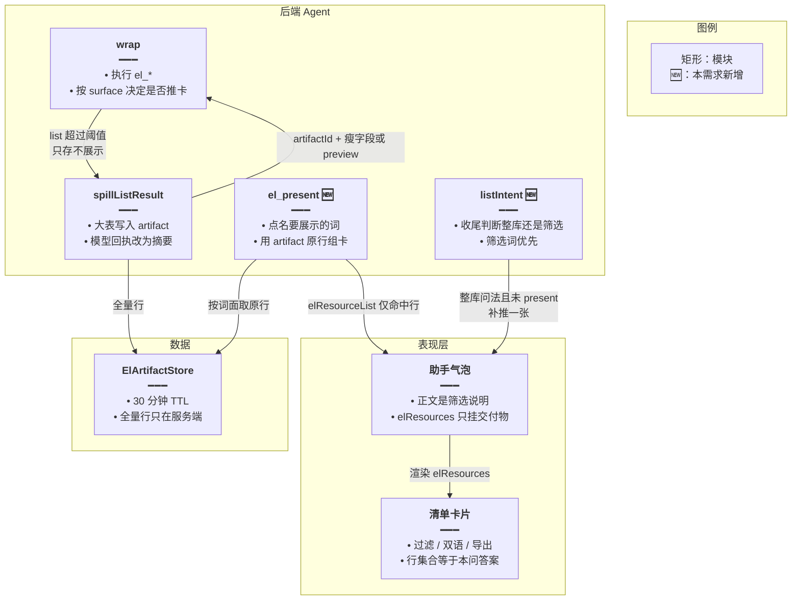
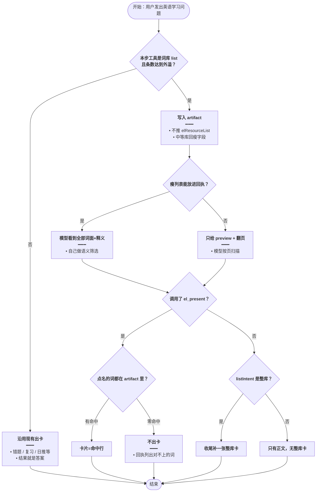
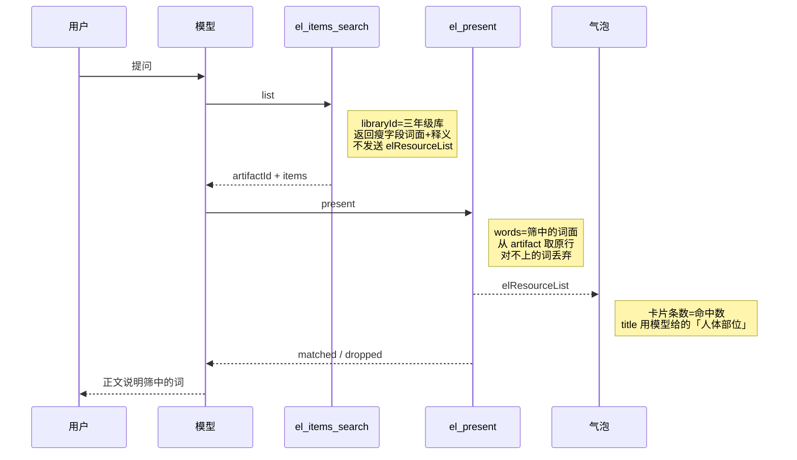
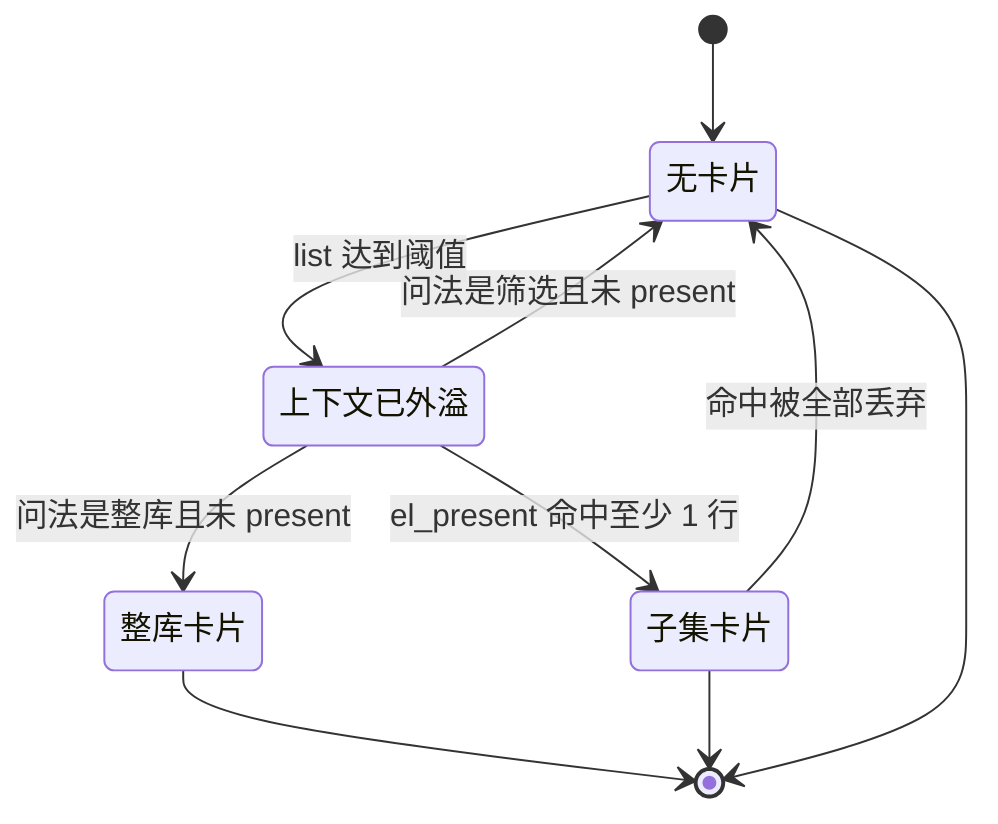

# 问答清单按需出卡 — 实现思路

> **状态**：规划（未实现；旁路卡片与 artifact 已有，本篇只改「何时给用户看」）  
> **日期**：2026-10-26  
> **需求摘要**：用户问「从某词库筛出人体部位」时，气泡下只出现筛中的词；只有用户要整份清单时才给出整库卡片。

## 延伸阅读

- [Agent大结果旁路展示.md](./Agent大结果旁路展示.md) — 大 list 外溢成卡片、模型只看摘要；本篇不推翻旁路，只把「外溢」和「给用户看」拆开
- [英语Agent关联侧栏.md](./英语Agent关联侧栏.md) — `el_*` 工具地图
- 业界：Anthropic 工具结果只回高信号字段（[Semantic Tool Output](https://www.agentpatterns.ai/tool-engineering/semantic-tool-output/)）；MCP Apps 规定检索给模型、UI 只在结果本身就是交付物时渲染（[MCP Apps 2026](https://mcp.directory/blog/mcp-apps-spec-2026-when-should-your-server-render-ui)）；工具轨迹与「这份结果就是答案」分开展示（[aparté tool-call UI](https://apartejs.dev/guides/tool-call-ui/)）

---

## 0. 读本文你将得到什么

- 问题：词库 `list` 一超过 30 条就 `onResourceList`，筛选题结尾也会挂上整库卡片。
- 一句话方案：旁路继续收起大表；用户卡片只展示本问的交付物，由 `el_present` 从已拉到的词里点名，或在用户明确要整份清单时收尾补一张。
- 改动层：后端 spill 与新工具、提示词；前端卡片组件不改协议。
- 阶段：M1 停掉 list 自动出卡并让模型看见瘦字段 → M2 `el_present` 落地筛选卡 → M3 整库问法兜底与极端截断。
- 最大风险：模型不调用 `el_present`，筛选题就没有卡片（正文仍在）；这比挂错整库可接受。

---

## 1. 需求与边界

### 1.1 用户故事

| 角色 | 场景 | 行为 | 期望结果 |
|------|------|------|----------|
| 学习者 | 「三年级词库里有哪些人体部位」 | 检索失败后模型拉全库再筛选 | 正文是筛中的词；卡片只有这些词，不是 107 条全库 |
| 学习者 | 「把这个词库全部列出来 / 导出」 | 拉全库 | 卡片是整库（硬顶内），可过滤、双语、导出 |
| 学习者 | 「我的错题 / 今日复习队列有哪些」 | 调用对应 list | 卡片就是这份队列，行为与现在一致 |
| 学习者 | 词库有 2000+ 条，问一个小类 | 全量放不进上下文 | 不挂整库卡；模型分页扫描后再 `el_present` 筛中项 |

### 1.2 范围

| 在范围内 | 不在范围内（非目标） |
|----------|----------------------|
| `el_items_search` 的 `list` 不再自动出用户卡片 | 重做清单 UI（过滤 / 双语 / 导出按钮保持） |
| 新增 `el_present`：只展示已出现在本轮工具结果里的行 | 用向量检索代替模型做「人体部位」语义分类 |
| 收尾时仅对「要整份清单」的问法兜底一张整库卡 | 修改收藏 / 错题 / 复习 / 日推 list 的出卡规则 |
| 卡片行的英文与释义以工具原件为准，丢掉模型编造的词 | 修复「检索接口报错」本身（另案；本方案不依赖搜索成功） |

### 1.3 约束与依赖

- 复用 `spillListResult`、`ElArtifactStore`（TTL 30 分钟）、SSE `elResourceList`、消息上的 `elResources`。
- 本轮 `el_*` 调用上限 10 次；`el_present` 最多再占 1 次。
- 模型输出约 4k token，禁止把整库再写进正文；筛选结果本身可以写，因为行数远小于整库。
- 卡片词条必须能在本轮 artifact 里对上，避免模型凭年级常识编词。

---

## 2. 方案总览（一句话 + 要点）

**一句话方案**：大 list 仍外溢成 artifact 供核对，但默认不推给气泡；用户看到的卡片只来自 `el_present` 点名的子集，或用户明确要整库时的收尾兜底。

| # | 设计要点 | 理由 |
|---|----------|------|
| 1 | 外溢（给模型减负）和出卡（给用户看）分成两步 | 现在 `wrap` 里一旦 `shouldSpill` 就 `onResourceList(full)`，筛选题被绑上原材料 |
| 2 | 107 条这类中等库把瘦字段（词面 + 释义）留在工具回执里 | 只给 5 条 preview 时，模型看不见 ear/hand，筛出来的词对不上一张它没读过的卡 |
| 3 | `el_present` 用 artifact 里的原行组卡 | 释义、音标不由模型重写；对不上的词丢弃并回执给模型 |
| 4 | 问法里「筛 / 找出 / 相关」压过「列出」 | 「列出其中的人体部位」不能当成整库导出 |
| 5 | 收藏、错题、复习队列、日推 list 仍自动出卡 | 这些调用的结果就是用户要的那份清单 |

---

## 3. 现状与复用

| 能力 | 仓库中已有 | 本需求中的用法 |
|------|------------|----------------|
| 大 list 外溢 | `apps/backend/src/services/agent/el-spill.ts` `shouldSpill`（≥30 条或 JSON ≥4000 字）、`spillListResult` | 继续生成 artifact；`el_items_search list` 不再因此推 SSE |
| 工具包装 | `english-learning-domain-tools.ts` `wrap`：spill 成功即 `onResourceList` | 增加 `surface`：`context` 只存 artifact，`answer` 才推卡片 |
| 卡片 SSE / 气泡 | `agent.service.ts` `elResourceList`；`englishAgent.ts` `onElResourceList`；`ChatAssistantMessage` 渲染 `elResources` | 协议不变，只减少误推的 payload |
| 词面白名单 | 同文件 `harvestWhitelist` | `el_present` 再按 artifact 行精确匹配，白名单只作辅助 |
| 字符预算裁尾 | `el-envelope.ts` `fitItemsByChars` | present 结果过大时沿用，并写 `returned/total` |
| 收尾改写正文 | `agent.service.ts` `resolvedAssistantText` / `stripDumpedList` | 不承担「出不出卡」；筛选短列表不再被当成整卡删掉（已收紧阈值） |

**调研结论**：卡片不是模型筛完后生成的，而是 `list` 的原始 `items` 在外溢时整包推到前端。107 条词库同时触发了「模型只剩 5 条 preview」和「用户看到 107 条卡片」。中等体积应把瘦列表留给模型做语义筛选；用户卡片改为显式提交。业界同样把检索载荷和交付物 UI 分开（MCP Apps、aparté）：检索默认是模型的上下文，只有结果本身需要浏览时才渲染。

---

## 4. 架构图



**图内方法说明**：

| 方法 | 功能 |
|------|------|
| `wrap` | 包住每个 `el_*`：解析参数、调用处理函数、再决定回执是否外溢 |
| `spillListResult` | 大 list 写入 artifact，返回给模型的信封去掉全表，避免撑满上下文 |
| `el_present` | 模型提交本问要给用户看的词；服务端只保留 artifact 里真实存在的行并推卡片 |
| `listIntent` | 读用户原话，区分「要整份清单」和「要子集」；两者冲突时算子集 |
| `ElArtifactStore.put` / `get` | 按 artifactId 存取全量行，供 present 核对，不把全表塞进历史消息 |

**读图要点**：

- 旁路存储和气泡卡片不再是同一次副作用。
- 筛选路径必经 `el_present`；整库路径可以由收尾兜底，避免模型忘了调用就没有卡片。
- 前端清单组件不改，只接收已经裁过的 payload。

---

## 5. 主流程图



**图内方法说明**：

| 方法 | 功能 |
|------|------|
| `shouldSpill` | 判断 list 是否大到不该原样进入模型上下文（≥30 条或 JSON ≥4000 字符） |
| `listIntent` | 从用户原话得到 `inventory` 或 `filter`；出现筛选词时即使同时有「列出」也返回 `filter` |
| `el_present` | 用点名词面到 artifact 取原行；零命中则不推卡片 |
| `fitItemsByChars` | present 或整库兜底的行数超过字符预算时从尾部裁，并标明 returned/total |

**读图要点**：

- 词库 `list` 的默认出口是「存起来 + 给模型看瘦字段」，不是气泡卡片。
- 筛选问法在模型不 present 时结束于「只有正文」，避免再次出现 107 条整库卡。
- 超大库走分页，不把两千行一次性塞进回执。

---

## 6. 核心时序图



**图内方法说明**：

| 方法 | 功能 |
|------|------|
| `list` | 拉指定词库全量（硬顶内），外溢后把瘦字段交给模型，不推用户卡片 |
| `el_present` | 按词面核对 artifact，只把命中行作为 `elResourceList` 推到当前助手消息 |
| `onElResourceList` | 前端把该 payload 写入当前气泡的 `elResources`，刷新后仍显示这张卡 |

**读图要点**：

- 用户先看到的不该是整库；卡片出现在 `el_present` 之后，内容与正文是同一子集。
- 模型在 present 回执里能看到被丢弃的词，便于改口，而不是悄悄展示编造词条。
- 整库问法的时序相同，只是 `words` 改为 `mode=all`，或收尾由 `listIntent` 补推。

---

## 7. 状态机



**图内方法说明**：

| 方法 | 功能 |
|------|------|
| `el_present` | 唯一能从「上下文已外溢」进入子集卡片的调用；零命中则留在无卡片 |
| `listIntent` | 仅在收尾、且本轮没有成功 present 时，决定要不要进入整库卡片 |

**读图要点**：筛选问法不会从外溢直接进入整库卡片。整库卡片是兜底，不是 `list` 的副作用。

---

## 8. 模块职责与接口草图

### 8.1 模块一览

| 模块 | 职责 | 新增/改动 | 预估路径 |
|------|------|-----------|----------|
| `wrap` / spill | 词库 list 外溢但不推卡；中等体积回瘦字段 | 扩展 | `apps/backend/src/services/agent/english-learning-domain-tools.ts` |
| `el_present` | 点名组卡、丢弃对不上的词 | 新增 | 同上 |
| `listIntent` | 整库 / 筛选 | 新增 | `apps/backend/src/services/agent/el-spill.ts` |
| 收尾兜底 | 仅整库问法补推一张 | 扩展 | `apps/backend/src/services/agent/agent.service.ts` |
| 提示词 | 规定何时必须 present | 扩展 | `apps/backend/src/services/agent/agent.prompt.ts` |
| 清单卡片 | 照旧渲染 `elResources` | 不改 | `apps/frontend/src/components/design/ChatAssistantMessage/index.tsx` |

### 8.2 关键接口（伪代码）

```typescript
// 问法分类；筛选词优先，避免「列出其中的人体部位」被当成导出整库
type ListIntent = 'inventory' | 'filter' | 'other';

// 只看用户原话，不看模型复述，防止模型自己把问法说成「列出全部」
function listIntent(userText: string): ListIntent;

// 本问要展示的行；mode=all 表示整库，words 表示子集
type PresentArgs = {
	// 本轮 list 外溢得到的 id，防止串到别的库
	artifactId: string;
	// all 仅用于用户要整份清单；筛选必须走 subset
	mode: 'all' | 'subset';
	// subset 时的词面；服务端忽略模型附带的释义
	words?: string[];
	// 卡片标题，如「人体部位」；缺省用词库名
	title?: string;
};

// 用 artifact 原行组卡；零命中返回 dropped，由调用方不推 SSE
function elPresent(args: PresentArgs): {
	matched: unknown[];
	dropped: string[];
};
```

### 8.3 数据模型

| 字段/实体 | 来源 | 存储 | 说明 |
|-----------|------|------|------|
| artifact 全量行 | `el_items_search list` | `ElArtifactStore`，30 分钟 | 只供核对，不自动出现在气泡 |
| `elResources` | `el_present` 或整库兜底 | 助手消息 JSON | 用户看到的卡片；筛选题里是子集 |
| `dropped` | present 对不上的词面 | 只在工具回执，不入库 | 让模型删掉编造的词 |

瘦字段进模型、原行进卡片：回执里可以只有 `word` + `translationZh`（约每条几十字，107 条约数千字符，低于外溢体积阈值的本意）。卡片仍用 artifact 里的完整行（含音标、例句），这样双语和导出不缺字段。体积阈值建议：瘦 JSON ≤ 1.2 万字符且条数 ≤ 400 时整表给模型；超过则 preview 5 条 + 已有翻页，不在本篇新做扫描协议。

---

## 9. 分阶段实现步骤

| 阶段 | 目标 | 交付物 | 依赖 |
|------|------|--------|------|
| M1 | 筛选题不再出现整库卡，模型仍能看见 107 个词 | list 外溢与出卡拆开 | 无 |
| M2 | 筛中的词有一张自己的卡 | `el_present` | M1 |
| M3 | 「列出全部」仍有整库卡；超大库与编造词有明确结果 | 收尾兜底 + 丢弃回执 | M2 |

- [ ] M1：`el_items_search list` 的 spill 不再调用 `onResourceList`
- [ ] M1：条数 ≥30 但瘦 JSON 未超预算时，回执保留全部 `{word, translationZh}`，不要只留 5 条 preview
- [ ] M1：提示词写明整库 list 不会出现卡片
- [ ] M2：实现 `el_present`，词面大小写不敏感匹配，命中行从 artifact 原样拷贝
- [ ] M2：`dropped` 非空时回执说明这些词不在该库；`matched` 为空时不推 SSE
- [ ] M2：筛选问法下若 `mode=all` 或命中数 ≥ 源行数的 80%，拒绝并要求改传子集
- [ ] M3：`listIntent === 'inventory'` 且本轮没有成功 present、且只有一个词库 list artifact 时，收尾推一张整库卡
- [ ] M3：两个以上库的 list 不自动推卡，避免把比较过程里的每一库都挂出来
- [ ] M3：present / 兜底结果走 `fitItemsByChars`，超预算时卡片标题旁可见「已列出 N / 总数」

---

## 10. 关键决策与备选方案

| 决策 | 选用 | 备选 | 为何不选备选 |
|------|------|------|--------------|
| 谁决定卡片内容 | 模型点名 + 服务端用原行核对 | 每次 list 都出卡，靠提示词让模型别提卡片 | 卡片是 SSE 推的，模型没法在结尾把已推的整库卡撤掉 |
| 中等词库给模型多少 | 全部瘦字段 | 维持 5 条 preview | preview 不够做「人体部位」这种语义筛选，模型只能猜年级常识 |
| 整库问法没调用 present | 收尾按问法补一张 | 一律不出卡 | 「把词库列出来」会退化成只有一段导语，和已有旁路目标相反 |
| 筛选词 vs「列出」同时出现 | 算筛选 | 算整库 | 「列出其中的人体部位」是这次事故的句式 |
| 收藏 / 错题 / 复习 / 日推 | 继续自动出卡 | 也改成必须 present | 那些工具的返回值就是用户要的清单，多一次调用没有收益 |

---

## 11. 风险、边界与待确认

| 项 | 等级 | 说明 | 缓解 |
|----|------|------|------|
| 模型不 present | 中 | 筛选题只有正文、没有卡片 | 可接受；提示词要求要卡片就必须 present。整库问法另有兜底 |
| 模型把整库 present 到筛选题 | 中 | 卡片又变回 107 条 | 问法为筛选且 `mode=all` 或命中 ≥80% 源行时直接拒绝 |
| 编造词 | 中 | 年级常识里的 body 词不在这 107 条里 | 只保留 artifact 命中；dropped 回给模型，正文不应再写这些词 |
| 检索接口失败 | 低 | 模型改走 list，这是本次路径 | 不依赖搜索成功；list 只做上下文 |
| 超大库 | 中 | 瘦字段超过预算，模型看不到全表 | preview + 现有翻页；present 仍只能提交见过的词。未扫到的页不能出现在卡片里 |
| 硬顶 2000 | 低 | 库被截断 | 卡片 `truncated=true`，禁止 present 声称「已是全部」 |
| 多库 | 中 | 一轮里 list 了 A 和 B | 自动兜底要求恰好一个 list artifact；多个时只允许带 artifactId 的 present |
| 空筛选 | 低 | 库里没有人体词 | present 零命中，无卡片，正文说明没有 |
| 重复词面 | 低 | 点名两次 | 按词面去重，保留先出现的原行 |
| artifact 过期 | 低 | 30 分钟后 present | 回执 `not_found`，不出卡，请重新 list |
| 历史消息 | 低 | 旧气泡已存整库 `elResources` | 不回写旧消息；新提问按新规则 |
| 语句库 | 低 | 筛选的是句子不是单词 | present 对 `english` 前 120 字做同样匹配 |

**待确认**：

- [ ] 筛选拒绝阈值用 80% 是否过紧（验证：用「找出所有动物」且动物占库内 90% 时，应改走 subset 并几乎全中，而不是被当成整库拒绝）

---

## 12. 验收清单

| # | 用例 | 步骤 | 期望 |
|---|------|------|------|
| AC1 | 筛选人体部位 | 指定三年级库，检索失败后 list 再筛选 | 无 107 条整库卡；若 present，卡片条数等于命中数，且每条词面都在该库 |
| AC2 | 列出全部 | 「把这个词库全部列出来」 | 有一张整库卡（硬顶内），可导出 |
| AC3 | 句式陷阱 | 「列出其中和身体有关的词」 | 视为筛选，不兜底整库卡 |
| AC4 | 编造词 | present 含库中不存在的词 | 卡片无该词；回执有 dropped |
| AC5 | 错题 / 今日队列 | 问「今天要复习哪些词」 | 仍自动出队列卡，不要求 present |
| AC6 | 两个库 | 同一轮 list 了两个库再筛选其中一个 | 不自动挂两张整库卡；只有被 present 的那张 |
| AC7 | 空结果 | 库内无匹配 | 无卡片，正文说明没有 |

---

## 13. 预估改动面（实现阶段参考）

| 类型 | 路径（预估） |
|------|----------------|
| 后端 | `apps/backend/src/services/agent/el-spill.ts`、`english-learning-domain-tools.ts`、`agent.service.ts`、`agent.prompt.ts` |
| 前端 | 无协议变更；`ChatAssistantMessage` 继续渲染 `elResources` |
| 自检 | 扩展 `el-spill.check.ts`：筛选问法不推卡、present 丢弃未知词、整库问法兜底一条 |

（本文档为规划态实现思路；落地后以源码为准）
