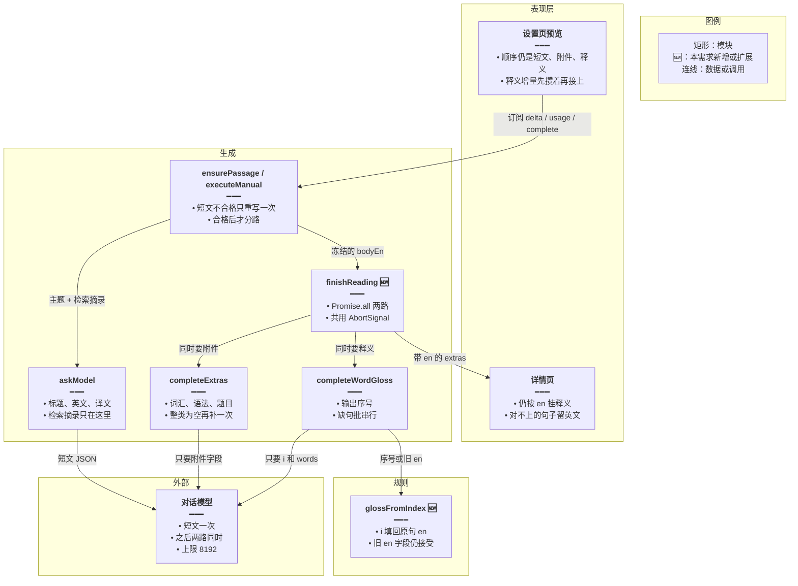
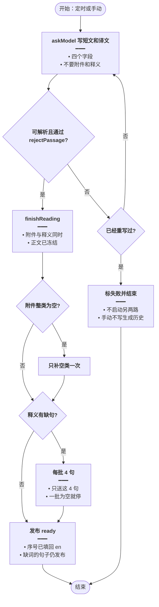
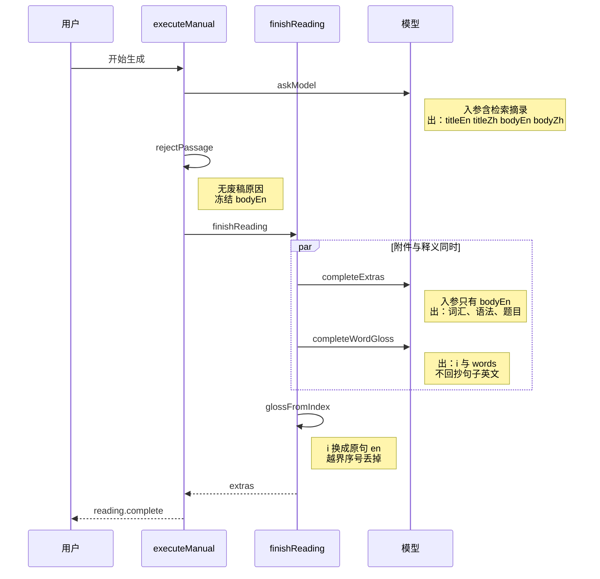

# 阅读分路并行 — 实现思路

> **状态**：已落地  
> **日期**：2026-10-19  
> **需求摘要**：每日阅读在小模型上仍要生成成功：短文含译文一次写完，附件与逐词释义并行，释义用句子序号省输出，写不全单词也不废正文。

## 延伸阅读

- [阅读附件分请求](./阅读附件分请求.md)（词汇、语法、题目已从短文 JSON 拆出。本文只把这一路和释义改成并行）
- [阅读截断补释义](./阅读截断补释义.md)（释义截断抢救、缺句每批 4 句。本文保留这条，并去掉输出里重复的英文原句）
- [弱模型补单词释义](./弱模型补单词释义.md)（flash 漏词再补。本文不再按模型名单分叉，`glm-4.7-flash` 与其它模型同一条链路）
- [每日阅读流式生成](./每日阅读流式生成.md)、[阅读生成历史](./阅读生成历史.md)（SSE 事件名不变。并行两路不能交叉写进同一条预览）
- [阅读限流重试](./阅读限流重试.md)（已落地：同一篇里的模型请求改为串行，429 只重试这一次并继续后面的批）

---

## 0. 读本文你将得到什么

- 要解决的问题：`glm-4.7-flash` 一类模型单次输出顶满后，逐词释义写不完；小模型也无法为每个词都给出中文。若用对话 agent 分拆，历史会反复重送，Token 更多、等待更长。
- 一句话方案：短文连同译文一次写完；合格后附件与逐词释义同时请求；释义只回句子序号和词，服务端填回原句；任一路写不全也发布短文。
- 只改后端生成编排（定时 `ensurePassage` 与手动 `executeManual`）。发布结果、预览顺序、详情、历史、失败和停止都与现在相同。
- 分三阶段：M1 释义改序号；M2 两路并行与预览顺序；M3 两条生成路径接上。调用次数见 §3.3。段落后面缺词只补缺词，见 §3.4。
- 最大风险：模型仍回抄英文原句，输出再次顶满。解析同时接受序号和旧的 `en`，抄回来的句子仍能用，缺的句子按批补。

---

## 1. 需求与边界

### 1.1 用户故事

| 角色       | 场景                                                              | 行为                    | 期望结果                                                                                                         |
| ---------- | ----------------------------------------------------------------- | ----------------------- | ---------------------------------------------------------------------------------------------------------------- |
| 已登录用户 | 用 `glm-4.7-flash` 或输出上限更低的模型生成长篇，并打开词汇或题目 | 等生成结束              | 短文发布。释义能写完的句子可点开中文，写不完的句子仍显示英文                                                     |
| 已登录用户 | 小模型给不出每个词的释义                                          | 打开详情                | 篇目是 `ready`。没有逐词中文的句子保持英文，不出现「模型没有返回可解析的短文」                                   |
| 已登录用户 | 同一次生成                                                        | 看消耗 Token 和等待时间 | Token 是各次输入加输出的累计，不因「agent 多轮」膨胀。附件与释义重叠等待，总时间接近较慢的那一路，而不是两路相加 |
| 读者       | 定时任务使用默认小模型                                            | 打开当天详情            | 与手动篇同一套编排。没有预览，也不按某个用户的 Key 生成                                                          |

### 1.2 范围

| 在范围内                                                     | 不在范围内（非目标）                   |
| ------------------------------------------------------------ | -------------------------------------- |
| 短文 JSON 仍含 `titleEn`、`titleZh`、`bodyEn`、`bodyZh`      | 把译文再拆成第三次请求                 |
| 短文合格后，`completeExtras` 与 `completeWordGloss` 同时开始 | 接入英语对话 agent、工具循环或子会话   |
| 释义输出改为 `{i, words}`，落库前把 `i` 填成原句 `en`        | 详情页改匹配算法，或给旧数据做迁移     |
| 输出上限保持 8192；截断仍抢救已闭合项                        | 把 `maxTokens` 调高                    |
| 缺句每批 4 句，批与批串行，某一批为空就停                    | 把每一批缺句再并行，或按单词逐个再请求 |
| 定时篇与手动篇共用同一个收尾函数                             | 改 SSE 事件名、改 `extras` 表结构      |

### 1.3 约束与依赖

- 手动生成要登录，模型跟该用户。定时篇不传 `userId`，用环境变量默认模型。
- 界面「消耗 Token 数」继续累加各次调用的输入和输出。并行不减少这个总数，只减少墙钟时间。
- 检索摘录最多 4000 字，只出现在写短文的那一次。附件和释义的用户消息只有冻结后的英文。
- 虚词仍要释义（`a`、`the`、`of` 等）。省 Token 靠去掉重复英文，不靠少解释词。
- 停止信号只在手动路径存在。两路共用同一次 `AbortSignal`，停止时两路一起停，行不标 `ready`。
- 已发布文章里的 `wordGloss` 仍是 `{en, words}`。本方案不改详情页 `glossParagraphs`。

---

## 2. 方案总览（一句话 + 要点）

**一句话方案**：短文和译文留在第一次；合格后附件与序号释义并行；释义写不全只补缺句，补不上也发布。

| #   | 设计要点                          | 理由                                                                                                         |
| --- | --------------------------------- | ------------------------------------------------------------------------------------------------------------ |
| 1   | 不用对话 agent                    | 每一轮都会把短文、译文和上一轮输出再送进去。调用次数和输入都会超过现在的固定提示                             |
| 2   | 译文留在短文同一次                | 220 词正文加中文译文通常一两千 token。再拆一次要把正文作为输入再付一遍，总数增加，对防截断帮助很小           |
| 3   | 附件与释义 `Promise.all`          | 两路都只读冻结的 `bodyEn`，没有先后依赖。等待时间变成较慢的一路                                              |
| 4   | 模型只回句子序号 `i` 和 `{w, zh}` | 现在每个句子都把英文再写进 `en`，输出里整篇正文出现第二次，容易把 `glm-4.7-flash` 顶满。序号把这段输出让出去 |
| 5   | 落库前用序号填回 `en`             | 详情页已经按 `en` 对照正文。存储形状不变，旧文章不用迁移                                                     |
| 6   | 缺句批仍串行，一批为空就停        | 小模型若整批都写不出词，后面的批不再发，避免为无效输出付 Token。批内用户消息只有这 4 句                      |

---

## 3. 现状与复用

| 能力                                   | 仓库中已有                                                                                  | 本需求中的用法                                                            |
| -------------------------------------- | ------------------------------------------------------------------------------------------- | ------------------------------------------------------------------------- |
| 短文一次写标题、英文、译文             | `apps/backend/src/services/english-learning/english-daily-reading.service.ts` 的 `askModel` | 直接复用。提示已禁止 `glossary`、`grammarNotes`、`questions`、`wordGloss` |
| 短文不合格只重写一次                   | `ensurePassage`、`executeManual` 与 `rejectPassage`                                         | 直接复用。并行两路在短文合格之后才开始                                    |
| 附件另请求、截断抢救、整类为空再补一次 | 同文件 `completeExtras`、`fillExtras`；`daily-reading.rules.ts` 的 `salvageExtras`          | 直接复用。由串行改为与释义同时启动                                        |
| 释义全文请求、截断抢救、缺句每批 4 句  | `completeWordGloss`、`fillWordGloss`、`salvageWordGloss`、`GLOSS_BATCH`                     | 扩展：提示改为序号；抢救和过滤同时认识 `i` 与旧的 `en`                    |
| 句子切分                               | `daily-reading.rules.ts` 的 `passageSentences`                                              | 扩展：对模型编号。切分规则不变                                            |
| 详情按原句对照                         | `apps/frontend/src/views/englishLearning/dailyReading/Detail.tsx` 的 `glossParagraphs`      | 直接复用。服务端写回 `en` 后再入库                                        |
| 预览追加                               | `continueBelow`、`reading.delta`                                                            | 扩展：附件仍逐段写入。释义增量在附件段接完前只进缓冲，顺序与现在相同      |
| 对话 agent                             | `apps/backend/src/services/agent/`、英语学习里的 agent 会话                                 | 不适用。不创建子会话，不走工具循环                                        |
| 失败不进生成历史                       | `rememberGen` 对 `error` 直接返回                                                           | 直接复用                                                                  |

**调研结论**：防截断的拆分已经落地，但附件和释义仍一前一后，释义输出仍回抄英文。速度和 Token 的缺口都在这里。仓库里的 agent 是对话会话，不是这条生成管道能复用的执行器。

### 3.1 对现有功能逻辑的影响

模型请求可以并行。写进预览、历史和短文行之前，必须排成现在的顺序。下表里「会变」的几行是禁止落地的做法。

| 现有逻辑                                                                                                              | 若两路直接抢同一条预览                                             | 本方案保持不变的做法                                                                       |
| --------------------------------------------------------------------------------------------------------------------- | ------------------------------------------------------------------ | ------------------------------------------------------------------------------------------ |
| 预览顺序是短文 JSON、空行、附件 JSON、空行、释义 JSON。附件先流式出现，再流式出现释义                                 | 两路 `reading.delta` 同时追加，JSON 缠在一起，历史里打开的原文变样 | 附件仍逐段写入 `run.text`。释义先到的增量只进内存，附件段接完再按现在的方式空一行并流释义  |
| `continueBelow` 在附件前插一次空行，在释义前再插一次。flash 重试短文时是接在下面还是清空，由 `isFlashGlossModel` 决定 | 两路同时调用 `continueBelow`，空行重复或插到短文中间               | 空行仍只在「短文和附件之间」「附件和释义之间」各插一次。短文重试的预览规则不改             |
| Token 用 `settled += callTotal` 按次相加，再发 `reading.usage`                                                        | 两路同时改 `settled`，总数少加或重复加                             | 累加放进同一条同步顺序里。界面看到的仍是各次输入加输出之和                                 |
| 详情用 `wordGloss[].en` 对照正文。对不上的句子留英文                                                                  | 只存序号时，现有详情对不上任何句子，词气泡消失                     | `glossFromIndex` 在入库前把序号填回 `en`。校验仍用现在的词长、是否在句中、缺词是否还算缺句 |
| 附件失败只少附件，释义失败只少释义，短文仍 `ready`。短文两次不合格才失败，且 `error` 不进历史                         | `Promise.all` 若把一路的异常抛出整次生成，短文会被标失败           | 两路内部仍各自接住非停止错误。停止才共用 `AbortSignal` 把两路一起中断，行不标 `ready`      |
| 定时篇无预览、无 `userId`，用自动配置。手动篇用用户配置和用户模型                                                     | 为了并行去改配置来源或给定时篇加预览                               | `finishReading` 只替换「先等附件、再叫释义」这一段。配置、主题、模型、发布条件不动         |
| 已发布的 `extras` 形状：`glossary`、`grammarNotes`、`questions`、`wordGloss: {en, words}`                             | 库里出现只含 `i` 的释义，旧详情和旧历史读不到                      | `i` 只留在模型输出里，不落库                                                               |

因此：发布后的短文、详情气泡、历史标题、失败文案、停止和暂停，与现在一致。变的只有等待时间，以及模型少写一遍英文原句。

### 3.2 现码与新方案

下面「当前代码」指落地前：短文、附件、释义已经拆开，但是串行。右边是现在已经落地的行为。调用次数的对照在 §3.3。

|        | 当前代码                                                                                                                                                          | 新方案                                                                                                                                        |
| ------ | ----------------------------------------------------------------------------------------------------------------------------------------------------------------- | --------------------------------------------------------------------------------------------------------------------------------------------- |
| 短文   | `askModel` 一次写出 `titleEn`、`titleZh`、`bodyEn`、`bodyZh`。不要附件和 `wordGloss`。不合格只重写一次                                                            | 相同，不改提示，不把译文拆出去                                                                                                                |
| 附件   | 短文合格后 `await completeExtras`。整类为空再补一次。截断用 `salvageExtras`                                                                                       | 请求内容相同。改为与释义同时发出，不再等它结束才开始释义                                                                                      |
| 释义   | 附件全部结束后才 `await completeWordGloss`。模型回 `{en, words}`，提示要求把句子英文再抄一遍。缺句每批 4 句，用户消息只有这 4 句，但仍要求 `Copy each en exactly` | 与附件同时开始。模型只回 `{i, words}`。服务端用同一份切句把 `i` 填成 `en` 再入库。缺句批仍串行，用户消息改为 `1. 句子` 这种编号，不再要求回抄 |
| 预览   | `executeManual` 里附件的 `onDelta` 直接写入 `run.text`，然后再写释义。`continueBelow` 各插一次空行                                                                | 附件仍直接写入。释义的 `onDelta` 先进入缓冲，附件段接完再空行并写出。历史看到的顺序不变                                                       |
| 定时篇 | `ensurePassage` 同样先附件、后释义，没有预览                                                                                                                      | 同样改为同时等待两路。配置、模型和失败清空不改                                                                                                |
| 落库   | `extras.wordGloss` 为 `{en, words}`。详情 `glossParagraphs` 用 `en` 对照                                                                                          | 库里的形状不变。序号只出现在模型原文里                                                                                                        |

**提升**

- 等待时间：现在是附件耗时加上释义耗时。新方案两路重叠，总等待接近较慢的释义那一路。
- 输出 Token：每个句子不再把英文写进 `en`。长篇十几句时，输出里少掉一整遍正文，`glm-4.7-flash` 更不容易在 8192 处被截断，从而少打缺句批。
- 缺词时的结果与现在相同：已闭合的句子留下，一批没有词就停，短文仍发布。提升在于全文那一次能装下更多句，而不是多一轮重试。

**改动点**

| 位置                                                            | 现在                                                  | 改成                                                                                |
| --------------------------------------------------------------- | ----------------------------------------------------- | ----------------------------------------------------------------------------------- |
| `ensurePassage` 约第 286–287 行                                 | 先 `completeExtras`，再 `completeWordGloss`           | 调用 `finishReading`，内部同时等两路                                                |
| `executeManual` 约第 694–709 行                                 | 同上，并且两路的 `onDelta` 都直接进预览               | 同上。释义的增量改走缓冲，Token 累加改为串行                                        |
| `fillWordGloss` 约第 1552–1566 行                               | 系统提示要 `{en, words}`，全文用户消息是整篇 `bodyEn` | 系统提示要 `{i, words}`。用户消息是编号句子。缺句批只带那 4 个编号                  |
| `daily-reading.rules.ts` 的 `pickWordGloss`、`salvageWordGloss` | 只认 `en`                                             | 增加 `glossFromIndex`。序号填回 `en` 后再走现有的词校验和缺句判断。旧的 `en` 仍接受 |

**改动逻辑**

1. 短文校验通过之前，不开始附件，也不开始释义。失败重试、废稿、不写 `error` 历史，都停在这一步。
2. 通过之后取出冻结的 `bodyEn`。附件路和释义路同时请求。检索摘录不进入这两路。
3. 释义路按 `passageSentences` 的顺序从 1 编号。模型返回的 `i` 对上哪一句，就把那句原文写入 `en`。对不上的序号丢掉，不挂到别的句子上。
4. 手动预览仍先流附件。释义字节先进缓冲；附件路结束（含它自己的补空类）后，再 `continueBelow` 并写出释义。缺句批的空行仍在释义段内部，不插进附件。
5. 两路都返回后，`wordGloss` 已是 `{en, words}`，再 `withSources` 发布。详情、历史标题、停止和定时篇失败清空都不另写分支。

### 3.3 模型调用：落地前与当前

并行不减少调用次数。同一次生成里，模型 HTTP 次数仍是各路相加。变的是短文合格之后，附件路和释义路同时发出，墙钟时间取较慢的那一路。单次输出上限仍是 8192。

**当前调用逻辑**（`ensurePassage` 与 `executeManual` 相同）

1. `askModel` 写短文和译文。JSON 解析失败或 `rejectPassage` 有原因时，再调用一次。第二次仍失败就结束，次数为 2，不进入后面两路。
2. 短文合格后 `finishReading` 用 `Promise.all` 同时启动下面两路。检索摘录不进入这两路。
3. 附件路 `completeExtras`：没打开词汇、语法、题目时是 0 次。打开了就先 `fillExtras` 一次，把本次要的键一起要。某一类一个合格条目都没有，再 `fillExtras` 一次，只带这些空类。这一路内部仍是串行，最多 2 次。
4. 释义路 `completeWordGloss` 与第 3 步同时开始。先 `fillWordGloss` 一次，用户消息是 `1. 句子` 这种编号，模型只回 `{i, words}`。缺句按 `missingSentences` 算一次，之后每 4 句再调用一次，用户消息只有这 4 个编号。某一批一个词都没有就停，后面的批不再发。这一路内部仍是串行。

**次数**

| 场景                                                                     | 落地前（串行）                                   | 当前（并行） | 墙钟                                                          |
| ------------------------------------------------------------------------ | ------------------------------------------------ | ------------ | ------------------------------------------------------------- |
| 只阅读、不出题，释义一次写完                                             | 短文 1 + 释义 1 = 2                              | 次数仍是 2   | 短文结束后只等释义。附件路立即返回，不发请求                  |
| 打开词汇或题目，附件和释义都一次写完                                     | 短文 1 + 附件 1 + 释义 1 = 3，三段相加           | 次数仍是 3   | 短文结束后等较慢的那一路，通常是释义                          |
| 短文重写一次，附件有一整类为空，长篇约 20 句的释义全文落空且每批都还有词 | 短文 2 + 附件 2 + 释义 1 + 缺句 5 = 10，全部相加 | 次数仍是 10  | 短文 2 次之后，等待是 `max(附件 2 次, 释义 6 次)`，不再是 2+6 |

长篇按提示大约十几到二十句。全文释义一句都没留下时，缺句大约还要 5 次（`ceil(20 / 4)`）。加上短文重写和附件补空，最多大约 10 次。只阅读、不出题时没有附件那 2 次，最多大约 8 次。短文两次都不合格则只有 2 次。

**同一次调用，落地前和当前差在哪**

| 调用                   | 落地前                                                                                    | 当前                                                                                                                                | 次数是否变化                                                      |
| ---------------------- | ----------------------------------------------------------------------------------------- | ----------------------------------------------------------------------------------------------------------------------------------- | ----------------------------------------------------------------- |
| `askModel`             | 标题、英文、译文。不要附件和 `wordGloss`。不合格只重写一次                                | 提示和次数相同                                                                                                                      | 否                                                                |
| `fillExtras`           | 短文合格并等它结束之后才发。用户消息是冻结的 `bodyEn`。整类为空再补一次                   | 请求正文相同，但和释义同时发出，不再等释义之前的空隙                                                                                | 否。仍是 0、1 或 2 次                                             |
| `fillWordGloss` 全文   | 附件路全部结束后才发。用户消息是整篇 `bodyEn`。要求回 `{en, words}`，把句子英文再抄进输出 | 与附件同时发。用户消息改为编号句子。要求只回 `{i, words}`，禁止回抄英文                                                             | 次数规则相同：先 1 次。输出变短后，更少因为顶满 8192 而进入缺句批 |
| `fillWordGloss` 缺词批 | 每 4 句 1 次，串行，一批为空就停。用户消息是这 4 句原文，并要求 `Copy each en exactly`    | 仍是每 4 句 1 次、串行、空批即停。用户消息只列这些句在全文中的原序号和还没有中文的词，例如 `3. simmered gently`。已有中文的词不重写 | 上限相同。每批输出更短                                            |
| 两路之间               | 必须先跑完附件（含补空那一次）再开始释义                                                  | `finishReading` 同时等两路。附件补空仍在附件路内部，不挡住已经开始的释义                                                            | 总次数不减。等待从相加变成取最大                                  |

服务端在 `pickWordGloss` 里把 `i` 填回 `en` 再入库。这一步不再调用模型。

### 3.4 段落后面缺词：只补缺词（已落地）

`glm-4.7-flash` 写逐词释义时从左往右写，经常在一句的后半截停下。详情里就变成段落后面的词没有中文。短文仍然发布，已有的词也不重写。

**改之前**

全文 `fillWordGloss` 之后，`missingSentences` 把「还有词没有中文」的句子整句算成缺句。`completeWordGloss` 再按 `GLOSS_BATCH = 4` 把这些句子整句送回去，提示仍要求这句的每个词都写出来。小模型会把已经有中文的前半截再写一遍，后半截还是空。`mergeWordGloss` 按词填空，但新结果里没有的词，旧结果里也没有，尾巴就留空。一批一个词都没有才停。同一批句子不会再要第二次。

**现在**

1. 全文释义不变：编号句子，只回 `{i, words}`。
2. 结束后按正文逐词核对。已经有中文的词留下，只记下还没有中文的词，以及它们所在的句子序号。
3. 仍按每批最多 4 句再请求。提示里只列序号和缺掉的词，不要整句重写，也不要回已经有中文的词。模型常把这批改成从 1 编号。序号对得上这批句子才按序号挂，对不上就按这批的顺序挂回原句。一个词写成两个词（如 `not only`）时拆开，各挂同一条中文。
4. 合并仍走 `mergeWordGloss`：原有中文保留，新结果只填空位。一批一个词都没有就停，后面的批不再发。
5. 补完仍缺的词留空。详情继续显示英文。不重写短文，不按单词逐个请求，不提高 8192。

**为什么一批是 4 句**

4 不是语法单位。`GLOSS_BATCH` 的取值是为了让这一批 JSON 停在 8192 的一半以下。整篇逐词释义会顶满上限；一次把所有缺句送回去，输出仍可能被截断。4 句够短，小模型更容易写完。再拆成一句一次，提示要重复很多次。只补缺词以后，每句输出更短，4 句这个上限仍然够用，不另加一轮。

**和现在的调用差在哪**

|                        | 改前                                         | 现在                                       |
| ---------------------- | -------------------------------------------- | ------------------------------------------ |
| 何时补                 | 全文释义之后，缺句批在释义路内部串行         | 相同                                       |
| 送什么                 | 最多 4 句的完整编号句子，要求每个词都写      | 最多 4 句，但只列这些句里还没有中文的词    |
| 次数                   | 缺句数除以 4，空批即停                       | 次数规则不变。每批输出更短，更少在半截停住 |
| 已有释义               | 合并时能保留，但模型常把前半截重写、尾巴仍缺 | 提示禁止重写已有词，合并只填空位           |
| 短文、附件、预览、详情 | 已落地的并行和落库形状                       | 不改                                       |

---

## 4. 架构图



**图内方法说明**：

| 方法                | 功能                                                                                                                      |
| ------------------- | ------------------------------------------------------------------------------------------------------------------------- |
| `askModel`          | 写标题、英文正文和整篇译文。检索摘录只附在这次。解析失败或 `rejectPassage` 有原因时由调用方重写一次，重写期间不启动另两路 |
| `finishReading`     | 短文合格后同时启动附件和释义。任一路抛非停止错误只少那一路的结果。停止则两路一起中断                                      |
| `completeExtras`    | 写词汇、语法、理解题。截断抢救、整类为空再补一次，这些仍留在这一路内部                                                    |
| `completeWordGloss` | 写逐词释义。全文一次，缺句每 4 句串行再要，一批没有词就停                                                                 |
| `glossFromIndex`    | 把模型返回的句子序号换成正文里的那一句，组成现有的 `{en, words}`。序号越界的丢掉；模型若仍带回 `en`，沿用现在的对照       |

**读图要点**：

- 表现层不参与分路。详情页看到的仍是带 `en` 的释义。
- 新增的编排只有 `finishReading` 和 `glossFromIndex`。附件、短文重试、缺句批次都用现成函数。
- 对话模型在短文结束前只有一路。短文合格后同时两路，缺句补全留在释义那一路里面，不再分叉出第三路并行。

---

## 5. 主流程图



**图内方法说明**：

| 方法             | 功能                                                                                 |
| ---------------- | ------------------------------------------------------------------------------------ |
| `askModel`       | 生成短文和译文。失败最多再进入一次                                                   |
| `rejectPassage`  | 检查标题、正文、译文和是否抄检索材料。有原因则不进入分路                             |
| `finishReading`  | 在短文合格后同时跑附件和释义。图里的附件判断和缺句判断发生在两路内部，墙钟上互相重叠 |
| `glossFromIndex` | 发布前把序号释义写成带 `en` 的结构。图中的发布节点使用它的结果                       |

**读图要点**：

- 唯一整次失败的分支是短文两次不合格。附件缺类、释义缺词都汇合到发布。
- 缺句批次画在释义判断之后，表示它不和附件抢「再开一路」，只在释义路内部串行。
- 手动停止沿用现有中止：不发布。图中不单画，避免和短文失败混在一起。

---

## 6. 核心时序图

手动生成、短文一次合格、附件与释义并行的主路径：



**图内方法说明**：

| 方法                | 功能                                                             |
| ------------------- | ---------------------------------------------------------------- |
| `askModel`          | 第一次模型调用写短文和译文。设置页此阶段仍按 delta 流式显示      |
| `rejectPassage`     | 合格后才允许 `finishReading`。不合格则重写短文，本图不展开       |
| `finishReading`     | 同时发出附件和释义。两路的增量各自积累，不写入同一条预览         |
| `completeExtras`    | 附件请求。整类为空时这一路内部再补一次，不另画                   |
| `completeWordGloss` | 释义请求。缺句批次仍在这次返回之前串行发生                       |
| `glossFromIndex`    | 并行结果汇合后、发布前，把序号释义变成详情页认识的 `{en, words}` |

**读图要点**：

- 用户只发起一次生成。短文结束前是一路；之后是两路同时，不是对话 agent 的多轮。
- 检索摘录不到后两路。两路的输入都是已经冻结的英文正文。
- `reading.complete` 仍在两路都结束、序号填回之后发一次。

---

## 8. 模块职责与接口草图

### 8.1 模块一览

| 模块                              | 职责                                     | 新增/改动 | 预估路径                                                                      |
| --------------------------------- | ---------------------------------------- | --------- | ----------------------------------------------------------------------------- |
| `finishReading`                   | 短文合格后并行附件与释义，并排好预览顺序 | 新增      | `apps/backend/src/services/english-learning/english-daily-reading.service.ts` |
| `fillWordGloss`                   | 提示改为序号；缺句批只送 4 句的编号文本  | 扩展      | 同上                                                                          |
| `glossFromIndex`                  | 序号填回 `en`，并继续接受旧的 `en`       | 新增      | `apps/backend/src/services/english-learning/daily-reading.rules.ts`           |
| `salvageWordGloss`                | 截断文本里已闭合的序号对象也能留下       | 扩展      | 同上                                                                          |
| `ensurePassage` / `executeManual` | 短文合格后改为调用 `finishReading`       | 扩展      | service 文件                                                                  |
| 详情 / SSE 事件名                 | 存储形状不变                             | 不改      | `Detail.tsx`                                                                  |

### 8.2 关键接口（伪代码）

```typescript
// 短文已合格才分路。两路都只收冻结英文，检索摘录不再送第二遍
async function finishReading(
	bodyEn: string,
	profile: ReadingProfile,
): Promise<ReadingExtras> {
	// 附件与释义没有先后依赖，同时发出去，墙钟时间取较慢的一路
	const [attached, gloss] = await Promise.all([
		// 词汇、语法、题目。整类为空时这一路内部再补一次
		completeExtras(bodyEn, profile),
		// 逐词释义。输出是序号，缺句补全留在这一路里面串行
		completeWordGloss(bodyEn),
	]);
	// 释义可以是空数组。空则只留下短文和已经拿到的附件
	return gloss?.length ? { ...attached, wordGloss: gloss } : attached;
}
```

释义提示要求 `wordGloss: [{i, words:[{w, zh}]}]`。`i` 从 1 开始，对应用户消息里的 `1. 句子`。`zh` 仍限 8 个汉字，虚词照样要。`glossFromIndex` 用现有切句结果把 `i` 换成该句原文，再交给现在的词语校验。模型若输出旧的 `en`，`pickWordGloss` 照旧对照正文。

预览和 Token 不改功能：短文阶段继续 `reading.delta`。附件路仍逐段写入。释义路的增量先进缓冲，附件段按现在的 `continueBelow` 接完后，再把缓冲和后续释义按现在的方式接上。`settled` 的累加串行，避免两路同时改总数。`reading.snapshot` 仍只用于短文重试时清空，不在并行阶段拿来覆盖已经写好的短文。

### 8.3 数据模型

| 字段/实体        | 来源             | 存储                         | 说明                              |
| ---------------- | ---------------- | ---------------------------- | --------------------------------- |
| `bodyZh`         | 短文那一次       | 短文行                       | 不另请求                          |
| `wordGloss[].en` | 服务端用序号填回 | `extras` JSON                | 形状与现在相同                    |
| `wordGloss[].i`  | 只存在于模型输出 | 不落库                       | 避免详情页改匹配                  |
| 生成历史 `text`  | 预览按顺序拼接   | `english_daily_reading_gens` | 第一段仍是短文 JSON。失败行仍不写 |

---

## 9. 分阶段实现步骤

| 阶段 | 目标                     | 交付物                                 | 依赖 |
| ---- | ------------------------ | -------------------------------------- | ---- |
| M1   | 释义输出变短，截断仍能用 | `glossFromIndex`、`fillWordGloss` 提示 | 无   |
| M2   | 两路重叠，预览不交叉     | `finishReading`                        | M1   |
| M3   | 定时与手动同一套         | `ensurePassage`、`executeManual`       | M2   |

### M1

- [ ] `fillWordGloss` 的系统提示改为只回 `i` 和 `words`，禁止回抄句子英文。
- [ ] 用户消息改为 `1. 句子` 这种编号。缺句批只包含这 4 句的编号。
- [ ] `glossFromIndex` 把合法序号填成 `en`。越界、对不上词的条目丢掉。
- [ ] `salvageWordGloss` / `pickWordGloss` 对已闭合对象同时接受 `i` 和旧 `en`。
- [ ] 不新增 spec 文件。

### M2

- [ ] 新增 `finishReading`，用 `Promise.all` 同时跑 `completeExtras` 和 `completeWordGloss`。
- [ ] 两路共用手动路径的 `AbortSignal`。停止时两路都中断，不发布。
- [ ] 附件仍逐段写入预览。释义增量在附件段接完前只进缓冲，再按现在的空行接上。
- [ ] Token 累加串行。一路的非停止错误仍只少那一路，不把整次生成变成失败。

### M3

- [ ] `ensurePassage` 与 `executeManual` 在短文合格后调用 `finishReading`，不再先等附件再叫释义。
- [ ] 定时篇不传预览回调。手动篇短文阶段的流式保持原样。
- [ ] 短文两次不合格时不调用 `finishReading`。

---

## 10. 关键决策与备选方案

| 决策       | 选用                      | 备选                      | 为何不选备选                                                   |
| ---------- | ------------------------- | ------------------------- | -------------------------------------------------------------- |
| 执行器     | 两次固定请求并行          | 对话 agent 加两个子智能体 | 子会话会重送历史，Token 和轮次都不可控，小模型更慢             |
| 译文       | 留在短文同一次            | 与附件并行的第三路        | 多付一遍正文输入。译文本身不长，不是顶满 8192 的部分           |
| 释义输出   | 句子序号                  | 继续回 `{en, words}`      | `en` 把整篇英文再生成一遍，`glm-4.7-flash` 容易在这里被截断    |
| 缺句       | 每批 4 句且串行，空批即停 | 所有缺句批同时发出        | 小模型一批都写不出时，其余批的输入已经花掉                     |
| 输出上限   | 保持 8192                 | 调到 32768                | 厂商实际上限可能更低。调高请求值填不满，也更鼓励模型把释义写长 |
| 写不完的词 | 发布短文，句子留英文      | 按词再请求，或整篇重写    | 按词请求会把调用次数放大到词数。重写短文浪费已经合格的正文     |

---

## 11. 风险、边界与待确认

| 项                                 | 等级 | 说明                                                       | 缓解                                                                 |
| ---------------------------------- | ---- | ---------------------------------------------------------- | -------------------------------------------------------------------- |
| 模型不听序号，仍回抄 `en`          | 中   | 输出再次变长，可能截断                                     | 解析接受 `en`。截断后已闭合的句留下，缺句再补                        |
| 并行两路同时打到厂商限流           | 低   | 同一用户连续两个请求                                       | 只有短文合格后这两路。缺句批不并行。限流错误当这一路失败，短文仍发布 |
| 两路同时写 `run.text` 或 `settled` | 高   | 预览和历史正文乱序，Token 少加，详情若只存序号会失去词气泡 | 按 §3.1 保持现有顺序和落库形状。这是落地限制，不是可选项             |
| 序号与切句不一致                   | 低   | `Mr.` 可能被现有规则切开，模型按切开后的编号写             | 沿用现有切句。编号和落库用同一份句子列表                             |
| 小模型大量句子没有释义             | 低   | 详情里许多句子没有词气泡                                   | 这是本方案接受的结果。不为此再开一轮短文                             |

**待确认**（若有）：

- [ ] 无。序号从 1 开始、落库前填回 `en`，以实现时的 `glossFromIndex` 为准。

---

## 12. 验收清单

| #   | 用例                                       | 步骤               | 期望                                                                             |
| --- | ------------------------------------------ | ------------------ | -------------------------------------------------------------------------------- |
| AC1 | 长篇 + 词汇 + 题目，模型为 `glm-4.7-flash` | 手动生成           | 短文为 `ready`。页面不是「模型没有返回可解析的短文」。附件与释义的等待重叠       |
| AC2 | 释义在中途被输出上限截断                   | 看详情             | 已闭合句子有词义。未写完的句子仍是英文。短文不重写                               |
| AC3 | 小模型几乎不给词义                         | 生成并打开详情     | 篇目发布。没有词义的段落仍显示英文正文                                           |
| AC4 | 只阅读、不出题                             | 生成               | 没有附件请求。释义仍与「空附件」同时开始，不等待一个空的附件回合                 |
| AC5 | 短文两次都不可解析                         | 生成               | 不调用 `finishReading`。手动显示短文失败原因，且不写生成历史                     |
| AC6 | 生成中停止                                 | 停在并行阶段       | 两路都中断。行不是 `ready`                                                       |
| AC7 | 模型仍返回带 `en` 的旧释义                 | 生成               | 这些句子仍能挂上词义。详情页不用改                                               |
| AC8 | 打开词汇或题目后看预览和历史               | 生成一篇并打开历史 | 原文顺序仍是短文、附件、释义。标题仍是短文标题。Token 为各次之和。失败行仍不出现 |

---

## 13. 预估改动面（实现阶段参考）

| 类型           | 路径（预估）                                                                                                                                       |
| -------------- | -------------------------------------------------------------------------------------------------------------------------------------------------- |
| 前端           | 无                                                                                                                                                 |
| 后端           | `apps/backend/src/services/english-learning/english-daily-reading.service.ts`、`apps/backend/src/services/english-learning/daily-reading.rules.ts` |
| 文档（实现后） | 本文状态改为已落地                                                                                                                                 |

---

（本文档为规划态实现思路；落地后以源码为准）
