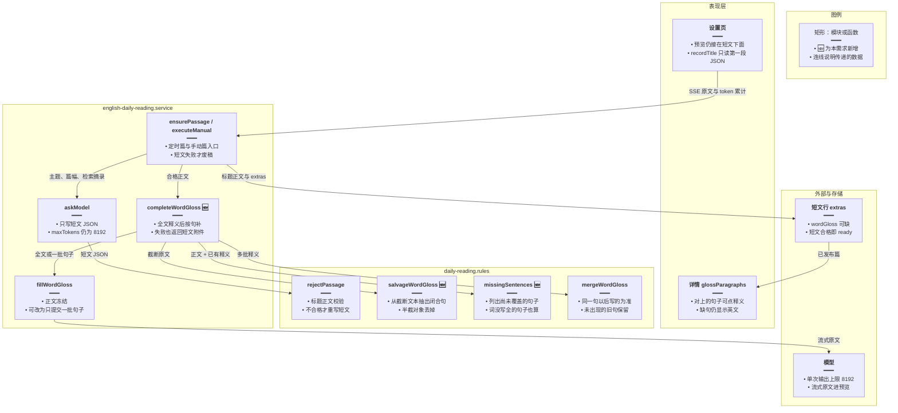
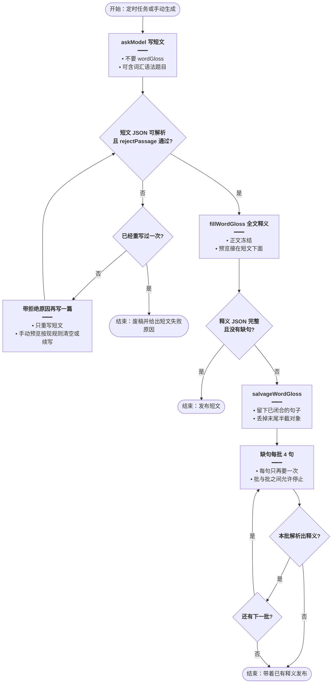
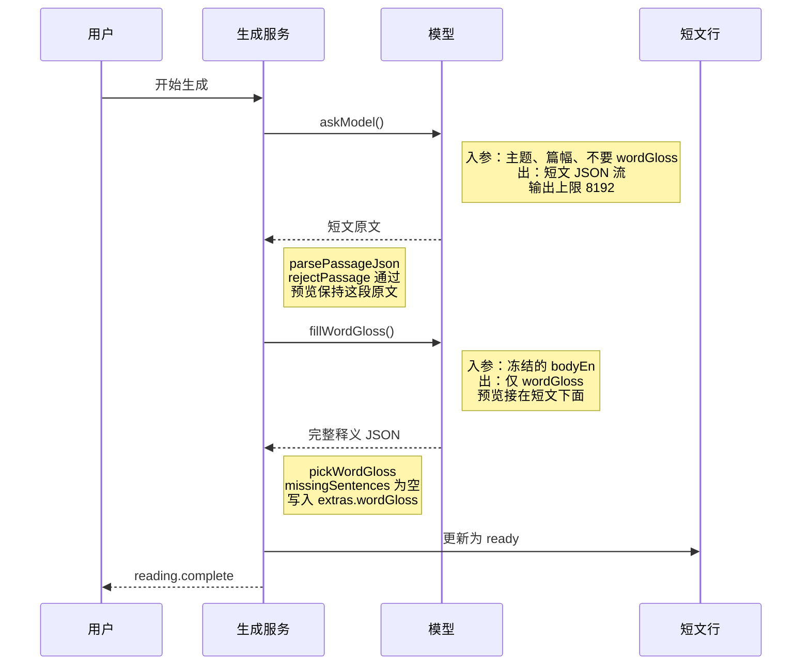
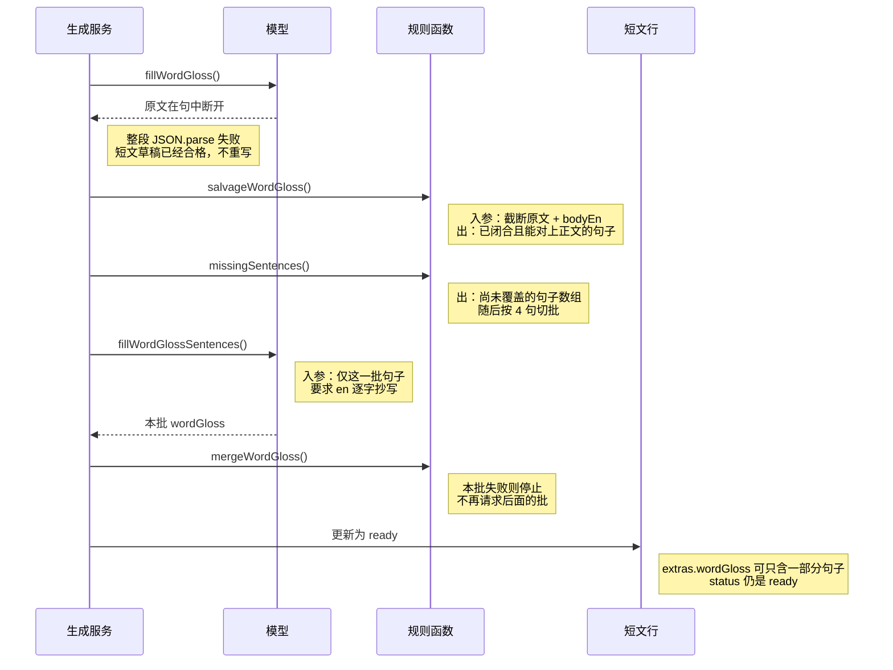
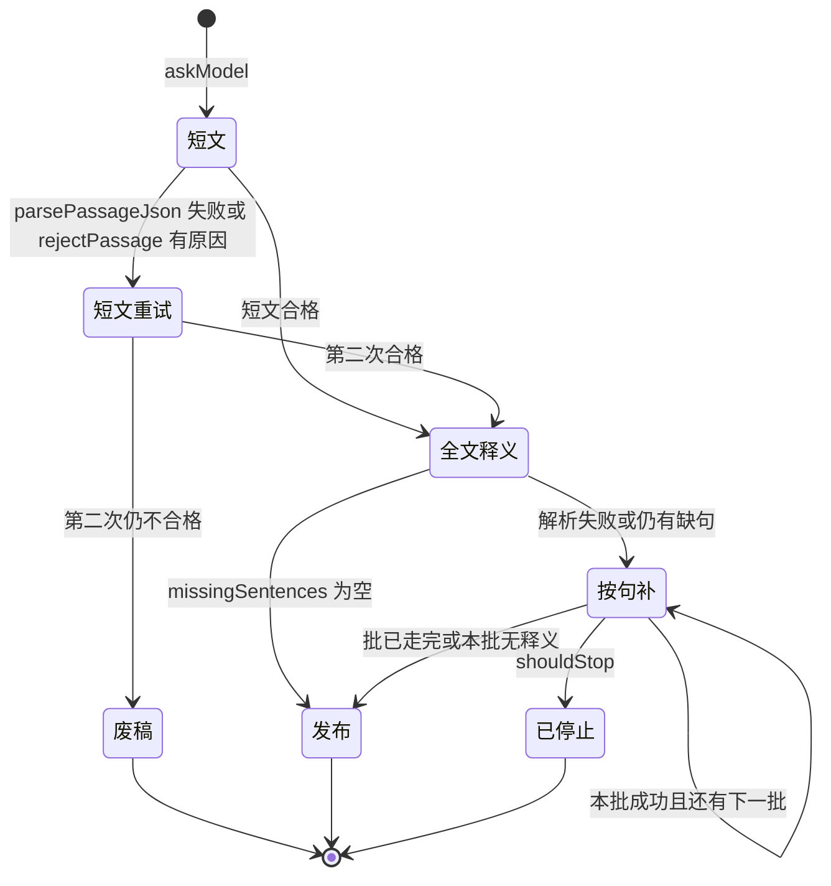

# 阅读截断补释义 — 实现思路

> **状态**：规划（未实现；短文与 `wordGloss` 仍在同一次输出里，上限 8192）  
> **日期**：2026-10-18  
> **需求摘要**：每日阅读生成被输出上限截断时，先单独写合格短文，再按句补逐词释义；释义不完整也发布短文，不再整篇重写。

## 延伸阅读

- [每日阅读](./每日阅读.md)（定时篇与详情页；`wordGloss` 对不上的句子仍显示英文）
- [每日阅读流式生成](./每日阅读流式生成.md)、[刷新续接生成流](./刷新续接生成流.md)（手动生成的 SSE 预览，本方案沿用，不改协议）
- [弱模型补单词释义](./弱模型补单词释义.md)（flash 漏词再补一次已进代码。本文替换其中「付费模型仍与短文同一次调用、释义只补一次」：截断时所有模型都拆开，并按句补缺口）
- [阅读生成历史](./阅读生成历史.md)（历史行标题只解析第一段短文 JSON。释义接在后面之后，整段解析会让标题退回成开始时间）
- [阅读附件分请求](./阅读附件分请求.md)（词汇、语法、理解题改到短文合格后另一次请求。本文里「这三项仍留在短文那一次」以该篇为准）

---

## 0. 读本文你将得到什么

- 要解决的问题：逐词释义写在短文同一个 JSON 里，单次输出顶到 8192 后字符串被掐断，整段无法解析，页面显示「模型没有返回可解析的短文」，然后整篇再生成一次。
- 一句话方案：第一次只写短文；短文合格后另要释义；释义被截断就留下已闭合的句子，缺句按每批 4 句补，补不上也发布短文。
- 生成拆分只改后端（定时 `ensurePassage` 与手动 `executeManual` 共用）。设置页预览、详情逐词气泡、错误文案协议都不改。历史列表标题要改：只读第一段短文 JSON，见 [阅读生成历史](./阅读生成历史.md)。
- 分三阶段：M1 短文去掉 `wordGloss`；M2 全文释义失败时抢救并按句补；M3 两条生成路径接上，并补纯函数断言。
- 最大风险：模型不听提示，仍把逐词释义写进第一次，短文 JSON 再次被截断。提示里明确不要该字段，解析失败仍只重写一次短文。

---

## 1. 需求与边界

### 1.1 用户故事

| 角色 | 场景 | 行为 | 期望结果 |
|------|------|------|----------|
| 已登录用户 | 设置页手动生成，模型把逐词释义写到一半 | 等生成结束 | 短文发布成功；预览里先是短文 JSON，下面才是释义。不再因为释义半截而整篇失败 |
| 读者 | 定时任务同样顶到输出上限 | 打开当天详情 | 篇目是 `ready`。已补上的句子能点出中文，没补上的句子仍显示英文 |
| 已登录用户 | 短文 JSON 本身不完整，或标题正文校验失败 | 生成结束 | 仍只重写一次短文。第二次还不行，才显示「模型没有返回可解析的短文」或对应的校验原因 |
| 已登录用户 | 生成过程中点停止 | 停在释义批次之间 | 与现在一样中止，不把半成品标成 `ready` |

### 1.2 范围

| 在范围内 | 不在范围内（非目标） |
|----------|----------------------|
| `askModel` 第一次不再要求 `wordGloss` | 把 `maxTokens` 从 8192 调高 |
| 短文合格后，所有模型都另要释义（不再只限 flash） | 从截断的短文 JSON 里硬抠标题和正文 |
| 释义输出不完整时，抽出已闭合的句子，缺句每批 4 句再要 | 某一批失败后再拆成单句、或对同一批无限重试 |
| 释义全失败时短文仍发布 | 详情页为缺释义单独加错误提示 |
| 定时篇与手动篇走同一套补释义 | 改 SSE 事件名、改 `extras` 表结构、改前端 Store |
| 历史行标题只解析第一段已闭合的短文 JSON | 为缺标题单独加接口或改历史表 |

### 1.3 约束与依赖

- 手动生成要登录。定时篇不带 `userId`，继续用环境变量默认模型（见 [每日阅读按用户生成](./每日阅读按用户生成.md)，该方案已放弃）。
- 输出上限保持 `askModel` / `fillWordGloss` 里的 `maxTokens: 8192`。界面上的「消耗 Token 数」是各次调用的输入加输出累计，不是单次输出上限。
- 词汇表、语法、理解题的拆分见 [阅读附件分请求](./阅读附件分请求.md)。本文只把 `wordGloss` 移出短文。
- 详情页 `glossParagraphs` 已按正文分段展示：对得上的句子挂释义，对不上的原文留在原段。缺句不必改 UI。
- 手动预览已有 `continueBelow`：下一轮接在已有输出下面，不清掉上一轮。释义各批沿用它。
- 停止信号只在手动路径存在。两批释义之间要看 `shouldStop`，与现在两轮模型之间的停法相同。

---

## 2. 方案总览（一句话 + 要点）

**一句话方案**：短文 JSON 不再携带 `wordGloss`；短文校验通过后调用全文释义，截断则抢救已闭合句，再把缺句按 4 句一批补完，任一批失败也发布短文。

| # | 设计要点 | 理由 |
|---|----------|------|
| 1 | 第一次去掉 `wordGloss`。词汇、语法、题目是否仍放在这次，以 [阅读附件分请求](./阅读附件分请求.md) 为准 | 现在被掐断的是排在最后、按词展开的 `wordGloss`。那三项另有截断风险，不在本文解决 |
| 2 | 短文不合格仍只重写一次，原因沿用 `rejectPassage` / `json` | 这条重试是短文质量问题，不是释义长度问题。释义失败不再触发它 |
| 3 | 全文释义用现有 `fillWordGloss`。解析失败时用新的 `salvageWordGloss` 留下已闭合对象 | 一次全文请求能覆盖短篇和多数中篇。截断时已写完的句子不必重生成 |
| 4 | 缺句每批 4 句，每句只再要一次；本批没有可解析结果就停止 | 4 句的 JSON 明显低于 8192。停止后保留已有释义，避免像现在这样把整篇再打一遍 |
| 5 | `ensurePassage` 与 `executeManual` 都改为调用同一个 `completeWordGloss` | 定时篇没有 SSE，但截断方式相同。只改一处，两条路径一起修好 |

---

## 3. 现状与复用

| 能力 | 仓库中已有 | 本需求中的用法 |
|------|------------|----------------|
| 短文一次生成并解析 | `apps/backend/src/services/english-learning/english-daily-reading.service.ts` 的 `askModel` | 扩展：系统提示去掉 `wordGloss`。词汇、语法、题目的去留见 [阅读附件分请求](./阅读附件分请求.md) |
| 解析失败或校验失败只重写一次 | 同文件 `ensurePassage`、`executeManual` | 直接复用。仅当 `parsePassageJson` 为空或 `rejectPassage` 有原因时重写 |
| 废稿文案 | `daily-reading.rules.ts` 的 `rejectReasonText`，`json` → 「模型没有返回可解析的短文」 | 直接复用。只在短文阶段使用 |
| flash 全文再补释义 | 同 service 的 `completeFlashGloss`、`fillWordGloss`；名单在 `isFlashGlossModel` | 扩展：门闩去掉，所有模型在短文合格后都补。`isFlashGlossModel` 仍只决定短文重试时预览是接在下面还是清空 |
| 两次释义按句按词合并 | `mergeWordGloss`、`mergeSentenceWords` | 直接复用。同一句以后一次为准 |
| 释义条目过滤 | `pickWordGloss`：`en` 必须出现在正文里，词须在该句中 | 直接复用。抢救出来的对象也走它 |
| 漏词计数 | `missingGlossCount` | 直接复用，用来判断「句子虽然对上了，但词没写全」 |
| 附件不合格不废正文 | `pickExtras` 注释写明学习块可省略 | 直接复用。词汇、语法、题目仍从短文 payload 取；`wordGloss` 改由补释义结果写入 |
| 流式累计 token | `readStream` + `onUsage`（结束时用供应商的 total，否则按字符粗算） | 直接复用。释义批次会把用量继续累加，界面数字变大是预期 |
| 手动预览接在下面 | `continueBelow`；阶段类型已有 `gloss` | 直接复用。每一批释义前调用，不 `beginModel` 清空短文预览 |
| 详情缺句仍显示英文 | `apps/frontend/src/views/englishLearning/dailyReading/Detail.tsx` 的 `glossParagraphs` | 直接复用。不改前端 |
| 输出上限 8192 | `askModel`、`fillWordGloss` 的 `createLlm({ maxTokens: 8192 })` | 直接复用，不改数值 |
| 按句切分、截断抢救、缺句名单 | 无 | 新建在 `daily-reading.rules.ts` |

**调研结论**：截断后的红字来自 `parseModelObject` 失败，调用方把原因记成 `json`，于是 `executeManual` 抛「模型没有返回可解析的短文」，`ensurePassage` 把定时篇标失败。此时正文往往已经在半截 JSON 里，但解析要求整段闭合，所以正文被丢掉并整篇重试。`fillWordGloss` 已经会「正文冻结、只写 wordGloss」，但只有 flash 且短文 JSON 先解析成功才会走到。本需求把这次调用提前成所有模型的必经步骤，并在它自己被截断时按句补，而不是再走短文重试。

---

## 4. 架构图



**图内方法说明**：

| 方法 | 功能 |
|------|------|
| `ensurePassage(publishDate)` | 定时篇入口。短文两次仍不合格则 `markFailed`；短文合格后把释义结果写入当天 `slot=day` 行并标 `ready` |
| `executeManual(...)` | 手动篇入口。短文失败时抛 `rejectReasonText`，经 SSE 变成设置页红字；成功则更新本条 `pending` 行 |
| `askModel(...)` | 向模型要短文 JSON。本需求从系统提示去掉 `wordGloss`，其它键与 8192 上限不变 |
| `rejectPassage(draft, recent, snippet)` | 检查标题、正文、英文句子数、重复和抄袭。返回原因字符串；合格返回 `null` |
| `completeWordGloss(...)` | 新编排：全文释义、抢救、按缺句分批、合并。无论释义是否齐全，都返回可随短文保存的 `extras` |
| `fillWordGloss(bodyEn)` | 系统提示只要 `wordGloss`。全文时用户消息是冻结正文；分批时只含这几句。整段解析失败时先 `salvageWordGloss`，截断批次里已闭合的句子仍算成功 |
| `salvageWordGloss(raw, bodyEn)` | 新纯函数。整段 JSON 解析失败时，逐个解析已闭合的 `{en, words}`，再交给 `pickWordGloss` 过滤 |
| `missingSentences(bodyEn, gloss)` | 新纯函数。返回还没有可用释义、或释义没盖住句中词的句子，供分批使用 |
| `mergeWordGloss(first, second)` | 按句子英文合并两份释义。同一句里后一次写过的词优先，只在第一次出现的词按正文顺序补上 |
| `glossParagraphs(bodyEn, gloss)` | 详情页已有展示。释义对不上的原文留在原段，本需求不修改 |
| `recordTitle(text, startedAt)` | 历史行标题。只解析第一段已闭合的短文 JSON 里的 `titleZh` / `titleEn`；这段还没闭合时显示开始时间 |

**读图要点**：

- 表现层只继续展示 SSE 原文和已发布的 `extras`。截断补句全部发生在服务端。
- 新增集中在 `completeWordGloss` 和两个纯函数。定时入口与手动入口都只改「短文合格之后」那一次调用。
- `askModel` 与 `fillWordGloss` 仍然各用 8192。变的是一次响应里不再同时装下短文和逐词释义。

---

## 5. 主流程图



**图内方法说明**：

| 方法 | 功能 |
|------|------|
| `askModel(...)` | 生成或重写短文。系统提示不再包含 `wordGloss` 的键说明 |
| `parsePassageJson(raw)` | 从模型原文取出 `titleEn`、`titleZh`、`bodyEn`、`bodyZh`。整段不是 JSON 时返回 `null`，调用方记为 `json` |
| `rejectPassage(...)` | 短文四字段齐全后做质量校验。有原因则进入仅有的一次重写 |
| `fillWordGloss(bodyEn)` | 第一次释义提交整篇正文。返回值要带上原始流文本，供截断时抢救 |
| `salvageWordGloss(raw, bodyEn)` | 只接受括号已经配平的释义对象。末尾未闭合的句子不猜、不补引号 |
| `missingSentences(bodyEn, gloss)` | 在抢救结果上计算缺口，再切成每批 4 句 |
| `fillWordGlossSentences(chunk)` | 与全文释义同一套提示，用户消息只含这一批句子，并要求 `en` 逐字抄写 |
| `shouldStop(runId, signal)` | 手动路径在每一批之前调用。已停止则不再发下一次 HTTP，也不发布 |

**读图要点**：

- 废稿只出现在短文分支。释义分支的两个出口都是发布。
- 全文释义已经齐全时，不进入按句循环，短篇不会多打空请求。
- 按句循环不把「本批仍有漏词」再塞回队列。每句最多在全文请求之外再出现一次。

---

## 6. 核心时序图

### 6.1 短文合格且全文释义一次写完



**图内方法说明**：

| 方法 | 功能 |
|------|------|
| `askModel()` | 手动或定时路径上的第一次模型调用，只要短文 |
| `parsePassageJson(raw)` | 确认四个正文字段都是字符串。失败则走第 5 节的重写，不进入本时序 |
| `rejectPassage(...)` | 确认这篇短文可以发布。失败同样只重写短文 |
| `fillWordGloss()` | 第二次模型调用。系统提示与现有补释义相同，用户消息是整篇英文 |
| `pickWordGloss(raw, bodyEn)` | 丢掉不在正文里的句子和词。空结果不当作发布失败 |
| `missingSentences(bodyEn, gloss)` | 本路径返回空数组，于是不再发按句请求 |
| `reading.complete` | 现有 SSE 终态。前端 Store 收到后结束生成并刷新历史，本需求不改事件 |

**读图要点**：

- 这是短篇和多数中篇的主路径：两次模型调用，没有按句循环。
- 预览不会在进入释义时被清空。`continueBelow` 在第二次调用前插入空行。
- 定时篇没有「用户」和 `reading.complete`，写库那一步相同。

### 6.2 全文释义被 8192 截断



**图内方法说明**：

| 方法 | 功能 |
|------|------|
| `fillWordGloss()` | 全文释义。流在 8192 处结束时，原文停在未闭合的字符串或对象上 |
| `salvageWordGloss(raw, bodyEn)` | 扫描 `wordGloss` 数组里括号已配平的对象并逐个 `JSON.parse`，再过滤 |
| `missingSentences(bodyEn, gloss)` | 用抢救结果对照正文，得到还要请求的句子 |
| `fillWordGlossSentences(chunk)` | 一批最多 4 句。解析失败时先抢救已闭合句；一句都没有才返回空，编排层停止后续批 |
| `mergeWordGloss(kept, part)` | 把本批并入已抢救的释义。同一句以后一次的词为准 |
| `shouldStop(...)` | 图中未单画。每一批发送前调用，停止则整次手动生成中止且不写 `ready` |

**读图要点**：

- 截断发生在释义调用之后，短文重试循环已经结束，不会再把 8192 打满第二次去重写正文。
- 抢救失败等于从零开始按句补；第一批也失败则 `wordGloss` 为空，短文仍然发布。
- 手动停止落在两批之间时走现有的中止路径，不发布。定时篇没有停止按钮，会把当时已合并的释义写上。

---

## 7. 状态机



**图内方法说明**：

| 方法 | 功能 |
|------|------|
| `askModel` | 进入「短文」。重试边再次调用它，并带上上次的拒绝原因 |
| `parsePassageJson` | 短文原文不能解析时走到「短文重试」或「废稿」 |
| `rejectPassage` | 解析成功但质量不合格时，与解析失败走同一条重试边 |
| `missingSentences` | 全文释义之后的分支条件。空则发布，非空则按句补 |
| `shouldStop` | 仅手动路径。从「按句补」进入「已停止」，不写 `ready` |

**读图要点**：

- 「废稿」到不了「全文释义」。「发布」也不依赖释义是否齐全。
- 「按句补」自循环只表示下一批，不表示同一批再试。
- 「已停止」与「废稿」都不是 `ready`。前者是用户中止，后者是短文两次都没写好。

---

## 8. 模块职责与接口草图

### 8.1 模块一览

| 模块 | 职责 | 新增/改动 | 预估路径 |
|------|------|-----------|----------|
| 短文提示 | 第一次 JSON 的键列表去掉 `wordGloss` | 扩展 | `apps/backend/src/services/english-learning/english-daily-reading.service.ts` 的 `askModel` |
| 释义编排 | 替换 `completeFlashGloss` 的 flash 门闩，改为全文 + 按句 | 扩展 | 同文件，新私有方法 `completeWordGloss` |
| 分批请求 | `fillWordGloss` 增加「只提交这些句子」 | 扩展 | 同文件 |
| 纯函数 | 切句、缺句、截断抢救 | 新增 | `apps/backend/src/services/english-learning/daily-reading.rules.ts` |
| 两条入口 | 短文合格后改为调用 `completeWordGloss` | 扩展 | 同 service 的 `ensurePassage`、`executeManual` |
| 断言 | 抢救与缺句的输入输出 | 新增 | `apps/backend/src/services/english-learning/daily-reading.gloss.spec.ts` |
| 预览与详情 | 继续消费现有 SSE 与 `extras.wordGloss` | 不改 | `store/englishDailyReading.ts`、`dailyReading/Detail.tsx` |
| 历史行标题 | 原文变成两段 JSON 后，只解析第一段短文 | 扩展 | `apps/frontend/src/views/englishLearning/dailyReading/Settings.tsx` 的 `recordTitle` |

### 8.2 关键接口（伪代码或 TypeScript 草图）

`fillWordGloss` 要同时交出原文。截断时解析结果是空的，抢救只能看流式原文。

```typescript
// 短文已合格才调用；释义不完整也不能把这篇标成失败
async function completeWordGloss(bodyEn: string, extras: ReadingExtras): Promise<ReadingExtras> {
	// 先整篇要一次；短篇和中篇多数能放进 8192，不必一开始就拆句
	const { gloss: full, raw } = await fillWordGloss(bodyEn);
	// 整段解析失败时，已闭合的句子仍留下，避免这些句子再生成一遍
	let gloss = mergeWordGloss(full, salvageWordGloss(raw, bodyEn));
	// 按进入循环时的缺句名单切批；某批失败不把剩余句子再排队
	for (const chunk of chunks(missingSentences(bodyEn, gloss), 4)) {
		// 只提交这一批，已覆盖的句子不再放进用户消息
		const part = await fillWordGlossSentences(chunk);
		// 本批没有可解析释义：停止后续批，短文仍可发布
		if (!part) break;
		// 同一句以后一次为准，只在本批新出现的词补进旧句
		gloss = mergeWordGloss(gloss, part);
	}
	// 一份释义都没有时不写空数组，详情按无逐词释义展示
	return gloss?.length ? { ...extras, wordGloss: gloss } : extras;
}
```

切句是补批的输入。缩写可能被切开，用包含关系匹配，而不是要求切分结果与模型的 `en` 逐字相同。

```typescript
// 按句号后的大写切句；Mr. 可能被切开，靠包含匹配兜住，不为此引入分句库
function passageSentences(bodyEn: string): string[] {
	// 先按空行分段，段界不要当成句号
	return bodyEn.split(/\n\s*\n/).flatMap((paragraph) =>
		// 句界后面必须是空白加大写，减少把小数点当成句号
		paragraph.split(/(?<=[.!?])\s+(?=[A-Z])/).map((s) => s.trim()).filter(Boolean),
	);
}

// 缺句同时包含「整句没有释义」和「释义没盖住句中的词」
function missingSentences(bodyEn: string, gloss: ReadingExtras['wordGloss']): string[] {
	// 没有释义数组时，切出来的每一句都要进入批次
	const rows = gloss ?? [];
	// 已覆盖的句子不再提交，避免把写完的句子又生成一遍
	return passageSentences(bodyEn).filter((sentence) => !isCovered(sentence, rows));
}

// 较短一侧不足 8 个字符不算同一句，避免 It. 这类碎片误配
function isCovered(sentence: string, rows: NonNullable<ReadingExtras['wordGloss']>): boolean {
	// 空白归一化后再比，模型多一个换行不算另一句
	const key = sentence.replace(/\s+/g, ' ').trim().toLowerCase();
	// 句与释义 en 相互包含即视为同一句
	const hit = rows.find((row) => includesEither(key, row.en));
	// 对上但还有词没有中文时，这句仍要进入下一批
	return !!hit && !sentenceStillMissing(sentence, hit.words);
}
```

`includesEither` 把两侧空白归一化后，要求较短一侧至少 8 个字符且互相包含。`sentenceStillMissing` 复用 `passageWords` 与现有漏词比较，不新写一套词形规则。`salvageWordGloss` 不在草图里展开：从原文定位 `wordGloss` 数组，对每个花括号已配平的对象 `JSON.parse`，收集成数组后调用现有 `pickWordGloss`。配平用计数，不引入 JSON 修复库。末尾缺引号的对象直接跳过。

### 8.3 数据模型

| 字段/实体 | 来源 | 存储 | 说明 |
|-----------|------|------|------|
| `titleEn` / `titleZh` / `bodyEn` / `bodyZh` | 第一次模型 JSON | `english_daily_reading` 列 | 只有这四项合格才进入释义。不新增列 |
| `extras.glossary` / `grammarNotes` / `questions` | 第一次 payload，经 `pickExtras` | `extras` JSON | 不合格就省略该键，与现在相同 |
| `extras.wordGloss` | 全文释义、抢救结果、按句批次合并 | `extras` JSON | 可缺、可只覆盖部分句子。不迁移 |
| 预览原文 | 各次模型流，`continueBelow` 拼接 | 进程内 `ManualRun.text` | 终态仍按现有历史快照保存。不改表 |
| token 累计 | 每次 `onUsage` 的供应商 total | SSE `reading.usage` 与历史 | 批次越多数字越大。不是单次输出 token |

---

## 9. 分阶段实现步骤

| 阶段 | 目标 | 交付物 | 依赖 |
|------|------|--------|------|
| M1 | 短文请求不再携带逐词释义 | `askModel` 提示改完；短文重试逻辑不变 | 无 |
| M2 | 释义截断可抢救、可按句补 | `completeWordGloss` 与三个纯函数，外加断言 | M1 |
| M3 | 定时与手动都发布「短文成功、释义可缺」的篇 | 两处入口接上；预览在释义前续写 | M2 |

### M1

- [ ] 从 `askModel` 的键列表和系统提示中删除 `wordGloss` 那段说明。
- [ ] 词汇、语法、题目的附加键保持原样，仍由 `pickExtras` 从第一次 payload 读取。
- [ ] 确认 `parsePassageJson` 不读取 `wordGloss`，短文重试条件不变。

### M2

- [ ] 在 `daily-reading.rules.ts` 增加 `passageSentences`、`missingSentences`、`salvageWordGloss`。
- [ ] `fillWordGloss` 返回 `{ gloss, raw }`，并支持用户消息只含一批句子。
- [ ] 用 `completeWordGloss` 替换 `completeFlashGloss` 的「仅 flash 且只补一次」门闩。`isFlashGlossModel` 留在短文重试的预览策略里。
- [ ] 批大小写成常量 `4`。循环用进入时的缺句名单，本批空结果就 `break`。
- [ ] 用仓库已有的 Jest 写 `daily-reading.gloss.spec.ts`：截断文本能救出已闭合句、末尾半截被丢掉、已覆盖句子不会出现在缺句名单里。

### M3

- [ ] `ensurePassage` 在短文合格后调用 `completeWordGloss`。释义抛错时记下日志，仍把短文标 `ready`（与现在补释义失败保留正文相同）。
- [ ] `executeManual` 同样调用。每一批前 `continueBelow`，并先看 `shouldStop`。
- [ ] 短文两次失败的红字仍是 `rejectReasonText`。释义缺口不新增文案。
- [ ] 手动走一遍长篇：预览在短文结束后继续增长，最终列表出现 `ready` 篇；故意停在两批之间时不发布。

---

## 10. 关键决策与备选方案

| 决策 | 选用 | 备选 | 为何不选备选 |
|------|------|------|--------------|
| 输出上限 | 保持 8192 | 调到 16384 或 32768 | 逐词释义随篇幅变长，调高只会让截断更晚，单次等待更久。短文和释义拆开后，各自都进得去 8192 |
| 谁要拆开 | 所有模型 | 只拆 flash，付费模型仍一次写完 | 截断来自字段体积，不来自模型名单。付费模型写长篇加逐词释义一样会顶满，然后整篇重试 |
| 释义第一次 | 先整篇要一次 | 上来就按句 | 短篇和多数中篇一次能写完。上来就按句会把现在一次能成功的生成拆成许多次 |
| 截断后的已写内容 | 抢救闭合对象，再补缺句 | 整段丢弃，从第一句重来 | 截断点通常在后部句子。丢掉前半会把已经花掉的输出再生成一遍 |
| 批失败之后 | 停止并发布已有结果 | 把失败批再拆成单句重试 | 单句仍失败就会堆请求。每句最多再要一次，缺口留到详情里显示英文 |
| 短文半截 JSON | 当废稿并只重写一次 | 从半截短文里抽取四字段 | 去掉 `wordGloss` 后短文体积小，再被截断应很少。抽取半截标题正文容易把不完整的 `bodyEn` 当合格篇 |

---

## 11. 风险、边界与待确认

| 项 | 等级 | 说明 | 缓解 |
|----|------|------|------|
| 模型仍输出 `wordGloss` | 中 | 第一次提示写了不要，模型仍可能写上，短文再次被截断 | 键列表里不出现该字段。解析失败只重写一次短文，不进入释义 |
| 切句与模型句界不一致 | 中 | `Mr.`、`U.S.` 可能被切成两段，缺句名单和模型返回的 `en` 对不齐 | 用空白归一化后的相互包含匹配，且较短一侧至少 8 个字符。对不齐的句子保持无释义，不废篇 |
| 一批 4 句仍被截断 | 低 | 单批异常长时，本批解析失败，后面的批也不再请求 | 批大小 4 是为了让 JSON 停在 8192 的一半以下。再拆单句不在本次范围 |
| 按句补增加耗时和 token | 中 | 长篇在全文释义之外还有若干次调用，界面累计 token 会高于 8192 | 只在有缺句时发生。相比现在「整篇失败再整篇重写」次数更少，而且能发布 |
| 定时篇在补句中途进程退出 | 低 | 与现在补释义中途退出一样，行可能停在 `pending`，等冷却后再入队 | 不新增持久化批次进度。重启后整篇按现有队列重做 |

**待确认**：

- [ ] 批大小 4 是否在长篇（约 190 词）上一次就能放下。验证方式：用一段约 40 词的四句样例估算 `{"w","zh"}` 条目的 token，确认低于 4096。若样例超过，把常量改为 3，不改编排。
- [ ] `fillWordGloss` 今天在流结束时只返回解析结果，原文只活在 `readStream` 内部。验证方式：实现时让它把 `readStream` 的字符串一并返回，抢救函数不要再向模型要一次同样的全文。

---

## 12. 验收清单

| # | 用例 | 步骤 | 期望 |
|---|------|------|------|
| AC1 | 短文与释义拆开 | 手动生成一篇中篇，看设置页预览 | 先出现含标题和正文的 JSON，随后另起一段只含 `wordGloss`。篇目变为 `ready` |
| AC2 | 全文释义被截断 | 用会在释义中途写满 8192 的长篇，或在测试里把释义那次的上限临时调小 | 短文仍发布。预览末尾可以停在半句。详情里已闭合的句子能点释义，后面的句子在补句成功时补上 |
| AC3 | 某一批释义失败 | 缺句存在，且下一批返回无法解析的文本 | 不再请求后面的批。篇目仍是 `ready`。不出现「模型没有返回可解析的短文」 |
| AC4 | 短文本身失败 | 第一次和重试的短文都不是可解析 JSON | 不调用释义。手动页显示「模型没有返回可解析的短文」。定时篇标失败 |
| AC5 | 短篇一次写完释义 | 生成约 100 词的短篇 | 模型调用为短文一次（不合格才两次）加释义一次。没有按句的第三次 |
| AC6 | 生成中停止 | 全文释义结束后、下一批发出前点停止 | 行不是 `ready`。SSE 为现有的停止终态 |
| AC7 | 定时篇同样补句 | 队列跑一天，释义不完整 | 当天行仍 `ready`，`extras.wordGloss` 可以只覆盖部分句子 |
| AC8 | 纯函数 | 跑 `daily-reading.gloss.spec.ts` | 半截对象被丢弃；已覆盖句子不在缺句名单中 |
| AC9 | 历史行仍有标题 | 生成结束后打开历史列表 | 行上是短文的 `titleZh` 或 `titleEn`。后面的释义 JSON 不把标题打回开始时间 |

---

## 13. 预估改动面（实现阶段参考）

| 类型 | 路径（预估） |
|------|--------------|
| 后端 | `apps/backend/src/services/english-learning/english-daily-reading.service.ts` |
| 后端 | `apps/backend/src/services/english-learning/daily-reading.rules.ts` |
| 后端测试 | `apps/backend/src/services/english-learning/daily-reading.gloss.spec.ts` |
| 前端 | `apps/frontend/src/views/englishLearning/dailyReading/Settings.tsx`（仅历史行标题） |
| 迁移 | 无 |
| 文档（实现后） | `micro-apps/remote-docs/wiki/english/` 下的实现归档，不在本规划里改 |

（本文档为规划态实现思路；落地后以源码与 `wiki/english/` 专题为准）
