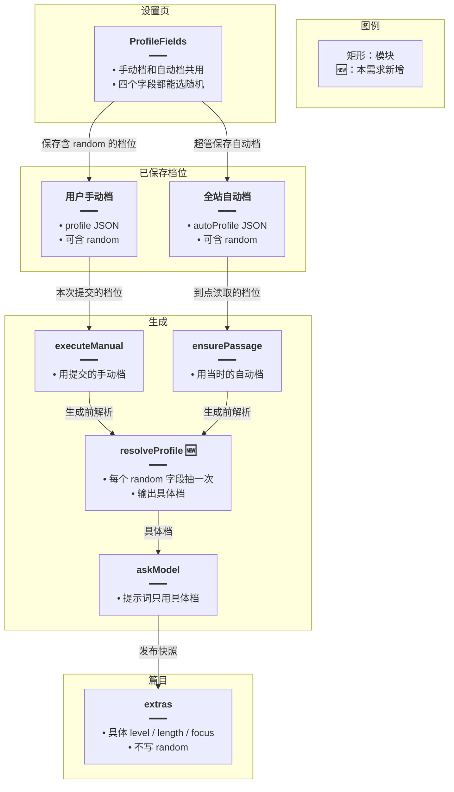
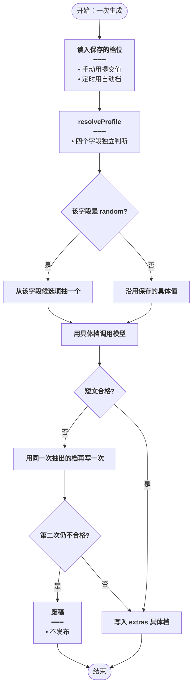
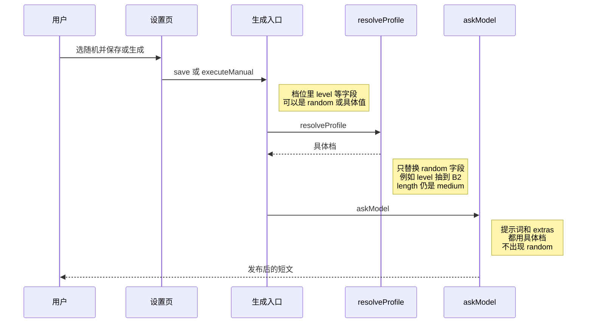
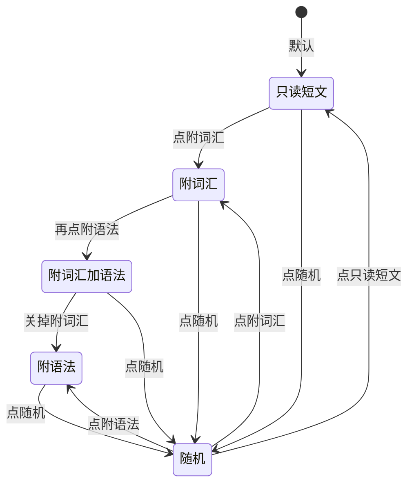

# 阅读档位随机 — 实现思路

> **状态**：已按本文落地  
> **日期**：2026-10-21  
> **需求摘要**：每日阅读的难度、篇幅、学习侧重、理解题各加「随机」；选中后每次生成再从该档的候选项里抽一项，已发布篇目不改。

## 延伸阅读

- [每日阅读超管配置.md](./每日阅读超管配置.md)：手动档与自动档分表保存
- [日推入队时刻.md](./日推入队时刻.md)：到点才入队，生成时才读自动档

---

## 0. 读本文你将得到什么

- 为什么「随机」必须留在设置里，而不是点一下就改成某一个具体档。
- 一句话方案：四个字段都能存 `random`；真正写提示词和 `extras` 之前抽一次具体值。
- 只改设置页四个选项和生成入口的档位解析；不改联网取材、不改 SSE、不改已发布正文。
- 两段落地：M1 后端认得并解析 `random`，M2 四个选项加上「随机」。
- 最大风险：学习侧重现在是组合开关，随机抽中的是四种结果之一，界面仍只亮「随机」。

---

## 1. 需求与边界

### 1.1 用户故事

| 角色 | 场景 | 行为 | 期望结果 |
|------|------|------|----------|
| 用户 | 手动生成配置 | 难度选「随机」，其余保持具体值，再生成 | 这一篇的难度是 A2 / B1 / B2 / C1 之一，篇幅仍是选定的那档 |
| 用户 | 再次手动生成 | 难度仍停在「随机」 | 再抽一次，可以和上一篇不同 |
| 超管 | 自动生成配置 | 四个档里任意几个选「随机」并保存 | 每个到点生成的发布日单独抽；没选随机的字段用保存值 |
| 用户 | 学习侧重选「随机」 | 生成一篇 | 从只读短文、附词汇、附语法、附词汇加语法里均匀抽一个 |
| 用户 | 理解题选「随机」 | 生成一篇 | 从不出题、2 题、3 题里均匀抽一个 |
| 用户 | 看已发布短文 | 事后把设置改成随机 | 旧篇 `extras` 仍是生成当时的具体档 |

### 1.2 范围

| 在范围内 | 不在范围内 |
|----------|------------|
| 手动档、自动档的难度、篇幅、学习侧重、理解题 | 联网取材、主题列表、入队整点 |
| 设置里持久保存「随机」 | 点随机后立刻改成某个具体档并清掉随机 |
| 每次生成独立抽取；同一次生成里的模型重试沿用这一次的结果 | 用发布日哈希把同一天钉死成同一个难度 |
| 提示词和 `extras` 只写抽中的具体值 | 把 `random` 写进已发布篇或提示词 |
| 中英文「随机」文案 | 新的 SSE 事件把抽中结果推回生成中的信息条 |

### 1.3 约束与依赖

- 手动档在 `english_daily_reading_user_settings.profile`，自动档在 `english_daily_reading_settings.autoProfile`。两边都是 JSON，加枚举值不用迁移。
- 生成读档的时刻不变：手动是提交那一刻的表单；自动是 `ensurePassage` 里的 `loadAutoSettings`。
- `extras.level` / `length` / `focus` 仍是具体档，详情和历史继续读这份快照。
- 默认档仍是 B1、中篇、只读短文、不出题。恢复默认会离开随机。

---

## 2. 方案总览（一句话 + 要点）

**一句话方案**：设置可以记住 `random`；`resolveProfile` 在调用模型前把标了随机的字段各抽一次，提示词和 `extras` 只用抽中的具体档。

| # | 设计要点 | 理由 |
|---|----------|------|
| 1 | 「随机」是保存值，不是一次性按钮 | 否则界面会跳到抽中的那一项，下一次生成不再随机 |
| 2 | 四个字段各自抽取 | 可以只随机难度，篇幅仍用中篇 |
| 3 | 学习侧重的随机池是四种结果，不是三个按钮 | 附词汇加语法今天没有单独按钮，但它是合法的 `both` |
| 4 | 只在 `ensurePassage` 和 `executeManual` 入口抽一次 | 同一次里的废稿重写不会中途换成另一个难度 |
| 5 | 界面选中「随机」时，学习侧重的三个开关全部不亮 | 避免看起来像已经选了某一组合 |

---

## 3. 现状与复用

| 能力 | 仓库中已有 | 本需求中的用法 |
|------|------------|----------------|
| 四档选项 UI | `dailyReading/components/ProfileFields.tsx`、`OptionRow.tsx` | 难度、篇幅、理解题各加一项；学习侧重旁加「随机」 |
| 侧重组合 | `dailyReading/utils/profile.ts` 的 `nextFocus` | 非随机时照旧；已是随机时，点具体开关直接离开随机 |
| 档位校验 | `daily-reading.rules.ts` 的 `normalizeProfile` | 扩展为认得 `random`；认不出的值仍回默认，避免整单失败 |
| 手动生成 | `executeManual` | 入口先 `resolveProfile`，再交给现有 `askModel` |
| 定时生成 | `ensurePassage` | 同样先解析自动档，再 `askModel` |
| 发布快照 | `finishReading` / `claim` 路径写入 `extras` | 只写入解析后的具体 `level` / `length` / `focus` |
| 主题按日期稳定抽取 | `themeForDate` | 不复用。随机档要每次不同，不能按日期取模 |

**调研结论**：提示词已经只吃具体的 `profile.level`、`length`、`focus`、`questions`。缺的是「设置里的随机」和「生成前的具体档」两层类型。若把 `random` 直接送进现有 `normalizeProfile`，它会被当成脏值改回 B1 或只读短文，随机会静默失效。

---

## 4. 架构图



**图内方法说明**：

| 方法 | 功能 |
|------|------|
| `resolveProfile(stored)` | 把仍为 `random` 的难度、篇幅、侧重、题数各均匀抽成一个具体值；没标随机的字段原样返回。手动生成和定时生成都只调用这一次 |
| `executeManual(...)` | 按用户这次提交的手动档写一篇；本需求里先解析再调用模型 |
| `ensurePassage(publishDate)` | 定时篇工人入口；读取自动档后先解析，再沿用现有抢行和写篇流程 |
| `askModel(...)` | 用具体档拼提示词。不能收到 `random`，否则难度会写成非法的 CEFR 等级 |

**读图要点**：

- 设置层只负责记住随机，不负责抽签。
- 手动档和自动档各走自己的生成入口，解析函数只有一个。
- `extras` 仍是具体档，详情页不用认识 `random`。

---

## 5. 主流程图



**图内方法说明**：

| 方法 | 功能 |
|------|------|
| `resolveProfile(stored)` | 一次生成只调用一次。后面的废稿重写必须复用它的返回值，避免同一篇前后两个难度 |
| `askModel(...)` | 现有模型调用。不合格时现有逻辑会再叫一次；两次都传入同一次解析结果 |

**读图要点**：

- 判断发生在每个字段上，不是整份档位要么全随机、要么全固定。
- 失败重试不重新抽签。下一次单独的生成才会再抽。
- 废稿不发布，因此也不会留下一份「随机」快照。

---

## 6. 核心时序图



**图内方法说明**：

| 方法 | 功能 |
|------|------|
| `resolveProfile(stored)` | 生成入口在调用模型前调用。返回值的类型就是今天的具体 `ReadingProfile`，下游不用改提示词分支 |
| `executeManual(...)` | 手动生成入口。定时路径换成 `ensurePassage`，解析步骤相同，所以时序不另画一条 |
| `askModel(...)` | 按具体档要短文和附件。发布时把同一份具体档写入 `extras` |

**读图要点**：

- 保存接口只原样记住 `random`，不在保存时抽签。
- 抽签发生在生成入口，所以手动和定时不会各写一套随机规则。
- 用户看到的已发布篇是抽中的结果；设置页仍显示「随机」。

---

## 7. 状态机

只描述学习侧重。另外三项是「具体值 / 随机」二态，点具体值即离开随机，不再单画。



**图内方法说明**：

| 方法 | 功能 |
|------|------|
| `nextFocus(current, key)` | 非随机时沿用：只读短文独占；附词汇和附语法可同时亮，同时亮则存 `both` |
| 随机态点击处理 | 已是 `random` 时不再调用 `nextFocus`。点只读、附词汇、附语法分别写成 `reading`、`vocab`、`grammar`，避免从隐藏的组合状态上反切 |

**读图要点**：

- 「附词汇加语法」仍不是第四个常驻按钮，只在两个开关同时亮，或被随机抽中时存在。
- 随机态下三个开关都不亮。再点随机保持随机，不退回只读短文。
- 从随机点「附词汇」只打开词汇，不会连着打开语法。

---

## 8. 模块职责与接口草图

### 8.1 模块一览

| 模块 | 职责 | 新增/改动 | 预估路径 |
|------|------|-----------|----------|
| 保存档类型 | 四个字段允许 `random` | 扩展 | `daily-reading.rules.ts`、前端 `EnglishDailyReadingProfile` |
| `normalizeProfile` | 校验时保留 `random` | 扩展 | `daily-reading.rules.ts` |
| `resolveProfile` | 生成前抽具体档 | 新增 | `daily-reading.rules.ts` |
| 生成入口 | 先解析再调用模型 | 扩展 | `english-daily-reading.service.ts` 的 `ensurePassage`、`executeManual` |
| 选项 UI | 加「随机」 | 扩展 | `ProfileFields.tsx`、`OptionRow.tsx` |
| 文案 | 中英文「随机」 | 新增键 | `zh-CN` / `en-US` 的 `englishLearning.ts` |

### 8.2 关键接口（伪代码或 TypeScript 草图）

```typescript
// 设置里允许随机；生成和 extras 仍用今天的具体 ReadingProfile
type StoredProfile = {
	// 随机难度从 A2、B1、B2、C1 抽
	level: ReadingLevel | 'random';
	// 随机篇幅从 short、medium、long 抽
	length: ReadingLength | 'random';
	// 随机侧重从 reading、vocab、grammar、both 抽
	focus: ReadingFocus | 'random';
	// 随机题数从 0、2、3 抽；用字符串以免和具体题数混淆
	questions: 0 | 2 | 3 | 'random';
	// 联网不参与随机
	useWeb: boolean;
};

// 每个标了 random 的字段均匀抽一次；具体字段保持原值
function resolveProfile(stored: StoredProfile): ReadingProfile {
	// 一次生成持有这份结果，废稿重写不能再抽
	return {
		// 未随机则原样，避免把用户选的 C1 覆盖掉
		level: stored.level === 'random' ? pick(LEVELS) : stored.level,
		// 篇幅与难度互不影响
		length: stored.length === 'random' ? pick(LENGTHS) : stored.length,
		// 池里含 both，对应附词汇加语法
		focus: stored.focus === 'random' ? pick(FOCUSES) : stored.focus,
		// 题数同样只在随机时替换
		questions: stored.questions === 'random' ? pick(QUESTION_COUNTS) : stored.questions,
		// 联网开关始终照设置
		useWeb: stored.useWeb,
	};
}
```

`pick` 用均匀随机，不用 `themeForDate` 那种按日期取模。

### 8.3 数据模型

| 字段 | 来源 | 存储 | 说明 |
|------|------|------|------|
| `profile` / `autoProfile` | 设置页 | JSON | 可含 `random`。旧数据没有该值，行为与现在相同 |
| `extras.level` / `length` / `focus` | `resolveProfile` 的结果 | 篇目行 | 只有具体档。理解题数量仍体现在 `extras.questions` 数组长度 |
| 默认档 | 现有 `DEFAULT_PROFILE` | 代码 | 不含随机。恢复默认即退出随机 |

---

## 9. 分阶段实现步骤

| 阶段 | 目标 | 交付物 | 依赖 |
|------|------|--------|------|
| M1 | 后端能保存并解析随机 | 类型、校验、生成入口 | 无 |
| M2 | 四个选项能选随机 | 设置页与文案 | M1 |

M1

- [x] `StoredProfile` 四个字段接受 `random`；`normalizeProfile` 不再把 `random` 收成 B1 / 中篇 / 只读 / 不出题。
- [x] 新增 `resolveProfile`。学习侧重的池是 `reading`、`vocab`、`grammar`、`both`。
- [x] `ensurePassage` 与 `executeManual` 在第一次 `askModel` 之前解析，废稿重写沿用同一次结果。
- [x] `extras` 只写具体档。

M2

- [x] 难度加「随机」，五个格子一排。篇幅、理解题加「随机」，四个格子一排。
- [x] 学习侧重在三个开关旁加「随机」。选中时三个开关不亮；从随机点具体开关时按 §7 离开随机。
- [x] 手动档和自动档都走 `ProfileFields`，两处一起生效。恢复默认回到具体默认档。
- [x] 中英文增加「随机」。生成中的信息条遇到 `random` 不把它显示成难度或篇幅。

---

## 10. 关键决策与备选方案

| 决策 | 选用 | 备选 | 为何不选备选 |
|------|------|------|--------------|
| 随机存在哪 | 设置 JSON 里的 `random` | 点一下就写成抽中的具体档 | 界面会离开随机，下一次生成不再抽 |
| 何时抽 | 每次生成入口抽一次 | 保存时抽，或按发布日取模 | 保存时抽等于只随机一次；按日期取模则同一天的手动篇和定时篇难度被钉死 |
| 侧重随机池 | 四种结果，含附词汇加语法 | 只在三个按钮里抽 | 用户明确要四种；`both` 已经是合法档 |
| 侧重界面 | 保留三个开关，另加随机 | 改成四个互斥按钮 | 现有「两个都亮」的组合会被拆掉 |
| 抽中结果何时可见 | 发布后的 `extras` | 生成中经 SSE 推回 | 信息条已能在没有具体档时留空，不必改流协议 |
| 字段关系 | 各自随机 | 一个总开关随机全部 | 用户要的是四个选项各自能随机 |

**评估**：把随机留在设置里、生成时再抽，手动篇和到点的定时篇都会变。若只在界面上掷一次骰子，自动档仍会每天写同一难度，和「系统随机选择一项」不符。

---

## 11. 风险、边界与待确认

| 项 | 等级 | 说明 | 缓解 |
|----|------|------|------|
| 校验把 random 吞掉 | 高 | 今天的 `normalizeProfile` 只接受具体枚举 | M1 先改校验，再放 UI |
| 难度五个按钮挤 | 中 | 左半列现在是四个 | 五项用五列；文案用「随机」，不写长句 |
| 侧重看起来像没选 | 低 | 随机时三个开关都不亮 | 「随机」本身为选中态 |
| 进行中信息条 | 低 | 提交值是 `random`，还没有 extras | 不显示该字段，完成后历史显示抽中值 |
| 旧篇 | 低 | 已发布 extras 是具体档 | 不回写 |

**待确认**：无。随机池、抽取时机、侧重的四种结果都按上面写死。

---

## 12. 验收清单

| # | 用例 | 步骤 | 期望 |
|---|------|------|------|
| AC1 | 只随机难度 | 难度选随机，篇幅选中篇，手动生成两篇 | 两篇篇幅都是中篇；难度各自是 A2 / B1 / B2 / C1 之一，设置仍显示随机 |
| AC2 | 侧重四种 | 学习侧重选随机，多次生成 | 只读、只附词汇、只附语法、词汇加语法都可能出现；设置上三个开关保持不亮 |
| AC3 | 理解题 | 理解题选随机 | 该篇题数是 0、2 或 3；其他档不变 |
| AC4 | 定时 | 自动档难度为随机，等到入队时刻 | 新发布日的 extras 是具体难度，不是 random |
| AC5 | 重试 | 同一篇第一次不合格并重写 | 两次模型请求的难度、篇幅、侧重、题数相同 |
| AC6 | 旧篇 | 改成随机后打开已发布篇 | 难度和篇幅仍是当初的具体值 |
| AC7 | 恢复默认 | 随机状态下恢复默认 | 回到 B1、中篇、只读短文、不出题 |

---

## 13. 预估改动面

| 类型 | 路径 |
|------|------|
| 后端 | `apps/backend/src/services/english-learning/daily-reading.rules.ts` |
| 后端 | `apps/backend/src/services/english-learning/english-daily-reading.service.ts` |
| 前端 | `apps/frontend/src/views/englishLearning/dailyReading/components/ProfileFields.tsx` |
| 前端 | `apps/frontend/src/views/englishLearning/dailyReading/components/OptionRow.tsx` |
| 前端 | `apps/frontend/src/views/englishLearning/dailyReading/utils/profile.ts` |
| 前端 | `apps/frontend/src/service/index.ts` |
| 文案 | `apps/frontend/src/i18n/locales/zh-CN/englishLearning.ts`、`en-US/englishLearning.ts` |

（已按本文落地；行为以源码为准）
